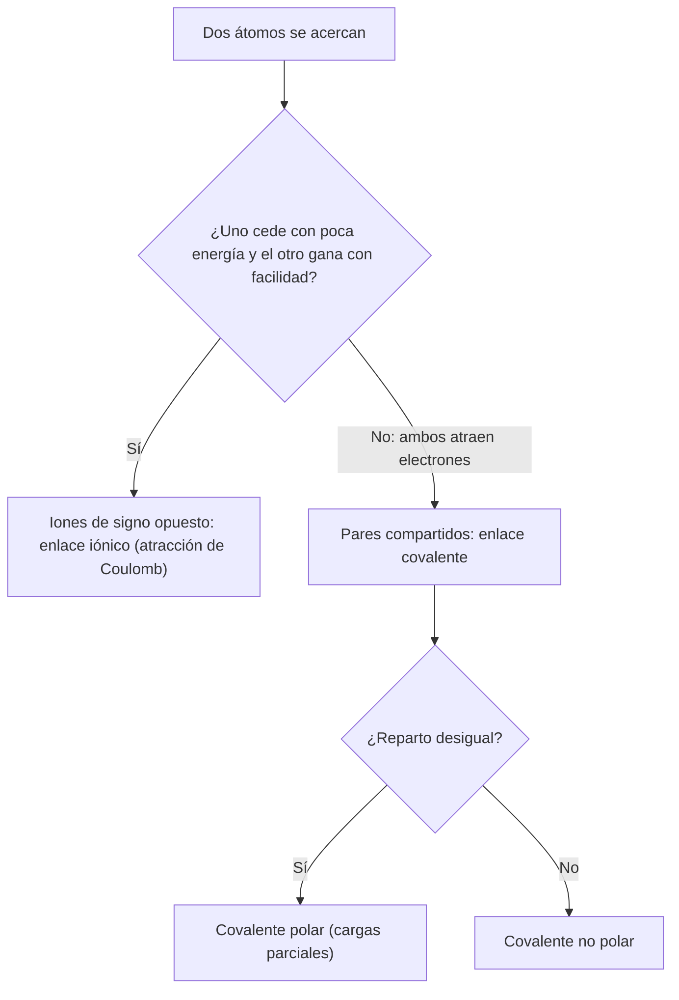

# B06-C04 — Enlaces iónicos y covalentes

<!-- nav:top -->
[🏠 Programa](../../../../README.md) · [📚 Bloque B06](../../../tronco-comun/B06-quimica-y-materia-del-universo.md) · [← Anterior: B06-C03 — Isótopos y masa atómica](../B06-C03-isotopos-y-masa-atomica/CLASE.md) · [Siguiente: B06-C05 — Moléculas y geometría molecular →](../../../tronco-comun/B06-quimica-y-materia-del-universo.md#b06-c05)
<!-- /nav -->

## 1. Ubicación, nivel y alcance

Cuarta clase del bloque B06. Ya sabes que los electrones externos de un átomo (C02) y la energía para arrancarlos (C01) explican su comportamiento. Aquí ves qué ocurre cuando dos átomos se encuentran: o uno cede electrones al otro y se atraen como cargas opuestas (enlace iónico), o los comparten (enlace covalente). Sigues en el nivel N1.

Verás cómo contar electrones de valencia, cómo estimar la energía de atracción entre dos iones con la ley de Coulomb, cómo se dibuja un enlace covalente como pares de electrones y por qué la frontera entre ambos tipos es un continuo. No verás geometría de moléculas (C05) ni energías de enlace medidas (C12).

## 2. Por qué esta clase existe

Las muestras del asteroide Bennu contienen amoníaco, pero en gran parte no como gas libre: los autores concluyen que la mayor parte probablemente quedó retenida como sales o ligada a minerales arcillosos y a materia orgánica, porque el amoníaco libre es muy volátil y se pierde (S1). Entre una molécula que se escapa y una sal que se queda hay una diferencia de enlace.

La decisión central es: **dados dos átomos o dos grupos de átomos, ¿qué tipo de enlace cabe esperar y cuánta energía lo sostiene frente a la agitación térmica?** Aprenderás a contar electrones de valencia, a dibujar estructuras sencillas y a estimar, con cargas puntuales, si una atracción electrostática resiste la temperatura. Prepara C05 (geometría), C15 (ácidos y bases) y C19 (minerales).

## 3. Lo que podrás hacer al terminar

1. Contar los electrones de valencia de un átomo, una molécula o un ion.
2. Explicar cuándo un átomo tiende a ceder, ganar o compartir electrones.
3. Distinguir enlace iónico, covalente y covalente polar con ejemplos.
4. Calcular la energía de Coulomb entre dos iones y compararla con `kT`.
5. Dibujar la estructura de Lewis de H₂O, NH₃, CO₂ y NH₄⁺ contando pares.
6. Redactar una ficha de enlace con supuestos y límites.

La evidencia es la **ficha de enlace** del ejercicio 12 (sección 20).

## 4. Con qué llegas y cómo comprobarlo

Necesitas C01, C02 y el cálculo con constantes en notación científica. Cinco preguntas:

1. ¿Cuántos electrones de valencia tiene el oxígeno? ¿Y el magnesio?
2. ¿Qué átomo se ioniza más fácil, el sodio (5,14 eV) o el neón (21,56 eV)?
3. Si algo es proporcional a 1/r, ¿qué pasa al duplicar r?
4. ¿Qué significa «cargas opuestas se atraen»?
5. ¿Cuánto es 1,44 dividido entre 0,25?

<details>
<summary>Ver respuestas</summary>

1. Seis; dos. 2. El sodio. 3. Se reduce a la mitad. 4. Que la energía de interacción es negativa (ligada) si las cargas tienen signo opuesto. 5. 5,76.
</details>

Con cuatro o cinco aciertos, sigue. Con tres o menos, repasa C01 y C02.

## 5. Un caso real: el amoníaco que no se escapó

Glavin y colaboradores (2025) midieron en las muestras de Bennu más carbono, nitrógeno y amoníaco que en las del asteroide Ryugu y que en la mayoría de los meteoritos. Entre sus resultados: la mayor parte del amoníaco habría estado retenida como sales o unida a arcillas o a materia orgánica; derivados como la metilamina (914 nmol/g) y la etilamina (121 nmol/g) dominan las aminas, y los ácidos fórmico (4106 nmol/g) y acético (1436 nmol/g) abundan, de modo que podrían ser los contraiones de sales de amonio (S1). También señalan que las sales de amonio podrían haber mantenido salmueras líquidas a temperaturas muy bajas (eutéctico NH₃–H₂O de 176 K).

Conviene separar los niveles: el amoníaco NH₃ es una molécula covalente; el ion amonio NH₄⁺, con el ion formiato, forma una sal, donde la atracción entre los iones es electrostática. Ten presente el límite: lo que aquí se calcula es una estimación de orden de magnitud con distancias ilustrativas; no se reproduce el análisis de los autores.

## 6. Vocabulario

Los **electrones de valencia** son los de la capa externa (C02). La **regla del octeto** dice que muchos átomos tienden a rodearse de ocho electrones; el hidrógeno, de dos. Un **ion** es un átomo o grupo con carga neta: un **catión** (positivo) pierde electrones; un **anión** (negativo) los gana. En un **enlace iónico** la atracción entre iones de signo opuesto mantiene la unión. En un **enlace covalente** dos átomos comparten uno o más **pares de electrones**: un par es enlace simple; dos, doble; tres, triple. Si los electrones se reparten de forma desigual, el enlace es **covalente polar**. Un **par solitario** es un par de valencia no compartido. La **estructura de Lewis** dibuja los átomos con sus pares de enlace y solitarios.

La **ley de Coulomb** da la energía de interacción entre dos cargas puntuales: `E = q₁q₂/(4π ε₀ r)`, con `ε₀` la permitividad del vacío (S2).

## 7. Modelo mental: ceder o compartir

Piensa en dos personas con una moneda cada una y un deseo de juntar dos. Si una tiene mucho interés en tener monedas (átomo que atrae electrones) y la otra puede cederlas con poco esfuerzo (átomo que se ioniza fácilmente), una se queda con las dos monedas y se atraen por tener signos opuestos. Si ambas las quieren por igual, las juntan y las usan en común.



*Descripción textual:* un árbol de decisión. Si un átomo cede electrones fácilmente y el otro los acepta, se forma un par de iones y la unión es iónica. Si ambos atraen electrones, los comparten (covalente); si el reparto es desigual, el enlace es polar.

La analogía de las monedas ilustra el contraste, pero tiene un límite importante: en la realidad no hay un «ceder» o «compartir» absolutos. Casi todos los enlaces tienen algo de ambos y se ordenan en un continuo; la clasificación es una herramienta, no una frontera de la naturaleza.

## 8. La explicación, paso a paso

### 8.1 Contar electrones de valencia

El número de electrones de valencia coincide con el número de grupo en los primeros periodos: hidrógeno 1, carbono 4, nitrógeno 5, oxígeno 6, cloro 7. La NIST confirma las configuraciones del oxígeno (`2s² 2p⁴`) y del magnesio (`[Ne] 3s²`) (S3). Para una molécula se suman las valencias de todos los átomos; para un ion se resta la carga positiva o se suma la negativa. H₂O: `2×1 + 6 = 8`; NH₃: `5 + 3 = 8`; CO₂: `4 + 2×6 = 16`; NH₄⁺: `5 + 4 − 1 = 8` (laboratorio, sección 17).

### 8.2 Enlace covalente: pares compartidos

Se reparten los electrones en pares, de modo que cada átomo (salvo H) tenga ocho a su alrededor. En H₂O hay 4 pares: dos de enlace (O–H) y dos solitarios sobre el oxígeno. En NH₃: tres de enlace y uno solitario. En CO₂ hay 8 pares: cuatro entre C y O en total (O=C=O, dos dobles enlaces) y los demás son solitarios en los oxígenos. Cada enlace es una región entre núcleos donde la densidad de electrones es alta y los mantiene unidos.

### 8.3 Enlace iónico: cargas que se atraen

Si un átomo tiene energía de ionización baja (sodio, 5,139 eV; magnesio, 7,646 eV, S3) y otro atrae electrones con facilidad, se forman iones. La interacción entre cargas puntuales `q₁` y `q₂` a distancia `r` es

```text
E = q₁ q₂ / (4π ε₀ r) = 1,43996 eV·nm × (q₁ q₂ / r[nm])
```

(el coeficiente sale de `e`, exacta, y de `ε₀ = 8,854 187 8188 × 10⁻¹² F/m`, S2). Para un par +1/−1 a una distancia **ilustrativa** de 0,25 nm resulta `−5,76 eV`: negativa porque están ligados. Con cargas +2/−2 a la misma distancia es cuatro veces mayor (`−23,04 eV`), porque la energía crece con el producto de las cargas.

### 8.4 ¿Resiste el enlace a la agitación térmica?

La energía térmica típica es `kT`: 25,85 meV a 300 K y 15,17 meV a 176 K. Un par con 5,76 eV de energía es unas 220 veces `kT` a 300 K; a esa temperatura la agitación casi nunca lo rompe. Esta estimación es un orden de magnitud: en medios con agua las cargas se apantallan y la energía efectiva es mucho menor, y en un cristal cada ion interacciona con muchos vecinos. Para un compuesto concreto hay que usar datos medidos.

### 8.5 Un continuo, no dos cajas

El enlace O–H del agua es covalente, pero el oxígeno atrae más a los electrones que el hidrógeno, por lo que cada hidrógeno queda con una carga parcial positiva y el oxígeno con una negativa. Al contrario, en una sal de amonio la unión entre iones es esencialmente electrostática, pero dentro de cada ion los enlaces N–H son covalentes. El mismo compuesto puede tener las dos clases de enlace.

## 9. Magnitudes, símbolos y unidades

| Símbolo | Qué es | Unidad | Valor o nota |
|---|---|---|---|
| `e` | carga elemental | C | 1,602 176 634 × 10⁻¹⁹ (exacta) |
| `ε₀` | permitividad del vacío | F/m | 8,854 187 8188 × 10⁻¹² (CODATA 2022) |
| `q` | carga del ion | e | +1, −1, +2… |
| `r` | distancia entre iones | nm | ilustrativa |
| `E` | energía de Coulomb | eV | `1,43996 q₁q₂ / r` |
| `kT` | energía térmica | eV | 25,85 meV a 300 K |
| `a₀` | radio de Bohr | m | 5,291 772 105 44 × 10⁻¹¹ |

## 10. Convenciones y referencias

La energía de interacción se toma cero para cargas infinitamente separadas, por lo que la atracción es negativa. En Lewis, cada raya es un par de enlace y cada par de puntos, un par solitario. Las distancias de 0,25 y 0,30 nm son **sintéticas** (ilustrativas), no distancias de un compuesto. Las constantes son de la edición CODATA 2022.

## 11. De dónde sale lo que afirmamos

| ID | Fuente | Localizador | Respalda | Estado |
|---|---|---|---|---|
| S1 | D. P. Glavin et al., *Nature Astronomy* (2025), doi:10.1038/s41550-024-02472-9 | PDF de NASA NTRS, doc. 20250001355 | Amoníaco retenido como sales o ligado a arcillas/orgánicos; aminas y ácidos carboxílicos (nmol/g); eutéctico NH₃–H₂O de 176 K | PDF leído el 2026-11-05 (extracción con PyMuPDF) |
| S2 | NIST, *CODATA Recommended Values* (2022): `ε₀`, `e`, `Ry·hc`, `a₀` | https://physics.nist.gov/cgi-bin/cuu/Value?ep0 (y `?e`, `?rydhcev`, `?bohrrada0`) | Constantes y su exactitud | Páginas consultadas el 2026-11-05 |
| S3 | NIST, *Atomic Spectra Database* v5.12, energías de ionización | https://physics.nist.gov/cgi-bin/ASD/ie.pl | Na 5,139 eV; Mg 7,646 eV; configuración del O y del Mg | Consulta del 2026-11-05 |

Límites: la clasificación de enlaces y el conteo de Lewis son explicación nuestra. No se consultó ninguna tabla de electronegatividad (no se pudo abrir la fuente de la IUPAC), por lo que la clase evita cifras de electronegatividad. Las distancias son sintéticas.

## 12. Cómo ver los enlaces

Esta tabla es la versión accesible de un esquema de Lewis.

| Especie | Electrones de valencia | Pares | Enlaces | Pares solitarios |
|---|---|---|---|---|
| H₂O | 8 | 4 | 2 (O–H) | 2 en O |
| NH₃ | 8 | 4 | 3 (N–H) | 1 en N |
| CO₂ | 16 | 8 | 2 dobles (O=C=O) | 2 en cada O |
| NH₄⁺ | 8 | 4 | 4 (N–H) | 0 |

Si dibujas Lewis, representa cada par de enlace por una raya y cada par solitario por dos puntos, y añade el nombre del átomo; no uses sólo color. Descripción larga: en NH₄⁺ los cuatro pares están compartidos con los hidrógenos; en NH₃ queda uno solitario, que es lo que le permite ligarse a un protón y formar amonio.

## 13. Ejemplo trabajado: ¿resiste el par de iones a 176 K?

**Pregunta:** un par catión +1 / anión −1 a 0,30 nm (**distancia sintética**), ¿resiste la agitación térmica a 176 K, la temperatura del eutéctico NH₃–H₂O (S1)?

**Paso 1 · Coeficiente de Coulomb.** `e²/(4π ε₀) = 1,43996 eV·nm` (S2).

**Paso 2 · Energía.** `E = −1,43996/0,30 = −4,80 eV`.

**Paso 3 · Energía térmica.** `kT = 1,380649 × 10⁻²³ J/K × 176 K / 1,602 177 × 10⁻¹⁹ J/eV = 0,01517 eV`.

**Paso 4 · Cociente.** `4,80/0,01517 = 316`.

**Paso 5 · Corrección por el medio.** En agua líquida las cargas se apantallan y la energía efectiva baja de forma notable; la cifra vale como cota superior del vacío, no como energía de disociación en disolución.

**Sentido físico.** En vacío el par resiste con mucho margen la agitación a 176 K. Eso no demuestra que una sal «sea estable» en una salmuera; muestra que la atracción electrostática es lo bastante intensa para explicar que el amonio quede retenido en un sólido, en lugar de escapar como gas.

## 14. Dos formas de ver un enlace

El modelo **iónico** (cargas puntuales) da una estimación sencilla de la energía y explica sólidos de iones; el modelo **covalente** (pares de Lewis) explica la composición de moléculas y cuántos enlaces forma cada átomo. Ninguno da energías de enlace precisas; para eso se usan datos medidos (C12). Usa Coulomb cuando haya iones bien definidos y Lewis cuando hayan átomos compartiendo electrones; en muchos compuestos hace falta ambos, como en el formiato de amonio.

## 15. Práctica guiada

**Ejercicio 1 · con los pasos indicados.** Dibuja la estructura de Lewis del amoníaco. *Pasos:* cuenta los electrones de valencia y reparte en pares (sección 8.1 y 8.2).

<details><summary>Solución comentada</summary>

`5 + 3 = 8` electrones, 4 pares: tres pares de enlace N–H y un par solitario en el nitrógeno. Si te sobra un hidrógeno con un par solitario, cada H sólo admite un enlace (dos electrones).
</details>

**Ejercicio 2 · con una pista.** ¿Cuántos pares solitarios tiene el oxígeno del agua? *Pista:* 4 pares en total, dos de enlace.

<details><summary>Solución comentada</summary>

Dos pares solitarios. El oxígeno queda con ocho electrones a su alrededor: cuatro de enlace y cuatro solitarios.
</details>

**Ejercicio 3 · casi autónomo.** Calcula la energía de Coulomb entre +1 y −1 a 0,25 nm (distancia ilustrativa).

<details><summary>Solución comentada</summary>

`E = −1,43996/0,25 = −5,76 eV`. El signo es negativo porque las cargas son opuestas.
</details>

## 16. Práctica autónoma, transferencia e integrador

**Ejercicio 4.** ¿Cómo cambia la energía si la distancia pasa de 0,20 a 0,40 nm?

<details><summary>Solución comentada</summary>

Es proporcional a `1/r`: al doble de distancia, la mitad de energía. `−7,20 eV` pasa a `−3,60 eV`.
</details>

**Ejercicio 5.** Cuenta los pares y dibuja el CO₂.

<details><summary>Solución comentada</summary>

`4 + 2×6 = 16` electrones, 8 pares. O=C=O: dos dobles enlaces (4 pares) y dos pares solitarios en cada oxígeno (4 pares). El carbono queda con ocho electrones.
</details>

**Ejercicio 6.** Compara la energía del par del ejercicio 3 con `kT` a 300 K (25,85 meV).

<details><summary>Solución comentada</summary>

`5,76/0,02585 = 223`. La energía de enlace es unos dos cientos de veces la térmica, así que a temperatura ambiente el par no se rompe por agitación (en vacío; ver sección 8.4).
</details>

**Ejercicio 7.** Comprueba que `e²/(4π ε₀ a₀)` vale el doble de la energía de ionización del hidrógeno (2 Ry).

<details><summary>Solución comentada</summary>

`1,43996 eV·nm / 0,0529177 nm = 27,211 eV`, y `2 × 13,6057 = 27,211 eV`. Es una buena comprobación de que las constantes y la fórmula están bien usadas, y vincula esta clase con el átomo de C01.
</details>

**Ejercicio 8.** Un par Mg²⁺/O²⁻ y un par +1/−1 están a la misma distancia. ¿Cuánto mayor es la energía del primero?

<details><summary>Solución comentada</summary>

El producto de las cargas pasa de 1 a 4: cuatro veces mayor. Esto explica por qué los sólidos de iones con dos cargas son más resistentes. Mg cede dos electrones porque su configuración es `[Ne] 3s²` (S3).
</details>

**Ejercicio 9 · transferencia.** Con la sección 5, explica por qué el amoníaco libre se pierde y el amonio de una sal no.

<details><summary>Solución comentada</summary>

El NH₃ es una molécula pequeña sin carga neta, muy volátil: sus interacciones con otras moléculas son débiles y escapa con facilidad. En una sal, el NH₄⁺ está unido electrostáticamente a un anión (por ejemplo formiato) en un sólido; para escapar tendría que romper una atracción de varios eV. Los autores proponen que el amoníaco de Bennu permaneció en gran parte en esa forma (S1).
</details>

**Ejercicio 10 · transferencia.** Explica con las energías de ionización por qué el sodio (5,139 eV) tiende a formar iones y el neón (21,565 eV) no.

<details><summary>Solución comentada</summary>

Al sodio le basta poca energía para soltar su único electrón externo; el neón tiene la capa llena y arrancarle un electrón cuesta más de cuatro veces más. Una diferencia así decide la química (C02).
</details>

**Ejercicio 11 · transferencia.** Una afirmación dice: «los enlaces iónicos y covalentes son dos clases separadas». Matízala con el agua y el formiato de amonio.

<details><summary>Solución comentada</summary>

El agua tiene enlaces covalentes polares (un reparto desigual de electrones que da cargas parciales). El formiato de amonio tiene enlaces covalentes dentro de cada ion y una unión iónica entre ellos. Son extremos de un continuo y un compuesto puede combinar ambos.
</details>

**Ejercicio 12 · integrador.** Elabora la *ficha de enlace* (sección 20) para el formiato de amonio (NH₄⁺ HCOO⁻): electrones de valencia de cada ion, estructuras, tipo de enlace dentro y entre iones, energía de Coulomb a una distancia ilustrativa declarada y su cociente con `kT` a 176 K, y los supuestos y límites.

<details><summary>Solución modelo</summary>

NH₄⁺: 8 electrones, 4 pares N–H (covalentes). HCOO⁻: `1 + 4 + 12 + 1 = 18` electrones, 9 pares. Entre iones: electrostático. Con 0,30 nm (sintético): `−4,80 eV`, `316 kT` a 176 K. Supuestos: cargas puntuales en el vacío, sin apantallamiento; el límite es que da una cota superior y no una energía real en disolución. Se acepta cualquier distancia siempre que se declare ilustrativa.
</details>

## 17. Laboratorio: Coulomb y conteo de Lewis

El script [enlaces.py](enlaces.py) calcula la energía de Coulomb entre iones, `kT` y los electrones de valencia y pares de H₂O, NH₃, CO₂ y NH₄⁺. Antes de imprimir comprueba que la energía a un radio de Bohr es 1 hartree (2 Ry), que la energía escala como `1/r` y `q₁q₂`, que cargas opuestas dan energía negativa y los conteos de Lewis conocidos; si falla, se detiene.

**Datos:** publicados (CODATA 2022); distancias **sintéticas**. **Predice antes de ejecutar:** ¿cuántos eV a 0,25 nm? (cerca de −5,8). **Resultados (2026-11-05, Python 3.12.9):** `e²/(4π ε₀) = 1,43996 eV·nm`; 27,2114 eV a un radio de Bohr (2 Ry = 27,2114 eV); −5,760 eV a 0,25 nm; −4,800 eV a 0,30 nm; −23,039 eV (+2/−2) a 0,25 nm; `kT` = 15,17 meV a 176 K y 25,85 meV a 300 K; electrones de valencia: H₂O 8, NH₃ 8, CO₂ 16, NH₄⁺ 8.

```bash
python programa/clases/B06/B06-C04-enlaces-ionicos-y-covalentes/enlaces.py
```

**Límites:** cargas puntuales en el vacío; sin repulsión de corto alcance, sin red cristalina, sin disolvente. No sirve para predecir energías de compuestos reales.

## 18. Errores frecuentes y cómo corregirlos

**Olvidar restar o sumar la carga del ion al contar electrones.** Se corrige con el ejercicio 1 y la sección 8.1.

**Confundir par de enlace con par solitario.** Se corrige con el ejercicio 2.

**Tomar la energía de Coulomb como positiva.** Cargas opuestas dan energía negativa; se corrige con el ejercicio 3.

**Aplicar la energía del vacío a una disolución.** Se corrige con la sección 13.

**Decir que un compuesto es «sólo iónico» o «sólo covalente».** Se corrige con el ejercicio 11.

## 19. Cómo sabrás que vas bien

Tras 8.1: ¿puedes contar los electrones de valencia del CO₂ sin ayuda? Si no, haz el ejercicio 5. Tras 8.3: ¿cómo cambia la energía con la carga y la distancia? Si dudas, haz los ejercicios 4 y 8. Tras 8.4: ¿comparar con `kT` qué te dice? Si no lo sabes, repite el ejercicio 6. Tras 8.5: ¿puedes citar un compuesto con ambos tipos de enlace? Si no, haz el ejercicio 11. Tras el laboratorio: ¿qué comprueba el script con el hartree? Si no lo recuerdas, lee su cabecera.

## 20. Qué entregas y cómo se evalúa

El producto es tu **ficha de enlace**: una página con el conteo de electrones, las estructuras de Lewis, el tipo de enlace dentro y entre las especies, una energía de Coulomb comparada con `kT` y los supuestos y límites.

| Criterio | Inicial | En desarrollo | Logrado | Destacado |
|---|---|---|---|---|
| Conteo de electrones | Con errores | Correcto con ayuda | Correcto con carga | Verifica con ejemplos conocidos |
| Lewis | No lo dibuja | Incompleto | Completo y descrito | Muestra alternativas |
| Energía de Coulomb | No calcula | Con errores de unidad | Correcta con signo | Compara con `kT` |
| Distinción de enlace | Binaria | Con ejemplo | Continuo explicado | Aplica a un compuesto mixto |
| Supuestos y fuentes | Ausentes | Parciales | Completos | Declara qué es sintético |

**Condiciones críticas:** no presentar una distancia sintética como medida; no extrapolar la energía del vacío a una disolución; citar sólo fuentes consultadas.

## 21. Ética, seguridad y límites

La clase es un cálculo sobre papel: no incluye experimentos. Si luego realizas prácticas con sales o ácidos, hazlo sólo con material autorizado, gafas, guantes y supervisión; muchos compuestos de nitrógeno y amoníaco concentrado son irritantes, y esta clase no describe síntesis ni manipulación. Alternativa sin reactivos: visualizar modelos moleculares en pantalla o con piezas de construcción. Accesibilidad: fórmulas en texto, Lewis descrito, tablas equivalentes, sin dependencia de color.

## 22. Para cerrar y seguir

Los átomos se unen cediendo o compartiendo electrones; la ley de Coulomb permite estimar cuánta energía sostiene una unión iónica frente a `kT`, y las estructuras de Lewis cuentan los pares de un enlace covalente. En la práctica ambos tipos se mezclan. En la próxima clase se estudia cómo los átomos unidos se ordenan en el espacio: la forma de una molécula.

**Glosario español–inglés.** enlace iónico · *ionic bond*; enlace covalente · *covalent bond*; electrones de valencia · *valence electrons*; regla del octeto · *octet rule*; par solitario · *lone pair*; catión · *cation*; anión · *anion*; ley de Coulomb · *Coulomb's law*.

**Continuidad.** B06-C05 usa los pares de electrones para predecir la geometría de las moléculas. B06-C15 retoma los iones en las disoluciones de ácidos y bases.

**Referencias:** ver sección 11. S1 a S3 son consultas del 2026-11-05; las distancias son sintéticas.

<!-- nav:bottom -->
---

[← Anterior: B06-C03 — Isótopos y masa atómica](../B06-C03-isotopos-y-masa-atomica/CLASE.md) · [📚 Bloque B06](../../../tronco-comun/B06-quimica-y-materia-del-universo.md) · [Siguiente: B06-C05 — Moléculas y geometría molecular →](../../../tronco-comun/B06-quimica-y-materia-del-universo.md#b06-c05)
<!-- /nav -->
