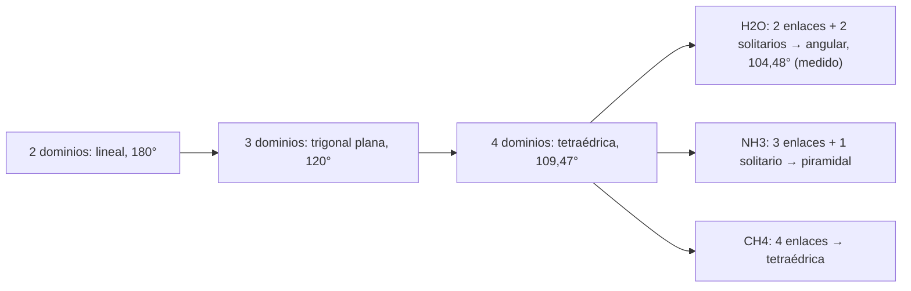

# B06-C05 — Moléculas y geometría molecular

<!-- nav:top -->
[🏠 Programa](../../../../README.md) · [📚 Bloque B06](../../../tronco-comun/B06-quimica-y-materia-del-universo.md) · [← Anterior: B06-C04 — Enlaces iónicos y covalentes](../B06-C04-enlaces-ionicos-y-covalentes/CLASE.md) · [Siguiente: B06-C06 — Cantidad de sustancia y mol →](../B06-C06-cantidad-de-sustancia-y-mol/CLASE.md)
<!-- /nav -->

## 1. Ubicación, nivel y alcance

Quinta clase del bloque B06 y cierre de su primer tramo. En C04 contaste los pares de electrones de una molécula. Aquí das el paso siguiente: esos pares se repelen y por eso los átomos adoptan una forma en el espacio. Esa forma decide si una molécula es polar, cómo se pega a otras y qué colores absorbe. Sigues en el nivel N1.

Verás cómo predecir la forma con los pares de electrones (modelo de repulsión de pares), cómo calcular un ángulo de enlace a partir de coordenadas, qué significa que una molécula sea polar y por qué el agua y el dióxido de carbono, con la misma fórmula de tres átomos, se comportan tan distinto. No verás orbitales ni cálculos cuánticos de geometría (B31).

## 2. Por qué esta clase existe

El dióxido de carbono es el 95,1 % de la atmósfera de Marte en volumen (S2), y los hielos de las nubes densas del medio interestelar contienen, según un estudio con el telescopio James Webb, agua y CO₂ entre otras especies (S3, que se leyó sólo en resumen). Las dos tienen tres átomos, pero una es lineal y la otra angular, y de esa diferencia depende que el agua sea un líquido tan especial y el CO₂ no.

La decisión central es: **dada una fórmula química, ¿qué forma tiene la molécula, es polar, y cuánto puedo confiar en esa predicción comparada con la medida?** Aprenderás a contar dominios de electrones, a predecir una forma, a calcular un ángulo desde coordenadas y a comparar el modelo ideal con un valor experimental. Prepara C10 (estados), C11 (fases) y C17 (espectros).

## 3. Lo que podrás hacer al terminar

1. Contar dominios de electrones alrededor de un átomo central y predecir la geometría.
2. Distinguir geometría electrónica de forma molecular.
3. Calcular un ángulo y una distancia entre átomos desde coordenadas cartesianas.
4. Comparar un ángulo ideal con uno medido y explicar la diferencia.
5. Decidir si una molécula es polar sumando vectores de enlace.
6. Redactar una ficha geométrica con valores medidos, ideales y sus fuentes.

La evidencia es la **ficha geométrica de una molécula** del ejercicio 12 (sección 20).

## 4. Con qué llegas y cómo comprobarlo

Necesitas C04 (pares de enlace y solitarios), trigonometría básica (seno, coseno) y suma de vectores. Cinco preguntas:

1. ¿Cuántos pares de enlace y solitarios tiene el H₂O?
2. ¿Cuánto vale `cos 60°`? ¿Y `sen 30°`?
3. ¿Cuánto da la suma de los vectores (1, 0) y (−1, 0)?
4. Si dos vectores unitarios forman 120°, ¿la suma es mayor o menor que 1?
5. ¿Qué es un ángulo de 180°?

<details>
<summary>Ver respuestas</summary>

1. Dos de enlace y dos solitarios. 2. 0,5; 0,5. 3. (0, 0). 4. Es exactamente 1 (sale un triángulo equilátero). 5. Una línea recta.
</details>

Con cuatro o cinco aciertos, sigue. Con tres o menos, repasa C04.

## 5. Un caso real: tres átomos, dos mundos

El agua y el CO₂ tienen tres átomos cada una. La base de datos de química computacional de la NIST registra para el agua una distancia O–H de 0,958 Å y un ángulo H–O–H de 104,4776° ± 0,0019°, medidos por espectroscopia (S1). En cambio, el CO₂ es lineal: sus tres átomos están en línea recta a 180°. Con esa diferencia, el agua tiene un lado más positivo y otro más negativo; el CO₂ está equilibrado.

Ten presente el límite: esta clase usa el modelo de repulsión de pares, que da formas ideales y no distancias; los números medidos vienen de la base de datos, no del modelo.

## 6. Vocabulario

Un **dominio de electrones** es una región alrededor del átomo central donde hay electrones: cada enlace (simple, doble o triple) cuenta como uno, y cada par solitario también. El **modelo de repulsión de pares de valencia** (VSEPR, por sus siglas en inglés) dice que los dominios se colocan lo más lejos posible entre sí. La **geometría electrónica** describe cómo se distribuyen todos los dominios; la **forma molecular** describe sólo dónde están los átomos. Las formas básicas son **lineal** (2 dominios, 180°), **trigonal plana** (3, 120°) y **tetraédrica** (4, 109,47°). Con pares solitarios aparecen la forma **angular** (como el agua) y la **piramidal** (como el amoníaco).

Un **dipolo de enlace** es el desplazamiento de carga en un enlace polar, representado como un vector. Una molécula es **polar** si la suma de esos vectores no es cero.

## 7. Modelo mental: globos atados

Imagina globos atados por un nudo central: se empujan entre sí y se acomodan lo más lejos posible. Con dos globos quedan en línea; con tres, en un triángulo plano; con cuatro, en un tetraedro. Si uno de los globos es «más gordo» (un par solitario ocupa más lugar que un enlace), empuja más a los vecinos y les cierra el ángulo.



*Descripción textual:* una cadena de formas ideales con el número de dominios creciente; los casos con cuatro dominios se bifurcan según cuántos sean pares solitarios: agua (dos), amoníaco (uno) y metano (ninguno).

La analogía de los globos ilustra la repulsión; su límite es que los dominios no son globos sino regiones de densidad electrónica, y que la «gordura» extra de los pares solitarios es una descripción cualitativa del modelo, no una medida.

## 8. La explicación, paso a paso

### 8.1 Contar dominios

Se cuenta en el átomo central: un dominio por cada átomo ligado (sea el enlace simple, doble o triple) más uno por cada par solitario. CO₂: el carbono tiene dos enlaces dobles y ningún par solitario, es decir, 2 dominios. H₂O: el oxígeno tiene dos enlaces y dos pares solitarios, 4 dominios. NH₃: tres enlaces y un par, 4. CH₄: cuatro enlaces, 4. Ion carbonato CO₃²⁻ (que verás en C19): el carbono central tiene 3 átomos de oxígeno y ningún par solitario, 3 dominios.

### 8.2 De los dominios a la forma

Con 2 dominios, la forma es lineal (180°). Con 3 sin pares solitarios, trigonal plana (120°). Con 4, la geometría electrónica es tetraédrica; si todos son enlaces, la forma también lo es (109,47°); si hay un par solitario, la forma es piramidal; si hay dos, angular. El ángulo tetraédrico ideal sale de la geometría: es `arccos(−1/3) = 109,4712°`, el que forman dos vértices de un tetraedro regular con su centro (el laboratorio lo comprueba).

### 8.3 Coordenadas y ángulos

Un ángulo entre tres átomos `A–B–C` se calcula con vectores: `cos θ = (u·v)/(|u||v|)`, donde `u` va de B a A y `v`, de B a C. Con el oxígeno del agua en el origen, los hidrógenos quedan en `(±r sen(θ/2), r cos(θ/2))`. Con `r = 0,958 Å` y `θ = 104,4776°`, la distancia H–H es `2 r sen(θ/2) = 1,5147 Å` (S1; cálculo del laboratorio). Si invierto el cálculo con las coordenadas, recupero el ángulo de partida, que es una buena prueba de que las fórmulas están bien.

### 8.4 Ideal frente a medido

El tetraedro ideal da 109,47° y el agua mide 104,48°: cinco grados menos. El modelo lo explica diciendo que los pares solitarios repelen más que los de enlace y cierran el ángulo. Pero el modelo no calcula 104,48°: sólo anticipa el sentido de la desviación. Para el valor se usa la medida (S1), cuya incertidumbre es de ±0,0019°.

### 8.5 Polaridad por simetría

Si cada enlace tiene un dipolo de la misma magnitud, la suma depende sólo de la geometría. En el CO₂ lineal, los dos vectores se anulan: molécula no polar. En el metano tetraédrico, los cuatro vectores unitarios suman cero. En el agua angular con 104,48°, la suma tiene módulo `2 cos(52,24°) = 1,2247` (en unidades del dipolo de enlace): molécula polar. Este cálculo es una comparación geométrica; no da el momento dipolar real, que requiere medidas.

## 9. Magnitudes, símbolos y unidades

| Símbolo | Qué es | Unidad | Valor o nota |
|---|---|---|---|
| `θ` | ángulo de enlace | grados | H–O–H = 104,4776° ± 0,0019° (S1) |
| `r` | distancia de enlace | Å (10⁻¹⁰ m) | O–H = 0,958 Å (S1) |
| `θ_tetra` | ángulo tetraédrico ideal | grados | `arccos(−1/3) = 109,4712°` |
| dominios | enlaces + pares solitarios | — | 2, 3 o 4 |
| `|μ_neto|` | suma de dipolos de enlace unitarios | — | H₂O 1,2247; CO₂ 0 |

## 10. Convenciones y referencias

Las distancias de enlace se dan en ångström (1 Å = 0,1 nm). Los ángulos, en grados. Las coordenadas del laboratorio usan el átomo central en el origen y la molécula en un plano. Las formas ideales (lineal, tetraédrica) son modelos y se rotulan como tales; el valor del agua es un dato **medido** (experimental) tomado de la base de datos de la NIST.

## 11. De dónde sale lo que afirmamos

| ID | Fuente | Localizador | Respalda | Estado |
|---|---|---|---|---|
| S1 | NIST CCCBDB, Release 22 (mayo 2022), SRD 101, geometría experimental del H₂O (Hoy y Bunker, *J. Mol. Spectrosc.* 74, 1, 1979) | https://cccbdb.nist.gov/exp2x.asp?casno=7732185 | r(O–H) = 0,958 Å; H–O–H = 104,4776° ± 0,0019° | Página consultada el 2026-11-05 |
| S2 | NASA NSSDC, *Mars Fact Sheet* (act. 19-may-2025) | https://nssdc.gsfc.nasa.gov/planetary/factsheet/marsfact.html | CO₂ 95,1 % de la atmósfera marciana (en volumen) | Página consultada el 2026-11-05 |
| S3 | M. K. McClure et al., «An Ice Age JWST inventory of dense molecular cloud ices», *Nature Astronomy* 7, 431 (2023), doi:10.1038/s41550-022-01875-w | arXiv:2301.09140 (resumen vía API de arXiv) | Hielos con especies variadas (incluido CO₂) en nubes densas; 2–19 % de los presupuestos de C, O, N, S | Sólo resumen, consultado el 2026-11-05 |

Límites: S3 se leyó sólo en resumen, por lo que no se afirma nada del contenido del artículo más allá de lo que dice el resumen (no se afirma cuál es el hielo más abundante). El modelo VSEPR y la comparación de dipolos son explicación nuestra.

## 12. Cómo ver la forma

Esta tabla es la versión accesible de un esquema de moléculas.

| Molécula | Dominios | Pares solitarios | Forma | Ángulo | Polar |
|---|---|---|---|---|---|
| CO₂ | 2 | 0 | lineal | 180° | no |
| CO₃²⁻ | 3 | 0 | trigonal plana | 120° (ideal) | no |
| CH₄ | 4 | 0 | tetraédrica | 109,47° (ideal) | no |
| NH₃ | 4 | 1 | piramidal | menor que 109,47° | sí |
| H₂O | 4 | 2 | angular | 104,48° (medido) | sí |

Si dibujas una molécula en 3D, indica con cuñas o líneas discontinuas lo que sale del plano y rotula cada ángulo con su tipo (ideal o medido). Descripción larga: en la fila del agua, los dos hidrógenos y el oxígeno forman una «V» de unos 104°; en la del CO₂, una recta.

## 13. Ejemplo trabajado: el agua, del modelo a las coordenadas

**Dato (medido, S1):** `r = 0,958 Å`, `θ = 104,4776°`.

**Paso 1 · Dominios.** O central con 2 enlaces y 2 pares solitarios: 4 dominios. Geometría electrónica tetraédrica; forma angular.

**Paso 2 · Ángulo ideal.** Tetraedro: `arccos(−1/3) = 109,4712°`.

**Paso 3 · Diferencia con la medida.** `109,4712 − 104,4776 = 4,99°`. El modelo anticipa un ángulo menor que el ideal; la medida dice cuánto.

**Paso 4 · Coordenadas.** `θ/2 = 52,2388°`; `sen = 0,79062`, `cos = 0,61230`. H₁ = (0,7574; 0,5866) Å y H₂ = (−0,7574; 0,5866) Å, con O en (0, 0).

**Paso 5 · Distancia H–H.** `2 × 0,7574 = 1,5147 Å`.

**Paso 6 · Polaridad.** Suma de dos vectores unitarios con ángulo 104,48°: `2 cos(52,24°) = 1,2247`. Distinto de cero: polar.

**Sentido físico.** El cálculo muestra por qué las moléculas de agua se orientan entre sí y por qué la forma es una pieza central del comportamiento del hielo y del agua líquida (C10, C11). Lo ideal es el punto de partida; lo medido es el dato.

## 14. Dos formas de conocer una geometría

Puedes **predecirla** con VSEPR (rápido, cualitativo, sin números exactos) o **tomarla de una medida** como la de la NIST (precisa, pero sólo para moléculas ya estudiadas). La predicción sirve cuando no hay dato o para anticipar tendencias; la medida es la que se usa en un cálculo serio. Una buena práctica es dar ambos y declarar cuál es cuál.

## 15. Práctica guiada

**Ejercicio 1 · con los pasos indicados.** Predice la forma del CO₂. *Pasos:* cuenta dominios del carbono (sección 8.1) y aplica la sección 8.2.

<details><summary>Solución comentada</summary>

El carbono tiene dos enlaces dobles y ningún par solitario: 2 dominios, forma lineal, 180°. Cada doble enlace cuenta como un solo dominio; si contaste 4, contaste los enlaces en lugar de los dominios.
</details>

**Ejercicio 2 · con una pista.** ¿Qué forma tiene el NH₃? *Pista:* 3 enlaces y 1 par solitario.

<details><summary>Solución comentada</summary>

4 dominios, geometría electrónica tetraédrica y forma piramidal (el par solitario ocupa el cuarto vértice). Es polar.
</details>

**Ejercicio 3 · casi autónomo.** Calcula el ángulo ideal entre dos enlaces de un tetraedro con `cos θ = −1/3`.

<details><summary>Solución comentada</summary>

`arccos(−1/3) = 109,47°`. Se obtiene, por ejemplo, de los vértices (1,1,1) y (1,−1,−1): producto escalar −1, módulos √3 cada uno, `cos θ = −1/3`.
</details>

## 16. Práctica autónoma, transferencia e integrador

**Ejercicio 4.** Predice la forma del CH₄ y di si es polar.

<details><summary>Solución comentada</summary>

4 enlaces, 0 pares solitarios: tetraédrica, 109,47°. Los cuatro dipolos de enlace iguales se anulan: no polar (el laboratorio comprueba que la suma vale 0).
</details>

**Ejercicio 5.** Con `r = 0,958 Å` y `θ = 104,4776°`, calcula la distancia H–H del agua.

<details><summary>Solución comentada</summary>

`2 × 0,958 × sen(52,2388°) = 1,916 × 0,79062 = 1,5147 Å`. Si te dio 1,916, olvidaste el seno (sería el valor si los dos H estuvieran alineados con el O a 180°).
</details>

**Ejercicio 6.** Calcula el módulo de la suma de dos vectores unitarios que forman un ángulo de 104,48°.

<details><summary>Solución comentada</summary>

`2 cos(θ/2) = 2 × 0,6123 = 1,2247`. Para 180° daría 0; para 0°, 2.
</details>

**Ejercicio 7.** ¿Cuántos grados menor que el tetraedro ideal es el ángulo medido del agua?

<details><summary>Solución comentada</summary>

`109,4712 − 104,4776 = 4,99°`, es decir, casi 5°, un 4,6 % menos. La incertidumbre de la medida (0,0019°) es mucho menor que esa diferencia: la desviación es real y no un error de medida.
</details>

**Ejercicio 8.** Predice la forma del ion carbonato CO₃²⁻ (carbono central con tres oxígenos).

<details><summary>Solución comentada</summary>

3 dominios, sin par solitario en el carbono: trigonal plana, 120° ideales. Es la forma de los carbonatos de los minerales (C19).
</details>

**Ejercicio 9 · transferencia.** El modelo ideal dice 109,47° y la medida dice 104,48°. ¿Qué te dice sobre los límites del modelo?

<details><summary>Solución comentada</summary>

Que el modelo captura la geometría general y el sentido de la desviación pero no el valor. Para calcular algo con el ángulo se usa la medida (S1) con su incertidumbre, y se rotula el 109,47° como ideal.
</details>

**Ejercicio 10 · transferencia.** El CO₂ es el 95,1 % de la atmósfera de Marte (S2). ¿Es polar una molécula de CO₂? ¿Y el agua? ¿Qué se espera de su comportamiento al enfriarse?

<details><summary>Solución comentada</summary>

CO₂ no polar, agua polar. Las moléculas polares se atraen más entre sí que las no polares de tamaño parecido, lo que favorece que el agua condense y se congele a temperaturas más altas que el CO₂ (lo calcularás en C10 y C11). Es una expectativa cualitativa que los datos de fase confirman.
</details>

**Ejercicio 11 · transferencia.** Un compañero dice: «el NH₄⁺ tiene un par solitario como el NH₃, por eso es piramidal». Corrígelo.

<details><summary>Solución comentada</summary>

El NH₄⁺ tiene cuatro enlaces N–H y ningún par solitario (el par del NH₃ se usó para unir un protón, C04). Por tanto es tetraédrico. La diferencia con NH₃ es exactamente ese par.
</details>

**Ejercicio 12 · integrador.** Elabora la *ficha geométrica* (sección 20) de una molécula de tu elección entre H₂O, CO₂, CH₄ o NH₃: dominios, forma, ángulo ideal y medido (si lo tienes), polaridad, un cálculo de coordenadas y las fuentes.

<details><summary>Solución modelo</summary>

Con el agua: ver el ejemplo trabajado de la sección 13. Con las demás, sólo hay datos medidos si los consultas; si no, la ficha debe decir «ángulo medido: no consultado» y usar el ideal rotulado como tal. Se acepta cualquier molécula siempre que se distingan ideal y medido.
</details>

## 17. Laboratorio: ángulos y simetría

El script [geometria_molecular.py](geometria_molecular.py) construye las coordenadas del agua desde `r` y `θ` medidos, recupera el ángulo, calcula la distancia H–H y compara con el tetraedro ideal; además suma los dipolos unitarios de H₂O, CO₂ y CH₄. Antes de imprimir comprueba que el ángulo se recupera a 10⁻⁹°, que el tetraedro regular da `arccos(−1/3)`, que 180° es lineal y que CO₂ y CH₄ ideales tienen dipolo neto cero; si algo falla, se detiene.

**Datos:** agua medida (S1); resto, ideales (sintéticos). **Predice antes de ejecutar:** ¿qué distancia H–H saldrá? (cerca de 1,5 Å). **Resultados (2026-11-05, Python 3.12.9):** H–H = 1,5147 Å; ángulo recuperado = 104,4776°; tetraedro ideal 109,4712° (diferencia 4,99°); dipolo neto relativo H₂O = 1,2247, CO₂ = 0 y CH₄ = 0.

```bash
python programa/clases/B06/B06-C05-moleculas-y-geometria-molecular/geometria_molecular.py
```

**Límites:** moléculas rígidas y planas (el agua); el dipolo es relativo y no es un momento dipolar real. No sirve para predecir geometrías de moléculas grandes.

## 18. Errores frecuentes y cómo corregirlos

**Contar enlaces en lugar de dominios.** Un doble enlace es un solo dominio; se corrige con el ejercicio 1.

**Olvidar los pares solitarios.** Se confunde NH₃ con CH₄; se corrige con el ejercicio 2.

**Mezclar el ángulo ideal con el medido.** Se corrige con el ejercicio 9.

**Pensar que «tres átomos» implican «misma forma».** Se corrige con el ejercicio 10.

**Dividir el ángulo por 2 al revés.** En las coordenadas se usa `θ/2`; se corrige con el ejercicio 5.

## 19. Cómo sabrás que vas bien

Tras 8.1: ¿cuántos dominios tiene el átomo central del CO₂, del H₂O y del NH₃? Si dudas, repite los ejercicios 1 y 2. Tras 8.3: ¿puedes pasar de un ángulo a coordenadas? Si no, repite el ejercicio 5. Tras 8.4: ¿qué parte del ángulo del agua explica el modelo y cuál no? Si no lo sabes, haz el ejercicio 9. Tras 8.5: ¿por qué el CO₂ no es polar? Si no, repite el ejercicio 6. Tras el laboratorio: ¿qué comprueba el script con el tetraedro? Si lo ignoras, lee su cabecera.

## 20. Qué entregas y cómo se evalúa

El producto es tu **ficha geométrica de una molécula**: dominios, forma, ángulo ideal y medido (con fuente), coordenadas, polaridad y límites.

| Criterio | Inicial | En desarrollo | Logrado | Destacado |
|---|---|---|---|---|
| Dominios y forma | Con errores | Correcta con ayuda | Correcta | Justifica el efecto de los pares solitarios |
| Ángulo e incertidumbre | Sin unidad | Valor sin fuente | Con fuente | Compara ideal y medido con su diferencia |
| Coordenadas | No calcula | Con errores | Correctas | Valida con una prueba |
| Polaridad | No la trata | Sin cálculo | Con suma de vectores | Explica el límite del cálculo |
| Rotulado | Mezcla ideal y medido | Los distingue a veces | Siempre | Explica por qué difieren |

**Condiciones críticas:** no presentar un ángulo ideal como medido; no omitir unidades; citar sólo fuentes consultadas.

## 21. Ética, seguridad y límites

La clase es un cálculo geométrico sin reactivos. Si construyes modelos con bolas y varillas o con papel, usa materiales seguros. Algunas moléculas de las que se habla (como el amoníaco concentrado) son irritantes: esta clase no propone manipularlas. Accesibilidad: cada esquema tiene su tabla y su descripción; las fórmulas están en texto. Presentar formas ideales como medidas es un error de honestidad científica.

## 22. Para cerrar y seguir

La forma de una molécula sale del reparto de los dominios de electrones alrededor del átomo central; el modelo da la forma ideal y el sentido de la desviación, y la medida da el valor. La geometría decide la polaridad: el agua es polar y el CO₂, no. En el siguiente tramo se pasa de las moléculas individuales a contarlas por millones de millones: el mol.

**Glosario español–inglés.** geometría molecular · *molecular geometry*; dominio de electrones · *electron domain*; angular · *bent*; piramidal · *trigonal pyramidal*; tetraédrica · *tetrahedral*; molécula polar · *polar molecule*; ángulo de enlace · *bond angle*.

**Continuidad.** B06-C06 define el mol para contar moléculas. B06-C10 retoma la polaridad del agua para explicar los estados de la materia, y B06-C17 las vibraciones moleculares en los espectros.

**Referencias:** ver sección 11. S1 y S2 son datos oficiales; S3 es sólo un resumen consultado.

<!-- nav:bottom -->
---

[← Anterior: B06-C04 — Enlaces iónicos y covalentes](../B06-C04-enlaces-ionicos-y-covalentes/CLASE.md) · [📚 Bloque B06](../../../tronco-comun/B06-quimica-y-materia-del-universo.md) · [Siguiente: B06-C06 — Cantidad de sustancia y mol →](../B06-C06-cantidad-de-sustancia-y-mol/CLASE.md)
<!-- /nav -->
