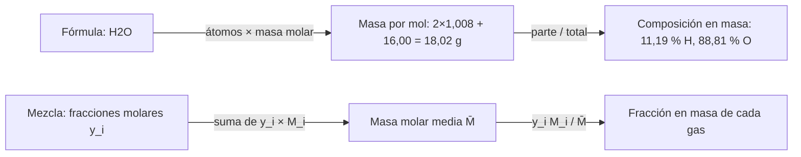

# B06-C07 — Estequiometría elemental

<!-- nav:top -->
[🏠 Programa](../../../../README.md) · [📚 Bloque B06](../../../tronco-comun/B06-quimica-y-materia-del-universo.md) · [← Anterior: B06-C06 — Cantidad de sustancia y mol](../B06-C06-cantidad-de-sustancia-y-mol/CLASE.md) · [Siguiente: B06-C08 — Reacciones y conservación de masa →](../B06-C08-reacciones-y-conservacion-de-masa/CLASE.md)
<!-- /nav -->

## 1. Ubicación, nivel y alcance

Séptima clase del bloque B06. Con el mol (C06) puedes contar. Ahora aprendes a leer una fórmula como una receta: cuántos átomos de cada elemento lleva una molécula, qué proporción de la masa corresponde a cada uno y cómo se calcula la masa molar media de una mezcla. Sigues en el nivel N1.

Verás composición porcentual, fórmula empírica, proporciones de combinación y la masa molar media de una atmósfera. No verás todavía el balanceo de ecuaciones (C08) ni equilibrios (C13).

## 2. Por qué esta clase existe

Si quieres saber cuánto pesa una columna de atmósfera de Marte, necesitas su masa molar media, y para eso, su composición. La NASA publica la composición en volumen de las atmósferas de Marte, Venus y la Tierra y también un «peso molecular» medio (S1, S2, S3). ¿Coinciden con lo que calculas tú? Comprobarlo es una forma de saber si entiendes la composición.

La decisión central es: **dada una composición (en volumen, en masa o en átomos), ¿cómo la convierto a otra base sin perder información y cómo compruebo mi resultado con un valor independiente?** Aprenderás a calcular composiciones porcentuales y masas molares medias, y a validar con una referencia externa. Prepara C09 (gases) y C20 (meteoritos).

## 3. Lo que podrás hacer al terminar

1. Leer una fórmula química como una proporción de átomos y de moles.
2. Calcular la composición porcentual en masa de un compuesto.
3. Deducir una fórmula empírica a partir de porcentajes.
4. Calcular la masa molar media de una mezcla de gases a partir de su composición en volumen.
5. Convertir entre fracción molar y fracción en masa.
6. Redactar un balance de composición verificado contra una referencia.

La evidencia es el **balance de composición de una atmósfera** del ejercicio 12 (sección 20).

## 4. Con qué llegas y cómo comprobarlo

Necesitas C06 (masa molar, mol) y proporciones. Cinco preguntas:

1. ¿Cuál es la masa molar del agua? ¿Y del CO₂?
2. Si 3 partes de 10 son A y el resto B, ¿qué porcentaje es B?
3. ¿Cuántos moles hay en 44 g de CO₂?
4. ¿Cuánto es `0,951 × 44,01`?
5. ¿Qué significa que una suma de porcentajes dé 99,85 %?

<details>
<summary>Ver respuestas</summary>

1. 18,015 g/mol; 44,010 g/mol. 2. 70 %. 3. Unos 1,0 mol. 4. 41,85. 5. Que hay redondeos o componentes que faltan (en este caso, el 0,15 % restante no está listado).
</details>

Con cuatro o cinco aciertos, sigue. Con tres o menos, repasa C06.

## 5. Un caso real: tres atmósferas, tres pesos moleculares

Las fichas de datos de planetas de la NASA publican la composición en volumen de la atmósfera y un peso molecular medio. Marte: CO₂ 95,1 %, N₂ 2,59 %, Ar 1,94 %, O₂ 0,16 %, CO 0,06 %, con peso molecular 43,49 (S1). Venus: CO₂ 96,5 % y N₂ 3,5 % cerca de la superficie, con 43,45 (S2). Tierra, aire seco: N₂ 78,08 %, O₂ 20,95 %, Ar 0,934 %, CO₂ 0,042 %, con 28,97 (S3).

¿Puedes reproducir esos tres números con sólo la composición y los pesos atómicos? Lo harás en la sección 13. Ten presente el límite: la ficha de Marte suma 99,85 %, lo que indica componentes que no están listados; la de Venus omite trazas de gases como el SO₂ (150 ppm).

## 6. Vocabulario

Una **fórmula molecular** dice cuántos átomos de cada elemento tiene una molécula (H₂O, CO₂). Una **fórmula empírica** da la proporción más simple entre los átomos (CH₂ para el eteno y el ciclohexano). La **composición porcentual** (en masa) de un elemento en un compuesto es `n_átomos × M_elemento / M_compuesto × 100`. La **fracción molar** `y_i` de un componente de una mezcla es su cantidad de sustancia dividida entre la total; para gases ideales, coincide con la fracción en volumen. La **masa molar media** de una mezcla es `M̄ = Σ y_i M_i`.

La **estequiometría** estudia las proporciones en que se combinan las sustancias. En esta clase se trabaja sólo con proporciones de elementos en una fórmula y con mezclas; las reacciones se tratan en C08.

## 7. Modelo mental: la receta y el recetario

Una fórmula es una receta de átomos: «dos de hidrógeno, uno de oxígeno». Una mezcla es un recetario con porciones de cada plato. La masa de cada ingrediente depende de cuánto pesa cada átomo; por eso la receta en átomos y la receta en gramos dan porcentajes distintos.



*Descripción textual:* dos caminos. En el de arriba, una fórmula se convierte en masa por mol y luego en composición porcentual. En el de abajo, una mezcla con fracciones molares da una masa molar media y de ahí la fracción en masa de cada componente.

La analogía de la receta tiene un límite: una receta se puede escalar a cualquier cantidad, pero una fórmula no admite fracciones de átomo; y una mezcla de gases no tiene proporciones fijas como un compuesto, puede variar con el lugar y el tiempo (por ejemplo, el CO₂ marciano varía con las estaciones).

## 8. La explicación, paso a paso

### 8.1 De la fórmula a la composición en masa

Para el agua, `M = 2 × 1,007975 + 15,9994 = 18,0153 g/mol`. Hidrógeno: `2 × 1,007975/18,0153 = 11,19 %`; oxígeno: `15,9994/18,0153 = 88,81 %`. Para el CO₂, `M = 44,0094 g/mol`; carbono `12,0106/44,0094 = 27,29 %` y oxígeno `72,71 %`. Los pesos atómicos son los de la NIST (C03), y la masa molar de H₂O y CO₂ coincide con la del WebBook (S4).

### 8.2 De la composición a la fórmula empírica

Se divide cada porcentaje entre la masa molar del elemento para obtener moles por cada 100 g y luego entre el menor: `27,29/12,0106 = 2,272` y `72,71/15,9994 = 4,545`; el cociente es `2,000`, así que C₁O₂. Si el cociente no es entero, se multiplica hasta serlo (por ejemplo, 1,5 → ×2).

### 8.3 Masa molar media de una mezcla

Si `y_i` son fracciones molares, `M̄ = Σ y_i M_i / Σ y_i` (se normaliza cuando las fichas redondean y no suman 100). Para Marte, con CO₂ 44,0094; N₂ 28,0137; Ar 39,948; O₂ 31,9988 y CO 28,0100 g/mol, resulta `M̄ = 43,487 g/mol`, frente a 43,49 de la NASA (S1). Para Venus, `43,450` frente a 43,45 (S2). Para la Tierra seca, `28,967` frente a 28,97 (S3). Los tres acuerdos son mejores que 0,005 g/mol.

### 8.4 De fracción molar a fracción en masa

La fracción en masa de un componente es `w_i = y_i M_i / M̄`. En Marte, el CO₂ es el 95,1 % de las moléculas pero el 96,4 % de la masa, porque es más pesado que el promedio de los demás gases. En Venus es el 96,5 % en volumen y el 97,7 % en masa. En la Tierra seca, el N₂ es el 78,08 % del volumen y el 75,5 % de la masa, y el O₂, el 20,95 % y el 23,1 % de la masa.

### 8.5 Qué componentes importan

El argón en Marte es sólo el 1,94 % del volumen, pero omitirlo cambia `M̄` de 43,487 a 43,557, una diferencia de 0,07 g/mol que ya supera la tolerancia de 0,05 de la clase. En cambio, los 150 ppm de SO₂ en Venus (S2) sólo cambian `M̄` en 0,003 g/mol. Un componente «importa» según su fracción y según cuánto se aparta su masa molar de la media.

## 9. Magnitudes, símbolos y unidades

| Símbolo | Qué es | Unidad | Valor o nota |
|---|---|---|---|
| `M_i` | masa molar del componente i | g/mol | CO₂ 44,0094; N₂ 28,0137; O₂ 31,9988; Ar 39,948; CO 28,0100 |
| `y_i` | fracción molar (≈ fracción en volumen) | — | de las fichas NASA, % /100 |
| `M̄` | masa molar media | g/mol | Marte 43,487; Venus 43,450; Tierra 28,967 |
| `w_i` | fracción en masa | — | `y_i M_i/M̄` |
| composición % | % en masa de un elemento en un compuesto | % | H₂O: 11,19 % H |

## 10. Convenciones y referencias

La fracción en volumen de un gas ideal es igual a su fracción molar. Las fichas dan porcentajes redondeados; se normaliza para que sumen 1. Los pesos atómicos son los de la NIST (puntos medios de intervalos). La composición de la Tierra es la del aire seco; el agua atmosférica varía y no está incluida. Los resultados se dan con tres decimales, la precisión de los datos de entrada.

## 11. De dónde sale lo que afirmamos

| ID | Fuente | Localizador | Respalda | Estado |
|---|---|---|---|---|
| S1 | NASA NSSDC, *Mars Fact Sheet* (act. 19-may-2025) | https://nssdc.gsfc.nasa.gov/planetary/factsheet/marsfact.html | Composición en volumen de la atmósfera de Marte; peso molecular 43,49 | Página consultada el 2026-11-05 |
| S2 | NASA NSSDC, *Venus Fact Sheet* (act. 11-ene-2024) | https://nssdc.gsfc.nasa.gov/planetary/factsheet/venusfact.html | Composición cercana a la superficie; trazas; peso molecular 43,45 | Página consultada el 2026-11-05 |
| S3 | NASA NSSDC, *Earth Fact Sheet* (act. 15-nov-2024) | https://nssdc.gsfc.nasa.gov/planetary/factsheet/earthfact.html | Composición del aire seco; peso molecular medio 28,97 | Página consultada el 2026-11-05 |
| S4 | NIST Chemistry WebBook, H₂O y CO₂; NIST Atomic Weights | https://webbook.nist.gov/cgi/cbook.cgi?ID=C7732185 (y `C124389`); https://physics.nist.gov/cgi-bin/Compositions/stand_alone.pl | Masas molares 18,0153 y 44,0095 g/mol; pesos atómicos | Consulta del 2026-11-05 |

Límites: las fichas de la NASA no indican la fecha de medición de cada composición ni sus incertidumbres, y no se verificó contra otro conjunto de datos; las unidades del «peso molecular» no aparecen en las fichas (se interpreta como g/mol). El cálculo de fracciones en masa es nuestro.

## 12. Cómo ver la composición

Esta tabla es la versión accesible de un gráfico de barras apiladas.

| Atmósfera | Gas | Fracción molar | Fracción en masa |
|---|---|---|---|
| Marte | CO₂ | 95,24 % (normalizado) | 96,39 % |
| Marte | N₂ | 2,59 % | 1,67 % |
| Marte | Ar | 1,94 % | 1,79 % |
| Venus | CO₂ | 96,5 % | 97,74 % |
| Venus | N₂ | 3,5 % | 2,26 % |
| Tierra | N₂ | 78,08 % | 75,51 % |
| Tierra | O₂ | 20,95 % | 23,14 % |

Si dibujas barras apiladas, usa el mismo orden de gases en cada barra, rotula con símbolo y valor, y no dependas del color. Descripción larga: en Marte y Venus domina el CO₂ con más del 95 %; la Tierra es la única con una mezcla de dos gases mayoritarios.

## 13. Ejemplo trabajado: reproducir el peso molecular de Marte

**Datos (observados, S1):** CO₂ 95,1; N₂ 2,59; Ar 1,94; O₂ 0,16; CO 0,06 (% en volumen). **Masas molares:** 44,0094; 28,0137; 39,948; 31,9988; 28,0100.

**Paso 1 · Suma de fracciones.** `95,1 + 2,59 + 1,94 + 0,16 + 0,06 = 99,85`. Falta un 0,15 % no listado.

**Paso 2 · Numerador.** `0,951 × 44,0094 = 41,853`; `0,0259 × 28,0137 = 0,7256`; `0,0194 × 39,948 = 0,7750`; `0,0016 × 31,9988 = 0,0512`; `0,0006 × 28,0100 = 0,0168`. Suma: `43,422`.

**Paso 3 · Normalización.** `43,422/0,9985 = 43,487 g/mol`.

**Paso 4 · Comparación.** La NASA da 43,49. Diferencia: −0,003 g/mol, es decir, 0,007 %.

**Paso 5 · Qué pasa si no normalizo.** `43,422` queda 0,07 por debajo del valor publicado: el 0,15 % que falta no es despreciable al nivel de precisión que buscamos.

**Sentido físico.** Con tres datos de entrada por gas y pesos atómicos, se reproduce un valor publicado a la cuarta cifra. Eso valida el método y la lectura de la ficha. La conclusión sobre qué componentes importan (sección 8.5) sale de comparar este cálculo con y sin cada componente.

## 14. Dos formas de expresar una mezcla

La **fracción molar** (o en volumen, en un gas ideal) cuenta moléculas y es la que se mide con un espectrómetro de masas o un cromatógrafo; la **fracción en masa** cuenta kilos y es la que importa para un balance de masa o una presión parcial. Se convierten con la masa molar media. Cuando alguien da «porcentajes» sin base, pregunta cuál es: puede haber 1,2 puntos de diferencia, como en el CO₂ de Marte (95,1 % frente a 96,4 %).

## 15. Práctica guiada

**Ejercicio 1 · con los pasos indicados.** Calcula el % en masa de hidrógeno en el agua. *Pasos:* `2 M_H / M_H₂O` (sección 8.1).

<details><summary>Solución comentada</summary>

`2 × 1,007975/18,0153 = 0,1119`, es decir, 11,19 %. Si te dio 5,6 %, usaste un solo átomo de hidrógeno.
</details>

**Ejercicio 2 · con una pista.** ¿Qué % en masa de carbono tiene el CO₂? *Pista:* `M_C/M_CO₂`.

<details><summary>Solución comentada</summary>

`12,0106/44,0094 = 27,29 %`. El 72,71 % restante es oxígeno; la suma debe ser 100 %.
</details>

**Ejercicio 3 · casi autónomo.** Un compuesto tiene 27,29 % C y 72,71 % O. Deduce su fórmula empírica.

<details><summary>Solución comentada</summary>

`27,29/12,0106 = 2,272`; `72,71/15,9994 = 4,545`; el cociente es 2,000: fórmula CO₂.
</details>

## 16. Práctica autónoma, transferencia e integrador

**Ejercicio 4.** Calcula la masa molar media de la atmósfera de Venus (CO₂ 96,5 %, N₂ 3,5 %).

<details><summary>Solución comentada</summary>

`0,965 × 44,0094 + 0,035 × 28,0137 = 42,469 + 0,980 = 43,450 g/mol` (S2: 43,45).
</details>

**Ejercicio 5.** ¿Qué fracción en masa de la atmósfera de Venus es N₂?

<details><summary>Solución comentada</summary>

`0,035 × 28,0137/43,450 = 0,02257`, es decir, 2,26 %, menor que el 3,5 % en volumen porque el N₂ es más liviano que el CO₂.
</details>

**Ejercicio 6.** ¿Qué porcentaje de la masa de la atmósfera de Marte es CO₂ (con la composición normalizada)?

<details><summary>Solución comentada</summary>

`(0,951/0,9985) × 44,0094/43,487 = 0,9524 × 1,0120 = 0,9639`: 96,4 %.
</details>

**Ejercicio 7.** Calcula la masa molar media del aire seco terrestre y compárala con 28,97.

<details><summary>Solución comentada</summary>

`0,7808 × 28,0137 + 0,2095 × 31,9988 + 0,00934 × 39,948 + 0,00042 × 44,0094 = 21,873 + 6,704 + 0,373 + 0,018 = 28,968`; normalizando por 1,00006, 28,967. Diferencia con 28,97: −0,003.
</details>

**Ejercicio 8.** Un hidrocarburo tiene 85,6 % C y 14,4 % H. ¿Cuál es su fórmula empírica?

<details><summary>Solución comentada</summary>

`85,6/12,0106 = 7,127`; `14,4/1,007975 = 14,286`; cociente `2,004 ≈ 2`: CH₂. La fórmula empírica no distingue entre moléculas distintas con esa proporción (eteno C₂H₄, propeno C₃H₆…).
</details>

**Ejercicio 9 · transferencia.** Si ignoras el argón en Marte, ¿cómo cambia `M̄`? ¿Qué te enseña?

<details><summary>Solución comentada</summary>

Sin argón, `M̄ = 43,557`, 0,07 g/mol más que con él (43,487). Aunque sea sólo el 1,94 % del volumen, pesa más que el promedio y desplaza el resultado por encima de la tolerancia de 0,05. Lección: la importancia de un componente depende de su fracción y de su masa molar.
</details>

**Ejercicio 10 · transferencia.** Venus tiene 150 ppm de SO₂ (S2). Calcula cuánto cambia `M̄` al incluirlo (M(SO₂) = 64,066 g/mol).

<details><summary>Solución comentada</summary>

`Δ M̄ ≈ 150 × 10⁻⁶ × (64,066 − 43,45) = 0,0031 g/mol`: despreciable frente a la tolerancia de 0,05. Pero ese gas importa para otros fenómenos (C15, C18), así que ser despreciable para M̄ no significa irrelevante.
</details>

**Ejercicio 11 · transferencia.** Un artículo dice: «la atmósfera de Marte es 95,1 % CO₂ en masa». Corrige.

<details><summary>Solución comentada</summary>

El 95,1 % es en volumen (fracción molar de un gas ideal). En masa, con la composición normalizada, es 96,4 %. Siempre hay que declarar la base.
</details>

**Ejercicio 12 · integrador.** Elabora el *balance de composición de una atmósfera* (sección 20) para Marte, Venus o la Tierra: composición en volumen, masas molares, `M̄`, fracción en masa de cada gas, comparación con el peso molecular de la NASA y un análisis de qué componente importa más.

<details><summary>Solución modelo</summary>

Una solución completa sigue el ejemplo trabajado con la atmósfera elegida: tabla de fracciones, `M̄`, residuo frente a la referencia (inferior a 0,05 g/mol), y una comparación con y sin el componente minoritario más pesado. Debe declarar que el peso molecular de la NASA se tomó como referencia independiente y que las unidades se interpretan como g/mol.
</details>

## 17. Laboratorio: pesos moleculares de tres atmósferas

El script [composicion_atmosferas.py](composicion_atmosferas.py) calcula la masa molar media de las atmósferas de Marte, Venus y la Tierra y las compara con los pesos moleculares de la NASA; también calcula composiciones porcentuales de H₂O y CO₂ y la fórmula empírica del CO₂. Antes de imprimir comprueba que `M(CO₂)` coincida con el WebBook, que los tres `M̄` queden a menos de 0,05 g/mol de la referencia y que el % de H en el agua sea 11,19 %; si algo falla, se detiene.

**Datos:** observados (S1–S3); pesos atómicos NIST. **Predice antes de ejecutar:** ¿qué `M̄` saldrá para Venus? (cerca de 43,45). **Resultados (2026-11-05, Python 3.12.9):** Marte 43,487 g/mol (NASA 43,49); Venus 43,450 (43,45); Tierra seca 28,967 (28,97); CO₂: 27,29 % C y 72,71 % O; H₂O: 11,19 % H y 88,81 % O; fórmula empírica C₁O₂.

```bash
python programa/clases/B06/B06-C07-estequiometria-elemental/composicion_atmosferas.py
```

**Límites:** gas ideal; sólo los componentes listados; sin vapor de agua. No sirve para atmósferas con composición variable fuerte ni para altitudes elevadas, donde la mezcla cambia.

## 18. Errores frecuentes y cómo corregirlos

**Usar un solo átomo cuando la fórmula tiene dos.** Se corrige con el ejercicio 1.

**No normalizar cuando los porcentajes no suman 100.** Se corrige con la sección 13.

**Confundir fracción en volumen con fracción en masa.** Se corrige con el ejercicio 11.

**Ignorar un componente minoritario pesado.** Se corrige con el ejercicio 9.

**Pensar que la fórmula empírica es la molecular.** Se corrige con el ejercicio 8.

## 19. Cómo sabrás que vas bien

Tras 8.1: ¿puedes calcular el % de oxígeno en el CO₂ sin mirar? Si no, repite el ejercicio 2. Tras 8.3: ¿puedes calcular `M̄` de una mezcla? Si no, haz los ejercicios 4 y 7. Tras 8.4: ¿por qué la fracción en masa del CO₂ es mayor que su fracción en volumen? Si dudas, haz el ejercicio 6. Tras 8.5: ¿cómo decides si un componente importa? Si no, repite los ejercicios 9 y 10. Tras el laboratorio: ¿contra qué referencia se valida el cálculo? Si lo ignoras, lee la cabecera.

## 20. Qué entregas y cómo se evalúa

El producto es tu **balance de composición de una atmósfera**: tabla de fracciones (molar y en masa), `M̄` calculado, referencia independiente, residuo y análisis de componentes.

| Criterio | Inicial | En desarrollo | Logrado | Destacado |
|---|---|---|---|---|
| Masa molar media | Con errores | Correcta sin normalizar | Correcta y normalizada | Propaga redondeos |
| Fracción en masa | No la calcula | Con errores | Correcta | Explica la diferencia con la molar |
| Validación | Ninguna | Compara sin residuo | Compara con residuo | Analiza qué la explica |
| Componentes minoritarios | Los ignora | Los lista | Evalúa su efecto | Cuantifica cuándo importan |
| Base y fuentes | Sin base | Base sin fuente | Base y fuente | Declara qué falta en la fuente |

**Condiciones críticas:** no presentar porcentajes sin base; no ignorar que una suma no sea 100 %; citar sólo fuentes consultadas.

## 21. Ética, seguridad y límites

Es un cálculo; no hay experimentos. Las atmósferas de Marte y Venus no son respirables; los números no deben usarse para dimensionar equipos de soporte vital. Accesibilidad: tablas equivalentes a los gráficos y fórmulas en texto. Dar una composición sin base y sin fuente es una forma de desinformación, aun sin mala intención.

## 22. Para cerrar y seguir

Una fórmula es una proporción de átomos; la composición en masa depende de las masas molares; una mezcla tiene masa molar media y fracciones en masa distintas de las molares. Validar contra un valor publicado independiente es lo que da confianza al cálculo. La próxima clase añade el movimiento: reacciones que reordenan átomos conservando la masa.

**Glosario español–inglés.** estequiometría · *stoichiometry*; fórmula empírica · *empirical formula*; composición porcentual · *percent composition*; fracción molar · *mole fraction*; masa molar media · *mean molar mass*; fracción en masa · *mass fraction*.

**Continuidad.** B06-C08 usa estas proporciones para balancear reacciones. B06-C09 usa `M̄` para calcular densidades y alturas de escala de atmósferas.

**Referencias:** ver sección 11. S1 a S4 son consultas del 2026-11-05; el peso molecular de la NASA es la referencia independiente del laboratorio.

<!-- nav:bottom -->
---

[← Anterior: B06-C06 — Cantidad de sustancia y mol](../B06-C06-cantidad-de-sustancia-y-mol/CLASE.md) · [📚 Bloque B06](../../../tronco-comun/B06-quimica-y-materia-del-universo.md) · [Siguiente: B06-C08 — Reacciones y conservación de masa →](../B06-C08-reacciones-y-conservacion-de-masa/CLASE.md)
<!-- /nav -->
