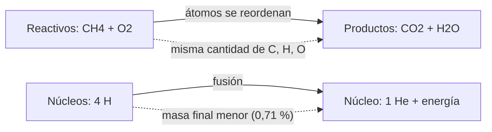

# B06-C08 — Reacciones y conservación de masa

<!-- nav:top -->
[🏠 Programa](../../../../README.md) · [📚 Bloque B06](../../../tronco-comun/B06-quimica-y-materia-del-universo.md) · [← Anterior: B06-C07 — Estequiometría elemental](../B06-C07-estequiometria-elemental/CLASE.md) · [Siguiente: B06-C09 — Gases ideales y no ideales →](../B06-C09-gases-ideales-y-no-ideales/CLASE.md)
<!-- /nav -->

## 1. Ubicación, nivel y alcance

Octava clase del bloque B06 y cierre de su segundo tramo. Ya sabes contar átomos (C06) y leer fórmulas (C07). Aquí ves qué ocurre cuando las sustancias cambian: los átomos se reordenan, pero no aparecen ni desaparecen. Sigues en el nivel N1.

Verás cómo escribir y balancear una ecuación química, cómo verificar la conservación de átomos y de carga, cuánta masa se «pierde» realmente en una reacción química y por qué en una reacción nuclear (como las del Sol) ese cambio ya no es despreciable. No verás energías de reacción (C12) ni velocidades (C14).

## 2. Por qué esta clase existe

Una vela y el Sol liberan energía, pero lo hacen de maneras radicalmente distintas. En la vela, los átomos de carbono e hidrógeno se reordenan con el oxígeno y todos siguen ahí al terminar. En el Sol, cuatro núcleos de hidrógeno se fusionan en uno de helio y una pequeña fracción de la masa se convierte en energía. Saber qué se conserva en cada caso, y con qué precisión, es lo que separa la química de la física nuclear.

La decisión central es: **dada una transformación, ¿qué debe conservarse, cómo lo compruebo y cuándo deja de ser válida la regla «la masa se conserva»?** Aprenderás a balancear ecuaciones con un método sistemático, a verificar átomos y carga, y a calcular el defecto de masa de la fusión del hidrógeno. Es la base de C12 (energía) y C13 (equilibrio).

## 3. Lo que podrás hacer al terminar

1. Escribir una reacción con reactivos, productos y coeficientes.
2. Balancear una ecuación contando átomos y carga.
3. Comprobar la conservación de masa con masas molares.
4. Calcular la fracción de masa que se pierde en una reacción química.
5. Calcular el defecto de masa y la energía de la fusión de cuatro núcleos de hidrógeno.
6. Redactar una ficha de reacción verificada.

La evidencia es la **ecuación balanceada con verificación** del ejercicio 12 (sección 20).

## 4. Con qué llegas y cómo comprobarlo

Necesitas C06 y C07. Cinco preguntas:

1. ¿Cuántos átomos de H hay en 2 CH₄?
2. ¿Cuántos átomos de O hay en 3 CO₂?
3. ¿Qué carga neta tiene NH₄⁺ más HCOO⁻?
4. Calcula `2 × 18,0153 + 44,0094`.
5. ¿Cuánto es 10⁻³ dividido entre 10⁻¹⁰?

<details>
<summary>Ver respuestas</summary>

1. 8. 2. 6. 3. Cero. 4. 80,0400. 5. 10⁷.
</details>

Con cuatro o cinco aciertos, sigue. Con tres o menos, repasa C06 y C07.

## 5. Un caso real: la fusión del hidrógeno

El Sol obtiene su energía fusionando núcleos de hidrógeno en helio. Con las masas atómicas relativas de la NIST, `¹H = 1,007 825 032 23` y `⁴He = 4,002 603 254 13` (S1), cuatro átomos de hidrógeno pesan `4,031 300 129 u` y un átomo de helio `4,002 603 254 u`. La diferencia es `0,028 696 875 u`. Multiplicada por `c²` y expresada en electronvoltios (con la constante de masa atómica de CODATA 2022, S2), da `26,73 MeV` por núcleo de helio formado. Es el 0,71 % de la masa inicial.

Este número es nuestro cálculo con masas atómicas neutras: incluye la energía que se libera cuando los positrones producidos se aniquilan con electrones. Ten presente el límite: no estudiamos aquí los pasos de la cadena nuclear (B17, B24), sólo el balance total.

## 6. Vocabulario

Una **reacción química** es un proceso en el que los átomos se reordenan para formar sustancias distintas. Los **reactivos** están a la izquierda y los **productos** a la derecha de una **ecuación química**. Los **coeficientes estequiométricos** son los números que multiplican cada fórmula para que la ecuación quede balanceada. La **conservación de los átomos** y de la **carga** son las condiciones que exigimos a una ecuación balanceada.

La **ley de conservación de la masa** (Lavoisier) dice que, en una reacción química, la masa total de los reactivos es igual a la de los productos. Con precisión, lo que se conserva exactamente son los átomos de cada elemento; la masa se conserva con una precisión limitada por la energía liberada (`Δm = ΔE/c²`). El **defecto de masa** es la diferencia entre la masa de los reactantes y la de los productos en una reacción nuclear.

## 7. Modelo mental: piezas que se reordenan

Piensa en piezas de construcción: con las mismas piezas de una torre puedes armar un puente. No hay piezas nuevas ni se pierden. En una reacción química, las piezas son los átomos. En una reacción nuclear, en cambio, las piezas mismas (los núcleos) se transforman, y la «contabilidad» de masa incluye una pequeña diferencia que se libera como energía.



*Descripción textual:* arriba, una reacción química: los reactivos se transforman en productos con los mismos átomos. Abajo, una fusión nuclear: cuatro núcleos de hidrógeno dan uno de helio y la masa final es 0,71 % menor, con la diferencia liberada como energía.

La analogía de las piezas muestra que se conserva el número de átomos; su límite es que no explica la energía: en una reacción química se libera o absorbe, aunque la masa casi no cambie. Esa pequeñísima diferencia se calcula con `E = mc²`.

## 8. La explicación, paso a paso

### 8.1 Escribir la ecuación

Se escriben las fórmulas de los reactivos, una flecha y las de los productos: `CH₄ + O₂ → CO₂ + H₂O`. Las fórmulas no se pueden cambiar (cambiarían la sustancia); lo que se ajusta son los coeficientes. Una ecuación sin coeficientes puede ser incorrecta: la de arriba tiene 4 H a la izquierda y 2 H a la derecha.

### 8.2 Balancear

Se escoge una especie, se le da el coeficiente 1 y se ajustan los demás hasta que cada elemento tenga la misma cantidad en ambos lados. Para el metano: carbono, 1 y 1; hidrógeno: 4 en CH₄, por tanto 2 H₂O; oxígeno: 2 + 2 = 4, por tanto 2 O₂. Resultado: `CH₄ + 2 O₂ → CO₂ + 2 H₂O`. El laboratorio hace esto de forma sistemática: plantea una ecuación lineal por elemento (átomos de cada uno, positivos a la izquierda y negativos a la derecha) y halla los coeficientes enteros mínimos con fracciones exactas. Para `CO₂ + H₂ → CH₄ + H₂O` obtiene `1, 4, 1, 2`.

### 8.3 Carga

En las ecuaciones con iones también se conserva la carga neta. `NH₃ + HCOOH → NH₄⁺ + HCOO⁻`: a la izquierda, carga 0; a la derecha, +1 − 1 = 0. La carga se trata como un «elemento» más en la ecuación lineal.

### 8.4 Verificar con masas

Se calcula la masa de cada lado: `CH₄ + 2 O₂`: `16,0425 + 2 × 31,9988 = 80,0401 g`; `CO₂ + 2 H₂O`: `44,0094 + 2 × 18,0153 = 80,0400 g` (los pesos de C07). Coinciden en cinco cifras. Es una prueba de que los coeficientes son correctos, no una demostración de la ley.

### 8.5 ¿Cuánta masa se pierde en una reacción química?

La combustión de un mol de metano libera unos 890 kJ (C12). La masa equivalente es `ΔE/c² = 890 300 J/(299 792 458 m/s)² = 9,9 × 10⁻¹² kg`, es decir, 10⁻⁸ g de unos 80 g de sustancias. En términos relativos es del orden de `10⁻¹⁰`: ninguna balanza de laboratorio lo detecta. Por eso la regla «la masa se conserva» es excelente en química. En la fusión del hidrógeno, en cambio, el 0,71 % de la masa desaparece: 10⁷ veces más en proporción. Allí la regla ya no sirve y hay que usar `E = mc²`.

## 9. Magnitudes, símbolos y unidades

| Símbolo | Qué es | Unidad | Valor o nota |
|---|---|---|---|
| coeficiente | número que balancea | — | entero mínimo |
| `Δm` | defecto de masa | u o kg | fusión 4 ¹H → ⁴He: 0,028 696 875 u |
| `c` | velocidad de la luz | m/s | 299 792 458 (exacta) |
| `u` | unidad de masa atómica | kg | 1,660 539 068 92 × 10⁻²⁷ (CODATA 2022) |
| `e` | carga elemental | C | 1,602 176 634 × 10⁻¹⁹ (exacta) |
| `ΔE` | energía liberada | MeV, kJ/mol | fusión: 26,73 MeV |

## 10. Convenciones y referencias

Los reactivos van a la izquierda; los coeficientes, delante de las fórmulas; los subíndices, dentro de ellas. Las masas nucleares se dan como masas **atómicas** neutras: eso incluye los electrones del hidrógeno y del helio, y el balance de positrones se compensa con la aniquilación de dos pares (cálculo propio). La energía en MeV se obtiene con `1 u c²/e = 931,494 MeV`.

## 11. De dónde sale lo que afirmamos

| ID | Fuente | Localizador | Respalda | Estado |
|---|---|---|---|---|
| S1 | NIST, *Atomic Weights and Isotopic Compositions for All Elements* | https://physics.nist.gov/cgi-bin/Compositions/stand_alone.pl | Masas atómicas relativas de ¹H y ⁴He | Consulta del 2026-11-05 |
| S2 | NIST, *CODATA Recommended Values* (2022): `u`; `c` y `e` | https://physics.nist.gov/cgi-bin/cuu/Value?u (y `?c`, `?e`) | `u`, `c`, `e` | Consulta del 2026-11-05 |
| S3 | NIST Chemistry WebBook: entalpías de formación de CH₄, CO₂ y H₂O líquida | https://webbook.nist.gov/cgi/cbook.cgi?ID=C74828 (y `C124389`, `C7732185`) | Base del valor −890,3 kJ/mol de la sección 8.5 (se calcula en C12) | Consulta del 2026-11-05 |

Límites: el valor de 26,73 MeV es un cálculo propio con masas atómicas neutras; no se contrastó con una fuente independiente de la energía de la cadena. El balance del método de la sección 8.2 y la discusión de la ley de Lavoisier son explicación nuestra.

## 12. Cómo ver una ecuación balanceada

Esta tabla es la versión accesible de la ecuación con conteo de átomos.

| Elemento | Reactivos: CH₄ + 2 O₂ | Productos: CO₂ + 2 H₂O |
|---|---|---|
| C | 1 | 1 |
| H | 4 | 2 × 2 = 4 |
| O | 2 × 2 = 4 | 2 + 2 = 4 |
| Masa (g/mol) | 80,0401 | 80,0400 |

Si escribes la ecuación a mano o con un editor, usa subíndices reales y deja un espacio antes y después de la flecha; no indiques estados con colores. Descripción larga: cada fila compara el número de átomos de un elemento a ambos lados; las filas coinciden.

## 13. Ejemplo trabajado: ¿cuánto «pesa» la luz del Sol?

**Pregunta:** ¿qué fracción de la masa de hidrógeno se convierte en energía al fusionarse en helio, y cómo se compara con quemar metano?

**Datos (publicados, S1, S2):** `m(¹H) = 1,007 825 032 23 u`; `m(⁴He) = 4,002 603 254 13 u`; `u c²/e = 931,494 MeV`.

**Paso 1 · Masa inicial.** `4 × 1,007 825 032 23 = 4,031 300 129 u`.

**Paso 2 · Defecto.** `4,031 300 129 − 4,002 603 254 = 0,028 696 875 u`.

**Paso 3 · Fracción.** `0,028 696 875/4,031 300 129 = 0,007119 = 0,71 %`.

**Paso 4 · Energía.** `0,028 696 875 × 931,494 MeV/u = 26,73 MeV` (el laboratorio da 26,731).

**Paso 5 · Comparación con el metano.** La combustión pierde `9,9 × 10⁻¹² kg` por mol, de `16,04 × 10⁻³ kg` de metano: fracción `6,2 × 10⁻¹⁰`. La razón entre ambos procesos es `0,007119/6,2 × 10⁻¹⁰ = 1,15 × 10⁷`.

**Sentido físico.** Por unidad de masa de combustible, la fusión libera unas 10 millones de veces más energía que la combustión. Esa es la razón de que una estrella dure miles de millones de años y una vela, horas. Para la química, en cambio, el cambio de masa es indetectable y puede decirse que la masa se conserva.

## 14. Dos formas de verificar un balance

Puedes **contar átomos** (exacto, sólo requiere las fórmulas) o **comparar masas** (requiere masas molares y es sensible a errores de redondeo). La primera demuestra el balance; la segunda lo confirma y detecta errores de fórmula. Para una reacción nuclear no sirve ninguna de las dos: se cuentan nucleones y carga, y la masa deja de ser el invariante.

## 15. Práctica guiada

**Ejercicio 1 · con los pasos indicados.** Balancea `H₂ + O₂ → H₂O`. *Pasos:* iguala el oxígeno y luego el hidrógeno (sección 8.2).

<details><summary>Solución comentada</summary>

`2 H₂ + O₂ → 2 H₂O`: 4 H y 2 O a cada lado. Si pones `H₂ + O₂ → H₂O₂`, cambiaste la sustancia (agua oxigenada), no balanceaste.
</details>

**Ejercicio 2 · con una pista.** Verifica que `CH₄ + 2 O₂ → CO₂ + 2 H₂O` está balanceada. *Pista:* cuenta C, H y O.

<details><summary>Solución comentada</summary>

C: 1 y 1. H: 4 y 4. O: 4 y 4. Está balanceada.
</details>

**Ejercicio 3 · casi autónomo.** Verifica `CO₂ + 4 H₂ → CH₄ + 2 H₂O`.

<details><summary>Solución comentada</summary>

C: 1 y 1. H: 8 y 4 + 4 = 8. O: 2 y 2. Balanceada. Es una reacción que se estudia como posible fuente de metano y agua con CO₂ y H₂ (Marte); aquí sólo se cuenta, no se propone un procedimiento.
</details>

## 16. Práctica autónoma, transferencia e integrador

**Ejercicio 4.** Balancea `C₂H₆ + O₂ → CO₂ + H₂O`.

<details><summary>Solución comentada</summary>

`2 C₂H₆ + 7 O₂ → 4 CO₂ + 6 H₂O`: C 4/4, H 12/12, O 14/14. Si te sale un coeficiente fraccionario (3,5 O₂), multiplica toda la ecuación por 2.
</details>

**Ejercicio 5.** Verifica la carga y los átomos de `NH₃ + HCOOH → NH₄⁺ + HCOO⁻`.

<details><summary>Solución comentada</summary>

N 1/1, H 3 + 2 = 5 y 4 + 1 = 5, C 1/1, O 2/2. Carga: 0 y +1 − 1 = 0. Es la transferencia de un protón entre un ácido y una base (C15) y reproduce la sal de amonio de C04.
</details>

**Ejercicio 6.** Comprueba con masas molares que `CH₄ + 2 O₂ → CO₂ + 2 H₂O` conserva la masa.

<details><summary>Solución comentada</summary>

Izquierda: `16,0425 + 2 × 31,9988 = 80,0401`; derecha: `44,0094 + 2 × 18,0153 = 80,0400`. La diferencia de 0,0001 es de redondeo de las masas molares, no una pérdida de masa real.
</details>

**Ejercicio 7.** Calcula la masa equivalente a 890,3 kJ y la fracción respecto de 16,04 g de metano.

<details><summary>Solución comentada</summary>

`890 300/(2,998 × 10⁸)² = 9,9 × 10⁻¹² kg`; fracción `9,9 × 10⁻¹²/0,01604 = 6,2 × 10⁻¹⁰`.
</details>

**Ejercicio 8.** Calcula el defecto de masa de `4 ¹H → ⁴He` en u y la fracción respecto de la masa inicial.

<details><summary>Solución comentada</summary>

`0,028 696 875 u` y `0,007119` (0,71 %).
</details>

**Ejercicio 9 · transferencia.** Un compañero dice: «en una reacción química la masa se conserva exactamente». Matiza.

<details><summary>Solución comentada</summary>

Se conservan exactamente los átomos y la carga. La masa total cambia en `ΔE/c²`, del orden de 10⁻¹⁰ en términos relativos para una combustión, mucho menor que la precisión de cualquier balanza; por eso la regla funciona. En reacciones nucleares ya no es válida a esa precisión.
</details>

**Ejercicio 10 · transferencia.** La fusión libera 26,73 MeV por núcleo de helio y la combustión de un metano, unos 9,2 eV. Calcula la razón de energías por evento.

<details><summary>Solución comentada</summary>

La energía por molécula de metano es `890 300 J/(6,0221 × 10²³ × 1,6022 × 10⁻¹⁹ J/eV) = 9,23 eV`. Razón: `26,73 × 10⁶/9,23 = 2,9 × 10⁶`. Por evento, la fusión libera casi tres millones de veces más; por unidad de masa de combustible, unas 10⁷ veces (sección 13).
</details>

**Ejercicio 11 · transferencia.** Encuentra el error: «CH₄ + 2 O₂ → CO₂ + H₂O».

<details><summary>Solución comentada</summary>

Hay 4 O a la izquierda y 3 a la derecha, y 4 H a la izquierda y 2 a la derecha. El coeficiente del agua debe ser 2.
</details>

**Ejercicio 12 · integrador.** Elabora la *ecuación balanceada con verificación* (sección 20) para `CO₂ + H₂ → CH₄ + H₂O`: coeficientes, tabla de átomos, verificación de masas y la fracción de masa «perdida» si la reacción libera −165 kJ por mol de CO₂ (valor ilustrativo derivado de entalpías de formación del WebBook: −393,51; −74,87; −241,826).

<details><summary>Solución modelo</summary>

Coeficientes `1, 4, 1, 2`. Átomos: C 1/1, H 8/8, O 2/2. Masas: `44,0094 + 4 × 2,0159 = 52,0730`; `16,0425 + 2 × 18,0153 = 52,0731` (coinciden en seis cifras). Energía: `−74,87 + 2(−241,826) − (−393,51) = −165,0 kJ` por mol de CO₂; `Δm = 165 000/c² = 1,8 × 10⁻¹² kg`, fracción `3,5 × 10⁻¹¹` de 52 g. Se acepta cualquier reacción siempre que se verifique y se declare la fuente de la energía.
</details>

## 17. Laboratorio: balanceo y defecto de masa

El script [balanceo.py](balanceo.py) balancea ecuaciones con aritmética racional exacta y calcula el defecto de masa de `4 ¹H → ⁴He` en MeV. Antes de imprimir comprueba que las ecuaciones del metano, del CO₂ con H₂ y la de NH₃ con ácido fórmico (con carga) dan los coeficientes esperados, que el defecto vale 26,731 MeV (±0,01) y que la masa perdida en una combustión es menor que 10⁻¹⁰ kg; si algo falla, se detiene.

**Datos:** publicados (S1, S2); energía de combustión derivada (S3). **Predice antes de ejecutar:** ¿qué energía por núcleo de helio? (cerca de 27 MeV). **Resultados (2026-11-05, Python 3.12.9):** `CH₄ + O₂ → CO₂ + H₂O`: `[1, 2, 1, 2]`; `CO₂ + H₂ → CH₄ + H₂O`: `[1, 4, 1, 2]`; fusión `4 ¹H → ⁴He`: 26,731 MeV; masa perdida al quemar 1 mol de CH₄: 9,906 × 10⁻¹² kg (9,906 × 10⁻⁹ g).

```bash
python programa/clases/B06/B06-C08-reacciones-y-conservacion-de-masa/balanceo.py
```

**Límites:** el balanceador requiere una sola solución independiente; masas atómicas neutras; no describe mecanismos. No sirve para predecir si una reacción ocurre ni cuán rápido.

## 18. Errores frecuentes y cómo corregirlos

**Cambiar subíndices en lugar de coeficientes.** Se corrige con el ejercicio 1.

**No contar el hidrógeno de ambos productos.** Se corrige con el ejercicio 2 y el 11.

**Olvidar la carga en una ecuación iónica.** Se corrige con el ejercicio 5.

**Creer que «se conserva la masa» es exacto.** Se corrige con el ejercicio 9.

**Aplicar esa regla a una reacción nuclear.** Se corrige con la sección 13.

## 19. Cómo sabrás que vas bien

Tras 8.2: ¿puedes balancear la combustión del etano? Si no, repite el ejercicio 4. Tras 8.3: ¿puedes verificar la carga de una ecuación iónica? Si no, haz el ejercicio 5. Tras 8.5: ¿por qué la química puede decir que la masa se conserva y la física nuclear no? Si dudas, haz los ejercicios 7 y 10. Tras el laboratorio: ¿qué comprueba el balanceador antes de dar coeficientes? Si no lo sabes, lee su cabecera.

## 20. Qué entregas y cómo se evalúa

El producto es tu **ecuación balanceada con verificación**: coeficientes, tabla de átomos, verificación de masas y una estimación de la masa equivalente a la energía de la reacción, con fuentes.

| Criterio | Inicial | En desarrollo | Logrado | Destacado |
|---|---|---|---|---|
| Balanceo | Con errores | Correcto con ayuda | Correcto y minimal | Automatiza el método |
| Verificación | Sólo átomos | Átomos y masas con error | Átomos y masas | Incluye carga |
| Masa y energía | No la trata | Cualitativa | Calcula `Δm` | Compara química y nuclear |
| Fuentes | Sin fuente | Con fuente | Con fecha | Distingue dato y cálculo propio |
| Límites | Ausentes | Mencionados | Explicados | Señala qué no se contrastó |

**Condiciones críticas:** no cambiar subíndices; no presentar un cálculo propio como dato publicado; citar sólo fuentes consultadas.

## 21. Ética, seguridad y límites

La clase es un cálculo: no incluye combustiones ni mezclas de gases. Las mezclas de metano, hidrógeno u otros combustibles con oxígeno pueden ser explosivas; no se proponen experimentos con ellas. Alternativa sin riesgo: simular el balanceo con el script o con piezas de construcción. Los valores de energía no se usan para diseñar motores ni procesos. Accesibilidad: tablas equivalentes a las ecuaciones y fórmulas en texto.

## 22. Para cerrar y seguir

En una reacción química se conservan los átomos y la carga; la masa se conserva con una precisión que depende de la energía liberada y que, en química, supera a cualquier balanza. En la fusión del hidrógeno el 0,71 % de la masa se transforma en energía. Con esto cierras la contabilidad química. El siguiente tramo pregunta cómo se comporta la materia en conjunto: gases, líquidos, sólidos y sus cambios.

**Glosario español–inglés.** reacción química · *chemical reaction*; reactivo · *reactant*; producto · *product*; coeficiente estequiométrico · *stoichiometric coefficient*; ecuación balanceada · *balanced equation*; defecto de masa · *mass defect*; conservación de la masa · *conservation of mass*.

**Continuidad.** B06-C09 estudia los gases con la cantidad de sustancia de C06. B06-C12 calcula la energía de las reacciones con entalpías de formación.

**Referencias:** ver sección 11. S1 y S2 son datos oficiales; el valor de 26,731 MeV es un cálculo propio.

<!-- nav:bottom -->
---

[← Anterior: B06-C07 — Estequiometría elemental](../B06-C07-estequiometria-elemental/CLASE.md) · [📚 Bloque B06](../../../tronco-comun/B06-quimica-y-materia-del-universo.md) · [Siguiente: B06-C09 — Gases ideales y no ideales →](../B06-C09-gases-ideales-y-no-ideales/CLASE.md)
<!-- /nav -->
