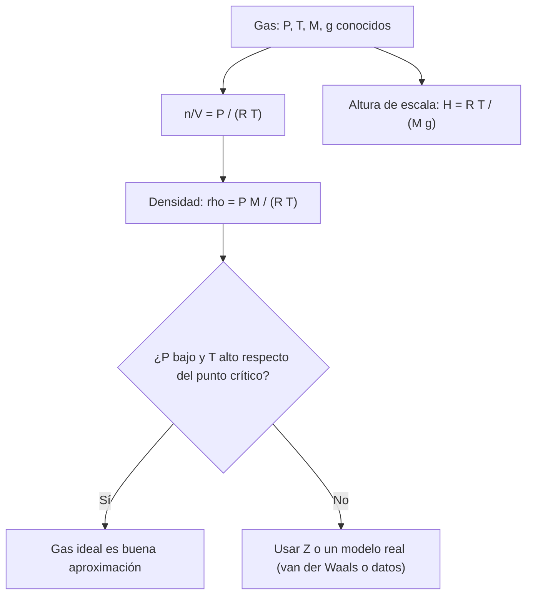

# B06-C09 — Gases ideales y no ideales

<!-- nav:top -->
[🏠 Programa](../../../../README.md) · [📚 Bloque B06](../../../tronco-comun/B06-quimica-y-materia-del-universo.md) · [← Anterior: B06-C08 — Reacciones y conservación de masa](../B06-C08-reacciones-y-conservacion-de-masa/CLASE.md) · [Siguiente: B06-C10 — Estados de la materia →](../B06-C10-estados-de-la-materia/CLASE.md)
<!-- /nav -->

## 1. Ubicación, nivel y alcance

Novena clase del bloque B06 y apertura de su tercer tramo, sobre el comportamiento conjunto de la materia. Hasta aquí contabas átomos y moléculas; ahora los tratas como un gas que llena un volumen. Sigues en el nivel N1.

Verás la ley de los gases ideales, cómo se obtiene la densidad de una atmósfera a partir de su presión, temperatura y masa molar media, qué es la altura de escala y cómo se reconoce que un gas se desvía del comportamiento ideal. No verás todavía cambios de fase (C10, C11) ni termodinámica formal (B05).

## 2. Por qué esta clase existe

La NASA publica para Marte, Venus y la Tierra la presión y la temperatura medias en la superficie, la gravedad, el peso molecular de la atmósfera y su densidad (S1, S2, S3). ¿Puedes reproducir esa densidad con sólo lo anterior? Es una prueba directa de que entiendes la ley de los gases. Si coincide, tienes una herramienta para estimar la densidad del aire de cualquier mundo con atmósfera.

La decisión central es: **dado un gas a cierta presión y temperatura, ¿puedo tratarlo como ideal, y cuánto me equivoco si no puedo?** Aprenderás a calcular densidades y alturas de escala, a validar contra datos publicados y a declarar el dominio de validez. Es base para C11 (fases), C13 (equilibrio) y los bloques de atmósferas y aerodinámica.

## 3. Lo que podrás hacer al terminar

1. Enunciar la ley de los gases ideales con sus unidades.
2. Calcular la cantidad de sustancia, la densidad y el número de moléculas por metro cúbico de un gas.
3. Calcular la altura de escala de una atmósfera isoterma.
4. Validar un cálculo contra datos publicados de planetas.
5. Explicar cuándo y por qué un gas deja de ser ideal.
6. Redactar una tabla de densidades atmosféricas con supuestos.

La evidencia es la **tabla de densidades atmosféricas verificada** del ejercicio 12 (sección 20).

## 4. Con qué llegas y cómo comprobarlo

Necesitas C06 y C07 (mol, masa molar) y manejo de unidades SI (B01-C08). Cinco preguntas:

1. Convierte 6,36 mb a pascales (1 mb = 100 Pa).
2. Convierte 43,49 g/mol a kg/mol.
3. Calcula `8,3145 × 214`.
4. ¿Qué pasa con `P/T` si T se duplica y P se mantiene?
5. ¿Qué es un exponencial decreciente? Da un ejemplo de la vida diaria.

<details>
<summary>Ver respuestas</summary>

1. 636 Pa. 2. 0,04349 kg/mol. 3. 1779,2. 4. Se reduce a la mitad. 5. Una cantidad que baja por el mismo factor en cada intervalo, como la espuma de un vaso o la temperatura de un café.
</details>

Con cuatro o cinco aciertos, sigue. Con tres o menos, repasa C06 y B01-C08.

## 5. Un caso real: ¿cuánto pesa el aire de otro mundo?

Las fichas de la NASA dan para la superficie de **Marte**: presión media 6,36 mb, temperatura 214 K, gravedad 3,73 m/s², peso molecular 43,49 y densidad de aproximadamente 0,016 ± 0,006 kg/m³ (S1). Para **Venus**: 92 bar, 737 K, 8,87 m/s², 43,45 y unos 65 kg/m³ (S2). Para la **Tierra**: 1014 mb, 288 K, 9,820 m/s², 28,97 y 1,217 kg/m³ (S3).

¿Obtendrás esas densidades con la ley de los gases? Lo harás en la sección 13. Ten presente el límite: son valores medios; la presión en Marte varía de 4,0 a 8,7 mb con las estaciones (S1) y la densidad con ella.

## 6. Vocabulario

La **ley de los gases ideales** relaciona la presión `P`, el volumen `V`, la cantidad de sustancia `n` y la temperatura absoluta `T`: `PV = nRT`, con `R` la **constante molar de los gases**. Un **gas ideal** es un modelo de partículas puntuales que no se atraen. La **densidad** `ρ` es la masa por unidad de volumen. La **altura de escala** `H` es la altura a la que la presión de una atmósfera isoterma cae por un factor `e ≈ 2,718`. La **temperatura absoluta** se mide en kelvin (K), con 0 K como cero absoluto; `T[K] = T[°C] + 273,15`.

Un **gas no ideal** o **real** se desvía del modelo: sus moléculas ocupan volumen y se atraen. El **factor de compresibilidad** `Z = PV/(nRT)` mide la desviación: `Z = 1` es ideal. La **ecuación de van der Waals** es un modelo sencillo con dos parámetros, `a` (atracción) y `b` (volumen propio).

## 7. Modelo mental: bolitas que rebotan

Imagina bolitas muy pequeñas, lejos unas de otras, que rebotan contra las paredes de una caja. La presión es la fuerza media de esos choques; sube si las bolitas van más rápido (temperatura mayor) o si hay más (mayor densidad). A presión alta, las bolitas ya no están tan lejos y empiezan a notarse su tamaño y sus atracciones.



*Descripción textual:* a partir de los datos de presión, temperatura, masa molar y gravedad se calcula la densidad y la altura de escala; después se decide si el modelo ideal sirve, según si la presión es baja y la temperatura alta respecto del punto crítico, o si hay que usar el factor `Z` o datos reales.

La analogía de las bolitas muestra por qué `P` crece con `T`; su límite es que las moléculas reales se atraen y se repelen, y que a presiones altas o temperaturas cercanas a la condensación esas fuerzas ya no son despreciables.

## 8. La explicación, paso a paso

### 8.1 La ley de los gases ideales

`PV = nRT`, con `R = 8,314 462 618… J/(mol·K)` (S4). Sale de dos constantes exactas del SI: `R = N_A k`. Si `P` está en pascales, `V` en m³, `n` en mol y `T` en K, el producto `nRT` queda en joules. En un metro cúbico de aire en la Tierra (101 400 Pa, 288 K) hay `n = 101 400 × 1/(8,3145 × 288) = 42,35 mol`.

### 8.2 Densidad y masa molar

Con `n/V = P/(RT)` y `ρ = (n/V) M`, resulta `ρ = P M/(RT)` (con `M` en kg/mol). Para Marte: `636 × 0,04349/(8,3145 × 214) = 0,01555 kg/m³`. Para Venus: `9,2 × 10⁶ × 0,04345/(8,3145 × 737) = 65,23 kg/m³`. Para la Tierra: `101 400 × 0,02897/(8,3145 × 288) = 1,227 kg/m³`.

### 8.3 Altura de escala

Si la atmósfera es isoterma, la presión decrece con la altura `z` como `P(z) = P₀ e^(−z/H)`, con `H = RT/(Mg)`. Marte: `8,3145 × 214/(0,04349 × 3,73) = 10,97 km`; Venus: `15,90 km`; Tierra: `8,42 km`. A una altura `H` la presión cae a `0,368` de la superficial; a `3H`, a `0,05`.

### 8.4 Comparar con los datos

Los resultados coinciden con la NASA: Marte `0,0155` frente a `0,016 ± 0,006` kg/m³ y `10,97` frente a `11,0` km; Venus `65,23` frente a `~65` kg/m³ (0,4 %) y `15,90` frente a `15,9` km; Tierra `1,227` frente a `1,217` kg/m³ (0,8 %) y `8,42` frente a `8,5` km (1 %). El acuerdo en los tres casos con un modelo de una línea es notable y es la prueba de que se aplicó bien.

### 8.5 Cuándo falla el modelo ideal

Un gas real se desvía cuando las moléculas están cerca (presión alta) y cuando la temperatura se acerca a la de condensación. Una medida es `Z = PV/(nRT)`. El dióxido de carbono tiene un punto crítico en `T_c = 304,18 K` y `P_c = 73,80 bar` (S5). En la superficie de Venus, `T = 737 K = 2,42 T_c` y `P = 92 bar = 1,25 P_c`: está muy por encima de la temperatura crítica y, por eso, la desviación es de unos pocos por ciento. Con parámetros de van der Waals **ilustrativos (sintéticos)** para el CO₂ (`a = 0,364 Pa m⁶/mol²`, `b = 4,27 × 10⁻⁵ m³/mol`), el laboratorio da `Z = 0,979` en Venus, `0,995` en la Tierra y `0,9999` en Marte. Esos valores sirven sólo para ilustrar la tendencia: no se verificaron con datos medidos.

## 9. Magnitudes, símbolos y unidades

| Símbolo | Qué es | Unidad | Valor o nota |
|---|---|---|---|
| `P` | presión | Pa | 1 mb = 100 Pa; 1 bar = 10⁵ Pa |
| `V` | volumen | m³ | — |
| `n` | cantidad de sustancia | mol | — |
| `T` | temperatura absoluta | K | `K = °C + 273,15` |
| `R` | constante molar de los gases | J/(mol K) | 8,314 462 618… (CODATA 2022) |
| `M` | masa molar | kg/mol | 0,04349 (Marte) |
| `ρ` | densidad | kg/m³ | `P M/(R T)` |
| `H` | altura de escala | km | `R T/(M g)` |
| `Z` | factor de compresibilidad | — | 1 en gas ideal |
| `T_c`, `P_c` | punto crítico del CO₂ | K, bar | 304,18; 73,80 (S5) |

## 10. Convenciones y referencias

Los valores de la NASA son medias de superficie; el «peso molecular» de las fichas se interpreta como g/mol. En la ecuación del gas, la temperatura es siempre absoluta. Se usa una atmósfera isoterma, por lo que `H` es un valor de referencia. La densidad de Marte se compara con el rango publicado de ±0,006. Los parámetros de van der Waals son **sintéticos** y se rotulan como tales.

## 11. De dónde sale lo que afirmamos

| ID | Fuente | Localizador | Respalda | Estado |
|---|---|---|---|---|
| S1 | NASA NSSDC, *Mars Fact Sheet* (act. 19-may-2025) | https://nssdc.gsfc.nasa.gov/planetary/factsheet/marsfact.html | Presión 6,36 mb (4,0–8,7), 214 K, g = 3,73, peso molecular 43,49, densidad ~0,016 ± 0,006, H = 11,0 km | Página consultada el 2026-11-05 |
| S2 | NASA NSSDC, *Venus Fact Sheet* (act. 11-ene-2024) | https://nssdc.gsfc.nasa.gov/planetary/factsheet/venusfact.html | 92 bar, 737 K, g = 8,87, peso molecular 43,45, densidad ~65, H = 15,9 km | Página consultada el 2026-11-05 |
| S3 | NASA NSSDC, *Earth Fact Sheet* (act. 15-nov-2024) | https://nssdc.gsfc.nasa.gov/planetary/factsheet/earthfact.html | 1014 mb, 288 K, g = 9,820, peso molecular 28,97, densidad 1,217, H = 8,5 km | Página consultada el 2026-11-05 |
| S4 | NIST, *CODATA Recommended Values* (2022): `R` | https://physics.nist.gov/cgi-bin/cuu/Value?r | `R = 8,314 462 618… J mol⁻¹ K⁻¹` | Consulta del 2026-11-05 |
| S5 | NIST Chemistry WebBook, CO₂ | https://webbook.nist.gov/cgi/cbook.cgi?ID=C124389&Mask=4 | `T_c = 304,18 K` y `P_c = 73,80 bar` (Suehiro et al., 1996) | Consulta del 2026-11-05 |

Límites: las fichas de la NASA no dan incertidumbres (salvo la de la densidad de Marte) ni dicen cómo se promedia la superficie; las unidades del peso molecular no figuran. Los parámetros `a` y `b` de van der Waals son sintéticos, no consultados.

## 12. Cómo ver las atmósferas

Esta tabla es la versión accesible de un gráfico de barras en escala logarítmica.

| Mundo | `P` (Pa) | `T` (K) | `M` (g/mol) | `ρ` calculada (kg/m³) | `ρ` NASA | `H` calculada (km) | `H` NASA |
|---|---|---|---|---|---|---|---|
| Marte | 636 | 214 | 43,49 | 0,0155 | 0,016 ± 0,006 | 10,97 | 11,0 |
| Venus | 9,2 × 10⁶ | 737 | 43,45 | 65,23 | ~65 | 15,90 | 15,9 |
| Tierra | 101 400 | 288 | 28,97 | 1,227 | 1,217 | 8,42 | 8,5 |

Si dibujas barras de densidad, usa un eje logarítmico (abarcan casi cuatro órdenes de magnitud) y etiqueta cada barra con su valor. Descripción larga: la densidad de Venus es unas 53 veces la de la Tierra y 4000 veces la de Marte.

## 13. Ejemplo trabajado: la densidad de la atmósfera de Marte

**Datos (observados, S1):** `P = 6,36 mb = 636 Pa`; `T = 214 K`; `M = 43,49 g/mol = 0,04349 kg/mol`. **Constante:** `R = 8,314 462 6 J/(mol K)`.

**Paso 1 · Cantidad por volumen.** `n/V = P/(RT) = 636/(8,3145 × 214) = 636/1779,2 = 0,3575 mol/m³`.

**Paso 2 · Número de moléculas.** `0,3575 × 6,0221 × 10²³ = 2,15 × 10²³ moléculas por m³`.

**Paso 3 · Densidad.** `ρ = 0,3575 × 0,04349 = 0,01555 kg/m³`.

**Paso 4 · Comparación.** La NASA da `0,016 ± 0,006`. Nuestro valor cae dentro del rango, a 0,1 desviaciones de la cifra central.

**Paso 5 · Variación estacional.** Con la presión en su rango (4,0 a 8,7 mb), `ρ` varía entre `0,0098` y `0,0213 kg/m³`, un factor 2: la incertidumbre de ±0,006 de la NASA es coherente con ese rango.

**Sentido físico.** El aire de Marte tiene unas 120 veces menos moléculas por metro cúbico que el de la Tierra (0,36 frente a 42 mol/m³); como cada molécula pesa 1,5 veces más, su densidad es unas 80 veces menor. La ley de los gases ideales reproduce la cifra publicada con una sola línea de cálculo.

## 14. Dos formas de tratar un gas

El **modelo ideal** es una línea de cálculo, sirve para presiones bajas o temperaturas altas y reproduce los tres planetas dentro de pocos por ciento. Un **modelo real** (van der Waals, virial, o tablas medidas) corrige la desviación, pero requiere parámetros medidos para cada gas. Usa el ideal para estimar y para validar el orden de magnitud; usa uno real cuando la presión sea alta o la temperatura se acerque a la de condensación (C11) y cuando necesites mejor que unos pocos por ciento.

## 15. Práctica guiada

**Ejercicio 1 · con los pasos indicados.** ¿Cuántos moles hay en un metro cúbico de aire a 101 400 Pa y 288 K? *Pasos:* `n = PV/(RT)` (sección 8.1).

<details><summary>Solución comentada</summary>

`n = 101 400 × 1/(8,3145 × 288) = 101 400/2394,6 = 42,35 mol`. Si te dio 0,0004, usaste la presión en bar o el volumen en litros sin convertir.
</details>

**Ejercicio 2 · con una pista.** Calcula la densidad del aire marciano con `P = 636 Pa`, `T = 214 K` y `M = 0,04349 kg/mol`. *Pista:* `ρ = P M/(R T)`.

<details><summary>Solución comentada</summary>

`ρ = 636 × 0,04349/(8,3145 × 214) = 27,66/1779,2 = 0,01555 kg/m³`. La masa molar debe estar en kg/mol; con g/mol, la densidad te sale mil veces mayor.
</details>

**Ejercicio 3 · casi autónomo.** Calcula la altura de escala de la Tierra con `T = 288 K`, `M = 0,02897 kg/mol` y `g = 9,82 m/s²`.

<details><summary>Solución comentada</summary>

`H = 8,3145 × 288/(0,02897 × 9,82) = 2394,6/0,28449 = 8417 m = 8,42 km`. La NASA da 8,5 km; la diferencia de 1 % no se puede explicar con la ficha, que no detalla cómo calculó su valor.
</details>

## 16. Práctica autónoma, transferencia e integrador

**Ejercicio 4.** ¿Cuántas moléculas hay por metro cúbico en la atmósfera de Marte?

<details><summary>Solución comentada</summary>

`0,3575 mol/m³ × 6,0221 × 10²³ = 2,15 × 10²³`. En la Tierra son `42,35 × 6,0221 × 10²³ = 2,55 × 10²⁵`.
</details>

**Ejercicio 5.** En Marte, ¿qué presión hay a una altura `H` y a `3H` sobre la superficie (atmósfera isoterma)?

<details><summary>Solución comentada</summary>

A `H = 10,97 km`: `636 × e⁻¹ = 234 Pa`. A `3H = 32,9 km`: `636 × e⁻³ = 31,7 Pa`. Es una aproximación: la temperatura real varía con la altura.
</details>

**Ejercicio 6.** ¿Cuántas veces es más densa la atmósfera de Venus que la de la Tierra?

<details><summary>Solución comentada</summary>

`65,23/1,227 = 53,2` veces. Casi toda la diferencia viene de la presión (92 bar frente a 1 bar), con una corrección de 0,39 por la temperatura y de 1,5 por la masa molar: `91 × 0,39 × 1,5 = 53`.
</details>

**Ejercicio 7.** Si el aire terrestre (101 400 Pa, 288 K) tuviera la masa molar de la atmósfera de Venus (43,45 g/mol), ¿cuál sería su densidad?

<details><summary>Solución comentada</summary>

`ρ ∝ M`: `1,227 × 43,45/28,97 = 1,840 kg/m³`. Una mezcla más pesada es más densa a igual presión y temperatura.
</details>

**Ejercicio 8.** En el rango de temperatura de Marte en el sitio del Viking 1 (184 K a 242 K, S1), ¿cómo cambia la densidad a presión fija?

<details><summary>Solución comentada</summary>

`ρ ∝ 1/T`: a 184 K, `0,01555 × 214/184 = 0,0181 kg/m³`; a 242 K, `0,01375 kg/m³`. Más frío, más denso: un 32 % de diferencia entre extremos.
</details>

**Ejercicio 9 · transferencia.** Con `Z = 0,979` (parámetros sintéticos), ¿qué densidad real daría Venus, y qué concluyes al compararla con la NASA?

<details><summary>Solución comentada</summary>

`ρ_real = ρ_ideal/Z = 65,23/0,979 = 66,6 kg/m³`. La NASA da «~65», sin decimales ni incertidumbre. No se puede distinguir 65,2 de 66,6 con ese dato, y como `a` y `b` son sintéticos tampoco se puede afirmar que el modelo real sea mejor. Lo único cierto es que la desviación esperada es de un par de por ciento.
</details>

**Ejercicio 10 · transferencia.** ¿Por qué la altura de escala de Venus (15,9 km) es mayor que la de la Tierra (8,4 km) si el CO₂ es más pesado que el aire?

<details><summary>Solución comentada</summary>

Porque `H = RT/(Mg)`: la temperatura de Venus (737 K) es 2,56 veces la terrestre, y eso supera el efecto de la masa molar (1,5 veces mayor) y de la gravedad (0,9 veces la terrestre): `2,56/(1,5 × 0,9) × 8,42 ≈ 15,9`. Lo que cuenta es la combinación de las tres magnitudes.
</details>

**Ejercicio 11 · transferencia.** Un compañero dice: «a 92 bar el CO₂ no puede ser un gas ideal». Evalúa con `T_c` y `P_c`.

<details><summary>Solución comentada</summary>

La presión (92 bar) supera la crítica (73,8 bar), pero la temperatura (737 K) es 2,4 veces la crítica (304 K). A temperaturas tan por encima de `T_c` el gas se comporta casi como ideal: la desviación es de pocos por ciento (en la clase, entre 0,5 y 2 %, con parámetros sintéticos). No es un gas ideal estricto, pero es una buena aproximación de primer orden.
</details>

**Ejercicio 12 · integrador.** Elabora la *tabla de densidades atmosféricas verificada* (sección 20): para Marte, Venus y la Tierra, `P`, `T`, `M`, `g`, `ρ` calculada, `ρ` publicada, `H` calculada y publicada, la desviación porcentual y una frase sobre los supuestos.

<details><summary>Solución modelo</summary>

La tabla coincide con la de la sección 12 con una columna adicional de desviación (Marte dentro del rango; Venus 0,4 %; Tierra 0,8 %; `H`: 0,3 %, 0,0 % y 1,0 %). Los supuestos: gas ideal, atmósfera isoterma, valores medios de superficie, peso molecular en g/mol. Se acepta incluir la desviación de van der Waals si se rotulan sus parámetros como sintéticos.
</details>

## 17. Laboratorio: densidades de tres atmósferas

El script [gases.py](gases.py) calcula densidad y altura de escala de Marte, Venus y la Tierra con el gas ideal y las compara con la NASA; añade el factor `Z` de van der Waals con parámetros sintéticos. Antes de imprimir comprueba que con `a = b = 0` se recupera `Z = 1`, que `Z` en Marte vale 1 dentro de 10⁻³, que `H` coincide con la NASA dentro de 2 % y que `ρ` coincide dentro de 3 % (Venus y Tierra) o dentro de la incertidumbre publicada (Marte); si algo falla, se detiene.

**Datos:** observados (S1–S3); `a`, `b` **sintéticos**. **Predice antes de ejecutar:** ¿qué densidad saldrá para Venus? (cerca de 65). **Resultados (2026-11-05, Python 3.12.9):** Marte `ρ = 0,0155` (NASA 0,016), `H = 10,97 km` (11,0); Venus `65,23` (65), `15,90 km` (15,9); Tierra `1,2268` (1,217), `8,42 km` (8,5); `Z` sintético: Marte 0,9999; Tierra 0,9954; Venus 0,9790.

```bash
python programa/clases/B06/B06-C09-gases-ideales-y-no-ideales/gases.py
```

**Límites:** atmósfera isoterma, valores medios, gas ideal; `Z` de van der Waals con parámetros no consultados. No sirve para predecir el perfil real de temperatura ni para diseñar entradas atmosféricas.

## 18. Errores frecuentes y cómo corregirlos

**Usar grados Celsius en `PV = nRT`.** La temperatura debe ser absoluta; se corrige con la sección 6.

**Mezclar g/mol con kg/mol.** Se corrige con el ejercicio 2.

**Usar mb o bar como si fueran Pa.** Se corrige con el ejercicio 1.

**Decir que un gas «es» ideal o «no es» ideal.** Es una aproximación con dominio de validez; se corrige con el ejercicio 11.

**Tomar el modelo isotermo como perfil real.** Se corrige con el ejercicio 5.

## 19. Cómo sabrás que vas bien

Tras 8.1: ¿puedes calcular cuántos moles caben en un metro cúbico de aire? Si no, repite el ejercicio 1. Tras 8.2: ¿puedes obtener una densidad sin mirar la fórmula? Si no, repite el ejercicio 2. Tras 8.4: ¿qué indica un acuerdo con la NASA dentro de 1 %? Si dudas, relee el ejemplo. Tras 8.5: ¿cuándo falla el modelo ideal? Si no lo sabes, haz los ejercicios 9 y 11. Tras el laboratorio: ¿qué parámetros son sintéticos? Si lo olvidas, lee la cabecera.

## 20. Qué entregas y cómo se evalúa

El producto es tu **tabla de densidades atmosféricas verificada**: tres mundos con sus datos, `ρ` y `H` calculados y publicados, desviaciones y supuestos.

| Criterio | Inicial | En desarrollo | Logrado | Destacado |
|---|---|---|---|---|
| Unidades | Mezcla | Correctas con ayuda | Correctas y declaradas | Verifica dimensionalmente |
| Cálculo de `ρ` y `H` | Con errores | Correcto en uno | Correcto en los tres | Propaga la variación estacional |
| Validación | Ninguna | Compara sin desviación | Compara con desviación | Explica la desviación |
| Dominio de validez | No lo trata | Lo menciona | Lo evalúa con `T_c`, `P_c` | Cuantifica con un modelo real |
| Rotulado de datos | Mezcla | Parcial | Distingue observado y sintético | Declara qué falta |

**Condiciones críticas:** no usar temperatura en °C; no presentar parámetros sintéticos como medidos; citar sólo fuentes consultadas.

## 21. Ética, seguridad y límites

La clase es un cálculo. Si se hacen demostraciones con gases (por ejemplo, inflar un globo o comprimir aire en una jeringa), deben ser de bajo riesgo y supervisadas: no se comprimen ni calientan gases en recipientes cerrados que no sean los diseñados para ello, y no se manipulan gases a presión sin formación. Los números de las atmósferas de Marte y Venus no son para dimensionar misiones. Accesibilidad: tablas equivalentes a los gráficos y fórmulas en texto.

## 22. Para cerrar y seguir

El gas ideal, con `PV = nRT`, reproduce la densidad y la altura de escala de tres atmósferas con una línea de cálculo; deja de valer cuando la presión es alta o la temperatura se acerca a la condensación. La próxima clase pregunta qué ocurre cuando la energía térmica ya no basta para mantener las moléculas separadas.

**Glosario español–inglés.** gas ideal · *ideal gas*; constante de los gases · *gas constant*; densidad · *density*; altura de escala · *scale height*; factor de compresibilidad · *compressibility factor*; punto crítico · *critical point*; ecuación de van der Waals · *van der Waals equation*.

**Continuidad.** B06-C10 compara la energía térmica con la energía de cohesión para explicar los estados de la materia, y B06-C11 ubica estas atmósferas en el diagrama de fases.

**Referencias:** ver sección 11. S1 a S5 son consultas del 2026-11-05; `a` y `b` son sintéticos.

<!-- nav:bottom -->
---

[← Anterior: B06-C08 — Reacciones y conservación de masa](../B06-C08-reacciones-y-conservacion-de-masa/CLASE.md) · [📚 Bloque B06](../../../tronco-comun/B06-quimica-y-materia-del-universo.md) · [Siguiente: B06-C10 — Estados de la materia →](../B06-C10-estados-de-la-materia/CLASE.md)
<!-- /nav -->
