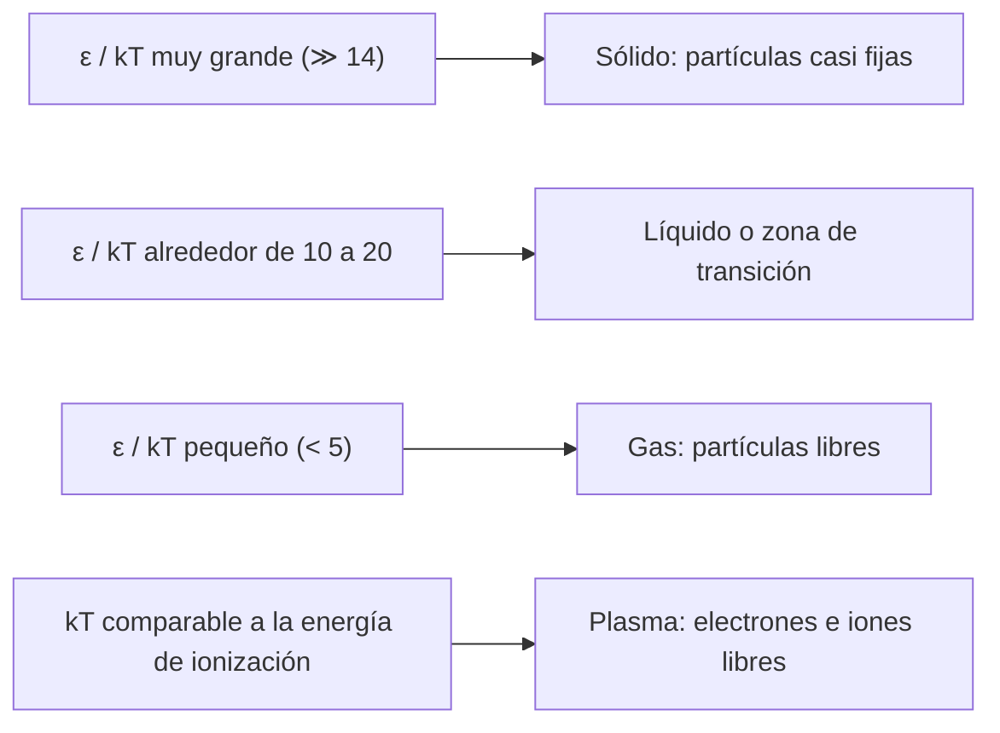

# B06-C10 — Estados de la materia

<!-- nav:top -->
[🏠 Programa](../../../../README.md) · [📚 Bloque B06](../../../tronco-comun/B06-quimica-y-materia-del-universo.md) · [← Anterior: B06-C09 — Gases ideales y no ideales](../B06-C09-gases-ideales-y-no-ideales/CLASE.md) · [Siguiente: B06-C11 — Diagramas de fase →](../B06-C11-diagramas-de-fase/CLASE.md)
<!-- /nav -->

## 1. Ubicación, nivel y alcance

Décima clase del bloque B06. En C09 el gas era un conjunto de moléculas libres. Ahora preguntas qué hace que una sustancia sea sólida, líquida, gaseosa o plasma: una competencia entre la energía de agitación térmica y la energía que une a las partículas. Sigues en el nivel N1.

Verás los cuatro estados de la materia, cómo comparar la energía térmica `kT` con la energía de cohesión por molécula, cómo convertir kJ/mol a eV por molécula y por qué el plasma domina el universo visible. No verás todavía los diagramas de fase (C11) ni la termodinámica formal (B05).

## 2. Por qué esta clase existe

En Marte, la temperatura media es 214 K y la presión media en superficie 6,36 mb (S1). Ese valor está casi en el punto triple del agua, la presión mínima a la que puede existir agua líquida (S2). La Tierra, a 288 K y 1014 mb, tiene océanos; Venus, a 737 K, ya no puede tener agua líquida en superficie. Una sola magnitud, la razón entre energía de cohesión y energía térmica, ya anticipa el orden.

La decisión central es: **dados una sustancia y un ambiente, ¿qué estado cabe esperar y qué razón entre energías lo decide?** Aprenderás a calcular `kT`, a convertir energías de cohesión a eV por molécula y a interpretar su cociente. Es la puerta de C11 (diagramas de fase), C19 (hielos) y de los plasmas de B30.

## 3. Lo que podrás hacer al terminar

1. Describir los estados sólido, líquido, gaseoso y plasma por la libertad de movimiento de sus partículas.
2. Calcular la energía térmica `kT` en eV a una temperatura dada.
3. Convertir una entalpía de cambio de fase de kJ/mol a eV por molécula.
4. Calcular e interpretar el cociente `ε/kT` para el agua y el CO₂ en distintos mundos.
5. Estimar la temperatura a la que `kT` iguala una energía de cohesión o de ionización.
6. Redactar una ficha de comparación energía térmica–cohesión con sus límites.

La evidencia es la **comparación energía térmica–cohesión** del ejercicio 12 (sección 20).

## 4. Con qué llegas y cómo comprobarlo

Necesitas C01 (eV), C06 (mol), C09 (temperatura en K). Cinco preguntas:

1. ¿Cuántos joules son 1 eV?
2. Convierte 44,0 kJ/mol a J por molécula (usa `N_A = 6,022 × 10²³`).
3. Calcula `1,38 × 10⁻²³ × 300`.
4. ¿Es 0,45 eV mayor o menor que 0,025 eV? ¿Cuántas veces?
5. ¿Qué diferencia hay entre un gas y un líquido a nivel de las moléculas?

<details>
<summary>Ver respuestas</summary>

1. 1,602 × 10⁻¹⁹ J. 2. 7,31 × 10⁻²⁰ J. 3. 4,14 × 10⁻²¹ J. 4. Mayor, unas 18 veces. 5. En un gas las moléculas están lejos y se mueven libres; en un líquido están juntas, con atracción, pero sin posiciones fijas.
</details>

Con cuatro o cinco aciertos, sigue. Con tres o menos, repasa C01, C06 y C09.

## 5. Un caso real: el agua de Marte, en el filo

La ficha de la NASA para Marte da una presión media de 6,36 mb (con un rango de 4,0 a 8,7 mb), una temperatura media de unos 214 K y un rango diario de 184 a 242 K en el sitio del Viking 1 (S1). El NIST WebBook indica que la presión del punto triple del agua es 0,0061 bar, es decir, 6,1 mb (S2), de modo que la presión media marciana está justo por encima de ese valor mientras que la temperatura media (214 K) está bien por debajo de 273 K. El agua en la superficie de Marte, por tanto, tiende a estar como hielo o como vapor y no como líquido.

Aquí sólo se plantea el orden de magnitud con energías; el análisis con el diagrama de fases queda para C11. Ten presente el límite: la ficha da medias globales y ni la presión ni la temperatura son uniformes.

## 6. Vocabulario

La **materia** puede estar en distintos **estados**, que se distinguen por la libertad de movimiento de sus partículas. En un **sólido** las partículas ocupan posiciones casi fijas; en un **líquido** están juntas pero se deslizan; en un **gas** están lejos y se mueven libres; en un **plasma** el gas está parcialmente o totalmente **ionizado**, es decir, hay electrones libres e iones.

La **energía térmica** característica por partícula es `kT`, con `k` la constante de Boltzmann y `T` la temperatura absoluta. La **energía de cohesión** `ε` es la que cuesta separar una partícula de sus vecinas; para un líquido que se evapora, es la entalpía de vaporización dividida entre `N_A`. Un **cambio de fase** (fusión, vaporización, sublimación…) ocurre cuando `kT` se acerca a una fracción de `ε`. La **entalpía de vaporización** `ΔH_vap` es la energía por mol necesaria para evaporar un líquido (C12).

## 7. Modelo mental: agitación contra atracción

Piensa en personas bailando en una pista. Si la música es lenta (baja temperatura), se quedan en parejas; si es rápida (alta temperatura), se separan y se mueven solas. La «fuerza» con que se agarran es la energía de cohesión; el ritmo de la música, `kT`.



*Descripción textual:* cuatro cajas ordenadas por el cociente de la energía de cohesión entre la térmica. Un cociente muy grande corresponde a sólidos; alrededor de 10 a 20, a la zona líquida o de transición; uno pequeño, a gases; y si `kT` se acerca a la energía de ionización, a plasma.

La analogía del baile sirve para el balance de energías; su límite es que el estado real también depende de la presión (en un gas denso las partículas vuelven a «agarrarse») y de la entropía, por lo que los umbrales numéricos de la caja son orientativos. La frontera real se estudia en C11.

## 8. La explicación, paso a paso

### 8.1 Los cuatro estados

Sólido, líquido y gas se distinguen por el orden y la distancia entre partículas. El plasma se obtiene cuando la agitación (o la radiación) es tan intensa que arranca electrones de los átomos. En el universo observable, la materia ordinaria que brilla, como las estrellas y el gas entre ellas, está en gran parte en estado de plasma (se estudia en B30).

### 8.2 La energía térmica `kT`

Con `k = 1,380 649 × 10⁻²³ J/K` y `e = 1,602 176 634 × 10⁻¹⁹ C` (exactas), `k/e = 8,617 33 × 10⁻⁵ eV/K` (S3). A 300 K, `kT = 25,85 meV`. En Marte (214 K): `18,44 meV`; en la Tierra (288 K): `24,82 meV`; en Venus (737 K): `63,51 meV`; en la fotosfera solar (5772 K, S4): `497,4 meV`. Una nube densa interestelar a 10 K (valor ilustrativo): `0,862 meV`.

### 8.3 Energía de cohesión por molécula

La entalpía de vaporización del agua a 298 K se obtiene de las entalpías de formación del NIST: `ΔfH(vapor) = −241,826 kJ/mol` y `ΔfH(líquido) = −285,830 kJ/mol`, de modo que `ΔH_vap = 44,004 kJ/mol` (S2). Por molécula: `44 004 J/(6,0221 × 10²³ × 1,6022 × 10⁻¹⁹ J/eV) = 0,4561 eV`. Para el CO₂, la entalpía de sublimación publicada es 26,1 kJ/mol (a 207 K), o `0,2705 eV` por molécula (S2). Son valores a una temperatura concreta; varían algo con ella.

### 8.4 El cociente `ε/kT`

Para el agua: Marte `0,4561/0,01844 = 24,7`; Tierra `18,4`; Venus `7,2`; fotosfera solar `0,9`; nube a 10 K, `529`. En su punto de ebullición normal (373,17 K, S2), `ε/kT = 14,2`. Para el CO₂: Marte `14,7`; Tierra `10,9`; Venus `4,3`. Con la regla orientativa de la caja de la sección 7, el agua en Marte (24,7) es sólida en lo que a energía se refiere, mientras que en Venus (7,2) está bien por debajo del valor de ebullición (14) y se espera como vapor, coherente con las trazas de vapor de agua que la NASA da para Venus (20 ppm, S5).

### 8.5 Plasma: la energía de ionización

La energía para ionizar el hidrógeno desde su estado fundamental es 13,598 eV (S6). La temperatura en la que `kT` iguala esa energía es `13,598/8,617 × 10⁻⁵ = 157 800 K`. En la fotosfera (5772 K), `E_ion/kT = 27`: el gas es en su mayoría de átomos neutros, con una fracción pequeña ionizada. Los plasmas de temperaturas del orden de 10⁵ K o más se estudian en B30. Como el cociente no tiene que ser 1 para que haya ionización apreciable (hay partículas más energéticas que la media), este número da un orden de magnitud y no un umbral.

## 9. Magnitudes, símbolos y unidades

| Símbolo | Qué es | Unidad | Valor o nota |
|---|---|---|---|
| `k` | constante de Boltzmann | J/K | 1,380 649 × 10⁻²³ (exacta) |
| `k/e` | idem en eV | eV/K | 8,617 33 × 10⁻⁵ |
| `kT` | energía térmica | eV, meV | 25,85 meV a 300 K |
| `ΔH_vap` | entalpía de vaporización | kJ/mol | agua, 298 K: 44,004 (derivada) |
| `ε` | energía de cohesión por molécula | eV | agua 0,4561; CO₂ (sublim.) 0,2705 |
| `E_ion` | energía de ionización | eV | H: 13,598 |
| `ε/kT` | cociente de energías | — | agua, ebullición: 14,2 |
| 1 eV | en kJ/mol | kJ/mol | 96,485 |

## 10. Convenciones y referencias

Las energías de cohesión por molécula se calculan dividiendo la entalpía molar entre `N_A`. Cada entalpía se da para una temperatura concreta; aquí se usa la de la fuente sin corregir. La temperatura de 10 K de la nube es **ilustrativa**. Los umbrales del cociente `ε/kT` de la sección 7 son orientativos, no una regla física exacta.

## 11. De dónde sale lo que afirmamos

| ID | Fuente | Localizador | Respalda | Estado |
|---|---|---|---|---|
| S1 | NASA NSSDC, *Mars Fact Sheet* (act. 19-may-2025) | https://nssdc.gsfc.nasa.gov/planetary/factsheet/marsfact.html | Presión 6,36 mb (4,0–8,7), T media 214 K, rango 184–242 K | Página consultada el 2026-11-05 |
| S2 | NIST Chemistry WebBook, H₂O y CO₂ | https://webbook.nist.gov/cgi/cbook.cgi?ID=C7732185 (y `C124389`) | Presión del punto triple 0,0061 bar; ebullición 373,17 ± 0,04 K; ΔfH(g) y ΔfH(l); ΔsubH del CO₂ | Consulta del 2026-11-05 |
| S3 | NIST, *CODATA Recommended Values* (2022): `k` y `e` | https://physics.nist.gov/cgi-bin/cuu/Value?k (y `?e`) | `k` y `e` exactas | Consulta del 2026-11-05 |
| S4 | NASA NSSDC, *Sun Fact Sheet* (act. 9-may-2024) | https://nssdc.gsfc.nasa.gov/planetary/factsheet/sunfact.html | Temperatura efectiva 5772 K | Página consultada el 2026-11-05 |
| S5 | NASA NSSDC, *Venus Fact Sheet* (act. 11-ene-2024) | https://nssdc.gsfc.nasa.gov/planetary/factsheet/venusfact.html | 737 K; vapor de agua 20 ppm | Página consultada el 2026-11-05 |
| S6 | NIST, *Atomic Spectra Database* v5.12 | https://physics.nist.gov/cgi-bin/ASD/ie.pl | Energía de ionización de H I: 13,598 435 eV | Consulta del 2026-11-05 |

Límites: la elección de entalpías a 298 K y 207 K para cocientes a otras temperaturas es una aproximación; los umbrales de la caja de la sección 7 son de la clase, no de una fuente; la ficha de Marte no distingue qué punto geográfico representa la media.

## 12. Cómo ver la competencia de energías

Esta tabla es la versión accesible de un gráfico de barras logarítmico.

| Ambiente | `T` (K) | `kT` (meV) | `ε_agua/kT` | `ε_CO₂/kT` | `E_ion(H)/kT` |
|---|---|---|---|---|---|
| Nube densa (ilustrativo) | 10 | 0,862 | 529 | 314 | 15 780 |
| Marte | 214 | 18,44 | 24,7 | 14,7 | 737 |
| Tierra | 288 | 24,82 | 18,4 | 10,9 | 548 |
| Venus | 737 | 63,51 | 7,2 | 4,3 | 214 |
| Fotosfera solar | 5772 | 497,4 | 0,9 | 0,5 | 27,3 |

Si haces un gráfico, usa escala logarítmica en el cociente y etiqueta cada barra con el ambiente y el valor. Descripción larga: el cociente baja de más de 500 en la nube a menos de 1 en la fotosfera, cruzando el valor de ebullición (14) entre la Tierra y Venus.

## 13. Ejemplo trabajado: ¿líquido o hielo en Marte?

**Pregunta:** a 214 K, ¿cuántas veces supera la energía de cohesión del agua a la energía térmica? ¿Y a 373,17 K?

**Datos (publicados, S1–S3):** `T = 214 K`; `ΔH_vap = 44,004 kJ/mol` (derivada); `k/e = 8,617 33 × 10⁻⁵ eV/K`.

**Paso 1 · `kT` en Marte.** `8,617 33 × 10⁻⁵ × 214 = 0,018 44 eV`.

**Paso 2 · `ε`.** `44 004/(6,0221 × 10²³ × 1,6022 × 10⁻¹⁹) = 0,4561 eV`.

**Paso 3 · Cociente.** `0,4561/0,01844 = 24,7`.

**Paso 4 · En ebullición.** `kT = 0,03216 eV`; cociente `14,2`.

**Paso 5 · Interpretación.** A 214 K el cociente es 1,7 veces el de ebullición: la agitación es insuficiente para liberar las moléculas, por eso lo esperable es hielo (la fusión se trata en C11). En Marte, además, la presión es baja (636 Pa).

**Sentido físico.** Ese cociente de energías ya apunta en el sentido correcto sin conocer el diagrama de fases. Lo que no hace es dar el punto exacto de transición (el agua ebulle cuando el cociente vale 14, no 1), porque eso depende también de la presión y de la entropía, que verás en C11.

## 14. Dos formas de decidir un estado

Puedes **comparar energías** (rápido, con un solo cociente, útil para una primera estimación en cualquier ambiente) o **consultar un diagrama de fases** (preciso, pero requiere presión, temperatura y datos de la sustancia). La primera te dice dónde mirar; la segunda te da la respuesta. Una buena práctica es usar la primera para descartar casos obvios y la segunda para los casos cercanos a la frontera, como el de Marte.

## 15. Práctica guiada

**Ejercicio 1 · con los pasos indicados.** Calcula `kT` a 300 K en meV. *Pasos:* `kT = (k/e) T` (sección 8.2).

<details><summary>Solución comentada</summary>

`8,617 33 × 10⁻⁵ × 300 = 0,025 85 eV = 25,85 meV`. Es el valor de referencia a temperatura ambiente.
</details>

**Ejercicio 2 · con una pista.** Convierte 44,004 kJ/mol a eV por molécula. *Pista:* divide entre `N_A e` en J/mol.

<details><summary>Solución comentada</summary>

`44 004/96 485 = 0,4561 eV`. Si te dio 4,56 × 10⁻²², dividiste por `N_A` pero olvidaste pasar a eV; si te dio 456, olvidaste pasar de kJ a J.
</details>

**Ejercicio 3 · casi autónomo.** Calcula `ε/kT` del agua en Marte a 214 K.

<details><summary>Solución comentada</summary>

`kT = 0,018 44 eV`; `0,4561/0,018 44 = 24,7`.
</details>

## 16. Práctica autónoma, transferencia e integrador

**Ejercicio 4.** ¿A qué temperatura iguala `kT` la energía de cohesión del agua (0,4561 eV)?

<details><summary>Solución comentada</summary>

`T = 0,4561/8,617 × 10⁻⁵ = 5293 K`. Es mucho mayor que el punto de ebullición, porque se necesitan varios `kT` para liberar una molécula.
</details>

**Ejercicio 5.** Calcula `ε/kT` del agua en la Tierra (288 K) y compáralo con el de la ebullición (14,2).

<details><summary>Solución comentada</summary>

`kT = 0,02482 eV`; cociente `18,4`, mayor que 14,2. A 288 K y 1 atm, el agua es líquida (por debajo del punto de ebullición); el valor es coherente con que esté por debajo de la ebullición.
</details>

**Ejercicio 6.** Calcula `E_ion(H)/kT` en la fotosfera solar (5772 K).

<details><summary>Solución comentada</summary>

`kT = 0,4974 eV`; `13,598/0,4974 = 27,3`. La ionización completa no se espera: el hidrógeno está en su mayor parte neutro, aunque una fracción pequeña de partículas muy energéticas sí ioniza.
</details>

**Ejercicio 7.** ¿A qué temperatura `kT` vale 13,598 eV?

<details><summary>Solución comentada</summary>

`13,598/8,617 × 10⁻⁵ = 157 800 K`. Es el orden de magnitud donde se espera un plasma de hidrógeno.
</details>

**Ejercicio 8.** Calcula `ε_CO₂/kT` en Marte con `ε = 26,1 kJ/mol = 0,2705 eV`.

<details><summary>Solución comentada</summary>

`0,2705/0,01844 = 14,7`. El cociente es parecido al de ebullición del agua, pero eso no decide el estado: a 636 Pa la presión es muy baja y la frontera sólido–gas del CO₂ se desplaza a una temperatura mucho menor (en C11 calcularás unos 148 K). A 214 K, el CO₂ marciano es gas. Es otro ejemplo de por qué el cociente solo, sin la presión, no basta.
</details>

**Ejercicio 9 · transferencia.** En Venus (737 K), `ε_agua/kT = 7,2`. ¿Qué estado de agua se espera y qué dato de la NASA lo respalda?

<details><summary>Solución comentada</summary>

Se espera vapor: 7,2 es la mitad del valor de ebullición (14). La ficha de Venus da 20 ppm de vapor de agua en la atmósfera cercana a la superficie (S5), coherente con agua como vapor a 737 K. El cociente no calcula esa fracción; sólo anticipa el estado.
</details>

**Ejercicio 10 · transferencia.** El cociente de ebullición del agua es 14,2. ¿Por qué no es 1?

<details><summary>Solución comentada</summary>

Porque para pasar de líquido a vapor no basta con igualar `kT` a la energía de cohesión: el vapor tiene mucho más desorden (entropía) que el líquido, y a presión de 1 atm el equilibrio se alcanza cuando la ganancia de desorden compensa el coste de energía. Hace falta que `kT` sea una fracción pequeña (1/14) de `ε` para que lo haga. Eso se formaliza con la energía libre (B05).
</details>

**Ejercicio 11 · transferencia.** Un compañero afirma: «el cociente `ε/kT` decide el estado, no la presión». Corrige con el caso del agua.

<details><summary>Solución comentada</summary>

La presión también decide: a 373 K el agua ebulle a 1 atm pero, a una presión menor, ebulle a una temperatura más baja (y en Marte, con 6,4 mb, el líquido apenas es posible). El cociente da una primera estimación, pero la frontera depende de la presión (C11).
</details>

**Ejercicio 12 · integrador.** Elabora la *comparación energía térmica–cohesión* (sección 20) para tres ambientes de tu elección: `T`, `kT`, `ε/kT` para agua y CO₂, `E_ion/kT`, el estado esperado y la advertencia sobre la presión.

<details><summary>Solución modelo</summary>

Con Marte, Tierra y Venus se obtiene la tabla de la sección 12; para cada ambiente se explica qué estado se espera y por qué el cociente no basta. Se acepta cualquier otro ambiente con temperatura publicada (rotulando como ilustrativo cualquier valor no consultado).
</details>

## 17. Laboratorio: kT contra cohesión

El script [energia_termica.py](energia_termica.py) calcula `kT` y los cocientes `ε/kT` y `E_ion/kT` para cinco ambientes. Antes de imprimir comprueba que `kT(300 K) = 25,852 meV`, que `ΔH_vap = 44,004 kJ/mol` cierra con las entalpías de formación, que 1 eV = 96,485 kJ/mol y que `ε_agua = 0,4561 eV`; si algo falla, se detiene.

**Datos:** publicados (S1–S6); la nube a 10 K es **ilustrativa**. **Predice antes de ejecutar:** ¿qué cociente saldrá para el agua en la Tierra? (cerca de 18). **Resultados (2026-11-05, Python 3.12.9):** `ΔH_vap` 44,004 kJ/mol = 0,4561 eV; `ΔH_sub(CO₂)` 0,2705 eV; cocientes `ε_agua/kT`: nube 529,2; Marte 24,7; Tierra 18,4; Venus 7,2; fotosfera 0,9; `E_ion/kT`: 15 780; 737; 548; 214; 27,3; `T(kT = ε_agua)` = 5292 K; `T(kT = E_ion)` = 157 803 K; agua en ebullición: 14,2.

```bash
python programa/clases/B06/B06-C10-estados-de-la-materia/energia_termica.py
```

**Límites:** entalpías a una sola temperatura; ignora la presión y la entropía; los umbrales son orientativos. No sirve para predecir transiciones exactas.

## 18. Errores frecuentes y cómo corregirlos

**Mezclar kJ/mol y eV por molécula.** Se corrige con el ejercicio 2.

**Comparar `kT` con una energía de otra escala.** Se corrige con la sección 8.3.

**Esperar que el cambio de fase ocurra cuando `kT = ε`.** Se corrige con el ejercicio 10.

**Ignorar la presión.** Se corrige con el ejercicio 11.

**Afirmar que el plasma es raro.** Se corrige con la sección 8.1.

## 19. Cómo sabrás que vas bien

Tras 8.2: ¿puedes calcular `kT` para cualquier temperatura? Si no, repite el ejercicio 1. Tras 8.3: ¿puedes pasar de kJ/mol a eV por molécula? Si no, repite el ejercicio 2. Tras 8.4: ¿qué indica un cociente de 7 frente a uno de 25? Si dudas, haz los ejercicios 3 y 9. Tras 8.5: ¿por qué una fotosfera a 5772 K no es un plasma completo? Si no lo sabes, haz el ejercicio 6. Tras el laboratorio: ¿qué comprueba el script antes de imprimir? Si lo ignoras, lee la cabecera.

## 20. Qué entregas y cómo se evalúa

El producto es tu **comparación energía térmica–cohesión**: una tabla de tres ambientes con `kT`, cocientes, estado esperado y una advertencia sobre sus límites.

| Criterio | Inicial | En desarrollo | Logrado | Destacado |
|---|---|---|---|---|
| Cálculo de `kT` | Con errores | Correcto con ayuda | Correcto con unidades | Verifica con un valor conocido |
| Conversión de energías | No convierte | Con errores | Correcta | Valida por dos caminos |
| Interpretación | Sólo el número | Cualitativa | Coherente con datos | Explica por qué no es 1 |
| Rotulado | Mezcla datos y supuestos | Parcial | Distingue ilustrativo | Declara qué falta |
| Límites | Ausentes | Mencionados | Con la presión | Propone el siguiente paso (diagrama de fases) |

**Condiciones críticas:** no presentar el cociente como umbral exacto; no omitir unidades; citar sólo fuentes consultadas.

## 21. Ética, seguridad y límites

Es un cálculo; no hay experimentos con sustancias. Si quieres observar estados de la materia, usa agua y hielo de uso doméstico. No manipules hielo seco (CO₂ sólido) ni nitrógeno líquido sin formación y equipo: provocan quemaduras por frío y, en espacios cerrados, riesgo de asfixia; esta clase no los usa. Accesibilidad: tablas equivalentes al gráfico y fórmulas en texto. Los estados de la materia son una simplificación: hay sustancias que no encajan cómodamente en uno solo.

## 22. Para cerrar y seguir

El estado de una sustancia resulta de una competencia entre la energía de agitación `kT` y la energía de cohesión; su cociente ordena los ambientes (Marte, Tierra, Venus, el Sol) aunque no fije el punto exacto de transición, porque la presión y la entropía también cuentan. La próxima clase añade la presión: el diagrama de fases.

**Glosario español–inglés.** sólido · *solid*; líquido · *liquid*; gas · *gas*; plasma · *plasma*; energía térmica · *thermal energy*; entalpía de vaporización · *enthalpy of vaporization*; energía de cohesión · *cohesion energy*; ionización · *ionization*.

**Continuidad.** B06-C11 ubica estos ambientes en el diagrama de fases con presión y temperatura. B06-C12 calcula entalpías de reacción con el mismo manejo de kJ/mol y eV.

**Referencias:** ver sección 11. S1 a S6 son consultas del 2026-11-05; la temperatura de 10 K y los umbrales son ilustrativos.

<!-- nav:bottom -->
---

[← Anterior: B06-C09 — Gases ideales y no ideales](../B06-C09-gases-ideales-y-no-ideales/CLASE.md) · [📚 Bloque B06](../../../tronco-comun/B06-quimica-y-materia-del-universo.md) · [Siguiente: B06-C11 — Diagramas de fase →](../B06-C11-diagramas-de-fase/CLASE.md)
<!-- /nav -->
