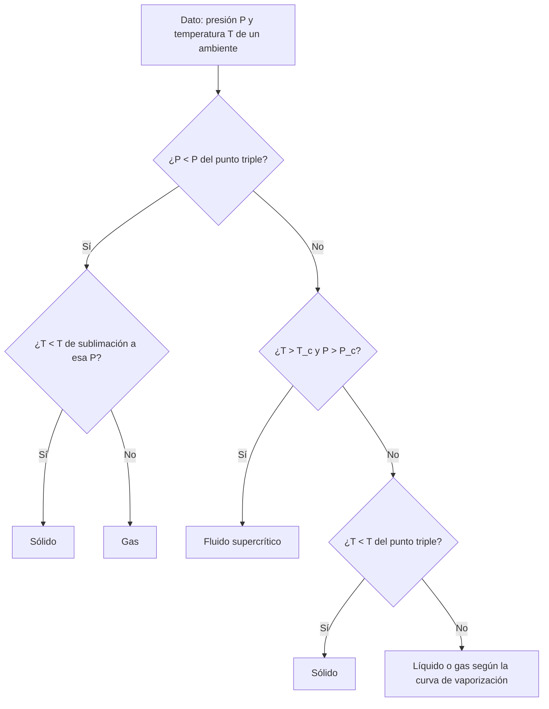

# B06-C11 — Diagramas de fase

<!-- nav:top -->
[🏠 Programa](../../../../README.md) · [📚 Bloque B06](../../../tronco-comun/B06-quimica-y-materia-del-universo.md) · [← Anterior: B06-C10 — Estados de la materia](../B06-C10-estados-de-la-materia/CLASE.md) · [Siguiente: B06-C12 — Termoquímica y energía de reacción →](../B06-C12-termoquimica-y-energia-de-reaccion/CLASE.md)
<!-- /nav -->

## 1. Ubicación, nivel y alcance

Undécima clase del bloque B06. En C10 comparaste la energía térmica con la de cohesión y viste que eso no basta: la presión también decide. El diagrama de fases junta presión y temperatura en un mapa que dice, para cada par de valores, qué estado tiene una sustancia. Sigues en el nivel N1.

Verás las regiones sólida, líquida y gaseosa, las curvas que las separan, el punto triple y el punto crítico, la ecuación de Clausius–Clapeyron que da la forma de esas curvas cerca del punto triple y cómo ubicar en el mapa a Marte, la Tierra y Venus. No verás diagramas de varias sustancias mezcladas (C19) ni termodinámica formal (B05).

## 2. Por qué esta clase existe

La temperatura de ebullición del agua no es una constante de la naturaleza: depende de la presión. En lo alto de una montaña hierve a menos de 100 °C; en Marte, con 6 mb, el agua apenas puede ser líquida; en Venus, a 92 bar y 737 K, el CO₂ no es ni líquido ni gas. Un diagrama de fases resume todo eso.

La decisión central es: **dados la presión y la temperatura de un ambiente, ¿en qué región del diagrama de una sustancia cae, y con qué margen de confianza dada la aproximación que uso para las curvas?** Aprenderás a leer un diagrama, a predecir una curva con Clausius–Clapeyron y a contrastar la predicción con un dato publicado. Es la base de C19 (hielos y minerales) y de los bloques de atmósferas planetarias.

## 3. Lo que podrás hacer al terminar

1. Identificar punto triple, punto crítico y las curvas de un diagrama de fases.
2. Explicar qué es un fluido supercrítico.
3. Usar la ecuación de Clausius–Clapeyron para obtener una temperatura a otra presión.
4. Ubicar un ambiente (presión y temperatura) en el diagrama del agua y del CO₂.
5. Evaluar la calidad de una predicción comparándola con un valor publicado.
6. Redactar una ficha de ubicación en el diagrama de fases con sus aproximaciones.

La evidencia es la **ubicación de un ambiente en el diagrama de fases** del ejercicio 12 (sección 20).

## 4. Con qué llegas y cómo comprobarlo

Necesitas C09 (presión, temperatura) y C10 (`kT`, entalpía de vaporización), y manejo del logaritmo natural. Cinco preguntas:

1. ¿Cuánto es `ln(e)`? ¿Y `ln(100)`, aproximadamente?
2. Convierte 0,0061 bar a pascales.
3. Si una cantidad crece como `e^x`, ¿cómo cambia si x pasa de 1 a 2?
4. ¿Cuál es la presión atmosférica normal en pascales?
5. ¿A qué temperatura en K corresponde 0 °C?

<details>
<summary>Ver respuestas</summary>

1. 1; 4,6. 2. 610 Pa. 3. Se multiplica por `e ≈ 2,7`. 4. 101 325 Pa. 5. 273,15 K.
</details>

Con cuatro o cinco aciertos, sigue. Con tres o menos, repasa C09 y C10.

## 5. Un caso real: agua y CO₂ en tres mundos

Con la temperatura y la presión medias de la NASA (Marte 214 K y 6,36 mb; Tierra 288 K y 1014 mb; Venus 737 K y 92 bar, S1–S3) y los datos del NIST para el agua y el CO₂ (S4, S5), puedes responder preguntas concretas: ¿qué estado tiene el agua en cada mundo? ¿Y el CO₂? Para el agua, el punto triple es 273,16 K (valor histórico recogido en el SI, S6) y 0,0061 bar (S4); para el CO₂, 216,58 K y 5,185 bar (S5).

Ten presente el límite: la presión y la temperatura son medias globales; en cada mundo hay lugares y estaciones con valores muy distintos.

## 6. Vocabulario

Un **diagrama de fases** es un mapa presión–temperatura con las regiones donde una sustancia es sólida, líquida o gaseosa. Las **curvas de equilibrio** separan regiones: **fusión** (sólido–líquido), **vaporización** (líquido–gas) y **sublimación** (sólido–gas). El **punto triple** es el único par (P, T) donde coexisten las tres fases. El **punto crítico** `(T_c, P_c)` es el extremo de la curva de vaporización: por encima de ambos, la sustancia es un **fluido supercrítico**, sin diferencia nítida entre líquido y gas.

La **ecuación de Clausius–Clapeyron** describe la curva de equilibrio entre una fase condensada y el vapor si la entalpía de cambio de fase `ΔH` es constante y el vapor es ideal:

```text
ln(P / P_tp) = −(ΔH / R) (1/T − 1/T_tp)
```

con `R` la constante molar de los gases (C09) y `(T_tp, P_tp)` el punto triple.

## 7. Modelo mental: un mapa con tres países

Imagina un mapa con tres países: sólido, líquido y gas. Las fronteras son las curvas de equilibrio. Hay un punto donde se tocan los tres países (el punto triple). Una de las fronteras, la del líquido y el gas, se termina en un punto (el crítico): más allá, se puede pasar de un país al otro sin cruzar una frontera.



*Descripción textual:* un árbol de decisión. Si la presión es menor que la del punto triple, no hay líquido: es sólido o gas según la temperatura de sublimación. Si es mayor, se mira si el ambiente supera el punto crítico (supercrítico), y si no, si la temperatura es menor que la del punto triple (sólido) o mayor (líquido o gas, según la curva de vaporización).

La analogía del mapa ayuda a ver las regiones; su límite es que las fronteras no son líneas exactas en la naturaleza: cerca del punto crítico las propiedades cambian de forma continua, y las curvas que calculas con una ecuación sencilla son aproximaciones.

## 8. La explicación, paso a paso

### 8.1 Leer el diagrama

En el diagrama del agua, el punto triple es `(273,16 K; 0,0061 bar)` y el punto crítico, `(647 K; 220,64 bar)` (S4). Por debajo de 0,0061 bar no existe agua líquida: el hielo pasa directo a vapor. Para el CO₂, el punto triple está en `5,185 bar`, es decir, a una presión más de cinco veces la atmosférica: por eso el CO₂ sólido a presión ambiental no se funde, sublima (S5). Su punto crítico es `(304,18 K; 73,80 bar)`.

### 8.2 Clausius–Clapeyron

Si se conoce un punto de la curva (el punto triple) y la entalpía de cambio de fase, se puede calcular otro punto: `T = [1/T_tp − (R/ΔH) ln(P/P_tp)]⁻¹`. Para el agua con `ΔH_vap = 44,004 kJ/mol` (C10) y `P = 101 325 Pa`: `ln(101 325/610) = 5,112`; `1/T = 1/273,16 − 8,3145 × 5,112/44 004 = 3,6608 × 10⁻³ − 9,659 × 10⁻⁴ = 2,6949 × 10⁻³`, de modo que `T = 371,08 K`. La ebullición medida es `373,17 ± 0,04 K` (S4): la predicción queda 2,1 K por debajo (0,56 %).

### 8.3 Por qué hay un error y qué dice

La diferencia de 2,1 K se debe en parte a que se usó `ΔH` constante igual al valor a 298 K, mientras que `ΔH` cambia con la temperatura, y a que el punto triple y la ebullición están separados por 100 K. No es un fallo del método sino de su dominio de validez: la ecuación es excelente cerca del punto de partida y se degrada lejos. Con el CO₂, sublimación a 1 atm, y `ΔH_sub = 26,1 kJ/mol`, resulta `194,7 K`; con los extremos publicados (25,2 y 27,2 kJ/mol), `194,0` y `195,5 K`: la incertidumbre de `ΔH` mueve el resultado en 1,5 K (S5).

### 8.4 Ubicar los mundos

**Marte** (636 Pa, 214 K): para el agua, `P > P_tp` pero `T < T_tp`: sólido. Para el CO₂, `P ≪ P_tp` y el punto de escarcha a 636 Pa es `148 K` (de 146 a 150 K según `ΔH`), de modo que a 214 K es gas; solo por debajo de unos 148 K (a esa presión) se condensa. **Tierra** (101 400 Pa, 288 K): agua líquida (la temperatura de ebullición a esa presión es 371 K en nuestro modelo); CO₂ gas. **Venus** (92 bar, 737 K): el CO₂ supera `T_c` y `P_c`: fluido supercrítico; el agua, con `T > 647 K`, no puede ser líquida a ninguna presión.

### 8.5 Presión y ebullición

En una cima con 70 000 Pa, el agua ebulle a `T = [3,6608 × 10⁻³ − 8,3145 ln(70 000/610)/44 004]⁻¹ = 361,7 K` (88,6 °C), según nuestro modelo. Más baja la presión, más baja la temperatura de ebullición. En Marte, con 636 Pa, el modelo daría una temperatura apenas mayor que la del punto triple: el agua líquida es muy poco estable.

## 9. Magnitudes, símbolos y unidades

| Símbolo | Qué es | Unidad | Valor o nota |
|---|---|---|---|
| `T_tp`, `P_tp` | punto triple | K, Pa | agua: 273,16 K, 610 Pa; CO₂: 216,58 K, 5,185 × 10⁵ Pa |
| `T_c`, `P_c` | punto crítico | K, bar | agua: 647 ± 2; 220,64; CO₂: 304,18; 73,80 |
| `ΔH_vap` | entalpía de vaporización | kJ/mol | agua 298 K: 44,004 (derivada, C10) |
| `ΔH_sub` | entalpía de sublimación | kJ/mol | CO₂: 26,1 (25,2–27,2) |
| `R` | constante de los gases | J/(mol K) | 8,314 462 618… |
| `T_b` | ebullición a 1 atm | K | agua: 373,17 ± 0,04 (medida) |

## 10. Convenciones y referencias

La presión del punto triple del agua se toma como 0,0061 bar (610 Pa), con las dos cifras que da el NIST. El punto triple del agua en el SI era 273,16 K por definición antes de 2019; hoy se determina experimentalmente (S6). Los dos modelos de la clase suponen `ΔH` constante y gas ideal. Los umbrales del árbol de decisión de la sección 7 son una simplificación del diagrama real.

## 11. De dónde sale lo que afirmamos

| ID | Fuente | Localizador | Respalda | Estado |
|---|---|---|---|---|
| S1 | NASA NSSDC, *Mars Fact Sheet* (act. 19-may-2025) | https://nssdc.gsfc.nasa.gov/planetary/factsheet/marsfact.html | 6,36 mb y 214 K | Página consultada el 2026-11-05 |
| S2 | NASA NSSDC, *Venus Fact Sheet* (act. 11-ene-2024) y *Earth Fact Sheet* (15-nov-2024) | https://nssdc.gsfc.nasa.gov/planetary/factsheet/venusfact.html (y `earthfact.html`) | Venus 92 bar y 737 K; Tierra 1014 mb y 288 K | Páginas consultadas el 2026-11-05 |
| S3 | NIST Chemistry WebBook, H₂O y CO₂ (entalpías de formación) | https://webbook.nist.gov/cgi/cbook.cgi?ID=C7732185 | `ΔH_vap` derivada: 44,004 kJ/mol | Consulta del 2026-11-05 |
| S4 | NIST Chemistry WebBook, H₂O, datos de cambio de fase | https://webbook.nist.gov/cgi/cbook.cgi?ID=C7732185&Mask=4 | `P_tp` 0,0061 bar (Sato et al., 1991); ebullición 373,17 ± 0,04 K; `T_c` 647 ± 2 K; `P_c` 220,64 bar | Consulta del 2026-11-05 |
| S5 | NIST Chemistry WebBook, CO₂, datos de cambio de fase | https://webbook.nist.gov/cgi/cbook.cgi?ID=C124389&Mask=4 | Punto triple 216,58 K y 5,185 bar; crítico 304,18 K y 73,80 bar; `ΔH_sub` 25,2–27,2 kJ/mol | Consulta del 2026-11-05 |
| S6 | BIPM, *The International System of Units (SI)*, 9.ª ed. (2019), definición del kelvin | Sección 2.3, «The kelvin» | `T_TPW = 273,16 K` según la definición anterior | PDF leído el 2026-11-05 |

Límites: el WebBook da el punto triple del agua con sólo dos cifras en la presión y no indica una temperatura de punto triple en la página consultada; para ésta se usa el valor del SI. Las curvas se calculan con una ecuación aproximada y no se contrastaron con tablas de saturación. El intervalo 193–196 K de la prueba del script lo eligió la clase para cubrir el rango de `ΔH`.

## 12. Cómo ver el diagrama

Esta tabla es la versión accesible de un diagrama presión–temperatura.

| Mundo | `P` | `T` | Agua | CO₂ |
|---|---|---|---|---|
| Marte (media) | 636 Pa | 214 K | sólido (T < T_tp) | gas (frost point 148 K) |
| Tierra | 101 400 Pa | 288 K | líquido | gas |
| Venus | 92 bar | 737 K | vapor / fluido supercrítico (T > T_c) | fluido supercrítico |

Si dibujas el diagrama, usa un eje de presión logarítmico (abarca cinco órdenes de magnitud), marca los puntos triple y crítico con símbolos distintos y etiqueta las regiones con texto, no sólo con color. Descripción larga: tres regiones que se encuentran en el punto triple; la curva de vaporización sube hasta el punto crítico y se detiene.

## 13. Ejemplo trabajado: ¿a qué temperatura se condensa el CO₂ en Marte?

**Pregunta:** a la presión media de Marte (636 Pa), ¿por debajo de qué temperatura aparece hielo de CO₂? **Datos (publicados, S1, S5):** `T_tp = 216,58 K`, `P_tp = 5,185 bar`, `ΔH_sub = 26,1 kJ/mol`.

**Paso 1 · Razón de presiones.** `P/P_tp = 636/518 500 = 1,227 × 10⁻³`; `ln = −6,703`.

**Paso 2 · Aplicar la ecuación.** `1/T = 1/216,58 − (8,3145/26 100) × (−6,703) = 4,6171 × 10⁻³ + 2,1356 × 10⁻³ = 6,7527 × 10⁻³`.

**Paso 3 · Temperatura.** `T = 148,1 K`.

**Paso 4 · Rango.** Con `ΔH = 25,2` y `27,2 kJ/mol`: `146,4` y `150,0 K`.

**Paso 5 · Comparar con el ambiente.** La media de 214 K está 66 K por encima: el CO₂ marciano es gas en la media. Para condensarlo harían falta temperaturas inferiores a unos 148 ± 2 K.

**Sentido físico.** El resultado es una predicción del modelo, no un dato medido; lo que sí es robusto es el orden de magnitud y que la incertidumbre de `ΔH` (1 kJ/mol) mueve el resultado menos de 2 K. Siempre se informa con su rango y con la advertencia del dominio de validez (lejos del punto triple, `ΔH` cambia).

## 14. Dos formas de ubicar un punto

Puedes **leer un diagrama** (rápido, cualitativo, de datos tabulados o dibujados) o **calcular con Clausius–Clapeyron** (rápido, cuantitativo, aproximado). El diagrama real incorpora las variaciones de `ΔH`; la ecuación sencilla las ignora y es buena en una ventana de pocas decenas de kelvin. Para una decisión crítica se usan tablas medidas; para entender y estimar, el modelo.

## 15. Práctica guiada

**Ejercicio 1 · con los pasos indicados.** Ubica el agua a 101 400 Pa y 288 K. *Pasos:* compara con el punto triple y con la ebullición (sección 8.4).

<details><summary>Solución comentada</summary>

`P > P_tp`; `T = 288 K > T_tp` y por debajo de la ebullición (371 K en el modelo, 373 K medida a 1 atm): líquido.
</details>

**Ejercicio 2 · con una pista.** ¿Qué fase tiene el agua a 636 Pa y 214 K? *Pista:* compara `T` con 273,16 K.

<details><summary>Solución comentada</summary>

`T = 214 K < 273,16 K`: sólido (hielo). Aunque 636 Pa supera por poco el punto triple, la temperatura está muy por debajo.
</details>

**Ejercicio 3 · casi autónomo.** ¿Qué fase tiene el CO₂ a 92 bar y 737 K?

<details><summary>Solución comentada</summary>

`T = 737 K > T_c = 304,18 K` y `P = 92 bar > P_c = 73,80 bar`: fluido supercrítico (`T/T_c = 2,42`, `P/P_c = 1,25`).
</details>

## 16. Práctica autónoma, transferencia e integrador

**Ejercicio 4.** Con Clausius–Clapeyron desde el punto triple y `ΔH_vap = 44 004 J/mol`, calcula la presión de vapor del agua a 300 K.

<details><summary>Solución comentada</summary>

`ln(P/610) = −(44 004/8,3145)(1/300 − 1/273,16) = 5292,4 × 3,275 × 10⁻⁴ = 1,733`; `P = 610 × 5,66 = 3452 Pa`. Es una predicción del modelo; no se contrastó con una tabla.
</details>

**Ejercicio 5.** Calcula la diferencia entre la ebullición predicha (371,08 K) y la medida (373,17 K) en kelvin y en porcentaje.

<details><summary>Solución comentada</summary>

`371,08 − 373,17 = −2,09 K`, es decir, `−0,56 %`. La incertidumbre de la medida (0,04 K) es mucho menor: la diferencia es un defecto del modelo, no de la medida.
</details>

**Ejercicio 6.** Calcula el punto de escarcha del CO₂ a 636 Pa con `ΔH_sub = 26,1 kJ/mol`.

<details><summary>Solución comentada</summary>

`148,1 K` (sección 13). Si te dio 1/148, olvidaste invertir el recíproco.
</details>

**Ejercicio 7.** ¿Cómo varía la temperatura de sublimación del CO₂ a 1 atm entre `ΔH = 25,2` y `27,2 kJ/mol`?

<details><summary>Solución comentada</summary>

De `194,0` a `195,5 K`: 1,5 K. La incertidumbre de `ΔH` (±1 kJ/mol, un 4 %) sólo mueve el resultado un 0,8 %.
</details>

**Ejercicio 8.** ¿Cuál es la presión de sublimación del CO₂ a 214 K con `ΔH = 26,1 kJ/mol`? ¿Qué implica para Marte?

<details><summary>Solución comentada</summary>

`P = 5,185 × 10⁵ × exp[−(26 100/8,3145)(1/214 − 1/216,58)] = 4,35 × 10⁵ Pa`. Para que haya hielo de CO₂ a 214 K haría falta una presión de 4,35 bar, 680 veces la de Marte (636 Pa): a esa temperatura, el CO₂ es gas.
</details>

**Ejercicio 9 · transferencia.** En una cima con 70 000 Pa, ¿a qué temperatura ebulle el agua según el modelo?

<details><summary>Solución comentada</summary>

`ln(70 000/610) = 4,743`; `1/T = 3,6608 × 10⁻³ − 8,3145 × 4,743/44 004 = 2,7646 × 10⁻³`; `T = 361,7 K` = 88,6 °C. Menos presión, ebullición a menor temperatura.
</details>

**Ejercicio 10 · transferencia.** ¿Por qué en Venus no se puede hablar de «CO₂ líquido» ni de «CO₂ gas» en la superficie? ¿Y de agua líquida?

<details><summary>Solución comentada</summary>

El CO₂ está por encima de `T_c` y `P_c`: es supercrítico, sin frontera nítida. El agua líquida no puede existir por encima de su temperatura crítica (647 K, S4) a ninguna presión, y Venus está a 737 K.
</details>

**Ejercicio 11 · transferencia.** Un compañero dice: «como la presión media de Marte (6,36 mb) supera el punto triple del agua (6,1 mb), hay agua líquida». Evalúa.

<details><summary>Solución comentada</summary>

Es necesario cumplir ambas condiciones: `P > P_tp` y `T > T_tp`. La temperatura media (214 K) está 59 K por debajo de 273,16 K: el agua es hielo. Además, `P` supera `P_tp` por muy poco (4 %) y la presión varía de 4,0 a 8,7 mb; en parte del año está por debajo. La afirmación es incorrecta.
</details>

**Ejercicio 12 · integrador.** Elabora la *ubicación de un ambiente en el diagrama de fases* (sección 20): para un ambiente con presión y temperatura publicadas, indica la fase del agua y del CO₂, la distancia a la frontera más cercana (en K o en Pa) y la aproximación empleada.

<details><summary>Solución modelo</summary>

Una solución completa sigue el ejemplo trabajado con el ambiente elegido: datos con fuente y fecha, árbol de decisión, cálculo de la frontera con Clausius–Clapeyron y su rango por `ΔH`, y la advertencia de que es un modelo. Se acepta cualquier ambiente con datos publicados.
</details>

## 17. Laboratorio: curvas y regiones

El script [diagramas_de_fase.py](diagramas_de_fase.py) calcula la temperatura de ebullición predicha del agua a 1 atm, la sublimación del CO₂ (con tres valores de `ΔH`) y el punto de escarcha del CO₂ a 636 Pa, y clasifica cuatro ambientes. Antes de imprimir comprueba que la curva pasa por el punto triple, que `P → T → P` es consistente, que la ebullición del agua queda dentro de 3 K de 373,17 K, que la sublimación del CO₂ queda entre 193 y 196 K y que las regiones esperadas se clasifican bien; si algo falla, se detiene.

**Datos:** observados y derivados (S1–S6). **Predice antes de ejecutar:** ¿cuánto se desvía la ebullición predicha? (unos 2 K). **Resultados (2026-11-05, Python 3.12.9):** agua: 371,08 K (−2,09 K respecto de 373,17); CO₂: sublimación a 1 atm 194,0 / 194,7 / 195,5 K y escarcha a 636 Pa 146,4 / 148,1 / 150,0 K para `ΔH` = 25,2 / 26,1 / 27,2; Marte: agua sólida y CO₂ gas; casquete polar de invierno (140 K, **ilustrativo**): CO₂ sólido; Tierra: agua líquida, CO₂ gas; Venus: agua vapor o supercrítico y CO₂ supercrítico.

```bash
python programa/clases/B06/B06-C11-diagramas-de-fase/diagramas_de_fase.py
```

**Límites:** `ΔH` constante, gas ideal, curvas aproximadas y válidas cerca del punto triple; no se calcula la curva de fusión. No sirve para diseñar equipos ni para afirmar presencia de agua líquida en un lugar real.

## 18. Errores frecuentes y cómo corregirlos

**Pensar que sólo importa la temperatura.** Se corrige con el ejercicio 11.

**Usar °C en la ecuación de Clausius–Clapeyron.** Debe ser kelvin; se corrige con el ejercicio 4.

**No invertir el recíproco al final.** Se corrige con el ejercicio 6.

**Extrapolar el modelo lejos del punto triple sin advertirlo.** Se corrige con la sección 8.3 y el ejercicio 5.

**Creer que «supercrítico» es una cuarta fase como el plasma.** Es un fluido sin transición nítida; se corrige con el ejercicio 10.

## 19. Cómo sabrás que vas bien

Tras 8.1: ¿puedes decir qué marcan el punto triple y el crítico? Si no, relee. Tras 8.2: ¿puedes calcular una temperatura con la ecuación? Si no, repite los ejercicios 4 a 6. Tras 8.4: ¿puedes ubicar un mundo en el diagrama del agua? Si no, haz los ejercicios 1 y 2. Tras 8.5: ¿por qué ebulle a menos temperatura en la cima? Si dudas, haz el ejercicio 9. Tras el laboratorio: ¿qué pruebas valida el script? Si lo ignoras, lee la cabecera.

## 20. Qué entregas y cómo se evalúa

El producto es tu **ubicación de un ambiente en el diagrama de fases**: datos con fuente, fase del agua y del CO₂, distancia a la frontera, rango por incertidumbre de `ΔH` y las aproximaciones.

| Criterio | Inicial | En desarrollo | Logrado | Destacado |
|---|---|---|---|---|
| Ubicación | Con errores | Una sustancia | Dos sustancias | Con distancia a la frontera |
| Cálculo (CC) | Sin kelvin o sin inversión | Con ayuda | Correcto | Con rango por `ΔH` |
| Validación | Ninguna | Compara sin diferencia | Con diferencia | Explica el origen de la diferencia |
| Rotulado | Mezcla datos y modelo | Parcial | Distingue medida y predicción | Declara qué no se contrastó |
| Límites | Ausentes | Mencionados | Explicados | Propone un dato mejor |

**Condiciones críticas:** no presentar una predicción como dato medido; no omitir el rango; no usar °C en la ecuación; citar sólo fuentes consultadas.

## 21. Ética, seguridad y límites

Es un cálculo; no hay experimentos. El hielo seco (CO₂ sólido) y los recipientes presurizados son peligrosos: no los uses sin formación (quemaduras por frío, asfixia, explosión). Alternativa sin riesgo: observar el agua y el hielo domésticos o simulaciones. Los resultados no sirven para afirmar que hay agua líquida o hielo en un lugar real, ni para diseñar misiones. Accesibilidad: tablas equivalentes al diagrama, fórmulas en texto.

## 22. Para cerrar y seguir

Un diagrama de fases es el mapa presión–temperatura de una sustancia; Clausius–Clapeyron permite calcular una frontera cerca del punto triple y predecir con 0,6 % de error la ebullición del agua; en Marte el agua es hielo y el CO₂, gas; en Venus el CO₂ es supercrítico. La próxima clase trata la energía que se libera o se absorbe cuando la materia reacciona.

**Glosario español–inglés.** diagrama de fases · *phase diagram*; punto triple · *triple point*; punto crítico · *critical point*; fluido supercrítico · *supercritical fluid*; sublimación · *sublimation*; vaporización · *vaporization*; ecuación de Clausius–Clapeyron · *Clausius–Clapeyron equation*.

**Continuidad.** B06-C12 calcula la energía de las reacciones, incluida la del cambio de fase. B06-C19 aplica este diagrama a hielos de amoníaco y agua en cuerpos fríos.

**Referencias:** ver sección 11. S1 a S6 son consultas del 2026-11-05; las curvas son predicciones de un modelo aproximado.

<!-- nav:bottom -->
---

[← Anterior: B06-C10 — Estados de la materia](../B06-C10-estados-de-la-materia/CLASE.md) · [📚 Bloque B06](../../../tronco-comun/B06-quimica-y-materia-del-universo.md) · [Siguiente: B06-C12 — Termoquímica y energía de reacción →](../B06-C12-termoquimica-y-energia-de-reaccion/CLASE.md)
<!-- /nav -->
