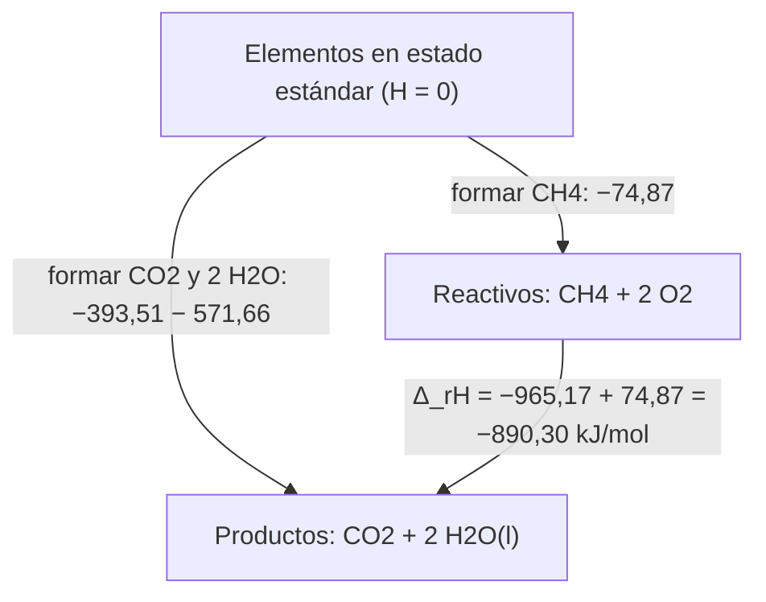

# B06-C12 — Termoquímica y energía de reacción

<!-- nav:top -->
[🏠 Programa](../../../../README.md) · [📚 Bloque B06](../../../tronco-comun/B06-quimica-y-materia-del-universo.md) · [← Anterior: B06-C11 — Diagramas de fase](../B06-C11-diagramas-de-fase/CLASE.md) · [Siguiente: B06-C13 — Equilibrio químico →](../B06-C13-equilibrio-quimico/CLASE.md)
<!-- /nav -->

## 1. Ubicación, nivel y alcance

Duodécima clase del bloque B06 y cierre de su tercer tramo. Ya sabes que una reacción conserva átomos (C08) y que los estados dependen de la energía (C10, C11). Aquí cuantificas cuánta energía se libera o se absorbe cuando las sustancias reaccionan. Sigues en el nivel N1.

Verás la entalpía, la entalpía de formación, la ley de Hess, cómo combinar datos tabulados para obtener la energía de una reacción con su incertidumbre y cómo pasar a energía por masa. No verás espontaneidad ni entropía (B05) ni diseño de propulsores: los cálculos son conceptuales.

## 2. Por qué esta clase existe

Cualquier combustible, de una hoguera a un cohete, libera energía porque los productos están en un estado más estable que los reactivos. ¿Cuánta energía por kilogramo? La respuesta no se mide para cada reacción: se calcula combinando datos tabulados de entalpías de formación, que son datos medidos y evaluados.

La decisión central es: **dada una reacción, ¿cómo obtengo su energía a partir de datos publicados, con qué incertidumbre y con qué supuestos?** Aprenderás a aplicar la ley de Hess, a propagar incertidumbres en cuadratura y a distinguir el agua líquida del vapor en el resultado. Es la base de C13 (equilibrio) y de la energía del cambio de fase de C10 y C11.

## 3. Lo que podrás hacer al terminar

1. Definir entalpía de reacción y entalpía de formación estándar.
2. Aplicar la ley de Hess para calcular la entalpía de una reacción.
3. Propagar incertidumbres de datos tabulados en cuadratura.
4. Pasar de kJ/mol a MJ/kg y a kWh.
5. Explicar la diferencia entre producir agua líquida y vapor.
6. Redactar una ficha de energía de reacción con fuente, incertidumbre y límites.

La evidencia es la **ficha de energía de reacción con incertidumbre** del ejercicio 12 (sección 20).

## 4. Con qué llegas y cómo comprobarlo

Necesitas C08 (ecuaciones balanceadas), C06 (masa molar) y C10 (kJ/mol y eV). Cinco preguntas:

1. Balancea `CH₄ + O₂ → CO₂ + H₂O`.
2. Calcula `−393,51 + 2 × (−285,83)`.
3. ¿Cuántos joules son 890 kJ? ¿Cuántos MJ son 55 000 kJ?
4. Si dos datos tienen incertidumbres 0,13 y 0,08, ¿cuánto vale `√(0,13² + 0,08²)`?
5. ¿Qué diferencia hay entre «libera» y «absorbe» energía?

<details>
<summary>Ver respuestas</summary>

1. `CH₄ + 2 O₂ → CO₂ + 2 H₂O`. 2. −965,17. 3. 890 000 J; 55 MJ. 4. 0,153. 5. Liberar es que el sistema cede energía al entorno (ΔH negativo); absorber es lo contrario (ΔH positivo).
</details>

Con cuatro o cinco aciertos, sigue. Con tres o menos, repasa C06, C08 y C10.

## 5. Un caso real: la energía del hidrógeno y el oxígeno

Una reacción central en la propulsión es la formación de agua a partir de hidrógeno y oxígeno. El NIST WebBook da para el vapor de agua una entalpía de formación estándar de −241,826 ± 0,040 kJ/mol y para el agua líquida de −285,830 ± 0,040 kJ/mol (S1). Así, formar un mol de vapor libera 241,826 kJ. La masa de un mol de agua es 18,0153 g, de modo que son `13,42 MJ` por kilogramo de agua formada.

Para comparar, la fusión del hidrógeno en el Sol libera `26,73 MeV` por cada 4 átomos de hidrógeno (C08), que equivalen a unos `6,4 × 10¹⁴ J/kg`: casi 50 millones de veces más por kilogramo. Ten presente el límite: este cálculo da energía de la reacción ideal; no tiene en cuenta eficiencia, temperatura de la cámara, pérdidas ni nada necesario para diseñar un motor.

## 6. Vocabulario

La **entalpía** `H` es una magnitud de energía que, a presión constante, mide el calor intercambiado en una reacción. La **entalpía de reacción** `Δ_rH` es el cambio de entalpía por mol de reacción tal como está escrita; es **negativa** si la reacción libera energía (exotérmica) y **positiva** si la absorbe (endotérmica). La **entalpía de formación estándar** `Δ_fH°` es la de formar un mol de un compuesto a partir de sus elementos en su estado estándar a 298,15 K y 1 bar; para un elemento en su forma estándar vale cero.

La **ley de Hess** dice que la entalpía de una reacción es la misma sea cual sea el camino: `Δ_rH = Σ ν Δ_fH°(productos) − Σ ν Δ_fH°(reactivos)`, con `ν` los coeficientes de la ecuación balanceada. Un **estado estándar** es una condición de referencia definida (aquí, 1 bar y 298,15 K).

## 7. Modelo mental: un desnivel de energía

Piensa en un valle: los reactivos están en una altura y los productos en otra. Lo que importa para la energía liberada es el desnivel, no el camino. Los elementos puros son el «nivel del mar»; cada compuesto tiene una altura medida desde ahí (su entalpía de formación).



*Descripción textual:* desde los elementos puros (nivel cero) se puede llegar a los reactivos (metano y oxígeno, con una entalpía de formación de −74,87) o a los productos (dióxido de carbono y agua líquida, con −965,17 en total). El cambio entre ambos, −890,30 kJ/mol, es la entalpía de la reacción.

La analogía del valle muestra que la energía depende sólo de los estados inicial y final. Su límite es que no dice cuán rápido se desciende (cinética, C14) ni si el descenso ocurre solo (espontaneidad, B05).

## 8. La explicación, paso a paso

### 8.1 Los datos de partida

Las entalpías de formación en kJ/mol a 298,15 K (S1, S2): `H₂O(g) = −241,826 ± 0,040`; `H₂O(l) = −285,830 ± 0,040`; `CO₂(g) = −393,51 ± 0,13`; `CH₄(g) = −74,87` (NIST-JANAF, Chase 1998) o `−74,6 ± 0,3` (Manion 2002). Los elementos (`H₂`, `O₂`) valen 0. Son datos medidos y evaluados: no los calculamos nosotros.

### 8.2 Aplicar la ley de Hess

Para `CH₄ + 2 O₂ → CO₂ + 2 H₂O(l)`: `Δ_rH = [−393,51 + 2(−285,830)] − [−74,87 + 0] = −965,17 + 74,87 = −890,30 kJ/mol`. Si el agua queda como vapor: `[−393,51 + 2(−241,826)] − [−74,87] = −877,16 + 74,87 = −802,29 kJ/mol`. La diferencia, `88,008 kJ/mol`, es el doble de la entalpía de vaporización (`2 × 44,004`), porque se producen dos moles de agua que o bien quedan líquidos o bien son vapor (C10).

### 8.3 Incertidumbre

Si los datos son independientes, las incertidumbres se suman en cuadratura: `u = √[(0,13)² + (2 × 0,040)²] = 0,15 kJ/mol` sin la del metano. Con el valor alternativo de `CH₄` (−74,6 ± 0,3), `Δ_rH = −890,57 ± 0,34 kJ/mol`. La diferencia entre las dos elecciones de datos para el metano (0,27 kJ/mol) es del orden de la incertidumbre: son consistentes. Cuando hay datos alternativos, se informa el rango.

### 8.4 De kJ/mol a MJ/kg

Un kilogramo de metano son `1/0,0160425 = 62,34 mol`; por tanto la energía es `62,34 × 890,30 = 55 500 kJ = 55,50 MJ`, que equivalen a `15,4 kWh` (1 kWh = 3,6 MJ). Para el hidrógeno: la formación de un kilogramo de vapor de agua libera `241,826/0,0180153 = 13 424 kJ = 13,42 MJ`; si fuera líquida, `15,87 MJ`. Cuando se cita energía «por kilogramo» hay que declarar si se cuenta sólo el combustible, sólo los productos o la mezcla de reactivos.

### 8.5 Qué no dice la entalpía

La entalpía no dice si la reacción ocurre sola (espontaneidad, B05), ni con qué rapidez (C14), ni qué parte de la energía se aprovecha. Es un dato de contabilidad energética a 298 K. A otra temperatura o presión los valores cambian algo (C13). Tampoco incluye la energía necesaria para iniciar la reacción.

## 9. Magnitudes, símbolos y unidades

| Símbolo | Qué es | Unidad | Valor o nota |
|---|---|---|---|
| `Δ_rH` | entalpía de reacción | kJ/mol | CH₄ + 2 O₂ → CO₂ + 2 H₂O(l): −890,30 |
| `Δ_fH°` | entalpía de formación estándar | kJ/mol | H₂O(l) −285,830; CO₂ −393,51 |
| `ν` | coeficiente estequiométrico | — | de la ecuación balanceada |
| `u` | incertidumbre | kJ/mol | en cuadratura |
| `E/m` | energía por masa | MJ/kg | CH₄ 55,50; H₂ + ½ O₂ 13,42 (por kg de agua) |
| 1 kWh | energía | MJ | 3,6 |

## 10. Convenciones y referencias

El signo negativo indica que el sistema libera energía. Los coeficientes de una ecuación son por mol de reacción tal como se escribe. Se usa 298,15 K y 1 bar. Cuando hay dos valores de la literatura se informan ambos. La energía por masa depende de qué masa se divide: combustible, producto o mezcla.

## 11. De dónde sale lo que afirmamos

| ID | Fuente | Localizador | Respalda | Estado |
|---|---|---|---|---|
| S1 | NIST Chemistry WebBook, H₂O (fase gas y líquida) | https://webbook.nist.gov/cgi/cbook.cgi?ID=C7732185&Units=SI&Mask=1 (y `Mask=2`) | `Δ_fH(g) = −241,826 ± 0,040` y `Δ_fH(l) = −285,830 ± 0,040` kJ/mol (Cox, Wagman et al. 1984); masa molar 18,0153 | Consulta del 2026-11-05 |
| S2 | NIST Chemistry WebBook, CO₂ y CH₄ (fase gas) | https://webbook.nist.gov/cgi/cbook.cgi?ID=C124389&Mask=1 (y `C74828`) | `Δ_fH(CO₂) = −393,51 ± 0,13`; `Δ_fH(CH₄) = −74,87` (Chase 1998) y `−74,6 ± 0,3` (Manion 2002); masa molar 16,0425 | Consulta del 2026-11-05 |
| S3 | NIST, *Atomic Weights and Isotopic Compositions*; *CODATA 2022* (`u`, `c`, `e`) | https://physics.nist.gov/cgi-bin/Compositions/stand_alone.pl | Masas de ¹H y ⁴He y constantes para el cociente con la fusión | Consulta del 2026-11-05 |

Límites: las entalpías se tomaron del WebBook y no se verificaron contra las publicaciones originales (Cox, Wagman et al.; Chase; Manion). El WebBook no ofrece sus propias incertidumbres para el valor de Chase. La comparación con la fusión usa el valor propio de 26,73 MeV (C08). La propagación en cuadratura supone datos independientes, lo que no se comprobó.

## 12. Cómo ver los balances

Esta tabla es la versión accesible del esquema de niveles.

| Especie | `Δ_fH°` (kJ/mol) | Coeficiente en la reacción | Contribución (kJ) |
|---|---|---|---|
| CH₄(g) | −74,87 | −1 (reactivo) | +74,87 |
| O₂(g) | 0 | −2 (reactivo) | 0 |
| CO₂(g) | −393,51 | +1 (producto) | −393,51 |
| H₂O(l) | −285,830 | +2 (producto) | −571,66 |
| **Suma** | | | **−890,30** |

Si dibujas el diagrama de niveles, rotula el eje con kJ/mol, marca los elementos como cero y no dependas del color para distinguir reactivos y productos. Descripción larga: los productos quedan más abajo que los reactivos; el escalón de 890 kJ/mol es la energía liberada.

## 13. Ejemplo trabajado: ¿cuánto libera quemar un kilogramo de metano?

**Datos (medidos, S1, S2):** `Δ_fH°`: CH₄ −74,87; CO₂ −393,51; H₂O(l) −285,830 kJ/mol. **Masa molar** del CH₄: 16,0425 g/mol.

**Paso 1 · Ecuación.** `CH₄ + 2 O₂ → CO₂ + 2 H₂O(l)` (balanceada, C08).

**Paso 2 · Productos.** `−393,51 + 2 × (−285,830) = −965,17 kJ`.

**Paso 3 · Reactivos.** `−74,87 + 0 = −74,87 kJ`.

**Paso 4 · Entalpía de reacción.** `−965,17 − (−74,87) = −890,30 kJ/mol`.

**Paso 5 · Por kilogramo.** `1000/16,0425 = 62,34 mol`; `62,34 × 890,30 = 55 500 kJ = 55,50 MJ = 15,4 kWh`.

**Paso 6 · Incertidumbre.** Con el dato alternativo del metano, `−890,57 ± 0,34`: el resultado por kilogramo cambia en 0,02 MJ (0,03 %). Se informa «55,5 MJ/kg (±0,1 %)».

**Sentido físico.** La energía por kilogramo de metano es unas 4 veces la del hidrógeno-oxígeno por kilogramo de agua formada (13,42 MJ/kg), pero la comparación es engañosa: el metano necesita su propio oxígeno, que no se contó. Si se cuenta la masa de la mezcla de reactivos (16,04 + 64,00 = 80,04 g por mol de CH₄), la energía es `890,30/0,08004 = 11,12 MJ/kg`, menor que la del hidrógeno-oxígeno. Por eso hay que declarar qué masa se divide.

## 14. Dos formas de obtener una energía de reacción

Puedes **medirla** (calorimetría, directa pero requiere equipo y cuidado) o **calcularla** con la ley de Hess a partir de datos tabulados (rápida, sin riesgo, con la incertidumbre de los datos). Para un curso de este nivel y para estimaciones en astronomía se calcula; para diseñar procesos reales se usan medidas y tablas más extensas. Declara siempre las tablas usadas y su edición.

## 15. Práctica guiada

**Ejercicio 1 · con los pasos indicados.** Calcula `Δ_rH` de `CH₄ + 2 O₂ → CO₂ + 2 H₂O(l)`. *Pasos:* productos menos reactivos (sección 8.2).

<details><summary>Solución comentada</summary>

`[−393,51 + 2(−285,830)] − [−74,87] = −890,30 kJ/mol`. Si te dio −1040, olvidaste que el CH₄ entra restando.
</details>

**Ejercicio 2 · con una pista.** Calcula la misma reacción si el agua queda como vapor. *Pista:* cambia −285,830 por −241,826.

<details><summary>Solución comentada</summary>

`[−393,51 + 2(−241,826)] − [−74,87] = −802,29 kJ/mol`. Es menos energía liberada, porque una parte quedó almacenada como calor latente del vapor.
</details>

**Ejercicio 3 · casi autónomo.** ¿Cuánto vale la diferencia entre ambos resultados? ¿A qué corresponde?

<details><summary>Solución comentada</summary>

`88,01 kJ/mol = 2 × 44,004`: la entalpía de vaporización de dos moles de agua (C10).
</details>

## 16. Práctica autónoma, transferencia e integrador

**Ejercicio 4.** Calcula `Δ_rH` de `CO₂ + 4 H₂ → CH₄ + 2 H₂O(g)`.

<details><summary>Solución comentada</summary>

`[−74,87 + 2(−241,826)] − [−393,51 + 0] = −558,52 + 393,51 = −165,01 kJ/mol`. Reacción exotérmica. (Se estudia como posible fuente de metano y agua con CO₂ y H₂; aquí sólo se calcula.)
</details>

**Ejercicio 5.** Calcula la energía por kilogramo de metano quemado hasta agua líquida.

<details><summary>Solución comentada</summary>

`890,30 kJ/mol / 0,0160425 kg/mol = 55 500 kJ/kg = 55,50 MJ/kg`.
</details>

**Ejercicio 6.** Calcula la energía liberada por kilogramo de agua (vapor) formada desde H₂ y O₂.

<details><summary>Solución comentada</summary>

`241,826/0,0180153 = 13 424 kJ/kg = 13,42 MJ/kg`.
</details>

**Ejercicio 7.** Expresa 55,50 MJ en kWh.

<details><summary>Solución comentada</summary>

`55,50/3,6 = 15,4 kWh`: un kilogramo de metano equivale a unos 15 kWh de energía.
</details>

**Ejercicio 8.** Propaga en cuadratura la incertidumbre de `Δ_rH` de la combustión (datos de CO₂ y H₂O) sin la del metano.

<details><summary>Solución comentada</summary>

`u = √[0,13² + (2 × 0,040)²] = √(0,0169 + 0,0064) = 0,153 kJ/mol`. El agua cuenta dos veces porque su coeficiente es 2.
</details>

**Ejercicio 9 · transferencia.** Con `CH₄ = −74,6 ± 0,3`, ¿cuánto vale `Δ_rH` y su incertidumbre? ¿Son compatibles los dos resultados?

<details><summary>Solución comentada</summary>

`Δ_rH = −965,17 + 74,6 = −890,57 kJ/mol`; `u = √(0,0169 + 0,0064 + 0,09) = 0,34`. La diferencia con el otro resultado (0,27) es menor que la incertidumbre: son compatibles.
</details>

**Ejercicio 10 · transferencia.** El metano da 55,50 MJ/kg (sólo el combustible) y 11,12 MJ/kg (con el oxígeno). Explica por qué importa decir qué masa se usa.

<details><summary>Solución comentada</summary>

Porque la masa de la mezcla es cinco veces la del combustible (80,04 g frente a 16,04 g por mol), y la energía por masa baja en la misma proporción. Quien compara «MJ/kg» entre combustibles sin declarar la base compara cosas distintas.
</details>

**Ejercicio 11 · transferencia.** La fusión del hidrógeno da `6,4 × 10¹⁴ J/kg` y la reacción H₂ + O₂ da `1,34 × 10⁷ J/kg`. Calcula el cociente e interprétalo.

<details><summary>Solución comentada</summary>

`6,4 × 10¹⁴/1,342 × 10⁷ = 4,8 × 10⁷`. La fusión rinde casi 50 millones de veces más energía por kilogramo, consistente con el 0,71 % de masa convertida de C08 frente a 10⁻¹⁰ de la química.
</details>

**Ejercicio 12 · integrador.** Elabora la *ficha de energía de reacción con incertidumbre* (sección 20): elige una reacción balanceada con datos del WebBook, calcula `Δ_rH` y su incertidumbre, convierte a MJ/kg declarando qué masa divides, y escribe los supuestos.

<details><summary>Solución modelo</summary>

Sigue el ejemplo trabajado de la sección 13 con otra reacción: ecuación balanceada, tabla de contribuciones, `Δ_rH ± u`, energía por kilogramo con la masa declarada, y la advertencia de que es un valor ideal a 298 K, sin eficiencia ni velocidad. Se acepta cualquier reacción cuyos datos hayas consultado.
</details>

## 17. Laboratorio: ley de Hess con incertidumbre

El script [termoquimica.py](termoquimica.py) calcula entalpías de reacción con la ley de Hess y su incertidumbre en cuadratura. Antes de imprimir comprueba que la reacción de formación de un compuesto da su `Δ_fH`, que la diferencia entre producir vapor y líquido es `2 × 44,004`, que invertir la reacción cambia el signo y que duplicar los coeficientes duplica la entalpía; si algo falla, se detiene.

**Datos:** medidos y evaluados (S1, S2). **Predice antes de ejecutar:** ¿cuánto vale la combustión del metano a agua líquida? (cerca de −890). **Resultados (2026-11-05, Python 3.12.9):** combustión a H₂O(l): −890,30 kJ/mol (±0,15 sin la del metano); con CH₄ = −74,6 ± 0,3: −890,57 ± 0,34; a H₂O(g): −802,29 kJ/mol, diferencia 88,008; `CO₂ + 4 H₂ → CH₄ + 2 H₂O(g)`: −165,01 kJ/mol; energía por kg de metano: 55,50 MJ/kg; `H₂ + ½ O₂ → H₂O(g)`: −241,826 kJ/mol = 13,42 MJ por kg de agua.

```bash
python programa/clases/B06/B06-C12-termoquimica-y-energia-de-reaccion/termoquimica.py
```

**Límites:** 298 K, estado estándar, incertidumbres independientes; no calcula temperaturas de llama, rendimiento ni velocidad. No sirve para diseñar combustibles ni motores.

## 18. Errores frecuentes y cómo corregirlos

**Restar al revés (reactivos menos productos).** Se corrige con el ejercicio 1.

**Olvidar el coeficiente estequiométrico.** Se corrige con el ejercicio 8.

**Confundir agua líquida con vapor.** Se corrige con los ejercicios 2 y 3.

**Comparar MJ/kg sin declarar la masa.** Se corrige con el ejercicio 10.

**Creer que una reacción exotérmica ocurre sola.** Se corrige con la sección 8.5.

## 19. Cómo sabrás que vas bien

Tras 8.2: ¿puedes aplicar Hess a otra reacción? Si no, repite los ejercicios 1 y 4. Tras 8.3: ¿cómo sumas incertidumbres? Si dudas, haz el ejercicio 8. Tras 8.4: ¿puedes pasar de kJ/mol a MJ/kg? Si no, repite el ejercicio 5. Tras 8.5: ¿qué no dice la entalpía? Si no lo sabes, relee. Tras el laboratorio: ¿qué clausura valida el script? Si lo ignoras, lee la cabecera.

## 20. Qué entregas y cómo se evalúa

El producto es tu **ficha de energía de reacción con incertidumbre**: ecuación balanceada, tabla de contribuciones, `Δ_rH ± u`, energía por masa con la base declarada y los supuestos.

| Criterio | Inicial | En desarrollo | Logrado | Destacado |
|---|---|---|---|---|
| Ley de Hess | Con errores de signo | Correcta con ayuda | Correcta | Verifica por otro camino |
| Incertidumbre | Ausente | Cualitativa | En cuadratura | Compara dos datos alternativos |
| Energía por masa | Sin base | Con base implícita | Con base declarada | Compara bases |
| Fuentes y datos | Sin edición | Con fuente | Con fuente y fecha | Distingue medida y derivado |
| Límites | Ausentes | Mencionados | Explicados | Señala qué falta (temperatura, velocidad) |

**Condiciones críticas:** no omitir la base de masa; no mezclar vapor y líquido; no usar la energía ideal para decir que un motor rinde eso; citar sólo fuentes consultadas.

## 21. Ética, seguridad y límites

Es un cálculo: no incluye quemar ni mezclar sustancias. Los combustibles, el hidrógeno, el metano y el oxígeno puro forman mezclas explosivas o inflamables; no se proponen experimentos con ellos. Alternativa sin riesgo: calcular con las tablas o simular. Los números no sirven para dimensionar motores, depósitos ni procesos. Accesibilidad: tablas equivalentes al esquema, fórmulas en texto.

## 22. Para cerrar y seguir

La ley de Hess permite obtener la energía de una reacción a partir de entalpías de formación tabuladas, con su incertidumbre; la combustión del metano libera 890,30 kJ/mol (55,5 MJ/kg de combustible), y la formación de agua desde sus elementos, 13,4 MJ por kilogramo de agua. Declara siempre la base de masa y el estado del agua. La siguiente clase pregunta hasta dónde avanza una reacción.

**Glosario español–inglés.** entalpía · *enthalpy*; entalpía de formación · *enthalpy of formation*; ley de Hess · *Hess's law*; exotérmica · *exothermic*; endotérmica · *endothermic*; estado estándar · *standard state*; calor latente · *latent heat*.

**Continuidad.** B06-C13 usa la energía de las reacciones para estudiar su equilibrio. B06-C18 compara estas energías con las de los fotones.

**Referencias:** ver sección 11. S1 y S2 son consultas del 2026-11-05 del WebBook; no se verificaron contra las publicaciones originales.

<!-- nav:bottom -->
---

[← Anterior: B06-C11 — Diagramas de fase](../B06-C11-diagramas-de-fase/CLASE.md) · [📚 Bloque B06](../../../tronco-comun/B06-quimica-y-materia-del-universo.md) · [Siguiente: B06-C13 — Equilibrio químico →](../B06-C13-equilibrio-quimico/CLASE.md)
<!-- /nav -->
