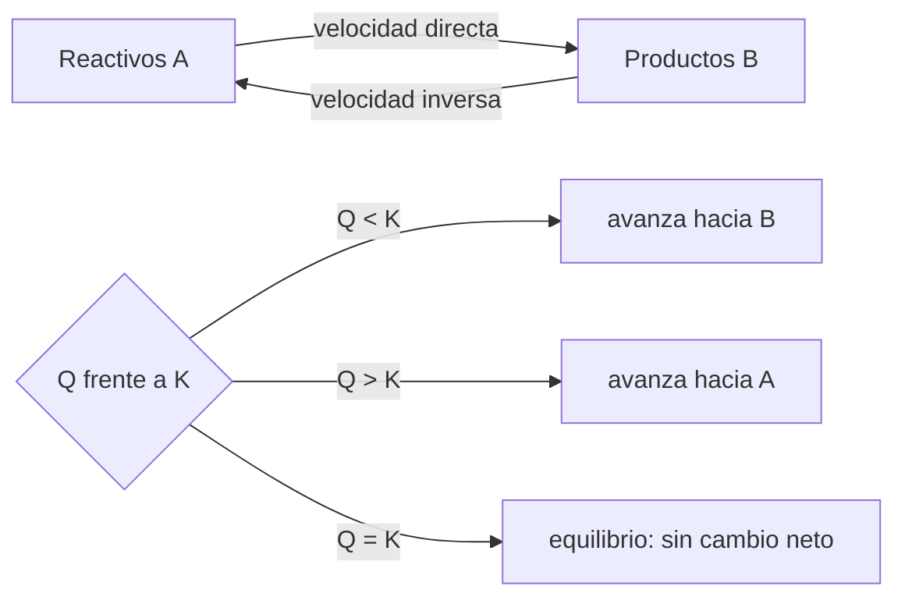

# B06-C13 — Equilibrio químico

<!-- nav:top -->
[🏠 Programa](../../../../README.md) · [📚 Bloque B06](../../../tronco-comun/B06-quimica-y-materia-del-universo.md) · [← Anterior: B06-C12 — Termoquímica y energía de reacción](../B06-C12-termoquimica-y-energia-de-reaccion/CLASE.md) · [Siguiente: B06-C14 — Cinética química inicial →](../B06-C14-cinetica-quimica-inicial/CLASE.md)
<!-- /nav -->

## 1. Ubicación, nivel y alcance

Decimotercera clase del bloque B06 y apertura de su cuarto tramo. Hasta aquí, las reacciones iban «hasta el final». Pero casi ninguna lo hace: llegan a un estado en que las cantidades dejan de cambiar porque el proceso directo y el inverso ocurren al mismo ritmo. Ese es el equilibrio. Sigues en el nivel N1.

Verás la constante de equilibrio `K`, el cociente de reacción `Q`, cómo decidir en qué sentido avanza un sistema, la tabla de concentraciones inicial–cambio–equilibrio, el principio de Le Chatelier y la dependencia de `K` con la temperatura. No verás todavía la velocidad de las reacciones (C14) ni la energía libre (B05).

## 2. Por qué esta clase existe

Según el cálculo de esta clase, el CO₂ de Marte puede condensarse como hielo o volver al gas según la temperatura. Es un equilibrio entre CO₂ sólido y gas: `CO₂(s) ⇌ CO₂(g)`. Con lo aprendido en C11 puedes calcular la temperatura a la que están en equilibrio, y con esta clase puedes decir en qué sentido va el sistema si la temperatura cambia.

La decisión central es: **dado un sistema reactivo a una temperatura, ¿en qué sentido evoluciona, hasta dónde llega y cómo cambia si lo perturbo?** Aprenderás a calcular `Q`, comparar con `K`, resolver una tabla ICE y predecir una perturbación. Prepara C14 (cinética), C15 (ácidos y bases) y C19 (hielos).

## 3. Lo que podrás hacer al terminar

1. Escribir la constante de equilibrio de una reacción, incluyendo sólidos y gases.
2. Calcular el cociente de reacción `Q` y compararlo con `K`.
3. Resolver una tabla ICE para un equilibrio sencillo.
4. Predecir el efecto de agregar un componente (Le Chatelier) y verificarlo numéricamente.
5. Estimar el cambio de `K` con la temperatura (van 't Hoff).
6. Redactar un cálculo de equilibrio verificado con sus supuestos.

La evidencia es el **cálculo de equilibrio verificado** del ejercicio 12 (sección 20).

## 4. Con qué llegas y cómo comprobarlo

Necesitas C09 (presión parcial), C11 (Clausius–Clapeyron) y C12 (signo de `ΔH`). Cinco preguntas:

1. Calcula `0,2²/0,4`.
2. Resuelve `4x² + 0,1x − 0,05 = 0` para `x > 0`.
3. Si la presión total es 636 Pa y el CO₂ es el 95,1 %, ¿cuál es la presión parcial?
4. Una reacción con `ΔH > 0`, ¿es exotérmica o endotérmica?
5. ¿Qué es una presión parcial?

<details>
<summary>Ver respuestas</summary>

1. 0,1. 2. `x = 0,1` (se verifica: `0,04 + 0,01 = 0,05`). 3. `0,951 × 636 = 604,8 Pa`. 4. Endotérmica. 5. La parte de la presión total que aporta un gas de la mezcla (`y_i P`).
</details>

Con cuatro o cinco aciertos, sigue. Con tres o menos, repasa C09, C11 y C12.

## 5. Un caso real: el CO₂ de Marte entre el hielo y el aire

El 95,1 % de la atmósfera marciana es CO₂ y la presión media en la superficie es 636 Pa (S1); la presión parcial del CO₂ es entonces `604,8 Pa`. Con el punto triple del CO₂ (216,58 K; 5,185 bar) y la entalpía de sublimación de 26,1 kJ/mol del NIST WebBook (S2), Clausius–Clapeyron da la presión de equilibrio del hielo con su vapor a cada temperatura. Si la presión parcial real supera esa presión de saturación, el CO₂ se condensa; si es menor, el hielo se sublima.

El equilibrio ocurre a `147,7 K` con la presión parcial del CO₂ (148,1 K con la presión total). Ten presente el límite: es una predicción de un modelo con `ΔH` constante; el rango publicado de `ΔH` (25,2 a 27,2 kJ/mol) mueve el resultado un par de kelvin (C11).

## 6. Vocabulario

Un **equilibrio químico** es un estado en el que las velocidades de la reacción directa e inversa son iguales y las concentraciones no cambian. Se escribe con una doble flecha: `A ⇌ B`. La **constante de equilibrio** `K` es el cociente entre productos y reactivos elevados a sus coeficientes, medido en el equilibrio. Para gases se usan presiones parciales divididas entre una presión estándar `p° = 1 bar`; para disoluciones, concentraciones divididas entre 1 mol/L; los **sólidos y líquidos puros** no aparecen (su actividad vale 1).

El **cociente de reacción** `Q` tiene la misma forma que `K` pero con las concentraciones o presiones **actuales**. Si `Q < K`, el sistema avanza hacia los productos; si `Q > K`, hacia los reactivos; si `Q = K`, está en equilibrio. El **principio de Le Chatelier** dice que un sistema en equilibrio sometido a una perturbación se desplaza en el sentido que la contrarresta. La **tabla ICE** (inicial, cambio, equilibrio) organiza el cálculo.

## 7. Modelo mental: dos corrientes que se igualan

Imagina un río con dos canales que se cruzan: uno lleva agua de A hacia B y otro de B hacia A. Si A tiene más agua, fluye más hacia B hasta que los dos flujos se igualan. Entonces los niveles dejan de cambiar, aunque el agua siga circulando.



*Descripción textual:* arriba, dos flechas entre reactivos y productos, una por sentido. Abajo, una decisión: si el cociente de reacción es menor que la constante, el sistema avanza hacia productos; si es mayor, hacia reactivos; si es igual, está en equilibrio.

La analogía del río muestra el equilibrio dinámico: no es que todo se detenga, sino que los flujos se compensan. Su límite es que no explica por qué `K` toma un valor y no otro, ni cuánto tarda en alcanzarse (C14).

## 8. La explicación, paso a paso

### 8.1 Escribir `K`

Para `CO₂(s) ⇌ CO₂(g)`, el sólido no aparece: `K = p(CO₂)/p°`. Para `A ⇌ 2B` en disolución, `K = [B]²/[A]`. En una ecuación con coeficientes, estos pasan a exponentes. `K` depende de la temperatura, no de las cantidades iniciales.

### 8.2 `K` desde datos: el equilibrio sólido–gas del CO₂

La presión de saturación del CO₂ a la temperatura `T` sale de Clausius–Clapeyron (C11), y entonces `K(T) = P_sat(T)/p°`. A 140 K, `K = 1,87 × 10⁻³`; a 148 K, `6,28 × 10⁻³`; a 160 K, `3,08 × 10⁻²`; a 214 K, `4,35`. `K` crece con la temperatura porque la sublimación es endotérmica (`ΔH > 0`): `K(160 K)/K(140 K) = 16,5`.

### 8.3 `Q` frente a `K`

Con la presión parcial del CO₂ marciano, `Q = 604,8/10⁵ = 6,05 × 10⁻³`. A 140 K, `K = 1,87 × 10⁻³ < Q`: el sistema va hacia los reactivos, es decir, **se condensa** el CO₂. A 148 K, `K = 6,28 × 10⁻³ > Q` (por poco): sublimación. A 160 K y 214 K, la sublimación es claramente favorable. El equilibrio está donde `Q = K`: `147,7 K`.

### 8.4 La tabla ICE

Sea la reacción **sintética** `A ⇌ 2B`, con `K = 0,10` y `[A]₀ = 0,50 mol/L`, `[B]₀ = 0`. Si avanza `x`: `[A] = 0,50 − x` y `[B] = 2x`. Entonces `(2x)²/(0,50 − x) = 0,10`, es decir, `4x² + 0,10x − 0,05 = 0`, con raíz positiva `x = 0,10`. Resultado: `[A] = 0,40`, `[B] = 0,20 mol/L`, y una conversión de 20 %. Comprobación: `0,20²/0,40 = 0,10 = K`. El laboratorio resuelve el sistema por dos métodos y obtiene el mismo valor.

### 8.5 Le Chatelier y la temperatura

Si en el equilibrio anterior se añaden 0,30 mol/L de B, `Q = 0,50²/0,40 = 0,625 > K`: el sistema se desplaza hacia A. El nuevo equilibrio resulta `[A] = 0,5344`, `[B] = 0,2312` (y `Q` vuelve a 0,100). Con la temperatura, la ecuación de van 't Hoff dice `ln(K₂/K₁) = −(ΔH/R)(1/T₂ − 1/T₁)`: para una reacción exotérmica como la `CO₂ + 4 H₂ → CH₄ + 2 H₂O` (`ΔH = −165 kJ/mol`, C12), pasar de 300 K a 600 K reduce `K` por un factor de `4 × 10⁻¹⁵`: la subida de temperatura desfavorece los productos. El valor es un ejemplo de tendencia, no de un reactor real.

## 9. Magnitudes, símbolos y unidades

| Símbolo | Qué es | Unidad | Valor o nota |
|---|---|---|---|
| `K` | constante de equilibrio | — | adimensional (con estado estándar) |
| `Q` | cociente de reacción | — | mismo formato que `K` |
| `p°` | presión estándar | Pa | 10⁵ (1 bar) |
| `p_i` | presión parcial | Pa | `y_i P` |
| `x` | avance de la reacción | mol/L | tabla ICE |
| `ΔH` | entalpía de reacción | kJ/mol | CO₂(s)→CO₂(g): +26,1 |
| `R` | constante de los gases | J/(mol K) | 8,314 462 618… |

## 10. Convenciones y referencias

Las constantes de equilibrio se dan adimensionales, con referencia a un estado estándar (1 bar o 1 mol/L). Los sólidos puros tienen actividad 1. La reacción `A ⇌ 2B` y sus valores son **sintéticos**, sin correspondencia con una sustancia real. Las presiones parciales se calculan con la composición de la NASA (C07).

## 11. De dónde sale lo que afirmamos

| ID | Fuente | Localizador | Respalda | Estado |
|---|---|---|---|---|
| S1 | NASA NSSDC, *Mars Fact Sheet* (act. 19-may-2025) | https://nssdc.gsfc.nasa.gov/planetary/factsheet/marsfact.html | 636 Pa de presión media y 95,1 % de CO₂ | Página consultada el 2026-11-05 |
| S2 | NIST Chemistry WebBook, CO₂ (cambio de fase) | https://webbook.nist.gov/cgi/cbook.cgi?ID=C124389&Mask=4 | Punto triple 216,58 K y 5,185 bar; `ΔH_sub` 25,2–27,2 kJ/mol | Consulta del 2026-11-05 |
| S3 | NIST, *CODATA Recommended Values* (2022): `R` | https://physics.nist.gov/cgi-bin/cuu/Value?r | `R` | Consulta del 2026-11-05 |
| S4 | NIST Chemistry WebBook, H₂O, CO₂ y CH₄ (formación) | https://webbook.nist.gov/cgi/cbook.cgi?ID=C74828 | `ΔH = −165 kJ/mol` de la metanación (C12) | Consulta del 2026-11-05 |

Límites: el equilibrio sólido–gas del CO₂ en Marte es una predicción del modelo de Clausius–Clapeyron, no un dato medido; no se contrastó con observaciones de la escarcha marciana. La reacción `A ⇌ 2B` es sintética. La presión parcial supone que la composición de la ficha de la NASA es uniforme.

## 12. Cómo ver el equilibrio

Esta tabla es la versión accesible de una gráfica de `K` frente a la temperatura.

| Temperatura (K) | `K(T)` | `Q` (Marte) | Sentido |
|---|---|---|---|
| 140 | 1,87 × 10⁻³ | 6,05 × 10⁻³ | hacia reactivos (condensa) |
| 148 | 6,28 × 10⁻³ | 6,05 × 10⁻³ | hacia productos (sublima, por poco) |
| 160 | 3,08 × 10⁻² | 6,05 × 10⁻³ | hacia productos (sublima) |
| 214 | 4,35 | 6,05 × 10⁻³ | hacia productos (sublima) |

Si dibujas `K(T)`, usa escala logarítmica en `K` y marca el cruce con `Q`. Descripción larga: `K` sube más de tres órdenes de magnitud entre 140 K y 214 K; cruza el valor de `Q` cerca de 148 K.

## 13. Ejemplo trabajado: tabla ICE de `A ⇌ 2B` y perturbación

**Datos (sintéticos):** `K = 0,10`; `[A]₀ = 0,50`; `[B]₀ = 0`.

**Paso 1 · Planteo.** `[A] = 0,50 − x`; `[B] = 2x`.

**Paso 2 · Ecuación.** `4x²/(0,50 − x) = 0,10` → `4x² + 0,10x − 0,05 = 0`.

**Paso 3 · Solución.** `x = [−0,10 + √(0,01 + 0,80)]/8 = (−0,10 + 0,90)/8 = 0,100`.

**Paso 4 · Equilibrio.** `[A] = 0,400`; `[B] = 0,200`; `Q = 0,200²/0,400 = 0,100 = K` ✓.

**Paso 5 · Perturbación.** Se añaden 0,30 mol/L de B: `[B] = 0,50`; `Q = 0,25/0,40 = 0,625 > K`; el sistema va hacia A. Con un avance inverso `y`: `(0,50 − 2y)²/(0,40 + y) = 0,10`, es decir, `4y² − 2,1y + 0,21 = 0`, `y = 0,1344`. Entonces `[A] = 0,5344` y `[B] = 0,2312`; comprobación: `0,2312²/0,5344 = 0,100` ✓.

**Sentido físico.** Una perturbación no destruye el equilibrio: lo reubica, y `K` sigue siendo la misma. El sentido del desplazamiento se anticipa con `Q` frente a `K`, y el cálculo lo cuantifica.

## 14. Dos formas de resolver un equilibrio

Puedes **resolver algebraicamente** (la fórmula cuadrática, exacta para ecuaciones sencillas) o **numéricamente** (bisección sobre el avance, que sirve para cualquier ecuación). El laboratorio usa los dos y comprueba que coinciden. El método numérico es la herramienta general; el algebraico, una verificación. Siempre se comprueba que `Q = K` con las concentraciones obtenidas.

## 15. Práctica guiada

**Ejercicio 1 · con los pasos indicados.** Escribe la constante de equilibrio de `CO₂(s) ⇌ CO₂(g)`. *Pasos:* los sólidos no aparecen (sección 8.1).

<details><summary>Solución comentada</summary>

`K = p(CO₂)/p°`. Si escribiste `K = p(CO₂)/[CO₂(s)]`, incluiste el sólido: su actividad vale 1 y no aparece.
</details>

**Ejercicio 2 · con una pista.** A 140 K, `K = 1,87 × 10⁻³` y `Q = 6,05 × 10⁻³`. ¿Hacia dónde evoluciona el CO₂ marciano? *Pista:* compara `Q` con `K`.

<details><summary>Solución comentada</summary>

`Q > K`: hacia reactivos, es decir, hacia el CO₂ sólido: se condensa.
</details>

**Ejercicio 3 · casi autónomo.** Resuelve la tabla ICE de `A ⇌ 2B` con `K = 0,10` y `[A]₀ = 0,50`.

<details><summary>Solución comentada</summary>

`x = 0,10`; `[A] = 0,40`; `[B] = 0,20`. Comprobación: `0,20²/0,40 = 0,10`.
</details>

## 16. Práctica autónoma, transferencia e integrador

**Ejercicio 4.** ¿Qué porcentaje de A se convierte en B en el ejercicio 3?

<details><summary>Solución comentada</summary>

`0,10/0,50 = 20 %`.
</details>

**Ejercicio 5.** Tras añadir 0,30 mol/L de B al equilibrio, calcula `Q` y di hacia dónde se desplaza.

<details><summary>Solución comentada</summary>

`Q = 0,50²/0,40 = 0,625 > K = 0,10`: hacia A (reactivos).
</details>

**Ejercicio 6.** Calcula el nuevo equilibrio.

<details><summary>Solución comentada</summary>

Con avance inverso `y`: `4y² − 2,1y + 0,21 = 0`, `y = (2,1 − √1,05)/8 = 0,1344`. `[A] = 0,5344`; `[B] = 0,50 − 0,2688 = 0,2312`. Comprobación: `0,2312²/0,5344 = 0,1000`. Se toma la raíz menor porque la mayor daría un `[B]` negativo.
</details>

**Ejercicio 7.** ¿Cuánto crece `K` del CO₂ entre 140 K y 160 K y por qué?

<details><summary>Solución comentada</summary>

`3,08 × 10⁻²/1,87 × 10⁻³ = 16,5` veces. Crece porque la sublimación es endotérmica (`ΔH = +26,1 kJ/mol`): una temperatura mayor favorece los productos.
</details>

**Ejercicio 8.** Explica por qué los sólidos puros no aparecen en `K`.

<details><summary>Solución comentada</summary>

Porque su actividad (concentración efectiva) no cambia con la cantidad de sólido: vale 1. Tener más hielo no cambia la presión de equilibrio del vapor; sólo cambia cuánto hay de cada fase.
</details>

**Ejercicio 9 · transferencia.** Calcula el punto de escarcha usando la presión parcial (604,8 Pa) y la total (636 Pa) y compara.

<details><summary>Solución comentada</summary>

Con la parcial, `147,7 K`; con la total, `148,1 K`: 0,35 K de diferencia. La parcial es la correcta porque sólo el CO₂ condensa; la diferencia, pequeña porque el CO₂ es casi toda la atmósfera.
</details>

**Ejercicio 10 · transferencia.** La reacción `CO₂ + 4 H₂ → CH₄ + 2 H₂O(g)` tiene `ΔH = −165 kJ/mol`. ¿Qué pasa con `K` al calentar de 300 a 600 K?

<details><summary>Solución comentada</summary>

`ln(K₂/K₁) = (165 000/8,3145)(1/600 − 1/300) = −33,1`; `K₂/K₁ = 4,3 × 10⁻¹⁵`. `K` desciende enormemente: en una reacción exotérmica, calentar desfavorece los productos. Que la velocidad (C14) suba con la temperatura es otra cuestión.
</details>

**Ejercicio 11 · transferencia.** «En el equilibrio las concentraciones de reactivos y productos son iguales.» Corrige con la tabla ICE.

<details><summary>Solución comentada</summary>

En el ejemplo, `[A] = 0,40` y `[B] = 0,20`: distintas. En el equilibrio es el cociente `Q` el que vale `K`; las concentraciones dependen de `K`, de los coeficientes y de las cantidades iniciales.
</details>

**Ejercicio 12 · integrador.** Elabora el *cálculo de equilibrio verificado* (sección 20): elige una temperatura y calcula `K` y `Q` del CO₂ en Marte (o resuelve una tabla ICE propia con `K` y concentraciones declaradas), indica el sentido, verifica `Q = K` y escribe supuestos y límites.

<details><summary>Solución modelo</summary>

Con la tabla ICE: ver el ejemplo trabajado. Con el CO₂: `K(T)` por Clausius–Clapeyron con la fuente y fecha, `Q = 604,8/10⁵`, sentido, `T` de equilibrio y su rango por `ΔH`. La verificación `Q = K` es obligatoria; si el sistema es sintético, debe rotularse.
</details>

## 17. Laboratorio: sólido–gas del CO₂ y tabla ICE

El script [equilibrio.py](equilibrio.py) calcula `K(T)`, `Q` y el sentido para el CO₂ marciano, y resuelve la tabla ICE de `A ⇌ 2B` por bisección y por fórmula cuadrática, con la perturbación de Le Chatelier. Antes de imprimir comprueba que `Q = K` tras resolver, que los dos métodos coinciden a 10⁻⁶, que la solución exacta es `[A] = 0,4`, que añadir B desplaza hacia reactivos y que `K(T_triple) = P_tp/p°`; si algo falla, se detiene.

**Datos:** observados y medidos (S1, S2); reacción `A ⇌ 2B` **sintética**. **Predice antes de ejecutar:** ¿qué temperatura de equilibrio? (cerca de 148 K). **Resultados (2026-11-05, Python 3.12.9):** `p(CO₂) = 604,8 Pa`; `Q = 6,048 × 10⁻³`; `T_eq = 147,74 K` (148,09 K con la presión total); `K` = 1,869 × 10⁻³ (140 K), 6,280 × 10⁻³ (148 K), 3,082 × 10⁻² (160 K), 4,354 (214 K); `K(160)/K(140) = 16,5`; ICE: `[A] = 0,4000`, `[B] = 0,2000`, conversión 20,0 %; tras añadir 0,30 mol/L de B: `Q = 0,625` y nuevo equilibrio `[A] = 0,5344`, `[B] = 0,2312`; van 't Hoff (−165 kJ/mol, 300→600 K): `K₂/K₁ = 4,32 × 10⁻¹⁵`.

```bash
python programa/clases/B06/B06-C13-equilibrio-quimico/equilibrio.py
```

**Límites:** gas ideal, `ΔH` constante, un solo equilibrio, sin cinética. No sirve para predecir el comportamiento real de la escarcha ni para diseñar reactores.

## 18. Errores frecuentes y cómo corregirlos

**Incluir sólidos en `K`.** Se corrige con el ejercicio 1.

**Invertir la comparación entre `Q` y `K`.** Se corrige con el ejercicio 2.

**Olvidar el cuadrado de los coeficientes.** Se corrige con el ejercicio 3.

**Tomar la raíz equivocada de la cuadrática.** Se corrige con el ejercicio 6.

**Pensar que el equilibrio es igualdad de cantidades.** Se corrige con el ejercicio 11.

## 19. Cómo sabrás que vas bien

Tras 8.1: ¿puedes escribir `K` de una reacción con sólidos? Si no, repite el ejercicio 1. Tras 8.3: ¿puedes decidir el sentido con `Q` y `K`? Si no, repite el ejercicio 2. Tras 8.4: ¿puedes resolver una tabla ICE? Si no, haz los ejercicios 3 y 4. Tras 8.5: ¿qué pasa al añadir un producto? Si dudas, haz los ejercicios 5 y 6. Tras el laboratorio: ¿qué verifica siempre el script? Si lo ignoras, lee su cabecera.

## 20. Qué entregas y cómo se evalúa

El producto es tu **cálculo de equilibrio verificado**: expresión de `K`, datos con fuente (o rotulados como sintéticos), `Q`, sentido, solución con la verificación `Q = K` y los supuestos.

| Criterio | Inicial | En desarrollo | Logrado | Destacado |
|---|---|---|---|---|
| Expresión de `K` | Con errores | Correcta con ayuda | Correcta | Justifica sólidos y estado estándar |
| `Q` frente a `K` | No compara | Compara sin sentido | Predice el sentido | Verifica numéricamente |
| Tabla ICE | Planteo incorrecto | Correcta con error | Correcta | Resuelve por dos métodos |
| Verificación | Ninguna | `Q ≈ K` aproximado | `Q = K` explícito | Con tolerancia declarada |
| Rotulado y límites | Mezcla datos y modelo | Parcial | Distingue sintético | Declara qué no se contrastó |

**Condiciones críticas:** no presentar una reacción sintética como real; verificar `Q = K`; no incluir sólidos puros en `K`; citar sólo fuentes consultadas.

## 21. Ética, seguridad y límites

Es un cálculo; no hay experimentos. El hidrógeno, el CO₂ a presión y los reactores catalíticos requieren formación y equipo especial; esta clase no describe cómo operarlos. Alternativa sin riesgo: resolver las tablas ICE y simular. Accesibilidad: tablas equivalentes a las gráficas y fórmulas en texto.

## 22. Para cerrar y seguir

Un equilibrio es un estado dinámico en que `Q = K`; comparar `Q` con `K` dice hacia dónde evoluciona un sistema, la tabla ICE dice hasta dónde, y `K` cambia con la temperatura según el signo de `ΔH`. En Marte, el CO₂ se condensa por debajo de unos 148 K y se sublima por encima. La próxima clase pregunta cuánto tarda en alcanzarse un equilibrio.

**Glosario español–inglés.** equilibrio químico · *chemical equilibrium*; constante de equilibrio · *equilibrium constant*; cociente de reacción · *reaction quotient*; principio de Le Chatelier · *Le Chatelier's principle*; tabla ICE · *ICE table*; presión parcial · *partial pressure*.

**Continuidad.** B06-C14 estudia la velocidad con la que se alcanza un equilibrio. B06-C15 aplica `K` a ácidos y bases, y B06-C19 a hielos y minerales.

**Referencias:** ver sección 11. S1 a S4 son consultas del 2026-11-05; el equilibrio de Marte es una predicción del modelo.

<!-- nav:bottom -->
---

[← Anterior: B06-C12 — Termoquímica y energía de reacción](../B06-C12-termoquimica-y-energia-de-reaccion/CLASE.md) · [📚 Bloque B06](../../../tronco-comun/B06-quimica-y-materia-del-universo.md) · [Siguiente: B06-C14 — Cinética química inicial →](../B06-C14-cinetica-quimica-inicial/CLASE.md)
<!-- /nav -->
