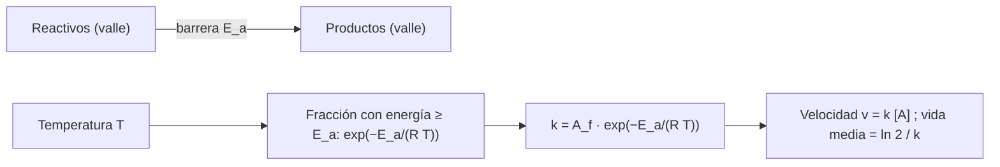

# B06-C14 — Cinética química inicial

<!-- nav:top -->
[🏠 Programa](../../../../README.md) · [📚 Bloque B06](../../../tronco-comun/B06-quimica-y-materia-del-universo.md) · [← Anterior: B06-C13 — Equilibrio químico](../B06-C13-equilibrio-quimico/CLASE.md) · [Siguiente: B06-C15 — Ácidos, bases y soluciones →](../B06-C15-acidos-bases-y-soluciones/CLASE.md)
<!-- /nav -->

## 1. Ubicación, nivel y alcance

Decimocuarta clase del bloque B06. En C13 viste hasta dónde llega una reacción. Falta saber cuánto tarda. La cinética química estudia la velocidad de las reacciones y su dependencia de la concentración y de la temperatura. Sigues en el nivel N1.

Verás la velocidad de reacción, la ley de primer orden, la vida media, la ecuación de Arrhenius y una integración numérica contrastada con la solución exacta. No verás mecanismos de varios pasos ni catálisis (cursos posteriores) ni sistemas de ecuaciones diferenciales (B11).

## 2. Por qué esta clase existe

Que una reacción sea posible (energía favorable, `K` grande) no significa que ocurra: puede ser tan lenta que no ocurra nunca en la edad del universo. En una nube molecular a 10 K, la energía térmica es de apenas 0,86 meV (C10). Y aun así, los estudios con el telescopio James Webb muestran hielos con una variedad de moléculas en nubes densas, y sus autores sugieren que moléculas simples y complejas pueden comenzar a formarse tempranamente en ese hielo, antes de que nazcan las estrellas (S1, resumen). ¿Cómo se concilia con lo lento de la química fría?

La decisión central es: **dada una reacción con una barrera de energía, ¿cuánto tarda a una temperatura dada, y qué tan sensible es esa rapidez a la temperatura?** Aprenderás a calcular la concentración con el tiempo, la vida media y la dependencia de Arrhenius, y verás cuándo una barrera «congela» una reacción. Es base de C18 (fotoquímica) y de los modelos de química astrofísica.

## 3. Lo que podrás hacer al terminar

1. Definir velocidad de reacción, constante de velocidad y orden.
2. Calcular concentración, fracción restante y vida media en un proceso de primer orden.
3. Aplicar la ecuación de Arrhenius para comparar velocidades a dos temperaturas.
4. Integrar numéricamente una ecuación de velocidad y compararla con la solución analítica.
5. Explicar por qué una barrera de energía bloquea una reacción en el frío.
6. Redactar una curva de decaimiento con su modelo y sus supuestos.

La evidencia es la **curva de decaimiento con su modelo** del ejercicio 12 (sección 20).

## 4. Con qué llegas y cómo comprobarlo

Necesitas C13 (equilibrio), C10 (`kT`) y el exponencial y el logaritmo natural. Cinco preguntas:

1. Calcula `e⁻¹` y `ln 2`.
2. Si algo cae a la mitad cada 10 s, ¿qué fracción queda a los 30 s?
3. Resuelve `e^(−0,01 t) = 0,5`.
4. ¿Cuánto es `exp(−50 000/(8,3145 × 300))`?
5. ¿Qué crece más rápido con la temperatura: `T` o `exp(−E/(RT))`?

<details>
<summary>Ver respuestas</summary>

1. 0,368; 0,693. 2. 1/8. 3. `t = ln 2/0,01 = 69,3`. 4. `exp(−20,04) = 2 × 10⁻⁹`. 5. La exponencial, mucho más.
</details>

Con cuatro o cinco aciertos, sigue. Con tres o menos, repasa C10 y C13.

## 5. Un caso real: química a 10 K

El estudio Ice Age del telescopio James Webb (McClure et al. 2023) detecta en dos líneas de visión de nubes densas hielos con una variedad de especies, entre ellas isotopólogos poco comunes y grupos funcionales de moléculas complejas, y estima que los hielos contienen entre el 2 y el 19 % de los presupuestos de carbono, oxígeno, nitrógeno y azufre; sus autores sugieren que moléculas simples y complejas pueden empezar a formarse en el hielo ya en esa etapa (S1, sólo el resumen).

Con la ecuación de Arrhenius y una barrera de 50 kJ/mol (valor **sintético**), una reacción que a 300 K tiene vida media de 0,35 s no ocurriría a 10 K en ninguna escala de tiempo: su vida media sería de 10²⁵² segundos. Por tanto, las reacciones que se forman a esas temperaturas no pueden depender de una barrera así, y requieren caminos sin barrera o con barreras mucho menores. Ten presente el límite: este curso no estudia esos caminos, y el número es una ilustración con parámetros inventados, no un cálculo de la química real de las nubes.

## 6. Vocabulario

La **velocidad de reacción** es el cambio de concentración por unidad de tiempo. Una reacción de **primer orden** `A → productos` tiene velocidad `v = −d[A]/dt = k[A]`, con `k` la **constante de velocidad** (en 1/s). Su solución es `[A] = [A]₀ e^(−kt)`. La **vida media** `t½ = ln 2/k` es el tiempo en que la concentración cae a la mitad; no depende de la concentración inicial. La **energía de activación** `E_a` es la barrera de energía que deben superar las moléculas para reaccionar. La **ecuación de Arrhenius** dice

```text
k = A_f · exp(−E_a / (R T))
```

con `A_f` el factor preexponencial (en 1/s para primer orden), `R` la constante de los gases y `T` la temperatura en kelvin. La **integración numérica** de la ecuación de velocidad aproxima la solución con pasos de tiempo finitos.

## 7. Modelo mental: una colina entre dos valles

Una reacción es como una bola que tiene que pasar de un valle a otro por encima de una colina. La bola sólo cruza si algunas partículas tienen energía suficiente. A mayor temperatura, más lo consiguen; a temperatura muy baja, casi ninguna.



*Descripción textual:* arriba, dos valles separados por una barrera de altura `E_a`; abajo, la cadena: la temperatura fija la fracción de moléculas con energía suficiente, esa fracción da la constante de velocidad por Arrhenius, y la constante da la velocidad y la vida media.

La analogía de la colina es útil para entender por qué calentar acelera; su límite es que las moléculas pueden atravesar barreras sin energía suficiente por efectos cuánticos (túnel), que no se tratan aquí, y que muchas reacciones tienen varios pasos.

## 8. La explicación, paso a paso

### 8.1 Primer orden

Si `k = 0,010 s⁻¹` (valor **sintético**), la concentración cae como `e^(−0,010 t)`: a 100 s queda `e⁻¹ = 0,368` de la inicial; hasta el 1 % hacen falta `ln 100/0,010 = 460,5 s`. La vida media es `ln 2/0,010 = 69,3 s`: tras tres vidas medias queda `1/8`; tras cinco, `1/32 = 0,03125`.

### 8.2 Resolver con un ordenador

La ecuación `dA/dt = −kA` se puede integrar numéricamente. El método de **Euler** da pasos `A_{n+1} = A_n(1 − k Δt)`; con 10 pasos hasta `t = 1/k` (es decir, `kΔt = 0,1`), resulta `0,3487` frente al exacto `0,3679`: un error de −5,2 %. El método **RK4** (Runge–Kutta de orden 4) con `kΔt = 0,01` reproduce el valor analítico de `0,031250` a los 5 `t½` con una exactitud de 10⁻⁹ relativa. La integración numérica es la herramienta general (B11); la solución analítica sirve de prueba.

### 8.3 Arrhenius

Con `E_a = 50 kJ/mol` y `A_f = 10⁹ s⁻¹` (**sintéticos**): a 300 K, `k = 1,97 s⁻¹` (vida media 0,35 s); a 310 K, `3,76 s⁻¹`: un aumento de `1,91` veces por 10 K. Con `E_a = 100 kJ/mol`, el aumento es de `3,64` veces: una barrera mayor hace que la reacción sea más sensible a la temperatura. A 214 K (la temperatura media de Marte, C10) con la barrera de 50 kJ/mol, `k = 6,3 × 10⁻⁴ s⁻¹` y la vida media pasa de 0,35 s a 1100 s (18 minutos).

### 8.4 El frío congela la química

A 10 K, `exp(−50 000/(8,3145 × 10)) = exp(−601) = 10⁻²⁶¹`, y con `A_f = 10⁹ s⁻¹`, `k = 7 × 10⁻²⁵³ s⁻¹`: la vida media sería de `1 × 10²⁵² s`, 2 × 10²³⁴ veces la edad del universo (13,8 mil millones de años, B01-C01). Una reacción con esa barrera no ocurre a 10 K. En el frío, lo que importa es la existencia de caminos sin barrera, y por eso la química de bajas temperaturas es un campo especializado.

### 8.5 Qué no dice esta clase

Se trabajó con un solo paso de primer orden, a temperatura constante y sin reacción inversa. Una reacción real puede tener varios pasos, orden distinto de 1 y una constante de velocidad que no se comporta como Arrhenius a baja temperatura. El resultado de la sección 8.4 es una ilustración de la tendencia, no un cálculo de una reacción real.

## 9. Magnitudes, símbolos y unidades

| Símbolo | Qué es | Unidad | Valor o nota |
|---|---|---|---|
| `[A]` | concentración | mol/L | — |
| `k` | constante de velocidad (1.er orden) | s⁻¹ | sintético: 0,010 |
| `t½` | vida media | s | `ln 2/k` |
| `E_a` | energía de activación | kJ/mol | sintética: 50 |
| `A_f` | factor preexponencial | s⁻¹ | sintético: 10⁹ |
| `R` | constante de los gases | J/(mol K) | 8,314 462 618… (CODATA 2022) |
| `T` | temperatura absoluta | K | — |

## 10. Convenciones y referencias

`k`, `E_a` y `A_f` son **sintéticos**: la clase no usa una reacción real. Las unidades de `k` dependen del orden; para primer orden, s⁻¹. La temperatura en la ecuación de Arrhenius es absoluta. La edad del universo, sólo como escala, es la de B01-C01.

## 11. De dónde sale lo que afirmamos

| ID | Fuente | Localizador | Respalda | Estado |
|---|---|---|---|---|
| S1 | M. K. McClure et al., «An Ice Age JWST inventory of dense molecular cloud ices», *Nature Astronomy* 7, 431 (2023), doi:10.1038/s41550-022-01875-w | arXiv:2301.09140 (resumen vía API de arXiv) | Hielos variados en nubes densas; 2–19 % de los presupuestos de C, O, N, S; formación temprana de moléculas en hielo | Sólo resumen, consultado el 2026-11-05 |
| S2 | NIST, *CODATA Recommended Values* (2022): `R` y `k` | https://physics.nist.gov/cgi-bin/cuu/Value?r (y `?k`) | `R` y `k` | Consulta del 2026-11-05 |
| S3 | B01-C01 de este programa (edad del universo, 13,8 Gyr) | `programa/clases/B01/B01-C01-naturaleza-del-universo/CLASE.md` | Escala temporal de comparación | Referencia interna, no revisada disciplinarmente |

Límites: S1 se leyó sólo en resumen; no se afirma nada sobre los mecanismos de formación de moléculas en el hielo más allá de lo que dicen los autores en el resumen. Los parámetros cinéticos son sintéticos. No se verificó la ecuación de Arrhenius contra una reacción medida.

## 12. Cómo ver las curvas

Esta tabla es la versión accesible de una gráfica de `k` frente a `T`.

| Temperatura (K) | `k` (s⁻¹) | Vida media |
|---|---|---|
| 10 | 7 × 10⁻²⁵³ | 10²⁵² s |
| 214 | 6,25 × 10⁻⁴ | 1109 s (18,5 min) |
| 300 | 1,97 | 0,352 s |
| 310 | 3,76 | 0,184 s |

Si dibujas `ln k` frente a `1/T`, obtendrás una recta de pendiente `−E_a/R`; usa ejes rotulados con su unidad. Descripción larga: la vida media cambia en unos 252 órdenes de magnitud entre 10 K y 300 K.

## 13. Ejemplo trabajado: curva de decaimiento y su integración

**Datos (sintéticos):** `k = 0,010 s⁻¹`; `[A]₀ = 1` (unidades arbitrarias).

**Paso 1 · Vida media.** `ln 2/0,010 = 69,31 s`.

**Paso 2 · Fracción en 100 s.** `e^(−1) = 0,3679`.

**Paso 3 · Tiempo hasta el 1 %.** `ln 100/0,010 = 460,5 s`.

**Paso 4 · Cinco vidas medias.** `t = 346,6 s`; `[A] = 2⁻⁵ = 0,03125`.

**Paso 5 · Integración numérica.** RK4 con `kΔt = 0,01` da `0,031250` frente a `0,031250` analítico. Euler con `kΔt = 0,1` da `0,3487` a `t = 1/k` frente a `0,3679` (−5,2 %).

**Sentido físico.** El modelo analítico permite verificar el integrador; el integrador es la herramienta cuando la ecuación no tiene solución cerrada. La vida media dice cuánto hay que esperar sin conocer la concentración inicial.

## 14. Dos formas de obtener la evolución

Puedes **resolver la ecuación** (analítica, exacta, sólo para casos sencillos) o **integrarla numéricamente** (general, aproximada con un error controlable por el paso). Una buena práctica es comprobar el integrador con el caso analítico y luego usarlo en casos sin solución. Declara siempre el método y el paso.

## 15. Práctica guiada

**Ejercicio 1 · con los pasos indicados.** Calcula la vida media con `k = 0,010 s⁻¹`. *Pasos:* `t½ = ln 2/k`.

<details><summary>Solución comentada</summary>

`0,6931/0,010 = 69,3 s`. Si te dio 0,0069, multiplicaste en vez de dividir.
</details>

**Ejercicio 2 · con una pista.** ¿Qué fracción queda tras tres vidas medias? *Pista:* cada una la reduce a la mitad.

<details><summary>Solución comentada</summary>

`(1/2)³ = 1/8 = 0,125`.
</details>

**Ejercicio 3 · casi autónomo.** ¿Qué fracción queda a los 100 s con `k = 0,010 s⁻¹`?

<details><summary>Solución comentada</summary>

`e^(−0,010 × 100) = e⁻¹ = 0,368`.
</details>

## 16. Práctica autónoma, transferencia e integrador

**Ejercicio 4.** ¿Cuánto tarda en quedar el 1 % de A?

<details><summary>Solución comentada</summary>

`t = ln(100)/k = 4,605/0,010 = 460,5 s`. Es 6,6 vidas medias.
</details>

**Ejercicio 5.** Calcula `k(310 K)/k(300 K)` con `E_a = 50 kJ/mol`.

<details><summary>Solución comentada</summary>

`exp[(50 000/8,3145)(1/300 − 1/310)] = exp(6013,7 × 1,0753 × 10⁻⁴) = exp(0,6467) = 1,91`.
</details>

**Ejercicio 6.** Repite con `E_a = 100 kJ/mol`.

<details><summary>Solución comentada</summary>

`exp(12 027 × 1,0753 × 10⁻⁴) = exp(1,2933) = 3,64`. El cociente se eleva al cuadrado: `1,91² = 3,65`.
</details>

**Ejercicio 7.** Calcula la vida media a 10 K con `E_a = 50 kJ/mol` y `A_f = 10⁹ s⁻¹`, y compárala con la edad del universo.

<details><summary>Solución comentada</summary>

`k = 10⁹ × exp(−601,4) = 6,8 × 10⁻²⁵³ s⁻¹`; `t½ = 0,693/k = 1,0 × 10²⁵² s`. La edad del universo es `4,35 × 10¹⁷ s`: el cociente es `2 × 10²³⁴`.
</details>

**Ejercicio 8.** ¿Qué unidades tiene `k` en un proceso de primer orden y por qué la vida media no depende de `[A]₀`?

<details><summary>Solución comentada</summary>

s⁻¹. La ecuación `[A] = [A]₀ e^(−kt)` hace que la razón `[A]/[A]₀` dependa sólo de `kt`: la vida media sale de `e^(−kt½) = 1/2`, sin `[A]₀`.
</details>

**Ejercicio 9 · transferencia.** Con Euler y `kΔt = 0,1`, ¿cuál es el error tras 10 pasos? ¿Y si se usan 100 pasos (`kΔt = 0,01`)?

<details><summary>Solución comentada</summary>

Con 10 pasos: `0,9¹⁰ = 0,3487` frente a `0,3679`: −5,2 %. Con 100 pasos: `0,99¹⁰⁰ = 0,3660`: −0,5 %. El error de Euler crece linealmente con el paso; RK4 lo reduce mucho más.
</details>

**Ejercicio 10 · transferencia.** Un proceso de primer orden tiene `t½ = 10 años` (valor ilustrativo). ¿Qué fracción queda tras 25 años?

<details><summary>Solución comentada</summary>

`2^(−25/10) = 2^(−2,5) = 0,177`. La misma matemática describe, por ejemplo, la desintegración radiactiva, pero el ejemplo aquí es ilustrativo y no representa a un isótopo.
</details>

**Ejercicio 11 · transferencia.** Un compañero dice: «si una reacción es exotérmica, ocurre rápido». Corrige con lo aprendido.

<details><summary>Solución comentada</summary>

La energía liberada (C12) y la velocidad (C14) son cosas distintas. La velocidad depende de la barrera `E_a`: la combustión del metano libera 890 kJ/mol y, aun así, a temperatura ambiente una mezcla con aire no arde sin una chispa. Una reacción puede ser muy exotérmica y muy lenta.
</details>

**Ejercicio 12 · integrador.** Elabora la *curva de decaimiento con su modelo* (sección 20): elige `k` (rotulado sintético), tabula `[A]/[A]₀` en 8 tiempos, calcula `t½` y compara RK4 o Euler con la solución exacta.

<details><summary>Solución modelo</summary>

Una tabla con los tiempos 0, 1, 2, 3, 4, 5, 6 y 7 vidas medias, con fracciones 1; 0,5; 0,25; 0,125; 0,0625; 0,03125; 0,0156; 0,0078. Compara con el integrador, declara el paso y el error relativo, y rotula `k` como sintético. Se aceptan otros valores de `k`.
</details>

## 17. Laboratorio: decaimiento y Arrhenius

El script [cinetica.py](cinetica.py) calcula la concentración, la vida media y la integración RK4 y Euler del proceso de primer orden, y la dependencia de Arrhenius a cuatro temperaturas. Antes de imprimir comprueba que en una vida media queda 1/2, que en tres queda 1/8, que RK4 coincide con la solución analítica a 10⁻⁹, que con `E_a = 0` no hay dependencia de la temperatura y que `k` crece con `T`; si algo falla, se detiene.

**Datos:** **sintéticos** (`k`, `E_a`, `A_f`); `R` de CODATA. **Predice antes de ejecutar:** ¿por cuánto se multiplica `k` en 10 K con `E_a = 50 kJ/mol`? (cerca de 2). **Resultados (2026-11-05, Python 3.12.9):** `t½ = 69,31 s`; fracción a 100 s: 0,3679; tiempo hasta 1 %: 460,5 s; a 5 `t½`: analítica 0,031250, RK4 0,031250; Euler con 10 pasos: 0,3487 frente a 0,3679 (−5,2 %); `k` = 1,97 s⁻¹ (300 K), 3,76 (310 K), 6,25 × 10⁻⁴ (214 K), 6,79 × 10⁻²⁵³ (10 K); cocientes `k(310)/k(300)`: 1,91 (50 kJ/mol) y 3,64 (100 kJ/mol).

```bash
python programa/clases/B06/B06-C14-cinetica-quimica-inicial/cinetica.py
```

**Límites:** un paso, primer orden, temperatura constante; parámetros sintéticos. No sirve para predecir velocidades de reacciones reales ni para química a muy baja temperatura.

## 18. Errores frecuentes y cómo corregirlos

**Multiplicar en vez de dividir en `t½ = ln 2/k`.** Se corrige con el ejercicio 1.

**Usar °C en Arrhenius.** Debe ser kelvin; se corrige con el ejercicio 5.

**Creer que la vida media depende de la concentración inicial.** Se corrige con el ejercicio 8.

**Confundir energía liberada con rapidez.** Se corrige con el ejercicio 11.

**Usar pasos demasiado grandes en un integrador.** Se corrige con el ejercicio 9.

## 19. Cómo sabrás que vas bien

Tras 8.1: ¿puedes calcular qué fracción queda tras 5 vidas medias? Si no, repite los ejercicios 2 y 3. Tras 8.2: ¿puedes comparar un integrador con la solución exacta? Si no, haz el ejercicio 9. Tras 8.3: ¿cómo cambia `k` con 10 K más? Si dudas, repite los ejercicios 5 y 6. Tras 8.4: ¿por qué la química a 10 K no puede depender de una barrera de 50 kJ/mol? Si no, haz el ejercicio 7. Tras el laboratorio: ¿qué comprueba el script con `E_a = 0`? Si lo ignoras, lee su cabecera.

## 20. Qué entregas y cómo se evalúa

El producto es tu **curva de decaimiento con su modelo**: tabla de `[A]/[A]₀` en el tiempo, vida media, comparación con un integrador y rotulado del parámetro como sintético.

| Criterio | Inicial | En desarrollo | Logrado | Destacado |
|---|---|---|---|---|
| Modelo de primer orden | Con errores | Correcto con ayuda | Correcto | Deduce `t½` y lo usa |
| Integración numérica | No integra | Integra sin comparar | Compara con la exacta | Estima el error por paso |
| Arrhenius | No lo usa | Con °C | Con K | Compara dos barreras |
| Rotulado | Parámetros sin etiqueta | Parcial | Sintético declarado | Declara qué dato real faltaría |
| Límites | Ausentes | Mencionados | Explicados | Señala caminos no tratados |

**Condiciones críticas:** no presentar parámetros sintéticos como medidos; usar kelvin en Arrhenius; no extrapolar a química real; citar sólo fuentes consultadas.

## 21. Ética, seguridad y límites

Es un cálculo; no hay experimentos. Si luego mides velocidades de reacciones en el aula, usa sistemas de bajo riesgo (por ejemplo, la disolución de una pastilla efervescente en agua a distintas temperaturas, con supervisión), no reactivos peligrosos. Alternativa sin riesgo: simular con el script. Los números no sirven para diseñar procesos. Accesibilidad: tablas equivalentes a las gráficas y fórmulas en texto.

## 22. Para cerrar y seguir

Una reacción de primer orden decae exponencialmente con una vida media que no depende de la concentración inicial; la ecuación de Arrhenius hace que la rapidez crezca muy deprisa con la temperatura y que una barrera de 50 kJ/mol detenga una reacción a 10 K. Un integrador numérico se valida contra la solución exacta. La próxima clase trata el tipo de reacciones químicas que se da en las disoluciones: ácidos y bases.

**Glosario español–inglés.** cinética química · *chemical kinetics*; velocidad de reacción · *reaction rate*; constante de velocidad · *rate constant*; vida media · *half-life*; energía de activación · *activation energy*; ecuación de Arrhenius · *Arrhenius equation*; integración numérica · *numerical integration*.

**Continuidad.** B06-C15 estudia reacciones de transferencia de protones en disolución. B06-C18 compara la energía de los fotones con las barreras. B11 retoma la integración numérica de ecuaciones diferenciales.

**Referencias:** ver sección 11. S1 se leyó en resumen; los parámetros cinéticos son sintéticos.

<!-- nav:bottom -->
---

[← Anterior: B06-C13 — Equilibrio químico](../B06-C13-equilibrio-quimico/CLASE.md) · [📚 Bloque B06](../../../tronco-comun/B06-quimica-y-materia-del-universo.md) · [Siguiente: B06-C15 — Ácidos, bases y soluciones →](../B06-C15-acidos-bases-y-soluciones/CLASE.md)
<!-- /nav -->
