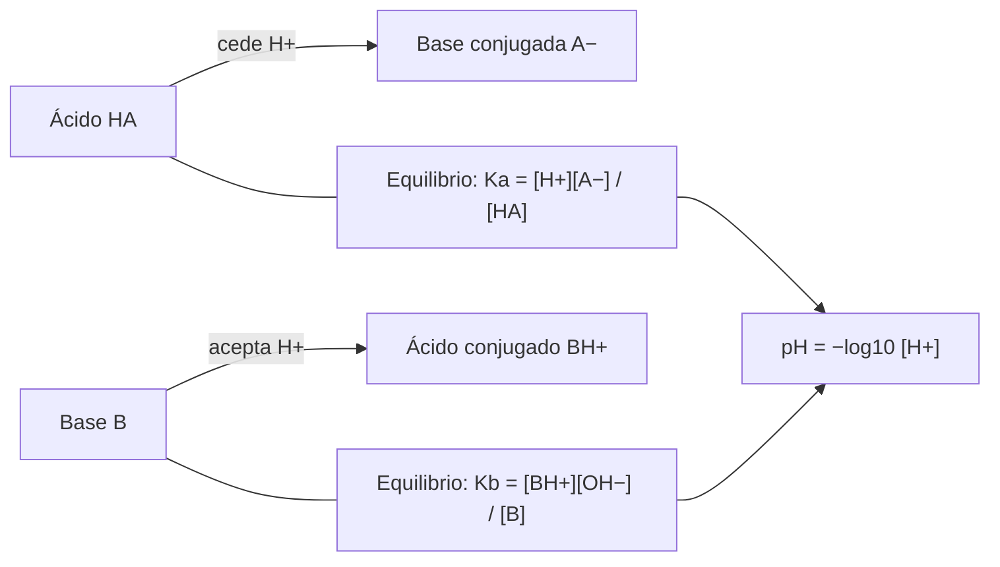

# B06-C15 — Ácidos, bases y soluciones

<!-- nav:top -->
[🏠 Programa](../../../../README.md) · [📚 Bloque B06](../../../tronco-comun/B06-quimica-y-materia-del-universo.md) · [← Anterior: B06-C14 — Cinética química inicial](../B06-C14-cinetica-quimica-inicial/CLASE.md) · [Siguiente: B06-C16 — Química orgánica esencial →](../B06-C16-quimica-organica-esencial/CLASE.md)
<!-- /nav -->

## 1. Ubicación, nivel y alcance

Decimoquinta clase del bloque B06. Después de ver el equilibrio (C13) y la velocidad (C14), aplicas el equilibrio a las reacciones más comunes en agua: la transferencia de protones. Sigues en el nivel N1.

Verás qué es una disolución y cómo se expresa su concentración, qué significan ácido y base, cómo se calcula el pH de un ácido o una base fuerte y débil, por qué hay que tener cuidado con las disoluciones muy diluidas y cómo se usa todo esto en un caso real de la química del asteroide Bennu. No verás titulaciones, tampones ni equilibrios de solubilidad (cursos posteriores).

## 2. Por qué esta clase existe

El extracto en agua caliente de las muestras de Bennu contiene amoníaco libre en unos 13,6 μmol por gramo y ácido fórmico en 4,106 μmol por gramo (S1). Un ácido y una base en el mismo líquido reaccionan entre sí: el ácido cede un protón, la base lo acepta y se forman iones. Qué especies predominan y cuál es el pH de la disolución son preguntas de química en agua que se contestan con esta clase.

La decisión central es: **dada una disolución con un ácido o una base, ¿qué especies predominan, qué pH tiene y cuándo la aproximación sencilla deja de valer?** Aprenderás a calcular pH exacto y aproximado, a reconocer la autoprotólisis del agua en disoluciones muy diluidas y a hacer balances de protones. Prepara C19 (minerales con carbonatos) y C20 (meteoritos).

## 3. Lo que podrás hacer al terminar

1. Calcular y expresar concentraciones en mol/L y en μmol/g.
2. Definir ácido, base y par conjugado, y reconocerlos en una ecuación.
3. Calcular el pH de un ácido o una base fuertes.
4. Calcular el pH de un ácido o una base débiles de forma exacta y aproximada, y decidir cuándo falla la aproximación.
5. Reconocer cuándo la autoprotólisis del agua importa.
6. Redactar un cálculo de pH con sus supuestos y valores de trabajo declarados.

La evidencia es el **cálculo de pH con supuestos declarados** del ejercicio 12 (sección 20).

## 4. Con qué llegas y cómo comprobarlo

Necesitas C13 (`K`, tabla ICE), C06 (mol) y logaritmos decimales. Cinco preguntas:

1. Calcula `log₁₀(10⁻³)`.
2. Resuelve `x² + 1,8 × 10⁻⁴ x − 1,8 × 10⁻⁶ = 0` para `x > 0` (aproximadamente).
3. Si hay 13,6 μmol de una sustancia por gramo y 4,1 de otra, ¿cuál es la razón?
4. ¿Qué es una constante de equilibrio?
5. Escribe `K` para `HA ⇌ H⁺ + A⁻`.

<details>
<summary>Ver respuestas</summary>

1. −3. 2. `x ≈ 1,25 × 10⁻³`. 3. 3,3. 4. El cociente de productos y reactivos en el equilibrio (C13). 5. `K = [H⁺][A⁻]/[HA]`.
</details>

Con cuatro o cinco aciertos, sigue. Con tres o menos, repasa C06 y C13.

## 5. Un caso real: ácido fórmico y amoníaco en Bennu

Glavin y colaboradores analizaron un extracto en agua caliente de una muestra de Bennu. Encontraron amoníaco libre en unos 13,6 μmol por gramo, que equivale a cerca del 40 % del nitrógeno total estimado del extracto, y entre los ácidos carboxílicos, el fórmico (4106 nmol/g) y el acético (1436 nmol/g) como los dos más abundantes (S1). Los autores señalan que esos ácidos podrían ser los contraiones de sales de amonio, como el formiato de amonio observado en el cometa 67P, y citan estudios de los minerales de la muestra que implican un pH alcalino y temperaturas por debajo de unos 55 °C (S1).

Con estos números puedes hacer un balance molar sencillo: hay 3,3 veces más amoníaco que ácido fórmico, así que el amoníaco sobra. Ten presente el límite: con los datos no se puede deducir el pH real de la salmuera de Bennu; eso requiere más información (otras especies, minerales, temperatura).

## 6. Vocabulario

Una **disolución** es una mezcla homogénea de un **soluto** en un **disolvente**; en esta clase, el disolvente es el agua. La **concentración** `c` se expresa en mol/L (**molaridad**) o, para muestras sólidas extraídas, en μmol por gramo. Un **ácido** (de Brønsted–Lowry) es una sustancia que cede un protón (H⁺); una **base**, la que lo acepta. Al ceder el protón, un ácido `HA` da su **base conjugada** `A⁻`; al aceptarlo, una base `B` da su **ácido conjugado** `BH⁺`. Los **ácidos o bases fuertes** se ionizan prácticamente por completo; los **débiles**, sólo en parte, y su equilibrio se describe con `K_a` o `K_b`.

El **pH** se define como `pH = −log₁₀[H⁺]` (en rigor, de la actividad del protón; aquí se usa la concentración como aproximación). El **producto iónico del agua** `K_w = [H⁺][OH⁻]` vale, a 25 °C, `1,0 × 10⁻¹⁴` (valor de trabajo de la clase), por lo que `pH + pOH = 14`. Una disolución es **neutra** si `[H⁺] = [OH⁻]`, es decir, pH 7 a 25 °C.

## 7. Modelo mental: un préstamo de protones

Un ácido es quien presta un protón y una base, quien lo recibe. El préstamo no es todo o nada: en un ácido fuerte casi todos los protones se prestan; en uno débil, sólo una fracción, y el equilibrio fija cuántos.



*Descripción textual:* a la izquierda, un ácido que cede un protón y se convierte en su base conjugada; abajo, una base que acepta un protón y se convierte en su ácido conjugado. Cada proceso tiene su constante de equilibrio, y de ellas se obtiene la concentración de protones y de ahí el pH.

La analogía del préstamo ayuda a ver quién da y quién recibe; su límite es que los protones no viajan solos: se pasan de molécula de agua en molécula de agua, y el modelo de «un ácido, una base» es una simplificación de un sistema donde hay muchas especies compitiendo.

## 8. La explicación, paso a paso

### 8.1 Ácidos fuertes y el pH

Si un ácido fuerte monoprótico tiene concentración `c`, `[H⁺] ≈ c` y `pH = −log₁₀ c`. Para `c = 1,0 × 10⁻³ mol/L`, `pH = 3`. Para una base fuerte de `10⁻³ mol/L`, `[OH⁻] = 10⁻³`, `pOH = 3` y `pH = 14 − 3 = 11`.

### 8.2 Ácidos débiles: la cuadrática exacta

Para `HA ⇌ H⁺ + A⁻` con `K_a` y concentración inicial `c`, si se ioniza `x`: `K_a = x²/(c − x)`, es decir, `x² + K_a x − K_a c = 0`, con solución `x = [−K_a + √(K_a² + 4K_a c)]/2`. Con el valor **de trabajo** `K_a = 1,8 × 10⁻⁴` y `c = 0,010`: `x = 1,255 × 10⁻³`, `pH = 2,901` y una ionización del 12,5 %. La aproximación `x ≈ √(K_a c)` da `1,342 × 10⁻³` y `pH = 2,872`: un error de 0,03 unidades.

### 8.3 Cuándo falla la aproximación

La aproximación supone que `c − x ≈ c`, es decir, que la ionización es pequeña. Con `c = 1,0 × 10⁻⁴` el mismo ácido se ioniza el 71,6 % y la aproximación da `pH = 3,87` frente al exacto `4,145`: un error de 0,27. La regla de aula: si la ionización calculada supera el 5 %, hay que usar la cuadrática.

### 8.4 Disoluciones muy diluidas: el agua también cuenta

Un ácido fuerte de `10⁻⁸ mol/L` no da `pH = 8`, porque el agua aporta `10⁻⁷ mol/L` de protones. Con la autoprotólisis, `[H⁺] = [c + √(c² + 4K_w)]/2 = 1,05 × 10⁻⁷` y `pH = 6,978`. Una disolución ácida no puede ser básica por mucho que se diluya.

### 8.5 Balance de protones en el caso de Bennu

La reacción `NH₃ + HCOOH → NH₄⁺ + HCOO⁻` (C08) tiene el ácido fórmico como donante y el amoníaco como aceptor. Con 13,6 μmol/g de amoníaco y 4,106 μmol/g de ácido fórmico, si el ácido reaccionara por completo se formarían 4,106 μmol/g de formiato de amonio y quedarían 9,494 μmol/g de amoníaco sin reaccionar. Esa cuenta es un balance de materia, no el pH real: éste depende de los equilibrios (`K_a` del ácido, `K_b` del amoníaco, otras especies) y no lo calculamos. El sentido cualitativo, más base que ácido, no contradice la inferencia de los autores sobre un pH alcalino.

## 9. Magnitudes, símbolos y unidades

| Símbolo | Qué es | Unidad | Valor o nota |
|---|---|---|---|
| `c` | concentración | mol/L (o μmol/g) | — |
| `[H⁺]` | concentración de protones | mol/L | `10^(−pH)` |
| `pH` | acidez | — | `−log₁₀[H⁺]` |
| `K_w` | producto iónico del agua | — | 1,0 × 10⁻¹⁴ (valor de trabajo, 25 °C) |
| `K_a`, `K_b` | constantes de ionización | — | 1,8 × 10⁻⁴ y 1,8 × 10⁻⁵ (valores de trabajo, sintéticos) |
| `x` | avance de la ionización | mol/L | cuadrática |
| NH₃ y HCOOH en Bennu | extracto en agua caliente | μmol/g | 13,6 y 4,106 (S1) |

## 10. Convenciones y referencias

Las concentraciones de la clase se usan como aproximación de las actividades, válido para disoluciones diluidas. `K_w`, `K_a` y `K_b` son **valores de trabajo de la clase** (no consultados en una fuente) y se rotulan como sintéticos. El pH se da con tres decimales, para comparar métodos, aunque en la práctica rara vez se miden más de dos. Las concentraciones de Bennu son μmol por gramo de muestra, no mol/L.

## 11. De dónde sale lo que afirmamos

| ID | Fuente | Localizador | Respalda | Estado |
|---|---|---|---|---|
| S1 | D. P. Glavin et al., «Abundant ammonia and nitrogen-rich soluble organic matter in samples from asteroid (101955) Bennu», *Nature Astronomy* (2025), doi:10.1038/s41550-024-02472-9 | PDF de NASA NTRS, doc. 20250001355 | NH₃ ~13,6 μmol/g (~40 % del N total del extracto); ácido fórmico 4106 nmol/g; ácido acético 1436 nmol/g; sales de amonio; minerales que implican pH alcalino y T < ~55 °C (citando a McCoy et al.) | PDF leído el 2026-11-05 (PyMuPDF) |
| S2 | NIST, *CODATA Recommended Values* (2022) | https://physics.nist.gov/cgi-bin/cuu/Value?r | Constantes del cálculo (indirectamente) | Consulta del 2026-11-05 |

Límites: no se consultó la definición de pH de la IUPAC (la página no se pudo abrir), por lo que la definición se da como convención de aula; `K_w`, `K_a`, `K_b` son valores de trabajo sin fuente consultada. La afirmación sobre pH alcalino es de los autores de S1, que la atribuyen a un estudio que no consultamos.

## 12. Cómo ver los resultados

Esta tabla es la versión accesible de una gráfica de pH.

| Caso | Datos | Método | pH |
|---|---|---|---|
| Ácido fuerte | `c = 10⁻³` | `−log c` | 3,000 |
| Ácido fuerte muy diluido | `c = 10⁻⁸` | con autoprotólisis | 6,978 |
| Ácido débil | `K_a = 1,8 × 10⁻⁴`, `c = 0,010` | exacto / aproximado | 2,901 / 2,872 |
| Ácido débil diluido | `c = 10⁻⁴` | exacto / aproximado | 4,145 / 3,872 |
| Base débil | `K_b = 1,8 × 10⁻⁵`, `c = 0,10` | exacto | 11,125 |

Si haces una gráfica de pH, rotula el eje con su unidad (adimensional) y señala el valor 7 como neutro; no dependas del color para distinguir ácido y base. Descripción larga: el pH crece de 2,9 a 11,1 entre el ácido débil concentrado y la base débil.

## 13. Ejemplo trabajado: el ácido débil y el límite de la aproximación

**Datos (sintéticos, valores de trabajo):** `K_a = 1,8 × 10⁻⁴`; `c = 0,010 mol/L`.

**Paso 1 · Ecuación.** `x² + 1,8 × 10⁻⁴ x − 1,8 × 10⁻⁶ = 0`.

**Paso 2 · Solución.** `x = [−1,8 × 10⁻⁴ + √(3,24 × 10⁻⁸ + 7,2 × 10⁻⁶)]/2 = (−1,8 × 10⁻⁴ + 2,6894 × 10⁻³)/2 = 1,2547 × 10⁻³`.

**Paso 3 · pH.** `−log₁₀(1,2547 × 10⁻³) = 2,901`.

**Paso 4 · Ionización.** `1,2547 × 10⁻³/0,010 = 12,5 %`, mayor que 5 %: la aproximación `√(K_a c)` queda en el límite de lo aceptable (pH 2,872, error 0,03).

**Paso 5 · Verificación.** `x²/(c − x) = (1,2547 × 10⁻³)²/(0,010 − 0,0012547) = 1,8000 × 10⁻⁴` ✓.

**Sentido físico.** Un ácido débil, a la misma concentración que uno fuerte, produce mucho menos protones (pH 2,9 en lugar de 2). La aproximación sencilla es una herramienta con un dominio: si la ionización pasa del 5 %, se usa la cuadrática.

## 14. Dos formas de obtener el pH

Puedes usar la **aproximación** `x ≈ √(K c)` (una línea, válida con ionización pequeña) o la **cuadrática exacta** (también una línea y válida siempre, dentro del modelo). Como la segunda cuesta lo mismo, la costumbre prudente es usar la exacta y comprobar con la aproximación. Para disoluciones muy diluidas ninguna de las dos basta y hay que añadir la autoprotólisis del agua.

## 15. Práctica guiada

**Ejercicio 1 · con los pasos indicados.** Calcula el pH de un ácido fuerte `10⁻³ mol/L`. *Pasos:* `pH = −log₁₀ c`.

<details><summary>Solución comentada</summary>

`pH = 3`. Si te dio −3, olvidaste el signo menos de la definición.
</details>

**Ejercicio 2 · con una pista.** Calcula el pH de una base fuerte `10⁻³ mol/L`. *Pista:* primero el pOH.

<details><summary>Solución comentada</summary>

`pOH = 3`; `pH = 14 − 3 = 11` (con `K_w = 10⁻¹⁴`).
</details>

**Ejercicio 3 · casi autónomo.** ¿Cuál es la concentración de protones si el pH es 5,5?

<details><summary>Solución comentada</summary>

`[H⁺] = 10^(−5,5) = 3,16 × 10⁻⁶ mol/L`.
</details>

## 16. Práctica autónoma, transferencia e integrador

**Ejercicio 4.** Calcula el pH de un ácido débil `K_a = 1,8 × 10⁻⁴` con `c = 0,010` con la cuadrática y con la aproximación. ¿Cuál es la diferencia?

<details><summary>Solución comentada</summary>

Exacto `2,901`; aproximado `2,872`; diferencia `0,029`.
</details>

**Ejercicio 5.** ¿Qué porcentaje de ácido está ionizado en el ejercicio 4?

<details><summary>Solución comentada</summary>

`1,2547 × 10⁻³/0,010 = 12,5 %`.
</details>

**Ejercicio 6.** Repite el cálculo con `c = 1,0 × 10⁻⁴` y evalúa la aproximación.

<details><summary>Solución comentada</summary>

Exacto: `x = [−1,8 × 10⁻⁴ + √(3,24 × 10⁻⁸ + 7,2 × 10⁻⁸)]/2 = 7,16 × 10⁻⁵`; `pH = 4,145`; ionización 71,6 %. Aproximado: `√(1,8 × 10⁻⁸) = 1,34 × 10⁻⁴` ⇒ `pH 3,87`: error de 0,27, inaceptable (más de 5 % de ionización).
</details>

**Ejercicio 7.** Calcula el pH de un ácido fuerte `10⁻⁸ mol/L`.

<details><summary>Solución comentada</summary>

`[H⁺] = (10⁻⁸ + √(10⁻¹⁶ + 4 × 10⁻¹⁴))/2 = 1,05 × 10⁻⁷`; `pH = 6,978`, no 8: una disolución ácida no puede ser básica.
</details>

**Ejercicio 8.** Calcula el pH de una base débil `K_b = 1,8 × 10⁻⁵` con `c = 0,10`.

<details><summary>Solución comentada</summary>

`x = [−1,8 × 10⁻⁵ + √(3,24 × 10⁻¹⁰ + 7,2 × 10⁻⁶)]/2 = 1,333 × 10⁻³ = [OH⁻]`; `pOH = 2,875`; `pH = 14 − 2,875 = 11,125`.
</details>

**Ejercicio 9 · transferencia.** Con 13,6 μmol/g de NH₃ y 4,106 μmol/g de HCOOH, calcula la razón y el amoníaco sobrante si el ácido reaccionara por completo. ¿Qué no puedes concluir?

<details><summary>Solución comentada</summary>

Razón `13,6/4,106 = 3,31`; sobrante `13,6 − 4,106 = 9,494 μmol/g`. No puedes concluir el pH: faltan las constantes de equilibrio del par, el volumen de disolución y las otras especies (ácido acético, aminas, minerales).
</details>

**Ejercicio 10 · transferencia.** En `NH₃ + HCOOH → NH₄⁺ + HCOO⁻`, identifica los dos pares ácido–base conjugados.

<details><summary>Solución comentada</summary>

HCOOH (ácido) / HCOO⁻ (base conjugada) y NH₄⁺ (ácido conjugado) / NH₃ (base). El protón pasa del HCOOH al NH₃.
</details>

**Ejercicio 11 · transferencia.** Un compañero dice: «si diluyo un ácido hasta 10⁻⁹ mol/L, su pH será 9». Corrige.

<details><summary>Solución comentada</summary>

El agua aporta `10⁻⁷ mol/L` de protones: `[H⁺] = (10⁻⁹ + √(10⁻¹⁸ + 4 × 10⁻¹⁴))/2 ≈ 1,005 × 10⁻⁷`, pH ≈ 6,998. Un ácido nunca vuelve básica a una disolución al diluirse.
</details>

**Ejercicio 12 · integrador.** Elabora el *cálculo de pH con supuestos declarados* (sección 20): elige un ácido o una base, rotula `K` y `c` como valores de trabajo, calcula el pH con los dos métodos, el porcentaje de ionización y verifica `K = x²/(c − x)`.

<details><summary>Solución modelo</summary>

Una solución completa sigue el ejemplo trabajado de la sección 13 con otros valores: tabla con ambas soluciones, porcentaje de ionización, verificación numérica y frase sobre el dominio de la aproximación. Se aceptan otros valores siempre que se rotulen como de trabajo.
</details>

## 17. Laboratorio: pH, ionización y balance de Bennu

El script [acidos_bases.py](acidos_bases.py) calcula el pH de ácidos fuertes y débiles, bases débiles y el balance molar NH₃/HCOOH de Bennu. Antes de imprimir comprueba que un ácido fuerte `10⁻³` da pH 3, que el agua pura da 7, que el límite muy diluido queda entre 6,9 y 7,0, que `K = x²/(c − x)` se cumple a 10⁻¹² y que el pH de la base débil es 11,12 ± 0,01; si algo falla, se detiene.

**Datos:** medidos (S1) y valores de trabajo sintéticos. **Predice antes de ejecutar:** ¿qué pH da un ácido fuerte `10⁻⁸ M`? (cerca de 7). **Resultados (2026-11-05, Python 3.12.9):** HCl `10⁻³`: pH 3,000; `10⁻⁸`: 6,978; ácido débil `c = 0,010`: exacto 2,901 y aproximado 2,872 (12,5 % ionizado); `c = 10⁻⁴`: 4,145 y 3,872 (71,6 %); base débil 0,10: pOH 2,875 y pH 11,125; Bennu: razón NH₃/HCOOH = 3,31; NH₃ sobrante 9,494 μmol/g.

```bash
python programa/clases/B06/B06-C15-acidos-bases-y-soluciones/acidos_bases.py
```

**Límites:** concentraciones en lugar de actividades, 25 °C, ácidos monopróticos, sin tampones ni varias especies. No sirve para predecir el pH real de una salmuera ni para dosificar sustancias.

## 18. Errores frecuentes y cómo corregirlos

**Olvidar el signo en `pH = −log c`.** Se corrige con el ejercicio 1.

**Dar a una base el pH de su pOH.** Se corrige con el ejercicio 2.

**Aplicar `√(K c)` con ionización alta.** Se corrige con el ejercicio 6.

**Ignorar el agua en disoluciones muy diluidas.** Se corrige con los ejercicios 7 y 11.

**Deducir el pH real de un balance de materia.** Se corrige con el ejercicio 9.

## 19. Cómo sabrás que vas bien

Tras 8.1: ¿puedes calcular el pH de una base fuerte? Si no, repite el ejercicio 2. Tras 8.2: ¿puedes resolver la cuadrática de un ácido débil? Si no, repite los ejercicios 4 y 5. Tras 8.3: ¿cuándo falla la aproximación? Si dudas, haz el ejercicio 6. Tras 8.4: ¿por qué un ácido diluido no es básico? Si no, haz el ejercicio 7. Tras el laboratorio: ¿qué parámetros son de trabajo? Si lo olvidas, lee la cabecera.

## 20. Qué entregas y cómo se evalúa

El producto es tu **cálculo de pH con supuestos declarados**: ecuación, solución exacta y aproximada, ionización, verificación y rotulado de los valores de trabajo.

| Criterio | Inicial | En desarrollo | Logrado | Destacado |
|---|---|---|---|---|
| Planteo de la ecuación | Con errores | Correcto con ayuda | Correcto | Incluye la autoprotólisis cuando importa |
| Solución | Sólo aproximada | Exacta con error | Exacta y aproximada | Evalúa el error de la aproximación |
| Verificación | Ninguna | Aproximada | `K = x²/(c − x)` explícito | Con tolerancia declarada |
| Rotulado | Valores sin etiqueta | Parcial | De trabajo declarados | Declara qué fuente faltaría |
| Límites | Ausentes | Mencionados | Explicados | Señala qué no se puede concluir |

**Condiciones críticas:** no presentar valores de trabajo como medidos; no usar la aproximación con ionización mayor que 5 % sin advertirlo; citar sólo fuentes consultadas.

## 21. Ética, seguridad y límites

Es un cálculo; no hay manipulación de sustancias. Los ácidos y bases concentrados son corrosivos, y el amoníaco desprende vapores irritantes: esta clase no propone usarlos. Si más adelante haces una práctica sobre pH, usa sustancias domésticas diluidas (vinagre, bicarbonato en agua), gafas y supervisión, y nunca mezcles productos de limpieza. Alternativa sin riesgo: simular con el script. Accesibilidad: tablas equivalentes a las gráficas y fórmulas en texto.

## 22. Para cerrar y seguir

Un ácido cede protones y una base los acepta; el pH mide la concentración de protones, y los ácidos débiles se resuelven con una cuadrática cuya aproximación tiene un dominio claro. En disoluciones muy diluidas el agua cuenta, y de un balance de materia no se obtiene un pH. La siguiente clase pasa de las sustancias en agua a la química del carbono.

**Glosario español–inglés.** ácido · *acid*; base · *base*; par conjugado · *conjugate pair*; pH · *pH*; ácido débil · *weak acid*; disolución · *solution*; concentración · *concentration*; autoprotólisis · *autoprotolysis*.

**Continuidad.** B06-C16 estudia las moléculas orgánicas (ácidos carboxílicos y aminas) que aparecen en este caso. B06-C19 estudia sales y minerales de los asteroides.

**Referencias:** ver sección 11. S1 es un PDF leído; `K_w`, `K_a` y `K_b` son valores de trabajo de la clase.

<!-- nav:bottom -->
---

[← Anterior: B06-C14 — Cinética química inicial](../B06-C14-cinetica-quimica-inicial/CLASE.md) · [📚 Bloque B06](../../../tronco-comun/B06-quimica-y-materia-del-universo.md) · [Siguiente: B06-C16 — Química orgánica esencial →](../B06-C16-quimica-organica-esencial/CLASE.md)
<!-- /nav -->
