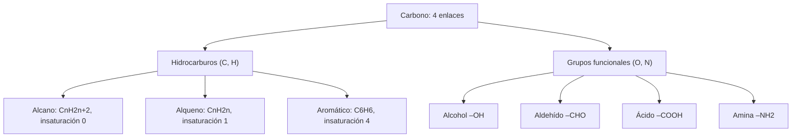

# B06-C16 — Química orgánica esencial

<!-- nav:top -->
[🏠 Programa](../../../../README.md) · [📚 Bloque B06](../../../tronco-comun/B06-quimica-y-materia-del-universo.md) · [← Anterior: B06-C15 — Ácidos, bases y soluciones](../B06-C15-acidos-bases-y-soluciones/CLASE.md) · [Siguiente: B06-C17 — Espectros atómicos y moleculares →](../B06-C17-espectros-atomicos-y-moleculares/CLASE.md)
<!-- /nav -->

## 1. Ubicación, nivel y alcance

Decimosexta clase del bloque B06 y cierre de su cuarto tramo. Con los enlaces (C04), la geometría (C05), el mol (C06) y los ácidos y bases (C15) puedes entrar a la química del carbono, la que forma las moléculas de la vida y también muchas moléculas del espacio. Sigues en el nivel N1.

Verás por qué el carbono forma tantos compuestos, las familias de hidrocarburos, los grupos funcionales más comunes, cómo calcular la masa molar y el grado de insaturación de una fórmula y cuánto pesan, en gramos, las moléculas orgánicas que se midieron en el asteroide Bennu. No verás nomenclatura sistemática completa, mecanismos de reacción ni bioquímica (bloques posteriores del programa).

## 2. Por qué esta clase existe

El análisis de las muestras de Bennu detectó aminoácidos (incluidos 14 de los 20 usados en la biología terrestre), aminas, formaldehído, ácidos carboxílicos, hidrocarburos aromáticos policíclicos y heterociclos de nitrógeno, entre ellos las cinco nucleobases del ADN y el ARN, además de unas 10 000 especies nitrogenadas (S1). Es una lista larga de nombres. Para entenderla hace falta saber qué es cada familia y cuánta masa representa.

La decisión central es: **dada una fórmula molecular, ¿qué familia de compuestos puede ser, qué masa molar tiene, cuántos anillos o dobles enlaces implica, y cuánto pesa una cantidad medida en nmol/g?** Aprenderás a leer fórmulas, calcular masas, deducir la insaturación y convertir cantidades medidas, con sentido de proporción. Prepara C19 y C20, y bloques posteriores de astrobiología.

## 3. Lo que podrás hacer al terminar

1. Explicar por qué el carbono forma cadenas, anillos y enlaces múltiples.
2. Reconocer alcanos, alquenos, alquinos y aromáticos por su fórmula y estructura.
3. Identificar los grupos funcionales alcohol, aldehído, ácido carboxílico y amina.
4. Calcular la masa molar y el grado de insaturación de una fórmula.
5. Convertir nmol/g a μg/g y a porcentaje en masa, y comparar con el carbono total.
6. Redactar una ficha de moléculas orgánicas con fórmulas, masas y alcance.

La evidencia es la **ficha de moléculas orgánicas** del ejercicio 12 (sección 20).

## 4. Con qué llegas y cómo comprobarlo

Necesitas C04 (enlaces, Lewis), C06 (mol, masa molar) y C15 (ácidos). Cinco preguntas:

1. ¿Cuántos enlaces forma el carbono, y el hidrógeno?
2. Calcula la masa molar del CH₄.
3. ¿Qué carga tiene el ion formiato HCOO⁻?
4. Convierte 4106 nmol a μmol.
5. ¿Qué es un enlace doble?

<details>
<summary>Ver respuestas</summary>

1. Cuatro; uno. 2. 16,04 g/mol. 3. −1. 4. 4,106 μmol. 5. Dos pares de electrones compartidos entre dos átomos (C04).
</details>

Con cuatro o cinco aciertos, sigue. Con tres o menos, repasa C04 y C06.

## 5. Un caso real: lo orgánico en Bennu

El resumen de Glavin y colaboradores (2025) informa que las muestras de Bennu tienen más carbono, nitrógeno y amoníaco que las de Ryugu y que la mayoría de los meteoritos, con contenidos de carbono de 4,5–4,7 % y de nitrógeno de 0,23–0,25 % en masa. Detectaron aminoácidos, aminas, formaldehído, ácidos carboxílicos, hidrocarburos aromáticos policíclicos y heterociclos de nitrógeno, con unas 10 000 especies nitrogenadas, y observaron que los aminoácidos quirales no proteicos eran racémicos o casi (mezcla en partes iguales de las dos imágenes especulares) (S1).

Ten presente el límite: la presencia de moléculas orgánicas no es evidencia de vida; los propios autores interpretan que se formaron por reacciones a baja temperatura en fluidos ricos en amoníaco. Esta clase no reproduce su análisis: sólo usa cuatro cifras publicadas para ejercitar el cálculo.

## 6. Vocabulario

La **química orgánica** estudia los compuestos del carbono (con H, O, N, S, P…). Un **hidrocarburo** contiene sólo carbono e hidrógeno: **alcano** (enlaces simples, `CₙH₂ₙ₊₂`, como el metano `CH₄`), **alqueno** (un doble enlace, `CₙH₂ₙ`, como el eteno `C₂H₄`), **alquino** (un triple enlace) y **aromático** (anillos con enlaces alternados, como el benceno `C₆H₆`). Los **hidrocarburos aromáticos policíclicos** (PAH) tienen varios anillos fusionados, como el naftaleno `C₁₀H₈`.

Un **grupo funcional** es una agrupación de átomos que da propiedades características: **alcohol** (–OH, como el etanol `C₂H₆O`), **aldehído** (–CHO, como el formaldehído `CH₂O`), **ácido carboxílico** (–COOH, como el fórmico `CH₂O₂` y el acético `C₂H₄O₂`) y **amina** (–NH₂, como la metilamina `CH₅N`). Los **isómeros** son moléculas con la misma fórmula y distinta estructura (etanol y éter dimetílico, ambos `C₂H₆O`). El **grado de insaturación** `(2C + 2 + N − H)/2` cuenta anillos más dobles enlaces (un triple cuenta dos). Una mezcla **racémica** contiene cantidades iguales de dos moléculas que son imágenes especulares una de otra.

## 7. Modelo mental: el carbono como pieza de construcción

El carbono tiene cuatro «manos» (C04). Con ellas puede agarrarse a otros carbonos en cadenas, anillos y ramas, y a la vez a hidrógeno, oxígeno o nitrógeno. Por eso las combinaciones son casi ilimitadas.



*Descripción textual:* el carbono, con cuatro enlaces, da dos ramas. La primera son los hidrocarburos: alcanos (insaturación 0), alquenos (1) y aromáticos como el benceno (4). La segunda son los grupos funcionales con oxígeno y nitrógeno: alcohol, aldehído, ácido carboxílico y amina.

La analogía de la pieza de construcción muestra la versatilidad del carbono; su límite es que no todas las combinaciones son estables ni existen en la naturaleza: sólo una fracción de las estructuras posibles se forma, y el análisis de qué se forma depende de la química (C12, C13, C14).

## 8. La explicación, paso a paso

### 8.1 El carbono y sus cuatro enlaces

Con cuatro electrones de valencia (C02), el carbono completa su octeto con cuatro pares compartidos (C04). En el metano, `CH₄`, son cuatro enlaces simples con geometría tetraédrica (C05). En el eteno, `C₂H₄`, hay un doble enlace carbono–carbono; en el CO₂ (C05), dos dobles enlaces con el oxígeno.

### 8.2 Familias de hidrocarburos

Los alcanos tienen la fórmula general `CₙH₂ₙ₊₂`: `CH₄`, `C₂H₆`, `C₃H₈`. Cada doble enlace o anillo quita dos hidrógenos: los alquenos son `CₙH₂ₙ`. El benceno, `C₆H₆`, tiene 4 grados de insaturación (un anillo y tres dobles enlaces) y el naftaleno `C₁₀H₈`, 7. Los PAH se detectan en las muestras de Bennu (S1).

### 8.3 Grupos funcionales

El grupo funcional determina el comportamiento químico. Un ácido carboxílico (–COOH) cede un protón (C15): el fórmico `HCOOH` da formiato `HCOO⁻`. Una amina (–NH₂) acepta un protón: la metilamina `CH₃NH₂` forma `CH₃NH₃⁺`. El aldehído (–CHO) más sencillo es el formaldehído, `CH₂O`. Los aminoácidos tienen a la vez un grupo amina y uno carboxílico: la glicina es `C₂H₅NO₂`, de masa molar 75,067 g/mol y grado de insaturación 1.

### 8.4 Masa molar y grado de insaturación

Con los pesos atómicos de la NIST (S2): `CH₂O₂ = 12,0106 + 2 × 1,007975 + 2 × 15,9994 = 46,0254 g/mol`; `C₂H₄O₂ = 60,0519`; `CH₅N = 31,0573`; `C₂H₇N = 45,0839`. El script comprueba que su cálculo da las masas molares del WebBook para `CH₄`, `H₂O` y `CO₂`. La insaturación de `C₂H₆O` es `(4 + 2 − 6)/2 = 0`: el etanol y su isómero, el éter dimetílico, no tienen dobles enlaces ni anillos.

### 8.5 ¿Cuánto pesan las moléculas medidas en Bennu?

Las concentraciones se dan en nmol por gramo (S1). Por gramo de muestra, tomándolo como lo da la fuente: fórmico `4106 nmol × 46,0254 = 189 μg`; acético `1436 × 60,0519 = 86,2 μg`; metilamina `914 × 31,0573 = 28,4 μg`; etilamina `121 × 45,0839 = 5,46 μg`. Suman `309 μg/g`, es decir, 0,031 % en masa. El carbono que contienen es `97,7 μg/g`, que frente a un carbono total de 4,5–4,7 % (45 000–47 000 μg/g) es sólo el 0,21–0,22 %. Es un orden de magnitud útil: estas cuatro moléculas son una fracción mínima del carbono de la muestra; el resto está en otras formas (S1 señala que el carbono orgánico de las condritas carbonáceas está sobre todo en materia orgánica insoluble compleja).

## 9. Magnitudes, símbolos y unidades

| Símbolo | Qué es | Unidad | Valor o nota |
|---|---|---|---|
| fórmula | composición molecular | — | `CH₂O₂`, `C₂H₄O₂`… |
| `M` | masa molar | g/mol | CH₂O₂ 46,0254; C₂H₄O₂ 60,0519; CH₅N 31,0573; C₂H₇N 45,0839 |
| insaturación | anillos + dobles enlaces | — | `(2C + 2 + N − H)/2` |
| concentración | cantidad por gramo | nmol/g, μg/g | fórmico 4106 nmol/g = 189 μg/g |
| C total | carbono de la muestra | % en masa | 4,5–4,7 (S1) |

## 10. Convenciones y referencias

Las fórmulas se escriben con el carbono primero, luego hidrógeno y los demás elementos por orden alfabético, salvo cuando se usa la fórmula estructural (`HCOOH`). Los pesos atómicos usan el punto medio de los intervalos de la NIST (C03). Las concentraciones se dan por gramo, tal como las informa la fuente; la clase supone que es por gramo de la muestra analizada (la fuente da `nmol g⁻¹`). La comparación con el carbono total es una estimación de orden de magnitud.

## 11. De dónde sale lo que afirmamos

| ID | Fuente | Localizador | Respalda | Estado |
|---|---|---|---|---|
| S1 | D. P. Glavin et al., *Nature Astronomy* (2025), doi:10.1038/s41550-024-02472-9 | PDF de NASA NTRS, doc. 20250001355 | Resumen de compuestos detectados; C 4,5–4,7 % y N 0,23–0,25 %; fórmico 4106, acético 1436, metilamina 914 y etilamina 121 nmol/g; aminoácidos quirales no proteicos racémicos | PDF leído el 2026-11-05 (PyMuPDF) |
| S2 | NIST, *Atomic Weights and Isotopic Compositions for All Elements* | https://physics.nist.gov/cgi-bin/Compositions/stand_alone.pl | Pesos atómicos | Consulta del 2026-11-05 |
| S3 | NIST Chemistry WebBook, CH₄, H₂O, CO₂ | https://webbook.nist.gov/cgi/cbook.cgi?ID=C74828 (y `C7732185`, `C124389`) | Masas molares de referencia: 16,0425; 18,0153; 44,0095 | Consulta del 2026-11-05 |

Límites: S1 se usa para cuatro cifras de concentración y para el resumen; no se reproduce su análisis ni se evalúa la identificación de compuestos. Las clasificaciones de familias y grupos funcionales son explicación nuestra sin fuente propia. La suposición de que las concentraciones son por gramo de muestra no se verificó contra la tabla de datos extendida del artículo.

## 12. Cómo ver las moléculas

Esta tabla es la versión accesible de un esquema de estructuras.

| Molécula | Fórmula | Familia | Insaturación | M (g/mol) |
|---|---|---|---|---|
| Metano | CH₄ | alcano | 0 | 16,0425 |
| Etanol | C₂H₆O | alcohol | 0 | 46,0684 |
| Ácido fórmico | CH₂O₂ | ácido carboxílico | 1 | 46,0254 |
| Ácido acético | C₂H₄O₂ | ácido carboxílico | 1 | 60,0519 |
| Metilamina | CH₅N | amina | 0 | 31,0573 |
| Glicina | C₂H₅NO₂ | aminoácido | 1 | 75,0667 |
| Benceno | C₆H₆ | aromático | 4 | 78,1115 |
| Naftaleno | C₁₀H₈ | PAH | 7 | 128,1698 |

Si dibujas estructuras, usa líneas para los enlaces, etiqueta cada átomo que no sea carbono y no dependas del color. Descripción larga: las moléculas crecen de un carbono (metano) a diez (naftaleno); la insaturación sube con los anillos y los dobles enlaces.

## 13. Ejemplo trabajado: ¿qué fracción del carbono de Bennu es fórmico, acético y aminas?

**Datos (medidos, S1):** fórmico 4106 nmol/g; acético 1436; metilamina 914; etilamina 121; carbono total 4,5–4,7 %.

**Paso 1 · Masas molares.** CH₂O₂ 46,0254; C₂H₄O₂ 60,0519; CH₅N 31,0573; C₂H₇N 45,0839 g/mol.

**Paso 2 · Masa por gramo.** `4106 × 46,0254/1000 = 188,98 μg`; `86,23`; `28,39`; `5,46`. Suma: `309,1 μg/g`.

**Paso 3 · Carbono por gramo.** Átomos de C por molécula: 1, 2, 1, 2. `4106 × 1 × 12,0106/1000 = 49,32 μg`; `34,49`; `10,98`; `2,91`. Suma: `97,7 μg C/g`.

**Paso 4 · Fracción del carbono total.** `97,7/(4,5 × 10⁴) = 0,22 %` y `97,7/(4,7 × 10⁴) = 0,21 %`.

**Paso 5 · Incertidumbre.** El rango del carbono total (4,5–4,7 %) cambia la fracción en 0,01 puntos; las concentraciones de la fuente llevan una incertidumbre no consultada, por lo que se informa «≈ 0,2 %».

**Sentido físico.** Las moléculas orgánicas solubles que se destacan en un titular suponen una fracción pequeñísima del carbono de la muestra, lo que ayuda a poner en contexto cualquier cifra de «moléculas orgánicas» (S1 apunta que el grueso del carbono orgánico está en materia insoluble).

## 14. Dos formas de describir una molécula

Puedes dar la **fórmula molecular** (qué átomos y cuántos, suficiente para la masa y la insaturación) o la **fórmula estructural** (cómo están unidos, necesaria para saber el grupo funcional y distinguir isómeros). La molecular responde preguntas de contabilidad; la estructural, de comportamiento. Una masa medida con un espectrómetro de masas da la molecular; la estructura exige más datos.

## 15. Práctica guiada

**Ejercicio 1 · con los pasos indicados.** Calcula la masa molar del ácido fórmico `CH₂O₂`. *Pasos:* `12,0106 + 2 × 1,007975 + 2 × 15,9994`.

<details><summary>Solución comentada</summary>

`12,0106 + 2,01595 + 31,9988 = 46,0254 g/mol`. Si te salió 30, olvidaste los oxígenos.
</details>

**Ejercicio 2 · con una pista.** Calcula el grado de insaturación de `C₂H₆O`. *Pista:* `(2C + 2 + N − H)/2`.

<details><summary>Solución comentada</summary>

`(4 + 2 + 0 − 6)/2 = 0`: sin anillos ni dobles enlaces (etanol o éter dimetílico).
</details>

**Ejercicio 3 · casi autónomo.** Identifica el grupo funcional de `HCOOH`, `CH₃NH₂` y `CH₂O`.

<details><summary>Solución comentada</summary>

Ácido carboxílico (–COOH), amina (–NH₂) y aldehído (el formaldehído).
</details>

## 16. Práctica autónoma, transferencia e integrador

**Ejercicio 4.** Calcula la masa molar del ácido acético `C₂H₄O₂`.

<details><summary>Solución comentada</summary>

`2 × 12,0106 + 4 × 1,007975 + 2 × 15,9994 = 24,0212 + 4,0319 + 31,9988 = 60,0519 g/mol`.
</details>

**Ejercicio 5.** Calcula el grado de insaturación del benceno `C₆H₆`.

<details><summary>Solución comentada</summary>

`(12 + 2 − 6)/2 = 4` (un anillo y tres dobles enlaces).
</details>

**Ejercicio 6.** Convierte 914 nmol/g de metilamina a μg/g.

<details><summary>Solución comentada</summary>

`914 × 10⁻⁹ mol × 31,0573 g/mol = 2,839 × 10⁻⁵ g = 28,4 μg` por gramo.
</details>

**Ejercicio 7.** Calcula el carbono (en μg/g) aportado por las cuatro moléculas de la sección 13.

<details><summary>Solución comentada</summary>

`49,32 + 34,49 + 10,98 + 2,91 = 97,7 μg/g`. Cada molécula aporta `n_C` átomos por molécula, de ahí los factores 1, 2, 1, 2.
</details>

**Ejercicio 8.** ¿Qué fracción del carbono total (4,6 %) son esas moléculas?

<details><summary>Solución comentada</summary>

`97,7/46 000 = 0,21 %`.
</details>

**Ejercicio 9 · transferencia.** El naftaleno `C₁₀H₈` es un PAH. Calcula su masa molar y su insaturación, y compara con el benceno.

<details><summary>Solución comentada</summary>

`10 × 12,0106 + 8 × 1,007975 = 128,17 g/mol`; insaturación `(20 + 2 − 8)/2 = 7` (dos anillos y cinco dobles enlaces). Son dos anillos fusionados: mismo tipo de estructura que el benceno, con más masa y más insaturación.
</details>

**Ejercicio 10 · transferencia.** Etanol y éter dimetílico son `C₂H₆O`. ¿Qué tienen igual y qué diferente?

<details><summary>Solución comentada</summary>

Igual: fórmula, masa molar (46,07 g/mol) e insaturación (0). Diferente: la estructura (un grupo –OH en uno, un oxígeno entre dos carbonos en el otro), y con ella las propiedades. Un espectrómetro de masas que sólo mide `M` no los distingue.
</details>

**Ejercicio 11 · transferencia.** Un titular dice: «hallaron los ladrillos de la vida en Bennu, por tanto hubo vida». Evalúa con lo leído.

<details><summary>Solución comentada</summary>

Detectar aminoácidos y nucleobases muestra que la química prebiótica produce esas moléculas, no que haya habido vida. Los autores observan que los aminoácidos quirales no proteicos eran racémicos o casi, y los atribuyen a reacciones a baja temperatura en fluidos con amoníaco (S1). La afirmación del titular no se sigue de los datos.
</details>

**Ejercicio 12 · integrador.** Elabora la *ficha de moléculas orgánicas* (sección 20): elige cinco moléculas (con fórmula conocida), calcula su masa molar con los pesos atómicos de la NIST, su insaturación y su familia, y convierte una concentración publicada (nmol/g) a μg/g y a fracción del carbono total.

<details><summary>Solución modelo</summary>

Una ficha con la tabla de la sección 12 (más la conversión de la sección 13) cumple. Se acepta cualquier conjunto de moléculas siempre que la fuente de la concentración se cite con fecha y se declare si es por gramo de muestra o de extracto.
</details>

## 17. Laboratorio: masas e insaturación

El script [moleculas_organicas.py](moleculas_organicas.py) analiza fórmulas, calcula la masa molar y el grado de insaturación, y convierte las concentraciones de Bennu a μg/g y a fracción del carbono total. Antes de imprimir comprueba que su masa molar de `CH₄`, `H₂O` y `CO₂` coincide con el WebBook (±5 × 10⁻⁴), que las insaturaciones de varias moléculas conocidas son las esperadas y que el analizador lee `C₂H₅NO₂` correctamente; si algo falla, se detiene.

**Datos:** medidos (S1) y pesos atómicos NIST. **Predice antes de ejecutar:** ¿qué porcentaje del carbono suman las cuatro moléculas? (algo más de 0,2 %). **Resultados (2026-11-05, Python 3.12.9):** masas molares 46,0254; 60,0519; 31,0573; 45,0839 g/mol; masas por gramo 188,98; 86,23; 28,39; 5,46 μg; suma 309,1 μg/g (0,0309 %); carbono 97,7 μg/g, que es 0,22 % (4,5 %) y 0,21 % (4,7 %) del total; `C₂H₆O` 46,0684 (insaturación 0), `C₆H₆` 78,1115 (4), `C₁₀H₈` 128,1698 (7), `C₂H₅NO₂` 75,0667 (1).

```bash
python programa/clases/B06/B06-C16-quimica-organica-esencial/moleculas_organicas.py
```

**Límites:** compuestos de C, H, N y O; no trata paréntesis ni cargas; las concentraciones se suponen por gramo de muestra. No sirve para identificar compuestos desconocidos.

## 18. Errores frecuentes y cómo corregirlos

**Olvidar un átomo en la masa molar.** Se corrige con el ejercicio 1.

**Confundir isómeros con la misma sustancia.** Se corrige con el ejercicio 10.

**Calcular mal el grado de insaturación (sin el término del nitrógeno).** Se corrige con el ejercicio 2.

**Convertir mal nmol a μg.** Se corrige con el ejercicio 6.

**Decir que moléculas orgánicas implican vida.** Se corrige con el ejercicio 11.

## 19. Cómo sabrás que vas bien

Tras 8.1: ¿cuántos enlaces forma el carbono y por qué? Si dudas, relee C04. Tras 8.2: ¿puedes distinguir un alcano de un alqueno por su fórmula? Si no, haz el ejercicio 5. Tras 8.3: ¿qué grupo funcional da un ácido? Si no, haz el ejercicio 3. Tras 8.5: ¿cómo pasas de nmol/g a una fracción de carbono? Si dudas, haz los ejercicios 6 a 8. Tras el laboratorio: ¿qué comprueba el script con el WebBook? Si lo ignoras, lee su cabecera.

## 20. Qué entregas y cómo se evalúa

El producto es tu **ficha de moléculas orgánicas**: cinco moléculas con fórmula, familia, masa molar, insaturación, una conversión de concentración y la fuente.

| Criterio | Inicial | En desarrollo | Logrado | Destacado |
|---|---|---|---|---|
| Fórmulas y familias | Con errores | Parcialmente correctas | Correctas | Distingue isómeros |
| Masa molar | Sin verificación | Con errores | Correcta y verificada | Contrasta con una referencia |
| Insaturación | No la calcula | Con errores | Correcta | La interpreta (anillos, dobles) |
| Conversión de concentración | Sin unidades | Con error | Correcta con unidades | Declara la base (por gramo de qué) |
| Alcance | Sobreinterpreta | Lo menciona | Lo limita | Explica la diferencia entre presencia y vida |

**Condiciones críticas:** no afirmar vida a partir de moléculas orgánicas; no omitir la base de la concentración; citar sólo fuentes consultadas.

## 21. Ética, seguridad y límites

Es un cálculo; no hay síntesis. Muchos compuestos orgánicos son inflamables, tóxicos o irritantes (el formaldehído y algunas aminas, entre ellos); esta clase no describe cómo prepararlos ni manipularlos, y no sugiere síntesis de ninguna sustancia. Alternativa sin riesgo: modelos moleculares en pantalla o piezas de construcción. Accesibilidad: tablas equivalentes a los esquemas y fórmulas en texto. Las afirmaciones sobre origen de la vida deben formularse con cautela.

## 22. Para cerrar y seguir

El carbono, con cuatro enlaces, forma cadenas, anillos y grupos funcionales; la fórmula da la masa molar y la insaturación, y la concentración medida da el peso de lo que se halla. En Bennu, las cuatro moléculas pequeñas del ejemplo suponen sólo ≈ 0,2 % del carbono de la muestra. En el último tramo pondrás la luz a trabajar con la química: espectros, fotoquímica, hielos, minerales y meteoritos.

**Glosario español–inglés.** química orgánica · *organic chemistry*; hidrocarburo · *hydrocarbon*; grupo funcional · *functional group*; isómero · *isomer*; grado de insaturación · *degree of unsaturation*; mezcla racémica · *racemic mixture*; aromático · *aromatic*.

**Continuidad.** B06-C17 usa estas moléculas para interpretar bandas de espectros. B06-C20 compara la composición de los meteoritos con la del Sol.

**Referencias:** ver sección 11. S1 es un PDF leído; las clasificaciones de familias son explicación propia.

<!-- nav:bottom -->
---

[← Anterior: B06-C15 — Ácidos, bases y soluciones](../B06-C15-acidos-bases-y-soluciones/CLASE.md) · [📚 Bloque B06](../../../tronco-comun/B06-quimica-y-materia-del-universo.md) · [Siguiente: B06-C17 — Espectros atómicos y moleculares →](../B06-C17-espectros-atomicos-y-moleculares/CLASE.md)
<!-- /nav -->
