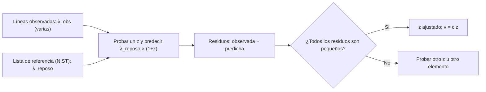

# B06-C17 — Espectros atómicos y moleculares

<!-- nav:top -->
[🏠 Programa](../../../../README.md) · [📚 Bloque B06](../../../tronco-comun/B06-quimica-y-materia-del-universo.md) · [← Anterior: B06-C16 — Química orgánica esencial](../B06-C16-quimica-organica-esencial/CLASE.md) · [Siguiente: B06-C18 — Fotoquímica y radiación →](../B06-C18-fotoquimica-y-radiacion/CLASE.md)
<!-- /nav -->

## 1. Ubicación, nivel y alcance

Decimoséptima clase del bloque B06 y apertura de su último tramo, donde la química se encuentra con la luz. En C01 calculaste las líneas del hidrógeno; en B01-C09 viste que la luz trae información. Aquí juntas ambas cosas para leer un espectro: reconocer qué líneas hay, de qué elemento son y qué dicen del movimiento del objeto. Sigues en el nivel N1.

Verás tipos de espectros (continuo, de emisión, de absorción), las series del hidrógeno más allá de Balmer, cómo identificar líneas con una lista de referencia, cómo obtener el corrimiento al rojo `z` y la velocidad, y la idea de los espectros moleculares (rotación). No verás instrumentación (B29) ni cálculos cuánticos de intensidades.

## 2. Por qué esta clase existe

En B01-C01 estimaste la velocidad de una galaxia con una sola línea, H-alfa en 662,9 nm. Pero ¿cómo se sabe que esa línea es H-alfa y no otra? La respuesta es que nunca se confía en una sola línea: se buscan varias, con el patrón de separaciones del hidrógeno, y todas deben dar el mismo `z`. Esa verificación cruzada es lo que convierte una rayita en una medida.

La decisión central es: **dada una lista de longitudes de onda observadas, ¿qué elemento y qué `z` las explican, con qué margen de error, y qué pasaría si me equivocara de línea?** Aprenderás a comparar con una lista de referencia, a ajustar `z` con varias líneas y a evaluar la consistencia. Es base de B29 y de todo análisis de la composición de estrellas y galaxias.

## 3. Lo que podrás hacer al terminar

1. Distinguir un espectro continuo, de emisión y de absorción, y decir qué indica cada uno.
2. Calcular las longitudes de onda de las series de Lyman, Balmer, Paschen y Brackett del hidrógeno.
3. Identificar líneas observadas con una lista de referencia y ajustar `z`.
4. Calcular la velocidad `v = c z` y reconocer corrimiento al azul.
5. Explicar por qué se usan varias líneas y por qué hay que declarar aire o vacío.
6. Redactar la identificación de líneas de un espectro con sus residuos y límites.

La evidencia es la **identificación de líneas en un espectro** del ejercicio 12 (sección 20).

## 4. Con qué llegas y cómo comprobarlo

Necesitas C01 (niveles, series de Balmer), C03 y B01-C09 (la luz y su espectro). Cinco preguntas:

1. ¿Qué longitud de onda tiene H-alfa en reposo (en aire)?
2. Calcula `656,28 × 1,0101`.
3. ¿Cuántos km/s son `0,0101 × 299 792`?
4. ¿Qué serie del hidrógeno termina en `n = 2`?
5. ¿Qué diferencia hay entre una línea de emisión y una de absorción?

<details>
<summary>Ver respuestas</summary>

1. 656,28 nm. 2. 662,9. 3. 3028 km/s. 4. La de Balmer. 5. La de emisión es un exceso de luz a un color; la de absorción, un déficit (una raya oscura) sobre un fondo continuo.
</details>

Con cuatro o cinco aciertos, sigue. Con tres o menos, repasa C01 y B01-C09.

## 5. Un caso real: ¿es H-alfa esa línea?

La NIST registra para el hidrógeno en el visible cuatro líneas de Balmer, con las componentes de estructura fina de cada una en rangos muy estrechos: H-alfa en 656,271–656,291 nm, H-beta en 486,128–486,137, H-gamma en 434,043–434,050 y H-delta en 410,170–410,177, todas en aire (S1). Si un espectro de una galaxia muestra cuatro líneas separadas en esa proporción pero todas más rojas en el mismo factor, la identificación es sólida; si sólo muestra una, la identificación es una hipótesis.

El espectro que usas en esta clase es **sintético** (con `z = 0,0101` fijo y errores de medida simulados). Ten presente el límite: un espectro real tiene ruido, ensanchamiento y líneas de otros elementos que complican la identificación; este ejercicio enseña el método, no resuelve un caso real.

## 6. Vocabulario

Un **espectro** es la distribución de la luz por longitud de onda. Un **espectro continuo** tiene luz en todos los colores; un **espectro de emisión** muestra líneas brillantes (un gas caliente emite sólo a ciertas longitudes de onda); uno de **absorción** muestra líneas oscuras (un gas más frío delante de una fuente continua absorbe esas mismas longitudes). Una **línea espectral** es un máximo o mínimo estrecho de ese espectro. La **longitud de onda de reposo** `λ_reposo` es la medida en el laboratorio, con la fuente en reposo; la **observada**, `λ_obs`, es la que llega. El **corrimiento al rojo** es

```text
z = λ_obs / λ_reposo − 1
```

y, para `z ≪ 1`, la **velocidad radial** aproximada es `v = c z`. Si `z < 0`, el objeto se acerca (corrimiento al azul). Las **series del hidrógeno** son las transiciones que terminan en un mismo nivel (C01): Lyman (`n = 1`, ultravioleta), Balmer (`n = 2`, visible), Paschen (`n = 3`, infrarrojo cercano) y Brackett (`n = 4`, infrarrojo). Un **espectro molecular** tiene además líneas por la rotación y la vibración de la molécula, que caen en el infrarrojo y las microondas.

## 7. Modelo mental: la huella dactilar

Cada elemento tiene un patrón propio de líneas, como una huella dactilar. Para identificarla no basta con una marca: se comparan varias marcas y sus separaciones. Si las marcas están desplazadas todas en la misma proporción, se trata de la misma huella corrida por el movimiento.



*Descripción textual:* las líneas observadas y la lista de referencia entran a un paso donde se prueba un valor de `z`, se calculan las longitudes predichas y los residuos. Si todos los residuos son pequeños, se acepta ese `z` y se calcula la velocidad; si no, se prueba otro `z` u otro elemento.

La analogía de la huella dactilar muestra por qué hacen falta varias líneas; su límite es que una huella no cambia de tamaño, mientras que el corrimiento escala todas las longitudes de onda en la misma proporción, por lo que lo que se compara son cocientes y separaciones relativas.

## 8. La explicación, paso a paso

### 8.1 Tres clases de espectros

Un sólido o un gas muy denso caliente emite un espectro continuo. Un gas poco denso y caliente, visto sin fondo, da líneas de emisión. El mismo gas, más frío y delante de una fuente continua, da líneas de absorción en las mismas posiciones. De ahí que las líneas del hidrógeno aparezcan brillantes en una nebulosa (como la línea roja de C01) y oscuras en el espectro de una estrella.

### 8.2 Las series del hidrógeno

Con la fórmula de Rydberg y la masa reducida (C01), en el vacío: Lyman-alfa (2→1) `121,568 nm`; Balmer-alfa (3→2) `656,470 nm`; Paschen-alfa (4→3) `1875,6 nm`; Brackett-alfa (5→4) `4052,3 nm`. Las dos primeras son ultravioleta y visible; las dos últimas, infrarrojo (el ojo no las ve). Los instrumentos observan las series fuera del visible desde satélites o con detectores infrarrojos.

### 8.3 Ajustar `z` con varias líneas

Con las cuatro líneas de Balmer de reposo (S1) y cuatro longitudes observadas **sintéticas** (414,306; 438,450; 491,003; 662,939 nm), se prueba una rejilla de valores de `z` y se elige el que minimiza la suma de discrepancias. Resultado: `z = 0,01014` (verdadero 0,0101), `v = 3040 km/s`, con una discrepancia total de 0,092 nm entre las cuatro líneas. Si se probara `z = 0`, la discrepancia sería más de diez veces mayor. Que cuatro líneas independientes den el mismo `z` es lo que respalda la identificación.

### 8.4 Aire y vacío otra vez

Si comparas una longitud de onda de reposo en el vacío (656,470 nm para H-alfa) con una observada en aire, el corrimiento aparente se desplaza en `(656,470 − 656,281)/656,281 = 2,9 × 10⁻⁴`, es decir, unos 86 km/s: un error pequeño, pero sistemático y evitable. Siempre se declara si la lista de referencia y las observaciones están en el mismo medio.

### 8.5 Espectros moleculares

Una molécula puede rotar, vibrar y cambiar de estado electrónico. Cada tipo de cambio absorbe o emite en un rango distinto: la rotación en microondas y submilimétrico; la vibración en el infrarrojo; los cambios electrónicos en el visible y el ultravioleta. En el modelo más sencillo de rotor rígido, las líneas de rotación están separadas regularmente en `2B`, donde `B` es la constante rotacional (en cm⁻¹). Con un valor **sintético** `B = 2,0 cm⁻¹`, las líneas caen en 4, 8, 12, 16, 20 cm⁻¹ y el espaciado da `B` directamente. Con `1 cm⁻¹ = 1,2398 × 10⁻⁴ eV`, la primera línea tiene una energía de `4,96 × 10⁻⁴ eV`, mil veces menor que un fotón visible. No se usa aquí ninguna molécula real.

## 9. Magnitudes, símbolos y unidades

| Símbolo | Qué es | Unidad | Valor o nota |
|---|---|---|---|
| `λ_reposo` | longitud de onda en laboratorio | nm | Hα 656,2810; Hβ 486,1327; Hγ 434,0463; Hδ 410,1734 (aire; S1) |
| `λ_obs` | longitud de onda observada | nm | — |
| `z` | corrimiento al rojo | — | `λ_obs/λ_reposo − 1` |
| `v` | velocidad radial | km/s | `c z` (si `z ≪ 1`) |
| `c` | velocidad de la luz | km/s | 299 792,458 |
| `B` | constante rotacional | cm⁻¹ | sintética: 2,0 |
| 1 cm⁻¹ | número de onda | eV | 1,2398 × 10⁻⁴ |

## 10. Convenciones y referencias

Las longitudes de reposo en aire usadas aquí son los **puntos medios** de los rangos de componentes que da la NIST (S1); no son valores recomendados únicos, y esa elección introduce ±0,01 nm. `z` es adimensional. La velocidad `c z` es la aproximación no relativista, válida para `z` pequeño. El espectro observado y el espectro molecular son **sintéticos**.

## 11. De dónde sale lo que afirmamos

| ID | Fuente | Localizador | Respalda | Estado |
|---|---|---|---|---|
| S1 | NIST, *Atomic Spectra Database* v5.12, líneas de H I, 380–700 nm | https://physics.nist.gov/cgi-bin/ASD/lines1.pl (consulta con `spectra=H I`) | Longitudes de onda en aire y rangos de componentes de Balmer | Consulta del 2026-11-05 |
| S2 | NIST, *CODATA Recommended Values* (2022): `R_inf`, `m_p/m_e`, `c` | https://physics.nist.gov/cgi-bin/cuu/Value?ryd (y `?mpsme`, `?c`) | Constantes para las series | Consulta del 2026-11-05 |
| S3 | B01-C01 de este programa (`z = 0,0101`, H-alfa a 662,9 nm) | `programa/clases/B01/B01-C01-naturaleza-del-universo/CLASE.md` | Valor de `z` de la galaxia usado como referencia sintética | Referencia interna |

Límites: el espectro de la clase es sintético y los espectros moleculares no tienen fuente; la descripción de los tres tipos de espectros y de las regiones espectrales de las transiciones moleculares es explicación nuestra, sin fuente consultada. No se consultó ninguna base de datos de líneas moleculares.

## 12. Cómo ver el espectro

Esta tabla es la versión accesible de un espectro con cuatro líneas.

| Línea | Reposo (nm, aire) | Observada sintética (nm) | Predicha con `z = 0,01014` (nm) | Residuo (nm) |
|---|---|---|---|---|
| Hδ | 410,1734 | 414,306 | 414,332 | −0,026 |
| Hγ | 434,0463 | 438,450 | 438,447 | +0,003 |
| Hβ | 486,1327 | 491,003 | 491,063 | −0,060 |
| Hα | 656,2810 | 662,939 | 662,936 | +0,003 |

Si dibujas el espectro, rotula el eje horizontal con la longitud de onda y su unidad, marca las líneas con etiquetas de texto y no dependas del color. Descripción larga: cuatro líneas aisladas a 414, 438, 491 y 663 nm, cada una desplazada hacia el rojo del 1,0 % respecto de su posición de reposo.

## 13. Ejemplo trabajado: recuperar `z` de un espectro

**Datos (reposo: publicados, S1; observadas: sintéticas):** líneas observadas 414,306; 438,450; 491,003; 662,939 nm.

**Paso 1 · Hipótesis.** Son las cuatro líneas de Balmer (δ, γ, β, α). La más roja es H-alfa.

**Paso 2 · `z` de H-alfa.** `662,939/656,2810 − 1 = 0,010145`.

**Paso 3 · Predecir las otras.** `410,1734 × 1,010145 = 414,334`; `434,0463 × 1,010145 = 438,450`; `486,1327 × 1,010145 = 491,065`.

**Paso 4 · Residuos.** `−0,028`; `0,000`; `−0,062` nm. Son del orden de las incertidumbres de medida simuladas (0,01–0,04 nm).

**Paso 5 · Velocidad.** `v = 299 792,458 × 0,010145 = 3041 km/s`.

**Paso 6 · Contraste.** Si hubieras supuesto que la línea de 662,939 nm es H-beta, `z = 662,939/486,1327 − 1 = 0,364`, y las demás líneas no encajarían: H-alfa se predeciría en 895 nm, donde no hay nada observado.

**Sentido físico.** Cuatro líneas consistentes con un mismo `z` son una identificación sólida; la verificación cruzada es lo que distingue una medida de una hipótesis.

## 14. Dos formas de identificar

Puedes **identificar a ojo** con una lista corta (rápido, adecuado si hay pocas líneas y un patrón evidente) o **ajustar `z` con una rejilla o un ajuste** (sistemático, da un residuo y una incertidumbre). Ambos se complementan: el ojo propone una hipótesis y el ajuste la prueba. Para espectros con cientos de líneas se usa software y una base de datos, pero el principio es el de esta clase.

## 15. Práctica guiada

**Ejercicio 1 · con los pasos indicados.** Calcula dónde se observaría H-beta (reposo 486,1327 nm) con `z = 0,0101`. *Pasos:* `λ_obs = λ_reposo (1 + z)`.

<details><summary>Solución comentada</summary>

`486,1327 × 1,0101 = 491,043 nm`. La línea sintética observada es 491,003 nm; la diferencia (−0,040 nm) es el error de medida simulado.
</details>

**Ejercicio 2 · con una pista.** Calcula `z` de la línea observada en 662,939 nm si es H-alfa. *Pista:* `z = λ_obs/λ_reposo − 1`.

<details><summary>Solución comentada</summary>

`662,939/656,2810 − 1 = 0,010145`.
</details>

**Ejercicio 3 · casi autónomo.** Calcula la velocidad con `v = c z`.

<details><summary>Solución comentada</summary>

`299 792,458 × 0,010145 = 3041 km/s`. Es la velocidad aparente de recesión (corrimiento al rojo).
</details>

## 16. Práctica autónoma, transferencia e integrador

**Ejercicio 4.** ¿Dónde cae Paschen-alfa en el vacío y está en el visible?

<details><summary>Solución comentada</summary>

`1875,6 nm` (1,88 μm): infrarrojo cercano; no visible.
</details>

**Ejercicio 5.** Calcula el límite de la serie de Paschen (`n_alto → ∞`) con `R_H`.

<details><summary>Solución comentada</summary>

`λ = 9/R_H = 9/10 967 758 m⁻¹ = 8,206 × 10⁻⁷ m = 820,6 nm` (en el vacío).
</details>

**Ejercicio 6.** Si comparas una observación en aire con el reposo de H-alfa en el vacío (656,470 nm), ¿qué error de velocidad introduces?

<details><summary>Solución comentada</summary>

`Δλ/λ = (656,470 − 656,281)/656,281 = 2,9 × 10⁻⁴`; `Δv = c × 2,9 × 10⁻⁴ ≈ 86 km/s`. Evitable declarando el medio.
</details>

**Ejercicio 7.** Un espectro sintético de rotor rígido tiene líneas en 4, 8, 12, 16 y 20 cm⁻¹. ¿Cuánto vale `B`?

<details><summary>Solución comentada</summary>

Separación `2B = 4 cm⁻¹`; `B = 2,0 cm⁻¹`.
</details>

**Ejercicio 8.** Convierte la línea de 4 cm⁻¹ a eV.

<details><summary>Solución comentada</summary>

`4 × 1,2398 × 10⁻⁴ = 4,96 × 10⁻⁴ eV`. Es unas 3800 veces menor que un fotón de H-alfa (1,89 eV).
</details>

**Ejercicio 9 · transferencia.** Una línea aislada se observa en 650,0 nm. Si fuese H-alfa, ¿qué velocidad y qué sentido tendría?

<details><summary>Solución comentada</summary>

`z = 650,0/656,281 − 1 = −0,00957`; `v = −2869 km/s`: corrimiento al azul, el objeto se acercaría. Pero con una sola línea no se puede asegurar que sea H-alfa.
</details>

**Ejercicio 10 · transferencia.** Explica por qué no basta con una sola línea y qué comprobación adicional la haría convincente.

<details><summary>Solución comentada</summary>

Una línea puede ser otro elemento o otra transición. Si se buscan las otras líneas esperadas (H-beta, H-gamma…) y todas dan el mismo `z`, la identificación gana peso; si no coinciden, se rechaza. La consistencia entre líneas es la verificación.
</details>

**Ejercicio 11 · transferencia.** Si supones que 662,939 nm es H-beta, ¿qué `z` obtienes y qué predicción hace falsable esa hipótesis?

<details><summary>Solución comentada</summary>

`z = 0,364`. Entonces H-alfa estaría en `656,281 × 1,364 = 895 nm`: no observada en el espectro. La hipótesis predice una línea ausente y se refuta.
</details>

**Ejercicio 12 · integrador.** Elabora la *identificación de líneas en un espectro* (sección 20): dado un espectro (propio, sintético y declarado así), tabula las líneas observadas, prueba una hipótesis, calcula `z`, predice las otras líneas, da los residuos, la velocidad y la comparación con una hipótesis alternativa.

<details><summary>Solución modelo</summary>

Sigue el ejemplo trabajado de la sección 13 con otras líneas o con otro `z`: debe incluir el rotulado «sintético», una tabla de residuos, el medio (aire o vacío) y la refutación de una alternativa. Se acepta cualquier `z` pequeño siempre que se declare el origen del espectro.
</details>

## 17. Laboratorio: identificar y medir `z`

El script [identificar_lineas.py](identificar_lineas.py) genera un espectro sintético de Balmer con `z = 0,0101` y errores simulados, ajusta `z` por rejilla, calcula la velocidad, las series Lyman, Balmer, Paschen y Brackett y un rotor rígido sintético. Antes de imprimir comprueba que `z` se recupera a menos de 2 × 10⁻⁴, que `z = 0` da un error mucho mayor, que el espaciado del rotor es `2B` y que Lyman-alfa vale 121,567 ± 0,01 nm; si algo falla, se detiene.

**Datos:** reposo publicado (S1, S2); observadas y rotor **sintéticos**. **Predice antes de ejecutar:** ¿qué `z` saldrá? (cerca de 0,0101). **Resultados (2026-11-05, Python 3.12.9):** líneas observadas 414,306; 438,450; 491,003; 662,939 nm; `z = 0,01014`; `v = 3040 km/s`; discrepancia total 0,092 nm; series en el vacío: Lyman-alfa 121,568; Balmer-alfa 656,470; Paschen-alfa 1875,6; Brackett-alfa 4052,3 nm; rotor `B = 2,0`: 4, 8, 12, 16, 20 cm⁻¹.

```bash
python programa/clases/B06/B06-C17-espectros-atomicos-y-moleculares/identificar_lineas.py
```

**Límites:** sólo hidrógeno; espectro sintético, sin ruido real ni ensanchamiento; `z ≪ 1`. No sirve para analizar espectros reales ni identificar moléculas.

## 18. Errores frecuentes y cómo corregirlos

**Identificar con una sola línea.** Se corrige con los ejercicios 10 y 11.

**Mezclar aire y vacío.** Se corrige con el ejercicio 6.

**Olvidar el sentido del signo de `z`.** Se corrige con el ejercicio 9.

**Aplicar `v = c z` a `z` grande.** Para `z` grande se necesita la relatividad (B19); se corrige reconociendo `z ≪ 1`.

**Confundir emisión con absorción.** Se corrige con la sección 8.1.

## 19. Cómo sabrás que vas bien

Tras 8.1: ¿cuándo se ven líneas brillantes y cuándo oscuras? Si dudas, relee. Tras 8.2: ¿puedes calcular Paschen-alfa? Si no, repite el ejercicio 4. Tras 8.3: ¿cómo ajustas `z`? Si no, repite los ejercicios 1 a 3. Tras 8.4: ¿qué error produce mezclar aire y vacío? Si no, repite el ejercicio 6. Tras el laboratorio: ¿qué datos son sintéticos? Si lo olvidas, lee la cabecera.

## 20. Qué entregas y cómo se evalúa

El producto es tu **identificación de líneas en un espectro**: tabla de líneas observadas, hipótesis de identificación, `z` y `v`, residuos, medio declarado y una hipótesis alternativa refutada.

| Criterio | Inicial | En desarrollo | Logrado | Destacado |
|---|---|---|---|---|
| Identificación | Con una línea | Con varias, sin residuos | Con residuos | Refuta una alternativa |
| Cálculo de `z` y `v` | Con errores | Correcto con ayuda | Correcto con unidades | Con incertidumbre |
| Medio (aire/vacío) | No declarado | Declarado en parte | Declarado | Evalúa el error de mezclarlos |
| Rotulado | Datos sintéticos sin etiqueta | Parcial | Declarado | Explica cómo reemplazar por datos reales |
| Límites | Ausentes | Mencionados | Explicados | Señala qué datos faltan |

**Condiciones críticas:** no presentar el espectro sintético como observado; no identificar con una sola línea sin advertirlo; declarar aire o vacío; citar sólo fuentes consultadas.

## 21. Ética, seguridad y límites

Es un cálculo y un análisis de datos; no hay experimentos. Si luego observas espectros con una lámpara espectral o un espectroscopio, usa equipo certificado, no mires fuentes de ultravioleta ni lámparas de alta intensidad de forma directa, y no apuntes instrumentos al Sol sin filtros adecuados (B01). Alternativa sin riesgo: usar espectros publicados o sintéticos. Accesibilidad: tabla equivalente al espectro, fórmulas en texto. La identificación de líneas es una inferencia con incertidumbre, no una certeza.

## 22. Para cerrar y seguir

Un espectro es una huella: las líneas de emisión o absorción de un elemento tienen posiciones fijas que se corren todas en la misma proporción por el movimiento. Se identifica con varias líneas, se ajusta `z`, se calcula `v = c z` y se declara el medio. Los espectros moleculares añaden rotación y vibración en el infrarrojo y las microondas. La próxima clase pregunta qué le hace la luz a una molécula.

**Glosario español–inglés.** espectro · *spectrum*; línea de emisión · *emission line*; línea de absorción · *absorption line*; corrimiento al rojo · *redshift*; serie espectral · *spectral series*; rotor rígido · *rigid rotor*; longitud de onda de reposo · *rest wavelength*.

**Continuidad.** B06-C18 estudia qué ocurre cuando un fotón de estas energías incide sobre una molécula. B29 desarrolla la espectroscopia astronómica y B19, el corrimiento al rojo cosmológico.

**Referencias:** ver sección 11. S1 y S2 son datos oficiales; el espectro observado y el rotor son sintéticos.

<!-- nav:bottom -->
---

[← Anterior: B06-C16 — Química orgánica esencial](../B06-C16-quimica-organica-esencial/CLASE.md) · [📚 Bloque B06](../../../tronco-comun/B06-quimica-y-materia-del-universo.md) · [Siguiente: B06-C18 — Fotoquímica y radiación →](../B06-C18-fotoquimica-y-radiacion/CLASE.md)
<!-- /nav -->
