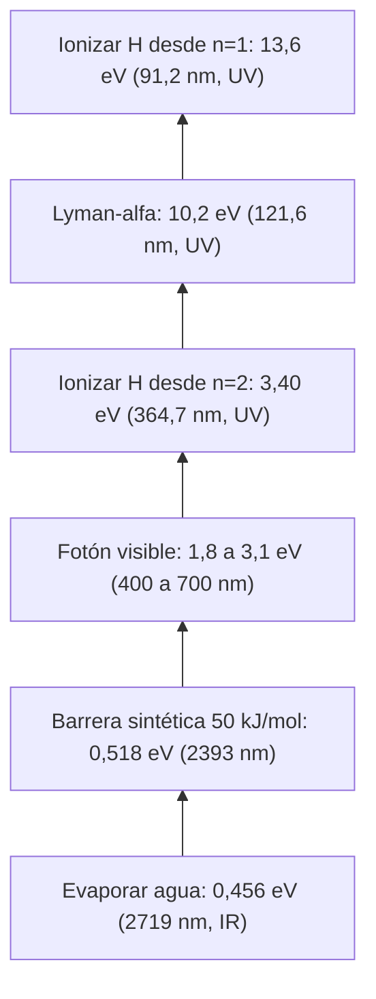

# B06-C18 — Fotoquímica y radiación

<!-- nav:top -->
[🏠 Programa](../../../../README.md) · [📚 Bloque B06](../../../tronco-comun/B06-quimica-y-materia-del-universo.md) · [← Anterior: B06-C17 — Espectros atómicos y moleculares](../B06-C17-espectros-atomicos-y-moleculares/CLASE.md) · [Siguiente: B06-C19 — Química de hielos y minerales →](../B06-C19-quimica-de-hielos-y-minerales/CLASE.md)
<!-- /nav -->

## 1. Ubicación, nivel y alcance

Decimoctava clase del bloque B06. En C17 leíste la luz que emiten y absorben los átomos. Ahora cambias la pregunta: ¿qué le hace esa luz a la materia? Un fotón puede calentar, romper una molécula o arrancar un electrón, según su energía. Sigues en el nivel N1.

Verás la energía de un fotón en eV y en kJ/mol, los umbrales de ionización y de cambio de fase, la diferencia entre radiación ionizante y no ionizante y las precauciones al trabajar con radiación (ultravioleta sobre todo). No verás cálculos de dosis ni de efectos biológicos con cifras (requieren fuentes especializadas) ni el modelo de un fotón absorbido por una molécula concreta.

## 2. Por qué esta clase existe

El hidrógeno de una nube o de una atmósfera puede ser ionizado por un fotón de longitud de onda menor que 91,2 nm. Un fotón de Lyman-alfa (121,6 nm) no lo ioniza desde el estado fundamental, pero tiene 22 veces la energía necesaria para evaporar una molécula de agua. Entender esas comparaciones es entender por qué el ultravioleta transforma la materia y el infrarrojo, en general, sólo la calienta.

La decisión central es: **dado un fotón de cierta longitud de onda, ¿qué puede hacer a una molécula o a un átomo, y qué precauciones exige trabajar con esa radiación?** Aprenderás a calcular energía de fotones, a compararla con umbrales y a establecer medidas de seguridad. Es base para B30, B44 y B45, donde se usa radiación real.

## 3. Lo que podrás hacer al terminar

1. Calcular la energía de un fotón en eV y en kJ/mol a partir de su longitud de onda.
2. Calcular la longitud de onda máxima de un fotón capaz de ionizar el hidrógeno.
3. Comparar la energía del fotón con umbrales de cohesión, de ionización y de barreras.
4. Distinguir radiación ionizante y no ionizante.
5. Enumerar medidas de seguridad básicas frente al ultravioleta.
6. Redactar una tabla fotón–umbral con sus advertencias.

La evidencia es la **tabla fotón–umbral con medidas de seguridad** del ejercicio 12 (sección 20).

## 4. Con qué llegas y cómo comprobarlo

Necesitas C01 (energía del fotón, ionización), C10 (energías en eV y kJ/mol) y C17 (series). Cinco preguntas:

1. ¿Cuánto vale `h c` en eV·nm?
2. Calcula `1239,84/121,567`.
3. ¿Cuántos kJ/mol son 1 eV?
4. ¿Qué serie del hidrógeno termina en `n = 1`?
5. ¿Qué es la energía de ionización?

<details>
<summary>Ver respuestas</summary>

1. 1239,84. 2. 10,199. 3. 96,485. 4. Lyman. 5. La energía necesaria para arrancar un electrón desde su nivel hasta el infinito (C01).
</details>

Con cuatro o cinco aciertos, sigue. Con tres o menos, repasa C01, C10 y C17.

## 5. Un caso real: tres fotones del hidrógeno

El hidrógeno atómico tiene una energía de ionización de 13,598 435 eV según la base de datos de la NIST (S1). Con `h c = 1239,84 eV·nm` (de constantes exactas del SI, S2), un fotón necesita una longitud de onda menor o igual que `91,175 nm` para ionizarlo desde su nivel fundamental. Por otra parte, un fotón de Lyman-alfa (121,567 nm) tiene 10,199 eV: no basta para ionizar desde el nivel 1, pero sí desde el nivel 2, cuya energía de ionización es 3,40 eV. Y un fotón de H-alfa (656,5 nm en el vacío) tiene 1,889 eV: tampoco ioniza desde el nivel 2.

Ten presente el límite: el umbral energético es una condición necesaria. Que un fotón sea absorbido depende de que haya un nivel al que subir (C17) y de la sección eficaz de absorción, que esta clase no estudia.

## 6. Vocabulario

La **energía de un fotón** es `E = h c/λ`, con `h c = 1239,84 eV·nm`. La energía de un mol de fotones (un **einstein**) es `N_A E`; en kJ/mol, `1 eV = 96,485 kJ/mol`. Un **umbral** es la energía mínima para un proceso (ionizar, evaporar, superar una barrera); dado un umbral `E_u`, la **longitud de onda umbral** es `λ_u = h c/E_u`, y sólo fotones con `λ ≤ λ_u` lo superan. La **fotoquímica** estudia las reacciones provocadas por la absorción de luz.

La **radiación ionizante** es la que tiene energía suficiente para arrancar electrones de átomos o moléculas (del orden de varios a decenas de eV o más); la **no ionizante** no la tiene. Aquí se usan las bandas con la convención de la clase: ultravioleta (λ < 400 nm), visible (400 a 700 nm) e infrarrojo (λ > 700 nm). El **límite de Lyman** es la longitud de onda umbral de ionización del hidrógeno desde `n = 1`.

## 7. Modelo mental: peldaños de energía

Piensa en una escalera de energías de proceso: primero hay peldaños bajos (calentar, evaporar), luego medios (romper un enlace, superar una barrera) y arriba el de ionizar. Un fotón sirve para un peldaño si tiene al menos esa energía; si es mayor, el exceso se reparte como movimiento.



*Descripción textual:* una escalera vertical de energías de menor a mayor: evaporar una molécula de agua (0,456 eV), una barrera de 0,518 eV, el rango de la luz visible, la ionización del hidrógeno desde el nivel 2 (3,40 eV), el fotón Lyman-alfa (10,2 eV) y la ionización desde el nivel 1 (13,6 eV).

La analogía de los peldaños es útil para ordenar energías; su límite es que alcanzar la energía no basta: el fotón debe ser absorbido, y la probabilidad de absorción cambia de un proceso a otro y de un fotón a otro.

## 8. La explicación, paso a paso

### 8.1 Energía del fotón

`E = 1239,84198 eV·nm/λ`. Para 121,567 nm: `10,199 eV`; para 656,47 nm: `1,889 eV`; para 400 nm (borde del visible): `3,100 eV`; para 1000 nm: `1,240 eV`. En unidades químicas: `E_mol = 96,485 kJ/mol × E[eV]`: Lyman-alfa, `984 kJ/mol`; H-alfa, `182 kJ/mol`; 1000 nm, `119,6 kJ/mol`. Compara con la entalpía de vaporización del agua (44,0 kJ/mol, C10): cada mol de fotones de H-alfa tiene 4 veces esa energía.

### 8.2 Umbrales

El umbral para ionizar el hidrógeno desde el estado fundamental es `λ = 1239,84/13,5984 = 91,175 nm`; por otro camino, `1/R_H = 91,176 nm` (C01): ambos coinciden a 0,001 nm, lo que valida las constantes y la energía de la NIST. Desde `n = 2` el umbral es `364,70 nm`. Para evaporar una molécula de agua (0,4561 eV): `2719 nm` (2,7 μm, infrarrojo). Para sublimar CO₂ (0,2705 eV): `4583 nm`. Para una barrera sintética de 50 kJ/mol (0,518 eV): `2393 nm`.

### 8.3 Fotoquímica: qué cambia con la energía

Un fotón de infrarrojo (1 μm, 1,24 eV) tiene mucha energía comparada con `kT` a temperatura ambiente (0,026 eV) pero no para ionizar. Un fotón ultravioleta de 250 nm (4,96 eV) tiene algo menos que la energía de ionización del sodio (5,14 eV, C02), y es comparable con las energías de Coulomb entre iones (5,76 eV, C04). Por eso el ultravioleta puede modificar enlaces y arrancar electrones, mientras que la luz visible y el infrarrojo, en general, calientan. Esta clase no ofrece energías de enlace de moléculas concretas: no se consultó una fuente para ellas.

### 8.4 Radiación ionizante y precauciones

La radiación ionizante puede alterar moléculas de los tejidos; la no ionizante, en dosis altas, puede quemar (calor) o dañar los ojos (el ultravioleta y los láseres). Las medidas generales: reducir el **tiempo** de exposición, aumentar la **distancia** y usar **blindaje o filtros** adecuados; usar equipo certificado y seguir la normativa del lugar; nunca mirar de forma directa lámparas de ultravioleta ni el Sol sin filtros certificados (B01). Esta clase no da límites de dosis ni umbrales numéricos de daño, porque no se consultó una fuente reguladora; para ellos hay que acudir a los organismos competentes.

### 8.5 Intensidad y número de fotones

Un vatio de luz de H-alfa contiene `1/(1,889 × 1,602 × 10⁻¹⁹) = 3,3 × 10¹⁸` fotones por segundo; un vatio de Lyman-alfa, `6,12 × 10¹⁷`. A igual potencia, el ultravioleta lleva menos fotones pero cada uno más energético. Para efectos que requieren superar un umbral, importa la energía del fotón; para efectos de calentamiento, la potencia total.

## 9. Magnitudes, símbolos y unidades

| Símbolo | Qué es | Unidad | Valor o nota |
|---|---|---|---|
| `λ` | longitud de onda | nm | — |
| `h c` | producto | eV·nm | 1239,841 98 (de `h`, `c`, `e` exactas) |
| `E` | energía del fotón | eV | `h c/λ` |
| `E_mol` | energía por mol de fotones | kJ/mol | `96,485 × E[eV]` |
| `E_u` | energía umbral | eV | H(n=1) 13,5984; H(n=2) 3,3996; agua 0,4561 |
| `λ_u` | longitud de onda umbral | nm | `h c/E_u` |
| bandas | ultravioleta / visible / infrarrojo | nm | < 400 / 400–700 / > 700 (convención de la clase) |

## 10. Convenciones y referencias

Las bandas son la convención de la clase (no la definición oficial de un organismo). Las energías se dan en eV y en kJ/mol de fotones. Las longitudes de onda de Lyman-alfa y H-alfa se dan en el vacío, con masa reducida (C01). La energía de ionización del hidrógeno es la de la NIST (con masa reducida). Los umbrales son necesarios, no suficientes.

## 11. De dónde sale lo que afirmamos

| ID | Fuente | Localizador | Respalda | Estado |
|---|---|---|---|---|
| S1 | NIST, *Atomic Spectra Database* v5.12 | https://physics.nist.gov/cgi-bin/ASD/ie.pl | Energía de ionización de H I: 13,598 434 599 702 eV | Consulta del 2026-11-05 |
| S2 | NIST, *CODATA Recommended Values* (2022) | https://physics.nist.gov/cgi-bin/cuu/Value?h (y `?c`, `?e`, `?na`, `?ryd`, `?mpsme`) | `h`, `c`, `e`, `N_A` exactas; `R_inf` y `m_p/m_e` | Consulta del 2026-11-05 |
| S3 | NIST Chemistry WebBook, H₂O y CO₂ | https://webbook.nist.gov/cgi/cbook.cgi?ID=C7732185 (y `C124389`) | `ΔH_vap` (derivada, C10) y `ΔH_sub` del CO₂ | Consulta del 2026-11-05 |

Límites: no se consultó ninguna fuente de organismos reguladores (por ejemplo, de protección radiológica o de seguridad ocular) ni de energías de enlace de moléculas; las medidas de seguridad de la sección 8.4 son principios generales de la clase, no normas. La barrera de 50 kJ/mol es sintética (C14).

## 12. Cómo ver los fotones

Esta tabla es la versión accesible de una escala de energías.

| `λ` (nm) | Banda | `E` (eV) | `E` (kJ/mol) | Qué puede hacer (según esta clase) |
|---|---|---|---|---|
| 91,176 | UV | 13,598 | 1312 | ionizar H desde `n = 1` (umbral) |
| 121,567 | UV | 10,199 | 984 | ionizar H desde `n = 2`; 22 veces la energía de evaporar agua |
| 250 | UV | 4,959 | 479 | algo menor que la ionización del sodio (5,14 eV) |
| 400 | visible | 3,100 | 299 | por debajo del umbral de ionización de `n = 2` (3,40) |
| 656,47 | visible | 1,889 | 182 | excitar H de `n = 2` a `3` |
| 1000 | IR | 1,240 | 120 | calentar |
| 2718 | IR | 0,456 | 44,0 | del orden de evaporar una molécula de agua |

Si haces un gráfico de energías, usa escala logarítmica, rotula las bandas con texto y no dependas del color. Descripción larga: la energía del fotón decrece de 13,6 a 0,46 eV al pasar del ultravioleta lejano al infrarrojo; el visible ocupa de 1,8 a 3,1 eV.

## 13. Ejemplo trabajado: ¿puede Lyman-alfa ionizar hidrógeno?

**Datos (publicados, S1, S2):** `E_ion(H) = 13,5984 eV`; `h c = 1239,84 eV·nm`; fotón de Lyman-alfa, `λ = 121,567 nm`.

**Paso 1 · Energía del fotón.** `1239,84/121,567 = 10,199 eV`.

**Paso 2 · Comparar con el umbral.** `10,199 < 13,598`: no basta para ionizar desde `n = 1`.

**Paso 3 · Desde `n = 2`.** `E_ion(n=2) = 13,598/4 = 3,400 eV`; `10,199 > 3,400`: sí ioniza, con un exceso de `6,80 eV` que se llevaría el electrón como energía cinética.

**Paso 4 · Longitud de onda umbral.** `1239,84/13,5984 = 91,175 nm`: para ionizar desde el nivel fundamental se necesita menos de 91,2 nm.

**Paso 5 · Energía por mol.** `10,199 × 96,485 = 984 kJ/mol`.

**Paso 6 · Comparación.** `984/44,0 = 22,4`: veintidós veces la energía para evaporar un mol de agua.

**Sentido físico.** El mismo fotón puede ser insuficiente para un proceso y sobrado para otro. El umbral energético es la primera criba; después hay que ver si el fotón es absorbido.

## 14. Dos formas de comparar un fotón con un proceso

Puedes **comparar energías** (el fotón frente al umbral, en eV o en kJ/mol) o **comparar longitudes de onda** (la del fotón frente a la umbral). Son equivalentes; la primera conecta con la termoquímica (C12) y la segunda con la espectroscopia (C17). Usa la que dé un número más natural para tu problema y declara siempre la unidad.

## 15. Práctica guiada

**Ejercicio 1 · con los pasos indicados.** Calcula la energía de un fotón de 121,567 nm. *Pasos:* `E = 1239,84/λ`.

<details><summary>Solución comentada</summary>

`1239,84/121,567 = 10,199 eV`. Si te dio 0,098, dividiste λ entre `h c`.
</details>

**Ejercicio 2 · con una pista.** Pásala a kJ/mol. *Pista:* `1 eV = 96,485 kJ/mol`.

<details><summary>Solución comentada</summary>

`10,199 × 96,485 = 984 kJ/mol`.
</details>

**Ejercicio 3 · casi autónomo.** Calcula la energía de un fotón de H-alfa (656,47 nm en el vacío) en eV y en kJ/mol.

<details><summary>Solución comentada</summary>

`1239,84/656,47 = 1,889 eV`; `1,889 × 96,485 = 182,2 kJ/mol`.
</details>

## 16. Práctica autónoma, transferencia e integrador

**Ejercicio 4.** Calcula la longitud de onda máxima de un fotón que ionice el hidrógeno desde el estado fundamental.

<details><summary>Solución comentada</summary>

`1239,84/13,5984 = 91,175 nm`.
</details>

**Ejercicio 5.** ¿Puede Lyman-alfa ionizar hidrógeno que está en `n = 2`? ¿Y H-alfa?

<details><summary>Solución comentada</summary>

Lyman-alfa (10,199 eV) supera 3,400 eV: sí. H-alfa (1,889 eV) no lo supera: no.
</details>

**Ejercicio 6.** ¿Qué longitud de onda tiene un fotón con la energía necesaria para evaporar una molécula de agua (0,4561 eV)?

<details><summary>Solución comentada</summary>

`1239,84/0,4561 = 2718 nm` (2,7 μm): infrarrojo.
</details>

**Ejercicio 7.** ¿Qué longitud de onda corresponde a la barrera sintética de 50 kJ/mol?

<details><summary>Solución comentada</summary>

`50 000/96 485 = 0,518 eV`; `1239,84/0,518 = 2393 nm`: infrarrojo. Un fotón visible de 600 nm (2,07 eV) tiene 4 veces esa energía.
</details>

**Ejercicio 8.** ¿Cuántos fotones de Lyman-alfa hay en 1 J?

<details><summary>Solución comentada</summary>

`1/(10,199 × 1,602 × 10⁻¹⁹) = 6,12 × 10¹⁷`.
</details>

**Ejercicio 9 · transferencia.** ¿Por qué el ultravioleta es más peligroso para tejidos que el infrarrojo, a igual potencia? Responde con energías.

<details><summary>Solución comentada</summary>

Porque cada fotón ultravioleta (3 a 10 eV) tiene energía comparable a la de ionización y a la de interacción entre iones (C04, C02), y puede alterar moléculas; un fotón infrarrojo (≈ 1 eV o menos) sólo aporta calor. Esa es una explicación cualitativa; los límites de exposición se toman de fuentes reguladoras, no de esta clase.
</details>

**Ejercicio 10 · transferencia.** Compara el número de fotones por segundo de 1 W de H-alfa y de 1 W de Lyman-alfa.

<details><summary>Solución comentada</summary>

H-alfa: `3,3 × 10¹⁸ s⁻¹`; Lyman-alfa: `6,12 × 10¹⁷ s⁻¹`; razón `5,4` (la de las energías de fotón). A igual potencia, el ultravioleta lleva 5,4 veces menos fotones, cada uno más energético.
</details>

**Ejercicio 11 · transferencia.** «Toda radiación es peligrosa por igual.» Corrige.

<details><summary>Solución comentada</summary>

El riesgo depende de la energía del fotón (ionizante o no), de la potencia o dosis, del tiempo y de la parte del cuerpo expuesta. La luz de una vela o de una pantalla y un haz de rayos X no son comparables. En ambos casos aplican las reglas de tiempo, distancia y blindaje; los límites concretos los fijan los organismos competentes.
</details>

**Ejercicio 12 · integrador.** Elabora la *tabla fotón–umbral con medidas de seguridad* (sección 20): para cinco longitudes de onda, `E` en eV y kJ/mol, banda, umbrales que superan (H desde `n = 1`, desde `n = 2`, evaporar agua), y una medida de seguridad para cada banda.

<details><summary>Solución modelo</summary>

Una tabla como la de la sección 12 con una columna de seguridad: UV, filtros y protección ocular certificada y sin mirar la fuente; visible, no mirar fuentes de alta intensidad; IR, evitar quemaduras por calor. Debe declarar la convención de bandas y que no ofrece límites de dosis.
</details>

## 17. Laboratorio: fotones y umbrales

El script [fotones.py](fotones.py) calcula la energía de fotones de varias longitudes de onda en eV y kJ/mol, la banda y las longitudes de onda umbral de ionización, evaporación y de una barrera sintética. Antes de imprimir comprueba que `h c = 1239,842 eV·nm`, que el límite de Lyman coincide entre `1/R_H` y `h c/E_ion` (NIST) a 0,002 nm, que la energía de Lyman-alfa es 10,199 eV y que 1 eV son 96,485 kJ/mol; si algo falla, se detiene.

**Datos:** publicados (S1–S3); barrera **sintética**; bandas por convención. **Predice antes de ejecutar:** ¿qué energía tiene Lyman-alfa? (cerca de 10 eV). **Resultados (2026-11-05, Python 3.12.9):** `h c = 1239,842 eV·nm`; 121,567 nm → 10,1988 eV = 984,04 kJ/mol; 656,47 nm → 1,8886 eV = 182,23 kJ/mol; umbral de ionización del H: 91,175 nm (1/R_H = 91,176 nm); desde `n = 2`: 364,70 nm; evaporar agua: 2719 nm; CO₂: 4583 nm; barrera sintética: 2393 nm; 6,12 × 10¹⁷ fotones de Lyman-alfa por julio.

```bash
python programa/clases/B06/B06-C18-fotoquimica-y-radiacion/fotones.py
```

**Límites:** umbrales energéticos necesarios, no suficientes; sin secciones eficaces ni dosis. No sirve para evaluar riesgos reales de exposición.

## 18. Errores frecuentes y cómo corregirlos

**Dividir al revés (`λ/hc`).** Se corrige con el ejercicio 1.

**Mezclar eV y kJ/mol sin convertir.** Se corrige con el ejercicio 2.

**Creer que el umbral energético basta.** Se corrige con la sección 5 y la 7.

**Tratar toda radiación por igual.** Se corrige con el ejercicio 11.

**Olvidar el medio (aire o vacío).** Se corrige con C01 y C17.

## 19. Cómo sabrás que vas bien

Tras 8.1: ¿puedes pasar de nm a eV y a kJ/mol? Si no, repite los ejercicios 1 a 3. Tras 8.2: ¿cómo se calcula un umbral? Si dudas, repite los ejercicios 4 y 6. Tras 8.4: ¿qué haces para trabajar con radiación de forma segura? Si no lo recuerdas, relee y haz el ejercicio 12. Tras el laboratorio: ¿qué dos rutas independientes se comparan para el límite de Lyman? Si lo ignoras, lee la cabecera.

## 20. Qué entregas y cómo se evalúa

El producto es tu **tabla fotón–umbral con medidas de seguridad**: cinco longitudes de onda con energía en eV y kJ/mol, banda, umbrales superados y una medida de seguridad por banda.

| Criterio | Inicial | En desarrollo | Logrado | Destacado |
|---|---|---|---|---|
| Energía del fotón | Con errores | Correcta con ayuda | Correcta y con unidades | Verifica por dos rutas |
| Umbrales | No los usa | Uno | Varios | Explica por qué necesarios no son suficientes |
| Bandas | Sin criterio | Con criterio no declarado | Convención declarada | Compara con otra convención |
| Seguridad | Ausente | Genérica | Por banda | Distingue norma de principio general |
| Fuentes y límites | Sin fuente | Con fuente | Con fuente y límites | Declara qué fuente reguladora falta |

**Condiciones críticas:** no dar límites de dosis sin fuente; no presentar la convención de bandas como oficial; no sugerir mirar fuentes de ultravioleta o el Sol sin protección; citar sólo fuentes consultadas.

## 21. Ética, seguridad y límites

Esta clase no incluye prácticas con radiación. La radiación ultravioleta (lámparas, soldadura, luz solar intensa), los láseres y las fuentes ionizantes exigen equipo certificado, formación y supervisión: protección ocular y de la piel adecuada, tiempo mínimo, distancia máxima y blindaje. Para observar el Sol se usan sólo filtros certificados (B01). No manipules fuentes radiactivas ni equipos de rayos X sin autorización. Alternativa sin riesgo: trabajar con datos y espectros publicados. Los números de esta clase son energías de fotones, no límites de seguridad: para éstos, consulta a los organismos competentes. Accesibilidad: tabla equivalente al gráfico, fórmulas en texto.

## 22. Para cerrar y seguir

Un fotón tiene energía `h c/λ`; si supera el umbral de un proceso (ionizar, evaporar) puede provocarlo, pero también hace falta que sea absorbido. El ultravioleta transforma la materia y exige protección; el infrarrojo, en general, la calienta. La próxima clase junta la química con los hielos y los minerales, los materiales sobre los que actúa esta radiación en el espacio.

**Glosario español–inglés.** fotoquímica · *photochemistry*; energía del fotón · *photon energy*; radiación ionizante · *ionizing radiation*; umbral · *threshold*; ultravioleta · *ultraviolet*; infrarrojo · *infrared*; límite de Lyman · *Lyman limit*.

**Continuidad.** B06-C19 describe los hielos y minerales que absorben y emiten esta radiación. B30, B44 y B45 retoman la radiación y su detección.

**Referencias:** ver sección 11. S1 a S3 son consultas del 2026-11-05; no se consultó ninguna fuente reguladora de seguridad.

<!-- nav:bottom -->
---

[← Anterior: B06-C17 — Espectros atómicos y moleculares](../B06-C17-espectros-atomicos-y-moleculares/CLASE.md) · [📚 Bloque B06](../../../tronco-comun/B06-quimica-y-materia-del-universo.md) · [Siguiente: B06-C19 — Química de hielos y minerales →](../B06-C19-quimica-de-hielos-y-minerales/CLASE.md)
<!-- /nav -->
