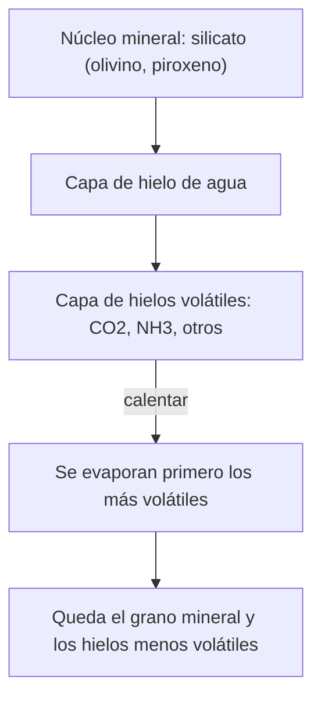

# B06-C19 — Química de hielos y minerales

<!-- nav:top -->
[🏠 Programa](../../../../README.md) · [📚 Bloque B06](../../../tronco-comun/B06-quimica-y-materia-del-universo.md) · [← Anterior: B06-C18 — Fotoquímica y radiación](../B06-C18-fotoquimica-y-radiacion/CLASE.md) · [Siguiente: B06-C20 — Análisis químico introductorio de meteoritos →](../B06-C20-analisis-quimico-introductorio-de-meteoritos/CLASE.md)
<!-- /nav -->

## 1. Ubicación, nivel y alcance

Decimonovena clase del bloque B06. Has estudiado átomos, enlaces, mol, fases y energía. Ahora aplicas todo a dos tipos de materiales sólidos del cosmos: los **hielos** (agua, CO₂, amoníaco) y los **minerales** (silicatos, carbonatos). Sigues en el nivel N1.

Verás qué son los hielos y los minerales, cómo se calculan sus masas formulares, cómo estimar en qué condiciones un hielo de CO₂ es estable, cómo la proporción de magnesio y silicio de un mineral rocoso se relaciona con la del Sol y qué dicen los datos publicados sobre hielos en nubes y sobre un asteroide. No verás mineralogía detallada ni cristalografía (cursos posteriores).

## 2. Por qué esta clase existe

Los estudios con el telescopio James Webb muestran que las nubes densas del medio interestelar tienen granos de polvo cubiertos de hielos con una variedad de moléculas, y que esos hielos contienen entre el 2 y el 19 % del carbono, oxígeno, nitrógeno y azufre disponibles (S1, resumen). Los asteroides como Bennu guardan una historia parecida: su roca hidratada sugiere que su cuerpo madre acumuló hielos del Sistema Solar exterior, y el amoníaco y las sales de las muestras permiten pensar en salmueras a temperaturas bajísimas (S2).

La decisión central es: **dado un sólido de composición conocida y un ambiente de presión y temperatura, ¿es estable, qué fracción de la masa corresponde a cada elemento y qué dice su composición sobre su origen?** Aprenderás a calcular masas formulares, a estimar la estabilidad de un hielo y a comparar proporciones con las solares. Prepara C20, donde se compara el Sol con los meteoritos.

## 3. Lo que podrás hacer al terminar

1. Distinguir hielo, mineral, roca y polvo con ejemplos.
2. Calcular la masa formular y el porcentaje en masa de elementos en un hielo o un mineral.
3. Calcular la masa de un olivino de composición intermedia por una regla de mezcla.
4. Estimar la presión mínima a la que el hielo de CO₂ es estable a una temperatura.
5. Comparar la razón Mg/Si de una roca con la del Sol.
6. Redactar una ficha de un hielo o un mineral con fórmula, masa, ambiente y límites.

La evidencia es la **ficha de un hielo o mineral** del ejercicio 12 (sección 20).

## 4. Con qué llegas y cómo comprobarlo

Necesitas C02 (abundancias), C06 y C07 (masa molar, composición), C11 y C13 (fases, equilibrio). Cinco preguntas:

1. Calcula la masa molar del H₂O.
2. Si `A(Mg) = 7,60` y `A(Si) = 7,51`, ¿cuánto vale `N_Mg/N_Si`?
3. ¿Qué es el punto triple del CO₂ (T y P)?
4. ¿Cuántos átomos de oxígeno hay en una fórmula Mg₂SiO₄?
5. ¿Qué hace el hielo de CO₂ a 1 atm?

<details>
<summary>Ver respuestas</summary>

1. 18,015 g/mol. 2. `10^0,09 = 1,23`. 3. 216,58 K y 5,185 bar. 4. Cuatro. 5. Sublima (pasa directamente a gas) a unos 195 K.
</details>

Con cuatro o cinco aciertos, sigue. Con tres o menos, repasa C02, C07 y C11.

## 5. Un caso real: hielos, salmueras y roca en Bennu

Glavin y colaboradores señalan que la mineralogía hidratada del material de Bennu sugiere que su cuerpo madre acumuló hielos que se condensaron en el disco protoplanetario exterior (S2); que los isótopos del nitrógeno apuntan a un origen del amoníaco en una nube molecular fría o en el disco externo; y que el cuerpo madre se formó o acumuló hielos de un lugar del Sistema Solar exterior donde el hielo de amoníaco era estable (S2). También proponen que altas concentraciones de sales de amonio habrían mantenido salmueras líquidas a temperaturas muy bajas, con un eutéctico de NH₃–H₂O a 176 K (S2).

Ten presente el límite: la clase no reproduce el análisis de los autores. Sólo toma dos cifras (la temperatura de 176 K y la clasificación de las especies) para ejercitar el cálculo de energías y de estabilidad.

## 6. Vocabulario

Un **hielo** es un sólido de una sustancia que a temperatura ambiente sería líquida o gaseosa (agua, CO₂, NH₃…). Un **mineral** es un sólido cristalino natural de composición química definida: el **olivino** `(Mg,Fe)₂SiO₄` es una serie entre la **forsterita** `Mg₂SiO₄` y la **fayalita** `Fe₂SiO₄`; el **piroxeno** más sencillo es `MgSiO₃`; la **calcita** es `CaCO₃`. Una **roca** es una mezcla de minerales. El **polvo** interestelar son granos sólidos muy pequeños, a menudo cubiertos de hielos.

Una **mezcla eutéctica** es la composición cuyo punto de fusión es el más bajo de la serie de mezclas; añadir un segundo componente baja el punto de fusión. El **número Mg** de un olivino es la fracción molar de Mg frente a (Mg + Fe). La **masa formular** es la masa molar de la fórmula; la **estabilidad** de un hielo, en esta clase, es el intervalo de presiones y temperaturas donde no sublima (C11).

## 7. Modelo mental: un grano de polvo con capas

Imagina un grano de roca (un silicato) en una nube fría, cubierto por capas de hielo: primero agua, luego CO₂ y otras moléculas, según las temperaturas de condensación. Si el grano entra en una región más cálida, las capas externas se evaporan primero.



*Descripción textual:* un grano en el centro (silicato), con una capa de hielo de agua encima y otra de hielos más volátiles (CO₂ y amoníaco) por fuera. Al calentar, las capas exteriores y más volátiles desaparecen primero, y queda el grano con los hielos menos volátiles.

La analogía del grano con capas ayuda a pensar en el orden de evaporación; su límite es que los hielos reales de los granos no siempre forman capas ordenadas: pueden estar mezclados, y la estructura depende de cómo se formaron.

## 8. La explicación, paso a paso

### 8.1 Masas formulares

Con los pesos atómicos de la NIST (C03): `H₂O = 18,0153`, `CO₂ = 44,0094`, `NH₃ = 17,0308`, forsterita `Mg₂SiO₄ = 2 × 24,3055 + 28,085 + 4 × 15,9994 = 140,6936`, fayalita `Fe₂SiO₄ = 203,7726`, piroxeno `MgSiO₃ = 100,3887` y calcita `CaCO₃ = 100,0868 g/mol`. Los de agua y CO₂ coinciden con el WebBook (S3). El magnesio es el 34,55 % de la masa de la forsterita.

### 8.2 Olivino intermedio

Un olivino con 90 % de forsterita y 10 % de fayalita (Fo₉₀) tiene una masa formular que es el promedio ponderado de las dos: `0,9 × 140,6936 + 0,1 × 203,7726 = 147,0015 g/mol`. La regla de mezcla es lineal en las fracciones molares; el laboratorio verifica los extremos (0 y 1).

### 8.3 Estabilidad del hielo de CO₂

Con Clausius–Clapeyron (C11) y `ΔH_sub = 26,1 kJ/mol`, el hielo de CO₂ es estable por encima de una presión que depende de la temperatura: a 150 K, 833 Pa; a 170 K, 9773 Pa (97,7 mb); a 194,7 K, 1,017 × 10⁵ Pa (1 atm). Por eso el CO₂ sólido persiste en regiones muy frías de baja presión y desaparece por sublimación en cuanto se calienta o la presión baja.

### 8.4 Mg/Si de una roca frente al Sol

La razón Mg/Si de la forsterita es 2 y la del piroxeno `MgSiO₃` es 1. Una roca solamente de olivino y piroxeno tiene Mg/Si entre 1 y 2. El Sol tiene `N_Mg/N_Si = 10^(7,60−7,51) = 1,23` (S4). En un modelo **ilustrativo** con sólo esos dos minerales, la fracción de silicio en olivino sería `1,23 − 1 = 0,23`: un 23 %. Es un ejercicio de aritmética, no una afirmación sobre la mineralogía de ningún cuerpo: faltan otros minerales y el Si y el Mg también están en otras fases.

### 8.5 Hielos en nubes y energías

Un eutéctico de NH₃–H₂O a 176 K significa que, con sales de amonio, el líquido existe a 176 K, muy por debajo de los 273 K del agua pura (S2). A esa temperatura `kT = 15,17 meV`. La energía por molécula de la cohesión del agua (0,456 eV, C10) es 30 veces mayor, lo que explica que el hielo de agua sea estable a temperaturas mucho más altas que las de las nubes frías. En las nubes densas, los hielos contienen entre 2 y 19 % del presupuesto de C, O, N, S de la región (S1): si hubiera 10 000 átomos de carbono en una región, entre 200 y 1900 estarían en el hielo.

## 9. Magnitudes, símbolos y unidades

| Símbolo | Qué es | Unidad | Valor o nota |
|---|---|---|---|
| `M` | masa formular | g/mol | H₂O 18,0153; CO₂ 44,0094; NH₃ 17,0308; Mg₂SiO₄ 140,6936; Fe₂SiO₄ 203,7726; MgSiO₃ 100,3887; CaCO₃ 100,0868 |
| `Fo` | fracción de forsterita | — | olivino Fo₉₀: 147,0015 g/mol |
| `N_Mg/N_Si` | razón de átomos | — | Sol: 1,23 (S4) |
| `P_est(T)` | presión de estabilidad del CO₂(s) | Pa | 833 (150 K); 9773 (170 K); 1,017 × 10⁵ (194,7 K) |
| `kT` | energía térmica | meV | 15,17 a 176 K |
| eutéctico NH₃–H₂O | temperatura | K | 176 (S2) |

## 10. Convenciones y referencias

Las fórmulas de olivino, piroxeno y calcita son fórmulas de manual, sin fuente consultada. Los pesos atómicos son de la NIST (puntos medios en intervalos). La presión de estabilidad se calcula con `ΔH` constante. El modelo olivino + piroxeno es **ilustrativo (sintético)**. Las abundancias del Sol son las de la fotosfera de Asplund y colaboradores (C02).

## 11. De dónde sale lo que afirmamos

| ID | Fuente | Localizador | Respalda | Estado |
|---|---|---|---|---|
| S1 | M. K. McClure et al., «An Ice Age JWST inventory of dense molecular cloud ices», *Nature Astronomy* 7, 431 (2023), doi:10.1038/s41550-022-01875-w | arXiv:2301.09140 (resumen vía API de arXiv) | Hielos variados en nubes densas; 2–19 % de los presupuestos de C, O, N, S | Sólo resumen, consultado el 2026-11-05 |
| S2 | D. P. Glavin et al., *Nature Astronomy* (2025), doi:10.1038/s41550-024-02472-9 | PDF de NASA NTRS, doc. 20250001355 | Mineralogía hidratada y hielos acumulados; origen frío del amoníaco; sales de amonio, salmueras y eutéctico NH₃–H₂O de 176 K | PDF leído el 2026-11-05 (PyMuPDF) |
| S3 | NIST Chemistry WebBook, CO₂ y H₂O; NIST Atomic Weights | https://webbook.nist.gov/cgi/cbook.cgi?ID=C124389&Mask=4 (y `C7732185`) | Punto triple y `ΔH_sub` del CO₂; masas molares de agua y CO₂ | Consulta del 2026-11-05 |
| S4 | M. Asplund et al., *Ann. Rev. Astron. Astrophys.* 47, 481 (2009) | arXiv:0909.0948, Tabla 1 | `A(Mg) = 7,60` y `A(Si) = 7,51` | PDF leído el 2026-11-05 |

Límites: S1 se leyó sólo en resumen; no se consultó ninguna fuente de mineralogía (las fórmulas de olivino, piroxeno y calcita y el orden de condensación son conocimiento de manual de la clase sin fuente propia); las energías de enlace de la red de silicatos no se tratan. La estabilidad del CO₂ es una predicción del modelo de C11.

## 12. Cómo ver los materiales

Esta tabla es la versión accesible de un diagrama de capas.

| Material | Fórmula | `M` (g/mol) | Papel en esta clase |
|---|---|---|---|
| Hielo de agua | H₂O | 18,0153 | hielo principal de granos y asteroides |
| Hielo de CO₂ | CO₂ | 44,0094 | estable a 150 K sobre 833 Pa |
| Amoníaco | NH₃ | 17,0308 | hielo y sales de amonio en Bennu |
| Forsterita | Mg₂SiO₄ | 140,6936 | silicato rico en Mg |
| Fayalita | Fe₂SiO₄ | 203,7726 | silicato rico en Fe |
| Piroxeno | MgSiO₃ | 100,3887 | silicato con Mg/Si = 1 |
| Calcita | CaCO₃ | 100,0868 | carbonato (ion CO₃²⁻, C05) |

Si dibujas un grano con capas, rotula cada capa con su sustancia y su temperatura aproximada de condensación en el texto, no sólo con color. Descripción larga: un núcleo central de silicato rodeado de hielo de agua y por fuera de hielos más volátiles.

## 13. Ejemplo trabajado: ¿qué olivino hace falta para un Mg/Si solar con piroxeno?

**Datos (observados, S4):** `A(Mg) = 7,60`; `A(Si) = 7,51`.

**Paso 1 · Razón solar.** `N_Mg/N_Si = 10^(7,60−7,51) = 10^0,09 = 1,230`.

**Paso 2 · Modelo.** Una fracción `f` del silicio está en olivino (Mg/Si = 2) y `1 − f` en piroxeno (Mg/Si = 1): `Mg/Si = 2f + (1 − f) = 1 + f`.

**Paso 3 · Despejar.** `f = 1,230 − 1 = 0,230`: el 23 % del silicio en olivino y el 77 % en piroxeno.

**Paso 4 · Verificar.** `Mg/Si = 1 + 0,230 = 1,230` ✓.

**Paso 5 · Masa de la mezcla (por mol de Si).** Olivino: `0,230 × (140,6936/1) = 32,36 g` por mol de Si en forsterita (cada mol de Mg₂SiO₄ aporta 1 mol de Si). Piroxeno: `0,770 × 100,3887 = 77,30 g`. Suma: `109,66 g` de roca por mol de Si.

**Sentido físico.** La razón Mg/Si por sí sola permite una combinación de minerales, pero no la única. Este modelo ilustra cómo se razona a partir de una razón de abundancias; no es una afirmación sobre un cuerpo concreto.

## 14. Dos formas de decir qué es una roca

Puedes describir una roca por su **composición química** (elementos y razones, como Mg/Si; lo que mide la espectroscopia y el análisis de laboratorio) o por su **mineralogía** (qué minerales y en qué proporción; lo que da la difracción y el microscopio). La primera es más fácil de comparar con el Sol; la segunda dice cómo está organizada. Una misma composición puede dar mineralogías distintas, y por eso hace falta declarar cuál se da.

## 15. Práctica guiada

**Ejercicio 1 · con los pasos indicados.** Calcula la masa formular de la forsterita `Mg₂SiO₄`. *Pasos:* `2 × 24,3055 + 28,085 + 4 × 15,9994`.

<details><summary>Solución comentada</summary>

`48,611 + 28,085 + 63,9976 = 140,6936 g/mol`. Si te dio 100, olvidaste un átomo de Mg o confundiste con `MgSiO₃`.
</details>

**Ejercicio 2 · con una pista.** Calcula la masa formular de la fayalita `Fe₂SiO₄`. *Pista:* igual que antes, con `Fe = 55,845`.

<details><summary>Solución comentada</summary>

`111,69 + 28,085 + 63,9976 = 203,7726 g/mol`. Es 63 g/mol mayor que la forsterita porque el hierro pesa más que el magnesio.
</details>

**Ejercicio 3 · casi autónomo.** Calcula la masa formular de un olivino Fo₉₀ con la regla de mezcla.

<details><summary>Solución comentada</summary>

`0,9 × 140,6936 + 0,1 × 203,7726 = 126,624 + 20,377 = 147,0015 g/mol`.
</details>

## 16. Práctica autónoma, transferencia e integrador

**Ejercicio 4.** ¿Qué porcentaje en masa del CO₂ es carbono?

<details><summary>Solución comentada</summary>

`12,0106/44,0094 = 27,29 %` (C07).
</details>

**Ejercicio 5.** Calcula el porcentaje en masa de Mg en la forsterita.

<details><summary>Solución comentada</summary>

`48,611/140,6936 = 34,55 %`.
</details>

**Ejercicio 6.** Calcula la presión mínima de estabilidad del hielo de CO₂ a 170 K con `ΔH_sub = 26,1 kJ/mol`.

<details><summary>Solución comentada</summary>

`P = 5,185 × 10⁵ × exp[−(26 100/8,3145)(1/170 − 1/216,58)] = 5,185 × 10⁵ × exp(−3,972) = 9773 Pa` (97,7 mb). Se obtiene la misma curva de C11.
</details>

**Ejercicio 7.** ¿Estable el hielo de CO₂ a 636 Pa y 150 K? ¿Y a 636 Pa y 200 K?

<details><summary>Solución comentada</summary>

A 150 K se necesitan 833 Pa: a 636 Pa no es estable (sublima). A 200 K se necesitan unas 1,5 × 10⁵ Pa: tampoco. Sólo es estable a 636 Pa por debajo de 148 K (C11).
</details>

**Ejercicio 8.** Calcula `N_Mg/N_Si` solar y la fracción de silicio en olivino del modelo ilustrativo.

<details><summary>Solución comentada</summary>

`10^0,09 = 1,230`; `f = 0,230`.
</details>

**Ejercicio 9 · transferencia.** Si el 19 % del carbono de una región está en hielos y hay 10 000 átomos de carbono en total, ¿cuántos están en los hielos? ¿Y con el 2 %?

<details><summary>Solución comentada</summary>

`0,19 × 10 000 = 1900` y `0,02 × 10 000 = 200`. El rango 2–19 % (S1) indica la dispersión entre líneas de visión; el resto del carbono está en gas o en granos de otro tipo.
</details>

**Ejercicio 10 · transferencia.** Compara `kT` a 176 K con la energía de cohesión del agua (0,456 eV). ¿Qué te dice?

<details><summary>Solución comentada</summary>

`kT = 15,17 meV`; `0,456/0,01517 = 30`. El agua pura está muy ligada a esa temperatura (sólida), y un eutéctico con sales de amonio explicaría que haya líquido a 176 K, porque la mezcla debilita la cohesión (S2). Es un razonamiento cualitativo.
</details>

**Ejercicio 11 · transferencia.** Un compañero dice: «el hielo de Marte es de agua porque hace frío». Matiza con C11 y esta clase.

<details><summary>Solución comentada</summary>

A 214 K de temperatura media el agua es hielo, pero el CO₂ sólo condensa por debajo de 148 K a 636 Pa. La composición del hielo depende de qué sustancia es estable a cada presión y temperatura: en las zonas más frías podría haber CO₂ sólido, en las más cálidas, sólo agua. El «porque hace frío» es incompleto.
</details>

**Ejercicio 12 · integrador.** Elabora la *ficha de un hielo o mineral* (sección 20): fórmula, masa formular, composición en masa, un ambiente de presión y temperatura donde sea estable, la fuente de ese ambiente y los límites del modelo.

<details><summary>Solución modelo</summary>

Con el hielo de CO₂: fórmula `CO₂`; `M = 44,0094`; 27,29 % C; estable a 170 K por encima de 9773 Pa; fuente WebBook; límites: `ΔH` constante. Con un mineral: fórmula de manual (rotulada), masa formular y composición en masa; si la fuente de la fórmula no se consultó, la ficha debe decirlo.
</details>

## 17. Laboratorio: masas, mezclas y estabilidad

El script [hielos_y_minerales.py](hielos_y_minerales.py) calcula masas formulares de hielos y silicatos, la masa de un olivino por mezcla, el modelo ilustrativo olivino + piroxeno para el Mg/Si solar y la presión de estabilidad del hielo de CO₂. Antes de imprimir comprueba que las masas de H₂O y CO₂ coinciden con el WebBook, que la mezcla recupera los extremos, que el modelo Mg/Si es consistente y que la presión de estabilidad en el punto triple es la del punto triple; si algo falla, se detiene.

**Datos:** publicados (S1–S4); modelo olivino + piroxeno **ilustrativo**. **Predice antes de ejecutar:** ¿qué masa formular tendrá el olivino Fo₉₀? (entre 140,7 y 203,8; cerca de 147). **Resultados (2026-11-05, Python 3.12.9):** H₂O 18,0153; CO₂ 44,0094; NH₃ 17,0308; Mg₂SiO₄ 140,6936; Fe₂SiO₄ 203,7726; MgSiO₃ 100,3887; CaCO₃ 100,0868 g/mol; Fo₉₀ 147,0015; Mg/Si solar 1,230 → fracción de olivino 0,230; Mg en forsterita 34,55 %; CO₂(s) estable por encima de 833,2 Pa (150 K), 9773 Pa (170 K), 1,017 × 10⁵ Pa (194,7 K); `kT(176 K) = 15,17 meV`.

```bash
python programa/clases/B06/B06-C19-quimica-de-hielos-y-minerales/hielos_y_minerales.py
```

**Límites:** fórmulas ideales; `ΔH` constante; sin cristalografía ni otros minerales; sin presión de equilibrio del agua ni del amoníaco. No sirve para determinar la mineralogía de un cuerpo real.

## 18. Errores frecuentes y cómo corregirlos

**Confundir la masa formular de olivino con la de piroxeno.** Se corrige con el ejercicio 1.

**Mezclar fracciones en masa con fracciones molares en la regla de mezcla.** Se corrige con el ejercicio 3.

**Creer que un hielo es estable a cualquier presión.** Se corrige con el ejercicio 7.

**Tomar el modelo olivino + piroxeno como mineralogía real.** Se corrige con la sección 8.4 y el ejercicio 8.

**Atribuir a una sola variable (frío) la composición del hielo.** Se corrige con el ejercicio 11.

## 19. Cómo sabrás que vas bien

Tras 8.1: ¿puedes calcular la masa formular de un silicato? Si no, repite los ejercicios 1 y 2. Tras 8.3: ¿cómo decides si un hielo es estable? Si dudas, haz los ejercicios 6 y 7. Tras 8.4: ¿qué hace falta para usar la razón Mg/Si? Si no lo sabes, haz el ejercicio 8. Tras el laboratorio: ¿qué se verifica con el punto triple? Si lo ignoras, lee la cabecera.

## 20. Qué entregas y cómo se evalúa

El producto es tu **ficha de un hielo o mineral**: fórmula, masa formular, composición en masa, ambiente de estabilidad con fuente y límites.

| Criterio | Inicial | En desarrollo | Logrado | Destacado |
|---|---|---|---|---|
| Fórmula y masa | Con errores | Correctas con ayuda | Correctas y verificadas | Contrasta con una referencia |
| Composición en masa | No la calcula | Con errores | Correcta | Interpreta la razón de elementos |
| Estabilidad | No la trata | Cualitativa | Calculada con la curva de fase | Propaga el rango de `ΔH` |
| Rotulado | Mezcla manual y fuente | Parcial | Distingue conocimiento de manual | Señala qué fuente consultaría |
| Límites | Ausentes | Mencionados | Explicados | Señala qué otros minerales faltan |

**Condiciones críticas:** no presentar el modelo ilustrativo como mineralogía real; no omitir el rotulado de fórmulas de manual; citar sólo fuentes consultadas.

## 21. Ética, seguridad y límites

Es un cálculo; no hay experimentos. Algunos minerales pueden contener amianto, sílice cristalina u otros peligros en polvo; no se proponen prácticas con rocas molidas. El hielo seco no se manipula sin formación (quemaduras por frío, asfixia). Las muestras de asteroides y meteoritos son patrimonio científico y no se compran ni destruyen sin procedencia verificada. Alternativa sin riesgo: trabajar con fórmulas y datos publicados. Accesibilidad: tablas equivalentes a los diagramas, fórmulas en texto.

## 22. Para cerrar y seguir

Los hielos y los minerales se describen con fórmulas, masas formulares y condiciones de estabilidad; el hielo de CO₂ es estable a una presión que crece rápido con la temperatura, y la razón Mg/Si de una roca se compara con la solar sólo como primer paso. La última clase junta todo en el análisis de un meteorito frente al Sol.

**Glosario español–inglés.** hielo · *ice*; mineral · *mineral*; olivino · *olivine*; forsterita · *forsterite*; piroxeno · *pyroxene*; eutéctico · *eutectic*; masa formular · *formula mass*; polvo interestelar · *interstellar dust*.

**Continuidad.** B06-C20 compara la composición de los meteoritos con la del Sol. Los bloques de ciencias planetarias y astrobiología retoman los hielos y los minerales.

**Referencias:** ver sección 11. S2 y S4 son PDF leídos; S1 es sólo resumen; las fórmulas de minerales son de manual.

<!-- nav:bottom -->
---

[← Anterior: B06-C18 — Fotoquímica y radiación](../B06-C18-fotoquimica-y-radiacion/CLASE.md) · [📚 Bloque B06](../../../tronco-comun/B06-quimica-y-materia-del-universo.md) · [Siguiente: B06-C20 — Análisis químico introductorio de meteoritos →](../B06-C20-analisis-quimico-introductorio-de-meteoritos/CLASE.md)
<!-- /nav -->
