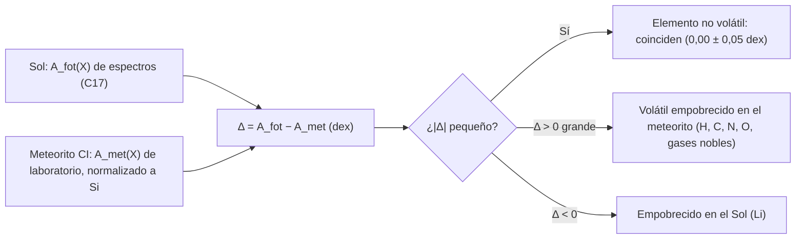

# B06-C20 — Análisis químico introductorio de meteoritos

<!-- nav:top -->
[🏠 Programa](../../../../README.md) · [📚 Bloque B06](../../../tronco-comun/B06-quimica-y-materia-del-universo.md) · [← Anterior: B06-C19 — Química de hielos y minerales](../B06-C19-quimica-de-hielos-y-minerales/CLASE.md) · [Siguiente: B07-C01 — Pensamiento algorítmico →](../../B07/B07-C01-pensamiento-algoritmico/CLASE.md)
<!-- /nav -->

## 1. Ubicación, nivel y alcance

Vigésima y última clase del bloque B06. Reúnes lo aprendido sobre átomos, abundancias (C02), isótopos (C03), mol (C06), composición (C07), minerales (C19) y orgánica (C16) para hacer lo que hace un cosmoquímico: comparar la composición del Sol con la de los meteoritos y con la del asteroide Bennu. Sigues en el nivel N1.

Verás por qué los meteoritos son una muestra de la composición del Sistema Solar, qué son las condritas CI, cómo se comparan sus abundancias con las del Sol en la escala logarítmica, qué elementos están empobrecidos y por qué, cómo se compara el carbono y el nitrógeno de Bennu con los de una «CI media» y qué buenas prácticas rigen el manejo de muestras. No verás técnicas analíticas (espectrometría de masas, microscopía) ni clasificación completa de meteoritos.

## 2. Por qué esta clase existe

Hay dos formas de saber de qué está hecho el Sistema Solar. Una es mirar la luz del Sol y deducir su composición; la otra es analizar en laboratorio meteoritos que conservan la composición del material con que se formó. Asplund y colaboradores comparan ambos métodos y encuentran, para 45 elementos, una diferencia media de 0,00 ± 0,05 dex entre fotosfera y meteoritos (S1). Cuando dos métodos independientes coinciden con esa precisión, la confianza en ambos crece. Y donde discrepan, hay algo que aprender.

La decisión central es: **dadas las abundancias del Sol y de un meteorito, ¿qué elementos coinciden, cuáles discrepan, por qué, y cómo declaro la comparación para que otra persona la reproduzca?** Aprenderás a calcular diferencias en dex, a interpretar empobrecimientos y a comparar una muestra real con el valor de referencia, con su incertidumbre y sus límites. Es la síntesis del bloque.

## 3. Lo que podrás hacer al terminar

1. Explicar qué es una condrita CI y por qué sirve como referencia de composición.
2. Calcular la diferencia fotosfera–meteorito en dex y en factor.
3. Reconocer elementos volátiles empobrecidos y el caso especial del litio.
4. Calcular la composición en masa de una «CI media» a partir de abundancias.
5. Comparar el carbono y el nitrógeno de Bennu con esa referencia, con sus incertidumbres.
6. Describir buenas prácticas de manejo y de declaración de muestras.

La evidencia es el **informe de comparación Sol–meteorito** del ejercicio 12 (sección 20).

## 4. Con qué llegas y cómo comprobarlo

Necesitas C02 (escala `A(X)`), C06 y C07 (mol, composición en masa), C16 (orgánica), C19 (minerales). Cinco preguntas:

1. Si `A(C) = 8,43` en el Sol y `7,39` en un meteorito, ¿cuántos dex las separan?
2. Convierte 1,04 dex en un factor.
3. ¿Qué elementos son «volátiles»? Da dos ejemplos.
4. ¿Cuál es la fracción en masa del oxígeno en el agua?
5. ¿Qué significa «normalizar a Si»?

<details>
<summary>Ver respuestas</summary>

1. 1,04. 2. `10^1,04 = 11`. 3. Los que pasan fácil a gas, como el hidrógeno y el nitrógeno (o los gases nobles). 4. 88,81 %. 5. Fijar el silicio como referencia común para comparar las demás abundancias.
</details>

Con cuatro o cinco aciertos, sigue. Con tres o menos, repasa C02, C07 y C19.

## 5. Un caso real: el Sol, las condritas CI y Bennu

Asplund y colaboradores explican que los meteoritos más prístinos son las condritas CI, de las que sólo se conocen cinco: Alais, Ivuna, Orgueil, Revelstoke y Tonk; incluso en ellas los elementos volátiles (hidrógeno, carbono, nitrógeno, oxígeno y los gases nobles) están empobrecidos en distinto grado, y por eso sus abundancias se fijan respecto del silicio y no del hidrógeno (S1). Para los 45 elementos no volátiles con incertidumbre fotosférica menor que el 25 %, la diferencia media entre la fotosfera y los meteoritos es 0,00 ± 0,05 dex; el litio es una excepción, empobrecido en el Sol (S1).

Las muestras de Bennu, devueltas a la Tierra en condiciones controladas para limitar la contaminación, tienen más carbono, nitrógeno y amoníaco que las de Ryugu y que la mayoría de los meteoritos, con C = 4,5–4,7 % y N = 0,23–0,25 % en masa (S2). Una nota de prensa de la NASA de diciembre de 2025 añade que las muestras contienen alrededor de seis veces más polvo presolar de supernova que cualquier otro material extraterrestre estudiado, además de azúcares como ribosa y glucosa y una sustancia orgánica con aspecto de goma (S3). Ten presente el límite: nuestro cálculo usa sólo la tabla de S1 y dos cifras de S2; no sustituye a los análisis de los autores.

## 6. Vocabulario

Un **meteorito** es un fragmento de un cuerpo del Sistema Solar que llega al suelo. Una **condrita** es un meteorito formado por materiales que no se fundieron del todo; las **condritas carbonáceas** son ricas en carbono, y las **CI** son las más primitivas en cuanto a su composición. Un **dex** es una unidad logarítmica: una diferencia de 1 dex es un factor 10. Un **elemento volátil** es el que pasa fácilmente a fase gaseosa; los **elementos refractarios** son los que permanecen sólidos a altas temperaturas. La **normalización a Si** consiste en fijar el silicio como referencia común de dos conjuntos de abundancias, de modo que `A_met(Si) = A_fot(Si) = 7,51`.

La **diferencia fotosfera–meteorito** es `Δ = A_fot − A_met`: positiva si el elemento está empobrecido en el meteorito; negativa si está empobrecido en el Sol. La **contaminación** es el material terrestre que altera la muestra; un **blanco de procedimiento** es una muestra de control que sigue el mismo tratamiento sin la muestra para detectarla.

## 7. Modelo mental: dos termómetros de la misma habitación

Imagina dos termómetros independientes que miden la misma habitación: uno apunta a la luz que llega de ella (la fotosfera) y otro entra al cuarto a tomar muestras (el meteorito). Si coinciden, confías en la medida. Si uno discrepa para ciertos elementos, hay una razón física: el material perdió elementos volátiles al formarse o el elemento se destruye en el Sol.



*Descripción textual:* las abundancias del Sol, obtenidas de espectros, y las del meteorito, medidas en laboratorio y normalizadas al silicio, se restan. Un resultado pequeño indica coincidencia (elementos no volátiles); un resultado positivo grande, un elemento volátil empobrecido en el meteorito; uno negativo, un elemento empobrecido en el Sol (litio).

La analogía de los termómetros ilustra la verificación cruzada; su límite es que los dos métodos no miden exactamente lo mismo (uno la atmósfera de una estrella, otro un trozo de roca que fue alterado por agua) y que cada uno tiene sus errores sistemáticos.

## 8. La explicación, paso a paso

### 8.1 Por qué las condritas CI

Un meteorito sirve de referencia si no ha fraccionado los elementos que se comparan. Las CI son las que menos se han modificado, aunque sufrieron alteración por agua y calentamiento, y se les considera una buena aproximación al material no volátil del que se formó el Sistema Solar (S1). Por eso sus abundancias se fijan respecto del silicio (millón de átomos de Si) y se renormalizan a la escala del Sol para compararlas.

### 8.2 Diferencia fotosfera–meteorito

Con la tabla de S1 (C02 y el script de la sección 17), para 17 elementos no volátiles de sodio a zinc, la media de `Δ` es `+0,002 dex` y la dispersión `0,052 dex`: coinciden dentro de 0,05 dex (un 12 %), como informa la fuente para su muestra más grande (S1). Hierro: `Δ = +0,05`; magnesio: `+0,07`; calcio: `+0,05`; azufre: `−0,03`. Por definición, `Δ(Si) = 0`.

### 8.3 Los elementos que no coinciden

Los volátiles están empobrecidos en el meteorito: hidrógeno, `Δ = +3,78` (un factor 6000); nitrógeno, `+1,57` (37); carbono, `+1,04` (11); oxígeno, `+0,29` (1,95). El litio es el caso contrario: `Δ = −2,21` (el Sol tiene 0,006 veces el litio relativo al silicio de las condritas); S1 señala que el litio está empobrecido en la fotosfera, sin que esta clase estudie la causa. Los gases nobles de la fotosfera (helio, neón, argón) vienen entre corchetes en la tabla porque son estimaciones indirectas, y no se comparan aquí con precisión.

### 8.4 La «CI media» en masa

Con las `A_met` de S1 y los pesos atómicos de la NIST (C03), para 26 elementos de H a Zn sin gases nobles, la fracción en masa resulta: O `46,6 %`, Fe `18,3 %`, Si `10,5 %`, Mg `9,5 %`, S `5,3 %`, C `3,42 %`, H `1,94 %`, N `0,30 %`. Es un **cálculo nuestro** sobre la tabla de la fuente, con elementos de Z > 30 omitidos (aportan una fracción pequeña); no es el análisis de ningún meteorito concreto.

### 8.5 Bennu frente a la «CI media»

El carbono de Bennu, 4,5–4,7 %, es `1,32–1,37` veces el valor de esa referencia; el nitrógeno, 0,23–0,25 %, es `0,78–0,85` veces. No se puede concluir que Bennu sea «más rico en carbono que las CI» con tanta seguridad: la comparación mezcla un valor medido en porciones de una muestra (S2) con un cálculo propio a partir de abundancias promedio (S1), con omisiones y sin incertidumbre propagada. El resumen de los autores sí afirma que Bennu tiene más carbono, nitrógeno y amoníaco que Ryugu y la mayoría de los meteoritos (S2). Las dos afirmaciones son compatibles, pero la nuestra es un orden de magnitud, no una medición.

## 9. Magnitudes, símbolos y unidades

| Símbolo | Qué es | Unidad | Valor o nota |
|---|---|---|---|
| `A_fot(X)` | abundancia en la fotosfera | dex (H = 12) | S1, Tabla 1 |
| `A_met(X)` | abundancia en condritas CI | dex (normalizada a Si) | S1, Tabla 1 |
| `Δ` | `A_fot − A_met` | dex | no volátiles: +0,002 ± 0,052 |
| `10^Δ` | factor | — | H 6000; N 37; C 11; O 1,95; Li 0,006 |
| `w_X` | fracción en masa de la «CI media» | % | O 46,6; C 3,42; N 0,30 (cálculo propio) |
| C, N de Bennu | contenidos medidos | % en masa | 4,5–4,7; 0,23–0,25 (S2) |

## 10. Convenciones y referencias

Las abundancias de las condritas CI son la media de Lodders, Palme y Gail (2009) tal como las recoge S1, renormalizadas fijando el silicio. Los valores entre corchetes de la fotosfera (gases nobles) son estimaciones indirectas. La «CI media» en masa es un cálculo de la clase con 26 elementos (sin gases nobles ni elementos pesados). Las comparaciones con Bennu usan el rango publicado.

## 11. De dónde sale lo que afirmamos

| ID | Fuente | Localizador | Respalda | Estado |
|---|---|---|---|---|
| S1 | M. Asplund, N. Grevesse, A. J. Sauval, P. Scott, *Ann. Rev. Astron. Astrophys.* 47, 481–522 (2009) | arXiv:0909.0948, Tabla 1 y sección 4.1 | `A_fot` y `A_met` (CI, de Lodders et al. 2009); las cinco CI conocidas; empobrecimiento de volátiles; media 0,00 ± 0,05 dex; Li | PDF leído el 2026-11-05 (PyMuPDF) |
| S2 | D. P. Glavin et al., *Nature Astronomy* (2025), doi:10.1038/s41550-024-02472-9 | PDF de NASA NTRS, doc. 20250001355 | C 4,5–4,7 % y N 0,23–0,25 % en masa; más C, N y amoníaco que Ryugu y la mayoría de los meteoritos; muestras recogidas y entregadas en condiciones controladas | PDF leído el 2026-11-05 (PyMuPDF) |
| S3 | NASA, «Sugars, “Gum,” Stardust Found in NASA’s Asteroid Bennu Samples» (2 dic. 2025) | https://www.nasa.gov/missions/osiris-rex/sugars-gum-stardust-found-in-nasas-asteroid-bennu-samples/ | ≈ 6 veces más polvo presolar de supernova; ribosa y glucosa; sustancia tipo «goma» | Página consultada el 2026-11-05 (nota de prensa, no los artículos originales) |
| S4 | NIST, *Atomic Weights and Isotopic Compositions for All Elements* | https://physics.nist.gov/cgi-bin/Compositions/stand_alone.pl | Pesos atómicos para la «CI media» | Consulta del 2026-11-05 |

Límites: la «CI media» en masa y la razón con Bennu son cálculos propios sobre la tabla de S1, sin propagar incertidumbres y con los elementos de Z > 30 omitidos; S3 es una nota de prensa y no se leyeron los tres artículos que resume; las buenas prácticas de manejo de muestras (ejercicio 11 y sección 21) son principios generales de la clase y no proceden de una norma consultada.

## 12. Cómo ver la comparación

Esta tabla es la versión accesible de un gráfico de `Δ` frente al número atómico.

| Elemento | `A_fot` | `A_met` | `Δ` (dex) | Factor | Comentario |
|---|---|---|---|---|---|
| H | 12,00 | 8,22 | +3,78 | 6000 | volátil |
| C | 8,43 | 7,39 | +1,04 | 11 | volátil |
| N | 7,83 | 6,26 | +1,57 | 37 | volátil |
| O | 8,69 | 8,40 | +0,29 | 1,95 | volátil (parcial) |
| Li | 1,05 | 3,26 | −2,21 | 0,006 | empobrecido en el Sol |
| Mg | 7,60 | 7,53 | +0,07 | 1,17 | coincide |
| Si | 7,51 | 7,51 | 0,00 | 1,00 | referencia |
| Fe | 7,50 | 7,45 | +0,05 | 1,12 | coincide |

Si haces el gráfico, usa `Δ` en el eje vertical, el símbolo de cada elemento como etiqueta y una banda de ±0,05 dex; no dependas del color. Descripción larga: casi todos los elementos no volátiles quedan dentro de la banda; H, C, N y O quedan muy por encima; el litio, muy por debajo.

## 13. Ejemplo trabajado: ¿cuánto carbono le sobra a Bennu?

**Datos (S1, S2, S4):** `A_met(X)` para 26 elementos; pesos atómicos; Bennu C = 4,5–4,7 %.

**Paso 1 · Razón de átomos.** `N_X/N_Si = 10^(A_met(X) − 7,51)`; para el carbono, `10^(−0,12) = 0,759`.

**Paso 2 · Masa por átomo de Si.** `m_C/m_Si = 0,759 × 12,0106/28,085 = 0,325`.

**Paso 3 · Fracción en masa de la «CI media».** Sumando los 26 elementos, `w_C = 3,42 %` (el script lo calcula).

**Paso 4 · Cociente con Bennu.** `4,5/3,42 = 1,32` y `4,7/3,42 = 1,37`.

**Paso 5 · Incertidumbre.** El rango de Bennu es ±2 %. Falta la incertidumbre de la «CI media» (la fuente da `A_met(C) = 7,39 ± 0,04`, o 10 %): el cociente es entonces `1,35 ± 0,15`, aproximadamente.

**Paso 6 · Lectura.** Bennu tiene entre un 20 % y un 50 % más de carbono que esa referencia, con las salvedades de la sección 8.5. Para nitrógeno: `0,23/0,30 = 0,78` y `0,25/0,30 = 0,85`: algo menos que la referencia, aunque la incertidumbre de `A_met(N)` es de ±0,06 dex (15 %).

**Sentido físico.** Una comparación sencilla con las abundancias del Sol, el mol y la composición en masa permite situar una muestra real frente a una referencia, pero la conclusión debe salir con incertidumbre y con una lista de lo que se omitió.

## 14. Dos formas de comparar composiciones

Puedes comparar **en la escala logarítmica de abundancias** (`Δ` en dex, ideal para elementos de muy distinta abundancia y para comparar con espectros) o **en la fracción en masa** (porcentajes, lo que da un análisis de laboratorio). La primera es la lengua de la astrofísica; la segunda, la de la geoquímica. La conversión entre ambas pasa por los pesos atómicos (C07). Elige la que dé una cifra interpretable y declara la base.

## 15. Práctica guiada

**Ejercicio 1 · con los pasos indicados.** Calcula `Δ` del carbono y su factor. *Pasos:* `Δ = 8,43 − 7,39`; factor `10^Δ`.

<details><summary>Solución comentada</summary>

`Δ = +1,04 dex`; factor `10^1,04 = 11`. El carbono es 11 veces menos abundante (frente al silicio) en las condritas CI que en el Sol.
</details>

**Ejercicio 2 · con una pista.** Calcula `Δ` y el factor del hierro. *Pista:* `A_fot = 7,50`; `A_met = 7,45`.

<details><summary>Solución comentada</summary>

`Δ = +0,05`; factor `1,12`. Dentro de la banda de ±0,05 dex: coinciden.
</details>

**Ejercicio 3 · casi autónomo.** Calcula `Δ` y el factor del litio. ¿Qué dice el signo?

<details><summary>Solución comentada</summary>

`Δ = 1,05 − 3,26 = −2,21`; factor `0,0062`. El signo negativo: el litio está empobrecido en el Sol, no en el meteorito (S1).
</details>

## 16. Práctica autónoma, transferencia e integrador

**Ejercicio 4.** Calcula `Δ` y el factor de H, N y O.

<details><summary>Solución comentada</summary>

H: `+3,78`, 6000. N: `+1,57`, 37. O: `+0,29`, 1,95. Los tres son volátiles empobrecidos en las CI; el oxígeno poco, porque buena parte está en silicatos y óxidos.
</details>

**Ejercicio 5.** Calcula la media de `Δ` de Na, Mg, Al, Si, P, S, K, Ca, Ti, V, Cr, Mn, Fe, Co, Ni, Cu y Zn.

<details><summary>Solución comentada</summary>

Valores: −0,03; +0,07; +0,02; 0,00; −0,02; −0,03; −0,05; +0,05; +0,04; −0,03; 0,00; −0,05; +0,05; +0,12; +0,02; −0,06; −0,07. Suma `0,03`; media `+0,002 dex`. Desviación `0,052`.
</details>

**Ejercicio 6.** ¿Cuántas veces más oxígeno que silicio hay (átomos) en una «CI media» según `A_met`?

<details><summary>Solución comentada</summary>

`10^(8,40 − 7,51) = 10^0,89 = 7,8`.
</details>

**Ejercicio 7.** Calcula la razón de masas C/Si de la «CI media».

<details><summary>Solución comentada</summary>

`10^(7,39 − 7,51) × 12,0106/28,085 = 0,759 × 0,4277 = 0,325`.
</details>

**Ejercicio 8.** La «CI media» tiene 3,42 % de carbono. ¿Cuántos gramos hay en 121,6 g (la masa devuelta de Bennu) si fuera una CI media? Compara con 4,5–4,7 %.

<details><summary>Solución comentada</summary>

`121,6 × 0,0342 = 4,16 g` frente a `5,47–5,72 g` (4,5–4,7 %): entre 1,3 y 1,6 g más. Es un ejercicio de aritmética: ni Bennu es una CI ni los porcentajes se midieron en toda la muestra.
</details>

**Ejercicio 9 · transferencia.** El 20 % más de carbono de Bennu respecto de la «CI media» (cociente 1,32–1,37), ¿es una diferencia firme? Argumenta.

<details><summary>Solución comentada</summary>

No es firme: la «CI media» es un cálculo propio sin incertidumbre ni elementos pesados, la `A_met(C)` tiene ±0,04 dex (≈ 10 %), y los porcentajes de Bennu son de porciones analizadas. Los autores de S2 afirman que Bennu tiene más carbono que la mayoría de los meteoritos; la cifra concreta de esta clase sólo da el orden de magnitud.
</details>

**Ejercicio 10 · transferencia.** ¿Por qué se normalizan las abundancias de los meteoritos al silicio y no al hidrógeno?

<details><summary>Solución comentada</summary>

Porque el hidrógeno (y el carbono, el nitrógeno, el oxígeno y los gases nobles) están empobrecidos en los meteoritos en distintos grados, de modo que el hidrógeno no sirve de referencia común. El silicio es no volátil y se mide con precisión en ambos (S1).
</details>

**Ejercicio 11 · transferencia.** Redacta tres buenas prácticas para manejar y declarar una muestra extraterrestre y justifícalas.

<details><summary>Solución comentada</summary>

(1) Registrar procedencia y cadena de custodia: sin ella no se sabe qué se mide. (2) Controlar la contaminación y usar blancos de procedimiento: los autores de S2 subrayan que la devolución en condiciones controladas permitió estudiar material sin exposición incontrolada a la biosfera terrestre. (3) Declarar la masa y la porción analizada: un porcentaje de una porción no es el de la muestra completa. Son principios generales de la clase, no una norma consultada.
</details>

**Ejercicio 12 · integrador.** Elabora el *informe de comparación Sol–meteorito* (sección 20): elige ocho elementos (al menos dos volátiles y uno no volátil), calcula `Δ` y su factor, indica cuáles coinciden y por qué, y compara el carbono o el nitrógeno de Bennu con la «CI media» con su incertidumbre y sus límites.

<details><summary>Solución modelo</summary>

La tabla de la sección 12 con ocho elementos más el cálculo del ejemplo trabajado cumple. Debe declarar: fuente y edición de cada columna, que la «CI media» es un cálculo propio, que Bennu no es una CI, y qué elementos se omitieron. Se acepta cualquier conjunto que incluya volátiles y no volátiles.
</details>

## 17. Laboratorio: Sol frente a meteoritos

El script [sol_frente_a_meteoritos.py](sol_frente_a_meteoritos.py) calcula `Δ` para 29 elementos, la media y la dispersión para los no volátiles, la fracción en masa de la «CI media» y la razón con el C y el N de Bennu. Antes de imprimir comprueba que `Δ(Si) = 0`, que la media de los no volátiles queda dentro de 0,02 dex de cero y su dispersión entre 0,03 y 0,07 (la fuente informa 0,00 ± 0,05), que los volátiles tienen `Δ > 0,25`, que el litio tiene `Δ < −2` y que la suma de las fracciones en masa es 100 %; si algo falla, se detiene.

**Datos:** observados (S1, S2, S4); «CI media» **calculada**. **Predice antes de ejecutar:** ¿qué media saldrá para los no volátiles? (cerca de 0). **Resultados (2026-11-05, Python 3.12.9):** 17 elementos no volátiles: media `+0,002 dex`, desviación `0,052 dex`; `Δ`: H +3,78 (6,03 × 10³), C +1,04 (11), N +1,57 (37,2), O +0,29 (1,95), Li −2,21 (0,0062), He +9,64, Ne +9,05, Ar +6,90 (indirectos); «CI media» (%): O 46,60; Fe 18,25; Si 10,54; Mg 9,55; S 5,25; C 3,42; H 1,94; N 0,30; Bennu: C = 1,32–1,37 veces y N = 0,78–0,85 veces el valor calculado.

```bash
python programa/clases/B06/B06-C20-analisis-quimico-introductorio-de-meteoritos/sol_frente_a_meteoritos.py
```

**Límites:** sólo elementos de H a Zn; sin gases nobles en la «CI media»; sin incertidumbres propagadas; Bennu no es una CI. No sirve para clasificar meteoritos ni para atribuir procedencia.

## 18. Errores frecuentes y cómo corregirlos

**Restar `A` en el orden equivocado.** El signo de `Δ` cambia de significado. Se corrige con los ejercicios 1 y 3.

**Comparar porcentajes en masa con abundancias logarítmicas sin convertir.** Se corrige con la sección 14 y el ejercicio 7.

**Tratar la «CI media» como un dato medido.** Se corrige con la sección 8.4 y el ejercicio 9.

**Concluir una diferencia sin incertidumbre.** Se corrige con la sección 13.

**Creer que un meteorito es una muestra «pura» del Sol.** Se corrige con el ejercicio 10.

## 19. Cómo sabrás que vas bien

Tras 8.2: ¿puedes calcular `Δ` y su factor? Si no, repite los ejercicios 1 a 3. Tras 8.3: ¿qué elementos están empobrecidos en el meteorito y cuál en el Sol? Si dudas, haz los ejercicios 3 y 4. Tras 8.4: ¿cómo pasas de `A_met` a fracción en masa? Si no, repite el ejercicio 7. Tras 8.5: ¿qué limita tu conclusión sobre Bennu? Si no lo sabes, haz el ejercicio 9. Tras el laboratorio: ¿qué comprueba el script con la dispersión? Si lo ignoras, lee la cabecera.

## 20. Qué entregas y cómo se evalúa

El producto es tu **informe de comparación Sol–meteorito**: tabla de ocho elementos con `A_fot`, `A_met`, `Δ` y factor, interpretación, comparación con Bennu con incertidumbre y límites.

| Criterio | Inicial | En desarrollo | Logrado | Destacado |
|---|---|---|---|---|
| Cálculo de `Δ` | Con errores de signo | Correcto con ayuda | Correcto con factor | Compara con la banda de ±0,05 dex |
| Interpretación | Sólo los números | Distingue volátiles | Explica volátiles y Li | Explica la normalización a Si |
| Comparación con Bennu | Sin incertidumbre | Con rango | Con incertidumbre y salvedades | Distingue medida y cálculo propio |
| Fuentes y rotulado | Sin edición | Con fuente | Con edición y fecha | Declara qué es cálculo propio |
| Manejo de muestras | No lo trata | Lo menciona | Tres prácticas justificadas | Distingue principio de norma |

**Condiciones críticas:** no presentar la «CI media» como una medida; no afirmar una diferencia sin incertidumbre; no sugerir procedencia de un meteorito sin análisis profesional; citar sólo fuentes consultadas.

## 21. Ética, seguridad y límites

La clase es un cálculo y no incluye manipulación de muestras. Los meteoritos y las muestras devueltas son patrimonio científico: su recolección, venta y exportación están regulados en muchos lugares y no se debe destruir ni comprar material sin procedencia verificada; los análisis destructivos los hace personal capacitado. Si algún día manipulas un meteorito (por ejemplo, de una colección escolar), usa guantes limpios para no contaminarlo y evita pulverizarlo. Algunos materiales pueden contener minerales peligrosos en polvo: no se muelen sin protección. Alternativa sin riesgo: trabajar con datos y tablas publicados. Accesibilidad: tablas equivalentes al gráfico, fórmulas en texto. Atribuir un origen a un objeto requiere análisis profesional; una coincidencia de composición no es una prueba de procedencia.

## 22. Para cerrar y seguir

Las abundancias del Sol y de las condritas CI coinciden dentro de unos 0,05 dex para los elementos no volátiles, y discrepan donde se espera: volátiles empobrecidos en el meteorito y litio empobrecido en el Sol. Con las abundancias, los pesos atómicos y el mol se calcula la composición en masa de una referencia y se compara con una muestra real como la de Bennu, con incertidumbre y con límites declarados. Con esto cierras el bloque B06; la química que hace falta para el resto del programa está en tus manos.

**Glosario español–inglés.** meteorito · *meteorite*; condrita · *chondrite*; condrita carbonácea · *carbonaceous chondrite*; elemento volátil · *volatile element*; elemento refractario · *refractory element*; dex · *dex*; blanco de procedimiento · *procedural blank*; contaminación · *contamination*.

**Continuidad.** El bloque B07 usa lo aprendido sobre unidades y laboratorios de cálculo para introducir la informática científica. Los bloques de ciencias planetarias y de astrobiología retoman el análisis de meteoritos y asteroides.

**Referencias:** ver sección 11. S1 y S2 son PDF leídos; S3 es una nota de prensa; la «CI media» es un cálculo propio.

<!-- nav:bottom -->
---

[← Anterior: B06-C19 — Química de hielos y minerales](../B06-C19-quimica-de-hielos-y-minerales/CLASE.md) · [📚 Bloque B06](../../../tronco-comun/B06-quimica-y-materia-del-universo.md) · [Siguiente: B07-C01 — Pensamiento algorítmico →](../../B07/B07-C01-pensamiento-algoritmico/CLASE.md)
<!-- /nav -->
