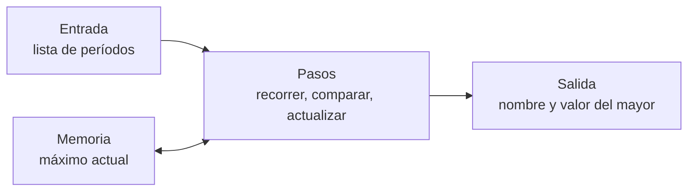

# B07-C01 — Pensamiento algorítmico

<!-- nav:top -->
[🏠 Programa](../../../../README.md) · [📚 Bloque B07](../../../tronco-comun/B07-informatica-cientifica-desde-cero.md) · [← Anterior: B06-C20 — Análisis químico introductorio de meteoritos](../../B06/B06-C20-analisis-quimico-introductorio-de-meteoritos/CLASE.md) · [Siguiente: B07-C02 — Tipos de datos y variables →](../B07-C02-tipos-de-datos-y-variables/CLASE.md)
<!-- /nav -->

## 1. Ubicación, nivel y alcance

Primera clase del bloque B07, la puerta de entrada a la programación. No necesitas haber programado nunca. Aquí aprendes a **descomponer un problema en pasos exactos** antes de escribir una sola línea de código, y a comprobar que esos pasos hacen lo que dices. Nivel N1.

Verás qué es un algoritmo, cómo se escribe en lenguaje natural y en Python, cómo se sigue a mano (una *traza*) y cómo se prueba. No verás todavía los tipos de datos ni los bucles en detalle: llegan en [B07-C02](../B07-C02-tipos-de-datos-y-variables/CLASE.md) y [B07-C05](../B07-C05-bucles-y-simulaciones-sencillas/CLASE.md). Aquí se usa de Python solo lo mínimo, y cada pieza se explica antes de usarla.

## 2. Por qué esta clase existe

En astronomía casi todo resultado pasa por un procedimiento repetible: reducir imágenes, ajustar una órbita, buscar el máximo de una curva de luz. Si no puedes describir el procedimiento con precisión, no puedes ejecutarlo en un computador ni dárselo a otra persona para que lo repita.

La pregunta motivadora es: **¿cómo le explico a una máquina, sin ambigüedad, cómo resolver un problema?** La decisión central es qué pasos, en qué orden y con qué datos de entrada, y cuándo estás seguro de que terminan y de que dan la respuesta correcta. Esto sostiene todo el bloque: cada clase siguiente es una herramienta para expresar o comprobar algoritmos.

## 3. Lo que podrás hacer al terminar

1. Definir *algoritmo* y distinguir entrada, proceso y salida.
2. Descomponer un problema pequeño en pasos no ambiguos y escribirlos como pseudocódigo.
3. Ejecutar un algoritmo a mano con una tabla de traza.
4. Leer y ejecutar un programa corto en Python que implemente la búsqueda del máximo.
5. Escribir pruebas que cubran el caso típico y los casos borde (lista de un elemento, lista vacía).
6. Explicar por qué un algoritmo termina y cuántas comparaciones hace.

La evidencia es la **ficha de algoritmo** del ejercicio 12 (sección 20).

## 4. Con qué llegas y cómo comprobarlo

Solo necesitas saber ordenar números y comparar dos de ellos. Cinco preguntas:

1. ¿Cuál es mayor, 365,256 o 686,980?
2. Si tienes 5 cartas boca abajo y quieres la de mayor número, ¿cuántas tienes que mirar como mínimo?
3. ¿Qué diferencia hay entre «ordenar» y «hallar el mayor»?
4. En la receta «bate los huevos, luego añade el azúcar», ¿importa el orden? ¿Por qué?
5. ¿Qué significa que un procedimiento sea «repetible»?

<details>
<summary>Ver respuestas</summary>

1. 686,980. 2. Las cinco: hasta mirar la última no puedes saber que no hay otra mayor. 3. Ordenar coloca todos; hallar el mayor devuelve uno solo. 4. Importa si el resultado cambia al invertirlo; en una receta casi siempre sí. 5. Que otra persona (o tú otro día) siguiendo los mismos pasos con los mismos datos obtiene el mismo resultado.
</details>

Con cuatro o cinco aciertos, sigue; con tres o menos, repasa el sentido de «comparar» antes de seguir.

## 5. Un caso real: ¿qué planeta tarda más en dar una vuelta al Sol?

Las fichas de datos planetarios del NASA NSSDC (fuente S1) publican el período orbital sidéreo de cada planeta (lo que tarda en volver a la misma posición respecto de las estrellas), en días terrestres: Mercurio 87,969; Venus 224,701; Tierra 365,256; Marte 686,980; Júpiter 4332,589; Saturno 10 755,699; Urano 30 685,400; Neptuno 60 189,018. Son valores publicados que usaremos tal cual.

Tú puedes responder a ojo: Neptuno. Pero ¿cómo lo haría un computador que no «ve» la lista, sino que recibe un número a la vez? Necesita un procedimiento. Ese procedimiento, y la manera de convencerte de que es correcto, es el contenido de esta clase. Este mismo caso, con estos ocho números, es el **ejemplo conductor**: lo retomaremos en el ejemplo trabajado, en el laboratorio y en los ejercicios.

## 6. Vocabulario

Un **algoritmo** es una secuencia finita de pasos precisos que, a partir de unas entradas, produce unas salidas y termina (la definición de uso en informática; el Tutorial de Python lo ilustra con ejemplos como la serie de Fibonacci, S2). La **entrada** son los datos que recibe; la **salida**, lo que devuelve. El **pseudocódigo** es un algoritmo escrito en frases ordenadas, sin la sintaxis de un lenguaje. Un **programa** es un algoritmo escrito en un lenguaje que una máquina puede ejecutar. Una **variable** es un nombre que guarda un valor para reutilizarlo. Una **traza** es una tabla que anota el valor de las variables después de cada paso. Un **caso borde** es una entrada extrema o inusual (lista vacía, un solo elemento) donde los errores suelen esconderse. Una **prueba** es una comprobación automática de que el programa da la salida esperada para una entrada conocida.

## 7. Modelo mental: caja con entrada, pasos y salida

Piensa en un algoritmo como una caja con una ranura de entrada y otra de salida. Dentro hay una lista de pasos numerados y una pequeña memoria con las variables. Cada paso lee, compara o actualiza esa memoria.



*Descripción textual:* de izquierda a derecha, la entrada (la lista de períodos) alimenta un bloque de pasos que recorre, compara y actualiza; ese bloque lee y escribe en una memoria que guarda el máximo actual, y al terminar entrega la salida: el nombre y el valor del mayor.

La analogía es una persona que revisa cartas una por una, sosteniendo en la mano la mayor vista hasta ahora. **Límite de la analogía:** una persona puede «echar un vistazo» al conjunto y saltarse pasos; la máquina ejecuta exactamente lo escrito, ni más ni menos.

## 8. La explicación, paso a paso

### 8.1 Del problema al algoritmo

Un problema bien planteado dice qué entra y qué debe salir. Aquí: *entra* una lista de pares (nombre, período); *sale* el par con el período mayor. Antes de programar, escribe la idea en pasos que no dejen dudas:

1. Toma el primer par y llámalo «mejor».
2. Para cada par restante, en orden: si su período es mayor que el de «mejor», entonces «mejor» pasa a ser ese par.
3. Al acabar la lista, «mejor» es la respuesta.

Cada paso es **no ambiguo** (sabes qué hacer sin interpretar), la lista es finita, así que el procedimiento **termina**, y produce una salida. Por eso es un algoritmo. Observa una decisión de diseño: empezamos con el primer elemento y no con el número 0, porque 0 sería «mejor» que cualquier valor negativo y daría una respuesta falsa. Elegir bien el punto de partida es parte del algoritmo.

### 8.2 Seguirlo a mano: la traza

Antes de ejecutar nada, sigue los pasos con papel. La traza para los datos de la sección 5 empieza con «mejor = Mercurio, 87,969». Luego, Venus (224,701 > 87,969): nuevo mejor. Tierra (365,256 > 224,701): nuevo mejor. Y así hasta Neptuno. En este caso cada planeta supera al anterior porque la lista viene ordenada por distancia al Sol; con otra lista habría pasos «sin cambio». Una traza te permite descubrir errores de lógica sin que el computador intervenga.

### 8.3 Pasarlo a Python, sin saltarse nada

Python es un lenguaje de programación. Un archivo `.py` es un texto con instrucciones que el intérprete (el programa `python`) ejecuta de arriba abajo. Antes del código, el vocabulario mínimo que vamos a usar, cada elemento explicado:

- `=` **asigna**: `mejor = 5` guarda el valor 5 bajo el nombre `mejor`. No es una igualdad matemática.
- `[ ... ]` crea una **lista**: valores separados por comas, en orden. `lista[0]` es el primero (se cuenta desde 0) y `lista[1:]` son todos menos el primero.
- `( a, b )` crea una **tupla**: un par fijo, aquí `(nombre, valor)`.
- `for x in lista:` **repite** el bloque indentado (con sangría de 4 espacios) una vez por elemento. Los dos puntos y la sangría son obligatorios.
- `if condición:` ejecuta el bloque solo si la condición es verdadera. `>` significa «mayor que».
- `def nombre(parámetros):` **define una función**; `return` devuelve el resultado. `"""..."""` justo debajo es la *docstring*, su descripción (S2).
- `print(...)` escribe en pantalla.

Con eso, el algoritmo se lee casi igual que el pseudocódigo:

```python
def buscar_maximo(pares):
    """Devuelve (nombre, valor, comparaciones) del par con el valor mayor."""
    mejor_nombre, mejor_valor = pares[0]
    comparaciones = 0
    for nombre, valor in pares[1:]:
        comparaciones += 1
        if valor > mejor_valor:
            mejor_nombre, mejor_valor = nombre, valor
    return mejor_nombre, mejor_valor, comparaciones
```

`comparaciones += 1` es la abreviatura de `comparaciones = comparaciones + 1`. La línea `mejor_nombre, mejor_valor = pares[0]` **desempaqueta** la tupla en dos nombres (tutorial de Python, sección 5.3, S3). El código completo con datos y pruebas está en el laboratorio de la sección 17.

### 8.4 Terminar y contar el costo

El bucle recorre `pares[1:]`, que tiene `n − 1` elementos si la lista tiene `n`. Cada vuelta hace una comparación, así que el algoritmo hace exactamente `n − 1` comparaciones y termina. Con ocho planetas, siete. No existe un algoritmo que halle el máximo de una lista desordenada con menos: si omites un elemento, podría ser el mayor. Esto conecta con la pregunta 2 del diagnóstico.

### 8.5 Probar: casos típicos y casos borde

Una prueba automática usa `assert condición`, que detiene el programa con un error si la condición es falsa. Probamos (a) el caso típico, con los ocho planetas; (b) un solo elemento, donde no debe haber comparaciones; (c) una lista donde el máximo está en medio. Una lista **vacía** hace fallar a `pares[0]` con un error; en [B07-C12](../B07-C12-manejo-de-errores-y-excepciones/CLASE.md) aprenderás a tratarlo. Por ahora declaramos el supuesto: la lista no está vacía.

## 9. Magnitudes, símbolos y unidades

| Símbolo o término | Qué es | Unidad | Nota |
|---|---|---|---|
| `T` (período sidéreo) | tiempo de una vuelta al Sol | d (día terrestre) | publicado por NASA (S1) |
| `n` | número de elementos de la lista | adimensional | entero |
| `n − 1` | comparaciones del algoritmo | adimensional | para la búsqueda del máximo |
| `=` | asignación en Python | — | no es igualdad |
| `>` | comparación «mayor que» | — | devuelve verdadero o falso |

Todos los períodos están en la misma unidad (días): comparar 87,969 d con 0,24 años sería un error de unidades. Las unidades se tratan a fondo en [B07-C11](../B07-C11-gestion-de-unidades-en-programas/CLASE.md).

## 10. Convenciones y referencias

Los nombres de variables van en minúsculas con guiones bajos (`mejor_valor`). La sangría es de 4 espacios. Los números decimales usan punto en el código (`365.2`) aunque en el texto español escribamos coma. Las versiones: Python 3.12.9 en la ejecución de esta clase. Los períodos se toman como están publicados, sin redondear.

## 11. De dónde sale lo que afirmamos

| ID | Fuente | Localizador | Respalda | Estado |
|---|---|---|---|---|
| S1 | NASA NSSDC, fichas individuales *Mercury/Venus/Earth/Mars/Jupiter/Saturn/Uranus/Neptune Fact Sheet* (act. entre 11-ene-2024 y 19-may-2025) | https://nssdc.gsfc.nasa.gov/planetary/factsheet/ (p. ej. `neptunefact.html`) | «Sidereal orbit period» de los ocho planetas (87,969 a 60 189,018 d) | Páginas leídas el 2026-11-05 (mutables) |
| S2 | Python Software Foundation, *The Python Tutorial* 3.12, §4.2 `for`, §4.8 Defining Functions, §4.9.7 Documentation Strings | https://docs.python.org/3.12/tutorial/controlflow.html | `for`, `if`, `def`, `return`, docstring | Leída el 2026-11-05 |
| S3 | Python Software Foundation, *The Python Tutorial* 3.12, §5.3 Tuples and Sequences | https://docs.python.org/3.12/tutorial/datastructures.html | Tuplas y desempaquetado | Leída el 2026-11-05 |
| S4 | Python Software Foundation, *The Python Tutorial* 3.12, §3.1.3 Lists | https://docs.python.org/3.12/tutorial/introduction.html | Listas, índices desde 0, segmentos | Leída el 2026-11-05 |
| S5 | Python Software Foundation, *The Python Tutorial* 3.12, §8.1 Syntax Errors | https://docs.python.org/3.12/tutorial/errors.html | Error de sintaxis por falta de dos puntos | Leída el 2026-11-05 |

Límites: la definición de algoritmo de la sección 6 es de uso común; no se consultó un texto normativo. Los períodos de S1 son valores publicados, no calculados aquí.

## 12. Cómo ver el algoritmo

La forma accesible es la traza en tabla, que es lo que imprime el laboratorio. Cada fila es un paso del bucle: el planeta mirado, su período, el máximo vigente y si cambió. La tabla de la sección 17 sustituye a un diagrama de flujo y se lee de arriba abajo sin necesidad de imagen.

## 13. Ejemplo trabajado: el máximo, con una lista desordenada

Tomemos los períodos de cuatro planetas en otro orden: Marte 686,980; Mercurio 87,969; Júpiter 4332,589; Tierra 365,256. Entrada: esas cuatro tuplas.

**Paso 1.** `mejor = (Marte, 686,980)`. **Paso 2.** Mercurio: 87,969 > 686,980 es falso, sin cambio. Júpiter: 4332,589 > 686,980 es verdadero, `mejor = (Júpiter, 4332,589)`. Tierra: 365,256 > 4332,589 es falso, sin cambio. **Paso 3.** Salida: Júpiter, 4332,589 d, con 3 comparaciones (`n − 1` con `n = 4`).

**Paso final · incertidumbre y verificación.** Comprueba con una segunda vía: ordena mentalmente de mayor a menor (4332,589; 686,980; 365,256; 87,969) y el primero es Júpiter. El resultado no tiene incertidumbre numérica (es una comparación de valores dados), pero depende de que los datos sean correctos: el algoritmo no sabe si 4332,589 d está bien publicado. Un algoritmo correcto con datos erróneos entrega una respuesta correcta a una pregunta equivocada.

## 14. Distintos algoritmos para el mismo problema

Otra forma de hallar el mayor es **ordenar** toda la lista y tomar el último. Funciona, pero hace mucho más trabajo del necesario cuando solo te interesa uno. Python trae la función `max()` que resuelve el problema con una sola llamada; aprender el algoritmo manual te enseña qué ocurre dentro y te permite adaptarlo (por ejemplo, para guardar también el nombre). Criterio: usa lo ya existente cuando cubre tu necesidad y está probado; escribe el tuyo cuando necesitas controlar el proceso o entenderlo. La clase [B07-C18](../B07-C18-algoritmos-de-busqueda-y-ordenamiento/CLASE.md) compara costos con más rigor.

## 15. Práctica guiada

**Ejercicio 1 · con los pasos indicados.** Escribe en pseudocódigo un algoritmo que halle el **menor** período de una lista. *Pasos:* parte de la sección 8.1 y cambia solo una cosa.

<details><summary>Solución comentada</summary>

Toma el primer par como «mejor». Para cada par restante: si su período es **menor** que el de «mejor», «mejor» pasa a ser ese par. Al final, «mejor» es la respuesta. Solo cambió la comparación (`<` en lugar de `>`). Con los ocho planetas el resultado es Mercurio, 87,969 d.
</details>

**Ejercicio 2 · con una pista.** Haz la traza del algoritmo del máximo con la lista Tierra 365,256; Venus 224,701; Marte 686,980. *Pista:* anota el máximo vigente después de cada paso.

<details><summary>Solución comentada</summary>

Inicio: mejor = Tierra, 365,256. Venus: 224,701 > 365,256 falso, sin cambio (máximo 365,256). Marte: 686,980 > 365,256 verdadero, mejor = Marte, 686,980. Salida: Marte, 686,980 d, 2 comparaciones.
</details>

**Ejercicio 3 · casi autónomo.** En el programa de la sección 8.3, ¿qué valor tiene `comparaciones` si la lista tiene un solo planeta? ¿Qué devuelve `buscar_maximo`?

<details><summary>Solución comentada</summary>

`pares[1:]` queda vacío, el bucle no se ejecuta, `comparaciones` sigue en 0 y la función devuelve el único par con 0 comparaciones. Es el caso borde (b) de la sección 8.5 y el laboratorio lo verifica.
</details>

## 16. Práctica autónoma, transferencia e integrador

**Ejercicio 4.** Con los períodos de la sección 5, escribe un algoritmo (pseudocódigo) que cuente cuántos planetas tardan **más que la Tierra** en dar una vuelta. Aplícalo a mano.

<details><summary>Solución comentada</summary>

Inicia un contador en 0. Para cada par: si el período es mayor que 365,256, suma 1. Resultado: Marte, Júpiter, Saturno, Urano y Neptuno, es decir, 5 (el laboratorio lo confirma con `contar_mayores`). Usa «mayor estrictamente» para no contar a la propia Tierra.
</details>

**Ejercicio 5.** Si la lista tiene 100 períodos, ¿cuántas comparaciones hace la búsqueda del máximo? ¿Y con 1000?

<details><summary>Solución comentada</summary>

`n − 1`: 99 y 999 (sección 8.4). El costo crece en proporción al tamaño de la lista.
</details>

**Ejercicio 6.** Un compañero inicia `mejor_valor = 0` en lugar de usar el primer elemento. ¿Para qué listas falla?

<details><summary>Solución comentada</summary>

Falla si todos los valores son negativos (el 0 inicial «gana» sin pertenecer a la lista) y, además, no devuelve ningún nombre asociado. Con períodos, que son positivos, funcionaría por casualidad: un buen ejemplo de un supuesto implícito peligroso (sección 8.1).
</details>

**Ejercicio 7.** Escribe una frase que describa la entrada, el proceso y la salida del algoritmo del ejercicio 4.

<details><summary>Solución comentada</summary>

Entrada: lista de pares (nombre, período) y un umbral de 365,256 d. Proceso: recorrer la lista comparando cada período con el umbral y acumulando un contador. Salida: un entero, el número de planetas con período mayor que el umbral.
</details>

**Ejercicio 8.** ¿Cuál es un caso borde para `contar_mayores`? ¿Qué debería devolver?

<details><summary>Solución comentada</summary>

Una lista vacía debe devolver 0 (no hay elementos que contar); también un umbral mayor que todos los valores. El laboratorio prueba la lista vacía.
</details>

**Ejercicio 9 · transferencia.** Una curva de luz es una lista de brillos medidos cada minuto. Describe en pseudocódigo cómo hallar el instante del brillo máximo (no solo el valor).

<details><summary>Solución comentada</summary>

Guarda el índice del mejor brillo además del valor: parte con índice 0; para cada medición `i` a partir de 1, si su brillo es mayor que el del mejor, actualiza valor e índice. La salida es el índice, que se traduce a minutos. Es la misma estructura que `buscar_maximo` con el índice en lugar del nombre.
</details>

**Ejercicio 10 · transferencia.** Un algoritmo debe devolver «el planeta más cercano al Sol» a partir de las distancias publicadas. ¿Qué cambias respecto del ejercicio 1, y qué datos necesitas?

<details><summary>Solución comentada</summary>

Cambia el dato (distancia al Sol en lugar de período) y mantienes la búsqueda del menor. Necesitas pares (nombre, distancia) en la misma unidad. El método es idéntico: un buen algoritmo se separa del dato que procesa.
</details>

**Ejercicio 11 · transferencia.** Un colega afirma: «mi algoritmo es correcto porque dio Neptuno con tus datos». ¿Por qué no basta?

<details><summary>Solución comentada</summary>

Un único caso no demuestra corrección: podría dar Neptuno por casualidad (por ejemplo, devolviendo siempre el último). Hay que probar también listas desordenadas, con el máximo al inicio y en medio, y casos borde.
</details>

**Ejercicio 12 · integrador.** Elige un problema pequeño de tu interés astronómico (hallar la estrella más brillante de una lista, contar días nublados…). Entrega una **ficha de algoritmo**: entrada, salida, pseudocódigo numerado, traza con tres datos, casos borde y cuántas comparaciones hace.

<details><summary>Solución modelo</summary>

Ejemplo: «hallar la estrella de menor magnitud (más brillante) en una lista». Entrada: pares (estrella, magnitud). Salida: el par de menor magnitud. Pasos: 1) tomar el primero; 2) para cada otro, si su magnitud es menor, reemplazar; 3) devolver. Traza con tres estrellas; caso borde: lista de una estrella; costo: `n − 1`. Se acepta cualquier ficha con entrada, salida, pasos no ambiguos, traza correcta y un caso borde.
</details>

## 17. Laboratorio: búsqueda del máximo con traza

El script [buscar_maximo.py](buscar_maximo.py) implementa `buscar_maximo` y `contar_mayores`, con los períodos de S1 y la traza. Antes de imprimir ejecuta pruebas: lista de un elemento, lista desordenada, los ocho planetas (con las `n − 1` comparaciones esperadas), conteo con umbral y lista vacía. Si una falla, el programa se detiene.

**Datos:** publicados (NASA), no simulados. **Predice antes de ejecutar:** ¿cuántas comparaciones hará con ocho planetas? (Siete.) **Resultados (2026-11-05, Python 3.12.9):**

```text
python 3.12.9 | pruebas OK
Mayor período: Neptuno con 60189.018 d tras 7 comparaciones
Traza del algoritmo:
  Venus       224.701  máximo actual    224.701  nuevo máximo
  Tierra      365.256  máximo actual    365.256  nuevo máximo
  Marte       686.980  máximo actual    686.980  nuevo máximo
  Júpiter    4332.589  máximo actual   4332.589  nuevo máximo
  Saturno   10755.699  máximo actual  10755.699  nuevo máximo
  Urano     30685.400  máximo actual  30685.400  nuevo máximo
  Neptuno   60189.018  máximo actual  60189.018  nuevo máximo
Planetas con período mayor que el de la Tierra: 5
```

```bash
python programa/clases/B07/B07-C01-pensamiento-algoritmico/buscar_maximo.py
```

**Límites:** el script supone una lista no vacía; no valida unidades ni tipos. Cada paso es «nuevo máximo» porque los datos ya vienen ordenados: prueba con una lista desordenada (ejercicio 2) para ver pasos «sin cambio».

## 18. Errores frecuentes y cómo corregirlos

**Iniciar el máximo con un valor arbitrario (0).** Se detecta con listas de negativos. Se corrige con el ejercicio 6.

**Confundir `=` con una igualdad.** `mejor = valor` asigna; no compara. Se detecta cuando una «condición» cambia la variable. Se corrige releyendo la sección 8.3.

**Probar solo un caso.** Se corrige con el ejercicio 11.

**Olvidar la sangría o los dos puntos.** Python lo señala con un `SyntaxError` (S5). Se corrige revisando que cada `for`, `if` y `def` termine en `:` y que su bloque esté indentado.

**Suponer que el algoritmo valida los datos.** Se corrige con el ejercicio 11 y la sección 13.

## 19. Cómo sabrás que vas bien

Tras la sección 8.1: ¿puedes escribir el pseudocódigo del máximo sin mirar? Si no, rehaz el ejercicio 1. Tras la 8.2: ¿haces la traza de una lista nueva sin errores? Si no, repite el ejercicio 2. Tras la 8.3: ¿puedes leer `buscar_maximo` línea a línea y decir qué hace cada una? Si no, vuelve a la lista de símbolos. Tras el laboratorio: ¿sabes por qué hay siete comparaciones? Si no, relee la sección 8.4. Al final: ¿qué supuesto tiene tu ficha del ejercicio 12 que no está verificado? Si no lo identificas, busca el caso borde.

## 20. Qué entregas y cómo se evalúa

El producto es tu **ficha de algoritmo** (una página): problema, entrada, salida, pseudocódigo numerado, traza con tres datos, casos borde, número de comparaciones y fuentes de los datos.

| Criterio | Inicial | En desarrollo | Logrado | Destacado |
|---|---|---|---|---|
| Descomposición | Pasos vagos | Pasos ordenados pero ambiguos | Pasos no ambiguos y finitos | Justifica el punto de partida |
| Traza | No la hace | Con errores | Correcta | Incluye un caso borde |
| Pruebas | Un solo caso | Típico y uno borde | Típico y varios bordes | Explica qué descubre cada prueba |
| Fuentes y datos | Sin fuente | Fuente sin versión | Fuente con fecha | Rotula datos publicados frente a inventados |

**Condiciones críticas:** no presentar como publicado un dato inventado; no afirmar que el algoritmo es correcto con una sola prueba; citar solo fuentes consultadas.

## 21. Ética, seguridad y límites

Un algoritmo hereda los sesgos y errores de sus datos y de sus supuestos; declarar entradas y casos no cubiertos es una obligación de honestidad científica. No se usan datos personales ni credenciales en esta clase. Accesibilidad: la traza es una tabla de texto; el pseudocódigo se puede leer con lector de pantalla. Material educativo; no sustituye una revisión de software científico.

## 22. Para cerrar y seguir

Un algoritmo es una secuencia finita y no ambigua de pasos que transforma una entrada en una salida. Se escribe primero en pseudocódigo, se sigue a mano con una traza, se pasa a Python y se prueba con casos típicos y bordes. La búsqueda del máximo hace `n − 1` comparaciones. Queda abierta una pregunta: ¿qué ocurre si los datos no son todos del mismo tipo o están en distinta unidad?

**Glosario español–inglés.** algoritmo · *algorithm*; pseudocódigo · *pseudocode*; variable · *variable*; entrada · *input*; salida · *output*; traza · *trace*; caso borde · *edge case*; prueba · *test*; función · *function*; bucle · *loop*.

**Continuidad.** [B07-C02](../B07-C02-tipos-de-datos-y-variables/CLASE.md) usa tu capacidad de **describir un procedimiento con precisión** para que aprendas qué clase de valor guarda cada variable y por qué importa que sea entero, decimal o texto.

**Referencias:** ver sección 11. Los períodos orbitales se tomaron de S1 y se contrastaron con un cálculo propio (la búsqueda del máximo) ejecutado el 2026-11-05.

<!-- nav:bottom -->
---

[← Anterior: B06-C20 — Análisis químico introductorio de meteoritos](../../B06/B06-C20-analisis-quimico-introductorio-de-meteoritos/CLASE.md) · [📚 Bloque B07](../../../tronco-comun/B07-informatica-cientifica-desde-cero.md) · [Siguiente: B07-C02 — Tipos de datos y variables →](../B07-C02-tipos-de-datos-y-variables/CLASE.md)
<!-- /nav -->
