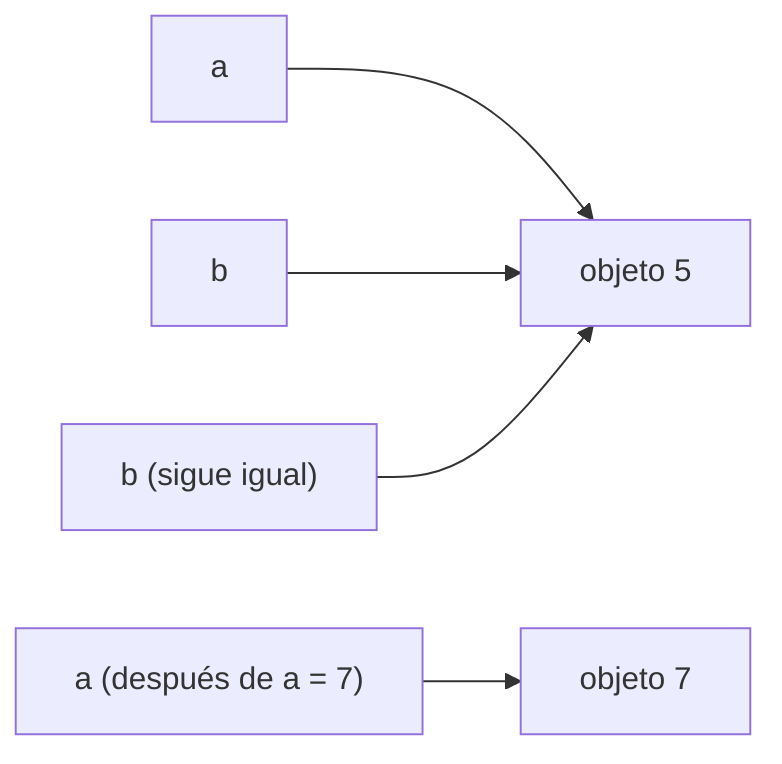

# B07-C02 — Tipos de datos y variables

<!-- nav:top -->
[🏠 Programa](../../../../README.md) · [📚 Bloque B07](../../../tronco-comun/B07-informatica-cientifica-desde-cero.md) · [← Anterior: B07-C01 — Pensamiento algorítmico](../B07-C01-pensamiento-algoritmico/CLASE.md) · [Siguiente: B07-C03 — Operadores y expresiones →](../B07-C03-operadores-y-expresiones/CLASE.md)
<!-- /nav -->

## 1. Ubicación, nivel y alcance

Segunda clase del bloque B07. En [B07-C01](../B07-C01-pensamiento-algoritmico/CLASE.md) escribiste algoritmos con variables sin preguntarte qué guardan. Ahora aprendes **qué clases de valores existen en Python, cómo se nombran y cómo se convierten de una a otra**. Nivel N1.

Verás enteros, decimales, texto, verdadero/falso y «sin valor»; la notación científica; y por qué `0.1 + 0.2` no da exactamente `0.3`. No verás aún los operadores en profundidad ([B07-C03](../B07-C03-operadores-y-expresiones/CLASE.md)) ni las colecciones ([B07-C07](../B07-C07-listas-y-estructuras-de-datos/CLASE.md)).

## 2. Por qué esta clase existe

Un dato sin tipo es ambiguo: «12756» puede ser un número con el que calculas o un texto que lees de un archivo. Si el programa los confunde, falla o, peor, da un resultado plausible pero erróneo. Una cifra con decimales puede, además, cambiar en la última posición según cómo se calcule.

La pregunta motivadora es: **¿qué es exactamente cada dato que mi programa maneja y qué puedo hacer con él?** La decisión central es elegir el tipo adecuado para cada magnitud y convertir con cuidado cuando el dato viene de fuera. Esto sostiene la lectura de archivos ([B07-C08](../B07-C08-lectura-de-archivos-csv/CLASE.md)), el manejo de errores y las unidades.

## 3. Lo que podrás hacer al terminar

1. Explicar qué es una variable (un nombre ligado a un valor) y elegir nombres válidos y claros.
2. Distinguir `int`, `float`, `str`, `bool` y `None`, y averiguar el tipo con `type()`.
3. Escribir números en notación científica (`5.97e24`) y leerla.
4. Convertir entre tipos con `int()`, `float()` y `str()` y anticipar cuándo falla.
5. Explicar por qué los decimales son aproximaciones y comparar con `math.isclose`.
6. Armar una ficha de datos de un planeta con tipos coherentes.

La evidencia es la **ficha de datos tipada** del ejercicio 12 (sección 20).

## 4. Con qué llegas y cómo comprobarlo

Necesitas lo de C01 (asignar con `=`, listas, `print`). Cinco preguntas:

1. ¿Qué hace `mejor = 5`? ¿Es una igualdad matemática?
2. ¿Cuántos decimales tiene la comparación `365,2 > 224,7`? ¿Qué devuelve?
3. ¿Qué significa `5.97e24` en notación científica convencional?
4. ¿Cuál es la diferencia entre `3` y `3.0` para una persona?
5. ¿Qué es una docstring?

<details>
<summary>Ver respuestas</summary>

1. Guarda el valor 5 bajo el nombre `mejor`; no es una igualdad. 2. Una comparación no tiene decimales: devuelve verdadero o falso. 3. 5,97 × 10²⁴. 4. Ninguna en valor; en informática el segundo anuncia que el número puede tener parte decimal. 5. Una cadena de texto al inicio de una función que la describe.
</details>

Con cuatro o cinco aciertos, sigue; con tres o menos, repasa C01.

## 5. Un caso real: la ficha de la Tierra

La ficha de datos planetarios de la Tierra del NASA NSSDC (S1) publica una masa de 5,9722 × 10²⁴ kg, un radio ecuatorial de 6378,137 km y un período orbital sidéreo de 365,256 d; además, la Tierra es el tercer planeta desde el Sol. Son valores publicados y redondeados. ¿Cómo los guardas en un programa? La masa es enorme y tiene decimales; el radio tiene decimales en kilómetros; la posición es un número entero; el nombre es texto; «¿es un gigante gaseoso?» es sí o no; y «satélite mayor, si no hubiese» es la ausencia de un dato. Cinco tipos distintos en una sola ficha, más la ausencia de un dato. Ese es el **ejemplo conductor** de la clase.

## 6. Vocabulario

Una **variable** es un nombre ligado a un valor: `periodo_d = 365.2` liga el nombre `periodo_d` al valor 365,2. Asignar de nuevo con otro valor cambia a qué apunta el nombre; no modifica al valor anterior (S2, §3.1.1). Un **tipo** es la clase de valor, que fija qué operaciones valen. `int` es un entero de precisión ilimitada; `float` es un número decimal de coma flotante, normalmente de 64 bits; `str` es texto; `bool` es `True` o `False`, y es un subtipo de entero (S3); `None` representa «sin valor». Una **conversión** (o *cast*) transforma un valor de un tipo a otro. La **notación científica** escribe `m × 10ⁿ` como `mEn`; por ejemplo `5.97e24`. Una **palabra reservada** es un nombre que el lenguaje usa para sí (`if`, `for`, `class`, `None`…) y no puedes usar como variable.

## 7. Modelo mental: la etiqueta y la cosa

Piensa en una variable como una etiqueta pegada a un objeto, no como una caja que contiene el valor. Al escribir `b = a`, pegas una segunda etiqueta al mismo objeto; al escribir luego `a = 7`, despegas la etiqueta `a` y la pegas a otro objeto, mientras `b` conserva el anterior.



*Descripción textual:* arriba, dos etiquetas `a` y `b` apuntan al mismo objeto 5. Abajo, después de `a = 7`, la etiqueta `a` apunta a un objeto 7 y `b` sigue apuntando al 5.

**Límite de la analogía:** en un valor que se puede modificar por dentro, como una lista, dos etiquetas sobre el mismo objeto sí ven los cambios del otro (la clase C07 lo desarrolla). Con números y textos, que no cambian, el efecto no aparece.

## 8. La explicación, paso a paso

### 8.1 Variables y nombres

Un nombre válido empieza con letra o guion bajo, sigue con letras, dígitos o guiones bajos, y no es palabra reservada. `masa_kg` es válido; `2tierra` no (empieza con dígito); `radio-km` no (el guion se lee como resta); `class` no (reservada). Python distingue mayúsculas de minúsculas: `Masa` y `masa` son nombres distintos. Un buen nombre dice qué es y en qué unidad: `periodo_d` mejor que `p`. Esto previene errores de unidades (C11).

### 8.2 Enteros y decimales

`int` guarda enteros sin límite de tamaño; `float` guarda números con parte decimal. El punto separa los decimales en el código (`365.2`). La división `/` siempre da `float`: `17 / 3` da `5.666666666666667`; `//` da el cociente entero (`5`) y `%` el resto (`2`) (S2). Si mezclas `int` y `float` en una operación, el resultado es `float`.

### 8.3 Notación científica

`5.97e24` significa 5,97 × 10²⁴. La `e` es «por diez elevado a». Es un `float`. Al imprimirlo, Python escribe `5.97e+24`. Usa esta notación para masas, distancias y cualquier número muy grande o muy pequeño. Los guiones bajos en enteros largos son legibles: `1_000_000`.

### 8.4 Texto, verdadero/falso y sin valor

Un `str` va entre comillas simples o dobles y no se puede modificar por posición: `"Tierra"[0] = "t"` es un error; se crea un texto nuevo (S2, §3.1.2). `len("Tierra")` da 6. Un `bool` surge de comparar (`365.2 > 224.7` es `True`). `None` indica ausencia de dato; es mejor que usar 0, porque 0 es un valor real (ejercicio 10).

### 8.5 Convertir con cuidado

`int("12756")` da `12756`; `float("365.2")` da `365.2`; `str(12756)` da `"12756"`. Mezclar tipos sin convertir falla: `"12756" + 1` produce `TypeError: can only concatenate str (not "int") to str`. Y `int("12.5")` falla con `ValueError: invalid literal for int() with base 10: '12.5'`; hay que pasar por `float`: `int(float("12.5"))` da `12` (trunca, no redondea). Los errores se estudian en [B07-C12](../B07-C12-manejo-de-errores-y-excepciones/CLASE.md).

### 8.6 Los decimales son aproximaciones

Un `float` guarda la fracción binaria más cercana al decimal que escribiste; `0.1` no se puede representar exactamente en binario, igual que 1/3 no se puede en decimal (S4). Por eso `0.1 + 0.2` da `0.30000000000000004` y `0.1 + 0.2 == 0.3` es `False`. La regla: **no compares decimales con `==`; compara con tolerancia**, usando `math.isclose(a, b)`, cuyo `rel_tol` por defecto es 1e-09 (S5). Redondea solo para mostrar, no para calcular.

## 9. Magnitudes, símbolos y unidades

| Variable | Tipo | Valor | Unidad | Fuente |
|---|---|---|---|---|
| `nombre` | `str` | `'Tierra'` | — | — |
| `masa_kg` | `float` | `5.9722e24` | kg | S1 | NASA NSSDC, fichas individuales *Earth Fact Sheet* (act. 15-nov-2024) y *Mars Fact Sheet* (act. 19-may-2025) | https://nssdc.gsfc.nasa.gov/planetary/factsheet/earthfact.html | Masa, radio ecuatorial y período sidéreo de la Tierra y de Marte | Leídas el 2026-11-05 (mutables) |
| `posicion` | `int` | `3` | — | S1 (orden desde el Sol) |
| `radio_ecuatorial_km` | `float` | `6378.137` | km | S1 |
| `periodo_d` | `float` | `365.256` | d (sidéreo) | S1 |
| `es_gigante` | `bool` | `False` | — | criterio propio |
| `satelite_mayor` | `NoneType` | `None` | — | sin dato |

Los valores publicados están redondeados: 5,9722 × 10²⁴ kg son cinco cifras significativas, no una masa exacta.

## 10. Convenciones y referencias

Nombres en minúsculas con guiones bajos y la unidad al final (`diametro_km`). Constantes en MAYÚSCULAS. Comillas dobles para textos. Python 3.12.9 en esta clase. Los datos son publicados, no simulados.

## 11. De dónde sale lo que afirmamos

| ID | Fuente | Localizador | Respalda | Estado |
|---|---|---|---|---|
| S1 | NASA NSSDC, *Planetary Fact Sheet* (act. 18-mar-2025) | https://nssdc.gsfc.nasa.gov/planetary/factsheet/ | Masa, diámetro y período de la Tierra | Leída el 2026-11-05 (mutable) |
| S2 | Python Software Foundation, *The Python Tutorial* 3.12, §3.1.1 Numbers, §3.1.2 Text | https://docs.python.org/3.12/tutorial/introduction.html | `int`, `float`, `/`, `//`, `%`, `**`, `str` inmutable, `len` | Leída el 2026-11-05 |
| S3 | Python Software Foundation, *The Python Standard Library* 3.12, «Built-in Types», Numeric Types | https://docs.python.org/3.12/library/stdtypes.html | `bool` subtipo de `int`; ceros falsos; mezcla de tipos | Leída parcialmente el 2026-11-05 (primeros 100 000 caracteres) |
| S4 | Python Software Foundation, *The Python Tutorial* 3.12, «Floating-Point Arithmetic: Issues and Limitations» | https://docs.python.org/3.12/tutorial/floatingpoint.html | 0.1 no es exacto; no usar `==`; `math.isclose` | Leída el 2026-11-05 |
| S5 | Python Software Foundation, *The Python Standard Library* 3.12, `math.isclose` | https://docs.python.org/3.12/library/math.html | `rel_tol=1e-09`, `abs_tol=0.0` | Leída el 2026-11-05 |

Límites: la masa de la Tierra se toma como publicada; no se contrastó con otra fuente.

## 12. Cómo ver los tipos

La forma accesible es la tabla de la sección 9 y la salida impresa del laboratorio, que lista cada variable con su valor y su tipo. Para quien usa lector de pantalla, cada línea es autosuficiente: `masa_kg = 5.97e+24 tipo: float`.

## 13. Ejemplo trabajado: leer un dato de texto y calcular un radio

Un archivo de texto trae `"12756"` (diámetro en km) como **texto**. Queremos el radio en km y en metros.

**Paso 1.** `diametro = int("12756")` convierte a entero: `12756`. **Paso 2.** `radio_km = diametro / 2` da `6378.0` (la división `/` devuelve `float`). **Paso 3.** `radio_m = radio_km * 1000` da `6378000.0`. **Paso 4.** Para mostrar: `f"{radio_m:.3e}"` da `'6.378e+06'`.

**Paso final · incertidumbre.** El diámetro viene redondeado a kilómetros (±0,5 km por redondeo), así que el radio tiene unos ±0,25 km, es decir, siete cifras de `6378000.0` en metros son una precisión aparente que el dato no tiene. Mantén las cifras significativas del dato original: 12 756 km son cinco cifras.

## 14. Distintas formas de guardar el mismo dato

Un período puede guardarse como `float` (`365.2`), como texto (`"365.2 d"`) o como entero en segundos (`31553280`). El `float` es práctico para calcular; el texto con unidad es legible pero hay que interpretarlo; el entero en una unidad pequeña evita aproximaciones decimales. Criterio: guarda el valor numérico con su unidad en el nombre de la variable, y deja el texto para mostrar. En C11 verás cómo hacer que la unidad viaje con el número.

## 15. Práctica guiada

**Ejercicio 1 · con los pasos indicados.** Di el tipo de cada valor: `12756`, `365.2`, `"365.2"`, `True`, `None`. *Pasos:* mira si hay comillas, punto decimal o palabra reservada (sección 8).

<details><summary>Solución comentada</summary>

`int`, `float`, `str`, `bool`, `NoneType`. La clave del tercero son las comillas: aunque parezca un número, es texto.
</details>

**Ejercicio 2 · con una pista.** Si `diametro_km = 6792` (el doble del radio ecuatorial de Marte, 3396,2 km, redondeado a km; S1), ¿qué tipo tiene `diametro_km / 2` y qué valor? *Pista:* la división `/`.

<details><summary>Solución comentada</summary>

`3396.0`, de tipo `float`, porque `/` siempre devuelve `float` (sección 8.2).
</details>

**Ejercicio 3 · casi autónomo.** Convierte el texto `"12.5"` en el entero 12. ¿Por qué `int("12.5")` falla?

<details><summary>Solución comentada</summary>

`int(float("12.5"))` da `12`. `int()` sobre un texto solo acepta dígitos enteros; el punto lo rechaza con `ValueError` (sección 8.5). Convertir de `float` a `int` trunca.
</details>

## 16. Práctica autónoma, transferencia e integrador

**Ejercicio 4.** ¿Qué ocurre con `periodo_d + " d"` si `periodo_d = 365.2`? Escribe una forma correcta de armar el texto `365.2 d`.

<details><summary>Solución comentada</summary>

`TypeError`: no se puede sumar `float` y `str`. Correcto: `f"{periodo_d} d"` o `str(periodo_d) + " d"`.
</details>

**Ejercicio 5.** Explica por qué `0.1 + 0.2 == 0.3` es `False` y escribe la comparación correcta.

<details><summary>Solución comentada</summary>

Los decimales se guardan como fracciones binarias aproximadas (sección 8.6): la suma da `0.30000000000000004`. Correcto: `math.isclose(0.1 + 0.2, 0.3)`, que devuelve `True`.
</details>

**Ejercicio 6.** Escribe la masa de Marte, 0,64169 × 10²⁴ kg (S1), en notación científica de Python. ¿Cómo la imprime Python?

<details><summary>Solución comentada</summary>

`6.4169e23` (o `0.64169e24`). Python lo imprime como `6.4169e+23`.
</details>

**Ejercicio 7.** Di cuáles de estos nombres son válidos y por qué: `masa_kg`, `2tierra`, `radio-km`, `class`.

<details><summary>Solución comentada</summary>

Solo `masa_kg`. `2tierra` empieza por dígito; `radio-km` contiene un guion (se leería como resta); `class` es palabra reservada (sección 8.1).
</details>

**Ejercicio 8.** Tras `a = 5`, `b = a`, `a = 7`, ¿cuánto vale `b`? Explícalo con la etiqueta y la cosa.

<details><summary>Solución comentada</summary>

`5`. `b` quedó pegado al objeto 5; `a = 7` despegó solo la etiqueta `a` (sección 7).
</details>

**Ejercicio 9 · transferencia.** Un sensor entrega las lecturas de texto `"23.5"` y `"24.1"` (°C). Calcula su media y di el tipo del resultado.

<details><summary>Solución comentada</summary>

`(float("23.5") + float("24.1")) / 2` da `23.8`, de tipo `float`. Hay que convertir primero; sumar los textos los concatenaría.
</details>

**Ejercicio 10 · transferencia.** Para un planeta sin satélites, ¿es mejor guardar `0` o `None` como «masa del satélite mayor»? Justifica.

<details><summary>Solución comentada</summary>

`None`: `0` es un valor medible que un cálculo (por ejemplo, un promedio) trataría como real; `None` marca la ausencia y obliga al programa a tratarla aparte.
</details>

**Ejercicio 11 · transferencia.** Convierte el período sidéreo de la Tierra, 365,256 d, a segundos con una variable bien nombrada. ¿Qué tipo resulta y cuántas cifras significativas justifican?

<details><summary>Solución comentada</summary>

`periodo_s = periodo_d * 86400` da `31558118.4` (`float`). El dato tiene seis cifras significativas (365,256), por lo que se debería informar como `3.15581e7` s; las demás cifras son aritmética, no información.
</details>

**Ejercicio 12 · integrador.** Construye una **ficha de datos tipada** de Marte con nombre, masa (kg), radio ecuatorial (km), período sidéreo (d), si es gigante y satélite mayor (`None` si no conoces el dato). Imprime cada variable con su tipo y añade al menos tres `assert` que comprueben los tipos y una conversión.

<details><summary>Solución modelo</summary>

Con S1: `nombre = "Marte"`, `masa_kg = 6.4169e23`, `radio_ecuatorial_km = 3396.2`, `periodo_d = 686.98`, `posicion = 4`, `es_gigante = False`, `satelite_mayor = None`. Pruebas: `type(masa_kg) is float`, `type(posicion) is int`, `math.isclose(2 * radio_ecuatorial_km, 6792.4)`. Se acepta cualquier ficha con tipos coherentes, unidad en el nombre y datos con fuente.
</details>

## 17. Laboratorio: ficha de la Tierra y trampas de los decimales

El script [tipos_y_variables.py](tipos_y_variables.py) crea la ficha de la sección 5, imprime cada variable con su tipo y demuestra las trampas de `float`. Antes de imprimir ejecuta pruebas: tipos esperados, `0.1 + 0.2 != 0.3` y `isclose`, división real/entera/resto, conversiones de texto, `True + True == 2` y consistencia de la masa en notación científica y diámetro = 2 × radio.

**Datos:** publicados (NASA), no simulados. **Predice antes de ejecutar:** ¿qué tipo tiene el diámetro calculado como `2 * radio_ecuatorial_km`? (`float`.) **Resultados (2026-11-05, Python 3.12.9):**

```text
python 3.12.9 | pruebas OK
nombre               = 'Tierra'   tipo: str
masa_kg              = 5.9722e+24 tipo: float
posicion             = 3          tipo: int
radio_ecuatorial_km  = 6378.137   tipo: float
periodo_d            = 365.256    tipo: float
es_gigante           = False      tipo: bool
satelite_mayor       = None       tipo: NoneType
0.1 + 0.2 = 0.30000000000000004 | ¿igual a 0.3? False | isclose: True
7 / 2 = 3.5 | 7 // 2 = 3 | 7 % 2 = 1
diámetro (km) = 12756.274 | tipo: float
masa en forma legible: 5.9722e+24 kg | float.hex(0.1) = 0x1.999999999999ap-4
```

```bash
python programa/clases/B07/B07-C02-tipos-de-datos-y-variables/tipos_y_variables.py
```

**Límites:** no valida entradas; los errores de conversión se tratan en C12.

## 18. Errores frecuentes y cómo corregirlos

**Sumar texto y número.** `TypeError`. Se corrige convirtiendo (ejercicio 4).

**Comparar decimales con `==`.** Se corrige con `math.isclose` (ejercicio 5).

**Pasar un texto con punto decimal a `int()`.** `ValueError`. Se corrige con `float` primero (ejercicio 3).

**Usar 0 como «sin dato».** Se corrige con `None` (ejercicio 10).

**Informar más cifras de las que tiene el dato.** Se corrige con la sección 13 y el ejercicio 11.

## 19. Cómo sabrás que vas bien

Tras 8.1: ¿distingues nombres válidos de inválidos? Si no, ejercicio 7. Tras 8.5: ¿predices qué conversión falla? Si no, ejercicio 3. Tras 8.6: ¿explicas por qué `0.1 + 0.2 != 0.3`? Si no, relee la sección y haz el ejercicio 5. Tras el laboratorio: ¿qué tipo tiene el diámetro calculado y por qué? Si dudas, ejercicio 2. Al final: ¿qué dato de tu ficha podría faltar y cómo lo representas? Si respondes «0», repasa el ejercicio 10.

## 20. Qué entregas y cómo se evalúa

El producto es tu **ficha de datos tipada** de un planeta (una página y un script de pocas líneas): variables con nombre y unidad, tipo de cada una, fuente de cada valor, conversión de al menos un dato desde texto y pruebas.

| Criterio | Inicial | En desarrollo | Logrado | Destacado |
|---|---|---|---|---|
| Tipos | Mezcla tipos sin darse cuenta | Los nombra | Los elige con criterio | Explica cada elección |
| Nombres y unidades | Nombres de una letra | Nombres claros | Con unidad | Coherentes en toda la ficha |
| Decimales | Compara con `==` | Sabe que hay error | Usa `isclose` | Informa cifras significativas |
| Fuentes | Sin fuente | Sin fecha | Con fecha | Distingue publicado de estimado |

**Condiciones críticas:** no inventar valores; citar solo fuentes consultadas; no informar más cifras que las del dato.

## 21. Ética, seguridad y límites

Redondear en silencio o inventar un dato faltante es faltar a la honestidad científica: marca lo ausente con `None` y di de dónde viene cada cifra. Sin datos personales ni credenciales. Accesibilidad: salidas en texto plano y tablas. Material educativo.

## 22. Para cerrar y seguir

Una variable es una etiqueta ligada a un valor; cada valor tiene un tipo que fija lo que puedes hacer con él. Los decimales son aproximaciones y se comparan con tolerancia. Convertir tipos es una decisión, no un trámite. Queda abierta la pregunta de cómo combinar los valores con operadores sin perder significado físico.

**Glosario español–inglés.** variable · *variable*; tipo · *type*; entero · *integer*; decimal (coma flotante) · *float*; texto · *string*; booleano · *boolean*; conversión · *cast / conversion*; notación científica · *scientific notation*; palabra reservada · *keyword*.

**Continuidad.** [B07-C03](../B07-C03-operadores-y-expresiones/CLASE.md) usa tu capacidad de **elegir y convertir tipos** para construir expresiones con operadores y verificar una regularidad real, la tercera ley de Kepler, con los datos de la NASA.

**Referencias:** ver sección 11. De S3 solo se leyó la primera parte de la página.

<!-- nav:bottom -->
---

[← Anterior: B07-C01 — Pensamiento algorítmico](../B07-C01-pensamiento-algoritmico/CLASE.md) · [📚 Bloque B07](../../../tronco-comun/B07-informatica-cientifica-desde-cero.md) · [Siguiente: B07-C03 — Operadores y expresiones →](../B07-C03-operadores-y-expresiones/CLASE.md)
<!-- /nav -->
