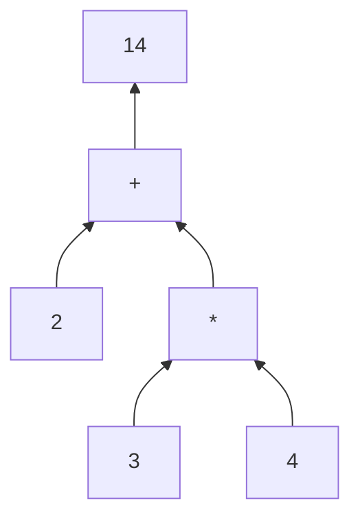

# B07-C03 — Operadores y expresiones

<!-- nav:top -->
[🏠 Programa](../../../../README.md) · [📚 Bloque B07](../../../tronco-comun/B07-informatica-cientifica-desde-cero.md) · [← Anterior: B07-C02 — Tipos de datos y variables](../B07-C02-tipos-de-datos-y-variables/CLASE.md) · [Siguiente: B07-C04 — Condicionales y decisiones →](../B07-C04-condicionales-y-decisiones/CLASE.md)
<!-- /nav -->

## 1. Ubicación, nivel y alcance

Tercera clase del bloque B07. Ya sabes qué es una variable y qué tipos de valores existen ([B07-C02](../B07-C02-tipos-de-datos-y-variables/CLASE.md)). Ahora **combinas valores con operadores** para formar expresiones y calcular, y compruebas una regularidad física real con datos publicados. Nivel N1.

Verás los operadores aritméticos, de comparación y lógicos, la precedencia, y cómo mostrar resultados con formato. No verás todavía las decisiones con `if` ([B07-C04](../B07-C04-condicionales-y-decisiones/CLASE.md)) ni funciones matemáticas como `sqrt` ([B07-C09](../B07-C09-calculos-cientificos-basicos-con-python/CLASE.md)).

## 2. Por qué esta clase existe

Casi cualquier resultado científico es una expresión: una masa dividida por un volumen, un cociente de períodos. Si no sabes en qué orden Python evalúa `a / b ** 3`, escribirás una fórmula distinta de la que piensas y no recibirás ningún aviso: el programa funcionará y dará un número equivocado.

La pregunta motivadora es: **¿cómo traduzco una fórmula a una línea de código sin cambiar su significado?** La decisión central es el orden de evaluación y el uso de paréntesis, junto con la comprobación de que el resultado tiene sentido. Esto sostiene los cálculos de C09, las unidades de C11 y el simulador de C20.

## 3. Lo que podrás hacer al terminar

1. Usar `+ - * / // % **` y predecir el resultado y su tipo.
2. Aplicar las reglas de precedencia y usar paréntesis para fijar el orden.
3. Comparar con `== != < <= > >=` y combinar condiciones con `and`, `or`, `not`.
4. Dar formato a números con f-strings (`:.3f`, `:.2e`).
5. Traducir `T²/a³` a código y evaluarla con datos reales.
6. Interpretar una desviación respecto de lo esperado en vez de ignorarla.

La evidencia es la **tabla de verificación de Kepler** del ejercicio 12 (sección 20).

## 4. Con qué llegas y cómo comprobarlo

Necesitas C02 (tipos y variables). Cinco preguntas:

1. ¿Qué tipo tiene `7 / 2` y cuánto vale?
2. ¿Qué significa `5.97e24`?
3. ¿Por qué no se compara `0.1 + 0.2 == 0.3`?
4. ¿Qué es una variable?
5. ¿Qué hace `int("12.5")`?

<details>
<summary>Ver respuestas</summary>

1. `float`, 3,5. 2. 5,97 × 10²⁴. 3. Los decimales son aproximaciones binarias; se usa `math.isclose`. 4. Un nombre ligado a un valor. 5. Falla con `ValueError`; hay que pasar por `float`.
</details>

Con cuatro o cinco aciertos, sigue; con tres o menos, repasa C02.

## 5. Un caso real: ¿se cumple la regularidad de Kepler?

Hace unos cuatrocientos años se encontró que, para los planetas que orbitan el Sol, el cuadrado del período `T` dividido por el cubo del semieje mayor `a` da casi el mismo número para todos (tercera ley de Kepler; aquí la usamos como regularidad que se comprueba, sin derivarla). Si mides `T` en años terrestres y `a` en distancias terrestres, esa razón debería valer 1 para todos los planetas.

Las fichas del NASA NSSDC (S1) publican el semieje mayor y el período sidéreo de cada planeta. Con esos datos, la comprobación es una expresión: `(T / T_tierra) ** 2 / (a / a_tierra) ** 3`. Escribirla bien exige conocer los operadores. Este es el **ejemplo conductor** de la clase.

## 6. Vocabulario

Un **operador** es un símbolo que combina valores: `+`, `*`, `>`, `and`. Un **operando** es cada valor combinado. Una **expresión** es una combinación de valores, variables y operadores que Python **evalúa** a un valor: `2 + 3 * 4` evalúa a `14`. Una **sentencia** hace algo (asignar, imprimir) y no necesariamente devuelve un valor. La **precedencia** es el orden en que se evalúan los operadores; la **asociatividad** dice hacia qué lado se agrupan los de igual precedencia. Un **operador de comparación** devuelve `True` o `False`. Un **operador lógico** (`and`, `or`, `not`) combina valores booleanos. Una **cadena f** (*f-string*) es un texto con `f` delante cuyas llaves `{}` insertan expresiones formateadas.

## 7. Modelo mental: el árbol de la expresión

Una expresión se evalúa como un árbol: las operaciones de mayor precedencia son ramas bajas que se resuelven primero y alimentan a las de arriba. Los paréntesis fuerzan una rama.



*Descripción textual:* el árbol de `2 + 3 * 4`. Primero se calcula la multiplicación de 3 y 4 (12); ese resultado y el 2 entran en la suma, que da 14.

**Límite de la analogía:** el árbol describe el orden de agrupación, no necesariamente el de ejecución de cada paso interno; basta para predecir el resultado.

## 8. La explicación, paso a paso

### 8.1 Operadores aritméticos

`+` suma, `-` resta, `*` multiplica, `/` divide y siempre devuelve `float` (`17 / 3` da `5.666666666666667`), `//` es división entera (`17 // 3` da `5`), `%` es el resto (`17 % 3` da `2`) y `**` es potencia (`2 ** 7` da `128`) (S2). Se cumple `(17 // 3) * 3 + 17 % 3 == 17`. Atención: `^` **no** es potencia en Python; es una operación bit a bit (`2 ^ 3` da `1`).

### 8.2 Precedencia y paréntesis

De mayor a menor: `**`, luego `*  /  //  %`, luego `+  -`. Entonces `2 + 3 * 4 ** 2` da `50` (primero `4 ** 2 = 16`, luego `3 * 16 = 48`, luego `+ 2`). La potencia agrupa de derecha a izquierda: `2 ** 3 ** 2` da `512`, como `2 ** (3 ** 2)`. Y `**` liga más que el signo menos: `-3 ** 2` da `-9`, mientras `(-3) ** 2` da `9` (S2). Ante la duda, usa paréntesis: cuestan nada y evitan errores.

### 8.3 Comparaciones y lógica

`==` pregunta si son iguales (distinto de `=`, que asigna), `!=` distintos, `<`, `<=`, `>`, `>=`. Se pueden encadenar: `3 < 5 < 7` es `True`. Con `and` (ambas verdaderas), `or` (alguna verdadera) y `not` (invierte) combinas condiciones: `3 > 2 and 1 > 2` da `False`; `3 > 2 or 1 > 2` da `True`. Los decimales se comparan con tolerancia (C02).

### 8.4 Mostrar resultados con formato

Una f-string inserta expresiones: `f"{365.2:.1f}"` muestra un decimal; `f"{5.97e24:.2e}"` da `5.97e+24`; `f"{59800:,}"` agrupa miles con comas (`59,800`). El formato cambia lo que ves, **no el valor** (S3 recomienda redondear solo para mostrar).

### 8.5 Traducir una fórmula

La razón de Kepler `T² / a³` con `T` en años y `a` en distancias terrestres es, en código:

```python
t_anios = periodo_d / T_TIERRA
a_rel = semieje_1e6km / A_TIERRA
razon = t_anios ** 2 / a_rel ** 3
```

Se calcula en dos pasos con nombres claros en vez de una línea enredada. Fíjate en que `t_anios ** 2 / a_rel ** 3` se evalúa como `(t_anios ** 2) / (a_rel ** 3)`, porque `**` precede a `/`. Si quisieras `T² / a` al cubo del cociente, necesitarías paréntesis.

### 8.6 Interpretar el resultado

Si la razón de un planeta no es exactamente 1, la desviación es información. Puede deberse al redondeo de los datos, a que el modelo es una aproximación (órbitas casi circulares, masa del planeta despreciada) o a un dato publicado menos preciso. No puedes distinguir la causa sin otra fuente: eso es un motivo para consultarla, no para ocultar la diferencia (sección 13).

## 9. Magnitudes, símbolos y unidades

| Símbolo | Qué es | Unidad | Nota |
|---|---|---|---|
| `T` | período sidéreo | d; en la razón, años terrestres | `T/T_tierra` |
| `a` | semieje mayor | 10⁶ km; en la razón, distancias terrestres | `a/a_tierra` |
| `T²/a³` | razón de Kepler | adimensional | ≈ 1 con estas unidades |
| `**` | potencia | — | no `^` |
| `//`, `%` | cociente entero y resto | — | `a == (a//b)*b + a%b` |

Con T en días y a en 10⁶ km la razón no vale 1 sino otro número; por eso normalizamos con la Tierra. La razón es adimensional solo después de dividir.

## 10. Convenciones y referencias

Espacios alrededor de los operadores aritméticos para legibilidad. Nombres con la unidad cuando la hay. Los datos son publicados (NASA), rotulados como tales; la razón es un cálculo derivado. Python 3.12.9.

## 11. De dónde sale lo que afirmamos

| ID | Fuente | Localizador | Respalda | Estado |
|---|---|---|---|---|
| S1 | NASA NSSDC, fichas individuales *Mercury…Neptune Fact Sheet* (act. 11-ene-2024 a 19-may-2025) | https://nssdc.gsfc.nasa.gov/planetary/factsheet/ (p. ej. `marsfact.html`) | Semieje mayor y período sidéreo de cada planeta | Leídas el 2026-11-05 (mutables) |
| S2 | Python Software Foundation, *The Python Tutorial* 3.12, §3.1.1 Numbers | https://docs.python.org/3.12/tutorial/introduction.html | `/`, `//`, `%`, `**`, precedencia de `-3**2` | Leída el 2026-11-05 |
| S3 | Python Software Foundation, *The Python Tutorial* 3.12, «Floating-Point Arithmetic» | https://docs.python.org/3.12/tutorial/floatingpoint.html | Redondear solo para mostrar | Leída el 2026-11-05 |

Límites: la ley de Kepler se usa como regularidad empírica; no se consultó una referencia de mecánica orbital ni una fuente alternativa del semieje de Saturno.

## 12. Cómo ver los resultados

La tabla del laboratorio (sección 17) ordena los planetas y alinea las columnas; es la versión accesible de un gráfico de dispersión que se hará en [B07-C10](../B07-C10-graficos-bidimensionales-iniciales/CLASE.md). Cada fila se entiende sola: planeta, `a` relativo, `T` en años y razón.

## 13. Ejemplo trabajado: Marte

**Datos (S1):** `a = 227.956` (10⁶ km), `T = 686.980` d; Tierra: `a = 149.598`, `T = 365.256`.

**Paso 1.** `t_anios = 686.980 / 365.256 = 1.8808...` **Paso 2.** `a_rel = 227.956 / 149.598 = 1.5238...` **Paso 3.** `t_anios ** 2 = 3.5375...`; `a_rel ** 3 = 3.5382...`. **Paso 4.** Razón: `0.99981`, es decir, 0,02 % por debajo de 1.

**Paso final · incertidumbre.** Los datos publicados tienen seis o siete cifras, así que la desviación de 0,02 % es compatible con el redondeo y con el modelo simple. En cambio Saturno da `0.9885` (−1,1 %) y Neptuno `0.9878` (−1,2 %): son desviaciones mucho mayores que el redondeo del dato. No sabemos la causa con lo consultado; una hipótesis a comprobar es que la ficha da un semieje promediado de otra manera, y para decidir habría que consultar efemérides independientes (no consultadas aquí).

## 14. Distintas maneras de escribir lo mismo

`razon = t ** 2 / a ** 3` equivale a `razon = (t / a ** 1.5) ** 2`. La primera es más legible; la segunda muestra que la razón es el cuadrado de `T / a^{3/2}`. Otra opción es predecir el período a partir del semieje: `t_pred = a_rel ** 1.5` y comparar con el medido. Elige la forma que haga evidente lo que comparas; con potencias fraccionarias aparecen más aproximaciones numéricas, así que compara con tolerancia.

## 15. Práctica guiada

**Ejercicio 1 · con los pasos indicados.** Calcula `17 // 3`, `17 % 3` y `17 / 3`, y comprueba que `(17 // 3) * 3 + 17 % 3` da 17. *Pasos:* aplica la sección 8.1.

<details><summary>Solución comentada</summary>

`5`, `2` y `5.666666666666667`. Comprobación: `5 * 3 + 2 = 17`. El cociente entero y el resto reconstruyen el número.
</details>

**Ejercicio 2 · con una pista.** Evalúa `2 + 3 * 4 ** 2` y escribe en qué orden se hicieron las operaciones. *Pista:* `**` primero.

<details><summary>Solución comentada</summary>

`50`: `4 ** 2 = 16`, `3 * 16 = 48`, `2 + 48 = 50`.
</details>

**Ejercicio 3 · casi autónomo.** Calcula la razón de Kepler de Júpiter con `a = 778.479` y `T = 4332.589`. *Pista:* normaliza con la Tierra.

<details><summary>Solución comentada</summary>

`t_anios = 4332.589 / 365.256 = 11.862`; `a_rel = 778.479 / 149.598 = 5.204`; razón `11.862² / 5.204³ = 0.9985` (el laboratorio imprime `0.9985`). Desviación de −0,15 %.
</details>

## 16. Práctica autónoma, transferencia e integrador

**Ejercicio 4.** ¿Cuánto valen `-3 ** 2` y `(-3) ** 2`? ¿Qué regla explica la diferencia?

<details><summary>Solución comentada</summary>

`-9` y `9`. La potencia precede al signo menos (sección 8.2).
</details>

**Ejercicio 5.** ¿Qué devuelve `2 ^ 3`? ¿Cómo escribirías 2 al cubo?

<details><summary>Solución comentada</summary>

`1` (operación bit a bit, no potencia). 2 al cubo: `2 ** 3`.
</details>

**Ejercicio 6.** Evalúa `3 < 5 < 7`, `3 > 2 and 1 > 2` y `not (3 < 2)`.

<details><summary>Solución comentada</summary>

`True`, `False`, `True`. La cadena `3 < 5 < 7` significa `3 < 5 and 5 < 7`.
</details>

**Ejercicio 7.** Escribe, con f-string, el período de Júpiter en años con tres decimales: `f"{4332.589 / 365.256:.3f}"`. ¿Qué imprime?

<details><summary>Solución comentada</summary>

`11.862`. El valor interno sigue siendo `11.861787349146901`: el formato no lo cambia.
</details>

**Ejercicio 8.** Predice el período de Saturno a partir de su semieje: `t_pred = a_rel ** 1.5`, con `a_rel = 1432.041 / 149.598`. Compáralo con `10755.699 / 365.256`.

<details><summary>Solución comentada</summary>

`t_pred ≈ 29.617` años y el medido es `29.447` años: la predicción excede al dato en un 0,6 %. Es consistente con la razón 0,9885 de la tabla: su desviación (−1,1 %) es aproximadamente el doble de la del período, porque `T` entra al cuadrado.
</details>

**Ejercicio 9 · transferencia.** Calcula la rapidez media de la Tierra en su órbita, suponiendo una órbita circular: `v = 2 · 3.14159 · a / T`, con `a` en km y `T` en segundos.

<details><summary>Solución comentada</summary>

`a = 149.598e6 km`, `T = 365.256 · 86400 s`: `v ≈ 29.78 km/s`. Es una estimación (modelo circular, π con seis cifras) y no un dato publicado.
</details>

**Ejercicio 10 · transferencia.** Con la tabla, ¿qué planeta se aleja más de 1 y en qué porcentaje? ¿Qué harías antes de afirmar que el dato del NASA está mal?

<details><summary>Solución comentada</summary>

Neptuno, −1,2 % (Saturno, −1,1 %). Antes de afirmar un error, contrastarías con otra fuente independiente (efemérides) y revisarías cómo define cada fuente el semieje y el período: no es lo mismo período sidéreo que tropical.
</details>

**Ejercicio 11 · transferencia.** Un compañero escribe `razon = t ** 2 / a ** 3` con `t` en días y `a` en 10⁶ km para la Tierra y obtiene un número distinto de 1. ¿Está mal el código?

<details><summary>Solución comentada</summary>

El código es correcto, pero la razón solo vale 1 con T en años y a en distancias terrestres. Con días y 10⁶ km el valor es otro (`365.256² / 149.598³ ≈ 0.0398`), porque la razón es dimensional. Hay que normalizar o indicar las unidades.
</details>

**Ejercicio 12 · integrador.** Construye la **tabla de verificación de Kepler** con los ocho planetas: columnas `a/a_T`, `T` en años, razón y desviación en %. Indica la mayor desviación y tu hipótesis, con la fuente que consultarías.

<details><summary>Solución modelo</summary>

Usa los datos de S1 como en la sección 17. Desviaciones: Mercurio +0,001 %, Venus −0,002 %, Marte −0,019 %, Júpiter −0,153 %, Urano +0,264 %, Saturno −1,146 %, Neptuno −1,223 %. La mayor es Neptuno. Se acepta una hipótesis razonable (definición del semieje, redondeo, masa del planeta) siempre que se marque como no comprobada y se nombre la fuente a consultar.
</details>

## 17. Laboratorio: tabla de verificación de Kepler

El script [expresiones_kepler.py](expresiones_kepler.py) calcula la razón de los ocho planetas con los datos de S1. Antes de imprimir comprueba que la Tierra da exactamente 1, que la precedencia (`2 + 3 * 4`, `-3 ** 2`, `2 ** 3 ** 2`) es la esperada y que todas las razones están a ±2 % de 1; si no, se detiene.

**Datos:** publicados (NASA); la razón es un cálculo derivado. **Predice antes de ejecutar:** ¿qué planeta se desviará más? (Neptuno.) **Resultados (2026-11-05, Python 3.12.9):**

```text
python 3.12.9 | pruebas OK
planeta      a/a_T    T (años)   T^2/a^3
Mercurio     0.387       0.241    1.0000
Venus        0.723       0.615    1.0000
Tierra       1.000       1.000    1.0000
Marte        1.524       1.881    0.9998
Júpiter      5.204      11.862    0.9985
Saturno      9.573      29.447    0.9885
Urano       19.165      84.011    1.0026
Neptuno     30.181     164.786    0.9878
```

```bash
python programa/clases/B07/B07-C03-operadores-y-expresiones/expresiones_kepler.py
```

**Límites:** la tolerancia del 2 % es una decisión de la clase para acomodar los datos publicados; no es un criterio físico. El script no estima incertidumbres.

## 18. Errores frecuentes y cómo corregirlos

**Usar `^` como potencia.** Se corrige con el ejercicio 5.

**Olvidar la precedencia de `**` frente al signo.** Se corrige con el ejercicio 4.

**Confundir `=` con `==`.** Una asigna, otra compara (sección 8.3).

**Mezclar unidades en una razón.** Se corrige con el ejercicio 11.

**Redondear antes de calcular.** El formato solo es para mostrar (sección 8.4).

## 19. Cómo sabrás que vas bien

Tras 8.2: ¿evalúas `2 + 3 * 4 ** 2` sin ejecutarlo? Si no, ejercicio 2. Tras 8.3: ¿distingues `=` de `==`? Si no, relee. Tras 8.5: ¿puedes escribir la razón de Kepler en dos líneas claras? Si no, ejercicio 3. Tras el laboratorio: ¿qué planeta se desvía más y por qué no concluimos que el dato esté mal? Si no lo explicas, relee 8.6. Al final: ¿qué consultarías para decidir? Si no sabes, repasa el ejercicio 10.

## 20. Qué entregas y cómo se evalúa

El producto es tu **tabla de verificación de Kepler** (una página y el script): ocho filas, desviaciones en %, la mayor desviación, una hipótesis marcada como no comprobada y las fuentes.

| Criterio | Inicial | En desarrollo | Logrado | Destacado |
|---|---|---|---|---|
| Expresiones | Resultados erróneos por precedencia | Correctas con ayuda | Correctas y legibles | Con pasos intermedios con nombre |
| Unidades | Mezcla unidades | Las declara | Normaliza con la Tierra | Explica por qué la razón es adimensional |
| Interpretación | Ignora la desviación | La nota | La compara con el redondeo | Propone cómo verificar la causa |
| Fuentes | Sin fuente | Sin fecha | Con fecha | Distingue dato publicado de cálculo |

**Condiciones críticas:** no ocultar desviaciones; no afirmar una causa sin evidencia; citar solo fuentes consultadas.

## 21. Ética, seguridad y límites

Presentar un resultado «que sale justo» ocultando discrepancias es mala práctica científica: reporta las desviaciones y su incertidumbre. Sin datos personales. Accesibilidad: salidas en tablas de texto. Material educativo; no sustituye efemérides profesionales.

## 22. Para cerrar y seguir

Una expresión combina valores con operadores según reglas de precedencia; los paréntesis fijan el orden y las f-strings muestran sin alterar. Comprobar una regularidad con datos reales muestra que las desviaciones son información. Queda abierta la pregunta de cómo tomar decisiones en el programa según el resultado de una comparación.

**Glosario español–inglés.** operador · *operator*; operando · *operand*; expresión · *expression*; precedencia · *precedence*; resto · *remainder / modulo*; potencia · *power / exponentiation*; comparación · *comparison*; cadena f · *f-string*.

**Continuidad.** [B07-C04](../B07-C04-condicionales-y-decisiones/CLASE.md) usa tu capacidad de **formar expresiones booleanas** para que el programa elija un camino según el resultado.

**Referencias:** ver sección 11. Las cifras de la tabla se obtuvieron ejecutando el laboratorio el 2026-11-05.

<!-- nav:bottom -->
---

[← Anterior: B07-C02 — Tipos de datos y variables](../B07-C02-tipos-de-datos-y-variables/CLASE.md) · [📚 Bloque B07](../../../tronco-comun/B07-informatica-cientifica-desde-cero.md) · [Siguiente: B07-C04 — Condicionales y decisiones →](../B07-C04-condicionales-y-decisiones/CLASE.md)
<!-- /nav -->
