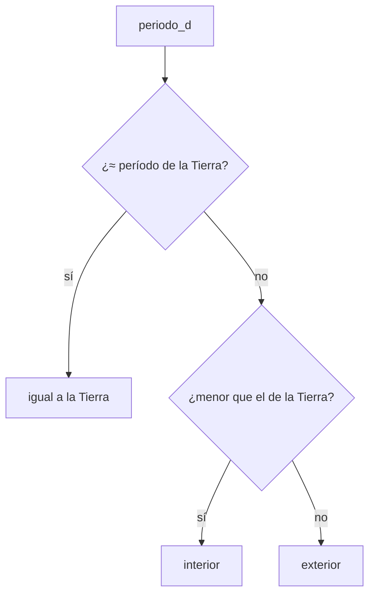

# B07-C04 — Condicionales y decisiones

<!-- nav:top -->
[🏠 Programa](../../../../README.md) · [📚 Bloque B07](../../../tronco-comun/B07-informatica-cientifica-desde-cero.md) · [← Anterior: B07-C03 — Operadores y expresiones](../B07-C03-operadores-y-expresiones/CLASE.md) · [Siguiente: B07-C05 — Bucles y simulaciones sencillas →](../../../tronco-comun/B07-informatica-cientifica-desde-cero.md#b07-c05)
<!-- /nav -->

## 1. Ubicación, nivel y alcance

Cuarta clase del bloque B07 y cierre de su primera sección. En [B07-C03](../B07-C03-operadores-y-expresiones/CLASE.md) construiste expresiones que dan `True` o `False`. Ahora haces que el **programa elija un camino** según esos resultados con `if`, `elif` y `else`. Nivel N1.

Verás las decisiones simples y encadenadas, el orden en que se evalúan, los umbrales y los casos frontera. No verás bucles ([B07-C05](../B07-C05-bucles-y-simulaciones-sencillas/CLASE.md)) ni el tratamiento de errores ([B07-C12](../B07-C12-manejo-de-errores-y-excepciones/CLASE.md)).

## 2. Por qué esta clase existe

Toda clasificación astronómica es una decisión sobre un dato: ¿esta señal supera el ruido?, ¿esta estrella es más brillante que el umbral?, ¿esta imagen está saturada? Una decisión mal escrita no falla ruidosamente: clasifica mal en silencio, justo en los casos frontera, que son los que importan.

La pregunta motivadora es: **¿cómo hago que el programa aplique una regla y cómo sé que la aplica donde debe?** La decisión central es elegir el umbral, el tipo de comparación (`>` o `>=`) y el orden de las ramas, y declarar que el umbral es una convención y no una ley natural.

## 3. Lo que podrás hacer al terminar

1. Escribir `if`, `elif` y `else` con la sangría correcta.
2. Predecir qué rama se ejecuta, incluyendo el orden de evaluación.
3. Combinar condiciones con `and`, `or` y `not`.
4. Probar los valores justo en el umbral (casos frontera).
5. Comparar decimales con `math.isclose` dentro de una condición.
6. Distinguir un umbral didáctico de una definición oficial.

La evidencia es la **tabla de decisión probada** del ejercicio 12 (sección 20).

## 4. Con qué llegas y cómo comprobarlo

Necesitas C03 (comparaciones y lógica). Cinco preguntas:

1. ¿Qué valor tiene `3 > 2 and 1 > 2`?
2. ¿Qué diferencia hay entre `=` y `==`?
3. ¿Qué devuelve `5 > 5`? ¿Y `5 >= 5`?
4. ¿Por qué no se usa `==` entre decimales?
5. ¿Qué es la sangría y por qué importa en Python?

<details>
<summary>Ver respuestas</summary>

1. `False`. 2. `=` asigna; `==` compara. 3. `False` y `True`. 4. Porque los decimales son aproximaciones; se usa `math.isclose`. 5. Los 4 espacios que marcan qué instrucciones pertenecen a un bloque; sin ellos cambia el significado o hay `SyntaxError`.
</details>

Con cuatro o cinco aciertos, sigue; con tres o menos, repasa C03.

## 5. Un caso real: separar planetas pequeños y grandes con una regla escrita

Con el radio ecuatorial de cada planeta (S1) puedes calcular su diámetro y decidir si es «grande» o «pequeño». Pero ¿grande respecto de qué? La Unión Astronómica Internacional define qué es un planeta ([B01-C03](../../B01/B01-C03-objetos-celestes-y-sus-diferencias/CLASE.md)), pero **no** define «pequeño» ni «grande». Aquí usaremos una regla didáctica propia, `diámetro > 20 000 km`, y otra para la posición: `período menor que el de la Tierra → interior`. Estas reglas son nuestras y están declaradas como tales. Este es el **ejemplo conductor**: una decisión con umbral, sus ramas y sus casos frontera.

## 6. Vocabulario

Una **condición** es una expresión que da `True` o `False`. Un **condicional** es una instrucción que ejecuta un bloque solo si se cumple una condición. `if` abre el condicional, `elif` (de «else if») añade condiciones alternativas que se prueban en orden, y `else` recoge todo lo demás. Una **rama** es cada bloque posible. Un **umbral** es el valor que separa dos casos. Un **caso frontera** es un dato igual o muy cercano al umbral. Una **convención** es un acuerdo que no se deduce de la naturaleza: el umbral de 20 000 km lo es. Un **valor de verdad** (*truthiness*) es lo que Python considera verdadero o falso en una condición: el 0 y los contenedores o textos vacíos son falsos; casi todo lo demás, verdadero (S3).

## 7. Modelo mental: un cruce con una señal por rama

Imagina un cruce donde el dato llega por un camino y encuentra una pregunta; según la respuesta sigue por una salida. Con `elif`, las preguntas se hacen una tras otra y se toma la **primera** salida cuya respuesta es sí; las demás ya no se miran.



*Descripción textual:* un dato entra y se hacen dos preguntas en orden. Si es aproximadamente igual al período de la Tierra, el resultado es «igual a la Tierra»; si no, se pregunta si es menor, y en ese caso es «interior»; si no, es «exterior».

**Límite de la analogía:** un cruce físico tiene un solo camino de salida porque el coche solo puede estar en un lugar; en un programa, si las preguntas están mal ordenadas, un dato puede «caer» en una rama que no corresponde.

## 8. La explicación, paso a paso

### 8.1 La estructura `if`

```python
if diametro_km > UMBRAL_DIAMETRO_KM:
    return "grande"
return "pequeño"
```

`if` va seguido de una condición y de dos puntos `:`. El bloque que se ejecuta si es verdadera está **indentado** (4 espacios). Si no lo es, el programa salta al código siguiente, con la sangría anterior (S2). Aquí `return` sale de la función con un valor.

### 8.2 `if` / `elif` / `else`

```python
if math.isclose(periodo_d, PERIODO_TIERRA_D):
    return "igual a la Tierra"
elif periodo_d < PERIODO_TIERRA_D:
    return "interior"
else:
    return "exterior"
```

Se evalúa cada condición en orden y solo se ejecuta la primera rama verdadera; `else` no lleva condición. El orden importa: si preguntaras primero `periodo_d < PERIODO_TIERRA_D`, un valor casi igual pero ligeramente menor por redondeo se clasificaría como «interior» antes de llegar a la pregunta de igualdad (ejercicio 8).

### 8.3 Condiciones compuestas

`and`, `or` y `not` combinan condiciones: `if diametro > 20_000 and periodo > 1000:` exige las dos. Python evalúa `and` y `or` de izquierda a derecha y **se detiene en cuanto conoce el resultado** (evaluación de cortocircuito). Para evitar ambigüedades, agrupa con paréntesis. También puedes encadenar comparaciones: `0 < x <= 10`.

### 8.4 Umbrales y casos frontera

La diferencia entre `>` y `>=` solo importa **en el umbral**. En nuestra regla, un diámetro exacto de 20 000 km es «pequeño» porque pedimos «mayor que». Es una decisión que debes escribir y probar: `clasificar_tamano(20_000.0)` debe dar `"pequeño"` y `clasificar_tamano(20_000.1)`, `"grande"`. Para decimales que podrían ser «iguales» por redondeo, usa `math.isclose` (C02).

### 8.5 Convención frente a definición

Los umbrales de la clase (20 000 km, período de la Tierra) son didácticos. Si el resultado fuera a usarse científicamente, el umbral debería venir de una definición citada o justificarse con datos. El programa no sabe de dónde viene el número: eso lo declaras tú en la cabecera y en el texto.

## 9. Magnitudes, símbolos y unidades

| Símbolo o nombre | Qué es | Unidad | Nota |
|---|---|---|---|
| `UMBRAL_DIAMETRO_KM` | umbral de tamaño | km | 20 000, convención didáctica |
| `PERIODO_TIERRA_D` | período sidéreo de la Tierra | d | 365,256 (S1) |
| `diametro_km` | `2 × radio ecuatorial` | km | del dato (S1) |
| `if` / `elif` / `else` | ramas del condicional | — | solo la primera verdadera |
| `isclose` | igualdad con tolerancia | — | `rel_tol=1e-09` (S4) |

## 10. Convenciones y referencias

Las constantes van en mayúsculas al inicio del archivo, con unidad en el nombre. Las reglas se documentan en la docstring. Se declara si el umbral es «mayor que» o «mayor o igual». Python 3.12.9.

## 11. De dónde sale lo que afirmamos

| ID | Fuente | Localizador | Respalda | Estado |
|---|---|---|---|---|
| S1 | NASA NSSDC, fichas individuales *Mercury…Neptune Fact Sheet* (act. 11-ene-2024 a 19-may-2025) | https://nssdc.gsfc.nasa.gov/planetary/factsheet/ | Radio ecuatorial y período sidéreo de cada planeta | Leídas el 2026-11-05 (mutables) |
| S2 | Python Software Foundation, *The Python Tutorial* 3.12, §4.1 `if` Statements | https://docs.python.org/3.12/tutorial/controlflow.html | `if`/`elif`/`else`, primera rama verdadera | Leída el 2026-11-05 |
| S3 | Python Software Foundation, *The Python Standard Library* 3.12, «Built-in Types» | https://docs.python.org/3.12/library/stdtypes.html | El cero numérico es falso | Leída parcialmente el 2026-11-05 |
| S4 | Python Software Foundation, `math.isclose` | https://docs.python.org/3.12/library/math.html | Tolerancia relativa por defecto 1e-09 | Leída el 2026-11-05 |
| S5 | IAU, Resoluciones de la Asamblea General de 2006 (B5, B6), citadas en B01-C03 | https://www.iau.org/Iau/Publications/List-of-Resolutions.aspx | La IAU define «planeta» pero no «grande/pequeño» | Citada desde B01-C03; no vuelta a leer en esta clase |

Límites: la afirmación sobre lo que la IAU no define se apoya en B01-C03, no en una relectura propia de las resoluciones. Las evaluaciones de cortocircuito y de verdad de contenedores vacíos se basan en la documentación de Python (S3), leída solo parcialmente.

## 12. Cómo ver las decisiones

La tabla de decisión es la forma accesible: una fila por planeta, con su valor de entrada y su rama. El laboratorio (sección 17) imprime una; el diagrama de la sección 7 es su versión visual y tiene descripción textual.

## 13. Ejemplo trabajado: clasificar Neptuno y Mercurio

**Neptuno (S1).** Radio ecuatorial 24 764 km, diámetro `2 × 24 764 = 49 528` km; período 60 189,018 d.

**Paso 1.** `49 528 > 20 000` es verdadero: «grande». **Paso 2.** `isclose(60189.018, 365.256)` es falso; `60189.018 < 365.256` es falso; entra en `else`: «exterior».

**Mercurio.** Diámetro `2 × 2440,5 = 4881` km; `4881 > 20 000` es falso: «pequeño». Período 87,969 d: `isclose` es falso y `87.969 < 365.256` es verdadero: «interior».

**Paso final · incertidumbre.** Ninguno de los ocho planetas queda cerca del umbral de 20 000 km (el menor «grande» tiene 49 528 km y el mayor «pequeño», 12 756 km), así que la clasificación es robusta frente a variaciones de unos pocos kilómetros en los datos. Un umbral de 13 000 km, en cambio, pondría a la Tierra casi en la frontera: la robustez depende de dónde pongas el umbral.

## 14. Distintas maneras de decidir

Una alternativa a la cadena `if/elif/else` es un **diccionario** que asigne cada valor a su etiqueta (se verá en C07), útil cuando las categorías son discretas y no hay umbrales. Otra es la **expresión condicional** `"grande" if d > 20_000 else "pequeño"`, compacta pero menos legible si hay más de dos ramas. Para umbrales con muchas categorías, una tabla ordenada de límites con búsqueda (C18) escala mejor que una cadena larga de `elif`.

## 15. Práctica guiada

**Ejercicio 1 · con los pasos indicados.** Clasifica por tamaño un planeta de diámetro 12 104 km y otro de 142 984 km con la regla de la sección 5. *Pasos:* compara con el umbral (sección 8.1).

<details><summary>Solución comentada</summary>

12 104 > 20 000 es falso: «pequeño» (es Venus, S1). 142 984 > 20 000 es verdadero: «grande» (Júpiter).
</details>

**Ejercicio 2 · con una pista.** Un planeta tiene período 224,701 d. ¿Qué rama de `clasificar_posicion` se ejecuta? *Pista:* mira el orden de las condiciones.

<details><summary>Solución comentada</summary>

`isclose(224.701, 365.256)` falso; `224.701 < 365.256` verdadero: «interior». No llega a `else`.
</details>

**Ejercicio 3 · casi autónomo.** ¿Qué devuelve `clasificar_tamano(20_000.0)` y por qué?

<details><summary>Solución comentada</summary>

`"pequeño"`: la condición es «mayor que» (`>`), y 20 000 no es mayor que 20 000. Es un caso frontera que el laboratorio prueba.
</details>

## 16. Práctica autónoma, transferencia e integrador

**Ejercicio 4.** Reescribe la regla de tamaño con `>=`. ¿Cambia la clasificación de alguno de los ocho planetas? ¿Cambia el caso frontera?

<details><summary>Solución comentada</summary>

Ningún planeta cambia (ninguno tiene exactamente 20 000 km). Sí cambia el caso frontera: 20 000,0 pasaría a «grande».
</details>

**Ejercicio 5.** Escribe una condición que sea verdadera para planetas «grandes y exteriores» a la vez.

<details><summary>Solución comentada</summary>

`diametro_km > 20_000 and periodo_d > 365.256` (los cuatro gigantes). Si además excluyes la Tierra con `isclose`, evitas confundir iguales por redondeo.
</details>

**Ejercicio 6.** ¿Qué imprime `if 0: print("a")` seguido de `else: print("b")`? ¿Y con `""`?

<details><summary>Solución comentada</summary>

Imprime `b` en ambos casos: el cero y el texto vacío son falsos (sección 6, S3).
</details>

**Ejercicio 7.** Con `x = 5`, ¿es verdadero `0 < x <= 10`? Reescríbelo sin encadenar.

<details><summary>Solución comentada</summary>

Sí. Equivale a `0 < x and x <= 10`.
</details>

**Ejercicio 8.** Invierte el orden de las dos primeras ramas de `clasificar_posicion`. ¿Con qué dato falla?

<details><summary>Solución comentada</summary>

Falla con un período ligeramente menor que 365,256 por redondeo (p. ej. 365,2559): la rama `<` lo declararía «interior» antes de probar la igualdad. El orden de las ramas es parte de la lógica.
</details>

**Ejercicio 9 · transferencia.** Una imagen se descarta si su fondo supera 1000 cuentas **y** hay más de 10 píxeles saturados, o si el obturador estuvo cerrado. Escribe la condición.

<details><summary>Solución comentada</summary>

`(fondo > 1000 and saturados > 10) or obturador_cerrado`. Los paréntesis fijan la agrupación, aunque `and` precede a `or`. Los umbrales aquí son inventados para el ejercicio.
</details>

**Ejercicio 10 · transferencia.** Un colega usa el umbral 13 000 km para «grande» y obtiene que la Tierra es «pequeña» por poco. ¿Qué le dirías sobre la robustez de su clasificación?

<details><summary>Solución comentada</summary>

La Tierra (12 756 km) está a menos de 2 % del umbral: cualquier cambio de definición del radio (ecuatorial frente a medio volumétrico, 6378 frente a 6371 km) podría moverla de lado. La clasificación es frágil; conviene un umbral lejos de los datos o declarar el criterio del radio.
</details>

**Ejercicio 11 · transferencia.** Explica por qué «planeta grande» no es una categoría de la IAU. ¿Qué dice la IAU y qué decidiste tú?

<details><summary>Solución comentada</summary>

La IAU define planeta, planeta enano y cuerpo menor con tres criterios (B01-C03). «Grande/pequeño» y el umbral de 20 000 km son decisiones didácticas nuestras: no deben atribuirse a la IAU.
</details>

**Ejercicio 12 · integrador.** Entrega una **tabla de decisión probada**: tres reglas con umbral para los ocho planetas, su código `if/elif/else`, al menos cuatro `assert` (con un caso frontera por regla) y la tabla de resultados.

<details><summary>Solución modelo</summary>

Reglas: tamaño (20 000 km), posición (período de la Tierra) y, por ejemplo, «período mayor que 10 años» (3652,56 d). Cada una con función, docstring, `assert` en el umbral y la tabla impresa como en la sección 17. Se acepta cualquier umbral declarado como convención.
</details>

## 17. Laboratorio: clasificador de planetas con reglas explícitas

El script [clasificar_planetas.py](clasificar_planetas.py) implementa las dos reglas con los datos de S1. Antes de imprimir prueba los casos frontera (20 000,0 y 20 000,1 km), la igualdad con la Tierra y la lista de planetas «grandes» e «interiores»; si algo falla, se detiene.

**Datos:** publicados (NASA); las reglas son didácticas. **Predice antes de ejecutar:** ¿cuántos planetas «grandes»? (Cuatro.) **Resultados (2026-11-05, Python 3.12.9):**

```text
python 3.12.9 | pruebas OK
Mercurio     4881.0 km  pequeño  interior
Venus       12103.6 km  pequeño  interior
Tierra      12756.3 km  pequeño  igual a la Tierra
Marte        6792.4 km  pequeño  exterior
Júpiter    142984.0 km  grande   exterior
Saturno    120536.0 km  grande   exterior
Urano       51118.0 km  grande   exterior
Neptuno     49528.0 km  grande   exterior
```

```bash
python programa/clases/B07/B07-C04-condicionales-y-decisiones/clasificar_planetas.py
```

**Límites:** las reglas no son definiciones oficiales; el diámetro se calcula como `2 × radio ecuatorial`, que para planetas achatados no es el diámetro medio.

## 18. Errores frecuentes y cómo corregirlos

**Usar `=` en vez de `==`.** Python lo rechaza como `SyntaxError` dentro de un `if`. Se corrige releyendo la sección 8.3.

**Olvidar `:` o la sangría.** Se corrige con el diagnóstico de la sección 4.

**Ordenar mal las ramas.** Se corrige con el ejercicio 8.

**No probar el umbral.** Se corrige con el ejercicio 3.

**Presentar un umbral propio como definición.** Se corrige con el ejercicio 11.

## 19. Cómo sabrás que vas bien

Tras 8.2: ¿predices qué rama se ejecuta con 224,701 d? Si no, ejercicio 2. Tras 8.4: ¿sabes qué devuelve la función exactamente en el umbral? Si no, ejercicio 3. Tras el ejemplo: ¿clasificas a Saturno sin ayuda? Si no, repite con él. Tras el laboratorio: ¿qué casos frontera prueba el script? Si no lo sabes, lee `pruebas()`. Al final: ¿qué umbral de tu tabla es una convención y cuál una definición citada? Si no distingues, repasa la sección 8.5.

## 20. Qué entregas y cómo se evalúa

El producto es tu **tabla de decisión probada**: reglas con umbral, código, pruebas de frontera, tabla de resultados y la declaración de qué es convención.

| Criterio | Inicial | En desarrollo | Logrado | Destacado |
|---|---|---|---|---|
| Lógica | Ramas que se solapan | Ramas correctas | Orden justificado | Analiza qué pasa si se invierte |
| Pruebas | Ninguna | Casos típicos | Casos frontera | Explica qué falla si se rompe cada uno |
| Umbrales | Sin explicar | Declarados | Declarados como convención | Muestra su sensibilidad |
| Fuentes | Sin fuente | Sin fecha | Con fecha | Distingue definición de convención |

**Condiciones críticas:** no atribuir un umbral propio a una institución; probar los casos frontera; citar solo fuentes consultadas.

## 21. Ética, seguridad y límites

Una regla de decisión aplicada a datos reales puede discriminar o excluir; en ciencia, un umbral mal justificado puede descartar señales verdaderas. Declara siempre quién fijó el umbral y por qué. Sin datos personales. Accesibilidad: la tabla y el diagrama tienen descripción textual. Material educativo.

## 22. Para cerrar y seguir

Un condicional hace que el programa elija entre ramas según una condición; solo se ejecuta la primera rama verdadera, y los umbrales y casos frontera deben probarse. Un umbral es una convención salvo que provenga de una definición citada. Queda abierta la pregunta de cómo repetir una decisión sobre muchos datos de forma automática.

**Glosario español–inglés.** condicional · *conditional*; rama · *branch*; umbral · *threshold*; caso frontera · *boundary case*; condición · *condition*; cortocircuito · *short-circuit*; convención · *convention*.

**Continuidad.** [B07-C05](../B07-C05-bucles-y-simulaciones-sencillas/CLASE.md) usa tu capacidad de **decidir con una condición** para repetir pasos hasta que se cumpla algo, y acercarte a una simulación.

**Referencias:** ver sección 11. S3 se leyó parcialmente; S5 se cita desde B01-C03.

<!-- nav:bottom -->
---

[← Anterior: B07-C03 — Operadores y expresiones](../B07-C03-operadores-y-expresiones/CLASE.md) · [📚 Bloque B07](../../../tronco-comun/B07-informatica-cientifica-desde-cero.md) · [Siguiente: B07-C05 — Bucles y simulaciones sencillas →](../../../tronco-comun/B07-informatica-cientifica-desde-cero.md#b07-c05)
<!-- /nav -->
