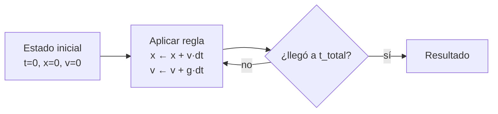

# B07-C05 — Bucles y simulaciones sencillas

<!-- nav:top -->
[🏠 Programa](../../../../README.md) · [📚 Bloque B07](../../../tronco-comun/B07-informatica-cientifica-desde-cero.md) · [← Anterior: B07-C04 — Condicionales y decisiones](../B07-C04-condicionales-y-decisiones/CLASE.md) · [Siguiente: B07-C06 — Funciones y modularidad →](../B07-C06-funciones-y-modularidad/CLASE.md)
<!-- /nav -->

## 1. Ubicación, nivel y alcance

Quinta clase del bloque B07. Con condicionales ([B07-C04](../B07-C04-condicionales-y-decisiones/CLASE.md)) ya decides; con **bucles** repites. Juntos permiten simular un fenómeno avanzando en pasos de tiempo. Nivel N1.

Verás `for`, `while`, `range`, `break`, `continue`, acumuladores y tu primera simulación numérica (el método de Euler) comparada con la solución exacta. No verás todavía órbitas ([B07-C20](../B07-C20-primer-simulador-de-un-movimiento-celeste/CLASE.md)) ni ecuaciones diferenciales en general (bloque B11).

## 2. Por qué esta clase existe

Una simulación es un bucle: calcula el estado siguiente a partir del actual, una y otra vez. Si el paso es demasiado grande, el resultado se aparta de la realidad; si es demasiado pequeño, tarda. Entender el bucle y el efecto del paso es la base de cualquier cálculo numérico.

La pregunta motivadora es: **¿cómo hago que el programa repita un cálculo y cómo sé cuánto puedo fiarme del resultado?** La decisión central es elegir el paso `dt`, la condición de parada y la comprobación contra una referencia exacta.

## 3. Lo que podrás hacer al terminar

1. Escribir bucles `for` sobre `range` y sobre listas, y bucles `while` con condición de parada.
2. Usar acumuladores y los contadores de pasos.
3. Evitar el bucle infinito y explicar sus causas.
4. Simular una caída libre con el método de Euler.
5. Comparar la simulación con la solución exacta y medir el error.
6. Explicar cómo cambia el error al cambiar el paso.

La evidencia es el **informe de convergencia** del ejercicio 12 (sección 20).

## 4. Con qué llegas y cómo comprobarlo

Necesitas C01–C04. Cinco preguntas:

1. ¿Qué hace `for x in lista:`?
2. ¿Qué valor tiene `range(3)` al recorrerlo?
3. ¿Qué es un caso borde?
4. ¿Por qué `==` entre decimales es mala idea?
5. ¿Qué tipo devuelve `/`?

<details>
<summary>Ver respuestas</summary>

1. Ejecuta el bloque una vez por elemento, con `x` tomando cada valor. 2. 0, 1, 2. 3. Una entrada extrema donde suelen esconderse errores. 4. Los decimales son aproximaciones. 5. `float`.
</details>

Con cuatro o cinco aciertos, sigue; con tres o menos, repasa C01–C04.

## 5. Un caso real: ¿cuánto tarda en caer una piedra en la Tierra y en Marte?

La tabla comparativa del NASA NSSDC (S1) publica la gravedad en la superficie: 9,8 m/s² en la Tierra y 3,7 m/s² en Marte (redondeada a dos cifras). Sin atmósfera y con `g` constante, una piedra soltada desde el reposo recorre `x = g t² / 2`. Queremos que el programa lo calcule paso a paso, sin usar esa fórmula, y que luego se compare con ella. Ese es el **ejemplo conductor**: si el bucle está bien escrito, ambos resultados deben coincidir hasta un error que sabemos predecir. Rotulamos el resultado como **simulado**: no es un dato observado.

## 6. Vocabulario

Un **bucle** repite un bloque. `for` repite para cada elemento de una secuencia; `while` repite mientras una condición sea verdadera (S2). `range(n)` produce los enteros de 0 a n−1; `range(a, b, paso)` los produce de `a` hasta antes de `b` con ese paso. Un **acumulador** es una variable que se actualiza en cada vuelta (`total = total + x`). Una **iteración** es una vuelta. `break` sale del bucle y `continue` salta a la siguiente iteración. Un **bucle infinito** nunca termina porque su condición nunca se vuelve falsa. Una **simulación** es un programa que reproduce la evolución de un modelo. El **paso** `dt` es el intervalo de tiempo de cada iteración. El **método de Euler** actualiza el estado con la tasa de cambio actual: `x ← x + v·dt`, `v ← v + g·dt`. El **error** es la diferencia entre el resultado simulado y el exacto.

## 7. Modelo mental: la película de fotogramas

Una simulación es como una película hecha de fotogramas: cada iteración es una foto del estado (posición, velocidad) y pasar a la siguiente aplica la regla del modelo durante un instante `dt`. Cuanto más cortos los intervalos, más fluido y fiel el movimiento.



*Descripción textual:* se parte de un estado inicial, se aplica la regla de actualización, y se pregunta si se alcanzó el tiempo total. Si no, se vuelve a aplicar la regla; si sí, se entrega el resultado.

**Límite de la analogía:** una película real tiene fotogramas independientes; en una simulación cada estado depende del anterior, y un error pequeño se arrastra a los siguientes.

## 8. La explicación, paso a paso

### 8.1 `for` y `range`

```python
total = 0
for n in range(1, 6):
    total = total + n
print(total)   # 15
```

`range(1, 6)` produce 1, 2, 3, 4, 5 (el final se excluye). La variable `n` toma cada valor y `total` acumula la suma: `15`. `range(2, 10, 3)` produce 2, 5, 8 (S2). Si no necesitas el valor del contador, la convención es llamarlo `_`.

### 8.2 `while`

Un `while` se usa cuando no sabes cuántas vueltas harás: «mientras no se cumpla, sigue». Ejemplo: el menor `n` con `2**n ≥ 1000`:

```python
n = 0
while 2 ** n < 1000:
    n = n + 1
print(n)   # 10
```

Cada vuelta debe **acercarte** a que la condición se vuelva falsa; si no, tienes un bucle infinito (ejercicio 7).

### 8.3 `break` y `continue`

`break` sale del bucle más interno; `continue` salta el resto de la vuelta y pasa a la siguiente (S2). Sumar solo los pares de 1 a 10 con `continue` da 30.

### 8.4 Un paso de tiempo: Euler para la caída libre

Con `x` (distancia caída) y `v` (rapidez) iniciales en 0, y `g` constante, el bucle de `caida_euler` hace, `t_total/dt` veces: `x = x + v*dt` y `v = v + g*dt`. Cuidado con el orden: `x` se actualiza con la `v` **anterior**. Una aproximación sencilla, pero con un resultado que podemos predecir exactamente.

### 8.5 Cuánto se equivoca Euler

Con ese orden de actualización, la suma de los pasos da `x = (g t² / 2)(1 − dt/t)`. Es decir, **el error relativo es `dt/t`**. Con `t = 10 s`: `dt = 0.1` da un error de 1 %, `dt = 0.01` de 0,1 % y `dt = 0.001` de 0,01 %. Reducir el paso a la décima parte reduce el error a la décima parte (la regla del método de primer orden). Esto es lo que el laboratorio comprueba.

### 8.6 Cuándo el modelo deja de valer

El modelo supone `g` constante y sin atmósfera. En alturas grandes respecto del radio del planeta la gravedad cambia, y en la Tierra el aire frena la caída. Una simulación fiel al modelo no es necesariamente fiel a la realidad: el error numérico (de Euler) y el error del modelo (de las hipótesis) son distintos y hay que reportarlos por separado.

## 9. Magnitudes, símbolos y unidades

| Símbolo | Qué es | Unidad | Nota |
|---|---|---|---|
| `g` | gravedad en la superficie | m/s² | 9,8 (Tierra), 3,7 (Marte) (S1) |
| `t` | tiempo total | s | — |
| `dt` | paso de tiempo | s | 0,1; 0,01; 0,001 |
| `x` | distancia caída | m | `g t²/2` exacta |
| `v` | rapidez | m/s | crece `g·dt` por paso |
| `dt/t` | error relativo de Euler | adimensional | en este caso |

## 10. Convenciones y referencias

Las unidades van en SI. El paso `dt` se declara siempre junto al resultado. Los resultados de simulaciones se rotulan **simulados**. Las comparaciones con tolerancia usan `math.isclose`. Python 3.12.9.

## 11. De dónde sale lo que afirmamos

| ID | Fuente | Localizador | Respalda | Estado |
|---|---|---|---|---|
| S1 | NASA NSSDC, *Planetary Fact Sheet* (tabla comparativa, act. 18-mar-2025) | https://nssdc.gsfc.nasa.gov/planetary/factsheet/ | Gravedad: Tierra 9,8; Marte 3,7 m/s² | Leída el 2026-11-05 (mutable) |
| S2 | Python Software Foundation, *The Python Tutorial* 3.12, §4.2 `for`, §4.3 `range()`, §4.4 `break`/`continue` | https://docs.python.org/3.12/tutorial/controlflow.html | Sintaxis y semántica de los bucles | Leída el 2026-11-05 |

Límites: la fórmula `x = g t²/2` y el análisis del error de Euler son resultados matemáticos estándar que aquí se **comprueban numéricamente**; no se citó un texto de métodos numéricos.

## 12. Cómo ver la convergencia

La tabla del laboratorio lista el paso, el resultado y el error relativo; es la versión accesible de un gráfico de error frente a paso (que construirás en [B07-C10](../B07-C10-graficos-bidimensionales-iniciales/CLASE.md)). Cada fila se lee de forma independiente.

## 13. Ejemplo trabajado: Marte con paso grande

Simulemos 10 s de caída en Marte (`g = 3,7`) con `dt = 0,5 s`.

**Paso 1.** Número de iteraciones: `10 / 0,5 = 20`. **Paso 2.** Resultado exacto: `3,7 · 10² / 2 = 185` m. **Paso 3.** Error relativo predicho: `dt/t = 0,5/10 = 5 %`, es decir, el resultado de Euler debe ser `185 · 0,95 = 175,75` m. **Paso 4.** Ejecutando `caida_euler(3.7, 10, 0.5)` se obtiene `175.75` (con ruido de redondeo en la cifra 14).

**Paso final · incertidumbre.** El error del 5 % es **numérico** y predecible: no es incertidumbre de medida. El dato `g = 3,7` está redondeado a dos cifras (±1 % aprox.), y eso es otro error, del dato. Una buena simulación declara ambos.

## 14. Distintas formas de repetir

Un `for` sobre `range` es el mejor cuando conoces el número de pasos; un `while` cuando la parada depende del estado (hasta tocar el suelo). Podrías también calcular directamente `g t²/2` sin bucle: es mejor si existe la fórmula, pero la simulación sirve cuando **no** existe (órbitas con varios cuerpos). Una mejora del método (p. ej. pasos más precisos que Euler) se verá en B11.

## 15. Práctica guiada

**Ejercicio 1 · con los pasos indicados.** Escribe un bucle que sume los enteros de 1 a 5 y di el resultado. *Pasos:* acumulador a 0, `range(1, 6)`.

<details><summary>Solución comentada</summary>

`total = 0; for n in range(1, 6): total = total + n` da `15`. `range(1, 6)` excluye el 6.
</details>

**Ejercicio 2 · con una pista.** ¿Qué produce `range(2, 10, 3)`? *Pista:* inicio, fin excluido, paso.

<details><summary>Solución comentada</summary>

`2, 5, 8`. El siguiente sería 11, que pasa del final.
</details>

**Ejercicio 3 · casi autónomo.** Con un `while`, halla el menor `n` con `2**n ≥ 1000`.

<details><summary>Solución comentada</summary>

`n = 10` (`2**10 = 1024`; `2**9 = 512 < 1000`). La condición del `while` es `2 ** n < 1000`.
</details>

## 16. Práctica autónoma, transferencia e integrador

**Ejercicio 4.** Suma los pares de 1 a 10 usando `continue` para saltar los impares.

<details><summary>Solución comentada</summary>

`for n in range(1, 11): if n % 2 == 1: continue; total = total + n` da `30`.
</details>

**Ejercicio 5.** ¿Cuántas iteraciones hace `caida_euler(9.8, 10.0, 0.01)`?

<details><summary>Solución comentada</summary>

`10 / 0,01 = 1000`.
</details>

**Ejercicio 6.** Calcula la distancia exacta de caída en Marte en 10 s y el error relativo de Euler con `dt = 0,01`.

<details><summary>Solución comentada</summary>

Exacta: `3,7 · 100 / 2 = 185` m. Error relativo: `dt/t = 0,001`, es decir, 0,1 %: Euler da `184,815` m.
</details>

**Ejercicio 7.** ¿Por qué este bucle no termina? `x = 0` / `while x < 10: y = y + 1`.

<details><summary>Solución comentada</summary>

La condición depende de `x`, que no cambia dentro del bucle. Para terminar, el cuerpo debe modificar lo que decide la condición.
</details>

**Ejercicio 8.** Con `dt = 0,1`, el laboratorio da un tiempo de caída de 100 m de `4.6` s en la Tierra y con `dt = 0,01`, `4.53` s. El exacto es `4.5175...` s. ¿Qué tendencia ves y por qué?

<details><summary>Solución comentada</summary>

El tiempo se acerca al exacto al reducir el paso, y siempre queda por encima: el último paso completo cruza el umbral y se mide en múltiplos de `dt`. La resolución del tiempo es `dt`.
</details>

**Ejercicio 9 · transferencia.** La Tierra recorre `360° / 365,256 d` por día en su órbita (modelo circular; período sidéreo de 365,256 d de la clase C03). Con un bucle diario, calcula el ángulo recorrido en 100 días.

<details><summary>Solución comentada</summary>

Acumulando `360/365.256` cien veces se obtiene `98.56°` (modelo de movimiento uniforme: no es una efeméride). El acumulador es el ángulo.
</details>

**Ejercicio 10 · transferencia.** Un colega cambia `dt` de 0,01 a 0,0001 y el programa tarda 100 veces más. ¿Mejora el resultado en la misma proporción? ¿Es razonable?

<details><summary>Solución comentada</summary>

El error baja 100 veces (de 0,1 % a 0,001 %) mientras el costo sube 100 veces: proporcional. Pero si el dato `g` tiene error de 1 %, reducir más el error numérico por debajo de eso no aporta información útil.
</details>

**Ejercicio 11 · transferencia.** ¿Es válida la simulación de caída libre para un objeto soltado a 400 km sobre la Tierra? Razona con las hipótesis de la sección 8.6.

<details><summary>Solución comentada</summary>

No: a esa altura la gravedad ya no es la misma que en la superficie y la hipótesis de `g` constante deja de valer; además, el modelo ignora el rozamiento atmosférico en la parte baja. Hay que citar un modelo de gravedad variable (B11, B71).
</details>

**Ejercicio 12 · integrador.** Entrega un **informe de convergencia**: para Tierra o Marte, tabla de `dt` (cuatro valores), resultado de Euler, resultado exacto y error relativo; comprobación de que el error relativo es `dt/t`; y una frase sobre el límite del modelo.

<details><summary>Solución modelo</summary>

Usa `caida_euler` con `dt` = 0,5; 0,1; 0,01; 0,001 y `t = 10 s`: errores 5 %, 1 %, 0,1 %, 0,01 %. La comprobación es `math.isclose(error, dt/t)`. Frase: el modelo supone g constante y sin atmósfera. Se acepta cualquier planeta con `g` de S1.
</details>

## 17. Laboratorio: caída libre por Euler

El script [caida_libre.py](caida_libre.py) implementa `caida_euler` (con `for`) y `tiempo_hasta` (con `while`). Antes de imprimir comprueba que Euler cumple la identidad `x = (g t²/2)(1 − dt/t)` con tolerancia relativa de 1e-9, que el error relativo se divide por 10 al dividir `dt` por 10, los casos borde (tiempo cero, altura cero) y que el tiempo hasta 100 m se acerca al valor analítico `√(2h/g)`.

**Datos:** `g` publicados (NASA); resultados **simulados**. **Predice antes de ejecutar:** ¿qué error relativo tendrá `dt = 0,01`? (0,1 %.) **Resultados (2026-11-05, Python 3.12.9):**

```text
python 3.12.9 | pruebas OK
Caída en 10 s (Tierra, g = 9.8 m/s²):
  exacta: 490.000 m
  dt = 0.1    Euler:   485.100 m   error relativo: 1.00e-02
  dt = 0.01   Euler:   489.510 m   error relativo: 1.00e-03
  dt = 0.001  Euler:   489.951 m   error relativo: 1.00e-04
Tiempo para caer 100 m (dt = 0.001 s):
  Tierra: 4.519 s | Marte: 7.353 s
```

Comparación: `√(200/9,8) = 4,5175` s y `√(200/3,7) = 7,3521` s (cálculo propio); la diferencia es del orden de `dt`.

```bash
python programa/clases/B07/B07-C05-bucles-y-simulaciones-sencillas/caida_libre.py
```

**Límites:** gravedad constante, sin atmósfera; `tiempo_hasta` tiene resolución `dt`.

## 18. Errores frecuentes y cómo corregirlos

**Bucle infinito.** Se corrige con el ejercicio 7.

**Error de uno** (*off-by-one*): `range(1, 5)` no incluye el 5. Se corrige con el ejercicio 1.

**Actualizar `x` con la `v` ya actualizada.** Cambia el método y el error: el orden importa (sección 8.4).

**Creer que menor `dt` siempre es mejor.** Se corrige con el ejercicio 10.

**Confundir error numérico con error del modelo.** Se corrige con el ejercicio 11.

## 19. Cómo sabrás que vas bien

Tras 8.1: ¿predices lo que produce `range(2, 10, 3)`? Si no, ejercicio 2. Tras 8.2: ¿detectas por qué un `while` no termina? Si no, ejercicio 7. Tras 8.5: ¿sabes decir por qué el error es `dt/t`? Si no, relee con el ejemplo. Tras el laboratorio: ¿qué comprueba el script antes de simular? Lee `pruebas()`. Al final: ¿qué parte de tu informe es error numérico y cuál del modelo? Si no separas, ejercicio 11.

## 20. Qué entregas y cómo se evalúa

El producto es tu **informe de convergencia**: tabla `dt` frente a error, comprobación de la regla `dt/t`, los límites del modelo y las fuentes.

| Criterio | Inicial | En desarrollo | Logrado | Destacado |
|---|---|---|---|---|
| Bucles | Bucle infinito o mal rango | Correctos con ayuda | Correctos | Elige `for` o `while` con razones |
| Comparación | No compara | Compara a ojo | Compara con tolerancia | Predice el error antes de ejecutar |
| Error | No lo separa | Lo menciona | Separa numérico y de modelo | Cuantifica ambos |
| Fuentes | Sin fuente | Sin fecha | Con fecha | Rotula datos, modelo y simulación |

**Condiciones críticas:** rotular el resultado como simulado; declarar `dt` y las hipótesis; citar solo fuentes consultadas.

## 21. Ética, seguridad y límites

Una simulación puede dar resultados de apariencia precisa pero falsos si el modelo no corresponde a la realidad: no presentes un resultado simulado como medido. Sin datos personales. Accesibilidad: tablas de texto. Material educativo; no sirve para diseñar trayectorias reales.

## 22. Para cerrar y seguir

Un bucle repite un cálculo; una simulación avanza un estado paso a paso. El paso `dt` controla el error numérico, que en este caso es `dt/t`, y el modelo tiene su propio límite de validez. Queda abierta la pregunta de cómo reutilizar ese código sin copiarlo.

**Glosario español–inglés.** bucle · *loop*; iteración · *iteration*; acumulador · *accumulator*; paso de tiempo · *time step*; simulación · *simulation*; error numérico · *numerical error*; bucle infinito · *infinite loop*.

**Continuidad.** [B07-C06](../B07-C06-funciones-y-modularidad/CLASE.md) usa tu capacidad de **repetir y simular** para empaquetar el código en funciones y módulos reutilizables y probables.

**Referencias:** ver sección 11.

<!-- nav:bottom -->
---

[← Anterior: B07-C04 — Condicionales y decisiones](../B07-C04-condicionales-y-decisiones/CLASE.md) · [📚 Bloque B07](../../../tronco-comun/B07-informatica-cientifica-desde-cero.md) · [Siguiente: B07-C06 — Funciones y modularidad →](../B07-C06-funciones-y-modularidad/CLASE.md)
<!-- /nav -->
