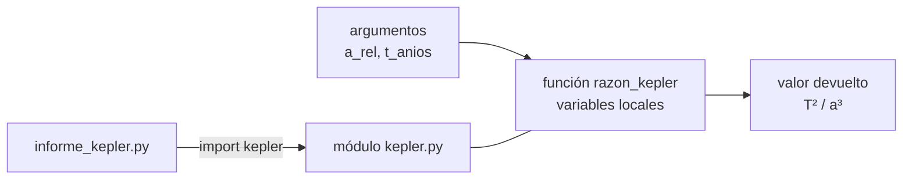

# B07-C06 — Funciones y modularidad

<!-- nav:top -->
[🏠 Programa](../../../../README.md) · [📚 Bloque B07](../../../tronco-comun/B07-informatica-cientifica-desde-cero.md) · [← Anterior: B07-C05 — Bucles y simulaciones sencillas](../B07-C05-bucles-y-simulaciones-sencillas/CLASE.md) · [Siguiente: B07-C07 — Listas y estructuras de datos →](../B07-C07-listas-y-estructuras-de-datos/CLASE.md)
<!-- /nav -->

## 1. Ubicación, nivel y alcance

Sexta clase del bloque B07. Hasta ahora tu código eran instrucciones sueltas. Aquí las **empaquetas en funciones con nombre** y las agrupas en **módulos** que puedes importar, probar y reutilizar. Nivel N1.

Verás `def`, parámetros, `return`, valores por defecto, alcance de las variables, docstrings, `import` y la guarda `if __name__ == "__main__"`. No verás todavía pruebas con `pytest` ([B07-C17](../B07-C17-pruebas-de-funciones-matematicas/CLASE.md)) ni documentación avanzada ([B07-C19](../B07-C19-documentacion-y-reproducibilidad/CLASE.md)).

## 2. Por qué esta clase existe

Copiar y pegar el mismo cálculo en cinco sitios es la forma más rápida de tener cinco versiones distintas y un error corregido solo en una. Una función concentra la lógica en un lugar, le da un nombre que expresa su intención y permite probarla aislada.

La pregunta motivadora es: **¿cómo divido un programa en piezas pequeñas, con nombre, que pueda probar y reusar?** La decisión central es qué entra (parámetros), qué sale (valor devuelto) y qué no debe depender de nada más. Esto sostiene el simulador de C20 y las pruebas de C17.

## 3. Lo que podrás hacer al terminar

1. Definir una función con `def`, parámetros y `return`.
2. Distinguir parámetro, argumento, valor devuelto y efecto secundario.
3. Usar valores por defecto y argumentos por nombre, evitando el error del valor mutable.
4. Explicar el alcance local y global.
5. Escribir docstrings y separar un módulo reutilizable de un script que lo usa.
6. Proteger el código de prueba con `if __name__ == "__main__"`.

La evidencia es el **módulo con pruebas** del ejercicio 12 (sección 20).

## 4. Con qué llegas y cómo comprobarlo

Necesitas C01–C05. Cinco preguntas:

1. ¿Qué es una docstring?
2. ¿Qué hace `return` en una función?
3. ¿Qué devuelve `**` entre `2` y `3`?
4. ¿Qué es un caso frontera?
5. ¿Qué hace `assert`?

<details>
<summary>Ver respuestas</summary>

1. La cadena que describe una función, al inicio. 2. Termina la función y entrega un valor. 3. `8`. 4. Un dato igual o cercano al umbral. 5. Detiene el programa si la condición es falsa.
</details>

Con cuatro o cinco aciertos, sigue; con tres o menos, repasa C01–C05.

## 5. Un caso real: la regularidad de Kepler como biblioteca

En [C03](../B07-C03-operadores-y-expresiones/CLASE.md) calculaste `T²/a³` para los ocho planetas con expresiones sueltas. Ahora conviertes ese cálculo en un **módulo `kepler.py`** con funciones para normalizar un dato, calcular la razón, predecir el período y medir la desviación (datos de las fichas del NASA NSSDC, S1). Un segundo archivo, `informe_kepler.py`, solo **importa** el módulo y arma la tabla. Ese es el **ejemplo conductor**: el mismo cálculo, ahora ordenado, probado y reutilizable.

## 6. Vocabulario

Una **función** es un bloque con nombre que recibe datos, hace algo y puede devolver un valor (S2). Un **parámetro** es el nombre que la función da a un dato de entrada; un **argumento** es el valor concreto que le pasas al llamarla. El **valor devuelto** es lo que entrega `return`; una función sin `return` devuelve `None`. Un **efecto secundario** es algo que la función hace además de devolver (imprimir, modificar un archivo). Un **valor por defecto** es el que toma un parámetro si no pasas argumento. El **alcance** (*scope*) es la región donde un nombre existe: una variable creada dentro de la función es **local**. Un **módulo** es un archivo `.py` cuyos nombres puedes reutilizar con `import` (S3). Una **docstring** documenta un módulo, función o clase (S4). `__name__` vale `"__main__"` cuando ejecutas el archivo directamente y su nombre de módulo cuando lo importas.

## 7. Modelo mental: una máquina con ranuras

Una función es una máquina con ranuras de entrada y una salida. Lo que ocurre dentro es privado (variables locales); lo único que sale es el valor devuelto. Si dos máquinas necesitan el mismo trabajo, comparten una tercera.



*Descripción textual:* los argumentos entran a la función `razon_kepler`, que usa variables locales y entrega un valor. La función vive en el módulo `kepler.py`, que el script `informe_kepler.py` importa para usarla.

**Límite de la analogía:** una máquina física no puede cambiar el mundo exterior sin que se note; una función sí (con efectos secundarios, como modificar una lista que recibe). Por eso conviene que las funciones numéricas no los tengan.

## 8. La explicación, paso a paso

### 8.1 Definir y llamar

```python
def razon_kepler(a_rel: float, t_anios: float) -> float:
    """Devuelve T^2 / a^3 con T en años terrestres y a en distancias terrestres."""
    return t_anios ** 2 / a_rel ** 3
```

`def` abre la definición, `razon_kepler` es el nombre, entre paréntesis van los parámetros, y `:` abre el bloque indentado. `: float` y `-> float` son **anotaciones de tipo**: documentan, Python no las exige. Se llama con `razon_kepler(4.0, 8.0)`, que devuelve `1.0` porque `8² / 4³ = 64/64`.

### 8.2 Parámetros y argumentos

Los argumentos se asignan por posición o por nombre: `periodo_predicho(4.0, exponente=2)` pasa `2` al parámetro `exponente`. Con un valor por defecto, `def periodo_predicho(a_rel, exponente=1.5)`, puedes omitirlo. **Cuidado:** un valor por defecto se evalúa **una sola vez**; si es una lista, todas las llamadas comparten la misma (S2, §4.9.1). La solución estándar es usar `None` y crear la lista dentro de la función (ejercicio 7).

### 8.3 `return` frente a `print`

`print` muestra algo en pantalla; `return` entrega un valor al código que llamó. Una función que solo imprime no se puede usar en otra expresión. Una función sin `return` devuelve `None` (S2). Las funciones de cálculo deben devolver, no imprimir.

### 8.4 Alcance local

Un nombre asignado dentro de una función es local: no altera uno del mismo nombre afuera. Si `x = 10` está afuera y la función hace `x = 5`, al volver `x` sigue valiendo `10`. Depender de variables globales hace que las funciones sean difíciles de probar: pasa lo que necesites como parámetro.

### 8.5 Módulos e `import`

Todo archivo `.py` es un módulo. `import kepler` trae el módulo y usas `kepler.razon_kepler(...)`; `from kepler import razon_kepler` trae solo ese nombre. Python busca el módulo primero en los integrados y luego en las carpetas de `sys.path`, que incluye la carpeta del script que ejecutas (S3). Por eso `informe_kepler.py` puede importar `kepler.py` si están juntos. Evita `from modulo import *`.

### 8.6 La guarda `if __name__ == "__main__"`

Al final de `kepler.py`:

```python
if __name__ == "__main__":
    pruebas()
```

Si ejecutas `python kepler.py`, `__name__` es `"__main__"` y se corren las pruebas. Si otro archivo hace `import kepler`, el bloque no corre (S3). Así el mismo archivo es biblioteca y herramienta.

### 8.7 Docstrings

La primera instrucción de una función puede ser una cadena que la describe. La convención: una frase corta imperativa que acaba en punto (S4). La docstring es lo que ve quien llame `help(razon_kepler)`.

## 9. Magnitudes, símbolos y unidades

| Función | Parámetros | Devuelve | Unidad |
|---|---|---|---|
| `normalizar(valor, referencia)` | dos números | cociente | adimensional |
| `razon_kepler(a_rel, t_anios)` | `a/a_T`, `T/T_T` | `T²/a³` | adimensional |
| `periodo_predicho(a_rel, exponente=1.5)` | `a/a_T` | `a_rel ** exponente` | años terrestres |
| `desviacion_porcentual(medido, esperado)` | dos números | `100·(m−e)/e` | % |

La unidad de cada parámetro se documenta en la docstring; una función que mezcla unidades da respuestas sin sentido (C11).

## 10. Convenciones y referencias

Nombres de funciones en minúsculas con guiones bajos y en forma de verbo o de resultado. Una función hace una cosa. Constantes en mayúsculas. Docstrings con comillas triples. Un módulo no ejecuta nada pesado al importarse. Python 3.12.9.

## 11. De dónde sale lo que afirmamos

| ID | Fuente | Localizador | Respalda | Estado |
|---|---|---|---|---|
| S1 | NASA NSSDC, fichas individuales *Mercury…Neptune Fact Sheet* (act. 11-ene-2024 a 19-may-2025) | https://nssdc.gsfc.nasa.gov/planetary/factsheet/ | Semieje mayor y período sidéreo | Leídas el 2026-11-05 (mutables) |
| S2 | Python Software Foundation, *The Python Tutorial* 3.12, §4.8 Defining Functions, §4.9.1 Default Argument Values | https://docs.python.org/3.12/tutorial/controlflow.html | `def`, `return`, `None`, valores por defecto evaluados una vez | Leída el 2026-11-05 |
| S3 | Python Software Foundation, *The Python Tutorial* 3.12, §6 Modules | https://docs.python.org/3.12/tutorial/modules.html | `import`, `from … import`, `__name__`, `sys.path` | Leída el 2026-11-05 |
| S4 | Python Enhancement Proposals, PEP 257 «Docstring Conventions» | https://peps.python.org/pep-0257/ | Convención de docstrings | Leída el 2026-11-05 |

Límites: las anotaciones de tipo no se consultaron en una fuente; se mencionan como práctica.

## 12. Cómo ver el resultado

El script imprime una tabla con T real, T predicho y desviación; la lees por filas. La estructura del módulo se ve en la tabla de la sección 9, que sustituye a un diagrama de clases.

## 13. Ejemplo trabajado: del cálculo suelto a la función

**Código suelto** (C03): `razon = (t / T_TIERRA) ** 2 / (a / A_TIERRA) ** 3`, repetido para cada planeta.

**Paso 1.** Identifica lo que cambia entre repeticiones: `a` y `t`. Son los parámetros. **Paso 2.** Identifica lo que es siempre igual: la fórmula y las referencias de la Tierra. Es el cuerpo. **Paso 3.** Nombra las operaciones: `normalizar`, `razon_kepler`. **Paso 4.** Escribe una función `planeta_a_razon(nombre)` que combine ambas con los datos del diccionario. **Paso 5.** Prueba: `razon_kepler(1.0, 1.0) == 1.0`; `razon_kepler(4.0, 8.0) == 1.0`.

**Paso final · incertidumbre.** La función no sabe si `a` y `t` son del mismo planeta, ni si están en las unidades correctas: eso es responsabilidad de quien llama (o de una validación, C12). Una función correcta con argumentos equivocados devuelve un valor que parece plausible.

## 14. Distintas formas de organizar el código

Un solo archivo largo es simple pero no se reutiliza ni se prueba por partes. Varios módulos pequeños ayudan a reutilizar; demasiados dificultan seguir el hilo. Una **clase** (que no vemos aquí) agrupa datos y funciones. Criterio: una función por tarea, un módulo por tema, y un script que orquesta.

## 15. Práctica guiada

**Ejercicio 1 · con los pasos indicados.** Escribe `def cuadrado(x)` que devuelva `x ** 2` y úsala para calcular `cuadrado(1.8808)`. *Pasos:* `def`, `return`, llamada.

<details><summary>Solución comentada</summary>

`def cuadrado(x): return x ** 2`; `cuadrado(1.8808)` da `3.53740864` (el cuadrado de 1,8808, que es el período de Marte en años, C03).
</details>

**Ejercicio 2 · con una pista.** Usa `periodo_predicho(9.0)`. ¿Qué devuelve y por qué? *Pista:* exponente por defecto.

<details><summary>Solución comentada</summary>

`27.0`: `9 ** 1.5 = 9 · 3`. El exponente por defecto es 1,5.
</details>

**Ejercicio 3 · casi autónomo.** Llama `periodo_predicho(2.0, 2)` y explica la diferencia con `periodo_predicho(2.0)`.

<details><summary>Solución comentada</summary>

Devuelve `4.0` (exponente 2) frente a `2.0 ** 1.5 ≈ 2.83`. El argumento pasado sustituye al valor por defecto.
</details>

## 16. Práctica autónoma, transferencia e integrador

**Ejercicio 4.** ¿Qué diferencia hay entre `print(x)` y `return x` dentro de una función?

<details><summary>Solución comentada</summary>

`print` solo muestra; `return` entrega el valor a quien llamó. Una función con `print` y sin `return` devuelve `None`.
</details>

**Ejercicio 5.** ¿Qué devuelve `sin_return(1)` si la función es `def sin_return(a): a + 1`?

<details><summary>Solución comentada</summary>

`None`: calcula `a + 1` y lo descarta. Falta el `return`.
</details>

**Ejercicio 6.** Con `x = 10` global y una función que hace `x = 5` y devuelve `x`, ¿cuánto vale `x` afuera después de llamarla?

<details><summary>Solución comentada</summary>

`10`. La `x` de la función es local (la ejecución da `5` y `10`).
</details>

**Ejercicio 7.** Explica por qué `def f(a, L=[])` es peligrosa y reescríbela.

<details><summary>Solución comentada</summary>

El valor por defecto se crea una sola vez; las llamadas comparten la lista (`f(1)` y `f(2)` terminan viendo `[1, 2]`). Correcto: `def f(a, L=None): if L is None: L = []`.
</details>

**Ejercicio 8.** Escribe `desviacion_porcentual(medido, esperado)` y calcula la de 9 respecto de 10.

<details><summary>Solución comentada</summary>

`100 * (9 - 10) / 10 = -10.0`. El signo indica que lo medido es menor.
</details>

**Ejercicio 9 · transferencia.** Escribe una función `distancia_a_au(km)` que convierta kilómetros a «distancias de la Tierra al Sol» usando `149.598e6`. ¿Qué precaución sobre la unidad conviene?

<details><summary>Solución comentada</summary>

`def distancia_relativa(km): return km / 149.598e6`. Precaución: documentar que el argumento es km y que la referencia es el semieje de la Tierra publicado (S1), no la ua oficial definida por la IAU, que no se consultó aquí.
</details>

**Ejercicio 10 · transferencia.** Un colega copia `informe_kepler.py` a otra carpeta, sin `kepler.py`, y falla el `import kepler`. ¿Por qué ocurre y cómo lo resuelves? ¿Y si ejecuta el script original desde otra carpeta con su ruta completa?

<details><summary>Solución comentada</summary>

Python busca el módulo en los integrados y en `sys.path`, que incluye la carpeta del script ejecutado (sección 8.5). Si el módulo no está allí ni instalado, falla: se resuelve copiando `kepler.py` junto al script o instalándolo como paquete (C13). Con el script original ejecutado por su ruta completa, sí funciona: la carpeta del script entra en `sys.path` aunque el directorio de trabajo sea otro.
</details>

**Ejercicio 11 · transferencia.** ¿Por qué `kepler.py` ejecuta `pruebas()` al correrlo pero no al importarlo?

<details><summary>Solución comentada</summary>

Por la guarda `if __name__ == "__main__"`: solo es verdadera al ejecutar el archivo directamente (sección 8.6).
</details>

**Ejercicio 12 · integrador.** Crea tu **módulo con pruebas**: un archivo con al menos cuatro funciones, cada una con docstring y unidades; una función `pruebas()` con cinco `assert` (incluyendo un caso frontera y un argumento por nombre); y un script que lo importe e imprima una tabla.

<details><summary>Solución modelo</summary>

Puedes adaptar `kepler.py`: funciones de normalización, razón, predicción y desviación; pruebas con `razon_kepler(1.0, 1.0) == 1.0`, `periodo_predicho(4.0) == 8.0`, `periodo_predicho(4.0, exponente=2) == 16.0`, `desviacion_porcentual(110.0, 100.0) == 10.0`; y el script de la sección 17. Se acepta otro tema con la misma estructura.
</details>

## 17. Laboratorio: un módulo y su cliente

[kepler.py](kepler.py) es el módulo (funciones, datos, `pruebas()` y la guarda); [informe_kepler.py](informe_kepler.py) lo importa y arma la tabla. Antes de imprimir se ejecutan las pruebas del módulo: valores exactos de las funciones, argumento por nombre y que las ocho razones queden a ±2 % de 1.

**Datos:** publicados (NASA); T predicho y desviación son **calculados**. **Predice antes de ejecutar:** ¿qué planeta tendrá mayor desviación? (Neptuno.) **Resultados (2026-11-05, Python 3.12.9):**

```text
python 3.12.9 | pruebas del módulo OK
planeta    T real (años)  T predicho  desv. %
Mercurio           0.241       0.241   -0.000
Venus              0.615       0.615   +0.001
Tierra             1.000       1.000   +0.000
Marte              1.881       1.881   +0.009
Júpiter           11.862      11.871   +0.076
Saturno           29.447      29.617   +0.578
Urano             84.011      83.900   -0.132
Neptuno          164.786     165.803   +0.617
```

```bash
cd programa/clases/B07/B07-C06-funciones-y-modularidad
python kepler.py
python informe_kepler.py
```

**Límites:** el módulo no valida entradas (a ≤ 0 daría error o resultados absurdos); es una regularidad empírica, no una derivación.

## 18. Errores frecuentes y cómo corregirlos

**Olvidar `return`.** Se corrige con el ejercicio 5.

**Valor por defecto mutable.** Se corrige con el ejercicio 7.

**Imprimir en lugar de devolver.** Se corrige con el ejercicio 4.

**Usar variables globales dentro de una función.** Se corrige pasando parámetros (sección 8.4).

**Pruebas que se ejecutan al importar.** Se corrige con la guarda (ejercicio 11).

## 19. Cómo sabrás que vas bien

Tras 8.1: ¿escribes una función con docstring sin copiar? Si no, ejercicio 1. Tras 8.2: ¿distingues parámetro de argumento? Si no, ejercicio 3. Tras 8.5: ¿explicas por qué falla un `import` desde otra carpeta? Si no, ejercicio 10. Tras el laboratorio: ¿qué comprueba `pruebas()`? Léelo. Al final: ¿qué función de tu módulo podría recibir una unidad equivocada? Si no lo sabes, repasa la sección 13.

## 20. Qué entregas y cómo se evalúa

El producto es tu **módulo con pruebas**: archivo con funciones documentadas, `pruebas()`, guarda `__main__`, un script cliente y la salida real de su ejecución.

| Criterio | Inicial | En desarrollo | Logrado | Destacado |
|---|---|---|---|---|
| Diseño | Una función hace todo | Funciones sueltas | Una tarea por función | Interfaces mínimas y claras |
| Documentación | Sin docstring | Docstring vaga | Con unidades | Con casos y límites |
| Pruebas | Ninguna | Caso típico | Casos frontera | Cubre argumentos por nombre y errores |
| Modularidad | Código copiado | Un módulo | Módulo + cliente | Sin efectos al importar |

**Condiciones críticas:** no mezclar unidades sin declararlas; las pruebas deben detener el programa si fallan; citar solo fuentes consultadas.

## 21. Ética, seguridad y límites

Una función reutilizada sin entender sus supuestos propaga errores a todos los lugares donde se usa: documentar dominio de validez es una obligación hacia quien reutilice tu código. Importar módulos de terceros ejecuta su código: usa solo fuentes confiables (C13). Sin datos personales. Material educativo.

## 22. Para cerrar y seguir

Una función recibe parámetros, hace un trabajo y devuelve un valor; un módulo agrupa funciones y se importa; la guarda `__main__` permite que un archivo sea biblioteca y herramienta. Las funciones pequeñas, documentadas y probadas son la base del software científico. Queda abierta la pregunta de cómo guardar colecciones de datos para pasarlas a esas funciones.

**Glosario español–inglés.** función · *function*; parámetro · *parameter*; argumento · *argument*; valor devuelto · *return value*; alcance · *scope*; módulo · *module*; docstring · *docstring*; efecto secundario · *side effect*.

**Continuidad.** [B07-C07](../B07-C07-listas-y-estructuras-de-datos/CLASE.md) usa tu capacidad de **empaquetar en funciones** para manejar colecciones de datos (listas, diccionarios) que esas funciones procesan.

**Referencias:** ver sección 11.

<!-- nav:bottom -->
---

[← Anterior: B07-C05 — Bucles y simulaciones sencillas](../B07-C05-bucles-y-simulaciones-sencillas/CLASE.md) · [📚 Bloque B07](../../../tronco-comun/B07-informatica-cientifica-desde-cero.md) · [Siguiente: B07-C07 — Listas y estructuras de datos →](../B07-C07-listas-y-estructuras-de-datos/CLASE.md)
<!-- /nav -->
