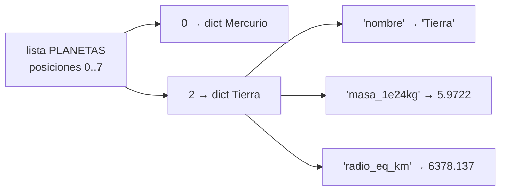

# B07-C07 — Listas y estructuras de datos

<!-- nav:top -->
[🏠 Programa](../../../../README.md) · [📚 Bloque B07](../../../tronco-comun/B07-informatica-cientifica-desde-cero.md) · [← Anterior: B07-C06 — Funciones y modularidad](../B07-C06-funciones-y-modularidad/CLASE.md) · [Siguiente: B07-C08 — Lectura de archivos CSV →](../B07-C08-lectura-de-archivos-csv/CLASE.md)
<!-- /nav -->

## 1. Ubicación, nivel y alcance

Séptima clase del bloque B07. Hasta aquí manejabas valores sueltos; casi todos los datos científicos son **colecciones**: muchas lecturas, muchos objetos. Aprendes las cuatro estructuras básicas de Python (lista, tupla, diccionario y conjunto) y cuándo usar cada una. Nivel N1.

Verás indexado, segmentos, métodos de lista, comprensiones, la diferencia entre alias y copia, y un registro por planeta como diccionario. No verás aún la lectura desde archivos ([B07-C08](../B07-C08-lectura-de-archivos-csv/CLASE.md)) ni los arreglos de NumPy ([B07-C09](../B07-C09-calculos-cientificos-basicos-con-python/CLASE.md)).

## 2. Por qué esta clase existe

Una tabla de ocho planetas con tres propiedades cada uno son 24 datos: no cabe en 24 variables sueltas. Necesitas estructuras que agrupen datos, permitan recorrerlos y los mantengan ordenados y consultables. Elegir mal la estructura vuelve lento o frágil un programa; por ejemplo, buscar por nombre en una lista exige recorrerla, mientras un diccionario lo hace de golpe.

La pregunta motivadora es: **¿cómo organizo muchos datos para recorrerlos, filtrarlos, buscarlos y no corromperlos por accidente?** La decisión central es la estructura (¿importa el orden? ¿se modifica? ¿se busca por clave?) y si compartes o copias.

## 3. Lo que podrás hacer al terminar

1. Crear, indexar y segmentar listas y tuplas.
2. Usar `append`, `sort`/`sorted`, `len`, `in` y las comprensiones de lista.
3. Crear y consultar diccionarios, y recorrer sus pares.
4. Usar conjuntos para pertenencia e intersecciones.
5. Distinguir alias de copia y evitar efectos laterales.
6. Representar una tabla como lista de diccionarios y calcular sobre ella.

La evidencia es el **catálogo de datos** del ejercicio 12 (sección 20).

## 4. Con qué llegas y cómo comprobarlo

Necesitas C01–C06. Cinco preguntas:

1. ¿Con qué número empieza a contar un índice en Python?
2. ¿Qué devuelve `range(3)`?
3. ¿Qué hace `for x in lista:`?
4. ¿Qué es un parámetro?
5. ¿Qué es un valor por defecto mutable y por qué es peligroso?

<details>
<summary>Ver respuestas</summary>

1. 0. 2. 0, 1, 2. 3. Ejecuta el bloque con `x` tomando cada elemento. 4. El nombre que una función da a un dato de entrada. 5. Una lista (u otro objeto modificable) usada como valor por defecto: se crea una vez y todas las llamadas la comparten.
</details>

Con cuatro o cinco aciertos, sigue; con tres o menos, repasa C01–C06.

## 5. Un caso real: la tabla de planetas del NSSDC

Las fichas del NASA NSSDC (S1) dan para cada planeta, entre otros datos, su masa (en 10²⁴ kg) y su radio ecuatorial (km). Quieres responder: ¿qué planetas tienen más de 50 × 10²⁴ kg?, ¿cuál es el orden por masa?, ¿qué fracción de la masa total corresponde a Júpiter? Para eso representas cada planeta como un diccionario `{"nombre": …, "masa_1e24kg": …, "radio_eq_km": …}` y la tabla como una lista de ocho diccionarios. Ese es el **ejemplo conductor**.

## 6. Vocabulario

Una **lista** es una secuencia ordenada y modificable, entre corchetes (S2). Una **tupla** es una secuencia ordenada e **inmutable**, entre paréntesis (S3). Un **diccionario** (`dict`) asocia claves únicas e inmutables a valores, entre llaves (S3). Un **conjunto** (`set`) es una colección sin orden ni duplicados (S3). Un **índice** es la posición de un elemento, desde 0; un índice negativo cuenta desde el final. Un **segmento** (*slice*) `lista[a:b]` toma desde `a` hasta antes de `b`. Una **comprensión de lista** construye una lista nueva a partir de otra: `[x**2 for x in lista if x > 0]`. Un **alias** es otro nombre para el mismo objeto; una **copia** es un objeto nuevo. **Mutable** significa que se puede modificar en el lugar.

## 7. Modelo mental: cajones, etiquetas y fichas

Una lista es una fila de cajones numerados; un diccionario es un fichero con etiquetas (claves) para buscar rápido; una tupla es una fila de cajones sellados; un conjunto es una bolsa donde cada cosa entra una vez.



*Descripción textual:* una lista con ocho posiciones; la posición 0 contiene el diccionario de Mercurio y la 2 el de la Tierra. El de la Tierra tiene tres claves: nombre, masa en 10²⁴ kg y radio ecuatorial en km, cada una con su valor.

**Límite de la analogía:** una lista no «contiene» los objetos como cajones físicos: contiene referencias; dos listas pueden referirse a los mismos objetos (sección 8.5).

## 8. La explicación, paso a paso

### 8.1 Listas: crear, indexar y segmentar

`masas = [0.33010, 4.8673, 5.9722]` crea una lista. `masas[0]` es el primero; `masas[-1]`, el último; `masas[0:2]`, los dos primeros (el final se excluye). Un índice fuera de rango da `IndexError: list index out of range`, pero un segmento fuera de rango se recorta sin error (S2). `len(masas)` da la longitud, `x in masas` pregunta si está, `masas + otra` concatena.

### 8.2 Métodos y orden

`lista.append(x)` añade al final y modifica la lista; `lista.sort()` ordena **en el lugar y devuelve `None`**; `sorted(lista)` devuelve una lista nueva sin tocar la original, y acepta `reverse=True` y `key=` (S4). Un error común es `lista = lista.sort()`, que deja `None`. Las listas sirven como pilas (`append`/`pop`); para colas largas se usa `collections.deque` (S3).

### 8.3 Tuplas y desempaquetado

Una tupla `(nombre, valor)` no se puede modificar. El **desempaquetado** `nombre, valor = par` reparte sus elementos en variables (S3). Una tupla de un elemento necesita coma final: `(5,)` es tupla, `(5)` es el entero 5. Úsalas para registros que no deben cambiar.

### 8.4 Diccionarios y conjuntos

`planeta = {"nombre": "Tierra", "radio_eq_km": 6378.137}`. `planeta["nombre"]` busca por clave; si no existe, `KeyError`; `planeta.get("masa")` devuelve `None` en vez de fallar. `planeta.items()` da los pares clave-valor para recorrerlos. Un conjunto `{"Tierra", "Marte"}` permite `&` (intersección), `|` (unión) y `-` (diferencia); un conjunto vacío es `set()`, no `{}` (S3).

### 8.5 Alias y copia

`copia = PLANETAS[:]` crea una lista nueva (copia **superficial**: los diccionarios internos siguen compartidos). `alias = PLANETAS` solo pone otro nombre: añadir a `alias` añade a `PLANETAS`. Una modificación inesperada de datos compartidos es uno de los errores más sutiles en código científico (S2, §3.1.3). Con listas de listas, `m[:]` copia solo la capa externa: `n = m[:]; n[0].append(9)` también cambia `m`.

### 8.6 Comprensiones

`[p["nombre"] for p in PLANETAS if p["masa_1e24kg"] > 50.0]` construye la lista de nombres con masa mayor que 50 × 10²⁴ kg. Es equivalente a un `for` con `append` pero más compacta; si la condición se vuelve compleja, usa el `for` explícito (S3).

## 9. Magnitudes, símbolos y unidades

| Clave | Significado | Unidad | Fuente |
|---|---|---|---|
| `nombre` | planeta | — | — |
| `masa_1e24kg` | masa | 10²⁴ kg | S1 |
| `radio_eq_km` | radio ecuatorial | km | S1 |
| `lista[i]` | elemento `i` | — | índice desde 0 |
| `a[i:j]` | segmento | — | `j` excluido |

La unidad vive en el nombre de la clave: así la tabla se autodescribe y los cálculos no mezclan unidades.

## 10. Convenciones y referencias

Listas para secuencias de lo mismo; diccionarios para registros con campos con nombre; tuplas para registros fijos; conjuntos para pertenencia. Nombres de claves en minúsculas con la unidad al final. Python 3.12.9. Datos publicados (NASA) tal como se transcriben.

## 11. De dónde sale lo que afirmamos

| ID | Fuente | Localizador | Respalda | Estado |
|---|---|---|---|---|
| S1 | NASA NSSDC, fichas individuales *Mercury…Neptune Fact Sheet* (act. 11-ene-2024 a 19-may-2025) | https://nssdc.gsfc.nasa.gov/planetary/factsheet/ | Masa y radio ecuatorial de los ocho planetas | Leídas el 2026-11-05 (mutables) |
| S2 | Python Software Foundation, *The Python Tutorial* 3.12, §3.1.3 Lists | https://docs.python.org/3.12/tutorial/introduction.html | Índices, segmentos, mutabilidad, alias y copia | Leída el 2026-11-05 |
| S3 | Python Software Foundation, *The Python Tutorial* 3.12, §5 Data Structures (§5.1, 5.3, 5.4, 5.5, 5.6) | https://docs.python.org/3.12/tutorial/datastructures.html | Métodos de lista, tuplas, conjuntos, diccionarios, comprensiones | Leída el 2026-11-05 |
| S4 | Python Software Foundation, *Sorting Techniques* (HOWTO) 3.12 | https://docs.python.org/3.12/howto/sorting.html | `sorted` frente a `list.sort`, `key`, `reverse` | Leída el 2026-11-05 |

Límites: la masa total y la fracción de Júpiter son cálculos propios con valores redondeados publicados, no un dato de NASA.

## 12. Cómo ver los datos

El laboratorio imprime la tabla ordenada por masa con columnas alineadas; es la versión accesible de un gráfico de barras que harás en [B07-C10](../B07-C10-graficos-bidimensionales-iniciales/CLASE.md).

## 13. Ejemplo trabajado: ¿qué fracción de la masa planetaria es Júpiter?

**Paso 1.** Suma las masas: `sum(p["masa_1e24kg"] for p in PLANETAS)` da `2667.48129` (10²⁴ kg). **Paso 2.** Busca la de Júpiter con un diccionario por nombre: `{p["nombre"]: p for p in PLANETAS}["Júpiter"]["masa_1e24kg"]` da `1898.13`. **Paso 3.** Cociente: `100 * 1898.13 / 2667.48129 = 71.2 %`.

**Paso final · incertidumbre.** Las masas están publicadas con cuatro a seis cifras, por lo que el 71,2 % tiene tres cifras fiables. Pero es la fracción de la masa de los **ocho planetas**; no incluye el Sol ni los cuerpos menores, así que no es «la masa del sistema solar». El número responde a una pregunta más estrecha de lo que parece.

## 14. Distintas estructuras para lo mismo

Los mismos ocho planetas pueden ser una lista de tuplas, una lista de diccionarios o un diccionario de diccionarios indexado por nombre. La lista de diccionarios conserva el orden y los campos con nombre; el diccionario por nombre permite buscar sin recorrer. Para cálculo numérico masivo, los arreglos de NumPy (C09) son más rápidos y compactos, a cambio de exigir un solo tipo de dato. Elige según la operación más frecuente.

## 15. Práctica guiada

**Ejercicio 1 · con los pasos indicados.** Dada `masas = [0.33010, 4.8673, 5.9722, 0.64169]`, obtén la masa de la Tierra, la última y las dos primeras. *Pasos:* índice, índice negativo, segmento.

<details><summary>Solución comentada</summary>

`masas[2]` = `5.9722`; `masas[-1]` = `0.64169`; `masas[:2]` = `[0.3301, 4.8673]`. Los segmentos excluyen el final.
</details>

**Ejercicio 2 · con una pista.** ¿Qué imprime `l = [3, 1, 2]; print(l.sort())`? ¿Y `l` después? *Pista:* ¿qué devuelve `sort`?

<details><summary>Solución comentada</summary>

`None`, y `l` queda `[1, 2, 3]`. Para obtener una lista ordenada sin tocar la original usa `sorted(l)`.
</details>

**Ejercicio 3 · casi autónomo.** Escribe una comprensión que dé los cuadrados de los pares de `range(5)`.

<details><summary>Solución comentada</summary>

`[x**2 for x in range(5) if x % 2 == 0]` da `[0, 4, 16]`.
</details>

## 16. Práctica autónoma, transferencia e integrador

**Ejercicio 4.** ¿Qué hace `d.get("b", 0)` si `d = {"a": 1}`? ¿Y `d["b"]`?

<details><summary>Solución comentada</summary>

`d.get("b", 0)` devuelve `0` (valor por defecto); `d["b"]` lanza `KeyError: 'b'`.
</details>

**Ejercicio 5.** Con `t = (1, 2)`, escribe el desempaquetado en `a` y `b`. ¿Qué tipo es `(5)` y cuál `(5,)`?

<details><summary>Solución comentada</summary>

`a, b = t` da `a = 1`, `b = 2`. `(5)` es `int`; `(5,)` es `tuple`.
</details>

**Ejercicio 6.** Si `a = [1, 2]` y `b = a`, ¿qué pasa en `a` tras `b.append(3)`? ¿Cómo evitarlo?

<details><summary>Solución comentada</summary>

`a` pasa a `[1, 2, 3]`: son el mismo objeto. Para evitarlo: `b = a[:]` (copia) o `b = list(a)`.
</details>

**Ejercicio 7.** Con `m = [[1, 2], [3, 4]]` y `n = m[:]`, ¿qué muestra `m` tras `n[0].append(9)`? Explica.

<details><summary>Solución comentada</summary>

`[[1, 2, 9], [3, 4]]`: la copia es superficial; las listas internas son compartidas. Para copiar todo se necesita una copia profunda (`copy.deepcopy`, que no usamos aquí).
</details>

**Ejercicio 8.** ¿Qué devuelve `len(set([1, 1, 2]))` y por qué?

<details><summary>Solución comentada</summary>

`2`: el conjunto elimina duplicados.
</details>

**Ejercicio 9 · transferencia.** Con la lista `PLANETAS`, escribe el código para obtener los nombres de los planetas con radio ecuatorial menor que 7000 km.

<details><summary>Solución comentada</summary>

`[p["nombre"] for p in PLANETAS if p["radio_eq_km"] < 7000]` da `['Mercurio', 'Venus', 'Tierra', 'Marte']` (radios 2440,5; 6051,8; 6378,137; 3396,2).
</details>

**Ejercicio 10 · transferencia.** Para buscar planetas por nombre muchas veces, ¿conviene lista o diccionario? Justifica.

<details><summary>Solución comentada</summary>

Diccionario indexado por nombre: encuentra por clave sin recorrer la lista. La lista exige revisar uno por uno.
</details>

**Ejercicio 11 · transferencia.** Un colega afirma: «Júpiter es el 71 % del sistema solar». ¿Qué corriges?

<details><summary>Solución comentada</summary>

Que es el 71,2 % de la masa de los ocho planetas, no del sistema solar: faltan el Sol y los cuerpos menores. Es un error de alcance, no de cálculo.
</details>

**Ejercicio 12 · integrador.** Construye un **catálogo de datos**: lista de diccionarios con al menos cinco campos (nombre, masa, radio, período, unidad en cada clave), con una función que filtre, una que ordene (sin modificar el original) y un `assert` de que el original no cambió; agrega un conjunto para una categoría y una intersección.

<details><summary>Solución modelo</summary>

Se acepta cualquier catálogo con claves que incluyan la unidad, datos de S1 transcritos sin alterar, funciones `filtrar` y `ordenar_por` basadas en comprensiones y `sorted`, la prueba de que `PLANETAS` conserva su orden tras ordenar, y una intersección de conjuntos con resultado verificado a mano.
</details>

## 17. Laboratorio: catálogo de planetas con estructuras

El script [estructuras_planetas.py](estructuras_planetas.py) crea la lista de diccionarios de la sección 5 y define dos funciones: filtrar por masa y ordenar sin alterar el original. Antes de imprimir comprueba longitud, índices y segmentos, el filtro (incluido un umbral que no deja a nadie), el orden, la inmutabilidad del original, el alias frente a la copia, una intersección de conjuntos y que la masa total coincida con una suma calculada por separado (2667,48129).

**Datos:** publicados (NASA); suma y fracción son cálculos derivados. **Predice antes de ejecutar:** ¿qué planeta aparece primero al ordenar por masa? (Mercurio.) **Resultados (2026-11-05, Python 3.12.9):**

```text
python 3.12.9 | pruebas OK
Planetas por masa creciente (1e24 kg):
  Mercurio    0.33010
  Marte       0.64169
  Venus       4.86730
  Tierra      5.97220
  Urano      86.81100
  Neptuno   102.40900
  Saturno   568.32000
  Júpiter  1898.13000
Masa mayor que 50e24 kg: ['Júpiter', 'Saturno', 'Urano', 'Neptuno']
Masa total de los 8 planetas: 2667.48129 e24 kg; Júpiter aporta 71.2 %
```

```bash
python programa/clases/B07/B07-C07-listas-y-estructuras-de-datos/estructuras_planetas.py
```

**Límites:** los datos se transcriben a mano; si cambia la ficha de la NASA, el script no lo sabe. La lectura desde archivo se trata en C08.

## 18. Errores frecuentes y cómo corregirlos

**`lista = lista.sort()`.** Deja `None`. Se corrige con el ejercicio 2.

**Alias creído como copia.** Se corrige con los ejercicios 6 y 7.

**Índice fuera de rango.** `IndexError`. Se corrige comprobando `len` o usando segmentos.

**`{}` como conjunto vacío.** Es un diccionario. Usa `set()`.

**Presentar una fracción con el denominador equivocado.** Se corrige con el ejercicio 11.

## 19. Cómo sabrás que vas bien

Tras 8.1: ¿predices `masas[-1]` y `masas[:2]`? Si no, ejercicio 1. Tras 8.2: ¿sabes qué devuelve `sort`? Si no, ejercicio 2. Tras 8.5: ¿explicas por qué `m` cambió? Si no, ejercicio 7. Tras el laboratorio: ¿qué comprueba el script sobre el original? Si no, relee `pruebas()`. Al final: ¿qué estructura elegirías para buscar por nombre? Si dudas, ejercicio 10.

## 20. Qué entregas y cómo se evalúa

El producto es tu **catálogo de datos**: estructura elegida y justificada, funciones de filtro y orden, pruebas, y fuentes de cada dato.

| Criterio | Inicial | En desarrollo | Logrado | Destacado |
|---|---|---|---|---|
| Estructura | Variables sueltas | Lista simple | Lista de diccionarios | Justifica la elección |
| Copia y alias | Modifica originales sin querer | Lo detecta | Lo evita | Lo prueba con `assert` |
| Cálculo | Sin validar | Correcto | Verificado con otra vía | Declara el alcance de la cifra |
| Fuentes | Sin fuente | Sin fecha | Con fecha | Distingue dato y cálculo |

**Condiciones críticas:** no modificar los datos de origen; declarar el alcance de las cifras derivadas; citar solo fuentes consultadas.

## 21. Ética, seguridad y límites

Una tabla transcrita a mano puede contener errores de copia: verifica contra la fuente y registra fecha y versión. Compartir una lista modificable entre partes del programa puede alterar datos sin dejar rastro. Sin datos personales. Material educativo.

## 22. Para cerrar y seguir

Las listas ordenan secuencias, las tuplas las fijan, los diccionarios buscan por clave y los conjuntos eliminan duplicados; distinguir alias de copia evita corrupciones silenciosas. Queda abierta la pregunta de cómo traer estos datos desde un archivo en lugar de escribirlos a mano.

**Glosario español–inglés.** lista · *list*; tupla · *tuple*; diccionario · *dictionary*; conjunto · *set*; índice · *index*; segmento · *slice*; comprensión · *comprehension*; alias · *alias*; copia superficial · *shallow copy*.

**Continuidad.** [B07-C08](../B07-C08-lectura-de-archivos-csv/CLASE.md) usa tu capacidad de **organizar datos en estructuras** para leer una tabla real desde un archivo CSV y convertir cada campo al tipo correcto.

**Referencias:** ver sección 11.

<!-- nav:bottom -->
---

[← Anterior: B07-C06 — Funciones y modularidad](../B07-C06-funciones-y-modularidad/CLASE.md) · [📚 Bloque B07](../../../tronco-comun/B07-informatica-cientifica-desde-cero.md) · [Siguiente: B07-C08 — Lectura de archivos CSV →](../B07-C08-lectura-de-archivos-csv/CLASE.md)
<!-- /nav -->
