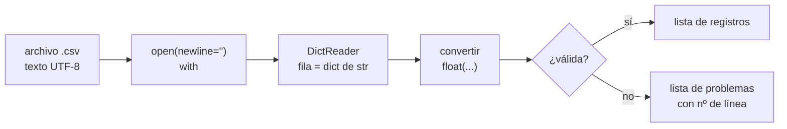

# B07-C08 — Lectura de archivos CSV

<!-- nav:top -->
[🏠 Programa](../../../../README.md) · [📚 Bloque B07](../../../tronco-comun/B07-informatica-cientifica-desde-cero.md) · [← Anterior: B07-C07 — Listas y estructuras de datos](../B07-C07-listas-y-estructuras-de-datos/CLASE.md) · [Siguiente: B07-C09 — Cálculos científicos básicos con Python →](../B07-C09-calculos-cientificos-basicos-con-python/CLASE.md)
<!-- /nav -->

## 1. Ubicación, nivel y alcance

Octava clase del bloque B07. Los datos reales casi nunca se escriben a mano en el programa: viven en archivos. El formato más común para tablas es el **CSV** (valores separados por comas). Aprendes a leerlo con el módulo estándar `csv`, a convertir cada campo a su tipo y a **detectar filas defectuosas** en vez de ignorarlas. Nivel N1.

Verás encabezados, delimitadores, codificación, `newline=""`, `DictReader`, conversión y validación. No verás todavía NumPy ([B07-C09](../B07-C09-calculos-cientificos-basicos-con-python/CLASE.md)), rutas en profundidad ([B07-C15](../B07-C15-terminal-y-rutas-de-archivos/CLASE.md)) ni el manejo de excepciones completo ([B07-C12](../B07-C12-manejo-de-errores-y-excepciones/CLASE.md)); aquí usarás un `try/except` mínimo, explicado donde aparece.

## 2. Por qué esta clase existe

Un archivo CSV parece trivial y por eso engaña: todo se lee como texto, un decimal con coma rompe una columna, una línea vacía pasa inadvertida, y una codificación equivocada convierte «Júpiter» en símbolos raros. Un análisis hecho sobre datos mal leídos puede ser plausible y erróneo a la vez.

La pregunta motivadora es: **¿cómo traigo una tabla a mi programa sabiendo que lo que entró es lo que había en el archivo?** La decisión central es qué validar al leer (número de filas, encabezado, tipos, rangos) y qué hacer con las filas defectuosas.

## 3. Lo que podrás hacer al terminar

1. Explicar qué es un CSV y sus puntos débiles (delimitador, decimal, codificación).
2. Abrir un archivo con `open(..., encoding="utf-8", newline="")` y recorrerlo con `csv.reader` y `csv.DictReader`.
3. Convertir los campos de texto a `float` o `int`.
4. Validar encabezado, número de filas y rangos.
5. Informar las filas defectuosas con su número de línea, sin ocultarlas.
6. Documentar la procedencia de una tabla.

La evidencia es el **informe de lectura** del ejercicio 12 (sección 20).

## 4. Con qué llegas y cómo comprobarlo

Necesitas C01–C07. Cinco preguntas:

1. ¿Qué tipo tiene `"365.256"` y cómo lo conviertes en número?
2. ¿Qué es un diccionario?
3. ¿Qué devuelve `float("abc")`?
4. ¿Para qué sirve una comprensión de lista?
5. ¿Por qué no se compara `==` entre decimales?

<details>
<summary>Ver respuestas</summary>

1. `str`; con `float("365.256")`. 2. Una colección de pares clave-valor. 3. Un error `ValueError`. 4. Para construir una lista nueva a partir de otra. 5. Porque son aproximaciones; se usa `math.isclose`.
</details>

Con cuatro o cinco aciertos, sigue; con tres o menos, repasa C02 y C07.

## 5. Un caso real: la tabla planetaria en un archivo

El archivo [planetas_nssdc.csv](planetas_nssdc.csv) contiene los datos de los ocho planetas que usamos desde C03: semieje mayor, período sidéreo, masa, radios, densidad y gravedad. Los valores están transcritos de las fichas individuales y de la tabla comparativa del NASA NSSDC (S1): son **datos publicados**. Cada fila tiene ocho campos. Junto a él hay un segundo archivo, [datos_sinteticos_sucios.csv](datos_sinteticos_sucios.csv), **inventado para esta clase** y con errores a propósito: un valor vacío, un texto no numérico, un decimal con coma entre comillas y una fila con un campo de más. Ese par de archivos es el **ejemplo conductor**.

## 6. Vocabulario

Un archivo **CSV** (*comma-separated values*) guarda una tabla como líneas de texto con campos separados por un **delimitador**, normalmente la coma. La primera línea suele ser el **encabezado**. Un campo que contiene el delimitador se pone **entre comillas**. La **codificación** es la correspondencia entre caracteres y bytes; UTF-8 es la más usada y admite tildes. `csv.reader` devuelve cada fila como una lista de **cadenas**; `csv.DictReader` la devuelve como un diccionario con los encabezados como claves y, si faltan campos, rellena con `None`; si sobran, los guarda bajo la clave `None` (S2). `newline=""` es el argumento de `open` que permite al módulo csv manejar los saltos de línea (S2). Un `with` abre un archivo y garantiza que se cierre al terminar. **Procedencia** es de dónde vienen los datos, quién los publicó y cuándo.

## 7. Modelo mental: del texto a la tabla tipada



*Descripción textual:* el archivo de texto se abre, el `DictReader` entrega cada fila como diccionario de cadenas, se convierten los campos numéricos y se decide si la fila es válida. Las válidas van a la lista de registros; las demás, a una lista de problemas con su número de línea.

**Límite de la analogía:** una cinta transportadora no puede rechazar una pieza; aquí **tú** decides qué hacer con una fila defectuosa (detener todo, saltarla informándolo, repararla), y esa decisión debe quedar escrita.

## 8. La explicación, paso a paso

### 8.1 Abrir bien el archivo

```python
with ruta.open(encoding="utf-8", newline="") as f:
    for fila in csv.DictReader(f):
        ...
```

`ruta` es un objeto `Path` (C15 lo explica; por ahora, la ruta del archivo). `encoding="utf-8"` evita que «Júpiter» se lea mal; `newline=""` es la recomendación de la documentación (S2). `as f` da nombre al archivo abierto y `with` lo cierra solo. Si no declaras la codificación, Python usa la de la plataforma: en el equipo Windows donde se probó esta clase, `locale.getpreferredencoding(False)` devolvió `cp1252`, no UTF-8. Declararla hace que el mismo código lea igual en cualquier sistema.

### 8.2 `reader` y `DictReader`

`csv.reader(f)` devuelve listas: `['Tierra', '149.598', ...]`. `csv.DictReader(f)` usa la primera línea como encabezado y devuelve `{'nombre': 'Tierra', 'semieje_1e6km': '149.598', ...}`. Con el diccionario accedes por nombre de columna en vez de por posición, lo que sobrevive a que alguien reordene las columnas. **Todos los valores son `str`**: el módulo no convierte nada (S2).

### 8.3 Convertir y validar

`float(fila["masa_1e24kg"])` convierte a número. Falla con `ValueError` si el texto no es un número válido (`'abc'`, `''`) y también con `'1,5'` o `'300,0'`, porque Python exige punto decimal. Después de convertir, valida: ¿es positivo?, ¿está en un rango razonable?, ¿es el número de filas esperado? Un `assert` o una prueba estructural detiene el programa si el archivo no es el esperado.

### 8.4 Filas defectuosas

El `try/except` es la instrucción que permite **intentar** algo y reaccionar si falla (se estudia en C12). Aquí: `try: registro[col] = float(texto)` / `except ValueError as error:` anota el problema y sigue con la fila siguiente. La función `leer_tolerante` anota el número de línea (`lector.line_num`) y el motivo. **Nunca descartes datos en silencio**: informa cuántas filas se omitieron y por qué.

### 8.5 Procedencia y versión de los datos

Un CSV sin procedencia no es un dato científico. Para `planetas_nssdc.csv` se declara en la cabecera del script y en la sección 11: quién publicó cada valor (NASA NSSDC), qué páginas, cuándo se consultaron y cuáles valores están redondeados (la densidad y la gravedad vienen de la tabla comparativa, con precisión menor). El archivo sintético se rotula **sintético** para que nadie lo confunda con datos reales.

## 9. Magnitudes, símbolos y unidades

| Columna | Significado | Unidad | Tipo al leer |
|---|---|---|---|
| `nombre` | planeta | — | `str` |
| `semieje_1e6km` | semieje mayor | 10⁶ km | `float` |
| `periodo_sidereo_d` | período sidéreo | d | `float` |
| `masa_1e24kg` | masa | 10²⁴ kg | `float` |
| `radio_medio_km` | radio medio volumétrico | km | `float` |
| `radio_ecuatorial_km` | radio ecuatorial | km | `float` |
| `densidad_kg_m3` | densidad media | kg/m³ | `float` |
| `gravedad_m_s2` | gravedad en la superficie | m/s² | `float` |

La unidad forma parte del nombre de la columna para que no se pierda al leer.

## 10. Convenciones y referencias

Un CSV por tabla, primera fila de encabezados, punto decimal, UTF-8 sin BOM, una unidad por columna escrita en su nombre. Se abre siempre con `encoding` y `newline=""`. Las filas rechazadas se informan. Python 3.12.9.

## 11. De dónde sale lo que afirmamos

| ID | Fuente | Localizador | Respalda | Estado |
|---|---|---|---|---|
| S1 | NASA NSSDC, fichas individuales *Mercury…Neptune Fact Sheet* (act. 11-ene-2024 a 19-may-2025) y *Planetary Fact Sheet* (tabla comparativa, act. 18-mar-2025) | https://nssdc.gsfc.nasa.gov/planetary/factsheet/ | Valores de `planetas_nssdc.csv`; densidad y gravedad de la tabla comparativa (redondeadas) | Leídas el 2026-11-05 (mutables) |
| S2 | Python Software Foundation, *The Python Standard Library* 3.12, `csv` | https://docs.python.org/3.12/library/csv.html | `reader`, `DictReader`, `restkey`/`restval`, `newline=''`, valores como cadenas | Leída el 2026-11-05 |
| S3 | Python Software Foundation, *The Python Tutorial* 3.12, §8.3 Handling Exceptions | https://docs.python.org/3.12/tutorial/errors.html | `try`/`except` (uso mínimo aquí) | Leída el 2026-11-05 |

Límites: la codificación por defecto se comprobó ejecutando Python en un solo equipo, no en la documentación. Los valores del CSV se transcribieron de las páginas leídas; no se contrastaron con una segunda fuente.

## 12. Cómo ver la tabla

La salida del laboratorio muestra tres filas alineadas y una lista de problemas con número de línea; es la versión accesible de una inspección visual de la hoja de cálculo. Para revisar el CSV completo, ábrelo en un editor de texto: es texto plano.

## 13. Ejemplo trabajado: leer, convertir y comprobar

**Paso 1.** Abre `planetas_nssdc.csv` con `encoding="utf-8", newline=""`. **Paso 2.** Recorre con `DictReader`; cada `fila["masa_1e24kg"]` es un texto como `'5.9722'`. **Paso 3.** Convierte a `float` y guarda en un registro. **Paso 4.** Comprueba: 8 filas, `planetas[2]["nombre"] == "Tierra"`, todos los valores positivos. **Paso 5.** Compara el encabezado con el esperado.

**Paso final · incertidumbre.** Las pruebas confirman que **el archivo se leyó como se escribió**, no que los datos sean correctos: si la transcripción de la masa de Marte tuviera un error de dedo, el programa no lo notaría. La corrección de los números depende de la fuente y de la verificación contra ella (S1); el programa solo garantiza la fidelidad de la lectura.

## 14. Distintas formas de leer una tabla

El módulo `csv` es estándar y suficiente para tablas pequeñas y estructura simple. Para análisis, bibliotecas como NumPy o pandas leen y convierten de una vez, a cambio de dependencias y de decisiones por defecto que debes conocer. Otros formatos (JSON, YAML, FITS) se verán en C16 y en el bloque de datos astronómicos. Criterio: usa la herramienta más simple que cubra tus necesidades y valida siempre lo leído.

## 15. Práctica guiada

**Ejercicio 1 · con los pasos indicados.** El texto CSV `a,b\n1,2\n` contiene una fila. ¿Qué devuelve `csv.reader` y qué `csv.DictReader`? *Pasos:* aplica 8.2.

<details><summary>Solución comentada</summary>

`reader`: `[['a', 'b'], ['1', '2']]` (incluye el encabezado como fila). `DictReader`: `[{'a': '1', 'b': '2'}]` (usa el encabezado como claves). Los valores son `str`.
</details>

**Ejercicio 2 · con una pista.** ¿Por qué `float("1,5")` falla? ¿Cómo se leería correctamente un decimal con coma? *Pista:* Python exige un formato.

<details><summary>Solución comentada</summary>

Da `ValueError: could not convert string to float: '1,5'` porque Python espera punto decimal. Hay que reemplazar la coma antes: `float("1,5".replace(",", "."))`, y documentar que esa columna usa coma.
</details>

**Ejercicio 3 · casi autónomo.** Lee el CSV y obtén la lista de nombres de planeta con comprensión.

<details><summary>Solución comentada</summary>

`[p["nombre"] for p in leer_planetas(ruta)]` da `['Mercurio', 'Venus', 'Tierra', 'Marte', 'Júpiter', 'Saturno', 'Urano', 'Neptuno']`.
</details>

## 16. Práctica autónoma, transferencia e integrador

**Ejercicio 4.** ¿Qué pasa si una fila del CSV tiene un campo más que el encabezado? ¿Y uno menos?

<details><summary>Solución comentada</summary>

Con `DictReader`, el campo de más va a una lista bajo la clave `None`; el que falta se rellena con `None` (S2). El laboratorio detecta la primera situación como «campos de más».
</details>

**Ejercicio 5.** ¿Qué produce `float(" 4.5 ")` y por qué importa?

<details><summary>Solución comentada</summary>

`4.5`: `float` ignora los espacios exteriores. Importa porque los CSV a veces traen espacios sobrantes.
</details>

**Ejercicio 6.** Calcula la media del período sidéreo de los planetas con `sum` y `len` a partir del CSV. ¿Tiene sentido físico?

<details><summary>Solución comentada</summary>

La suma de los ocho períodos es `107327,612` d; dividida entre 8 es `13415,95` d (≈ 36,7 años). Aritméticamente es correcta, pero físicamente no significa nada: promedia órbitas muy diferentes. Es un buen ejemplo de un cálculo válido sin sentido.
</details>

**Ejercicio 7.** Escribe una verificación de que todos los semiejes sean positivos y estén en orden creciente.

<details><summary>Solución comentada</summary>

`a = [p["semieje_1e6km"] for p in planetas]`; `assert all(x > 0 for x in a)` y `assert a == sorted(a)`. En el CSV de la NASA, los planetas ya vienen ordenados por distancia al Sol.
</details>

**Ejercicio 8.** ¿Por qué se usa `with` al abrir un archivo?

<details><summary>Solución comentada</summary>

Porque cierra el archivo automáticamente al salir del bloque, incluso si ocurre un error en medio.
</details>

**Ejercicio 9 · transferencia.** Recibes un CSV de otra institución con decimales con coma y delimitador `;`. ¿Qué cambias al leerlo?

<details><summary>Solución comentada</summary>

Pasa `delimiter=";"` a `csv.reader` o `DictReader` (S2) y convierte los decimales reemplazando la coma por punto antes de `float`. Documenta ambos supuestos en la cabecera.
</details>

**Ejercicio 10 · transferencia.** El laboratorio dice «1 fila válida, 4 con problemas». ¿Qué harías antes de usar esa única fila para un cálculo?

<details><summary>Solución comentada</summary>

Averiguar por qué fallaron las demás (¿es un problema de transcripción del archivo o del lector?), pedir o corregir los datos de origen y no calcular con una muestra del 20 % como si fuera el conjunto completo. Silenciar los problemas sesgaría el resultado.
</details>

**Ejercicio 11 · transferencia.** Un compañero afirma que sus datos «son de la NASA» sin más detalles. ¿Qué metadatos exiges?

<details><summary>Solución comentada</summary>

Qué publicación y página, la versión o fecha de actualización de la página, la fecha de consulta, la licencia o condiciones de reuso y qué valores son redondeados o derivados (sección 8.5).
</details>

**Ejercicio 12 · integrador.** Entrega un **informe de lectura**: función que lea un CSV propio (de al menos 5 filas y 4 columnas) con encabezados y unidades, validaciones con `assert`, un caso defectuoso reportado con número de línea, y una nota de procedencia con fecha y fuente.

<details><summary>Solución modelo</summary>

Se acepta cualquier tabla con procedencia verificable, por ejemplo extraída de otra ficha del NASA NSSDC. Debe incluir apertura con `encoding` y `newline=""`, `DictReader`, conversión a `float`, `assert` de filas y rangos, y la salida impresa de las filas rechazadas con el motivo.
</details>

## 17. Laboratorio: lectura y validación de las dos tablas

El script [leer_csv.py](leer_csv.py) define `leer_planetas` (estricta) y `leer_tolerante` (informa problemas). Antes de imprimir comprueba 8 filas, nombres con tildes bien leídos, el tipo `float`, que todo sea positivo, que el encabezado sea el esperado y que el archivo sucio dé exactamente una fila válida y problemas en las líneas 3 a 6.

**Datos:** `planetas_nssdc.csv` publicado (NASA); `datos_sinteticos_sucios.csv` **sintético**. **Predice antes de ejecutar:** ¿cuántas filas válidas del archivo sucio? (Una.) **Resultados (2026-11-05, Python 3.12.9):**

```text
python 3.12.9 | pruebas OK
Filas leídas: 8 | columnas: 8
  Mercurio  a =   57.909 e6 km   T =    87.969 d
  Venus     a =  108.210 e6 km   T =   224.701 d
  Tierra    a =  149.598 e6 km   T =   365.256 d
Archivo sintético sucio: 1 fila válida, 4 con problemas
  línea 3: valor vacío en masa_1e24kg
  línea 4: could not convert string to float: 'abc'
  línea 5: could not convert string to float: '300,0'
  línea 6: campos de más
```

```bash
python programa/clases/B07/B07-C08-lectura-de-archivos-csv/leer_csv.py
```

**Límites:** el lector no repara filas ni infiere unidades; asume UTF-8, coma y punto decimal. La suma del ejercicio 6 se calcula con el lector estricto.

## 18. Errores frecuentes y cómo corregirlos

**Olvidar que todo es texto.** Sumar `'1' + '2'` da `'12'`. Se corrige convirtiendo (ejercicio 2).

**No declarar la codificación.** Aparecen símbolos raros. Se corrige con 8.1.

**Decimales con coma.** Se corrige con el ejercicio 9.

**Descartar filas en silencio.** Se corrige con la sección 8.4 y el ejercicio 10.

**Confiar en un dato porque «se leyó bien».** Se corrige con la sección 13.

## 19. Cómo sabrás que vas bien

Tras 8.2: ¿explicas la diferencia entre `reader` y `DictReader`? Si no, ejercicio 1. Tras 8.3: ¿predices qué conversiones fallan? Si no, ejercicio 2. Tras el ejemplo: ¿qué garantiza y qué no tu lectura? Si dudas, relee el paso final. Tras el laboratorio: ¿por qué la fila 3 está en problemas? Si no lo sabes, mira el archivo. Al final: ¿qué metadatos faltan en tus datos? Si no los identificas, ejercicio 11.

## 20. Qué entregas y cómo se evalúa

El producto es tu **informe de lectura**: función de lectura, validaciones, reporte de filas rechazadas y nota de procedencia.

| Criterio | Inicial | En desarrollo | Logrado | Destacado |
|---|---|---|---|---|
| Lectura | Sin encoding ni `newline` | Con uno | Con ambos | Explica por qué |
| Validación | Ninguna | Número de filas | Tipos y rangos | Reporta filas con línea y motivo |
| Procedencia | Sin ella | Fuente sin fecha | Fuente con fecha | Distingue publicado, redondeado y sintético |
| Honestidad | Oculta problemas | Los nota | Los informa | Cuantifica su efecto |

**Condiciones críticas:** no descartar filas en silencio; rotular los datos sintéticos; citar solo fuentes consultadas.

## 21. Ética, seguridad y límites

Los CSV externos pueden traer contenido inesperado: valida antes de usar y no ejecutes nada que venga de un archivo. No cargues datos personales en los ejemplos. Respeta la licencia de los datos que reutilices (aquí, datos publicados por NASA con transcripción propia y fuente). Accesibilidad: la tabla es texto plano.

## 22. Para cerrar y seguir

Un CSV es una tabla en texto: se abre con `encoding` y `newline=""`, se recorre con `DictReader`, se convierte campo a campo y se valida. Las filas defectuosas se informan, no se ocultan, y la procedencia se declara. Queda abierta la pregunta de cómo hacer cálculos numéricos eficientes sobre estas columnas.

**Glosario español–inglés.** CSV · *comma-separated values*; delimitador · *delimiter*; encabezado · *header*; codificación · *encoding*; procedencia · *provenance*; validación · *validation*; fila · *row*; columna · *column*.

**Continuidad.** [B07-C09](../B07-C09-calculos-cientificos-basicos-con-python/CLASE.md) usa tu capacidad de **leer y validar una tabla** para hacer cálculos científicos con NumPy y contrastar un resultado con un dato publicado.

**Referencias:** ver sección 11.

<!-- nav:bottom -->
---

[← Anterior: B07-C07 — Listas y estructuras de datos](../B07-C07-listas-y-estructuras-de-datos/CLASE.md) · [📚 Bloque B07](../../../tronco-comun/B07-informatica-cientifica-desde-cero.md) · [Siguiente: B07-C09 — Cálculos científicos básicos con Python →](../B07-C09-calculos-cientificos-basicos-con-python/CLASE.md)
<!-- /nav -->
