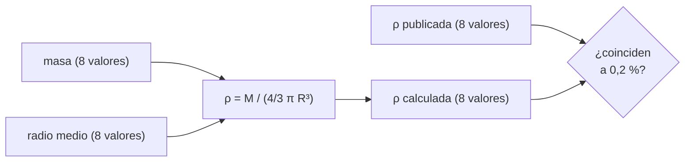

# B07-C09 — Cálculos científicos básicos con Python

<!-- nav:top -->
[🏠 Programa](../../../../README.md) · [📚 Bloque B07](../../../tronco-comun/B07-informatica-cientifica-desde-cero.md) · [← Anterior: B07-C08 — Lectura de archivos CSV](../B07-C08-lectura-de-archivos-csv/CLASE.md) · [Siguiente: B07-C10 — Gráficos bidimensionales iniciales →](../B07-C10-graficos-bidimensionales-iniciales/CLASE.md)
<!-- /nav -->

## 1. Ubicación, nivel y alcance

Novena clase del bloque B07. Ya sabes leer una tabla ([B07-C08](../B07-C08-lectura-de-archivos-csv/CLASE.md)) y definir funciones ([B07-C06](../B07-C06-funciones-y-modularidad/CLASE.md)). Ahora haces **cálculo científico**: operar sobre columnas enteras con **NumPy**, usar el módulo `math`, y **contrastar un resultado calculado con un dato publicado** para ganar confianza. Nivel N1.

Verás arreglos, operaciones vectorizadas, `sum`, `mean`, `argmax`, `dtype`, constantes y funciones de `math`, y la comprobación contra una referencia independiente. No verás gráficos ([B07-C10](../B07-C10-graficos-bidimensionales-iniciales/CLASE.md)), unidades automáticas ([B07-C11](../B07-C11-gestion-de-unidades-en-programas/CLASE.md)) ni álgebra lineal (bloque B10).

## 2. Por qué esta clase existe

Calcular la densidad de ocho planetas con un `for` funciona, pero a escala de millones de datos es lento y verboso. NumPy opera sobre arreglos completos con una sola expresión y es la base de casi toda la ciencia con Python. Además, un cálculo que nadie ha contrastado con nada es solo una promesa: la práctica científica exige una **comprobación independiente**.

La pregunta motivadora es: **¿cómo calculo con muchas cifras a la vez y cómo sé que el resultado es correcto?** La decisión central es la representación (qué es un arreglo, qué `dtype`), la fórmula con sus unidades y el contraste con una referencia.

## 3. Lo que podrás hacer al terminar

1. Crear arreglos de NumPy y averiguar su forma (`shape`) y tipo (`dtype`).
2. Operar elemento a elemento y agregar con `sum`, `mean`, `min`, `argmax`.
3. Usar `math.pi`, `math.sqrt` y `math.isclose`, y saber cuándo usar `math` y cuándo NumPy.
4. Convertir unidades dentro de una fórmula (km a m, 10²⁴ kg a kg).
5. Calcular una densidad media y compararla con el dato publicado.
6. Explicar la diferencia entre media simple y media ponderada.

La evidencia es la **hoja de verificación de cálculo** del ejercicio 12 (sección 20).

## 4. Con qué llegas y cómo comprobarlo

Necesitas C01–C08. Cinco preguntas:

1. ¿Qué diferencia hay entre `/` y `//`?
2. ¿Qué es una lista de diccionarios?
3. ¿Por qué `0.1 + 0.2 != 0.3`?
4. ¿Cómo se importa un módulo?
5. ¿Para qué sirve `assert`?

<details>
<summary>Ver respuestas</summary>

1. `/` da `float`; `//` el cociente entero. 2. Una lista cuyos elementos son diccionarios (registros). 3. Los decimales son aproximaciones binarias. 4. Con `import modulo` o `from modulo import nombre`. 5. Detiene el programa si la condición es falsa.
</details>

Con cuatro o cinco aciertos, sigue; con tres o menos, repasa C02 y C06.

## 5. Un caso real: ¿pesa lo mismo, por volumen, cada planeta?

La densidad media de un planeta es su masa dividida por su volumen. Las fichas del NASA NSSDC (S1) publican la masa, el radio medio volumétrico y la densidad. Eso permite una pregunta de verificación: si calculas `ρ = M / (4/3 π R³)` con la masa y el radio, ¿obtienes la densidad que NASA publica? Si sí, entiendes bien los datos y las unidades; si no, algo falla (un factor 10³ de unidades, por ejemplo). Es el **ejemplo conductor** de la clase.

## 6. Vocabulario

**NumPy** es una biblioteca para cálculo numérico; su estructura central es el **arreglo** (`ndarray`): una rejilla de elementos del mismo tipo con tamaño fijo (S2). `shape` es la forma (`(8,)` es un vector de ocho elementos), `ndim` el número de dimensiones y `dtype` el tipo de los elementos (por ejemplo, `float64` o `int64`). Una operación **vectorizada** se aplica a todos los elementos sin escribir un bucle (S2). La **difusión** (*broadcasting*) permite combinar arreglos de forma compatible, y falla con `ValueError` si no lo son. `math` es el módulo estándar de funciones matemáticas para números sueltos (S3). La **densidad media** es masa entre volumen. El **radio medio volumétrico** es el radio de la esfera con el mismo volumen que el cuerpo (S1). Una **media ponderada** pesa cada valor por su importancia; una **media simple** los trata igual. Una **referencia independiente** es un dato o método distinto del que usaste para calcular.

## 7. Modelo mental: columnas de una hoja de cálculo

Un arreglo es una columna de una hoja de cálculo; una operación vectorizada es escribir una fórmula en la primera celda y arrastrarla hacia abajo, pero hecha de una sola vez y sin errores de arrastre.



*Descripción textual:* dos columnas de ocho valores, masa y radio medio, entran a la fórmula de la densidad y producen una tercera columna. Esa columna se compara con la densidad publicada, y la pregunta es si coinciden dentro de 0,2 %.

**Límite de la analogía:** una hoja de cálculo mezcla tipos libremente; un arreglo de NumPy tiene un solo `dtype`, y eso lo hace rápido pero obliga a que todos los elementos sean del mismo tipo.

## 8. La explicación, paso a paso

### 8.1 Arreglos y atributos

```python
import numpy as np
a = np.array([1.0, 2.0, 3.0])
a.shape, a.dtype      # ((3,), dtype('float64'))
```

`import numpy as np` trae NumPy con el apodo habitual `np`. `np.array([...])` crea el arreglo desde una lista. Si todos los elementos son enteros, el `dtype` es entero (`int64`); basta un decimal para que sea `float64`. `ndim`, `shape`, `size` y `dtype` describen el arreglo (S2).

### 8.2 Operaciones vectorizadas y agregados

`a * 2` da `[2. 4. 6.]`; `a ** 2`, `[1. 4. 9.]`; `a + b` suma elemento a elemento si las formas coinciden; si no, `ValueError: operands could not be broadcast together with shapes (2,) (3,)`. `a.sum()` da `6.0`, `a.mean()` da `2.0`, `a.std()` la desviación estándar, `np.argmax(a)` la **posición** del mayor (S2). Con un arreglo 2D, `suma.sum(axis=0)` suma por columnas.

### 8.3 `math` frente a NumPy

`math.pi`, `math.sqrt(x)` y `math.isclose(a, b)` son para números sueltos y dan el mismo resultado que sus equivalentes de NumPy cuando se aplican a un solo valor (`math.sqrt(2)` y `np.sqrt(2)` dan `1.4142135623730951`). Para arreglos usa las funciones de NumPy (`np.sqrt`, `np.log10`, `np.pi`). `math.sqrt` de un negativo da `ValueError`; el módulo no maneja complejos (S3).

### 8.4 Unidades dentro de la fórmula

Los datos del CSV vienen en 10²⁴ kg y en km. La fórmula necesita kg y m para dar kg/m³. Entonces: `masa_kg = masa_1e24kg * 1e24` y `radio_m = radio_km * 1e3`. Equivocarse con un factor mil en el radio cambia el volumen en 10⁹: el resultado sería absurdo. Escribe la conversión como paso explícito y con nombres que digan la unidad.

### 8.5 La densidad media

El volumen de una esfera es `V = 4/3 π R³` y la densidad `ρ = M / V`. En código: `densidad_media(masa_kg, radio_m) = masa / (4/3 * math.pi * radio ** 3)`. Aplicada a arrays, calcula las ocho densidades a la vez. Como `R` aparece al cubo, un error del 1 % en el radio produce un error de ~3 % en `ρ`.

### 8.6 Contrastar con una referencia independiente

La densidad que NASA publica es un dato independiente de tu cálculo (aunque derivado de las mismas masa y radio). Compararla con la tuya detecta errores de unidades, de fórmula o de transcripción. La tolerancia (aquí 0,2 %) se decide **antes** de mirar el resultado y se justifica: la densidad publicada está redondeada a entero, lo que da un error de redondeo de hasta ~0,05 % en Mercurio (≈ 0,5/5429). El laboratorio detiene el programa si alguna desviación supera 0,2 %.

### 8.7 Media simple y media ponderada

La media simple de las ocho densidades es `3129,8 kg/m³`, pero **no** es la densidad media del conjunto. Esa es la masa total entre el volumen total: `1115,4 kg/m³`, porque Júpiter y Saturno aportan casi todo el volumen y son poco densos. Que una operación exista (`mean`) no significa que responda tu pregunta.

## 9. Magnitudes, símbolos y unidades

| Símbolo | Qué es | Unidad | Nota |
|---|---|---|---|
| `M` | masa | kg (datos en 10²⁴ kg) | `× 1e24` |
| `R` | radio medio volumétrico | m (datos en km) | `× 1e3` |
| `V` | volumen de la esfera | m³ | `4/3 π R³` |
| `ρ` | densidad media | kg/m³ | `M / V` |
| `π` | razón circunferencia/diámetro | adimensional | `math.pi` |
| `shape`, `dtype` | forma y tipo del arreglo | — | `(8,)`, `float64` |

## 10. Convenciones y referencias

Se usa `import numpy as np`. Las unidades SI en las fórmulas y la conversión visible. Tolerancias declaradas antes del cálculo. Se escribe la versión de NumPy junto con los resultados (aquí 2.4.4 con Python 3.12.9). La densidad calculada es un valor **derivado**; la publicada, un dato.

## 11. De dónde sale lo que afirmamos

| ID | Fuente | Localizador | Respalda | Estado |
|---|---|---|---|---|
| S1 | NASA NSSDC, fichas individuales de planetas y *Planetary Fact Sheet* (tabla comparativa) | https://nssdc.gsfc.nasa.gov/planetary/factsheet/ | Masa, radio medio volumétrico y densidad de los ocho planetas | Leídas el 2026-11-05 (mutables) |
| S2 | NumPy Developers, *NumPy: the absolute basics for beginners* (NumPy 2.4) | https://numpy.org/doc/2.4/user/absolute_beginners.html | Arreglo, `array`, `sum`, vectorización, `ndim`/`shape`/`size`/`dtype` | Leída el 2026-11-05 |
| S3 | Python Software Foundation, *The Python Standard Library* 3.12, `math` | https://docs.python.org/3.12/library/math.html | `sqrt`, `pi`, `isclose`, sin complejos | Leída el 2026-11-05 |

Límites: S2 es la guía introductoria; la definición exacta de `mean`, `std` y `argmax` se usó por analogía con `sum` (la página los menciona sin ejemplos) y se **verificó ejecutando** el código. La densidad como masa entre volumen es una definición estándar no citada a una fuente.

## 12. Cómo ver los resultados

La tabla del laboratorio compara densidad calculada, publicada y desviación; un gráfico de barras o de dispersión se construirá en C10. Cada fila se entiende sola.

## 13. Ejemplo trabajado: la densidad de la Tierra

**Datos (S1):** `M = 5.9722 × 10²⁴ kg`, `R = 6371,000 km`.

**Paso 1.** Conversión: `M = 5.9722e24 kg`, `R = 6.371e6 m`. **Paso 2.** Volumen: `V = 4/3 π (6.371e6)³ = 1.0832e21 m³`. **Paso 3.** Densidad: `ρ = 5.9722e24 / 1.0832e21 = 5513.4 kg/m³`. **Paso 4.** Contraste: la publicada es 5514 kg/m³; desviación `−0,010 %`, muy dentro del 0,2 %.

**Paso final · incertidumbre.** La coincidencia a 0,01 % confirma las unidades y la fórmula, pero no prueba que la Tierra sea una esfera homogénea: la densidad **media** no dice cómo se distribuye la masa por dentro. Y como la densidad publicada deriva de los mismos datos, la coincidencia es una prueba de coherencia, no una medida independiente de la densidad.

## 14. Distintos modos de calcular

Un bucle con `math` hace lo mismo con más código y más lento; NumPy es la regla para columnas. Para cantidades con unidades, la biblioteca `astropy.units` (C11) las acompaña y evita el factor 10³ olvidado. Para aritmética exacta existen `fractions` y `decimal`; los `float64` de NumPy son suficientes cuando se declara la tolerancia. El criterio: la herramienta más simple que haga visible la unidad y el error.

## 15. Práctica guiada

**Ejercicio 1 · con los pasos indicados.** Crea `a = np.array([1.0, 2.0, 3.0])` y calcula `a * 2`, `a.sum()` y `a.mean()`. *Pasos:* aplica 8.2.

<details><summary>Solución comentada</summary>

`[2. 4. 6.]`, `6.0` y `2.0`. La operación se aplica elemento a elemento sin bucle.
</details>

**Ejercicio 2 · con una pista.** ¿Qué `dtype` tienen `np.array([1, 2, 3])` y `np.array([1, 2.5])`? *Pista:* un decimal basta.

<details><summary>Solución comentada</summary>

`int64` y `float64`. NumPy elige un único tipo que sirva a todos los elementos.
</details>

**Ejercicio 3 · casi autónomo.** Calcula el volumen de una esfera de radio 1 y la densidad de una esfera de 8 kg y radio 1 m.

<details><summary>Solución comentada</summary>

`V = 4/3 π = 4.18879...`; `ρ = 8 / 4.18879 = 1.90986 kg/m³`. El laboratorio usa estas dos comprobaciones.
</details>

## 16. Práctica autónoma, transferencia e integrador

**Ejercicio 4.** ¿Qué error da `np.array([1, 2]) + np.array([1, 2, 3])`?

<details><summary>Solución comentada</summary>

`ValueError: operands could not be broadcast together with shapes (2,) (3,)`. Las formas no son compatibles.
</details>

**Ejercicio 5.** Calcula a mano la densidad de Mercurio con `M = 0.33010e24 kg` y `R = 2439,7 km` y compárala con 5429 kg/m³.

<details><summary>Solución comentada</summary>

`R = 2.4397e6 m`, `V = 4/3 π R³ = 6.0828e19 m³`, `ρ = 3.3010e23 / 6.0828e19 ≈ 5426.8`. Desviación `−0,040 %` (la mayor del conjunto) frente a la publicada.
</details>

**Ejercicio 6.** ¿Qué pasa si usas el radio **ecuatorial** en vez del medio para Saturno? ¿Sube o baja la densidad?

<details><summary>Solución comentada</summary>

El radio ecuatorial (60 268 km) es mayor que el medio (58 232 km): el volumen crece y la densidad baja a `619,8 kg/m³`, un 10 % menos que los 687 publicados. Saturno es achatado y la esfera de radio ecuatorial sobrestima su volumen.
</details>

**Ejercicio 7.** Con `np.float32` (precisión simple), `0.1 + 0.2 == 0.3` da `True`; con `float64`, `False`. ¿Qué enseña?

<details><summary>Solución comentada</summary>

Que la aproximación depende del tipo: `float32` redondea más grueso y por casualidad coincide. No es «más correcto»; tiene menos cifras. Compara siempre con tolerancia.
</details>

**Ejercicio 8.** Escribe la comparación vectorizada de dos arreglos con tolerancia.

<details><summary>Solución comentada</summary>

`np.allclose(a, b, rtol=1e-3)` o `np.isclose(a, b)` elemento a elemento. Declara la tolerancia.
</details>

**Ejercicio 9 · transferencia.** Calcula con NumPy la rapidez orbital media `v = 2π a / T` de la Tierra, con `a` en km y `T` en s, y la de Neptuno.

<details><summary>Solución comentada</summary>

Tierra `29,785 km/s`; Neptuno `5,455 km/s` (modelo circular y datos de S1, valores calculados, no publicados). Neptuno es 5,5 veces más lento: tiene mucha más distancia que recorrer con una fuerza menor.
</details>

**Ejercicio 10 · transferencia.** Un colega promedia las ocho densidades y dice «la densidad media de los planetas es 3130 kg/m³». ¿Qué le respondes?

<details><summary>Solución comentada</summary>

Que es una media simple de ocho números, no la densidad del conjunto. Masa total entre volumen total da `1115 kg/m³` (los gigantes gaseosos dominan el volumen). Debe decir qué promedio calculó y por qué responde su pregunta.
</details>

**Ejercicio 11 · transferencia.** El resultado de un colega para la Tierra es `5.5134e12`. ¿Qué error de unidades sospechas y cómo lo confirmas?

<details><summary>Solución comentada</summary>

Está `10⁹` veces por encima de 5513,4: es lo que ocurre si usa el radio en **km** (6371) en lugar de en m (6,371 × 10⁶), porque el volumen queda `10⁹` veces menor y la densidad `10⁹` veces mayor. Se confirma recalculando con `R = 6371` y obteniendo `5.5134e12`, y se corrige con `radio_m = radio_km * 1e3`. Comparar con el orden de magnitud esperado (miles de kg/m³) lo habría delatado.
</details>

**Ejercicio 12 · integrador.** Entrega una **hoja de verificación de cálculo**: para los ocho planetas, tabla de densidad calculada, publicada y desviación; tolerancia declarada y justificada; las conversiones de unidades explícitas; y un párrafo sobre qué prueba y qué no prueba la coincidencia.

<details><summary>Solución modelo</summary>

La tabla de la sección 17 con la tolerancia de 0,2 % (la mayor desviación observada es 0,040 %). Conversiones: `×1e24` y `×1e3`. Párrafo: prueba coherencia de unidades y fórmula; no prueba homogeneidad interna ni independencia de la referencia.
</details>

## 17. Laboratorio: densidades con NumPy

El script [densidades.py](densidades.py) lee `planetas_nssdc.csv` (de [C08](../B07-C08-lectura-de-archivos-csv/CLASE.md)), calcula la densidad media con NumPy y la compara con la publicada. Antes de imprimir comprueba el volumen de la esfera unitaria, la densidad de una esfera de 8 kg y radio 1 m, la forma de los arreglos, que ninguna desviación supere 0,2 % y que `sum` de NumPy coincida con un bucle de Python.

**Datos:** publicados (NASA); la densidad calculada es **derivada**. **Predice antes de ejecutar:** ¿qué planeta tendrá la mayor desviación? (Mercurio.) **Resultados (2026-11-05, Python 3.12.9, NumPy 2.4.4):**

```text
python 3.12.9 | numpy 2.4.4 | pruebas OK
planeta    ρ calc (kg/m³)  ρ publicada  desv. %
Mercurio           5426.8         5429   -0.040
Venus              5242.6         5243   -0.008
Tierra             5513.4         5514   -0.010
Marte              3934.0         3934   -0.001
Júpiter            1326.2         1326   +0.013
Saturno             687.1          687   +0.014
Urano              1270.4         1270   +0.030
Neptuno            1637.9         1638   -0.008
Planeta más denso: Tierra | menos denso: Saturno
Densidad media de los 8 (sin ponderar): 3129.8 kg/m³
```

```bash
python programa/clases/B07/B07-C09-calculos-cientificos-basicos-con-python/densidades.py
```

**Límites:** necesita NumPy instalado (C13 explica cómo). Supone esferas; no incorpora incertidumbres. La densidad publicada es redondeada a entero.

## 18. Errores frecuentes y cómo corregirlos

**Olvidar conversiones de unidades.** Se corrige con 8.4 y el ejercicio 11.

**Usar el radio equivocado.** Se corrige con el ejercicio 6.

**Promediar sin ponderar.** Se corrige con el ejercicio 10.

**Mezclar listas con arreglos.** `lista * 2` repite; `array * 2` multiplica. Se detecta al ver `[1, 2, 1, 2]`.

**Aceptar un resultado sin contrastarlo.** Se corrige con la sección 8.6.

## 19. Cómo sabrás que vas bien

Tras 8.2: ¿predices `a * 2` y `a.mean()`? Si no, ejercicio 1. Tras 8.4: ¿conviertes las unidades sin ayuda? Si no, ejercicio 5. Tras el ejemplo: ¿qué prueba y qué no la coincidencia con la densidad publicada? Si no, relee el paso final. Tras el laboratorio: ¿por qué la tolerancia es 0,2 %? Si no lo sabes, relee 8.6. Al final: ¿en tu hoja, qué unidades pasaste y dónde? Si no están visibles, rehaz el ejercicio 12.

## 20. Qué entregas y cómo se evalúa

El producto es tu **hoja de verificación de cálculo**: fórmula, conversiones, tabla de contraste, tolerancia justificada y alcance de la conclusión.

| Criterio | Inicial | En desarrollo | Logrado | Destacado |
|---|---|---|---|---|
| Cálculo | Con errores de unidad | Correcto con ayuda | Correcto y vectorizado | Con pruebas independientes |
| Contraste | Ninguno | Compara a ojo | Compara con tolerancia | La justifica por el redondeo |
| Interpretación | Afirma de más | Describe | Distingue coherencia de prueba | Cuantifica lo que no sabe |
| Fuentes y versiones | Sin ellas | Fuente sin fecha | Fuente con fecha | Con versiones de software |

**Condiciones críticas:** unidades explícitas; tolerancia fijada antes de comparar; rotular lo derivado; citar solo fuentes consultadas.

## 21. Ética, seguridad y límites

Un resultado que «sale bien» por casualidad (por ejemplo, con `float32`) puede tomarse por correcto: contrasta con una referencia independiente y reporta la tolerancia. No presentes un cálculo derivado como medida. Sin datos personales. Material educativo; no sirve para cálculos de diseño.

## 22. Para cerrar y seguir

NumPy permite operar sobre columnas completas; `math` sirve para números sueltos; las unidades se convierten de forma explícita; y un cálculo gana credibilidad al compararse con una referencia con una tolerancia fijada de antemano. Queda abierta la pregunta de cómo mostrar estos resultados en una figura legible.

**Glosario español–inglés.** arreglo · *array*; forma · *shape*; tipo de dato · *dtype*; vectorizado · *vectorized*; difusión · *broadcasting*; densidad media · *mean density*; media ponderada · *weighted mean*; tolerancia · *tolerance*.

**Continuidad.** [B07-C10](../B07-C10-graficos-bidimensionales-iniciales/CLASE.md) usa tu capacidad de **calcular sobre columnas** para representar la relación entre período y distancia en un gráfico con ejes, etiquetas y unidades.

**Referencias:** ver sección 11.

<!-- nav:bottom -->
---

[← Anterior: B07-C08 — Lectura de archivos CSV](../B07-C08-lectura-de-archivos-csv/CLASE.md) · [📚 Bloque B07](../../../tronco-comun/B07-informatica-cientifica-desde-cero.md) · [Siguiente: B07-C10 — Gráficos bidimensionales iniciales →](../B07-C10-graficos-bidimensionales-iniciales/CLASE.md)
<!-- /nav -->
