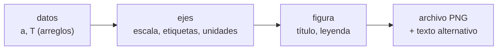
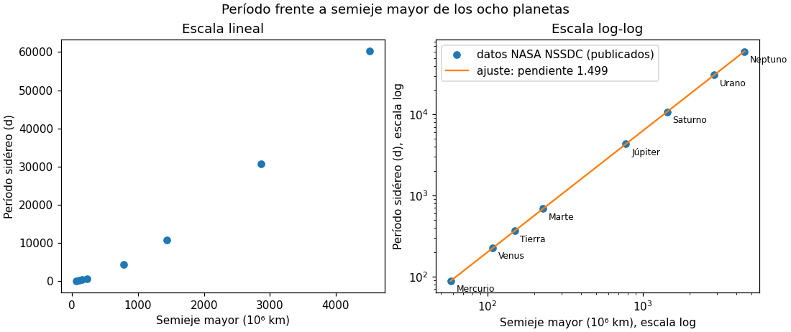

# B07-C10 — Gráficos bidimensionales iniciales

<!-- nav:top -->
[🏠 Programa](../../../../README.md) · [📚 Bloque B07](../../../tronco-comun/B07-informatica-cientifica-desde-cero.md) · [← Anterior: B07-C09 — Cálculos científicos básicos con Python](../B07-C09-calculos-cientificos-basicos-con-python/CLASE.md) · [Siguiente: B07-C11 — Gestión de unidades en programas →](../B07-C11-gestion-de-unidades-en-programas/CLASE.md)
<!-- /nav -->

## 1. Ubicación, nivel y alcance

Décima clase del bloque B07. Ya calculas sobre columnas ([B07-C09](../B07-C09-calculos-cientificos-basicos-con-python/CLASE.md)); ahora **dibujas** lo que calculaste con **Matplotlib** y aprendes a que el dibujo sea honesto: ejes con nombre y unidad, escala adecuada, leyenda y descripción para quien no lo ve. Nivel N1.

Verás figura, ejes, `plot`, `loglog`, etiquetas, leyenda, guardado de archivos y el ajuste de una recta en escala log-log. No verás estadística de ajuste ni incertidumbres (bloque B12), ni gráficos tridimensionales.

## 2. Por qué esta clase existe

Un gráfico es una afirmación: dice «mira esta relación». Un gráfico sin unidades, con una escala que esconde la mitad de los datos o sin leyenda puede inducir a error aunque los números sean correctos. Con datos que abarcan varios órdenes de magnitud, como los períodos de los planetas, una escala lineal aplasta los cuerpos interiores contra el origen.

La pregunta motivadora es: **¿cómo muestro una relación entre dos magnitudes de manera que se vea y no engañe?** La decisión central es qué va en cada eje, con qué escala, con qué unidad, y cómo declaras de dónde salen los puntos y la línea.

## 3. Lo que podrás hacer al terminar

1. Crear una figura con ejes (`plt.subplots`) y dibujar puntos y líneas.
2. Etiquetar ejes con magnitud y unidad, poner título y leyenda.
3. Elegir escala lineal o logarítmica y justificarla.
4. Ajustar una recta a datos en escala log-log y leer su pendiente.
5. Guardar la figura en archivo desde un script sin pantalla.
6. Describir un gráfico con texto para que sea accesible.

La evidencia es la **figura con descripción** del ejercicio 12 (sección 20).

## 4. Con qué llegas y cómo comprobarlo

Necesitas C01–C09. Cinco preguntas:

1. ¿Qué devuelve `np.log10(1000)`?
2. ¿Qué es un arreglo de NumPy?
3. ¿Qué hace `np.array(lista)`?
4. ¿Qué es un orden de magnitud?
5. ¿Para qué sirve `zip(a, b)`?

<details>
<summary>Ver respuestas</summary>

1. `3.0`. 2. Una rejilla de elementos del mismo tipo. 3. Convierte la lista en un arreglo. 4. Un factor de 10. 5. Recorre dos secuencias a la vez, emparejando sus elementos.
</details>

Con cuatro o cinco aciertos, sigue; con tres o menos, repasa C09 y B03.

## 5. Un caso real: la ley de Kepler en una imagen

En [C03](../B07-C03-operadores-y-expresiones/CLASE.md) comprobaste que `T²/a³ ≈ 1` con una tabla. Ahora lo mostrarás con una **figura**: período frente a semieje mayor de los ocho planetas (datos publicados del NASA NSSDC, S1, leídos de `planetas_nssdc.csv`). Si el período crece como `a` elevado a `p`, en escala log-log los puntos caen sobre una recta de pendiente `p`; Kepler anticipa `p = 1,5`. El **ejemplo conductor** es esa figura y la pendiente que mides en ella.

## 6. Vocabulario

Una **figura** (`Figure`) es el lienzo completo; los **ejes** (`Axes`) son la región donde se dibujan los datos, con sus dos **ejes de coordenadas** (`Axis`) que fijan escala, límites y marcas (S2). La **interfaz explícita** crea figura y ejes y llama a sus métodos (`ax.plot`); la **interfaz implícita** usa `plt.plot` y deja que `pyplot` gestione todo; la documentación recomienda la explícita para código reutilizable (S2). Una **escala logarítmica** muestra el logaritmo de la magnitud: cada marca principal es un factor 10. Un **ajuste** es la curva que mejor representa los datos según un criterio. La **pendiente** de una recta en log-log es el exponente de la ley de potencias. Una **leyenda** nombra cada serie. Un **backend** es el motor que dibuja; `Agg` genera archivos sin ventana. El **texto alternativo** es la descripción de la imagen para quien no la ve.

## 7. Modelo mental: de los datos al lienzo



*Descripción textual:* los datos (dos arreglos) se dibujan sobre unos ejes que llevan escala, etiquetas y unidades; los ejes forman parte de una figura con título y leyenda, que se guarda como imagen acompañada de una descripción en texto.

**Límite de la analogía:** un lienzo de pintura no cambia al cambiar la escala; en un gráfico la misma información se ve distinta con otra escala, y esa elección es parte del mensaje.

## 8. La explicación, paso a paso

### 8.1 Figura y ejes

```python
fig, ax = plt.subplots(figsize=(5, 2.7))
ax.plot([1, 2, 3, 4], [1, 4, 2, 3])
ax.set_xlabel("x label")
```

`plt.subplots()` devuelve la figura y los ejes (en el laboratorio, dos ejes lado a lado). `ax.plot(x, y)` dibuja una línea; con `"o"` dibuja puntos. `set_xlabel`, `set_ylabel` y `set_title` escriben el texto (S2). `import matplotlib.pyplot as plt` trae la interfaz habitual.

### 8.2 Etiquetas con magnitud y unidad

Cada eje dice **qué** y **en qué unidad**: «Semieje mayor (10⁶ km)» y «Período sidéreo (d)». Un eje sin unidad no se puede usar. También rotula la procedencia: la leyenda dice «datos NASA NSSDC (publicados)» para la serie de puntos y «ajuste» para la recta.

### 8.3 Escala lineal y logarítmica

En escala lineal, Neptuno (a ≈ 4515, T ≈ 60 189) domina el gráfico y Mercurio, Venus, la Tierra y Marte quedan amontonados cerca del origen (panel izquierdo de la figura). La relación entre el semieje del más lejano y el del más cercano es de 78 veces, y la de los períodos, 684 veces. `ax.loglog(x, y)` usa escala logarítmica en ambos ejes: las separaciones iguales son factores iguales, y los ocho puntos se ven distribuidos. Usar log-log no es «arreglar» el gráfico: es elegir la escala que corresponde a una relación de potencias.

### 8.4 Ajustar una recta en log-log

Si `T = k · aᵖ`, entonces `log₁₀ T = log₁₀ k + p · log₁₀ a`: una recta de pendiente `p`. `np.polyfit(np.log10(a), np.log10(t), 1)` devuelve `(pendiente, ordenada)` por mínimos cuadrados (el criterio estadístico se estudia en B12). Con los datos de S1 sale `p = 1.4990`, cercano a 1,5. Con solo dos puntos (Tierra y Neptuno) sale `1.4982`; con Mercurio y Tierra, `1.49999...`: cada par es una estimación, y el ajuste a los ocho combina información.

### 8.5 Guardar y acceder

`fig.savefig("archivo.png", dpi=110)` guarda sin abrir ventana si el backend es `Agg` (`matplotlib.use("Agg")` antes de importar `pyplot`). Un script sin pantalla (un servidor, una prueba automática) no puede mostrar ventanas, pero sí guardar. **Cada imagen debe acompañarse de texto alternativo y de una tabla con los valores**, para personas ciegas o con baja visión, y porque la imagen se pierde si no se abre.

### 8.6 Qué no decir

El ajuste describe los ocho puntos; no «demuestra» la ley de Kepler ni dice por qué ocurre. La pendiente 1,499 es una **medida con los datos publicados**; sin incertidumbres en los datos, no sabes cuán fiable es el tercer decimal.

## 9. Magnitudes, símbolos y unidades

| Elemento | Qué es | Unidad | Nota |
|---|---|---|---|
| eje x | semieje mayor `a` | 10⁶ km | de S1 |
| eje y | período sidéreo `T` | d | de S1 |
| `p` | pendiente log-log | adimensional | ajustada: 1,4990 |
| `log₁₀ k` | ordenada del ajuste | log₁₀ de d/(10⁶ km)^p | −0,6978 |
| `dpi` | resolución de la imagen | puntos por pulgada | 110 |

## 10. Convenciones y referencias

Interfaz explícita (`fig, ax`). Unidades en los ejes. Leyenda con la procedencia. Imágenes con texto alternativo y datos en tabla. Versiones: Matplotlib 3.10.8, NumPy 2.4.4, Python 3.12.9. Cualquier valor derivado de un ajuste se rotula como **ajustado**.

## 11. De dónde sale lo que afirmamos

| ID | Fuente | Localizador | Respalda | Estado |
|---|---|---|---|---|
| S1 | NASA NSSDC, fichas individuales de planetas | https://nssdc.gsfc.nasa.gov/planetary/factsheet/ | Semieje mayor y período sidéreo | Leídas el 2026-11-05 (mutables) |
| S2 | Matplotlib Development Team, *Quick start guide* (Matplotlib 3.10.8) | https://matplotlib.org/3.10.8/users/explain/quick_start.html | Figure, Axes, Axis; `plot`, `set_xlabel`; interfaz explícita frente a implícita | Leída el 2026-11-05 |
| S3 | NumPy Developers, *NumPy: the absolute basics for beginners* (2.4) | https://numpy.org/doc/2.4/user/absolute_beginners.html | Arreglos y operaciones | Leída el 2026-11-05 |

Límites: la documentación de Matplotlib consultada no cubre `savefig` ni `loglog`; ambos se **verificaron ejecutando** el código. La función `np.polyfit` no se consultó en su página de referencia; su uso se comprobó con un caso analítico exacto.

## 12. Cómo ver la figura



*Descripción textual.* Dos paneles. A la izquierda, escala lineal: cuatro puntos (Mercurio, Venus, Tierra y Marte) están pegados al origen, Júpiter y Saturno se separan algo y Urano y Neptuno quedan lejos, hasta un período de unos 60 000 d. A la derecha, escala log-log: los ocho puntos, de Mercurio (a ≈ 58 × 10⁶ km, T ≈ 88 d) a Neptuno (a ≈ 4515 × 10⁶ km, T ≈ 60 189 d), forman una recta casi perfecta, con la recta de ajuste superpuesta y una leyenda que indica la pendiente 1,499.

| Planeta | a (10⁶ km) | T (d) |
|---|---|---|
| Mercurio | 57,909 | 87,969 |
| Venus | 108,210 | 224,701 |
| Tierra | 149,598 | 365,256 |
| Marte | 227,956 | 686,980 |
| Júpiter | 778,479 | 4332,589 |
| Saturno | 1432,041 | 10 755,699 |
| Urano | 2867,043 | 30 685,400 |
| Neptuno | 4514,953 | 60 189,018 |

## 13. Ejemplo trabajado: leer una pendiente a mano

**Datos (S1):** Mercurio `(57,909; 87,969)` y Neptuno `(4514,953; 60 189,018)`.

**Paso 1.** Logaritmos: `log₁₀ 57,909 = 1,7627`, `log₁₀ 4514,953 = 3,6547`; `log₁₀ 87,969 = 1,9443`, `log₁₀ 60 189,018 = 4,7795`. **Paso 2.** Pendiente entre ambos puntos: `(4,7795 − 1,9443) / (3,6547 − 1,7627) = 2,8352 / 1,8920 = 1,4985`. **Paso 3.** Compara con el ajuste de los ocho puntos: `1,4990`. **Paso 4.** Compara con 1,5: la diferencia es `0,1 %`.

**Paso final · incertidumbre.** Una pendiente de 1,499 con datos redondeados no permite distinguir 1,499 de 1,500: la tolerancia que se declaró en el script (`|p − 1,5| < 0,01`) refleja lo que el ejercicio puede afirmar. Concluir «la pendiente es exactamente 1,5» sería sobreinterpretar; concluir «es coherente con 1,5 a 0,1 %» es lo que los datos sostienen.

## 14. Distintas formas de mostrar lo mismo

Una tabla da los números exactos y es accesible, pero no muestra la forma de la relación. Un gráfico de dispersión en lineal es sencillo pero engañoso aquí. El log-log es el adecuado para leyes de potencia. También podrías graficar `T²/a³` frente a `a`, que debería ser una horizontal en 1 (más sensible a pequeñas desviaciones). Elige el gráfico según la pregunta, y ofrece al menos otra vía (tabla o texto) para quien no lo ve.

## 15. Práctica guiada

**Ejercicio 1 · con los pasos indicados.** Dibuja los puntos `x = [1, 2, 3, 4]`, `y = [1, 4, 9, 16]` con ejes etiquetados. *Pasos:* `fig, ax = plt.subplots()`, `ax.plot(..., "o")`, `set_xlabel`, `set_ylabel`.

<details><summary>Solución comentada</summary>

`fig, ax = plt.subplots(); ax.plot(x, y, "o"); ax.set_xlabel("x (unidad)"); ax.set_ylabel("y = x² (unidad²)")`. Los ejes sin unidades serían un error aunque los puntos estén bien.
</details>

**Ejercicio 2 · con una pista.** ¿Qué pendiente tendría la recta `y = x²` en log-log? *Pista:* `log y = 2 log x`.

<details><summary>Solución comentada</summary>

Pendiente `2`. Toda ley de potencias `y = kxᵖ` es una recta de pendiente `p` en log-log.
</details>

**Ejercicio 3 · casi autónomo.** Usa `np.polyfit(np.log10(x), np.log10(y), 1)` con `x = [1, 10, 100]` y `y = [1, 31.6228, 1000]` (≈ `x^1,5`). ¿Qué esperas?

<details><summary>Solución comentada</summary>

Una pendiente de `1,5` y ordenada `0` (el laboratorio lo comprueba con valores exactos `10^1,5`). Con `31,6228` redondeado sale `1,50000...` a 6 cifras.
</details>

## 16. Práctica autónoma, transferencia e integrador

**Ejercicio 4.** ¿Por qué en el panel lineal no se distinguen Mercurio y Venus?

<details><summary>Solución comentada</summary>

Sus períodos (88 y 225 d) son 0,15 % y 0,37 % del máximo (60 189 d); en una escala que llega a 60 000, la separación es de unos pocos píxeles.
</details>

**Ejercicio 5.** ¿Cuántos órdenes de magnitud abarcan los períodos? ¿Y los semiejes?

<details><summary>Solución comentada</summary>

Períodos: de 87,969 a 60 189,018, `log₁₀(684,2) = 2,84`, casi tres órdenes. Semiejes: `log₁₀(78,0) = 1,89`, casi dos.
</details>

**Ejercicio 6.** Con el ajuste `T = 0,2005 · a^1,499` (ordenada −0,6978), predice el período de Marte (a = 227,956) y compáralo con el publicado.

<details><summary>Solución comentada</summary>

`10^−0,6978 = 0,2005`; con exponente 1,5 daría `690,2` d (cálculo con ordenada −0,6978 y exponente 1,5, aproximación), frente a 686,98 d publicado: un 0,5 % de diferencia. La ordenada y la pendiente se ajustaron **juntas**: usar la ordenada con otra pendiente mezcla dos ajustes. Con la pendiente 1,4990 la predicción se acerca más.
</details>

**Ejercicio 7.** Escribe el código para guardar la figura en `figura.png` sin abrir ventana.

<details><summary>Solución comentada</summary>

`matplotlib.use("Agg")` antes de importar `pyplot`, y `fig.savefig("figura.png", dpi=110)`.
</details>

**Ejercicio 8.** ¿Qué le falta a un gráfico con una línea azul sin ejes etiquetados ni título?

<details><summary>Solución comentada</summary>

Magnitud y unidad en cada eje, un título o pie, una leyenda si hay varias series, la procedencia de los datos y un texto alternativo.
</details>

**Ejercicio 9 · transferencia.** Un compañero grafica la tabla de densidades de C09 (ocho planetas) con el eje y en escala logarítmica. ¿Cuándo es adecuado?

<details><summary>Solución comentada</summary>

Cuando los valores abarcan varios órdenes de magnitud o te interesa la variación relativa. Las densidades van de 687 a 5514 kg/m³ (factor 8): una escala lineal suele bastar; log es opcional. La elección se justifica por la pregunta.
</details>

**Ejercicio 10 · transferencia.** Un titular dice «la gráfica demuestra la ley de Kepler». ¿Qué corriges?

<details><summary>Solución comentada</summary>

Una figura con ocho puntos alineados es **coherente** con una ley de potencias de exponente 1,5; no la demuestra ni dice por qué. La explicación proviene de la teoría de la gravitación (bloque B71), no del gráfico.
</details>

**Ejercicio 11 · transferencia.** Un gráfico con eje y truncado (empieza en 5000) en lugar de en 0 hace que una diferencia del 2 % parezca enorme. ¿Qué principio se viola y cómo lo evitas?

<details><summary>Solución comentada</summary>

La proporción visual no refleja la proporción real. Evítalo con ejes que empiecen en cero en gráficos de barras, o declarando explícitamente la truncación y mostrando la diferencia relativa en el texto.
</details>

**Ejercicio 12 · integrador.** Entrega una **figura con descripción**: gráfico de dos paneles (lineal y log) de otra relación del CSV (por ejemplo, masa frente a radio medio), con ejes etiquetados con unidades, leyenda con procedencia, la pendiente ajustada y una tabla de datos más un texto alternativo.

<details><summary>Solución modelo</summary>

Con `radio_medio_km` y `masa_1e24kg` de `planetas_nssdc.csv`. La relación entre masa y radio no es una ley de potencias simple entre rocosos y gigantes: se muestra y se comenta que la pendiente depende del grupo. Se acepta cualquier par de columnas con una conclusión acotada y marcada como ajustada.
</details>

## 17. Laboratorio: la figura de Kepler

El script [grafico_kepler.py](grafico_kepler.py) lee `planetas_nssdc.csv` (de [C08](../B07-C08-lectura-de-archivos-csv/CLASE.md)), ajusta la recta log-log y guarda [kepler_loglog.png](kepler_loglog.png). Antes de dibujar comprueba 8 datos, que la pendiente esté a menos de 0,01 de 1,5 y, como caso analítico, que tres puntos exactos sobre `y = x^1,5` den pendiente `1,5` a `1e-12`; luego verifica que el archivo exista y no esté vacío.

**Datos:** publicados (NASA); el ajuste es **calculado**. **Predice antes de ejecutar:** ¿qué pendiente esperas? (Cerca de 1,5.) **Resultados (2026-11-05, Python 3.12.9, NumPy 2.4.4, Matplotlib 3.10.8):**

```text
python 3.12.9 | numpy 2.4.4 | matplotlib 3.10.8 | pruebas OK
Pendiente del ajuste log-log: 1.4990 (esperada 1.5)
Ordenada log10(T) en log10(a)=0: -0.6978
Figura guardada: kepler_loglog.png (58263 bytes)
```

```bash
python programa/clases/B07/B07-C10-graficos-bidimensionales-iniciales/grafico_kepler.py
```

**Límites:** el tamaño del archivo puede variar levemente entre versiones y sistemas; el script no estima incertidumbre de la pendiente; necesita NumPy y Matplotlib instalados (C13).

## 18. Errores frecuentes y cómo corregirlos

**Ejes sin unidades.** Se corrige con la sección 8.2 y el ejercicio 8.

**Escala que oculta datos.** Se corrige con la sección 8.3 y el ejercicio 4.

**Eje truncado que exagera.** Se corrige con el ejercicio 11.

**Ordenada y pendiente de ajustes distintos.** Se corrige con el ejercicio 6.

**Sobreinterpretar el ajuste.** Se corrige con el ejercicio 10.

## 19. Cómo sabrás que vas bien

Tras 8.1: ¿haces una figura con ejes etiquetados sin copiar? Si no, ejercicio 1. Tras 8.3: ¿explicas por qué log-log? Si no, ejercicio 4. Tras 8.4: ¿lees una pendiente en log-log? Si no, ejercicio 2. Tras el laboratorio: ¿qué comprueba el script antes de dibujar? Léelo. Al final: ¿cómo describirías tu gráfico a quien no lo ve? Si no puedes, redacta el texto alternativo del ejercicio 12.

## 20. Qué entregas y cómo se evalúa

El producto es tu **figura con descripción**: el archivo de imagen, su script, la tabla de datos, el texto alternativo y las fuentes.

| Criterio | Inicial | En desarrollo | Logrado | Destacado |
|---|---|---|---|---|
| Ejes y unidades | Sin etiquetas | Etiquetas sin unidad | Con unidad | Con procedencia en leyenda |
| Escala | Sin justificar | Justificada a medias | Justificada | Compara dos escalas |
| Accesibilidad | Solo imagen | Con título | Con descripción | Con descripción y tabla |
| Interpretación | Afirma de más | Describe | Acota la conclusión | Cuantifica lo que no sabe |

**Condiciones críticas:** rotular datos y ajuste; no truncar ejes sin avisarlo; citar solo fuentes consultadas.

## 21. Ética, seguridad y límites

Un gráfico es persuasivo: elegir escalas o recortes para exagerar un efecto es manipulación. Describe siempre la figura en texto. Sin datos personales. Material educativo.

## 22. Para cerrar y seguir

Un gráfico honesto lleva ejes con magnitud y unidad, una escala justificada, leyenda con la procedencia y un texto que lo describe. En escala log-log, una ley de potencias es una recta cuya pendiente es el exponente; aquí 1,499, coherente con 1,5. Queda abierta la pregunta de cómo hacer que las unidades de los datos viajen con los números y no solo con las etiquetas.

**Glosario español–inglés.** figura · *figure*; ejes · *axes*; escala logarítmica · *logarithmic scale*; ajuste · *fit*; pendiente · *slope*; leyenda · *legend*; texto alternativo · *alt text*; dispersión · *scatter plot*.

**Continuidad.** [B07-C11](../B07-C11-gestion-de-unidades-en-programas/CLASE.md) usa tu capacidad de **etiquetar unidades en un gráfico** para que las unidades se gestionen dentro del propio programa y los errores de conversión se detecten al calcular.

**Referencias:** ver sección 11.

<!-- nav:bottom -->
---

[← Anterior: B07-C09 — Cálculos científicos básicos con Python](../B07-C09-calculos-cientificos-basicos-con-python/CLASE.md) · [📚 Bloque B07](../../../tronco-comun/B07-informatica-cientifica-desde-cero.md) · [Siguiente: B07-C11 — Gestión de unidades en programas →](../B07-C11-gestion-de-unidades-en-programas/CLASE.md)
<!-- /nav -->
