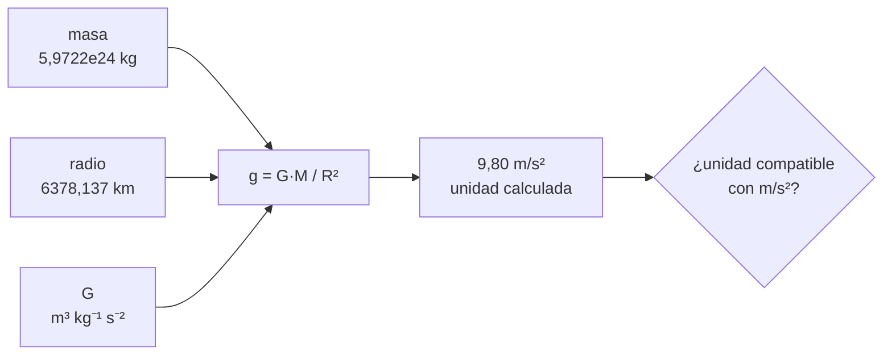

# B07-C11 — Gestión de unidades en programas

<!-- nav:top -->
[🏠 Programa](../../../../README.md) · [📚 Bloque B07](../../../tronco-comun/B07-informatica-cientifica-desde-cero.md) · [← Anterior: B07-C10 — Gráficos bidimensionales iniciales](../B07-C10-graficos-bidimensionales-iniciales/CLASE.md) · [Siguiente: B07-C12 — Manejo de errores y excepciones →](../B07-C12-manejo-de-errores-y-excepciones/CLASE.md)
<!-- /nav -->

## 1. Ubicación, nivel y alcance

Undécima clase del bloque B07. En [C09](../B07-C09-calculos-cientificos-basicos-con-python/CLASE.md) las unidades vivían en los nombres de las variables y en tu cuidado al convertir (`× 1e24`, `× 1e3`). Aquí las unidades **viajan con el número** gracias a `astropy.units`, y el programa se niega a sumar kilogramos con metros. Nivel N1–N2.

Verás `Quantity`, `.to()`, `.to_value()`, aritmética con unidades, `UnitConversionError`, `decompose()` y constantes con unidades. No verás sistemas de coordenadas ni tiempos astronómicos (bloque B13) ni propagación de incertidumbres.

## 2. Por qué esta clase existe

Un error de unidades no hace fallar el programa: lo hace dar una respuesta distinta de la esperada. En la clase C09 viste que un radio en km en vez de m multiplica la densidad por 10⁹ sin ningún aviso. En proyectos reales, las unidades equivocadas entre módulos son una causa clásica de fallas; la defensa es que la unidad sea parte del dato.

La pregunta motivadora es: **¿cómo hago que mi programa verifique las unidades en vez de confiar en mi atención?** La decisión central es qué datos llevan unidad explícita, cuándo convertir, y qué hacer cuando una operación mezcla magnitudes incompatibles.

## 3. Lo que podrás hacer al terminar

1. Crear una cantidad con unidad (`valor * u.unidad`) y leer su valor y su unidad.
2. Convertir con `.to()` y `.to_value()`.
3. Operar con unidades y reconocer cuándo el programa lo impide (`UnitConversionError`).
4. Usar constantes físicas con unidad (`G`) en una fórmula y obtener la unidad del resultado.
5. Contrastar un resultado con unidades frente a un dato publicado.
6. Decidir cuándo usar unidades automáticas y cuándo variables con la unidad en el nombre.

La evidencia es la **hoja de unidades verificadas** del ejercicio 12 (sección 20).

## 4. Con qué llegas y cómo comprobarlo

Necesitas C01–C10. Cinco preguntas:

1. ¿Cuántos metros hay en 6371 km?
2. ¿Qué es un arreglo de NumPy?
3. ¿Qué es una función con parámetros?
4. ¿Qué significa «derivado» frente a «publicado»?
5. ¿Qué error aparece al sumar `"1" + 1`?

<details>
<summary>Ver respuestas</summary>

1. 6 371 000 m. 2. Una rejilla de elementos del mismo tipo. 3. Un bloque con nombre que recibe datos y devuelve un valor. 4. Derivado: calculado por ti; publicado: tomado de una fuente. 5. `TypeError`.
</details>

Con cuatro o cinco aciertos, sigue; con tres o menos, repasa C02, C06 y C09.

## 5. Un caso real: densidad y gravedad de los planetas, con unidades

Con la masa y el radio de cada planeta (datos publicados del NASA NSSDC, S1, en `planetas_nssdc.csv`) puedes calcular dos cosas y contrastarlas con lo que NASA publica: la **densidad media** `ρ = M / (4/3 π R³)` y la **gravedad en la superficie** `g = G M / R²`. La segunda necesita la constante de gravitación `G`, que la biblioteca aporta **con su unidad** (`m³ kg⁻¹ s⁻²`). Si la fórmula y las unidades están bien, el resultado sale directamente en kg/m³ y en m/s², sin que escribas ningún factor de conversión. Ese es el **ejemplo conductor**.

## 6. Vocabulario

Una **unidad** es una magnitud de referencia (metro, kilogramo, segundo). Una **cantidad** (`Quantity`) en Astropy es un número —o un arreglo— acompañado de una unidad: `15 * u.m / u.s` es `15 m / s` (S2). `.value` da el número y `.unit` la unidad. `.to(u.km)` devuelve una copia convertida; `.to_value(u.km)` devuelve solo el número (S2). La **compatibilidad dimensional** significa que dos unidades miden la misma clase de magnitud (longitud con longitud). Sumar o restar exige unidades equivalentes; multiplicar y dividir funcionan con cualquiera y generan unidades compuestas. `decompose()` reduce una unidad compuesta a las unidades base. Una cantidad **adimensional** no tiene unidad neta. `UnitConversionError` es el error que aparece al operar o convertir con unidades incompatibles (S2). Una **constante** de `astropy.constants` es una cantidad con unidad, incertidumbre y referencia (S3).

## 7. Modelo mental: el número con su etiqueta pegada

Imagina que cada número lleva pegada una etiqueta con su unidad, y que las operaciones solo se permiten si las etiquetas son compatibles: puedes sumar metros con kilómetros (el programa convierte), pero no metros con kilogramos.



*Descripción textual:* masa, radio y la constante G, cada uno con su unidad, entran en la fórmula `G·M/R²`. El resultado trae una unidad calculada automáticamente y se comprueba que sea compatible con m/s² antes de compararlo con el dato publicado.

**Límite de la analogía:** las unidades automáticas detectan **incompatibilidad**, no errores de **magnitud** con la unidad correcta: si pones `6.37 * u.km` en vez de `6371 * u.km`, la unidad es válida y el número, equivocado.

## 8. La explicación, paso a paso

### 8.1 Crear y leer cantidades

```python
import astropy.units as u
radio = 6371.0 * u.km
radio.value, radio.unit      # (6371.0, Unit("km"))
```

`import astropy.units as u` trae el módulo con el apodo habitual. Multiplicar un número por una unidad crea la cantidad. Los arreglos de NumPy también admiten unidades (S2). Astropy 8.0.2 se usa en esta clase.

### 8.2 Convertir

`(149.598e6 * u.km).to(u.au)` da `1.000000864 AU`; `(365.256 * u.d).to(u.s)` da `31558118.4 s`; `(2.5 * u.m).to_value(u.cm)` da `250.0`. `.to()` conserva la unidad en el resultado; `.to_value()` entrega el número, útil para formatear o graficar. El nombre `au` es la unidad astronómica de Astropy; su valor devuelto en la ejecución fue 149 597 870,7 km.

### 8.3 Operar y errores

`1100.1 * u.m + 13.5 * u.km` da `14600.1 m`: con unidades distintas pero equivalentes, el resultado toma la unidad del operando izquierdo (S2). Con unidades incompatibles, `1 * u.kg + 1 * u.m` produce `UnitConversionError: Can only apply 'add' function to quantities with compatible dimensions`. Convertir a una unidad de otra clase también falla: `(3 * u.m).to(u.s)` da `UnitConversionError: 'm' (length) and 's' (time) are not convertible`. Y sumar un número simple a una cantidad con unidad falla con `UnitConversionError` (S2). Estos errores **son una ventaja**: el programa se detiene antes de dar una respuesta sin sentido.

### 8.4 Composición y `decompose`

`10 * u.km / (5 * u.s)` da `2.0 km / s`. `(20 * u.cm / (1 * u.m)).decompose()` da una cantidad adimensional `0.2`. `29.785 km/s * 1 d` da `2573424.0 km` después de `.to(u.km)`: el programa multiplica magnitudes con distintas unidades de tiempo y las reconcilia.

### 8.5 Constantes con unidad

`from astropy.constants import G` trae la constante de gravitación: `6.6743e-11 m³ / (kg s²)` con incertidumbre `1.5e-15` y referencia «CODATA 2022» (S3). Con ella, `G * masa / radio ** 2` da una cantidad con unidades `kg m³ / (kg s² km²)` que `.to(u.m / u.s ** 2)` reduce a aceleración. Si la fórmula estuviera mal (por ejemplo, `radio` sin elevar al cuadrado), `.to(u.m / u.s ** 2)` fallaría y delataría el error.

### 8.6 Cuándo no basta

Las unidades automáticas **no** detectan un valor equivocado con unidad correcta ni una fórmula físicamente errónea con unidades compatibles. Y tienen un costo: mayor lentitud y una dependencia (C13). Una alternativa liviana es poner la unidad en el nombre (`radio_km`) y convertir en un único lugar. Para un script corto sirve; para un proyecto con varios módulos que intercambian magnitudes, usa cantidades con unidad.

### 8.7 Contrastar con el dato publicado

Con la densidad, la comparación con el dato publicado (redondeado a entero) da desviaciones de hasta 0,04 % (como en C09). Con la gravedad, para los cuatro planetas rocosos (que NASA publica con una cifra decimal), el cálculo coincide dentro de 0,05 m/s². Para los gigantes, la diferencia es mayor: Júpiter da `24.79` frente a `23.1` publicada (+7 %), y Saturno `10.44` frente a `9.0` (+16 %). No sabemos la causa con lo consultado: podría deberse a cómo se define su «superficie» o a la rotación, pero no lo verificamos; es un motivo para consultar la definición de la columna en la ficha antes de concluir nada.

## 9. Magnitudes, símbolos y unidades

| Símbolo | Qué es | Unidad | Nota |
|---|---|---|---|
| `M` | masa | kg | del CSV: `masa_1e24kg × 1e24 kg` |
| `R` | radio medio o ecuatorial | km | se convierte solo |
| `ρ` | densidad media | kg/m³ | `M / (4/3 π R³)` |
| `G` | constante de gravitación | m³ kg⁻¹ s⁻² | 6,6743 × 10⁻¹¹ (CODATA 2022 en Astropy 8.0.2) |
| `g` | gravedad en la superficie | m/s² | `G M / R²` |
| `au` | unidad astronómica | m | 149 597 870,7 km (valor devuelto por Astropy) |

## 10. Convenciones y referencias

Importar como `import astropy.units as u`. Unidades del SI en los resultados finales. Constantes importadas de `astropy.constants`, con su versión citada. Los resultados con unidades derivados de fórmulas se rotulan **derivados**. Versiones: Astropy 8.0.2, NumPy 2.4.4, Python 3.12.9.

## 11. De dónde sale lo que afirmamos

| ID | Fuente | Localizador | Respalda | Estado |
|---|---|---|---|---|
| S1 | NASA NSSDC, fichas individuales de planetas y tabla comparativa | https://nssdc.gsfc.nasa.gov/planetary/factsheet/ | Masa, radios, densidad y gravedad publicadas | Leídas el 2026-11-05 (mutables) |
| S2 | Astropy Project, *Quantity* (Astropy v8.0.2, «stable») | https://docs.astropy.org/en/stable/units/quantity.html | Crear, `.value`/`.unit`, `.to()`, `.to_value()`, aritmética, `UnitConversionError`, `decompose` | Leída el 2026-11-05 |
| S3 | Astropy Project, *Constants* (Astropy v8.0.2, «stable») | https://docs.astropy.org/en/stable/constants/index.html | `G` = 6,6743e-11 m³/(kg s²), incertidumbre 1,5e-15, CODATA 2022; `M_sun`, `au` | Leída el 2026-11-05 |
| S4 | Astropy Project, *Units and Quantities* (introducción) | https://docs.astropy.org/en/stable/units/index.html | Qué hace `astropy.units`; equivalencias y `UnitConversionError` | Leída el 2026-11-05 |

Límites: no se consultó la referencia CODATA original ni la definición de la IAU de la unidad astronómica; el valor de `au` es el que devolvió Astropy 8.0.2 al ejecutarlo. No se conoce con lo leído cómo define NASA la «gravedad» de los gigantes.

## 12. Cómo ver los resultados

La tabla del laboratorio compara, para los ocho planetas, el semieje en au, la densidad calculada, la gravedad calculada y la publicada. Es la versión accesible de un gráfico de dispersión de gravedad calculada frente a publicada; cada fila se entiende sola.

## 13. Ejemplo trabajado: la gravedad de la Tierra

**Datos (S1):** `M = 5.9722 × 10²⁴ kg`; `R_eq = 6378.137 km`. **G (S3):** `6.6743e-11 m³/(kg s²)`.

**Paso 1.** Cantidades: `masa = 5.9722e24 * u.kg`, `radio = 6378.137 * u.km`. **Paso 2.** Fórmula: `G * masa / radio ** 2` tiene unidades `m³ kg⁻¹ s⁻² · kg / km²`. **Paso 3.** Convertir: `.to(u.m / u.s ** 2)` realiza el factor `10⁻⁶ km²/m²` y da `9.80 m/s²`. **Paso 4.** Contraste: publicada, `9.8`; coinciden dentro de 0,05.

**Paso final · incertidumbre.** El resultado coincide con el publicado, que está redondeado a una cifra decimal (error de redondeo de ±0,05). La coincidencia valida las unidades y la fórmula; no prueba que el modelo esférico sin rotación sea exacto para la Tierra, y la tolerancia de 0,05 m/s² es la del redondeo, no una incertidumbre física.

## 14. Distintas maneras de gestionar unidades

(1) Sin biblioteca: unidad en el nombre de la variable y conversión en un solo sitio. Simple, pero depende de la disciplina. (2) `astropy.units`: la unidad es parte del dato; detecta incompatibilidades; añade dependencia. (3) Otras bibliotecas (por ejemplo, `pint`) hacen algo similar; no se consultaron aquí. (4) Convención de un único sistema (SI) en todo el programa y conversión solo en la entrada y la salida. Una combinación de (4) y (2) en las fronteras es habitual.

## 15. Práctica guiada

**Ejercicio 1 · con los pasos indicados.** Convierte `2.5 m` a cm y `2.3 m/s` a km/h con Astropy. *Pasos:* `.to()`.

<details><summary>Solución comentada</summary>

`(2.5 * u.m).to(u.cm)` da `250.0 cm`; `(2.3 * u.m / u.s).to(u.km / u.h)` da `8.28 km / h`.
</details>

**Ejercicio 2 · con una pista.** Calcula `1100.1 m + 13.5 km`. *Pista:* la unidad del resultado.

<details><summary>Solución comentada</summary>

`14600.1 m`: toma la unidad del operando izquierdo.
</details>

**Ejercicio 3 · casi autónomo.** Convierte el semieje de la Tierra, `149.598e6 km`, a au. ¿Qué obtienes y qué significa la diferencia respecto de 1?

<details><summary>Solución comentada</summary>

`1.000000864 AU`: la diferencia de `8,6 × 10⁻⁷` es la del redondeo del semieje publicado (149,598 millones de km) frente al valor de Astropy (149 597 870,7 km).
</details>

## 16. Práctica autónoma, transferencia e integrador

**Ejercicio 4.** ¿Qué pasa con `1.0 + 1 * u.m`? ¿Por qué es útil?

<details><summary>Solución comentada</summary>

`UnitConversionError: Can only apply 'add' function to dimensionless quantities when other argument is not a quantity (unless the latter is all zero/infinity/nan).` Impide sumar un número sin unidad a una longitud, que casi siempre es un error.
</details>

**Ejercicio 5.** ¿Qué error da `(3 * u.m).to(u.s)`?

<details><summary>Solución comentada</summary>

`UnitConversionError: 'm' (length) and 's' (time) are not convertible`. Longitud y tiempo son magnitudes de clases distintas.
</details>

**Ejercicio 6.** La Tierra recorre `29.785 km/s` en promedio (C09, derivado). ¿Cuántos km recorre en un día?

<details><summary>Solución comentada</summary>

`(29.785 * u.km / u.s * (1 * u.d)).to(u.km)` da `2573424.0 km`: `29,785 × 86 400`. Astropy reconcilia segundos y días.
</details>

**Ejercicio 7.** ¿Cuántas au tiene un parsec en Astropy? ¿Y cuántos años luz?

<details><summary>Solución comentada</summary>

`206264.806 AU` y `3.2615638 lyr` (valores devueltos por Astropy 8.0.2). Los usos del parsec se verán en el bloque de distancias.
</details>

**Ejercicio 8.** Calcula `(20 * u.cm / (1 * u.m)).decompose()`.

<details><summary>Solución comentada</summary>

`0.2` adimensional: los centímetros y los metros se cancelan tras convertir.
</details>

**Ejercicio 9 · transferencia.** El laboratorio da `g = 24.79 m/s²` para Júpiter frente a `23.1` publicado. ¿Qué haces antes de decidir que «uno de los dos está mal»?

<details><summary>Solución comentada</summary>

Averiguar cómo define la ficha la «gravedad» de un planeta sin superficie sólida y con rotación rápida (qué radio, a qué nivel de presión) y si su cálculo usa el mismo modelo que el tuyo. Esa definición **no se consultó** aquí. La diferencia del 7 % es una señal de que los modelos difieren, no un diagnóstico.
</details>

**Ejercicio 10 · transferencia.** Un colega escribe `radio = 6.37 * u.km` queriendo decir 6370 km. ¿Lo detecta Astropy? ¿Qué defensa propones?

<details><summary>Solución comentada</summary>

No: la unidad es válida y el número equivocado (por un factor 1000). Defensa: contrastar el resultado con un valor de referencia, como en C09, y comprobar el orden de magnitud esperado.
</details>

**Ejercicio 11 · transferencia.** ¿En qué caso elegirías variables con unidad en el nombre en vez de `astropy.units`?

<details><summary>Solución comentada</summary>

En un script corto, sin dependencias, donde todas las conversiones están en un único lugar y la velocidad importa. Debes documentar la unidad en el nombre y en la docstring.
</details>

**Ejercicio 12 · integrador.** Entrega una **hoja de unidades verificadas**: para los cuatro planetas rocosos, la densidad y la gravedad con unidades, el contraste con lo publicado, la lista de conversiones hechas automáticamente y una frase sobre lo que Astropy no detecta.

<details><summary>Solución modelo</summary>

Con la tabla del laboratorio: Mercurio 5426,8 kg/m³ y 3,70 m/s²; Venus 5242,6 y 8,87; Tierra 5513,4 y 9,80; Marte 3934,0 y 3,71. Conversiones automáticas: 10²⁴ kg (en el CSV, aplicada al leer), km a m, km² a m². No detecta valores equivocados con unidad correcta (ejercicio 10).
</details>

## 17. Laboratorio: densidad y gravedad con unidades

El script [unidades_astropy.py](unidades_astropy.py) lee `planetas_nssdc.csv` (C08) como cantidades con unidad, calcula densidad y gravedad y las contrasta. Antes de imprimir comprueba el valor de la au devuelto por Astropy, una conversión simple, que sumar kg y m dé `UnitConversionError`, `decompose`, la densidad de los ocho con tolerancia de 0,2 %, la gravedad de los cuatro rocosos dentro de 0,05 m/s² y que la Tierra esté a 1 au dentro de 10⁻⁵.

**Datos:** publicados (NASA) y constantes de Astropy; densidad y gravedad calculadas son **derivadas**. **Predice antes de ejecutar:** ¿qué planetas se alejarán más de lo publicado en gravedad? (Los gigantes.) **Resultados (2026-11-05, Python 3.12.9, Astropy 8.0.2, NumPy 2.4.4):**

```text
python 3.12.9 | astropy 8.0.2 | numpy 2.4.4 | pruebas OK
G = 6.6743e-11 m3 / (kg s2)
planeta      a (au)  ρ calc (kg/m³)  g calc (m/s²)  g publ.
Mercurio      0.387          5426.8           3.70      3.7
Venus         0.723          5242.6           8.87      8.9
Tierra        1.000          5513.4           9.80      9.8
Marte         1.524          3934.0           3.71      3.7
Júpiter       5.204          1326.2          24.79     23.1
Saturno       9.573           687.1          10.44      9.0
Urano        19.165          1270.4           8.87      8.7
Neptuno      30.181          1637.9          11.15     11.0
Suma de kg y m -> UnitConversionError: Can only apply 'add' function to quantities with compatible dimensions
```

```bash
python programa/clases/B07/B07-C11-gestion-de-unidades-en-programas/unidades_astropy.py
```

**Límites:** requiere Astropy (C13 explica la instalación); el modelo es esférico y sin rotación; la tolerancia de gravedad se exige solo para rocosos.

## 18. Errores frecuentes y cómo corregirlos

**Olvidar el factor de conversión.** Se previene con unidades automáticas.

**Creer que las unidades garantizan la corrección.** Se corrige con el ejercicio 10.

**Sumar un número simple a una cantidad.** Se corrige con el ejercicio 4.

**Usar `.value` y olvidar la unidad.** Se corrige convirtiendo antes con `.to_value(unidad)`.

**Atribuir una diferencia a «un error del dato» sin investigarla.** Se corrige con el ejercicio 9.

## 19. Cómo sabrás que vas bien

Tras 8.2: ¿conviertes `.to()` y `.to_value()` sin ayuda? Si no, ejercicio 1. Tras 8.3: ¿predices cuándo falla una suma? Si no, ejercicios 4 y 5. Tras 8.5: ¿explicas por qué la unidad de `G M / R²` sale como aceleración? Si no, relee. Tras el laboratorio: ¿qué planetas coinciden y cuáles no? Si no lo dices, lee la tabla. Al final: ¿qué errores **no** detecta tu programa? Si no lo sabes, ejercicio 10.

## 20. Qué entregas y cómo se evalúa

El producto es tu **hoja de unidades verificadas**: tabla de resultados con unidades, contraste, lista de conversiones y una frase sobre los límites.

| Criterio | Inicial | En desarrollo | Logrado | Destacado |
|---|---|---|---|---|
| Unidades | Sin unidades | En los nombres | Con `Quantity` | Con conversiones documentadas |
| Contraste | Ninguno | Compara a ojo | Con tolerancia | Explica las diferencias sin atribuir causa sin prueba |
| Límites | No los menciona | Los menciona | Los explica | Propone cómo verificarlos |
| Fuentes y versiones | Sin ellas | Sin fecha | Con fecha | Con versiones de software y constantes |

**Condiciones críticas:** no afirmar una causa no verificada; declarar versiones de constantes; citar solo fuentes consultadas.

## 21. Ética, seguridad y límites

Los errores de unidades pueden tener consecuencias graves en sistemas reales; verificar unidades y contrastar con referencias es una responsabilidad del autor del software. No sustituye la revisión por pares ni la verificación y validación de software crítico (bloque B88). Sin datos personales.

## 22. Para cerrar y seguir

Las unidades automáticas hacen que el programa verifique la compatibilidad de las magnitudes y reduzcan los factores de conversión manuales; no detectan valores equivocados con unidad correcta. Una constante con su versión y su incertidumbre es parte del resultado. Queda abierta la pregunta de qué hacer cuando algo falla a mitad del programa.

**Glosario español–inglés.** unidad · *unit*; cantidad · *quantity*; conversión · *conversion*; compatibilidad dimensional · *dimensional compatibility*; constante · *constant*; adimensional · *dimensionless*; unidad astronómica · *astronomical unit*.

**Continuidad.** [B07-C12](../B07-C12-manejo-de-errores-y-excepciones/CLASE.md) usa tu capacidad de **reconocer errores de unidades** para tratar de manera ordenada los errores y excepciones del programa.

**Referencias:** ver sección 11.

<!-- nav:bottom -->
---

[← Anterior: B07-C10 — Gráficos bidimensionales iniciales](../B07-C10-graficos-bidimensionales-iniciales/CLASE.md) · [📚 Bloque B07](../../../tronco-comun/B07-informatica-cientifica-desde-cero.md) · [Siguiente: B07-C12 — Manejo de errores y excepciones →](../B07-C12-manejo-de-errores-y-excepciones/CLASE.md)
<!-- /nav -->
