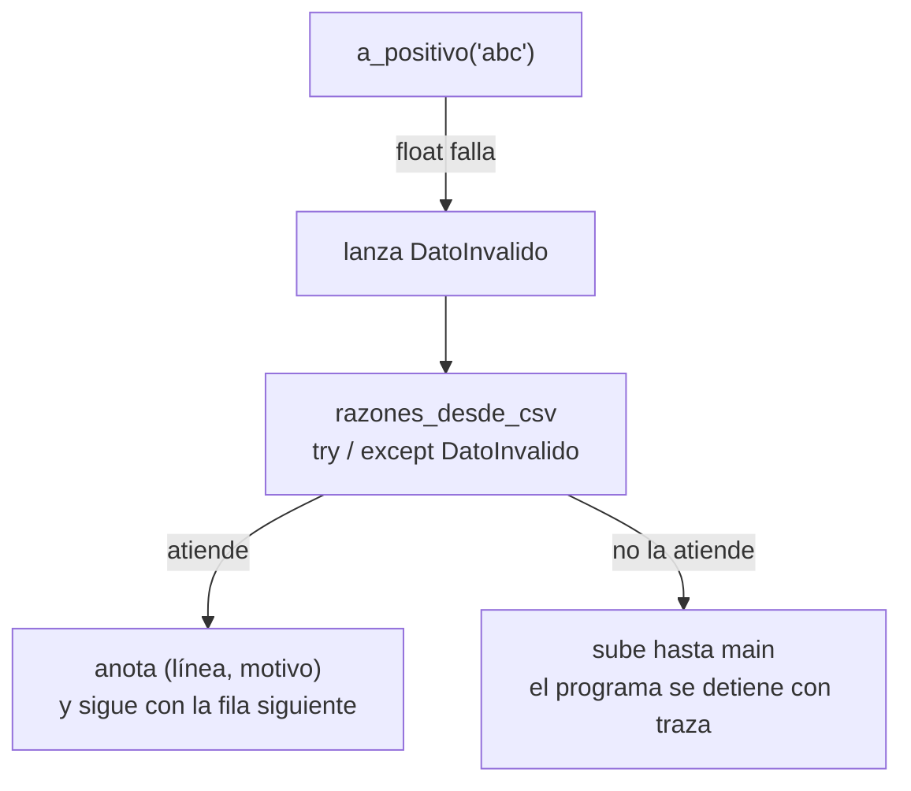

# B07-C12 — Manejo de errores y excepciones

<!-- nav:top -->
[🏠 Programa](../../../../README.md) · [📚 Bloque B07](../../../tronco-comun/B07-informatica-cientifica-desde-cero.md) · [← Anterior: B07-C11 — Gestión de unidades en programas](../B07-C11-gestion-de-unidades-en-programas/CLASE.md) · [Siguiente: B07-C13 — Entornos y dependencias con uv →](../../../tronco-comun/B07-informatica-cientifica-desde-cero.md#b07-c13)
<!-- /nav -->

## 1. Ubicación, nivel y alcance

Duodécima clase del bloque B07 y cierre de su tramo de programación básica. Hasta ahora los errores te detenían el programa con un mensaje que no sabías interpretar. Aquí aprendes a **leerlos**, a **provocarlos a propósito** cuando un dato es inválido y a **tratarlos** sin ocultarlos. Nivel N1–N2.

Verás tipos de error, trazas, `try`/`except`/`else`/`finally`, `raise`, excepciones propias y la diferencia entre validar y afirmar. No verás registro avanzado (`logging`) ni pruebas con `pytest` ([B07-C17](../B07-C17-pruebas-de-funciones-matematicas/CLASE.md)).

## 2. Por qué esta clase existe

Un programa científico recibe archivos con huecos, texto donde esperaba un número y valores imposibles (un período negativo). Hay dos malas respuestas: dejar que el programa se caiga sin explicar nada y, peor, **seguir en silencio** con un valor inválido (`nan`, `0`) que contamina el resultado final. Una buena respuesta se detiene, dice qué falló y dónde, o aísla el dato malo y lo cuenta.

La pregunta motivadora es: **¿qué debe hacer mi programa cuando algo sale mal, de modo que yo y quien me lea podamos confiar en el resultado?** La decisión central es dónde validar, qué error lanzar, qué tratar y qué dejar subir.

## 3. Lo que podrás hacer al terminar

1. Leer una traza de error e identificar tipo, mensaje y línea.
2. Distinguir errores de sintaxis de excepciones en ejecución.
3. Usar `try`, `except`, `else` y `finally` con el alcance mínimo.
4. Lanzar `ValueError` u otra excepción propia con un mensaje útil.
5. Evitar capturar todo (`except:` sin tipo) y ocultar errores.
6. Decidir entre validar con `raise` y comprobar con `assert`.

La evidencia es la **tabla de errores tratados** del ejercicio 12 (sección 20).

## 4. Con qué llegas y cómo comprobarlo

Necesitas C01–C11. Cinco preguntas:

1. ¿Qué hace `float("abc")`?
2. ¿Qué hace `assert x > 0`?
3. ¿Qué es una función?
4. ¿Qué hace `with open(...) as f`?
5. ¿Qué es un caso borde?

<details>
<summary>Ver respuestas</summary>

1. Falla con `ValueError`. 2. Detiene el programa con `AssertionError` si `x > 0` es falso. 3. Un bloque con nombre que recibe datos y devuelve un valor. 4. Abre el archivo y lo cierra al salir del bloque. 5. Una entrada extrema o inusual donde suelen esconderse errores.
</details>

Con cuatro o cinco aciertos, sigue; con tres o menos, repasa C02, C06 y C08.

## 5. Un caso real: datos planetarios que no son lo que dicen ser

Retomas la razón de Kepler `T²/a³` de C03 y C06 con los datos del NASA NSSDC (S1). Con el CSV publicado todo va bien. Pero a una función real le llegan también: un semieje negativo, un texto en lugar de número, un período igual a cero, una celda vacía, un archivo que no existe. Un archivo **sintético** inventado para esta clase (`datos_sinteticos_invalidos.csv`) reúne cuatro de esos casos. El **ejemplo conductor** es la función que calcula la razón y lo que hace con cada entrada mala: o lanza un error claro, o aísla la fila y cuenta el problema.

## 6. Vocabulario

Un **error de sintaxis** ocurre cuando el código no es Python válido, antes de ejecutarse; una **excepción** ocurre durante la ejecución y puede tratarse (S2, §8.1–8.2). La **traza** (*traceback*) muestra la cadena de llamadas; su última línea dice el tipo y el mensaje. Ejemplos de tipos: `ZeroDivisionError`, `ValueError` (valor del tipo correcto pero inaceptable), `TypeError` (tipo incorrecto), `IndexError`, `KeyError`, `NameError`, `FileNotFoundError`. `try` encierra el código que podría fallar; `except Tipo` define qué hacer; `else` se ejecuta solo si no hubo excepción; `finally` se ejecuta siempre (S2, §8.3). `raise` lanza una excepción (S2, §8.4). Una **excepción propia** es una clase que heredas de otra (aquí `DatoInvalido(ValueError)`). **Validar** es comprobar la entrada y avisar si es inválida; **afirmar** (`assert`) es comprobar una condición que el programador cree siempre cierta. Un **valor centinela** (`nan`, `None`, `-1`) es un valor especial que marca «sin dato».

## 7. Modelo mental: la cadena de avisos

Una excepción es una alarma que sube por la pila de llamadas hasta que alguien la atiende. Si nadie la atiende, el programa se detiene y muestra la traza. `except` es el lugar donde decides atenderla.



*Descripción textual:* una llamada a `a_positivo('abc')` falla al convertir y lanza `DatoInvalido`. La función que lee el CSV puede atender la excepción con `try/except`, anotando la línea y el motivo y siguiendo con la fila siguiente; si no la atiende, la excepción sube hasta el programa principal y lo detiene mostrando la traza.

**Límite de la analogía:** una alarma real avisa a alguien con autoridad; en un programa, quien captura la excepción puede «apagar la alarma» sin resolver nada. Capturar no es arreglar.

## 8. La explicación, paso a paso

### 8.1 Leer una traza

La traza se lee de abajo hacia arriba: la última línea es el tipo y el mensaje (`ValueError: invalid literal for int() with base 10: 'abc'`); las líneas anteriores muestran dónde ocurrió. Ejemplos reales:

```text
1/0              -> ZeroDivisionError: division by zero
int("abc")       -> ValueError: invalid literal for int() with base 10: 'abc'
[1,2][5]         -> IndexError: list index out of range
{"a":1}["b"]     -> KeyError: 'b'
undefined_name   -> NameError: name 'undefined_name' is not defined
"a" + 1          -> TypeError: can only concatenate str (not "int") to str
open("no.txt")   -> FileNotFoundError: [Errno 2] No such file or directory: 'no.txt'
```

Los nombres de las excepciones estándar no son palabras reservadas (S2). Un error de sintaxis, en cambio, impide ejecutar: Python señala la línea, aunque el origen puede estar un poco antes (S2, §8.1).

### 8.2 `try` / `except`

```python
try:
    valor = float(texto)
except ValueError:
    raise DatoInvalido(f"'{texto}' no es un número") from None
```

Si `float(texto)` falla con `ValueError`, el bloque `except` se ejecuta. Capturas **el tipo concreto que esperas**, no todos: un `except:` sin tipo atrapa también errores de programación y los esconde. Se puede capturar varios tipos con una tupla (`except (ValueError, KeyError):`) y una clase coincide con sus subclases (S2).

### 8.3 `else` y `finally`

`else` se ejecuta si el `try` no lanzó nada; ponerlo ahí evita capturar excepciones que el código protegido no produjo (S2). `finally` se ejecuta siempre, haya o no excepción, y sirve para liberar recursos (cerrar un archivo): una función con `try: return 1 / finally: print(...)` imprime y luego devuelve `1`. Un `return` dentro de `finally` anula la excepción: evítalo (S2).

### 8.4 `raise`: lanzar tus propios errores

`raise ValueError("mensaje")` detiene la función con un error que **tú** describes. Un buen mensaje dice qué dato, qué valor y qué se esperaba: `semieje: -5.0 no es positivo`. Con `raise ... from None` se oculta la cadena interna cuando solo confunde; sin él, Python muestra la excepción original como contexto. Un `raise` solo, dentro de un `except`, vuelve a lanzar la excepción actual (S2, §8.4).

### 8.5 Excepciones propias y jerarquía

`class DatoInvalido(ValueError): ...` crea una excepción más específica que `ValueError` y que se puede capturar como `ValueError`. El orden de los `except` importa: pon primero la más específica, porque Python usa la primera que coincide.

### 8.6 Validar frente a afirmar

Para **entradas** (datos, archivos, argumentos), valida y lanza `raise`: es parte del comportamiento del programa. `assert` es para comprobaciones internas y pruebas, y **se desactiva** si ejecutas Python con la opción `-O` (probado: `python -O` no evalúa el `assert`). Si tu validación es un `assert`, un cambio de modo de ejecución la borra en silencio.

### 8.7 `nan` y los centinelas

`float("nan")` es un número válido para Python, y `nan > 0` da `False`. Por eso la validación se escribe `if not valor > 0:` (que también rechaza `nan`) y no `if valor <= 0:` (que lo dejaría pasar, porque `nan <= 0` también es `False`). Evita centinelas como `-1` o `0` que parecen datos; prefiere `None` o `nan` y trátalos de forma explícita.

## 9. Magnitudes, símbolos y unidades

| Elemento | Qué es | Ejemplo |
|---|---|---|
| `ValueError` | valor inaceptable del tipo correcto | `float("abc")` |
| `TypeError` | tipo incorrecto | `"a" + 1` |
| `KeyError`/`IndexError` | clave o índice inexistente | `d["b"]`, `l[5]` |
| `FileNotFoundError` | archivo inexistente | `open("no.txt")` |
| `DatoInvalido(ValueError)` | excepción propia del laboratorio | semieje ≤ 0 |
| `nan` | «no es un número» | `float("nan")` |

Los datos son los de siempre (semieje en 10⁶ km, período en d); los errores no tienen unidad pero sí un mensaje con la magnitud afectada.

## 10. Convenciones y referencias

Capturar el tipo más específico posible. Mensajes con qué, dónde y qué se esperaba. No usar `except:` sin tipo. No capturar para ocultar. Validar entradas con `raise`; usar `assert` en pruebas. Informar siempre cuántas filas se rechazaron. Python 3.12.9.

## 11. De dónde sale lo que afirmamos

| ID | Fuente | Localizador | Respalda | Estado |
|---|---|---|---|---|
| S1 | NASA NSSDC, fichas individuales de planetas | https://nssdc.gsfc.nasa.gov/planetary/factsheet/ | Semieje mayor y período sidéreo | Leídas el 2026-11-05 (mutables) |
| S2 | Python Software Foundation, *The Python Tutorial* 3.12, §8 Errors and Exceptions (§8.1–8.4) | https://docs.python.org/3.12/tutorial/errors.html | Sintaxis frente a excepción, `try`/`except`/`else`/`finally`, `raise`, subclases | Leída el 2026-11-05 |
| S3 | Python Software Foundation, *The Python Standard Library* 3.12, `math` | https://docs.python.org/3.12/library/math.html | `isclose`, errores de `sqrt` con negativos | Leída el 2026-11-05 |

Límites: el comportamiento de `nan` y de `python -O` se **verificó ejecutando** Python 3.12.9, no en la documentación. No se consultó la lista completa de excepciones estándar.

## 12. Cómo ver el flujo

El laboratorio imprime cada entrada mala con el error que provoca y, para el archivo sintético, la lista de (línea, motivo). El diagrama de la sección 7 es su versión visual y tiene descripción textual; las tablas son la versión accesible.

## 13. Ejemplo trabajado: tres entradas malas

**Entrada 1: `"abc"` como semieje.** `float("abc")` lanza `ValueError`; la función lo captura y lanza `DatoInvalido: semieje: 'abc' no es un número`. **Entrada 2: `"-1"`.** `float` funciona; `not -1.0 > 0` es verdadero: `DatoInvalido: semieje: -1.0 no es positivo`. **Entrada 3: `"nan"`.** `float("nan")` funciona; `not nan > 0` es verdadero porque `nan > 0` es falso: `DatoInvalido: semieje: nan no es positivo`. Con `if valor <= 0` la tercera pasaría sin avisar.

**Paso final · incertidumbre.** La función detecta datos **imposibles**, no datos **incorrectos pero válidos**: un semieje de `1.5` en lugar de `150` pasa sin quejas. Y aislar las filas malas deja un resultado construido con menos datos: el informe debe decir cuántos se perdieron (aquí 4 de 5) para que nadie tome una muestra del 20 % por el conjunto completo.

## 14. Distintas estrategias ante un error

(1) **Fallar rápido**: lanzar y detener; es lo mejor cuando continuar sería engañoso. (2) **Aislar y contar**: seguir con los datos buenos e informar los malos; sirve para lotes grandes, siempre que se informe. (3) **Reparar**: reemplazar un valor por otro razonable; es peligroso y debe documentarse explícitamente. (4) **Reintentar**: para fallos transitorios como la red. Criterio: ¿qué haría peor al resultado, parar o seguir? En ciencia, ante la duda, parar o informar.

## 15. Práctica guiada

**Ejercicio 1 · con los pasos indicados.** Di qué excepción produce cada línea: `1/0`, `int("abc")`, `[1, 2][5]`, `{"a": 1}["b"]`. *Pasos:* mira la sección 8.1.

<details><summary>Solución comentada</summary>

`ZeroDivisionError`, `ValueError`, `IndexError` y `KeyError`. Cada una dice en su mensaje qué ocurrió.
</details>

**Ejercicio 2 · con una pista.** ¿Qué imprime `f()` y qué devuelve si `def f(): try: return 1 finally: print("fin")`? *Pista:* `finally` corre siempre.

<details><summary>Solución comentada</summary>

Imprime `fin` y luego devuelve `1`. El `finally` se ejecuta antes de que la función termine, aunque ya haya un `return`.
</details>

**Ejercicio 3 · casi autónomo.** Escribe una función `a_positivo(texto)` que devuelva un `float` positivo o lance `ValueError` con un mensaje claro.

<details><summary>Solución comentada</summary>

`valor = float(texto)` dentro de un `try` con `except ValueError` que relance con mensaje; luego `if not valor > 0: raise ValueError(...)`. Usa `not valor > 0` para rechazar `nan`.
</details>

## 16. Práctica autónoma, transferencia e integrador

**Ejercicio 4.** ¿Por qué `except:` sin tipo es mala idea?

<details><summary>Solución comentada</summary>

Captura cualquier error, incluidos los de programación (un `NameError` por un nombre mal escrito) y oculta su causa. Captura solo lo que sabes tratar.
</details>

**Ejercicio 5.** ¿Qué da `float("nan") > 0`? ¿Qué validación correcta evita que `nan` pase?

<details><summary>Solución comentada</summary>

`False`. La validación `if not valor > 0: raise ...` lo rechaza; `if valor <= 0` no (también da `False`).
</details>

**Ejercicio 6.** ¿Qué mensaje da `open("no.txt")` si el archivo no existe? ¿Cómo lo reinterpretarías para el usuario?

<details><summary>Solución comentada</summary>

`FileNotFoundError: [Errno 2] No such file or directory: 'no.txt'`. Se captura y se relanza con un texto como «no existe el archivo de datos: no.txt», sin la ruta completa si no hace falta.
</details>

**Ejercicio 7.** Escribe `masa_a_kg(valor)` que lance `ValueError` si `valor` es negativo.

<details><summary>Solución comentada</summary>

`if valor < 0: raise ValueError(f"masa negativa: {valor}")` y `return valor * 1e24` si la entrada está en 10²⁴ kg. Documenta la unidad en la docstring.
</details>

**Ejercicio 8.** Si capturas `except ValueError` antes de `except DatoInvalido` (subclase), ¿cuál se ejecuta para un `DatoInvalido`?

<details><summary>Solución comentada</summary>

El de `ValueError`, porque coincide primero (una clase coincide con sus subclases) y el segundo nunca se alcanza. Pon el más específico primero.
</details>

**Ejercicio 9 · transferencia.** Un instrumento escribe `"N/A"` en las lecturas fallidas de un CSV. ¿Cómo las tratas sin que se cuelen en la media?

<details><summary>Solución comentada</summary>

Convertir `"N/A"` a `None` (o `nan`) al leer, contar cuántas hay, excluirlas explícitamente del cálculo (`[x for x in lecturas if x is not None]`) e informar el recuento. No las reemplaces por 0.
</details>

**Ejercicio 10 · transferencia.** Un colega envuelve todo su programa en `try/except Exception: pass` para que «no se caiga». ¿Qué le dices?

<details><summary>Solución comentada</summary>

Que oculta fallos y puede entregar resultados incompletos o falsos sin aviso. Un programa científico debe fallar de forma visible o registrar lo que omitió y por qué.
</details>

**Ejercicio 11 · transferencia.** ¿Por qué validar con `assert` los datos de un archivo externo es un riesgo?

<details><summary>Solución comentada</summary>

Porque `assert` se desactiva con `python -O` y es un mecanismo para comprobaciones internas y pruebas. La validación de entradas debe hacerse con `raise`, que siempre se ejecuta.
</details>

**Ejercicio 12 · integrador.** Entrega una **tabla de errores tratados**: al menos seis entradas malas distintas, el error que provoca cada una (tipo y mensaje reales, ejecutados), la decisión (fallar, aislar o reparar) y su justificación, más una función con `try/except/else/finally` y pruebas.

<details><summary>Solución modelo</summary>

Puedes partir de las tres entradas de la sección 13, el archivo inexistente, la fila con período cero y la celda vacía. Cada fila con el mensaje real obtenido al ejecutar y una decisión coherente (por ejemplo, aislar y contar en lote; fallar si es el único dato). Se acepta cualquier tabla con salidas copiadas de una ejecución.
</details>

## 17. Laboratorio: validar, lanzar y aislar

El script [lectura_robusta.py](lectura_robusta.py) define `DatoInvalido`, `a_positivo`, `razon_kepler` (que valida) y `razones_desde_csv` (que usa `try/except/else/finally`, informa filas rechazadas y cierra el archivo siempre). Antes de imprimir comprueba los mensajes exactos de cada error, la razón de la Tierra (1 dentro de 1e-12), las ocho razones del CSV publicado a ±2 %, que un archivo inexistente lance `FileNotFoundError` y que el archivo [datos_sinteticos_invalidos.csv](datos_sinteticos_invalidos.csv) dé una razón válida y cuatro problemas en las líneas 3 a 6.

**Datos:** `planetas_nssdc.csv` publicado (NASA, desde C08); `datos_sinteticos_invalidos.csv` **sintético**. **Predice antes de ejecutar:** ¿cuántos problemas en el archivo sintético? (Cuatro.) **Resultados (2026-11-05, Python 3.12.9):**

```text
python 3.12.9 | pruebas OK
planetas_nssdc.csv: 8 razones, 0 problemas
  entrada 'abc'  -> DatoInvalido: semieje: 'abc' no es un número
  entrada '-1'   -> DatoInvalido: semieje: -1.0 no es positivo
  entrada 'nan'  -> DatoInvalido: semieje: nan no es positivo
datos_sinteticos_invalidos.csv: 1 razón válida, 4 problemas
  línea 3: semieje: -5.0 no es positivo
  línea 4: semieje: 'abc' no es un número
  línea 5: período: 0.0 no es positivo
  línea 6: período: '' no es un número
  archivo inexistente -> no existe el archivo de datos: no_existe.csv
```

```bash
python programa/clases/B07/B07-C12-manejo-de-errores-y-excepciones/lectura_robusta.py
```

**Límites:** valida que los números sean positivos, no que sean correctos; no registra los problemas en un archivo; el archivo sintético no representa datos reales.

## 18. Errores frecuentes y cómo corregirlos

**`except:` sin tipo.** Se corrige con el ejercicio 4.

**Capturar y no hacer nada.** Se corrige con el ejercicio 10.

**Validar con `assert`.** Se corrige con el ejercicio 11.

**Dejar pasar `nan`.** Se corrige con el ejercicio 5.

**Informar un resultado sin decir cuántos datos se descartaron.** Se corrige con la sección 13.

## 19. Cómo sabrás que vas bien

Tras 8.1: ¿lees una traza sin ayuda y dices qué falló? Si no, ejercicio 1. Tras 8.3: ¿predices qué imprime una función con `finally`? Si no, ejercicio 2. Tras 8.6: ¿explicas por qué no validar con `assert`? Si no, ejercicio 11. Tras el laboratorio: ¿qué hace tu programa con el 80 % de filas malas? Si no lo sabes, relee la sección 13. Al final: ¿qué error de tu tabla ocultaría el peor daño? Si no lo identificas, ejercicio 10.

## 20. Qué entregas y cómo se evalúa

El producto es tu **tabla de errores tratados**: entradas malas, error real provocado, decisión y justificación, más el código y sus pruebas.

| Criterio | Inicial | En desarrollo | Logrado | Destacado |
|---|---|---|---|---|
| Lectura de errores | No los interpreta | Los nombra | Los explica | Rastrea la causa desde la traza |
| Tratamiento | Oculta o ignora | Captura general | Captura específica | Justifica cada decisión |
| Mensajes | Vagos | Con el tipo | Con qué, dónde y esperado | Útiles para quien no programa |
| Honestidad | No informa descartes | Informa a medias | Informa cuántos | Cuantifica el efecto en el resultado |

**Condiciones críticas:** no ocultar errores; no validar con `assert`; informar los datos descartados; citar solo fuentes consultadas.

## 21. Ética, seguridad y límites

Un programa que oculta errores produce resultados que parecen fiables y no lo son: es una forma de engaño involuntario. Los mensajes de error no deben incluir datos personales, credenciales ni rutas sensibles. No ejecutes ni evalúes texto procedente de un archivo (`eval`). Material educativo; no sustituye la revisión de software crítico.

## 22. Para cerrar y seguir

Una excepción es una alarma que sube por la pila; la atiendes con `try/except` específico, la lanzas con `raise` cuando un dato es inválido y nunca la ocultas. Validar entradas con `raise` y aislar filas malas informando cuántas fueron es la práctica honesta. Queda abierta la pregunta de cómo asegurarte de que el entorno donde corre tu programa sea el mismo en cualquier máquina.

**Glosario español–inglés.** error de sintaxis · *syntax error*; excepción · *exception*; traza · *traceback*; lanzar · *to raise*; capturar · *to catch*; validar · *to validate*; afirmar · *to assert*; centinela · *sentinel*.

**Continuidad.** [B07-C13](../B07-C13-entornos-y-dependencias-con-uv/CLASE.md) usa tu capacidad de **leer y tratar errores** para entender un error muy frecuente: `ModuleNotFoundError`, que aparece cuando el entorno no tiene instaladas las bibliotecas que el programa necesita.

**Referencias:** ver sección 11.

<!-- nav:bottom -->
---

[← Anterior: B07-C11 — Gestión de unidades en programas](../B07-C11-gestion-de-unidades-en-programas/CLASE.md) · [📚 Bloque B07](../../../tronco-comun/B07-informatica-cientifica-desde-cero.md) · [Siguiente: B07-C13 — Entornos y dependencias con uv →](../../../tronco-comun/B07-informatica-cientifica-desde-cero.md#b07-c13)
<!-- /nav -->
