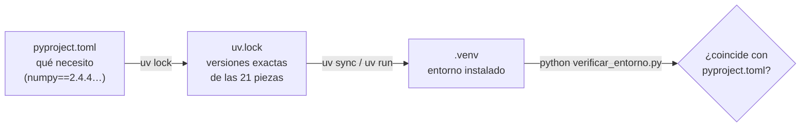

# B07-C13 — Entornos y dependencias con uv

<!-- nav:top -->
[🏠 Programa](../../../../README.md) · [📚 Bloque B07](../../../tronco-comun/B07-informatica-cientifica-desde-cero.md) · [← Anterior: B07-C12 — Manejo de errores y excepciones](../B07-C12-manejo-de-errores-y-excepciones/CLASE.md) · [Siguiente: B07-C14 — Control de versiones con Git →](../B07-C14-control-de-versiones-con-git/CLASE.md)
<!-- /nav -->

## 1. Ubicación, nivel y alcance

Decimotercera clase del bloque B07 y primera del tramo de **herramientas de trabajo reproducible**. Los laboratorios anteriores necesitaban NumPy, Matplotlib o Astropy «ya instalados». Aquí aprendes a declarar qué necesita un proyecto, a crear un **entorno aislado** a partir de esa declaración y a fijar las versiones exactas para que otra persona (o tú dentro de un año) obtenga el mismo entorno. Usamos **uv**, la herramienta que prefiere este repositorio. Nivel N1–N2.

Verás entorno virtual, dependencia, `pyproject.toml`, `uv init`, `uv add`, `uv run`, `uv lock`, `uv sync` y la verificación de que lo instalado coincide con lo declarado. No verás empaquetado ni publicación de bibliotecas, ni Docker.

## 2. Por qué esta clase existe

«En mi computador funciona» es la frase más cara de la informática científica: el programa depende, sin decirlo, de la versión de Python y de cada biblioteca instalada. Si cambian, los resultados pueden cambiar o el programa fallar con un `ModuleNotFoundError`. Un entorno declarado y fijado convierte esa dependencia oculta en un archivo que se revisa y se versiona.

La pregunta motivadora es: **¿cómo consigo que mi programa se ejecute igual en otra máquina y en otra fecha?** La decisión central es qué declarar (dependencias directas), qué fijar (versiones exactas con un archivo de bloqueo) y cómo comprobar que el entorno real coincide con el declarado.

## 3. Lo que podrás hacer al terminar

1. Explicar qué es un entorno virtual y por qué se usa uno por proyecto.
2. Leer un `pyproject.toml` y distinguir dependencias de ejecución y de desarrollo.
3. Crear un proyecto con `uv init`, añadir dependencias con `uv add` y ejecutar con `uv run`.
4. Explicar qué guarda `uv.lock` y por qué se versiona.
5. Verificar con un script que las versiones instaladas coinciden con las declaradas.
6. Reconocer y diagnosticar un `ModuleNotFoundError` o un entorno dañado.

La evidencia es el **proyecto reproducible** del ejercicio 12 (sección 20).

## 4. Con qué llegas y cómo comprobarlo

Necesitas C01–C12 y saber abrir una terminal (se profundiza en [B07-C15](../B07-C15-terminal-y-rutas-de-archivos/CLASE.md)). Cinco preguntas:

1. ¿Qué hace `import numpy`?
2. ¿Qué error aparece si el módulo no está instalado?
3. ¿Qué es un diccionario?
4. ¿Qué es un número de versión como `2.4.4`?
5. ¿Qué significa que un resultado sea reproducible?

<details>
<summary>Ver respuestas</summary>

1. Carga el módulo `numpy` para usar sus nombres. 2. `ModuleNotFoundError`. 3. Una colección de pares clave-valor. 4. Un identificador del estado del software; cambiar el número significa que el código cambió. 5. Que otra persona con los mismos datos y los mismos pasos obtiene el mismo resultado.
</details>

Con cuatro o cinco aciertos, sigue; con tres o menos, repasa C06 y C12.

## 5. Un caso real: el entorno de los laboratorios del bloque

Los laboratorios de B07 usan cuatro bibliotecas (NumPy, Matplotlib, Astropy y PyYAML) y una herramienta de pruebas (pytest). Cada una tiene una versión; combinaciones distintas pueden dar comportamientos distintos. La carpeta [proyecto_laboratorios](proyecto_laboratorios/pyproject.toml) declara el entorno con versiones exactas (Python 3.12; NumPy 2.4.4; Matplotlib 3.10.8; Astropy 8.0.2; PyYAML 6.0.3; pytest 9.2.0) y trae su archivo de bloqueo `uv.lock`. El script `verificar_entorno.py` responde a una pregunta concreta: **¿el entorno en el que estoy corriendo coincide con lo declarado?** Ese par de archivos es el **ejemplo conductor**.

## 6. Vocabulario

Un **entorno virtual** es una carpeta con su propio intérprete de Python y sus propios paquetes, aislada del resto del sistema; permite que proyectos con versiones incompatibles convivan (S1). Una **dependencia** es un paquete que tu programa necesita. Las **dependencias de ejecución** se instalan siempre; las de **desarrollo** (por ejemplo, la herramienta de pruebas) solo para quien trabaja en el proyecto (S2). **`pyproject.toml`** es el archivo del proyecto que declara su nombre, versión de Python requerida y dependencias (S3). Un **archivo de bloqueo** (`uv.lock`) registra las versiones exactas resueltas de todas las dependencias, incluidas las indirectas, y es multiplataforma (S3). **Resolver** es calcular un conjunto de versiones compatibles entre sí. **Sincronizar** (`uv sync`) es instalar en el entorno lo que dicta el archivo de bloqueo. `uv run` ejecuta un comando dentro del entorno del proyecto, comprobando antes que el bloqueo y el entorno estén al día (S4). **Fijar** una versión es escribirla con `==`.

## 7. Modelo mental: de la declaración al entorno



*Descripción textual:* el archivo `pyproject.toml` declara qué necesitas; `uv lock` lo convierte en `uv.lock`, con las versiones exactas de todas las piezas; `uv sync` o `uv run` instalan esas versiones en la carpeta `.venv`; y un script comprueba que lo instalado coincide con lo declarado.

**Límite de la analogía:** una receta de cocina («2 huevos») no cambia de un día para otro; un paquete publicado sí puede desaparecer o cambiar de comportamiento si no fijas la versión, y el archivo de bloqueo no protege de cambios en el sistema operativo ni en el hardware.

## 8. La explicación, paso a paso

### 8.1 Qué es un entorno y por qué uno por proyecto

Python instalado en el sistema comparte sus paquetes con todos los programas. Si el proyecto A necesita NumPy 1.x y el B, NumPy 2.x, no caben juntos. Un entorno virtual les da a cada uno su carpeta propia (S1). La forma «de fábrica» es `python -m venv .venv`, activarlo (`.venv\Scripts\activate` en Windows, `source .venv/bin/activate` en Linux o macOS) y usar `python -m pip install ...`; `uv` automatiza todo eso y además bloquea versiones (S1, S4).

### 8.2 El archivo `pyproject.toml`

El del laboratorio declara: `requires-python = ">=3.12,<3.13"`, la lista `dependencies` (NumPy, Matplotlib, Astropy y PyYAML con `==`) y un grupo `dev` con pytest. `uv add` escribe en `project.dependencies`; con `--dev`, en `dependency-groups` (S2). El formato `TOML` es texto simple: `clave = valor`, listas entre corchetes.

### 8.3 Crear un proyecto y añadir dependencias

En una carpeta vacía, `uv init --no-package --python 3.12 orbita` crea `.python-version`, `README.md`, `main.py` y `pyproject.toml` con `dependencies = []`; sin `--no-package`, el proyecto se crea como aplicación con paquete en `src/` (S5). Luego `uv add "numpy==2.4.4"` crea `.venv`, resuelve las versiones, descarga e instala y escribe en `pyproject.toml`: `dependencies = ["numpy==2.4.4"]`. Es lo que ocurrió en la ejecución de preparación de esta clase (Python 3.12.9, uv 0.13.7): `Resolved 2 packages`, `Installed 1 package`, ` + numpy==2.4.4`.

### 8.4 `uv.lock`: el bloqueo

`uv lock` crea o actualiza `uv.lock`, que guarda cada paquete con su versión, de dónde se descarga y su huella (hash). Para el proyecto del laboratorio resolvió **21 paquetes** (el propio proyecto, los 5 paquetes declarados y 15 indirectos, como `pillow` o `pyerfa`) y el archivo ocupa unos 43 KB. `uv lock --check` verifica que el bloqueo esté al día sin modificarlo; `--locked` hace que un comando falle en vez de actualizarlo; `--frozen` usa el bloqueo sin comprobar (S4). La documentación indica que `uv.lock` **se versiona** (se sube al repositorio) para obtener instalaciones iguales en distintas máquinas, y que `.venv` **no** (S3).

### 8.5 `uv run` y `uv sync`

`uv run --locked --project proyecto_laboratorios python verificar_entorno.py` ejecuta el script en el entorno del proyecto, creándolo o actualizándolo si falta (S4). `uv sync` instala exactamente lo del bloqueo y quita lo sobrante; `uv run` deja lo extra (S4). Con `uv run` no necesitas activar nada.

### 8.6 Comprobar que lo instalado es lo declarado

El script `verificar_entorno.py` lee `pyproject.toml` con `tomllib` (biblioteca estándar), pregunta a `importlib.metadata` qué versión hay instalada de cada paquete y lista las discrepancias. Ejecutado en el entorno del proyecto, todo coincide. Ejecutado con el `python` del sistema, que no se creó desde el proyecto, detecta dos diferencias: Astropy no está y pytest es 9.1.1 en lugar de 9.2.0. El **mismo programa** pudo comportarse distinto en esas dos máquinas.

### 8.7 Un obstáculo real: rutas largas en Windows

Al crear el `.venv` dentro de la carpeta del repositorio en el equipo de pruebas (una ruta de más de 200 caracteres), el entorno quedó **dañado**: NumPy no podía cargar su extensión y `pytest` fallaba con `ModuleNotFoundError`. Instalando el entorno en una ruta corta, por medio de la variable de entorno `UV_PROJECT_ENVIRONMENT=C:/Users/.../uvenv_b07`, todo funcionó. La causa probable es el límite de longitud de ruta de Windows, pero **no se verificó en la documentación**: es lo que se observó. La lección general es que un entorno falla por motivos que el programa no muestra, y por eso se verifica con un script como el de 8.6.

### 8.8 Un `ModuleNotFoundError`, diagnosticado

Si `import astropy` falla con `ModuleNotFoundError`, hay tres causas típicas: no está instalado, estás ejecutando otro Python (el del sistema en vez del entorno) o el entorno está dañado. Pregunta a Python qué intérprete usa (`python -c "import sys; print(sys.executable)"`) y qué versión hay (`python -m pip show astropy`).

## 9. Magnitudes, símbolos y unidades

| Elemento | Qué es | Ejemplo |
|---|---|---|
| `requires-python` | versiones de Python aceptadas | `>=3.12,<3.13` |
| `==` | versión exacta | `numpy==2.4.4` |
| `uv.lock` | versiones resueltas de todos los paquetes | 21 paquetes, ≈ 43 KB |
| `.venv` | entorno instalado | no se versiona |
| `uv lock --check` | comprobar el bloqueo | no modifica |

No hay magnitudes físicas en esta clase; las «unidades» son los números de versión, que identifican de manera exacta el software.

## 10. Convenciones y referencias

Un proyecto, un entorno. Dependencias directas con versión exacta si el resultado debe ser reproducible bit a bit; con rangos si es una biblioteca para otros. `uv.lock` se sube al repositorio; `.venv` no. Declarar la versión de Python. Ejecutar siempre con `uv run`. En esta clase: uv 0.13.7, Python 3.12.9.

## 11. De dónde sale lo que afirmamos

| ID | Fuente | Localizador | Respalda | Estado |
|---|---|---|---|---|
| S1 | Python Software Foundation, *The Python Tutorial* 3.12, §12 Virtual Environments and Packages | https://docs.python.org/3.12/tutorial/venv.html | Entornos virtuales, `python -m venv`, activación, `pip freeze` | Leída el 2026-11-05 |
| S2 | Astral, *uv: Managing dependencies* | https://docs.astral.sh/uv/concepts/projects/dependencies/ | `uv add`, `--dev`, tablas `project.dependencies` y `dependency-groups` | Leída el 2026-11-05 |
| S3 | Astral, *uv: Project structure and files* | https://docs.astral.sh/uv/concepts/projects/layout/ | `pyproject.toml`, `uv.lock` multiplataforma | Leída el 2026-11-05 |
| S4 | Astral, *uv: Locking and syncing* | https://docs.astral.sh/uv/concepts/projects/sync/ | `uv lock`, `uv sync`, `uv run`, `--locked`, `--frozen`, `--check` | Leída el 2026-11-05 |
| S5 | Astral, *uv: Creating projects* | https://docs.astral.sh/uv/concepts/projects/init/ | `uv init`, `--no-package`, archivos creados | Leída el 2026-11-05 |

Límites: los números de versión del documento de uv no se asocian a la versión instalada (0.13.7); las páginas de uv son mutables. El comportamiento de `UV_PROJECT_ENVIRONMENT` y la causa de las rutas largas se **observaron ejecutando**, no en la documentación. Se leyeron las páginas de uv; no se consultó la de instalación ni la de Python gestionado.

## 12. Cómo ver el resultado

La salida del script es una tabla de cinco filas (declarado frente a instalado) y un veredicto de una línea; es la versión accesible. El diagrama de la sección 7 tiene descripción textual. El propio `uv tree` imprime las dependencias en forma de árbol de texto.

## 13. Ejemplo trabajado: del proyecto vacío al entorno verificado

**Paso 1.** `uv init --no-package --python 3.12 orbita` → carpeta con `pyproject.toml` (`dependencies = []`). **Paso 2.** `uv add "numpy==2.4.4"` → crea `.venv`, resuelve 2 paquetes (el proyecto y NumPy), instala `numpy==2.4.4` y deja `dependencies = ["numpy==2.4.4"]` más un `uv.lock`. **Paso 3.** `uv run python -c "import numpy, sys; print(sys.version.split()[0], numpy.__version__)"` imprime `3.12.9 2.4.4`. **Paso 4.** `uv lock --check` responde `Resolved 2 packages` sin cambiar nada. **Paso 5.** `uv tree` muestra `orbita v0.1.0` y `└── numpy v2.4.4`.

**Paso final · incertidumbre.** El bloqueo garantiza las **versiones de los paquetes**, no el resultado completo: dependen también del sistema operativo, del procesador (algunas operaciones numéricas varían en la última cifra) y de los datos. Un entorno idéntico hace el resultado reproducible **con alta probabilidad**, no con certeza absoluta; la reproducibilidad plena exige además declarar datos, semillas y plataforma (C19).

## 14. Distintas formas de gestionar entornos

`venv` + `pip` es el método estándar y no necesita nada extra, pero no bloquea versiones indirectas por sí solo (se puede aproximar con `pip freeze > requirements.txt`, S1). `conda` gestiona también paquetes que no son de Python; no se consultó aquí. `uv` une entorno, resolución, bloqueo y ejecución en una herramienta rápida. Criterio: usa uno por proyecto, déjalo escrito en el repositorio y verifica el resultado con un script o una prueba.

## 15. Práctica guiada

**Ejercicio 1 · con los pasos indicados.** Lee este fragmento y di qué instalaría: `dependencies = ["numpy==2.4.4"]`. *Pasos:* nombre, operador, versión.

<details><summary>Solución comentada</summary>

Instalaría el paquete `numpy` en la versión exacta 2.4.4 (`==`); cualquier otra versión no cumpliría la declaración.
</details>

**Ejercicio 2 · con una pista.** ¿Qué diferencia hay entre `uv sync` y `uv run`? *Pista:* qué hacen con paquetes sobrantes.

<details><summary>Solución comentada</summary>

`uv sync` deja el entorno exactamente como dicta el bloqueo, quitando lo sobrante; `uv run` actualiza lo necesario y ejecuta, dejando los extras (S4).
</details>

**Ejercicio 3 · casi autónomo.** ¿Qué archivos subirías al repositorio y cuáles no: `pyproject.toml`, `uv.lock`, `.venv`, `.python-version`?

<details><summary>Solución comentada</summary>

Sí: `pyproject.toml`, `uv.lock` (S3) y `.python-version` (declara el Python deseado). No: `.venv`, que se reconstruye y es específico de la máquina.
</details>

## 16. Práctica autónoma, transferencia e integrador

**Ejercicio 4.** Con `verificar_entorno.py`, ¿por qué el `python` del sistema detecta 2 discrepancias y `uv run` 0?

<details><summary>Solución comentada</summary>

Porque el `python` del sistema no se creó desde `pyproject.toml`: le falta Astropy y su pytest es otra versión. `uv run` construye el entorno desde el bloqueo, así que coincide.
</details>

**Ejercicio 5.** Si cambias a mano `pyproject.toml` (pasas NumPy a 2.4.3) y ejecutas `uv lock --check`, ¿qué esperas?

<details><summary>Solución comentada</summary>

Que informe que el bloqueo está desactualizado (el archivo ya no corresponde a la declaración); `uv lock` lo regenera. La documentación dice que uv considera el bloqueo desactualizado cuando no coincide con `pyproject.toml` (S4).
</details>

**Ejercicio 6.** ¿Qué hace `--locked` en `uv run --locked ...`?

<details><summary>Solución comentada</summary>

Hace que el comando **falle** en lugar de actualizar un bloqueo desactualizado (S4); útil en integración continua, donde no debe haber cambios silenciosos.
</details>

**Ejercicio 7.** ¿Para qué sirve un grupo `dev`? Da un ejemplo del laboratorio.

<details><summary>Solución comentada</summary>

Para herramientas que solo necesita quien desarrolla, no quien ejecuta (S2). En el laboratorio, `pytest`.
</details>

**Ejercicio 8.** Tu script falla con `ModuleNotFoundError: No module named 'astropy'`. Lista tres causas y cómo distinguirlas.

<details><summary>Solución comentada</summary>

No está instalado (`python -m pip show astropy`), ejecutas otro Python (`python -c "import sys; print(sys.executable)"`) o el entorno está dañado (reconstruirlo). Ver 8.8.
</details>

**Ejercicio 9 · transferencia.** Un compañero te envía un script con «necesita numpy» y nada más. ¿Qué le pides para poder reproducir su resultado?

<details><summary>Solución comentada</summary>

La versión de Python, la lista de dependencias con versión exacta (o su `pyproject.toml` y `uv.lock`), los datos de entrada, las semillas aleatorias si las hay y el comando exacto con el que ejecutó.
</details>

**Ejercicio 10 · transferencia.** El entorno de un proyecto queda dañado por rutas largas. ¿Qué pruebas harías y cómo sabrías que se resolvió?

<details><summary>Solución comentada</summary>

Reproducir el fallo con `import numpy` en el entorno; recrear el entorno en una ruta corta (en el equipo de pruebas, mediante `UV_PROJECT_ENVIRONMENT`); ejecutar `verificar_entorno.py` y comprobar que da «todo coincide». La causa del daño es una hipótesis hasta comprobarla.
</details>

**Ejercicio 11 · transferencia.** ¿Por qué un entorno idéntico no garantiza un resultado idéntico?

<details><summary>Solución comentada</summary>

Porque también importan el sistema operativo, el procesador, los datos, las semillas aleatorias y el orden de ciertas operaciones numéricas (sección 13).
</details>

**Ejercicio 12 · integrador.** Entrega un **proyecto reproducible**: un `pyproject.toml` con versión de Python y dependencias exactas, su `uv.lock`, un script que verifique el entorno (puedes adaptar `verificar_entorno.py`) y el registro de tres ejecuciones: en el entorno del proyecto (todo coincide), fuera de él (discrepancias) y con una versión alterada a propósito.

<details><summary>Solución modelo</summary>

El proyecto de la carpeta `proyecto_laboratorios`, la salida «Entorno reproducible» con `uv run`, las dos discrepancias con el `python` del sistema y una modificación manual (por ejemplo, cambiar la versión de pytest a 9.1.1 y ejecutar `uv lock --check`, que debe señalar que el bloqueo está desactualizado). Se acepta cualquier combinación que muestre las tres situaciones con salidas reales.
</details>

## 17. Laboratorio: verificar el entorno

El script [verificar_entorno.py](verificar_entorno.py) comprueba que lo instalado coincide con [proyecto_laboratorios/pyproject.toml](proyecto_laboratorios/pyproject.toml). Antes de verificar ejecuta pruebas internas: separa `nombre==versión`, rechaza un requisito sin versión exacta, detecta discrepancias en un caso controlado y comprueba que el `pyproject.toml` declare 5 dependencias.

**Datos:** ninguno astronómico; versiones **declaradas** (en `pyproject.toml`) frente a **instaladas** (en el entorno). **Predice antes de ejecutar:** ¿qué dirá con el `python` del sistema? (Discrepancias.) **Resultados (2026-11-05, Python 3.12.9, uv 0.13.7):**

Con el entorno del proyecto:

```bash
uv run --locked --project proyecto_laboratorios python verificar_entorno.py
```

```text
python 3.12.9 | pruebas internas OK
  numpy       declarado 2.4.4   instalado 2.4.4
  matplotlib  declarado 3.10.8  instalado 3.10.8
  astropy     declarado 8.0.2   instalado 8.0.2
  pyyaml      declarado 6.0.3   instalado 6.0.3
  pytest      declarado 9.2.0   instalado 9.2.0
Entorno reproducible: todo coincide con pyproject.toml
```

Con el `python` del sistema (código de salida 1):

```bash
python verificar_entorno.py
```

```text
python 3.12.9 | pruebas internas OK
  numpy       declarado 2.4.4   instalado 2.4.4
  matplotlib  declarado 3.10.8  instalado 3.10.8
  astropy     declarado 8.0.2   instalado —
  pyyaml      declarado 6.0.3   instalado 6.0.3
  pytest      declarado 9.2.0   instalado 9.1.1
DISCREPANCIAS:
  - astropy: no instalado (declarado 8.0.2)
  - pytest: instalado 9.1.1, declarado 9.2.0
```

Para crear el entorno en una ruta corta (si tu ruta de trabajo es muy larga), define antes `UV_PROJECT_ENVIRONMENT` con la ruta del entorno (ver 8.7).

**Límites:** compara cadenas de versión exactas, no entiende rangos (`>=`); no comprueba dependencias indirectas ni el sistema operativo; solo verifica lo declarado con `==`.

## 18. Errores frecuentes y cómo corregirlos

**Instalar todo en el Python del sistema.** Mezcla proyectos. Se corrige con un entorno por proyecto (8.1).

**No versionar `uv.lock`.** Pierdes la reproducibilidad. Se corrige con el ejercicio 3.

**Versionar `.venv`.** Es pesado y específico de la máquina. Se corrige con el ejercicio 3.

**Ejecutar con otro Python.** Se corrige con la sección 8.8 y el ejercicio 4.

**Creer que el bloqueo garantiza todo.** Se corrige con la sección 13 y el ejercicio 11.

## 19. Cómo sabrás que vas bien

Tras 8.2: ¿lees un `pyproject.toml` y dices qué instala? Si no, ejercicio 1. Tras 8.4: ¿explicas qué guarda `uv.lock`? Si no, relee. Tras 8.6: ¿sabes por qué dos máquinas pueden dar resultados distintos? Si no, ejercicio 4. Tras el laboratorio: ¿qué discrepancias detectó con el Python del sistema? Si no lo dices, vuelve a la sección 17. Al final: ¿qué parte de tu proyecto no queda cubierta por el bloqueo? Si no lo sabes, ejercicio 11.

## 20. Qué entregas y cómo se evalúa

El producto es tu **proyecto reproducible**: declaración, bloqueo, script de verificación y tres ejecuciones registradas.

| Criterio | Inicial | En desarrollo | Logrado | Destacado |
|---|---|---|---|---|
| Declaración | Sin versiones | Algunas con versión | Todas con versión exacta | Con versión de Python |
| Bloqueo | Sin `uv.lock` | Lo genera | Lo versiona | Lo comprueba con `--check` |
| Verificación | Ninguna | Manual | Con script | Con discrepancias detectadas |
| Honestidad | Afirma reproducibilidad total | La matiza | Declara qué no cubre | Cuantifica lo que no controla |

**Condiciones críticas:** versionar `uv.lock` y no `.venv`; no afirmar reproducibilidad total; citar solo fuentes consultadas.

## 21. Ética, seguridad y límites

Instalar paquetes es **ejecutar código de terceros** en tu máquina: instálalos solo desde fuentes confiables, revisa el nombre exacto (hay paquetes con nombres engañosos) y mantén las versiones fijadas. No pongas credenciales ni claves en `pyproject.toml` ni en el repositorio. Material educativo; no sustituye una auditoría de dependencias.

## 22. Para cerrar y seguir

Un entorno declarado en `pyproject.toml`, fijado en `uv.lock` y verificado con un script convierte «funciona en mi equipo» en un resultado que otra persona puede reconstruir. El bloqueo cubre las versiones de paquetes, no todo lo que influye en el resultado. Queda abierta la pregunta de cómo seguir la historia de los cambios de tu proyecto.

**Glosario español–inglés.** entorno virtual · *virtual environment*; dependencia · *dependency*; archivo de bloqueo · *lock file*; resolver · *to resolve*; sincronizar · *to sync*; versión exacta · *pinned version*; reproducibilidad · *reproducibility*.

**Continuidad.** [B07-C14](../B07-C14-control-de-versiones-con-git/CLASE.md) usa tu capacidad de **declarar y fijar** el entorno para registrar con Git la historia del proyecto: qué cambió, quién lo cambió y cómo volver atrás.

**Referencias:** ver sección 11.

<!-- nav:bottom -->
---

[← Anterior: B07-C12 — Manejo de errores y excepciones](../B07-C12-manejo-de-errores-y-excepciones/CLASE.md) · [📚 Bloque B07](../../../tronco-comun/B07-informatica-cientifica-desde-cero.md) · [Siguiente: B07-C14 — Control de versiones con Git →](../B07-C14-control-de-versiones-con-git/CLASE.md)
<!-- /nav -->
