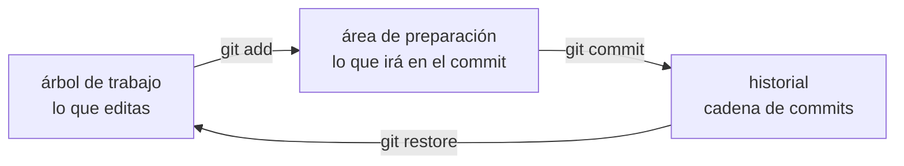

# B07-C14 — Control de versiones con Git

<!-- nav:top -->
[🏠 Programa](../../../../README.md) · [📚 Bloque B07](../../../tronco-comun/B07-informatica-cientifica-desde-cero.md) · [← Anterior: B07-C13 — Entornos y dependencias con uv](../B07-C13-entornos-y-dependencias-con-uv/CLASE.md) · [Siguiente: B07-C15 — Terminal y rutas de archivos →](../B07-C15-terminal-y-rutas-de-archivos/CLASE.md)
<!-- /nav -->

## 1. Ubicación, nivel y alcance

Decimocuarta clase del bloque B07. En [C13](../B07-C13-entornos-y-dependencias-con-uv/CLASE.md) fijaste el entorno; ahora registras la **historia** de tu proyecto con **Git**: qué cambió, cuándo, por qué y cómo volver atrás. Nivel N1–N2.

Verás repositorio, área de preparación, commit, estado, diferencias, historial, deshacer cambios y ramas. No verás repositorios remotos ni colaboración (GitHub), fusiones con conflictos ni flujos avanzados; esos temas quedan para proyectos en equipo.

## 2. Por qué esta clase existe

Sin control de versiones, un proyecto científico acumula archivos como `analisis_final.py`, `analisis_final2.py` y `analisis_final_ahora_si.py`, y nadie sabe cuál produjo la figura del artículo. Con Git, cada estado importante queda guardado con un mensaje, una fecha y un autor, y puedes comparar o recuperar cualquier versión. Es la base de la reproducibilidad y de la autoría clara.

La pregunta motivadora es: **¿cómo sé qué cambié, por qué y cómo vuelvo a un estado anterior que funcionaba?** La decisión central es cuándo registrar un estado (commit), qué incluir en él y qué mensaje darle.

## 3. Lo que podrás hacer al terminar

1. Explicar qué es un repositorio, un commit y las tres zonas de Git.
2. Ejecutar `git init`, `git status`, `git add`, `git commit`, `git diff` y `git log`.
3. Leer el resultado corto de `git status --short`.
4. Descartar cambios no confirmados sabiendo que son irrecuperables.
5. Crear y cambiar de rama.
6. Escribir mensajes de commit útiles y excluir archivos con `.gitignore`.

La evidencia es el **historial comentado** del ejercicio 12 (sección 20).

## 4. Con qué llegas y cómo comprobarlo

Necesitas C01–C13 y una terminal. Cinco preguntas:

1. ¿Qué archivo declara las dependencias y cuál las fija?
2. ¿Qué es una carpeta?
3. ¿Qué hace `python script.py`?
4. ¿Qué es un archivo de texto?
5. ¿Por qué no se versiona `.venv`?

<details>
<summary>Ver respuestas</summary>

1. `pyproject.toml` declara; `uv.lock` fija. 2. Un contenedor de archivos. 3. Ejecuta el script con Python. 4. Un archivo cuyo contenido son caracteres legibles; Git trabaja mejor con ellos. 5. Es pesado, se reconstruye y es específico de la máquina.
</details>

Con cuatro o cinco aciertos, sigue; con tres o menos, repasa C13.

## 5. Un caso real: la historia de una tabla de períodos

Imagina un archivo `periodos.csv` con los períodos orbitales sidéreos publicados por el NASA NSSDC (S1): Mercurio 87,969 d y Venus 224,701 d. Más tarde añades la Tierra, 365,256 d. Después te equivocas al editar y pones un 0 como período de Mercurio. Con Git: el primer estado queda registrado, el segundo también, y el error se descarta antes de confirmarlo. El laboratorio ejecuta exactamente esa historia en un repositorio temporal, con una identidad **ficticia**. Es el **ejemplo conductor**.

## 6. Vocabulario

Un **repositorio** es una carpeta con la historia del proyecto (en `.git`). Un **commit** es una instantánea del proyecto con un mensaje, autor y fecha; Git guarda instantáneas completas, no listas de diferencias (S2). Tus archivos pasan por tres estados: **modificado** (editado, aún no registrado), **preparado** (*staged*, marcado para el próximo commit) y **confirmado** (guardado en la base local) (S2). El **árbol de trabajo** es lo que ves y editas; el **área de preparación** es la lista de lo que irá en el próximo commit; el **historial** es la cadena de commits. Una **rama** es un puntero móvil a un commit; `HEAD` apunta a la rama que tienes activa (S5). `.gitignore` lista los patrones de archivos que Git no debe seguir (S3). Casi todas las operaciones de Git son **locales**, así que funcionan sin red (S2).

## 7. Modelo mental: tres zonas y una cadena



*Descripción textual:* tres zonas conectadas en círculo. Los cambios del árbol de trabajo pasan al área de preparación con `git add`, y de ahí al historial con `git commit`. `git restore` trae al árbol de trabajo el contenido guardado, descartando las ediciones no confirmadas.

**Límite de la analogía:** una fotografía no puede deshacerse; en Git un commit se puede corregir, pero **lo que no llegó a confirmarse y se descarta se pierde para siempre** (S4).

## 8. La explicación, paso a paso

### 8.1 Crear el repositorio

`git init -b main` crea la carpeta oculta `.git` en el directorio actual y llama `main` a la rama inicial. (La documentación consultada indica que el nombre por defecto de `git init` es `master`, aunque es un nombre como cualquier otro, S5.) Desde entonces, Git mira esa carpeta.

### 8.2 Estado, preparación y commit

`git status --short` muestra dos columnas: la izquierda es el área de preparación; la derecha, el árbol de trabajo (S3). Los códigos que verás: `?? archivo` (nuevo, sin seguimiento), `A  archivo` (nuevo y preparado), ` M archivo` (modificado, sin preparar), `M  archivo` (modificado y preparado). `git add archivo` prepara; `git commit -m "mensaje"` crea el commit con lo preparado (S3). Si editas un archivo después de prepararlo, debes volver a hacer `git add` para incluir el último cambio (S3).

### 8.3 Ver los cambios y la historia

`git diff` muestra los cambios **sin preparar** (árbol de trabajo frente a preparación); `git diff --staged` muestra lo preparado frente al último commit (S3). `git log --oneline` lista los commits, el más reciente primero, con el hash abreviado y el mensaje (S6). En el laboratorio, el `diff` de agregar la Tierra es exactamente una línea: `+Tierra,365.256`.

### 8.4 Deshacer

`git restore archivo` reemplaza el archivo por su última versión preparada o confirmada y **descarta tus ediciones no confirmadas de forma permanente**; `git restore --staged archivo` solo lo saca del área de preparación y conserva las ediciones (S4). `git commit --amend` reemplaza el último commit en lugar de añadir otro: úsalo solo si el commit no se ha compartido (S4). En el laboratorio, el error (`Mercurio,0`) se descarta con `git restore` y el estado vuelve a limpio.

### 8.5 Ramas

Una rama es un puntero ligero a un commit. `git switch -c prueba-marte` crea la rama y se pasa a ella; `git switch main` vuelve; `git branch` las lista (S5). Las ramas permiten probar una idea sin tocar `main`. No se estudian aquí las fusiones.

### 8.6 Mensajes y qué incluir

Un buen mensaje dice **qué** y, si no es obvio, **por qué**: «Agrega el período de la Tierra». Un commit debe ser una unidad lógica: no mezcles un arreglo de unidades con una figura nueva. No incluyas archivos generados (`.venv`, `__pycache__`), ni datos pesados, ni **credenciales**: ponlos en `.gitignore` (S3). Lo que entra en el historial es difícil de borrar después.

## 9. Magnitudes, símbolos y unidades

| Código de `status --short` | Significado | Zona |
|---|---|---|
| `??` | archivo nuevo sin seguimiento | árbol |
| `A ` | nuevo y preparado | preparación |
| ` M` | modificado, sin preparar | árbol |
| `M ` | modificado y preparado | preparación |
| (vacío) | sin cambios | — |

Los datos del ejemplo (períodos en días, columna `periodo_d`) son los publicados por el NASA NSSDC (S1).

## 10. Convenciones y referencias

Mensajes breves, en imperativo o descriptivos, coherentes en un proyecto. Un commit por cambio lógico. `.gitignore` desde el inicio. Identidad de autor real en tus repositorios y ficticia en los ejemplos. Versión usada: Git 2.55.0 (Windows), Python 3.12.9.

## 11. De dónde sale lo que afirmamos

| ID | Fuente | Localizador | Respalda | Estado |
|---|---|---|---|---|
| S1 | NASA NSSDC, fichas individuales de planetas | https://nssdc.gsfc.nasa.gov/planetary/factsheet/ | Períodos sidéreos de Mercurio, Venus y Tierra | Leídas el 2026-11-05 (mutables) |
| S2 | Chacon y Straub, *Pro Git* (2.ª ed.), «What is Git?» | https://git-scm.com/book/en/v2/Getting-Started-What-is-Git%3F | Tres estados, instantáneas, operaciones locales | Leída el 2026-11-05 |
| S3 | *Pro Git*, «Recording Changes to the Repository» | https://git-scm.com/book/en/v2/Git-Basics-Recording-Changes-to-the-Repository | `status`, `add`, `commit -m`, `diff`, `.gitignore` | Leída el 2026-11-05 |
| S4 | *Pro Git*, «Undoing Things» | https://git-scm.com/book/en/v2/Git-Basics-Undoing-Things | `restore`, `restore --staged`, `commit --amend`, irreversibilidad | Leída el 2026-11-05 |
| S5 | *Pro Git*, «Branches in a Nutshell» | https://git-scm.com/book/en/v2/Git-Branching-Branches-in-a-Nutshell | Rama, `HEAD`, `switch -c`, nombre por defecto | Leída el 2026-11-05 |
| S6 | *Pro Git*, «Viewing the Commit History» | https://git-scm.com/book/en/v2/Git-Basics-Viewing-the-Commit-History | `git log --oneline`, `-p`, `--stat` | Leída el 2026-11-05 |

Límites: *Pro Git* describe el comportamiento general; la salida exacta se verificó ejecutando Git 2.55.0. Las variables de entorno `GIT_AUTHOR_NAME` y similares (usadas en el laboratorio) y la opción `git init -b` se verificaron ejecutando, no en las páginas leídas.

## 12. Cómo ver la historia

El laboratorio imprime las salidas de Git (estado, diff, log) como texto; es la versión accesible. Para el historial completo, `git log --oneline` y, para ver ramas, `git log --oneline --decorate` (S5). El diagrama de la sección 7 tiene descripción textual.

## 13. Ejemplo trabajado: agregar la Tierra y cometer un error

**Paso 1.** Archivo nuevo con Mercurio y Venus: `git status --short` da `?? periodos.csv`. **Paso 2.** `git add periodos.csv` → `A  periodos.csv`. `git commit -m "Agrega períodos de Mercurio y Venus"`. **Paso 3.** Añade la línea `Tierra,365.256`: `git status --short` da ` M periodos.csv` y `git diff` muestra solo `+Tierra,365.256`. **Paso 4.** `git add` y `git commit -m "Agrega el período de la Tierra"`; `git log --oneline` lista dos commits. **Paso 5.** Edita mal el archivo (`Mercurio,0`) y verifica con `git status --short` que aparece ` M periodos.csv`. **Paso 6.** `git restore periodos.csv`: el estado queda vacío y el archivo recupera el último contenido confirmado.

**Paso final · incertidumbre.** El historial registra **qué** cambió, no que el contenido sea correcto: si hubieras confirmado `Mercurio,0`, Git lo habría guardado con la misma naturalidad. Y `git restore` solo salvó el archivo porque el valor correcto ya estaba confirmado; un dato nunca confirmado y descartado no puede recuperarse. La verificación de los datos sigue siendo tuya.

## 14. Distintas maneras de guardar versiones

Copiar carpetas con fecha es simple pero no dice qué cambió ni quién. Un servicio de archivos con historial ayuda con archivos sueltos pero no con proyectos. Git registra instantáneas con mensajes y permite ramas, a cambio de aprender sus conceptos. Otros sistemas existen y no se consultaron aquí. Criterio: usa Git desde el primer día de un proyecto de código o de análisis, y confirma a menudo con mensajes claros.

## 15. Práctica guiada

**Ejercicio 1 · con los pasos indicados.** Lee `A  periodos.csv`, ` M periodos.csv` y `?? periodos.csv` y di en qué estado está cada uno. *Pasos:* columna izquierda y derecha (8.2).

<details><summary>Solución comentada</summary>

`A  ` nuevo y preparado; ` M` modificado sin preparar; `??` nuevo sin seguimiento.
</details>

**Ejercicio 2 · con una pista.** ¿Qué muestra `git diff` justo después de añadir una fila al archivo, antes de `git add`? *Pista:* cambios sin preparar.

<details><summary>Solución comentada</summary>

Las líneas añadidas con `+`, aquí `+Tierra,365.256`. Tras `git add`, `git diff` queda vacío y los cambios se ven con `git diff --staged`.
</details>

**Ejercicio 3 · casi autónomo.** Escribe un mensaje de commit para cambiar `Mercurio,87.9` por `Mercurio,87.969`.

<details><summary>Solución comentada</summary>

Por ejemplo: «Corrige el período de Mercurio a 87,969 d (NSSDC)». Dice qué cambió y la fuente; evita «arreglo» o «cambios».
</details>

## 16. Práctica autónoma, transferencia e integrador

**Ejercicio 4.** ¿Qué hace `git restore periodos.csv` y qué riesgo tiene?

<details><summary>Solución comentada</summary>

Devuelve el archivo a su última versión confirmada o preparada, descartando las ediciones; esas ediciones no confirmadas **no se pueden recuperar** (S4).
</details>

**Ejercicio 5.** ¿En qué se diferencia `git restore --staged archivo` de `git restore archivo`?

<details><summary>Solución comentada</summary>

La primera saca el archivo del área de preparación y conserva las ediciones; la segunda descarta las ediciones del árbol de trabajo (S4).
</details>

**Ejercicio 6.** ¿Por qué `git log --oneline` tras dos commits muestra dos líneas y cuál va primera?

<details><summary>Solución comentada</summary>

Porque hay dos commits; el más reciente va primero («Agrega el período de la Tierra»).
</details>

**Ejercicio 7.** ¿Qué es una rama? ¿Qué crea `git switch -c prueba-marte`?

<details><summary>Solución comentada</summary>

Un puntero ligero a un commit. El comando crea la rama `prueba-marte` en el commit actual y cambia a ella (S5); `main` queda donde estaba.
</details>

**Ejercicio 8.** Escribe un `.gitignore` mínimo para un proyecto con `uv`.

<details><summary>Solución comentada</summary>

`.venv/` y `__pycache__/` (y, si generas figuras temporales, `*.png` de prueba). No ignores `uv.lock` (C13).
</details>

**Ejercicio 9 · transferencia.** Accidentalmente confirmaste un archivo con una contraseña. ¿Basta con borrarlo en un commit nuevo?

<details><summary>Solución comentada</summary>

No: la contraseña sigue en el historial. Debes tratarla como **comprometida** (cambiarla) y consultar cómo reescribir el historial; si ya se compartió, reescribir tiene consecuencias (S4 advierte sobre rehacer historia compartida). Prevenir: usar `.gitignore` y no poner secretos en el código.
</details>

**Ejercicio 10 · transferencia.** Un colega mezcla en un solo commit un cambio de unidades, una figura nueva y el formato del código. ¿Qué problema tiene?

<details><summary>Solución comentada</summary>

Es difícil de revisar y de deshacer parcialmente: si el cambio de unidades fuera incorrecto, no podrías revertirlo sin perder lo demás. Conviene un commit por cambio lógico.
</details>

**Ejercicio 11 · transferencia.** ¿Por qué un historial de Git no basta para decir que un resultado es reproducible?

<details><summary>Solución comentada</summary>

Porque registra el código y los archivos versionados, no necesariamente el entorno, los datos, las semillas ni la plataforma (C13, C19). Hay que declarar y versionar todo eso o dejar instrucciones para reconstruirlo.
</details>

**Ejercicio 12 · integrador.** Entrega un **historial comentado**: un repositorio (o su `git log --oneline`) con al menos cuatro commits sobre un script de este bloque, con mensajes claros, un `.gitignore`, una rama de prueba y una nota que explique cada commit y el error que descartaste con `restore`.

<details><summary>Solución modelo</summary>

Por ejemplo: 1) agrega `kepler.py`; 2) agrega pruebas; 3) corrige una unidad; 4) agrega `.gitignore`. Una rama `prueba-xxx` para un experimento. La nota explica cada commit y cita la salida real de `git log --oneline` y `git status --short` antes y después del `restore`.
</details>

## 17. Laboratorio: una sesión de Git automatizada

El script [sesion_git.py](sesion_git.py) crea un repositorio temporal, realiza la sesión de la sección 13 (con identidad ficticia «Estudiante Ejemplo») y comprueba cada resultado antes de imprimir: estados, el diff de una línea, dos commits, el árbol limpio tras `restore`, la rama creada y que existan `main` y `prueba-marte`. Al terminar borra la carpeta temporal y no toca ningún repositorio real.

**Datos:** períodos publicados (NASA NSSDC); identidad **ficticia**. **Predice antes de ejecutar:** ¿qué mostrará `git status --short` tras añadir una fila y antes de `git add`? (` M periodos.csv`.) **Resultados (2026-11-05, Python 3.12.9, Git 2.55.0):**

```text
python 3.12.9 | git version 2.55.0.windows.1 | pruebas OK
status inicial     : ?? periodos.csv
status tras add    : A  periodos.csv
status tras editar :  M periodos.csv
líneas del diff    : ['+Tierra,365.256']
log (--oneline), con el hash oculto:
  <hash> Agrega el período de la Tierra
  <hash> Agrega períodos de Mercurio y Venus
status tras restore: '' (vacío = árbol limpio)
ramas              : ['main', 'prueba-marte']
```

```bash
python programa/clases/B07/B07-C14-control-de-versiones-con-git/sesion_git.py
```

**Límites:** requiere `git` instalado; el hash cambia en cada ejecución (por eso se oculta); no prueba remotos, fusiones ni conflictos; la identidad es ficticia y no debe usarse en tu trabajo real.

## 18. Errores frecuentes y cómo corregirlos

**Olvidar `git add` después de editar.** El commit no incluye el último cambio (8.2). Se corrige con `git status` antes de confirmar.

**Mensajes vagos.** «arreglos», «cambios». Se corrige con el ejercicio 3.

**Confirmar secretos.** Se corrige con el ejercicio 9.

**Descartar con `restore` sin pensar.** Se corrige con el ejercicio 4.

**Confundir historia con corrección.** Se corrige con el ejercicio 11.

## 19. Cómo sabrás que vas bien

Tras 8.2: ¿lees `git status --short` sin ayuda? Si no, ejercicio 1. Tras 8.3: ¿predices qué muestra `git diff` antes y después de `git add`? Si no, ejercicio 2. Tras 8.4: ¿sabes qué es irrecuperable? Si no, ejercicio 4. Tras el laboratorio: ¿qué comprobó el script sobre el árbol tras `restore`? Léelo. Al final: ¿tu historial dice por qué, no solo qué? Si no, reescribe los mensajes.

## 20. Qué entregas y cómo se evalúa

El producto es tu **historial comentado**: commits, `.gitignore`, rama de prueba y la nota que explica cada paso.

| Criterio | Inicial | En desarrollo | Logrado | Destacado |
|---|---|---|---|---|
| Commits | Uno solo gigante | Varios sin criterio | Un cambio lógico por commit | Con mensajes que explican el porqué |
| Estado y diff | No los usa | Los usa a veces | Los usa antes de cada commit | Los interpreta por escrito |
| Deshacer | Pierde trabajo | Lo evita | Usa `restore` con criterio | Explica lo irrecuperable |
| Higiene | Confirma archivos generados | `.gitignore` parcial | `.gitignore` completo | Sin secretos ni datos pesados |

**Condiciones críticas:** no confirmar credenciales ni datos personales; no reescribir historia compartida; citar solo fuentes consultadas.

## 21. Ética, seguridad y límites

El historial de Git puede contener datos sensibles que nunca se borran del todo: no incluyas contraseñas, claves, tokens ni datos personales; si ocurre, trátalos como comprometidos. La autoría registrada en cada commit es parte de la rendición de cuentas científica: usa tu identidad real en tu trabajo y declara el uso de herramientas automáticas. Material educativo.

## 22. Para cerrar y seguir

Git guarda instantáneas del proyecto en tres zonas (árbol de trabajo, preparación e historial); `status`, `diff` y `log` te dicen qué pasa; `restore` descarta lo no confirmado y no tiene vuelta atrás; y las ramas permiten probar sin romper `main`. Queda abierta la pregunta de cómo manejar con soltura el terminal en el que ejecutas todos estos comandos.

**Glosario español–inglés.** repositorio · *repository*; confirmación · *commit*; área de preparación · *staging area*; árbol de trabajo · *working tree*; rama · *branch*; historial · *history*; diferencias · *diff*; restaurar · *to restore*.

**Continuidad.** [B07-C15](../B07-C15-terminal-y-rutas-de-archivos/CLASE.md) usa tu capacidad de **registrar cambios** para dominar el terminal y las rutas de archivos, que es donde ejecutas Git, `uv` y Python.

**Referencias:** ver sección 11.

<!-- nav:bottom -->
---

[← Anterior: B07-C13 — Entornos y dependencias con uv](../B07-C13-entornos-y-dependencias-con-uv/CLASE.md) · [📚 Bloque B07](../../../tronco-comun/B07-informatica-cientifica-desde-cero.md) · [Siguiente: B07-C15 — Terminal y rutas de archivos →](../B07-C15-terminal-y-rutas-de-archivos/CLASE.md)
<!-- /nav -->
