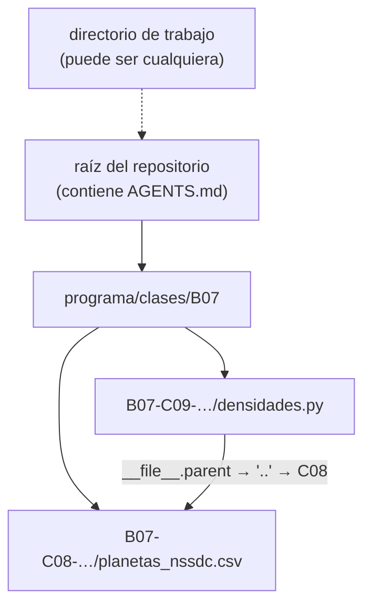

# B07-C15 — Terminal y rutas de archivos

<!-- nav:top -->
[🏠 Programa](../../../../README.md) · [📚 Bloque B07](../../../tronco-comun/B07-informatica-cientifica-desde-cero.md) · [← Anterior: B07-C14 — Control de versiones con Git](../B07-C14-control-de-versiones-con-git/CLASE.md) · [Siguiente: B07-C16 — Formatos JSON y YAML →](../B07-C16-formatos-json-y-yaml/CLASE.md)
<!-- /nav -->

## 1. Ubicación, nivel y alcance

Decimoquinta clase del bloque B07. Ya ejecutaste Python, `uv` y Git «desde una terminal». Ahora entiendes **qué es esa terminal**, en qué carpeta está parada y cómo se escriben las **rutas** que apuntan a tus archivos, sin que el programa se rompa al cambiar de computador o de sistema operativo. Nivel N1.

Verás directorio de trabajo, rutas relativas y absolutas, los comandos básicos de navegación en bash y en PowerShell, y la biblioteca `pathlib`. No verás scripts de shell avanzados, permisos ni redes.

## 2. Por qué esta clase existe

Una causa muy común de «el programa no encuentra el archivo» es que la ruta funciona en el computador del autor y no en otro: se escribió con `C:\Usuarios\ana\datos\...`, o se asumió que el programa se ejecuta desde cierta carpeta. La segunda causa es la diferencia entre sistemas: Windows y Linux separan y comparan rutas de forma distinta.

La pregunta motivadora es: **¿cómo escribo la ubicación de un archivo para que mi programa lo encuentre en cualquier máquina y desde cualquier carpeta?** La decisión central es calcular rutas **relativas a un punto conocido** (el propio script) en vez de fijar rutas absolutas o depender del directorio de trabajo.

## 3. Lo que podrás hacer al terminar

1. Explicar qué es la terminal, el directorio de trabajo y una ruta.
2. Distinguir ruta relativa de absoluta y predecir a qué archivo apunta cada una.
3. Navegar con `pwd`/`cd`/`ls` (bash) y con `Get-Location`/`Set-Location`/`Get-ChildItem` (PowerShell).
4. Construir rutas con `pathlib` y el operador `/`, y leer `name`, `suffix`, `parent`.
5. Calcular la ruta de un archivo de datos desde `__file__`.
6. Explicar dos diferencias entre rutas de Windows y de POSIX.

La evidencia es la **ficha de rutas** del ejercicio 12 (sección 20).

## 4. Con qué llegas y cómo comprobarlo

Necesitas C01–C14. Cinco preguntas:

1. ¿Qué es un archivo y qué es una carpeta?
2. ¿Qué hace `open("datos.csv")`?
3. ¿Qué es `__name__`?
4. ¿Para qué sirve `uv run`?
5. ¿Qué es un módulo?

<details>
<summary>Ver respuestas</summary>

1. Un archivo guarda datos; una carpeta contiene archivos y otras carpetas. 2. Abre el archivo `datos.csv` buscándolo en el directorio de trabajo. 3. El nombre del módulo; `"__main__"` si es el programa que se ejecuta. 4. Ejecuta un comando en el entorno del proyecto. 5. Un archivo `.py` cuyos nombres se pueden importar.
</details>

Con cuatro o cinco aciertos, sigue; con tres o menos, repasa C06 y C13.

## 5. Un caso real: el CSV de planetas desde cualquier carpeta

El laboratorio de [C09](../B07-C09-calculos-cientificos-basicos-con-python/CLASE.md) lee `planetas_nssdc.csv`, que vive en la carpeta de C08. No lo hace con una ruta como `C:\...` sino calculándola desde la ubicación del propio script. Ese archivo contiene datos publicados por el NASA NSSDC (S1). Aquí compruebas que da igual desde qué carpeta lances el script: el resultado es el mismo. Ese ejercicio —lanzarlo desde la raíz del repositorio y desde otra carpeta— es el **ejemplo conductor**.

## 6. Vocabulario

La **terminal** (o consola) es un programa donde escribes comandos de texto; el **intérprete de comandos** (*shell*), como bash o PowerShell, los ejecuta. El **directorio de trabajo** es la carpeta en la que «estás parado»; los comandos y `open()` relativos se resuelven desde ahí. Una **ruta** (*path*) es la dirección de un archivo o carpeta. Una ruta **absoluta** está completa desde la raíz (`C:\...` o `/home/...`); una **relativa** se interpreta desde el directorio de trabajo. `.` es la carpeta actual y `..` la carpeta padre. Un **separador** divide los componentes: `\` en Windows y `/` en POSIX (aunque Windows también acepta `/`). Una **extensión** (`.csv`) es el sufijo del nombre. `pathlib.Path` representa una ruta como objeto, y el operador `/` la une (S2). Las clases `PurePath` manipulan rutas **sin tocar el disco** y existen en versión Windows y POSIX (S2). `resolve()` convierte una ruta en absoluta, quitando `..` y siguiendo enlaces (S2).

## 7. Modelo mental: el árbol de carpetas y «dónde estoy»

El sistema de archivos es un árbol; el directorio de trabajo es un punto marcado en él. Una ruta relativa son pasos desde ese punto; una absoluta, pasos desde la raíz.



*Descripción textual:* un árbol con la raíz del repositorio arriba, la carpeta `programa/clases/B07` debajo y, dentro, las carpetas de las clases C08 (con el CSV) y C09 (con el script). La flecha continua muestra cómo el script de C09 llega al CSV subiendo a su carpeta padre y bajando a la de C08, sin depender de dónde esté el directorio de trabajo, que se dibuja aparte con una línea punteada.

**Límite de la analogía:** un mapa de papel es el mismo en cualquier lugar; el directorio de trabajo cambia según desde dónde lances el programa, y un enlace simbólico puede hacer que dos rutas lleven al mismo sitio.

## 8. La explicación, paso a paso

### 8.1 La terminal y los comandos de navegación

En **bash** (Linux, macOS, Git Bash): `pwd` muestra la carpeta actual, `cd carpeta` entra, `cd ..` sube, `ls` lista. En **PowerShell** (Windows): `Get-Location` (o `pwd`), `Set-Location carpeta` (o `cd`) y `Get-ChildItem` (o `ls`/`dir`). Ejemplo real de esta clase, en la carpeta C15 de un equipo Windows: bash mostró una ruta con barras `/c/dev/.../B07-C15-terminal-y-rutas-de-archivos` y PowerShell, la misma carpeta como `C:\dev\...\B07-C15-terminal-y-rutas-de-archivos`. Los nombres de comando de PowerShell y sus alias se verificaron ejecutándolos, no en la documentación. Las comillas protegen espacios en rutas: `cd "Mis datos"`.

### 8.2 Rutas relativas y absolutas

`datos/kepler.csv` es relativa: depende de dónde estés. `C:\datos\kepler.csv` o `/home/ana/datos/kepler.csv` es absoluta. Una ruta relativa que funciona desde la raíz del repositorio puede fallar desde otra carpeta; una absoluta fija funciona solo en la máquina de su autor. Ambas son frágiles.

### 8.3 `pathlib`

```python
from pathlib import Path
AQUI = Path(__file__).resolve().parent
csv = AQUI.parent / "B07-C08-lectura-de-archivos-csv" / "planetas_nssdc.csv"
```

`__file__` es la ruta del archivo en ejecución; `.resolve()` la hace absoluta; `.parent` es la carpeta que lo contiene; `/` une componentes (si el de la derecha es absoluto, **reemplaza** lo anterior, S2). Con `csv.name` obtienes `planetas_nssdc.csv`, con `csv.suffix` `.csv`, con `csv.exists()` si existe y con `csv.read_text(encoding="utf-8")` su contenido (S2).

### 8.4 Encontrar la raíz del proyecto

Una técnica robusta: subir por `AQUI.parents` hasta encontrar un archivo marcador (aquí `AGENTS.md`). Si no aparece, lanza `FileNotFoundError` con un mensaje claro (C12). Luego `csv.relative_to(raiz)` da una ruta corta e independiente del equipo para mostrar en informes.

### 8.5 Windows frente a POSIX

Tres diferencias que importan (S2): (1) Windows compara rutas **sin distinguir mayúsculas** y POSIX **sí las distingue**: `PureWindowsPath('c:/Datos/Kepler.CSV') == PureWindowsPath('C:/datos/kepler.csv')` es `True`, y el equivalente POSIX es `False`. (2) Windows tiene **unidades** (`C:`) y rutas de red; POSIX no. (3) `str(path)` usa el separador nativo; `as_posix()` lo convierte a `/`. Por eso se prefiere `pathlib` a concatenar cadenas con `"\\"` o `"/"` a mano.

### 8.6 Rutas y reproducibilidad

Las rutas absolutas dentro del código hacen que el resultado dependa del equipo y revelan datos personales (el nombre de usuario). Las rutas calculadas desde `__file__` o recibidas como argumento son portables. En un informe, muestra rutas relativas a la raíz del proyecto.

## 9. Magnitudes, símbolos y unidades

| Comando o elemento | bash / POSIX | PowerShell / Windows |
|---|---|---|
| carpeta actual | `pwd` | `Get-Location` (`pwd`) |
| entrar en una carpeta | `cd carpeta` | `Set-Location carpeta` (`cd`) |
| listar | `ls` | `Get-ChildItem` (`ls`, `dir`) |
| separador | `/` | `\` (también acepta `/`) |
| mayúsculas en rutas | distingue | no distingue |
| `.` / `..` | actual / padre | actual / padre |

No hay magnitudes físicas; el dato de ejemplo es el CSV publicado de C08 (S1).

## 10. Convenciones y referencias

Rutas con `pathlib`. Nunca rutas absolutas en el código. Nombres de archivo sin espacios ni tildes cuando sea posible. Codificación UTF-8 explícita al leer. Ejecutar los scripts con el comando completo y, si usas `uv`, desde la carpeta del proyecto. Python 3.12.9.

## 11. De dónde sale lo que afirmamos

| ID | Fuente | Localizador | Respalda | Estado |
|---|---|---|---|---|
| S1 | NASA NSSDC, fichas individuales de planetas (contenido del CSV de C08) | https://nssdc.gsfc.nasa.gov/planetary/factsheet/ | Datos del CSV de ejemplo | Leídas el 2026-11-05 (mutables) |
| S2 | Python Software Foundation, *The Python Standard Library* 3.12, `pathlib` | https://docs.python.org/3.12/library/pathlib.html | `Path`, `/`, absoluta/relativa, `cwd`, `resolve`, `suffix`, `parent`, diferencias Windows/POSIX, clases «puras» | Leída el 2026-11-05 |
| S3 | Python Software Foundation, *The Python Tutorial* 3.12, §6 Modules | https://docs.python.org/3.12/tutorial/modules.html | `sys.path` incluye la carpeta del script | Leída el 2026-11-05 |

Límites: los comandos de bash y PowerShell se comprobaron ejecutándolos en un equipo Windows con Git Bash y Windows PowerShell 5.1; no se consultó su documentación. No se cubrieron rutas de red (UNC) ni enlaces simbólicos más allá de lo que dice S2.

## 12. Cómo ver las rutas

El laboratorio imprime la ruta relativa a la raíz del repositorio, el nombre, la extensión y la carpeta del CSV; y comprueba las diferencias Windows/POSIX con rutas «puras». Todo es texto, accesible. El árbol de la sección 7 tiene descripción textual.

## 13. Ejemplo trabajado: llegar al CSV desde dos carpetas distintas

**Paso 1.** Desde la raíz del repositorio: `python programa/clases/B07/B07-C15-terminal-y-rutas-de-archivos/rutas_pathlib.py`. **Paso 2.** Desde otra carpeta (por ejemplo, el directorio temporal) con la ruta completa del script: el programa imprime **lo mismo** (`programa/clases/B07/B07-C08-lectura-de-archivos-csv/planetas_nssdc.csv`). **Paso 3.** Por qué: `AQUI = Path(__file__).resolve().parent` fija el punto de partida en el script y no en el directorio de trabajo; `AQUI.parent / "B07-C08-…" / "planetas_nssdc.csv"` sube y baja desde ahí.

**Paso final · incertidumbre.** Esto funciona **mientras no cambie la estructura de carpetas**: si alguien renombra la carpeta de C08, la ruta falla con un error de archivo inexistente, que es el comportamiento deseable. Una ruta fija en el código no dejaría ver el problema hasta cambiar de máquina. Además, la prueba se hizo en Windows; en Linux, las mayúsculas del nombre de la carpeta importarían.

## 14. Distintas maneras de pasar una ruta

(1) Calculada desde `__file__` (portable si el árbol no cambia). (2) Argumento de línea de comandos (`python script.py ruta/datos.csv`): flexible, pero obliga a quien lo ejecuta a escribirlo bien; el módulo `argparse` lo facilita y no se estudia aquí. (3) Variable de entorno o archivo de configuración (C16). (4) Ruta absoluta fija: la peor opción para código compartido. Criterio: valores por defecto calculados, y la posibilidad de sobrescribirlos desde fuera.

## 15. Práctica guiada

**Ejercicio 1 · con los pasos indicados.** Di si son absolutas o relativas: `datos/kepler.csv`, `C:\datos\kepler.csv`, `/home/ana/datos`, `../datos`. *Pasos:* ¿empieza en una raíz o unidad?

<details><summary>Solución comentada</summary>

Relativa, absoluta, absoluta (POSIX) y relativa. `../datos` sube un nivel desde el directorio de trabajo.
</details>

**Ejercicio 2 · con una pista.** ¿Qué es `PurePosixPath("/etc") / "init.d" / "reboot"`? *Pista:* el operador `/` une.

<details><summary>Solución comentada</summary>

`PurePosixPath('/etc/init.d/reboot')`. El operador `/` une componentes con el separador de la plataforma de la clase.
</details>

**Ejercicio 3 · casi autónomo.** ¿Qué devuelve `PurePosixPath("/etc") / "/ruta_absoluta"`?

<details><summary>Solución comentada</summary>

`PurePosixPath('/ruta_absoluta')`: si el componente de la derecha es absoluto, reemplaza todo lo anterior (S2).
</details>

## 16. Práctica autónoma, transferencia e integrador

**Ejercicio 4.** Con `ruta = Path("biblioteca.tar.gz")`, ¿qué dan `suffix` y `suffixes`?

<details><summary>Solución comentada</summary>

`suffix` da `.gz` (la última); `suffixes` da `['.tar', '.gz']` (S2).
</details>

**Ejercicio 5.** ¿Son iguales `PureWindowsPath("c:/Datos/Kepler.CSV")` y `PureWindowsPath("C:/datos/kepler.csv")`? ¿Y las equivalentes POSIX?

<details><summary>Solución comentada</summary>

En Windows sí; en POSIX no (el laboratorio imprime `True` y `False`). Consecuencia: un programa que funciona en Windows con otra capitalización puede fallar en Linux.
</details>

**Ejercicio 6.** ¿Qué hace `.resolve()` con `Path("a/b/../c")`?

<details><summary>Solución comentada</summary>

La convierte en absoluta y elimina el `..`, dando `.../a/c` (S2). El laboratorio lo comprueba con el directorio de trabajo actual.
</details>

**Ejercicio 7.** Escribe una línea con `pathlib` que dé la ruta de `resultados.png` en la misma carpeta que tu script.

<details><summary>Solución comentada</summary>

`Path(__file__).resolve().parent / "resultados.png"`. Es independiente del directorio de trabajo.
</details>

**Ejercicio 8.** ¿Por qué no conviene escribir `"datos\\kepler.csv"` a mano?

<details><summary>Solución comentada</summary>

Porque el separador `\` es de Windows; en otro sistema la cadena no representa la ruta esperada. `Path("datos") / "kepler.csv"` usa el separador correcto en cada plataforma.
</details>

**Ejercicio 9 · transferencia.** Un colega comparte un script con `open("C:/Users/maria/Documentos/datos.csv")`. ¿Qué dos problemas tiene?

<details><summary>Solución comentada</summary>

Solo funciona en la máquina de María (ruta absoluta fija) y expone su nombre de usuario. Debería recibir la ruta como argumento o calcularla relativa al script.
</details>

**Ejercicio 10 · transferencia.** Tu programa falla con `FileNotFoundError` solo cuando lo lanzas desde la carpeta superior. ¿Qué sospechas y cómo lo diagnosticas?

<details><summary>Solución comentada</summary>

Una ruta relativa que depende del directorio de trabajo. Diagnóstico: imprime `Path.cwd()` y la ruta resuelta (`Path(ruta).resolve()`). Solución: calcular la ruta desde `__file__`.
</details>

**Ejercicio 11 · transferencia.** ¿Por qué `raiz_del_repositorio` lanza una excepción en lugar de devolver `None`?

<details><summary>Solución comentada</summary>

Porque continuar sin raíz produciría errores confusos más adelante. Un error claro y temprano, con el punto de partida en el mensaje (C12), es más fácil de diagnosticar.
</details>

**Ejercicio 12 · integrador.** Entrega una **ficha de rutas** de uno de tus scripts: cómo calcula cada ruta, cómo se comporta lanzado desde dos carpetas (con salidas reales), una prueba de que falla con un mensaje claro si falta el archivo, y las diferencias Windows/POSIX relevantes.

<details><summary>Solución modelo</summary>

Se acepta un script que calcule `AQUI` desde `__file__`, lea un archivo de otra carpeta del repositorio y muestre la ruta relativa a la raíz; dos ejecuciones con idéntica salida desde carpetas distintas; un `assert` o prueba con un archivo inexistente que lance `FileNotFoundError`; y una nota sobre mayúsculas y separadores.
</details>

## 17. Laboratorio: rutas portables

El script [rutas_pathlib.py](rutas_pathlib.py) calcula la ruta del CSV de C08 desde `__file__`, encuentra la raíz del repositorio y compara rutas de Windows y POSIX con clases «puras». Antes de imprimir comprueba rutas absolutas y relativas, que el CSV exista y su primera línea sea la esperada, la raíz (por `AGENTS.md`), el operador `/` con un componente absoluto, la sensibilidad a mayúsculas en cada plataforma, `as_posix`, `resolve`, `suffixes` y que falle con `FileNotFoundError` si no hay raíz.

**Datos:** CSV publicado (NASA), rutas de ejemplo inventadas. **Predice antes de ejecutar:** ¿darán lo mismo las dos comparaciones de mayúsculas? (No: `False` en POSIX y `True` en Windows.) **Resultados (2026-11-05, Python 3.12.9, Windows):**

```text
python 3.12.9 | win32 | separador del sistema: '\\' | pruebas OK
Ruta relativa a la raíz del repositorio: programa/clases/B07/B07-C08-lectura-de-archivos-csv/planetas_nssdc.csv
Nombre: planetas_nssdc.csv | extensión: .csv | carpeta: B07-C08-lectura-de-archivos-csv
Líneas del CSV: 9
PurePosixPath('Datos/Kepler.CSV') == PurePosixPath('datos/kepler.csv'): False
PureWindowsPath('c:/Datos/Kepler.CSV') == PureWindowsPath('C:/datos/kepler.csv'): True
```

La misma ejecución lanzada desde el directorio temporal (con la ruta completa del script) dio las mismas dos primeras líneas de resultado.

```bash
python programa/clases/B07/B07-C15-terminal-y-rutas-de-archivos/rutas_pathlib.py
```

**Límites:** probado solo en Windows (la primera línea mostrará `linux` o `darwin` en otros sistemas); supone que el script vive dentro del repositorio; no prueba enlaces simbólicos ni rutas de red.

## 18. Errores frecuentes y cómo corregirlos

**Ruta absoluta fija.** Se corrige con el ejercicio 9.

**Ruta relativa que depende de dónde ejecutas.** Se corrige con el ejercicio 10.

**Concatenar con `\\` a mano.** Se corrige con el ejercicio 8.

**Ignorar mayúsculas y minúsculas.** Se corrige con el ejercicio 5.

**Mostrar rutas con el nombre de usuario en informes.** Se corrige con `relative_to` (sección 8.4).

## 19. Cómo sabrás que vas bien

Tras 8.1: ¿navegas a la carpeta de un script y lo ejecutas en bash o PowerShell? Si no, practica `pwd`, `cd`, `ls`. Tras 8.3: ¿escribes la ruta de un archivo hermano con `pathlib`? Si no, ejercicio 7. Tras 8.5: ¿explicas dos diferencias Windows/POSIX? Si no, ejercicio 5. Tras el laboratorio: ¿qué asegura que funcione desde otra carpeta? Si no lo sabes, relee 8.3. Al final: ¿qué ruta de tu código es absoluta? Si hay alguna, ejercicio 9.

## 20. Qué entregas y cómo se evalúa

El producto es tu **ficha de rutas**: cómo se calcula cada ruta, ejecuciones desde dos carpetas, prueba del archivo ausente y las diferencias entre plataformas.

| Criterio | Inicial | En desarrollo | Logrado | Destacado |
|---|---|---|---|---|
| Portabilidad | Rutas absolutas | Relativas al directorio de trabajo | Relativas al script | Con prueba desde dos carpetas |
| Herramienta | Cadenas a mano | Mezcla | `pathlib` | `pathlib` con raíz del proyecto |
| Errores | Silencia | Mensaje genérico | Mensaje claro | Con la ruta consultada en el mensaje |
| Privacidad | Muestra rutas con usuario | Parcialmente | Muestra rutas relativas | Explica por qué |

**Condiciones críticas:** no incluir rutas absolutas ni datos personales; no ocultar `FileNotFoundError`; citar solo fuentes consultadas.

## 21. Ética, seguridad y límites

Cuidado con los comandos que borran o mueven archivos (`rm`, `Remove-Item`, `mv`): no se usan en esta clase; si los usas, hazlo sobre una copia y verifica la ruta antes de ejecutar, porque borrar en la terminal no pasa por una papelera. No ejecutes comandos copiados de internet sin entenderlos. Las rutas pueden revelar tu nombre de usuario y la estructura de tu equipo: no las incluyas en informes públicos. Material educativo.

## 22. Para cerrar y seguir

La terminal ejecuta comandos desde un directorio de trabajo; una ruta puede ser relativa o absoluta; y `pathlib`, con rutas calculadas desde el propio script, hace que el programa encuentre sus archivos en cualquier máquina. Windows y POSIX difieren en separadores, unidades y en distinguir mayúsculas. Queda abierta la pregunta de cómo guardar parámetros y datos estructurados en archivos legibles por personas y por programas.

**Glosario español–inglés.** terminal · *terminal*; intérprete de comandos · *shell*; directorio de trabajo · *working directory*; ruta · *path*; ruta absoluta · *absolute path*; ruta relativa · *relative path*; extensión · *file extension*; separador · *separator*.

**Continuidad.** [B07-C16](../B07-C16-formatos-json-y-yaml/CLASE.md) usa tu capacidad de **ubicar archivos** para guardar parámetros y resultados en formatos estructurados (JSON y YAML) que cualquier programa puede leer.

**Referencias:** ver sección 11.

<!-- nav:bottom -->
---

[← Anterior: B07-C14 — Control de versiones con Git](../B07-C14-control-de-versiones-con-git/CLASE.md) · [📚 Bloque B07](../../../tronco-comun/B07-informatica-cientifica-desde-cero.md) · [Siguiente: B07-C16 — Formatos JSON y YAML →](../B07-C16-formatos-json-y-yaml/CLASE.md)
<!-- /nav -->
