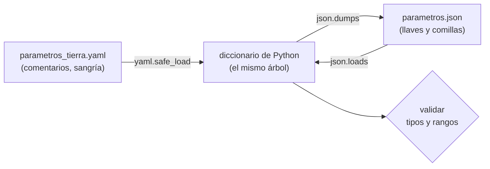

# B07-C16 — Formatos JSON y YAML

<!-- nav:top -->
[🏠 Programa](../../../../README.md) · [📚 Bloque B07](../../../tronco-comun/B07-informatica-cientifica-desde-cero.md) · [← Anterior: B07-C15 — Terminal y rutas de archivos](../B07-C15-terminal-y-rutas-de-archivos/CLASE.md) · [Siguiente: B07-C17 — Pruebas de funciones matemáticas →](../B07-C17-pruebas-de-funciones-matematicas/CLASE.md)
<!-- /nav -->

## 1. Ubicación, nivel y alcance

Decimosexta clase del bloque B07. El CSV de [C08](../B07-C08-lectura-de-archivos-csv/CLASE.md) guarda **tablas**. Para guardar **parámetros, configuraciones y datos anidados** (un cuerpo central con su GM, un planeta con su semieje, una simulación con su paso) se usan **JSON** y **YAML**. Aprendes a leerlos, escribirlos, validarlos y a evitar sus trampas. Nivel N1–N2.

Verás la sintaxis de ambos, la correspondencia con los tipos de Python, la lectura segura y la validación. No verás esquemas formales (JSON Schema), formatos científicos binarios (FITS, HDF5) ni bases de datos.

## 2. Por qué esta clase existe

Una simulación tiene decenas de parámetros. Si están enterrados en el código, cambiar uno obliga a editar el programa y es fácil olvidar con qué valores se obtuvo cada resultado. Un archivo de parámetros legible, versionado y validado separa **qué se calcula** de **con qué datos**, y deja constancia para reproducir el cálculo.

La pregunta motivadora es: **¿en qué formato guardo parámetros y resultados para que personas y programas los lean sin ambigüedad?** La decisión central es el formato (JSON o YAML), cómo se validan los valores al leerlos y qué se hace con lo que el formato interpreta «por sí mismo» (una trampa que veremos: `no` leído como falso).

## 3. Lo que podrás hacer al terminar

1. Escribir y leer un archivo JSON y uno YAML con la misma estructura.
2. Explicar la correspondencia entre tipos de JSON/YAML y de Python.
3. Usar `json.loads`/`json.dumps` y `yaml.safe_load`/`yaml.safe_dump`.
4. Reconocer tres diferencias: comentarios, comillas y claves repetidas.
5. Validar los valores leídos antes de usarlos.
6. Explicar por qué `yaml.safe_load` y no `yaml.load` con datos que no controlas.

La evidencia es el **archivo de parámetros validado** del ejercicio 12 (sección 20).

## 4. Con qué llegas y cómo comprobarlo

Necesitas C01–C15. Cinco preguntas:

1. ¿Qué es un diccionario en Python?
2. ¿Qué tipos tiene Python para números?
3. ¿Qué es `None`?
4. ¿Qué hace `Path.read_text`?
5. ¿Para qué sirve `raise ValueError(...)`?

<details>
<summary>Ver respuestas</summary>

1. Una colección de pares clave-valor. 2. `int` y `float`. 3. «Sin valor». 4. Lee el archivo completo como texto. 5. Detiene la función con un error claro si un dato es inválido.
</details>

Con cuatro o cinco aciertos, sigue; con tres o menos, repasa C02, C07 y C12.

## 5. Un caso real: los parámetros de la órbita de la Tierra

Para simular la órbita de la Tierra (C20) hacen falta: el GM del Sol, el semieje mayor y el período sidéreo de la Tierra, y los ajustes de la simulación. Los tres primeros son datos publicados por el NASA NSSDC (S1); el paso de tiempo de 3600 s es una **decisión nuestra**, rotulada como tal. El archivo [parametros_tierra.yaml](parametros_tierra.yaml) los reúne con comentarios que dicen de dónde viene cada uno. Ese archivo, su lectura y su validación son el **ejemplo conductor**.

## 6. Vocabulario

**JSON** es un formato de texto para intercambiar datos entre lenguajes; sus valores son objeto, arreglo, número, texto, `true`, `false` y `null` (S2, S3). **YAML** es un formato legible por personas para serializar datos con tres estructuras: mapeos (clave-valor), secuencias (listas) y escalares (valores simples); la estructura se marca con **sangría** y no admite tabulaciones en ella (S4). Un **comentario** de YAML empieza con `#`; JSON no tiene comentarios (S3, S4). **Serializar** es convertir un objeto a texto; **deserializar**, convertir texto en objeto. `json.loads` lee texto JSON y `json.dumps` lo escribe; `json.load`/`json.dump` hacen lo mismo con archivos (S2). `yaml.safe_load` solo construye objetos simples (números, textos, listas, diccionarios); `yaml.load` puede construir objetos arbitrarios y es inseguro con datos no confiables (S5). **Validar** es comprobar que los valores tienen el tipo y rango esperados.

## 7. Modelo mental: el mismo árbol en dos escrituras



*Descripción textual:* un archivo YAML se carga con `yaml.safe_load` y produce un diccionario de Python; ese diccionario se puede escribir como JSON con `json.dumps` y volver a leer con `json.loads`, recuperando el mismo diccionario; antes de usarlo se valida el tipo y el rango de cada valor.

**Límite de la analogía:** dos escrituras de un mismo árbol no son siempre intercambiables: YAML admite comentarios y tipos (como fechas) que JSON no tiene, y se pierden al convertir.

## 8. La explicación, paso a paso

### 8.1 JSON

```json
{"nombre": "Tierra", "semieje_km": 149598000.0, "periodo_sidereo_d": 365.256}
```

Llaves para objetos, corchetes para listas, textos **siempre entre comillas dobles**, `true`/`false`/`null` en minúscula y **sin comentarios** (S3). Las claves son siempre texto: `json.dumps({1: "a"})` da `{"1": "a"}`, y al leerlo vuelve `{'1': 'a'}` (S2). Si una clave se repite, Python conserva la última. El texto que se intercambia entre sistemas debe ser UTF-8 sin marca de orden de bytes (S3). `json.dumps(obj, indent=2, ensure_ascii=False)` da una escritura legible con tildes.

### 8.2 YAML

El archivo del ejemplo se escribe sin llaves: la sangría (espacios) marca la jerarquía, `clave: valor` define un par, `[a, b]` una lista en línea y `#` un comentario. Nunca uses tabulaciones para sangrar: YAML no las admite (S4); PyYAML da un `ScannerError`. La versión 1.2 de YAML es un superconjunto de JSON (todo JSON válido es YAML válido), según la especificación (S4).

### 8.3 Correspondencia con Python

JSON/YAML objeto o mapeo ↔ `dict`; arreglo o secuencia ↔ `list` (una `tuple` se escribe como arreglo y vuelve como `list`); texto ↔ `str`; número ↔ `int` o `float`; `true`/`false` ↔ `True`/`False`; `null` ↔ `None` (S2, S5). YAML además mapea fechas a `datetime`: `f: 2026-11-05` se lee como `datetime.date(2026, 11, 5)`.

### 8.4 Trampas de YAML (verificadas con PyYAML 6.0.3)

PyYAML aplica reglas de YAML 1.1, distintas de las de la especificación 1.2 que leímos (S4); lo que sigue se comprobó **ejecutando**. (1) `pais: no` se lee como `False` y `activo: yes` como `True`: el país «NO» (Noruega) se convierte en falso. (2) `b: 1.0e3` se lee como **texto** `'1.0e3'`, no como número; hace falta `1.0e+3` con el signo del exponente. Por eso el GM del Sol se escribe `1.32712e+11` y no `1.32712e11` en el archivo de la clase: sin el signo, el programa recibiría un texto y la validación lo rechazaría. (3) `z: 010` se lee como el entero `8` (octal). Moraleja: **valida siempre** lo que lees; no confíes en que el formato hizo lo que pensabas.

### 8.5 Lectura segura

`yaml.safe_load` solo construye tipos simples; `yaml.load` puede construir objetos arbitrarios y llamar funciones de Python, por lo que es inseguro con datos de otra persona, como `pickle.load` (S5). Usa siempre `safe_load`. Con JSON no existe ese problema, porque `json.loads` solo devuelve tipos simples.

### 8.6 Validar

Después de cargar, valida: ¿cada magnitud es número? ¿positivo? La función `validar` del laboratorio lanza `ValueError` con el nombre del campo y lo que llegó: `planeta.semieje_km: se esperaba un número y llegó '1.49598e8' (str)`. Un `bool` también se rechaza, porque en Python `True` es un entero (C02).

### 8.7 JSON frente a YAML

JSON: estricto, universal, ideal para intercambio entre programas y para resultados; sin comentarios. YAML: más cómodo para personas y para configuración con comentarios; más trampas y más tipos implícitos. Para un archivo de parámetros que otras personas leerán y comentarán, YAML con validación; para guardar resultados que leerá otro programa, JSON. Ninguno sirve para tablas grandes (usa CSV u otro formato de datos).

### 8.8 NaN y valores especiales

El módulo `json` de Python escribe `NaN` y `Infinity` por defecto, que **no son JSON estándar**; con `allow_nan=False` lanza `ValueError: Out of range float values are not JSON compliant` (S2, y verificado). Para intercambio con otros sistemas, usa `allow_nan=False` y representa los datos faltantes con `null`.

## 9. Magnitudes, símbolos y unidades

| Campo del archivo | Valor | Unidad | Procedencia |
|---|---|---|---|
| `cuerpo_central.gm_km3_s2` | 1,32712 × 10¹¹ | km³/s² | publicado (S1) |
| `planeta.semieje_km` | 1,49598 × 10⁸ | km | publicado (S1) |
| `planeta.periodo_sidereo_d` | 365,256 | d | publicado (S1) |
| `simulacion.paso_s` | 3600 | s | **elegido** |
| `simulacion.dias` | 365,256 | d | elegido (un año) |
| `simulacion.semilla` | `null` | — | sin azar |

La unidad se escribe **en el nombre del campo** (`semieje_km`), porque JSON y YAML no la guardan.

## 10. Convenciones y referencias

Una estructura clara, claves en minúsculas con la unidad al final, comentarios que dicen la procedencia (YAML), UTF-8, `safe_load` siempre, validación al leer. Se rotulan los valores **publicados**, **elegidos** y **simulados**. Versiones: PyYAML 6.0.3, Python 3.12.9.

## 11. De dónde sale lo que afirmamos

| ID | Fuente | Localizador | Respalda | Estado |
|---|---|---|---|---|
| S1 | NASA NSSDC, fichas *Earth Fact Sheet* y *Sun Fact Sheet* | https://nssdc.gsfc.nasa.gov/planetary/factsheet/sunfact.html | GM del Sol (132 712 × 10⁶ km³/s², act. 9-may-2024); semieje y período de la Tierra | Leídas el 2026-11-05 (mutables) |
| S2 | Python Software Foundation, *The Python Standard Library* 3.12, `json` | https://docs.python.org/3.12/library/json.html | `loads`/`dumps`/`load`/`dump`, correspondencia de tipos, claves como texto, `NaN`/`Infinity`, clave repetida | Leída el 2026-11-05 |
| S3 | IETF, RFC 8259, *The JavaScript Object Notation (JSON) Data Interchange Format* | https://www.rfc-editor.org/rfc/rfc8259 | Tipos de valor, UTF-8, sin comentarios | Leída el 2026-11-05 (resumen, gramática y reglas indicadas) |
| S4 | YAML Language Development Team, *YAML Ain't Markup Language, Version 1.2.2* | https://yaml.org/spec/1.2.2/ | Mapeos, secuencias, escalares; sangría sin tabulaciones; `#` comentarios; superconjunto de JSON | Leída parcialmente el 2026-11-05 (primeros 100 000 de 191 683 caracteres) |
| S5 | PyYAML, *PyYAML Documentation* | https://pyyaml.org/wiki/PyYAMLDocumentation | `safe_load` frente a `load`, `safe_dump`, correspondencia con tipos de Python | Leída el 2026-11-05 |

Límites: S4 describe YAML 1.2.2; PyYAML 6.0.3 se comporta en varios puntos como YAML 1.1, y esas diferencias (`no`, `1.0e3`, octal) se **verificaron ejecutando**, no en una fuente. No se consultó la especificación de YAML 1.1.

## 12. Cómo ver el archivo

El YAML y el JSON del ejemplo son texto: puedes leerlos en cualquier editor y con un lector de pantalla. El diagrama de la sección 7 tiene descripción textual. La estructura completa del archivo, en forma de árbol:

- `cuerpo_central`: `nombre`, `gm_km3_s2`.
- `planeta`: `nombre`, `semieje_km`, `periodo_sidereo_d`.
- `simulacion`: `paso_s`, `dias`, `semilla`.
- `etiquetas`: lista de tres textos.

## 13. Ejemplo trabajado: del YAML al JSON y la trampa del exponente

**Paso 1.** Carga: `p = yaml.safe_load(texto)` da un diccionario con cuatro claves de primer nivel. **Paso 2.** Valida: cinco campos positivos, todos `float`. **Paso 3.** Escribe a JSON con `json.dumps(p, indent=2, ensure_ascii=False, allow_nan=False)` y vuelve a leer: el diccionario resultante es **idéntico** (`True` en el laboratorio). **Paso 4.** Provoca la trampa: cambia en el YAML `1.32712e+11` por `1.32712e11` y carga: `gm_km3_s2` pasa a ser el **texto** `'1.32712e11'`. **Paso 5.** Valida de nuevo: `ValueError: cuerpo_central.gm_km3_s2: se esperaba un número y llegó '1.32712e11' (str)`.

**Paso final · incertidumbre.** La validación atrapa tipos incorrectos, pero no valores plausibles y equivocados: un `semieje_km` de `1.49598e+5` pasaría. La lectura fiel del archivo no garantiza que los datos sean correctos; solo la comparación con la fuente (S1) lo hace. Y la ida y vuelta de un `float` por texto JSON conserva el valor porque Python escribe la representación más corta que lo reproduce, pero no preserva comentarios ni el orden de escritura original de las claves del YAML (aquí, sí el orden de inserción del diccionario).

## 14. Distintas maneras de guardar parámetros

Variables en el código: lo más simple, pero entierra los parámetros. Argumentos de línea de comandos: bien para pocos. Variables de entorno: bien para secretos (que no deben ir en un archivo versionado). JSON: estricto y portable. YAML: legible con comentarios. TOML (el de `pyproject.toml`, C13) es otra alternativa legible que ya usas. Criterio: elige el formato que tu equipo ya lee, valida al cargar y versiona el archivo (C14).

## 15. Práctica guiada

**Ejercicio 1 · con los pasos indicados.** Convierte este diccionario de Python a JSON a mano: `{"nombre": "Tierra", "activo": True, "satelite": None}`. *Pasos:* tipos de la sección 8.3.

<details><summary>Solución comentada</summary>

`{"nombre": "Tierra", "activo": true, "satelite": null}`. `True` pasa a `true`, `None` a `null`, y las claves llevan comillas dobles.
</details>

**Ejercicio 2 · con una pista.** ¿Qué lee `yaml.safe_load("a: 1.0e+3\nb: 1.0e3")`? *Pista:* el signo del exponente.

<details><summary>Solución comentada</summary>

`{'a': 1000.0, 'b': '1.0e3'}`: `a` es número y `b`, texto (sección 8.4).
</details>

**Ejercicio 3 · casi autónomo.** Escribe en YAML, con un comentario, la lista de planetas `["Mercurio", "Venus"]` y su período en días (87,969 y 224,701).

<details><summary>Solución comentada</summary>

```yaml
# Períodos sidéreos publicados (NASA NSSDC)
Mercurio: 87.969
Venus: 224.701
```

(o como lista de mapeos). Los decimales con punto y sin exponente evitan las trampas.
</details>

## 16. Práctica autónoma, transferencia e integrador

**Ejercicio 4.** ¿Por qué `json.loads('{"a": 1, // c\n"b": 2}')` falla?

<details><summary>Solución comentada</summary>

Porque JSON no admite comentarios (S3): lanza `JSONDecodeError`. En YAML el comentario sería `# c`.
</details>

**Ejercicio 5.** ¿Qué devuelve `json.loads(json.dumps({1: "a"}))`?

<details><summary>Solución comentada</summary>

`{'1': 'a'}`: las claves de JSON son siempre texto, así que el `1` se convierte en `"1"` (S2).
</details>

**Ejercicio 6.** ¿Qué lee `yaml.safe_load("pais: no")`? ¿Cómo lo evitas para el código de país de Noruega?

<details><summary>Solución comentada</summary>

`{'pais': False}`. Se evita entrecomillando: `pais: "no"` (y validando el tipo al leer).
</details>

**Ejercicio 7.** ¿Qué pasa si sangras una línea de YAML con una tabulación?

<details><summary>Solución comentada</summary>

PyYAML lanza `ScannerError` y la especificación prohíbe tabulaciones en la sangría (S4). Usa espacios.
</details>

**Ejercicio 8.** Escribe `validar` para que acepte solo números positivos y rechace `True`.

<details><summary>Solución comentada</summary>

`if isinstance(v, bool) or not isinstance(v, (int, float)): raise ValueError(...)` y luego `if not v > 0: raise ...`. Se excluye `bool` porque en Python es un entero.
</details>

**Ejercicio 9 · transferencia.** Te envían un YAML de un desconocido y propones leerlo con `yaml.load`. ¿Qué respondes?

<details><summary>Solución comentada</summary>

Que no: `yaml.load` puede construir objetos arbitrarios y ejecutar funciones de Python (S5). Se usa `yaml.safe_load`, y aun así se valida lo leído.
</details>

**Ejercicio 10 · transferencia.** ¿Por qué un valor faltante debe escribirse `null` y no `NaN` en un JSON que lee otro sistema?

<details><summary>Solución comentada</summary>

Porque `NaN` no es JSON estándar (S3); otro lector podría rechazarlo. Con `allow_nan=False`, Python lo impide al escribir y fuerza a decidir una representación válida.
</details>

**Ejercicio 11 · transferencia.** ¿Qué se pierde al convertir un YAML con comentarios a JSON y de vuelta?

<details><summary>Solución comentada</summary>

Los comentarios (y con ellos la procedencia de cada valor), y cualquier tipo propio de YAML (como fechas, que pasarían a texto). Si la procedencia importa, consérvala en campos del propio archivo (`fuente`, `fecha_consulta`).
</details>

**Ejercicio 12 · integrador.** Entrega un **archivo de parámetros validado**: un YAML con comentarios de procedencia para otro cuerpo del sistema solar (con datos de las fichas del NSSDC), su lectura con `safe_load`, una función de validación con tres pruebas (incluida la trampa del exponente), la conversión a JSON con ida y vuelta, y la nota sobre qué valores son publicados y cuáles elegidos.

<details><summary>Solución modelo</summary>

Con Marte: `semieje_km: 2.27956e+8`, `periodo_sidereo_d: 686.98`, GM del Sol igual. Pruebas: tipo texto por exponente sin signo, valor negativo y `bool`. La conversión a JSON debe dar el mismo diccionario. Se acepta cualquier cuerpo con datos verificables.
</details>

## 17. Laboratorio: parámetros en YAML y JSON

El script [json_yaml.py](json_yaml.py) lee [parametros_tierra.yaml](parametros_tierra.yaml), lo valida, lo escribe a JSON en una carpeta temporal y lo vuelve a leer, y comprueba las trampas de YAML y las reglas de JSON. Antes de imprimir verifica los tipos (`float`, `None`, lista), la identidad de la ida y vuelta en ambos sentidos, las tres trampas de YAML (`no`, `1.0e3`, `010`), que JSON rechace comillas simples y comentarios, que `allow_nan=False` rechace `NaN` y que `validar` detecte un número escrito como texto.

**Datos:** GM, semieje y período **publicados** (NASA NSSDC); paso de 3600 s **elegido**. **Predice antes de ejecutar:** ¿qué tipo tendrá el GM del Sol? (`float`.) **Resultados (2026-11-05, Python 3.12.9, PyYAML 6.0.3):**

```text
python 3.12.9 | pyyaml 6.0.3 | pruebas OK
Claves de primer nivel: ['cuerpo_central', 'planeta', 'simulacion', 'etiquetas']
GM del Sol: 132712000000.0 km³/s² | tipo: float
Ida y vuelta YAML→JSON→dict idéntica: True
JSON compacto: {"nombre": "Tierra", "semieje_km": 149598000.0, "periodo_sidereo_d": 365.256}
YAML 'pais: no' -> {'pais': False}
YAML 'b: 1.0e3' -> {'b': '1.0e3'} (texto, no número)
```

```bash
uv run --project ../B07-C13-entornos-y-dependencias-con-uv/proyecto_laboratorios python json_yaml.py
```

**Límites:** requiere PyYAML (C13); el GM de la ficha del Sol se transcribió con las cifras publicadas (132 712 × 10⁶ km³/s²); no valida esquemas completos ni rangos físicos plausibles.

## 18. Errores frecuentes y cómo corregirlos

**Usar `yaml.load` con datos ajenos.** Se corrige con el ejercicio 9.

**Escribir `1e11` en YAML.** Se lee como texto. Se corrige con el ejercicio 2.

**Dejar que `no`/`yes` se conviertan en booleanos.** Se corrige con el ejercicio 6.

**Esperar comentarios en JSON.** Se corrige con el ejercicio 4.

**Confiar en que lo leído es lo escrito.** Se corrige validando (sección 8.6).

## 19. Cómo sabrás que vas bien

Tras 8.1: ¿escribes un JSON válido a mano? Si no, ejercicio 1. Tras 8.4: ¿predices cómo lee PyYAML `1.0e3` y `no`? Si no, ejercicios 2 y 6. Tras 8.5: ¿sabes por qué `safe_load`? Si no, ejercicio 9. Tras el laboratorio: ¿qué atrapa `validar` y qué no? Si no lo dices, relee el paso final del ejemplo. Al final: ¿qué pierde tu archivo al pasar de YAML a JSON? Si no lo identificas, ejercicio 11.

## 20. Qué entregas y cómo se evalúa

El producto es tu **archivo de parámetros validado**: YAML con procedencia, lectura segura, validación probada, conversión a JSON y nota sobre valores publicados y elegidos.

| Criterio | Inicial | En desarrollo | Logrado | Destacado |
|---|---|---|---|---|
| Formato | Sintaxis con errores | Correcto con ayuda | Correcto y legible | Elige formato con razones |
| Lectura | `yaml.load` | `safe_load` | `safe_load` más validación | Prueba las trampas |
| Procedencia | Sin ella | En el nombre | En comentarios | Rotula publicado, elegido y simulado |
| Honestidad | Oculta lo que se pierde | Lo menciona | Lo documenta | Lo cuantifica |

**Condiciones críticas:** `safe_load` siempre; no poner secretos ni datos personales en el archivo; citar solo fuentes consultadas.

## 21. Ética, seguridad y límites

Leer YAML o JSON de terceros es leer datos, no ejecutar código, **siempre que uses `safe_load`**; con `yaml.load` podrías ejecutar instrucciones ajenas. No guardes contraseñas, claves ni tokens en archivos de parámetros que se suban a un repositorio. Los comentarios son parte de la documentación científica: dejan constancia de la procedencia de cada valor. Material educativo.

## 22. Para cerrar y seguir

JSON y YAML guardan estructuras anidadas de manera legible: JSON es estricto y portable, YAML cómodo para personas pero con trampas. Se leen con `json` y `yaml.safe_load`, se validan y se versionan. Queda abierta la pregunta de cómo comprobar de forma automática que las funciones matemáticas que usan estos parámetros están bien escritas.

**Glosario español–inglés.** JSON · *JSON*; YAML · *YAML*; serializar · *to serialize*; deserializar · *to deserialize*; mapeo · *mapping*; secuencia · *sequence*; escalar · *scalar*; validar · *to validate*.

**Continuidad.** [B07-C17](../B07-C17-pruebas-de-funciones-matematicas/CLASE.md) usa tu capacidad de **validar datos** para escribir pruebas automáticas de funciones matemáticas, contrastadas con casos analíticos.

**Referencias:** ver sección 11. S4 se leyó parcialmente.

<!-- nav:bottom -->
---

[← Anterior: B07-C15 — Terminal y rutas de archivos](../B07-C15-terminal-y-rutas-de-archivos/CLASE.md) · [📚 Bloque B07](../../../tronco-comun/B07-informatica-cientifica-desde-cero.md) · [Siguiente: B07-C17 — Pruebas de funciones matemáticas →](../B07-C17-pruebas-de-funciones-matematicas/CLASE.md)
<!-- /nav -->
