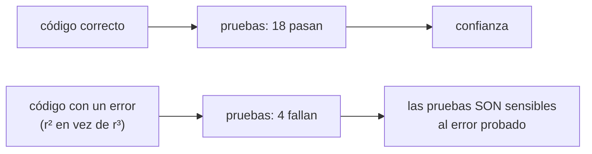

# B07-C17 — Pruebas de funciones matemáticas

<!-- nav:top -->
[🏠 Programa](../../../../README.md) · [📚 Bloque B07](../../../tronco-comun/B07-informatica-cientifica-desde-cero.md) · [← Anterior: B07-C16 — Formatos JSON y YAML](../B07-C16-formatos-json-y-yaml/CLASE.md) · [Siguiente: B07-C18 — Algoritmos de búsqueda y ordenamiento →](../B07-C18-algoritmos-de-busqueda-y-ordenamiento/CLASE.md)
<!-- /nav -->

## 1. Ubicación, nivel y alcance

Decimoséptima clase del bloque B07. Hasta ahora probabas con `assert` dentro de una función `pruebas()`. Aquí pasas a **pytest**, la herramienta habitual, y aprendes **qué probar** en una función matemática: casos analíticos, propiedades, bordes y errores, con tolerancias justificadas. Nivel N2.

Verás pruebas con `assert`, `pytest.approx`, `pytest.raises`, parametrización, propiedades de escala, estabilidad numérica y la pregunta clave: «¿mis pruebas detectarían un error?». No verás cobertura de código, pruebas basadas en propiedades con generación aleatoria ni integración continua.

## 2. Por qué esta clase existe

Una función matemática puede dar el resultado correcto en el único caso que probaste y estar mal en los demás. Y es fácil escribir una prueba que **no puede fallar**: la que compara la función contra sí misma o contra un caso donde el error se esconde. En este bloque lo verás con un ejemplo real: probar el volumen de una esfera con radio 1 no detecta que el programa use `r²` en vez de `r³`.

La pregunta motivadora es: **¿cómo sé que mi función está bien y que mis pruebas lo detectarían si no lo estuviera?** La decisión central es qué casos y propiedades elegir, qué tolerancia usar y cómo demostrar que la prueba es sensible.

## 3. Lo que podrás hacer al terminar

1. Escribir pruebas con `assert` que pytest descubra y ejecute.
2. Comparar decimales con `pytest.approx` y justificar la tolerancia.
3. Comprobar que se lanzan los errores esperados con `pytest.raises`.
4. Parametrizar una prueba para varios casos.
5. Elegir casos analíticos, propiedades (escalas, relaciones entre raíces) y bordes.
6. Comprobar que una prueba falla cuando el código está mal.

La evidencia es el **juego de pruebas con demostración de sensibilidad** del ejercicio 12 (sección 20).

## 4. Con qué llegas y cómo comprobarlo

Necesitas C01–C16. Cinco preguntas:

1. ¿Qué hace `assert`?
2. ¿Por qué no se compara `==` entre decimales?
3. ¿Qué hace `raise ValueError`?
4. ¿Qué es un módulo y cómo se importa?
5. ¿Cómo ejecutas un script con `uv run`?

<details>
<summary>Ver respuestas</summary>

1. Detiene el programa si la condición es falsa. 2. Los decimales son aproximaciones binarias. 3. Lanza un error con un mensaje. 4. Un archivo `.py`; con `import`. 5. `uv run --project <carpeta> python script.py` (C13).
</details>

Con cuatro o cinco aciertos, sigue; con tres o menos, repasa C06, C12 y C13.

## 5. Un caso real: tres funciones con casos que se conocen de antemano

El módulo [funciones_matematicas.py](funciones_matematicas.py) tiene tres funciones: el volumen de una esfera, las raíces reales de una ecuación cuadrática y el período de Kepler `T = a^1,5` (años terrestres con distancias terrestres). Para cada una se conocen resultados **sin usar el programa**: la esfera de radio 1 tiene volumen `4π/3`; `(x − 1)(x − 2)` tiene raíces 1 y 2; la Tierra, con a = 1, tiene T = 1, y Marte, con datos publicados del NASA NSSDC (S1), tiene `T = 686,980/365,256 = 1,881` años. Ese conjunto de casos es el **ejemplo conductor**.

## 6. Vocabulario

Una **prueba** (*test*) es una función que ejecuta código y comprueba el resultado con `assert`. pytest descubre archivos `test_*.py` y funciones `test_*` (S2). `pytest.approx` compara números con tolerancia relativa (y absoluta para cero); funciona con escalares, listas y arreglos de NumPy (S2, S3). `pytest.raises(Tipo, match="texto")` comprueba que el bloque lance esa excepción, con un mensaje que coincida (S3). La **parametrización** (`@pytest.mark.parametrize`) repite una prueba con varios datos. Un **caso analítico** es uno cuyo resultado se deduce con matemáticas, sin la función. Una **propiedad** es una relación que debe cumplirse siempre (por ejemplo, duplicar el radio multiplica el volumen por 8). Un **caso borde** es una entrada extrema (0, negativos, `nan`). La **estabilidad numérica** es la capacidad de un cálculo de no perder cifras. Una prueba **sensible** falla cuando el código está mal. **Cancelación catastrófica** es la pérdida de cifras al restar números casi iguales.

## 7. Modelo mental: la prueba como detector

Una prueba es un detector. Un detector que nunca se ha visto sonar no sirve de nada: hay que acercarle algo que debería activarlo.



*Descripción textual:* el código correcto, ejecutado con las pruebas, pasa las 18; el código al que se introdujo un error (r² en vez de r³) falla 4. Que fallen demuestra que las pruebas son sensibles a ese error, y que pasen en el código correcto da confianza.

**Límite de la analogía:** un detector se ajusta para un tipo de señal; un juego de pruebas solo es sensible a los errores que cubren. Pasar todas no prueba que **no** haya errores, solo que no están en lo que se probó.

## 8. La explicación, paso a paso

### 8.1 La primera prueba

```python
def test_volumen_esfera_unitaria():
    assert fm.volumen_esfera(1.0) == pytest.approx(4.0 * math.pi / 3.0, rel=1e-12)
```

El nombre empieza por `test_`; adentro, un `assert`. Se ejecuta con `python -m pytest -q` en la carpeta; pytest reescribe el `assert` para mostrar los valores intermedios cuando falla (S2, S3). Aquí se compara con `4π/3` calculado **de forma independiente**, no con la función.

### 8.2 Comparar decimales con tolerancia

`pytest.approx(esperado, rel=1e-12)` acepta el valor si difiere menos de `1e-12` en relación al esperado. Sin argumentos, la tolerancia relativa por defecto es `1e-6` y, para comparar con cero, hay una tolerancia absoluta de `1e-12` (comprobado ejecutando: `1.0001` no coincide con `1.0` pero `1.0000001` sí; `1e-13` coincide con `0.0` y `1e-11`, no). Elige la tolerancia según el error que esperas del cálculo: un volumen de una sola multiplicación admite `1e-12`; un período contra un dato publicado con cuatro cifras, `1e-3`.

### 8.3 Casos analíticos, propiedades y bordes

Para el volumen: caso analítico (radio 1), borde (radio 0 da 0) y **propiedad de escala** (duplicar el radio multiplica el volumen por 8), parametrizada con cuatro radios (0,5; 1; 6371; 0,001). Para la cuadrática: raíces conocidas (1 y 2; ±2; 2 y 3; la doble 1) y las **relaciones de Vieta**: el producto de las raíces es `c/a` y la suma `−b/a`. Para el período: la Tierra (T = 1) y Marte con datos publicados.

### 8.4 Errores esperados

`with pytest.raises(ValueError, match="radio negativo"): fm.volumen_esfera(-1.0)` pasa solo si la función lanza ese error con ese mensaje. Se prueban las entradas que deben rechazarse: radio negativo, discriminante negativo, `a = 0`, y para el período `0`, un negativo y `nan` (parametrizadas).

### 8.5 La trampa: un caso que no distingue

La prueba del radio 1 pasa **aunque** la función calcule `4/3·π·r²`, porque `1² = 1³`. Y la del radio 0 también. Solo las pruebas de escala detectan el error: al introducirlo a propósito, **14 pruebas pasan y 4 fallan** (las cuatro de la propiedad de escala). Con el error, el mensaje de pytest muestra `4.1887902047863905 == 8.377580409572781 ± 8.4e-12`: el volumen no se multiplicó por 8. Lección: un caso con valores «cómodos» (0, 1) puede esconder errores; combina casos con valores no triviales y propiedades.

### 8.6 Estabilidad numérica: la fórmula ingenua falla

Para `x² − 10⁸x + 1 = 0`, las raíces son aproximadamente `10⁸` y `10⁻⁸` (su producto es 1). La fórmula directa calcula la pequeña como `(−b − √(b² − 4ac)) / 2a`, restando dos números casi iguales y perdiendo casi todas las cifras: da `7.45 × 10⁻⁹` en lugar de `1 × 10⁻⁸`, **un 25 % de error**. La versión estable calcula primero la raíz grande y obtiene la pequeña como `c / q`, y da `1e-08` con error relativo 0. La prueba con las relaciones de Vieta y la comparación `ingenua != approx(1e-8, rel=1e-2)` documentan el fallo. Una función que pasa pruebas con valores «normales» puede ser inútil en otros regímenes.

### 8.7 Qué no prueban las pruebas

Pasar no prueba que no haya errores, solo que no están en los casos cubiertos. Tampoco prueban que el modelo físico sea correcto: el período de Kepler se contrasta con un dato con tolerancia, pero la función no «sabe» de gravitación. Y una prueba contra el propio resultado de la función (un valor copiado de lo que da hoy) detecta cambios, no errores.

## 9. Magnitudes, símbolos y unidades

| Elemento | Qué es | Valor o regla |
|---|---|---|
| `V` | volumen de la esfera | `4/3 π r³` (unidades de r al cubo) |
| `T` | período de Kepler | `a^1,5` (años terrestres; a en distancias terrestres) |
| `x₁ x₂` | producto de raíces | `c/a` |
| `x₁ + x₂` | suma de raíces | `−b/a` |
| `rel`, `abs` | tolerancias de `approx` | por defecto `1e-6` y `1e-12` |
| Marte | `T = 686,980/365,256` | 1,881 años; `a = 227,956/149,598` (S1) |

## 10. Convenciones y referencias

Archivos `test_*.py` junto al módulo; un nombre de prueba que diga **qué** comprueba; un `assert` por idea; casos analíticos primero; tolerancia explícita y justificada; errores esperados con `match`. Versiones: pytest 9.2.0, Python 3.12.9. Las pruebas no se ejecutan en la integración continua del repositorio; se ejecutan en el laboratorio.

## 11. De dónde sale lo que afirmamos

| ID | Fuente | Localizador | Respalda | Estado |
|---|---|---|---|---|
| S1 | NASA NSSDC, fichas *Earth* y *Mars Fact Sheet* | https://nssdc.gsfc.nasa.gov/planetary/factsheet/marsfact.html | Semieje (227,956 y 149,598 × 10⁶ km) y período sidéreo (686,980 y 365,256 d) | Leídas el 2026-11-05 (mutables) |
| S2 | pytest-dev, *Get Started* (pytest 9.2.0) | https://docs.pytest.org/en/stable/getting-started.html | Descubrimiento `test_*`, `assert`, `raises`, `approx`, `-q` | Leída el 2026-11-05 |
| S3 | pytest-dev, *How to write and report assertions in tests* | https://docs.pytest.org/en/stable/how-to/assert.html | Introspección de `assert`, `raises` con `match`, `approx` | Leída el 2026-11-05 |
| S4 | Python Software Foundation, *The Python Standard Library* 3.12, `math` | https://docs.python.org/3.12/library/math.html | `sqrt`, `copysign`, `isclose` | Leída el 2026-11-05 |

Límites: las tolerancias por defecto de `approx` y la cancelación en la fórmula cuadrática se **verificaron ejecutando**, no en las páginas leídas (S3 indica que el valor por defecto está en la referencia de la API, que no se consultó). `pytest.mark.parametrize` se usa aquí sin haberse leído su página.

## 12. Cómo ver los resultados

La salida de `pytest -v` lista cada prueba con su estado (pasada o fallada), y la de `demostrar_fallo.py` resume los recuentos. Es la versión accesible; sin gráficos.

## 13. Ejemplo trabajado: cazar el error con una propiedad

**Paso 1.** Código con un error escondido: `radio ** 2` en lugar de `radio ** 3`. **Paso 2.** La prueba de radio 1 pasa (`1² = 1³`); la de radio 0 pasa. **Paso 3.** La propiedad «duplicar el radio multiplica por 8» falla: con radio 0,5 da `4.1887902047863905` frente a `8.377580409572781`. **Paso 4.** Cuatro pruebas fallan de las 18: el detector funciona. **Paso 5.** Se corrige y las 18 pasan.

**Paso final · incertidumbre.** Una propiedad bien elegida detecta clases enteras de errores; pero este juego de pruebas no cubriría un error que afectara solo a radios enormes (`1e300`) o a la constante `π` (que se probó solo a través de `4π/3`). La confianza es acotada por lo probado: declara qué cubre y qué no (por ejemplo, entradas no finitas, que aquí solo se prueban para el período).

## 14. Distintos estilos de prueba

(1) **Caso a caso**: simple, legible, pero puede esconder errores. (2) **Parametrizadas**: más casos con el mismo código. (3) **Propiedades**: relaciones que valen siempre; encuentran errores que los casos no ven. (4) **Contra una referencia independiente**: otra biblioteca o un dato publicado (como Marte aquí). (5) **De regresión**: congelan el resultado de hoy; detectan cambios pero no corrigen errores. (6) **Basadas en generación aleatoria de propiedades**: no se estudian aquí. Una buena práctica es combinar 1–4.

## 15. Práctica guiada

**Ejercicio 1 · con los pasos indicados.** Escribe una prueba de `hipotenusa(3, 4)` (que debe dar 5). *Pasos:* `def test_...`, `assert`, `pytest.approx`.

<details><summary>Solución comentada</summary>

`def test_hipotenusa_345(): assert hipotenusa(3, 4) == pytest.approx(5.0, rel=1e-12)`. El caso 3-4-5 es analítico.
</details>

**Ejercicio 2 · con una pista.** ¿Qué tolerancia usa `pytest.approx(1.0)` si no la indicas? ¿Aceptaría `1.0001`? *Pista:* se comprobó en la sección 8.2.

<details><summary>Solución comentada</summary>

Relativa de `1e-6`: rechaza `1.0001` (error relativo `1e-4`) y acepta `1.0000001`.
</details>

**Ejercicio 3 · casi autónomo.** Escribe una prueba con `pytest.raises` para `periodo_kepler_anios(-1.0)`.

<details><summary>Solución comentada</summary>

`with pytest.raises(ValueError): fm.periodo_kepler_anios(-1.0)`. Con `match="positivo"` se comprueba además el mensaje.
</details>

## 16. Práctica autónoma, transferencia e integrador

**Ejercicio 4.** ¿Por qué la prueba con radio 1 no detecta `r²` en lugar de `r³`? ¿Qué prueba sí?

<details><summary>Solución comentada</summary>

Porque `1² = 1³`. La propiedad de escala sí (duplicar el radio debe multiplicar el volumen por 8): con `r²` lo multiplica por 4.
</details>

**Ejercicio 5.** Para `x² − 3x + 2 = 0`, ¿cuáles son la suma y el producto de las raíces según Vieta? ¿Coinciden con 1 y 2?

<details><summary>Solución comentada</summary>

Suma `3`, producto `2`; raíces 1 y 2: `1 + 2 = 3` y `1 · 2 = 2`. Coinciden.
</details>

**Ejercicio 6.** Escribe una prueba parametrizada para `raices_estables` con la ecuación `x² − 5x + 6 = 0` (raíces 2 y 3) y otra con `x² − 4 = 0`.

<details><summary>Solución comentada</summary>

`@pytest.mark.parametrize("a, b, c, esperadas", [(1, -5, 6, (2.0, 3.0)), (1, 0, -4, (-2.0, 2.0))])` y un `assert fm.raices_estables(a, b, c) == pytest.approx(esperadas, rel=1e-12)`.
</details>

**Ejercicio 7.** ¿Qué entrada hace fallar `raices_estables` con `ValueError` y por qué la rechaza?

<details><summary>Solución comentada</summary>

`raices_estables(1, 0, 1)` (discriminante negativo: raíces complejas) o `a = 0` (no es cuadrática). La función solo trabaja con raíces reales y lo dice.
</details>

**Ejercicio 8.** Calcula con la fórmula ingenua la raíz pequeña de `x² − 10⁸x + 1`. ¿Cuántas cifras pierdes?

<details><summary>Solución comentada</summary>

Da `7.450580596923828e-09`, con 25 % de error (esperado `1e-08`): se pierde casi todo. Se debe a la resta de dos números casi iguales (`10⁸` y `√(10¹⁶ − 4)`).
</details>

**Ejercicio 9 · transferencia.** Un compañero escribe `assert volumen_esfera(2) == volumen_esfera(2)`. ¿Qué detecta esa prueba?

<details><summary>Solución comentada</summary>

Nada: compara la función consigo misma y siempre pasa. Debe compararse con un valor analítico (`32π/3`) o con una propiedad.
</details>

**Ejercicio 10 · transferencia.** El período de Marte con datos publicados difiere de `a^1,5` en `0,009 %`. ¿Qué tolerancia pondrías en la prueba y por qué?

<details><summary>Solución comentada</summary>

Una `rel` de `1e-3` (0,1 %) como en el módulo: es mayor que la diferencia observada y menor que cualquier error de modelo relevante; no puedes poner `1e-12` porque el dato está redondeado. La tolerancia debe justificarse por el dato.
</details>

**Ejercicio 11 · transferencia.** Un colega copia el resultado actual de la función y lo usa como «valor esperado» en la prueba. ¿Qué tipo de prueba es y qué no detecta?

<details><summary>Solución comentada</summary>

Una prueba de regresión: detecta cambios futuros, pero si hoy hay un error, lo congela como si fuera correcto. Debe haber al menos una prueba con un valor esperado obtenido de forma independiente.
</details>

**Ejercicio 12 · integrador.** Entrega un **juego de pruebas con demostración de sensibilidad** para una función propia (por ejemplo, la densidad de una esfera o la rapidez orbital circular): tres casos analíticos, dos propiedades, dos bordes, dos errores esperados, un error introducido a propósito con el recuento de pruebas que falla, y una frase sobre lo que el juego no cubre.

<details><summary>Solución modelo</summary>

Se acepta cualquier función con casos independientes, una propiedad de escala o simetría, una demostración con recuento real (por ejemplo, «16 pasan, 3 fallan») y una declaración de límites (entradas no finitas no probadas, rango de validez). Debe incluir la salida real de pytest.
</details>

## 17. Laboratorio: pruebas y demostración de sensibilidad

El archivo [test_funciones_matematicas.py](test_funciones_matematicas.py) contiene 18 pruebas (con parametrización) para [funciones_matematicas.py](funciones_matematicas.py); el script [demostrar_fallo.py](demostrar_fallo.py) copia ambos a una carpeta temporal, introduce el error `r²` en una copia y ejecuta pytest en las dos. Antes de imprimir verifica que la copia correcta pase todo (salida 0) y que la mala falle (salida distinta de 0); no toca los archivos originales.

**Datos:** casos analíticos y datos publicados de Marte (NASA); el error es **inyectado a propósito**. **Predice antes de ejecutar:** ¿cuántas pruebas fallarán con `r²`? (Las cuatro de la propiedad de escala.) **Resultados (2026-11-05, Python 3.12.9, pytest 9.2.0):**

```text
$ python -m pytest -q
..................                                                       [100%]
18 passed in 0.04s
```

```bash
uv run --project ../B07-C13-entornos-y-dependencias-con-uv/proyecto_laboratorios python demostrar_fallo.py
```

```text
python 3.12.9 | pytest 9.2.0 | pruebas OK
Código correcto : 18 pasadas, 0 falladas (salida 0)
Con r² en vez de r³: 14 pasadas, 4 falladas (salida 1)
```

Mensaje de pytest con el error inyectado (extracto):

```text
>       assert fm.volumen_esfera(2 * radio) == pytest.approx(8 * fm.volumen_esfera(radio), rel=1e-12)
E       assert 4.1887902047863905 == 8.377580409572781 ± 8.4e-12
```

**Límites:** requiere pytest (C13); la demostración inyecta un solo tipo de error; el recuento exacto depende de las pruebas parametrizadas; el tiempo de ejecución varía por equipo.

## 18. Errores frecuentes y cómo corregirlos

**Probar solo valores cómodos (0, 1).** Se corrige con el ejercicio 4.

**Comparar la función con ella misma.** Se corrige con el ejercicio 9.

**Tolerancia arbitraria.** Se corrige con el ejercicio 10 y la sección 8.2.

**Ignorar la estabilidad numérica.** Se corrige con la sección 8.6 y el ejercicio 8.

**Creer que «todas pasan» es prueba de corrección.** Se corrige con la sección 8.7 y el ejercicio 11.

## 19. Cómo sabrás que vas bien

Tras 8.1: ¿escribes una prueba con valor esperado independiente? Si no, ejercicio 1. Tras 8.2: ¿justificas una tolerancia? Si no, ejercicio 10. Tras 8.5: ¿explicas por qué falló solo la propiedad de escala? Si no, ejercicio 4. Tras el laboratorio: ¿cuántas pruebas detectaron el error y cuáles? Si no lo sabes, vuelve a la sección 17. Al final: ¿qué errores **no** detectaría tu juego? Si no lo dices, repasa la sección 13.

## 20. Qué entregas y cómo se evalúa

El producto es tu **juego de pruebas con demostración de sensibilidad**: pruebas, salida real de pytest, un error inyectado con recuento de fallos y los límites de lo cubierto.

| Criterio | Inicial | En desarrollo | Logrado | Destacado |
|---|---|---|---|---|
| Casos | Valores cómodos | Algunos analíticos | Analíticos, bordes y errores | Propiedades y relaciones |
| Tolerancias | Arbitrarias | Declaradas | Justificadas | Ligadas al dato o al método |
| Sensibilidad | No la comprueba | La menciona | Inyecta un error y cuenta | Varios errores y análisis |
| Honestidad | Afirma corrección total | Matiza | Declara lo no cubierto | Cuantifica lo que no sabe |

**Condiciones críticas:** valor esperado independiente de la función; demostrar sensibilidad; citar solo fuentes consultadas.

## 21. Ética, seguridad y límites

Un juego de pruebas aprobado da confianza, no certeza: en software con consecuencias reales (misiones, seguridad) se exige verificación y validación independientes (bloques B88 y B90). Declarar los límites de las pruebas es honestidad profesional. Sin datos personales. Material educativo.

## 22. Para cerrar y seguir

Una buena prueba compara con algo independiente, usa tolerancias justificadas, cubre bordes, errores y propiedades, y se demuestra sensible al provocar un fallo a propósito. Pasar no prueba que no haya errores. Queda abierta la pregunta de cómo ordenar y buscar datos con algoritmos cuyo costo se pueda medir.

**Glosario español–inglés.** prueba · *test*; tolerancia · *tolerance*; parametrizar · *to parametrize*; caso borde · *edge case*; propiedad · *property*; estabilidad numérica · *numerical stability*; cancelación catastrófica · *catastrophic cancellation*; regresión · *regression*.

**Continuidad.** [B07-C18](../B07-C18-algoritmos-de-busqueda-y-ordenamiento/CLASE.md) usa tu capacidad de **probar funciones** para implementar y comparar algoritmos de búsqueda y ordenamiento, midiendo su costo y comprobándolos contra los de la biblioteca estándar.

**Referencias:** ver sección 11.

<!-- nav:bottom -->
---

[← Anterior: B07-C16 — Formatos JSON y YAML](../B07-C16-formatos-json-y-yaml/CLASE.md) · [📚 Bloque B07](../../../tronco-comun/B07-informatica-cientifica-desde-cero.md) · [Siguiente: B07-C18 — Algoritmos de búsqueda y ordenamiento →](../B07-C18-algoritmos-de-busqueda-y-ordenamiento/CLASE.md)
<!-- /nav -->
