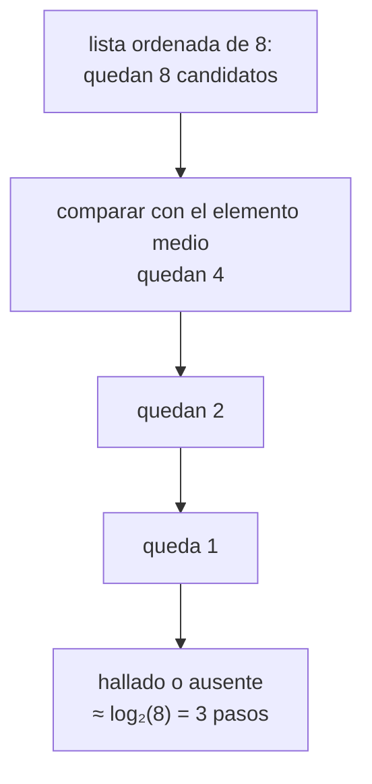

# B07-C18 — Algoritmos de búsqueda y ordenamiento

<!-- nav:top -->
[🏠 Programa](../../../../README.md) · [📚 Bloque B07](../../../tronco-comun/B07-informatica-cientifica-desde-cero.md) · [← Anterior: B07-C17 — Pruebas de funciones matemáticas](../B07-C17-pruebas-de-funciones-matematicas/CLASE.md) · [Siguiente: B07-C19 — Documentación y reproducibilidad →](../B07-C19-documentacion-y-reproducibilidad/CLASE.md)
<!-- /nav -->

## 1. Ubicación, nivel y alcance

Decimoctava clase del bloque B07. En [C01](../B07-C01-pensamiento-algoritmico/CLASE.md) escribiste un algoritmo para hallar el máximo. Ahora estudias los dos problemas más frecuentes sobre colecciones —**buscar** un dato y **ordenar**— y aprendes a medir y comparar su **costo** de forma que no dependa del computador. Nivel N2.

Verás búsqueda lineal y binaria, ordenamiento por inserción y por mezcla, conteo de comparaciones, `sorted`, `bisect` y la estabilidad. No verás complejidad formal (notación O mayúscula en detalle), estructuras como árboles o tablas hash, ni algoritmos para datos que no caben en memoria.

## 2. Por qué esta clase existe

Un catálogo estelar tiene millones de objetos. Buscar uno a uno es posible con diez planetas y ruinoso con diez millones. Ordenar antes de buscar cuesta una vez y ahorra muchísimo después. Y elegir el algoritmo equivocado puede convertir un cálculo de segundos en uno de días. La biblioteca estándar ya ofrece versiones excelentes, pero entender qué hacen te permite saber **cuándo** usarlas y **qué esperar**.

La pregunta motivadora es: **¿cómo encuentro y ordeno datos de forma que el costo crezca despacio cuando los datos crecen?** La decisión central es si ordenar primero, qué algoritmo emplear y cómo medir el costo con algo que no cambie de una máquina a otra.

## 3. Lo que podrás hacer al terminar

1. Implementar la búsqueda lineal y la binaria, y explicar cuándo se puede usar la binaria.
2. Implementar el ordenamiento por inserción y por mezcla.
3. Contar comparaciones para medir el costo sin depender de la velocidad del equipo.
4. Contrastar tu resultado con `sorted` y `bisect`.
5. Explicar el significado de «estable» y verificarlo.
6. Probar con casos borde (vacía, un elemento, repetidos, ya ordenada, inversa).

La evidencia es el **informe de costos** del ejercicio 12 (sección 20).

## 4. Con qué llegas y cómo comprobarlo

Necesitas C01–C17. Cinco preguntas:

1. ¿Cuántas comparaciones hace la búsqueda del máximo en una lista de 100 elementos?
2. ¿Qué diferencia hay entre `sorted` y `lista.sort()`?
3. ¿Qué es un caso borde?
4. ¿Qué es una función recursiva? (si no lo sabes, no importa: se explica aquí)
5. ¿Para qué sirve una semilla aleatoria?

<details>
<summary>Ver respuestas</summary>

1. 99 (`n − 1`). 2. `sorted` devuelve una lista nueva; `sort()` ordena en el lugar y devuelve `None`. 3. Una entrada extrema donde suelen esconderse errores. 4. Una función que se llama a sí misma con un problema más pequeño. 5. Para que una secuencia pseudoaleatoria sea reproducible.
</details>

Con cuatro o cinco aciertos, sigue; con tres o menos, repasa C01, C07 y C17.

## 5. Un caso real: ¿entre qué planetas cae una órbita?

Con los semiejes mayores de los ocho planetas (datos publicados del NASA NSSDC, S1) expresados en distancias terrestres, quieres saber entre qué dos planetas queda una órbita a 2,7 distancias terrestres. La lista de semiejes ya está ordenada de menor a mayor, así que no hace falta recorrerla entera: puedes **dividirla a la mitad** una y otra vez. Con ocho elementos la diferencia es pequeña; con ocho millones sería enorme. Ese problema, con ocho planetas y con listas sintéticas de 100 a 5000 elementos, es el **ejemplo conductor**.

## 6. Vocabulario

La **búsqueda lineal** recorre la lista elemento a elemento hasta hallar el objetivo. La **búsqueda binaria** compara con el elemento del medio de una lista **ordenada** y descarta la mitad que no puede contener el objetivo; repite con la mitad restante (S3). El **ordenamiento por inserción** toma cada elemento y lo inserta en su lugar dentro de la parte ya ordenada. El **ordenamiento por mezcla** divide la lista en dos, ordena cada mitad y las **mezcla** (se escribe con **recursión**: una función que se llama a sí misma con un problema menor). Un ordenamiento es **estable** si los elementos con la misma clave conservan su orden relativo (S2). El **costo** se mide aquí como número de **comparaciones**. `bisect_left(a, x)` devuelve la posición donde insertar `x` en la lista ordenada `a` (S3). Los **datos sintéticos** son datos generados por un programa, como las listas pseudoaleatorias del laboratorio.

## 7. Modelo mental: dividir a la mitad

Piensa en buscar una palabra en un diccionario impreso: no lees desde la «a»; abres por el medio, ves si la palabra está antes o después, y repites con la mitad correspondiente. Cada paso descarta la mitad de lo que queda.



*Descripción textual:* una lista ordenada de 8 candidatos se reduce a 4 tras comparar con el elemento medio, luego a 2, luego a 1; en unos tres pasos (log₂ 8) se sabe si el objetivo está o no.

**Límite de la analogía:** el diccionario está ordenado por construcción; si la lista **no** está ordenada, la búsqueda binaria da resultados sin sentido y no avisa.

## 8. La explicación, paso a paso

### 8.1 Búsqueda lineal

```python
def busqueda_lineal(lista, objetivo):
    comparaciones = 0
    for i, x in enumerate(lista):
        comparaciones += 1
        if x == objetivo:
            return i, comparaciones
    return -1, comparaciones
```

`enumerate` da el índice junto al elemento (S4). En el peor caso (objetivo ausente) compara con los `n` elementos. No exige orden.

### 8.2 Búsqueda binaria

Mantiene un rango `[bajo, alto]`; en cada vuelta mira el medio y mueve `bajo` o `alto`. El laboratorio cuenta dos comparaciones por vuelta (igualdad y orden), de modo que con 1000 elementos ausentes tarda 18 comparaciones frente a las 1000 de la lineal. Exige que la lista esté ordenada; la documentación de `bisect` lo asume y dice que su búsqueda es `O(log n)` (S3). Para ubicar una posición, la biblioteca estándar ofrece `bisect.bisect_left`, con la que el laboratorio ubica la órbita de 2,7 entre Marte y Júpiter.

### 8.3 Ordenamiento por inserción

Recorre desde el segundo elemento; guarda el valor, desplaza hacia la derecha los mayores y lo coloca. En una lista ya ordenada hace `n − 1` comparaciones; en una inversa, `n(n−1)/2`; en promedio, unas `n²/4`. Es simple y rápido para listas pequeñas o casi ordenadas.

### 8.4 Ordenamiento por mezcla

Divide en mitades, las ordena recursivamente y mezcla dos listas ordenadas comparando sus cabezas. Cada nivel de división hace unas `n` comparaciones y hay unos `log₂ n` niveles: el total es cercano a `n log₂ n`. Es estable si, en un empate, se toma primero el elemento de la mitad izquierda (como hace el laboratorio).

### 8.5 Lo que dice el conteo

Con datos sintéticos de semilla 2026: con 100 elementos, inserción hizo 2485 comparaciones (teoría `n(n−1)/4 = 2475`) y mezcla 541; con 5000, inserción hizo 6 270 052 (teoría 6 248 750) y mezcla 55 167. La mezcla crece mucho más despacio. La binaria pasa de 12 comparaciones con 100 elementos a 24 con 5000; la lineal, de 100 a 5000. Las cifras son **recuentos exactos de una ejecución con datos sintéticos**, no mediciones de tiempo.

### 8.6 Lo que ofrece la biblioteca estándar

`sorted(lista)` devuelve una lista nueva, admite `key=` y `reverse=` y es **estable**; su algoritmo, Timsort, aprovecha el orden previo de los datos (S2). Casi siempre es la mejor opción; tus implementaciones sirven para entender y para casos especiales. El laboratorio comprueba que ambas implementaciones den exactamente lo mismo que `sorted` en 300 listas aleatorias con repetidos.

### 8.7 Probar un algoritmo de ordenamiento

Casos: lista vacía, un elemento, repetidos, ya ordenada (mínimo costo de inserción), inversa (máximo), y listas aleatorias contrastadas con `sorted`. Propiedades: el resultado es una permutación de la entrada y está en orden no decreciente. La referencia independiente es `sorted`.

## 9. Magnitudes, símbolos y unidades

| Concepto | Costo (comparaciones) | Condición |
|---|---|---|
| búsqueda lineal | hasta `n` | ninguna |
| búsqueda binaria | ≈ `2 log₂ n` en el laboratorio (2 por vuelta) | lista ordenada |
| inserción | `n−1` a `n(n−1)/2`; ≈ `n²/4` en promedio | simple |
| mezcla | ≈ `n log₂ n` | recursiva; estable |
| `sorted` | ≤ `n log₂ n` típicamente | estable, con `key` |

Los semiejes se expresan en distancias terrestres (adimensional): `a/149,598` con `a` en 10⁶ km (S1).

## 10. Convenciones y referencias

Medir el costo con comparaciones, no con segundos, cuando se compara el algoritmo. Declarar que los datos son **sintéticos** y fijar la semilla. Usar `sorted` y `bisect` en código de producción salvo razón de peso. Probar contra la biblioteca estándar. Python 3.12.9.

## 11. De dónde sale lo que afirmamos

| ID | Fuente | Localizador | Respalda | Estado |
|---|---|---|---|---|
| S1 | NASA NSSDC, fichas individuales de planetas | https://nssdc.gsfc.nasa.gov/planetary/factsheet/ | Semieje mayor de los ocho planetas | Leídas el 2026-11-05 (mutables) |
| S2 | Python Software Foundation, *Sorting Techniques* (HOWTO) 3.12 | https://docs.python.org/3.12/howto/sorting.html | `sorted` frente a `list.sort`, `key`, `reverse`, estabilidad, Timsort | Leída el 2026-11-05 |
| S3 | Python Software Foundation, *The Python Standard Library* 3.12, `bisect` | https://docs.python.org/3.12/library/bisect.html | `bisect_left`, lista ya ordenada, `O(log n)` | Leída el 2026-11-05 |
| S4 | Python Software Foundation, *The Python Tutorial* 3.12, §5.6 Looping Techniques | https://docs.python.org/3.12/tutorial/datastructures.html | `enumerate` | Leída el 2026-11-05 |

Límites: los recuentos de la sección 8.5 y las fórmulas de costo de inserción y mezcla son **resultados de una ejecución** y de análisis estándar no citados a un texto; no se consultó un libro de algoritmos. No se midió tiempo de ejecución.

## 12. Cómo ver los costos

La tabla del laboratorio compara recuentos por tamaño. Una gráfica en escala log-log de comparaciones frente a `n` mostraría rectas de pendiente 2 (inserción), algo más de 1 (mezcla) y casi 0 (binaria); como ejercicio, constrúyela con lo aprendido en [C10](../B07-C10-graficos-bidimensionales-iniciales/CLASE.md).

## 13. Ejemplo trabajado: ¿entre quiénes cae 2,7?

**Datos (S1):** semiejes en distancias terrestres: Mercurio 0,387; Venus 0,723; Tierra 1,000; Marte 1,524; Júpiter 5,204; Saturno 9,572; Urano 19,165; Neptuno 30,181.

**Paso 1.** La lista está ordenada. **Paso 2.** `bisect_left(lista, 2.7)` devuelve la posición 4 (hay 4 elementos menores que 2,7). **Paso 3.** Los vecinos son el elemento 3 (Marte, 1,524) y el 4 (Júpiter, 5,204). **Paso 4.** Resultado del laboratorio: «entre Marte y Júpiter».

**Paso final · incertidumbre.** El resultado depende de que la lista esté ordenada y de que 2,7 sea un valor exacto; no dice nada sobre si hay cuerpos reales ahí ni sobre excentricidades (órbitas más alargadas cruzan estos límites). Es una **ubicación entre semiejes publicados**, no una afirmación física. Y con ocho elementos el algoritmo binario ahorra poco: su ventaja aparece con datos grandes.

## 14. Distintas maneras de buscar y ordenar

Para búsquedas repetidas por clave exacta, un **diccionario** (C07) es más rápido que la búsqueda binaria; la binaria sirve para rangos y posiciones. Para ordenar, `sorted` basta; la mezcla es útil si necesitas entender o adaptar la lógica; la inserción, para pocos datos. NumPy ofrece `np.sort` y `np.searchsorted` para arreglos (no consultados aquí). Criterio: usa lo estándar, verifica con pruebas y mide si importa.

## 15. Práctica guiada

**Ejercicio 1 · con los pasos indicados.** Ordena a mano por inserción la lista `[3, 1, 2]` y cuenta las comparaciones. *Pasos:* sección 8.3.

<details><summary>Solución comentada</summary>

`i=1`: valor 1; compara con 3 (3 > 1: desplaza) y llega al principio: 1 comparación. `i=2`: valor 2; compara con 3 (desplaza) y con 1 (1 > 2 es falso, para): 2 comparaciones. Total 3; resultado `[1, 2, 3]`.
</details>

**Ejercicio 2 · con una pista.** ¿Cuántas comparaciones hace `busqueda_lineal([3, 1, 2], 2)`? *Pista:* el 2 está al final.

<details><summary>Solución comentada</summary>

3, y devuelve `(2, 3)`: el índice 2 tras 3 comparaciones.
</details>

**Ejercicio 3 · casi autónomo.** ¿Qué pasa con la búsqueda binaria en `[5, 1, 4]` buscando 1?

<details><summary>Solución comentada</summary>

Buscando 1, mira el medio (que es 1) y lo halla por casualidad. Pero buscando 5, que **sí está** en el índice 0, devuelve `(-1, 4)`: compara con el medio (1), concluye que 5 está a la derecha y nunca mira a la izquierda. La lista no está ordenada: el algoritmo no avisa y su resultado es falso (comprobado ejecutando).
</details>

## 16. Práctica autónoma, transferencia e integrador

**Ejercicio 4.** ¿Cuántas comparaciones hace la inserción en una lista **ya ordenada** de 50 elementos y en una **inversa**?

<details><summary>Solución comentada</summary>

49 (`n − 1`) y 1225 (`50·49/2`); el laboratorio lo comprueba.
</details>

**Ejercicio 5.** Con la tabla de la sección 8.5, ¿cuántas veces más comparaciones hace la inserción que la mezcla con 5000 elementos?

<details><summary>Solución comentada</summary>

`6 270 052 / 55 167 ≈ 114`. Con 100 elementos, `2485 / 541 ≈ 4,6`: la ventaja crece con el tamaño.
</details>

**Ejercicio 6.** ¿Por qué `sorted` es mejor que tu mezcla para el uso diario?

<details><summary>Solución comentada</summary>

Está probada, es más rápida (implementada en C y aprovecha el orden previo), es estable y admite `key` y `reverse` (S2). Tu versión sirve para aprender.
</details>

**Ejercicio 7.** ¿Qué significa «estable»? Da un ejemplo con pares.

<details><summary>Solución comentada</summary>

Los elementos con igual clave conservan su orden relativo. Con `[(2,'a'),(1,'b'),(2,'c'),(1,'d')]` ordenado por el número, un orden estable da `b, d, a, c` (el laboratorio lo comprueba con `sorted`).
</details>

**Ejercicio 8.** Usa `bisect_left` para ubicar 0,5 en `[0.387, 0.723, 1.0]`. ¿Entre cuáles queda?

<details><summary>Solución comentada</summary>

`bisect_left` devuelve 1; queda entre 0,387 (Mercurio) y 0,723 (Venus).
</details>

**Ejercicio 9 · transferencia.** Tienes un millón de magnitudes ordenadas de estrellas y 1000 consultas «¿cuántas son más débiles que 12?». ¿Ordenas, buscas o usas diccionario?

<details><summary>Solución comentada</summary>

Ordenas una vez y usas `bisect` en cada consulta: cada una cuesta unos 20 pasos en lugar de un millón. Un diccionario no sirve para rangos.
</details>

**Ejercicio 10 · transferencia.** El laboratorio mide comparaciones, no segundos. ¿Qué ventaja y qué límite tiene?

<details><summary>Solución comentada</summary>

Ventaja: el resultado es idéntico en cualquier computador y revela cómo crece el costo. Límite: no mide otros costos (memoria, velocidad real de operaciones en C frente a Python), así que no predice cuál será más rápido en la práctica.
</details>

**Ejercicio 11 · transferencia.** Un compañero afirma que la búsqueda binaria «siempre es mejor» que la lineal. ¿Qué respondes?

<details><summary>Solución comentada</summary>

Solo si la lista está ordenada y se busca más de una vez (el ordenamiento cuesta); para una sola búsqueda en una lista desordenada, la lineal es más barata que ordenar y buscar. Y con muy pocos elementos la diferencia es irrelevante.
</details>

**Ejercicio 12 · integrador.** Entrega un **informe de costos**: tus implementaciones probadas contra `sorted` y `bisect`, una tabla de comparaciones para al menos cuatro tamaños con datos sintéticos de semilla declarada, el cociente entre los costos teóricos y observados, y una conclusión que diga cuándo elegirías cada algoritmo.

<details><summary>Solución modelo</summary>

Puedes reproducir la tabla de la sección 17 con otra semilla y cambiar la inserción por la selección o la burbuja. Debe incluir pruebas con bordes, la semilla, los recuentos reales y una recomendación razonada (por ejemplo, `sorted` por defecto; binaria con lista ya ordenada y muchas consultas).
</details>

## 17. Laboratorio: costos de buscar y ordenar

El script [busqueda_ordenamiento.py](busqueda_ordenamiento.py) implementa los cuatro algoritmos con conteo de comparaciones y ubica la órbita de 2,7 con `bisect`. Antes de imprimir verifica que inserción y mezcla coincidan con `sorted` en 300 listas con repetidos, bordes, los costos mínimo y máximo de inserción, la estabilidad, la binaria contra `bisect` con una cota logarítmica, y que los semiejes de la ficha ya estén en orden.

**Datos:** semiejes **publicados** (NASA); listas **sintéticas** con `random.Random(2026)`. **Predice antes de ejecutar:** ¿cuántas comparaciones hará la inserción con 1000 elementos? (Unas `n²/4 ≈ 250 000`.) **Resultados (2026-11-05, Python 3.12.9):**

```text
python 3.12.9 | pruebas OK
Una órbita a 2.7 distancias terrestres queda entre Marte y Júpiter (semiejes 1.524 y 5.204)
      n  lineal (peor)  binaria   inserción   mezcla  sorted
      8              8        6          16       15      ok
    100            100       12        2485      541      ok
   1000           1000       18      261345     8686      ok
   5000           5000       24     6270052    55167      ok
```

```bash
python programa/clases/B07/B07-C18-algoritmos-de-busqueda-y-ordenamiento/busqueda_ordenamiento.py
```

Cálculo propio de contraste: `n(n−1)/4` da 14, 2475, 249 750 y 6 248 750; `n log₂ n`, 24, 664, 9966 y 61 439.

**Límites:** el costo es en comparaciones, no en tiempo; los recuentos dependen de la semilla; no se estudian memoria ni datos que no caben en RAM.

## 18. Errores frecuentes y cómo corregirlos

**Usar búsqueda binaria en una lista desordenada.** Se corrige con el ejercicio 3.

**Ordenar para una sola búsqueda.** Se corrige con el ejercicio 11.

**Confundir `sort()` con `sorted()`.** Se corrige con C07 y el ejercicio 6.

**Medir el tiempo y concluir sobre el algoritmo.** Se corrige con el ejercicio 10.

**No probar bordes.** Se corrige con la sección 8.7.

## 19. Cómo sabrás que vas bien

Tras 8.2: ¿explicas por qué la binaria exige orden? Si no, ejercicio 3. Tras 8.3: ¿cuentas comparaciones a mano en una lista pequeña? Si no, ejercicio 1. Tras 8.5: ¿explicas por qué la mezcla crece más despacio? Si no, relee 8.4. Tras el laboratorio: ¿qué comprobó el script antes de imprimir? Si no lo sabes, léelo. Al final: ¿cuándo elegirías `bisect` y cuándo un diccionario? Si dudas, ejercicio 9.

## 20. Qué entregas y cómo se evalúa

El producto es tu **informe de costos**: implementaciones, pruebas, tabla con semilla declarada, comparación con la teoría y recomendación razonada.

| Criterio | Inicial | En desarrollo | Logrado | Destacado |
|---|---|---|---|---|
| Algoritmos | Con errores | Correctos con ayuda | Correctos y probados | Con estabilidad verificada |
| Pruebas | Un caso | Típicos | Bordes y contraste con `sorted` | Propiedades (permutación y orden) |
| Medición | Sin medir | En segundos | En comparaciones | Con cotejo teórico |
| Honestidad | Datos sin rotular | Rotulados | Con semilla | Con límites de la medición |

**Condiciones críticas:** rotular datos sintéticos y declarar la semilla; no usar búsqueda binaria sin orden; citar solo fuentes consultadas.

## 21. Ética, seguridad y límites

Un algoritmo de ordenamiento o búsqueda puede ser la base de un catálogo del que dependen decisiones: probar con casos borde y declarar supuestos evita errores silenciosos. Cuidado con los datos sintéticos: no los presentes como reales. Sin datos personales. Material educativo.

## 22. Para cerrar y seguir

Buscar y ordenar tienen costos que crecen de forma distinta con el tamaño: la binaria y la mezcla crecen despacio frente a la lineal y la inserción. Medir comparaciones permite comparar algoritmos con independencia del equipo, y la biblioteca estándar es la opción por defecto. Queda abierta la pregunta de cómo documentar y reproducir todo esto para que otra persona lo repita.

**Glosario español–inglés.** búsqueda lineal · *linear search*; búsqueda binaria · *binary search*; ordenamiento por inserción · *insertion sort*; ordenamiento por mezcla · *merge sort*; estable · *stable*; recursión · *recursion*; costo · *cost*; datos sintéticos · *synthetic data*.

**Continuidad.** [B07-C19](../B07-C19-documentacion-y-reproducibilidad/CLASE.md) usa tu capacidad de **medir y declarar semillas** para documentar un proyecto completo de modo que otra persona lo reproduzca.

**Referencias:** ver sección 11.

<!-- nav:bottom -->
---

[← Anterior: B07-C17 — Pruebas de funciones matemáticas](../B07-C17-pruebas-de-funciones-matematicas/CLASE.md) · [📚 Bloque B07](../../../tronco-comun/B07-informatica-cientifica-desde-cero.md) · [Siguiente: B07-C19 — Documentación y reproducibilidad →](../B07-C19-documentacion-y-reproducibilidad/CLASE.md)
<!-- /nav -->
