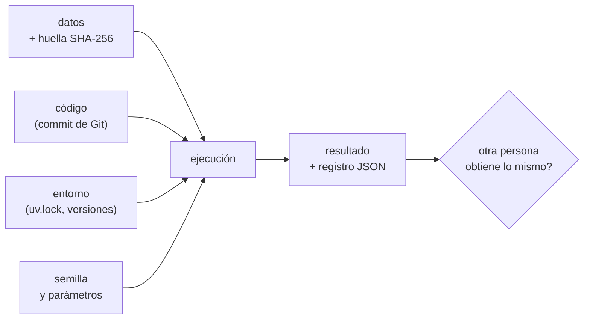

# B07-C19 — Documentación y reproducibilidad

<!-- nav:top -->
[🏠 Programa](../../../../README.md) · [📚 Bloque B07](../../../tronco-comun/B07-informatica-cientifica-desde-cero.md) · [← Anterior: B07-C18 — Algoritmos de búsqueda y ordenamiento](../B07-C18-algoritmos-de-busqueda-y-ordenamiento/CLASE.md) · [Siguiente: B07-C20 — Primer simulador de un movimiento celeste →](../B07-C20-primer-simulador-de-un-movimiento-celeste/CLASE.md)
<!-- /nav -->

## 1. Ubicación, nivel y alcance

Decimonovena clase del bloque B07. Tienes código que funciona ([C06](../B07-C06-funciones-y-modularidad/CLASE.md)), se prueba ([C17](../B07-C17-pruebas-de-funciones-matematicas/CLASE.md)), usa un entorno fijado ([C13](../B07-C13-entornos-y-dependencias-con-uv/CLASE.md)) y tiene historia ([C14](../B07-C14-control-de-versiones-con-git/CLASE.md)). Falta lo que permite que **otra persona lo entienda y obtenga tu resultado**: documentación y un registro de cada ejecución. Nivel N2.

Verás docstrings, README, semillas aleatorias, huellas de archivos de datos, registro de versiones y la diferencia entre repetir y reproducir. No verás contenedores, flujos de trabajo automatizados ni publicación de datos con identificador persistente.

## 2. Por qué esta clase existe

Un resultado que solo su autor puede obtener, y solo el día en que lo obtuvo, es una anécdota. Cuando pasan seis meses, no sabrás con qué datos, con qué versión ni con qué semilla lo generaste. Y si el cálculo usa números aleatorios, sin semilla ni siquiera tú podrás repetirlo.

La pregunta motivadora es: **¿qué debo guardar y escribir para que mi resultado se pueda volver a obtener y entender?** La decisión central es qué entra en el registro (datos con su huella, parámetros, semilla, versiones) y qué documentación acompaña al código.

## 3. Lo que podrás hacer al terminar

1. Escribir docstrings y un README que respondan qué hace, cómo se usa y con qué datos.
2. Fijar una semilla aleatoria y explicar por qué da el mismo resultado.
3. Calcular la huella SHA-256 de un archivo de datos y para qué sirve.
4. Registrar entradas, entorno y resultado en un archivo JSON.
5. Comprobar que dos ejecuciones con el mismo registro dan lo mismo.
6. Distinguir qué garantiza y qué no garantiza la reproducibilidad.

La evidencia es el **paquete reproducible** del ejercicio 12 (sección 20).

## 4. Con qué llegas y cómo comprobarlo

Necesitas C01–C18. Cinco preguntas:

1. ¿Qué guarda `uv.lock`?
2. ¿Qué es un commit?
3. ¿Qué formato escribe `json.dumps`?
4. ¿Qué es un dato sintético?
5. ¿Qué es una docstring?

<details>
<summary>Ver respuestas</summary>

1. Las versiones exactas resueltas de todas las dependencias. 2. Una instantánea del proyecto con mensaje, autor y fecha. 3. Texto JSON. 4. Un dato generado por un programa, no medido. 5. Una cadena al inicio de un módulo o función que la describe.
</details>

Con cuatro o cinco aciertos, sigue; con tres o menos, repasa C06, C13, C14 y C16.

## 5. Un caso real: estimar π y poder repetirlo

Para tener un cálculo con azar y un resultado comprobable, el laboratorio estima π lanzando puntos aleatorios en un cuadrado de lado 1 y contando cuántos caen dentro del cuarto de círculo: `π ≈ 4 × (dentro / total)`. Es un experimento **sintético** (no hay medidas) cuyo resultado correcto conocemos. El script registra con cada ejecución el número de puntos, la semilla, la huella del CSV de planetas de C08 (datos publicados por el NASA NSSDC, S1), las versiones de Python y NumPy y el resultado. Ese registro es el **ejemplo conductor**.

## 6. Vocabulario

**Documentar** es escribir lo necesario para entender y usar el código y los datos. Una **docstring** es la cadena al inicio de un módulo, clase o función que lo describe; la primera línea es un resumen corto, y el resto explica argumentos, valores devueltos, efectos y excepciones (S2). Un **README** es el archivo de entrada de un proyecto: qué es, cómo instalarlo, cómo ejecutarlo y de dónde vienen los datos. Una **semilla** es el valor inicial de un generador pseudoaleatorio: con la misma semilla produce la misma secuencia (S3, S4). `numpy.random.default_rng(semilla)` crea un generador que no gestiona un estado global (S4). Una **huella** (*hash*) es un número de longitud fija calculado a partir del contenido de un archivo; si el contenido cambia, la huella cambia. **SHA-256** es una función de huella de 256 bits. **Repetir** es volver a ejecutar el mismo código con los mismos datos; **reproducir** es obtener el mismo resultado de forma independiente, a partir de la descripción. Un **registro de ejecución** guarda entradas, entorno y resultado. **Procedencia** es el origen y la historia de los datos.

## 7. Modelo mental: la receta completa

Un resultado es como un plato: para que otro cocinero lo repita necesita los ingredientes con su marca (datos y huella), la receta (código y versión), el instrumental (entorno) y las decisiones que dependían del azar (semilla).



*Descripción textual:* cuatro entradas —los datos con su huella, el código identificado por su commit, el entorno fijado y la semilla con los parámetros— alimentan una ejecución que produce el resultado y un registro en JSON; con ese registro, otra persona puede comprobar si obtiene lo mismo.

**Límite de la analogía:** en la cocina, «repetir» un plato nunca da exactamente lo mismo; en computación, con las mismas entradas el resultado puede ser **idéntico bit a bit**, pero solo si todas las entradas (incluidas las ocultas, como la versión de una biblioteca o el procesador) coinciden.

## 8. La explicación, paso a paso

### 8.1 Docstrings que sirven

La convención (S2): una frase corta e imperativa que acaba en punto; si hay más, una línea en blanco y la explicación (argumentos, valores devueltos, efectos secundarios y excepciones). Por ejemplo: `"""Devuelve la huella SHA-256 (hexadecimal) del contenido de un archivo."""`. Un script entero también se documenta: su docstring de módulo debe bastar como mensaje de uso (S2). En este bloque, cada laboratorio lleva una cabecera con **datos, modelo, supuestos, validez y tolerancia**.

### 8.2 Comprobar que hay documentación

Con `inspect.getdoc(f)` obtienes la docstring de una función; el laboratorio recorre las funciones públicas de un módulo y lista las que no tienen. Al aplicarlo al módulo `kepler.py` de C06 descubrió que su función `pruebas()` carecía de docstring; se corrigió. Documentar no es un adorno: se puede **comprobar de forma automática**, aunque que exista no garantiza que sea buena.

### 8.3 Un README mínimo

Responde seis preguntas: ¿qué es? (una frase), ¿qué necesita? (versión de Python y dependencias, con `uv.lock`), ¿cómo se ejecuta? (el comando exacto), ¿qué datos usa y de dónde vienen? (fuente, fecha, huella y licencia), ¿qué resultados produce y cómo se comprueban? (pruebas), y ¿quién lo hizo y cómo se cita? Un README no sustituye las docstrings: el README describe el proyecto; las docstrings, cada pieza.

### 8.4 Semillas

Con `rng = np.random.default_rng(42)`, dos ejecuciones producen la misma secuencia (S4). Sin semilla, se usa entropía del sistema y cada ejecución es distinta. Registra la semilla **siempre**, aunque creas que da igual. La documentación de NumPy advierte que `Generator` **no garantiza** la misma secuencia entre versiones de NumPy (S4); por eso el registro también guarda la versión de NumPy. El módulo `random` de la biblioteca estándar funciona igual con `random.seed`, y tampoco es para uso criptográfico (S3).

### 8.5 Huellas de datos

`hashlib.sha256(bytes).hexdigest()` produce 64 caracteres hexadecimales. La del CSV de planetas es `0458ca08…7a58` (la comprobamos también con la herramienta `sha256sum`: coincide). Si alguien cambia una cifra, la huella cambia por completo. Un detalle práctico: las huellas dependen de los **bytes**; en Windows, el cambio de fin de línea (`\r\n`) alteraría la huella. Este repositorio fija los finales de línea con `eol=lf` (se comprobó con `git ls-files --eol`: el archivo está en `lf` en el índice y en la copia de trabajo), y por eso la huella es la misma en cualquier sistema.

### 8.6 El registro de ejecución

El script guarda en un diccionario (y en JSON, C16): `entradas` (n, semilla, huella del CSV), `entorno` (versiones de Python y NumPy, sistema) y `resultado` (π estimado). Con las mismas entradas y entorno, dos ejecuciones dan un registro **igual**: se comprueba con `==`. Con otra semilla, el resultado cambia.

### 8.7 Repetir, reproducir y sus límites

Que **tu** script dé lo mismo dos veces (repetir) es lo mínimo. Reproducir exige que otra persona, con tu README y tu registro, llegue al mismo resultado en **su** máquina. Aun así pueden variar la plataforma o el procesador en las últimas cifras de operaciones con decimales. Por eso se compara con una tolerancia declarada cuando la plataforma difiere, y exactitud solo cuando el entorno es el mismo.

## 9. Magnitudes, símbolos y unidades

| Elemento | Qué es | Ejemplo del laboratorio |
|---|---|---|
| `n` | número de puntos | 100 000 |
| semilla | valor inicial del generador | 2026 |
| `csv_sha256` | huella del CSV (64 hex) | `0458ca08…7a58` |
| `σ` | desviación típica teórica del estimador | `4·√(p(1−p)/n)` = 0,00519 con p = π/4 |
| `π` estimado | resultado sintético | 3,15316 (semilla 2026) |

El resultado es adimensional. La huella no tiene unidades.

## 10. Convenciones y referencias

Docstring en cada función pública y cabecera en cada script. Semilla declarada y guardada. Huella de cada archivo de datos que entre en un resultado. Registro en JSON con entradas, entorno y resultado. Versiones: Python 3.12.9, NumPy 2.4.4. Los datos sintéticos se rotulan como tales.

## 11. De dónde sale lo que afirmamos

| ID | Fuente | Localizador | Respalda | Estado |
|---|---|---|---|---|
| S1 | NASA NSSDC, fichas individuales de planetas (contenido del CSV de C08) | https://nssdc.gsfc.nasa.gov/planetary/factsheet/ | Datos cuya huella se registra | Leídas el 2026-11-05 (mutables) |
| S2 | Python Enhancement Proposals, PEP 257 «Docstring Conventions» | https://peps.python.org/pep-0257/ | Qué es una docstring; convención de una línea y de varias; docstrings de scripts | Leída el 2026-11-05 |
| S3 | Python Software Foundation, *The Python Standard Library* 3.12, `random` | https://docs.python.org/3.12/library/random.html | `seed`, reproducibilidad con la misma semilla, advertencia de seguridad | Leída el 2026-11-05 |
| S4 | NumPy Developers, *Random Generator* (NumPy 2.4) | https://numpy.org/doc/2.4/reference/random/generator.html | `default_rng`, semilla reproducible, sin garantía entre versiones | Leída el 2026-11-05 |
| S5 | Astral, *uv: Locking and syncing* | https://docs.astral.sh/uv/concepts/projects/sync/ | `uv.lock` como registro de versiones | Leída el 2026-11-05 |

Límites: la página de NumPy no incluye ejemplos de `normal` ni `uniform`; no se usan aquí. `hashlib` y la definición de SHA-256 no se consultaron en una fuente: la huella se **verificó con `sha256sum`**. Las definiciones de «repetir» y «reproducir» son las de esta clase, no una cita de una norma. No se consultó ninguna guía de ciencia abierta.

## 12. Cómo ver el registro

El registro se imprime como JSON legible (texto plano), con la huella del CSV, las versiones y el resultado; es la versión accesible. El diagrama de la sección 7 tiene descripción textual.

## 13. Ejemplo trabajado: dos ejecuciones y una tercera distinta

**Entradas:** `n = 100 000`, semilla 2026, el CSV de C08.

**Paso 1.** Primera ejecución: `pi_estimado = 3.15316`. **Paso 2.** Segunda, con las mismas entradas: el registro completo es **idéntico** (`True`). **Paso 3.** Tercera, con semilla 2027: `3.14348`, distinto: es otra realización del azar, no un error. **Paso 4.** Comparar con π: el error de la semilla 2026 es `0.01157`, y la desviación típica teórica con 100 000 puntos es `0.00519`: el error observado es de unas 2,2 desviaciones, algo poco frecuente pero plausible; la semilla 2027 queda a `0.0019`.

**Paso final · incertidumbre.** El resultado de **una** semilla no es «la» estimación de π: el valor cambia con la semilla dentro de la desviación típica. Informar `3.15316` sin la semilla y el número de puntos sería engañoso; informar el registro permite repetirlo, pero repetir **no** valida la corrección del método. Para validarlo, se compara con π, que se conoce.

## 14. Distintas maneras de documentar y registrar

Docstrings y README: lo mínimo. Un **cuaderno** (notebook) mezcla código, resultados y texto, pero puede ejecutarse en desorden y ocultar el estado: no se consultó aquí. Un **archivo de registro** (como el JSON del laboratorio) es simple y automatizable. Servicios de seguimiento de experimentos y contenedores dan más garantías con más complejidad; no se estudian. Criterio: empieza por lo simple y verificable (README + registro + `uv.lock` + Git) y añade herramientas cuando falte algo concreto.

## 15. Práctica guiada

**Ejercicio 1 · con los pasos indicados.** Escribe la docstring de una función `volumen_esfera(radio)` siguiendo la convención. *Pasos:* resumen imperativo, unidades, error.

<details><summary>Solución comentada</summary>

`"""Devuelve el volumen de una esfera (unidades de radio al cubo); lanza ValueError si el radio es negativo."""`. Una línea que dice qué devuelve, en qué unidades y qué falla.
</details>

**Ejercicio 2 · con una pista.** ¿Qué produce `np.random.default_rng(42).random(3)` ejecutado dos veces en el mismo entorno? *Pista:* semilla.

<details><summary>Solución comentada</summary>

Los mismos tres números en ambas (S4). Sin semilla, serían distintos cada vez.
</details>

**Ejercicio 3 · casi autónomo.** ¿Qué cambia en la huella SHA-256 de un archivo si modificas un solo carácter?

<details><summary>Solución comentada</summary>

Cambia por completo (una huella totalmente distinta de 64 caracteres). Por eso detecta cualquier alteración del contenido.
</details>

## 16. Práctica autónoma, transferencia e integrador

**Ejercicio 4.** Con el laboratorio, ¿qué resultado esperas con semilla 2026 y n = 100 000, y por qué es distinto de π?

<details><summary>Solución comentada</summary>

`3.15316`; difiere de π por el azar del muestreo (desviación típica teórica 0,00519). Es un resultado **sintético** y tiene error estadístico.
</details>

**Ejercicio 5.** ¿Por qué el registro guarda la versión de NumPy además de la semilla?

<details><summary>Solución comentada</summary>

Porque `Generator` no garantiza la misma secuencia entre versiones de NumPy (S4): con la misma semilla en otra versión, el resultado podría cambiar.
</details>

**Ejercicio 6.** ¿Qué detecta la huella del CSV que no detecta el nombre del archivo?

<details><summary>Solución comentada</summary>

Que el contenido cambió (una cifra, un fin de línea) aunque el nombre sea el mismo. Un nombre no garantiza un contenido.
</details>

**Ejercicio 7.** Redacta las seis respuestas de un README para el laboratorio de esta clase.

<details><summary>Solución comentada</summary>

Qué es (estimador de π con registro); qué necesita (Python 3.12, NumPy 2.4.4, `uv.lock` de C13); cómo se ejecuta (el comando de la sección 17); qué datos usa (CSV de C08, NASA NSSDC, huella `0458ca08…`); qué produce y cómo se comprueba (JSON y pruebas internas); quién lo hizo y cómo citarlo.
</details>

**Ejercicio 8.** Ejecuta con semillas 2026, 2027 y 2028 y compara los errores con la desviación típica teórica. ¿Es razonable que alguno supere 2 desviaciones?

<details><summary>Solución comentada</summary>

Con 2026, 2,2 desviaciones; con 2027, 0,4. Superar 2 desviaciones ocurre en alrededor de un 5 % de las semillas, así que en tres ejecuciones es posible aunque poco frecuente. Una tercera semilla permite comprobarlo.
</details>

**Ejercicio 9 · transferencia.** Un colega publica un resultado con «semilla aleatoria» sin decir cuál. ¿Qué problema hay?

<details><summary>Solución comentada</summary>

Nadie puede repetir su cálculo exactamente ni saber si el resultado es típico de su semilla. Debe publicar la semilla, el número de realizaciones y, de preferencia, varios resultados con sus dispersión.
</details>

**Ejercicio 10 · transferencia.** El mismo script en Windows y en Linux da una diferencia en la última cifra decimal. ¿Es un error? ¿Qué haces?

<details><summary>Solución comentada</summary>

No necesariamente: las operaciones con decimales pueden variar en la última cifra entre plataformas o bibliotecas. Documenta ambas plataformas y compara con tolerancia (C09, C17), no con `==`. Un cambio mayor sí requiere investigarlo.
</details>

**Ejercicio 11 · transferencia.** ¿Garantiza un `uv.lock` que otra persona obtenga tu mismo resultado? Nombra tres cosas que no cubre.

<details><summary>Solución comentada</summary>

No: cubre versiones de paquetes. No cubre los datos (por eso la huella), la semilla (por eso se registra), ni la plataforma y el procesador. Tampoco el código propio (por eso Git).
</details>

**Ejercicio 12 · integrador.** Entrega un **paquete reproducible** de uno de tus laboratorios: README de seis respuestas, docstrings comprobadas con `inspect`, `pyproject.toml` y `uv.lock`, huella de cada dato, semilla si hay azar, un registro JSON, y la salida de dos ejecuciones idénticas más una distinta.

<details><summary>Solución modelo</summary>

Puedes partir del laboratorio de la clase y cambiar el experimento (por ejemplo, estimar el área bajo una curva por Monte Carlo). Debe verse que la segunda ejecución con el mismo registro da `True`, y que con otra semilla cambia. Se acepta cualquier paquete con esas seis piezas y salidas reales.
</details>

## 17. Laboratorio: un registro de ejecución

El script [registro_ejecucion.py](registro_ejecucion.py) estima π con Monte Carlo y escribe el registro de la sección 5. Antes de imprimir comprueba que la misma semilla da registros idénticos, que otra semilla cambia el resultado, que la estimación esté a menos de 4 desviaciones típicas de π, que la huella del CSV sea estable y de 64 caracteres, que el registro quepa en JSON y que los módulos `kepler.py` (C06) y el propio script tengan docstring en todas sus funciones públicas.

**Datos:** CSV **publicado** (NASA, para la huella); experimento **sintético**. **Predice antes de ejecutar:** ¿serán idénticas las dos ejecuciones con semilla 2026? (Sí.) **Resultados (2026-11-05, Python 3.12.9, NumPy 2.4.4):**

```text
python 3.12.9 | numpy 2.4.4 | pruebas OK
{
  "entradas": {
    "n": 100000,
    "semilla": 2026,
    "csv_sha256": "0458ca0805809a55599f4f843f30414eca9194e8604ba59dfbf915283eec7a58"
  },
  "entorno": {
    "python": "3.12.9",
    "numpy": "2.4.4",
    "sistema": "Windows"
  },
  "resultado": {
    "pi_estimado": 3.15316
  }
}
Misma semilla 2026, segunda ejecución idéntica: True
Semilla 2027 (sintético) π ≈ 3.14348
Desviación típica teórica = 0.00519 | error observado con 2026: 0.01157
```

```bash
uv run --project ../B07-C13-entornos-y-dependencias-con-uv/proyecto_laboratorios python registro_ejecucion.py
```

**Límites:** el resultado `3.15316` es válido para NumPy 2.4.4 (otra versión podría dar otro valor); el campo `sistema` cambiará en otra plataforma; el script no guarda el registro en un archivo, solo lo imprime; no registra el commit de Git.

## 18. Errores frecuentes y cómo corregirlos

**Dejar la semilla sin declarar.** Se corrige con el ejercicio 9.

**No registrar versiones.** Se corrige con el ejercicio 5.

**Fiarse del nombre de un archivo de datos.** Se corrige con el ejercicio 6.

**Confundir repetir con validar.** Se corrige con el paso final de la sección 13.

**Creer que `uv.lock` basta.** Se corrige con el ejercicio 11.

## 19. Cómo sabrás que vas bien

Tras 8.1: ¿tus funciones tienen docstring con unidades y errores? Si no, ejercicio 1. Tras 8.4: ¿explicas por qué guardar la versión de NumPy? Si no, ejercicio 5. Tras 8.5: ¿sabes cuándo cambia una huella? Si no, ejercicio 3. Tras el laboratorio: ¿qué comprueba el script sobre la documentación? Lee `pruebas()`. Al final: ¿podría otra persona reproducir tu resultado sin preguntarte nada? Si no, rehaz el README.

## 20. Qué entregas y cómo se evalúa

El producto es tu **paquete reproducible**: README, docstrings, entorno fijado, huellas, semilla, registro JSON y salidas reales de tres ejecuciones.

| Criterio | Inicial | En desarrollo | Logrado | Destacado |
|---|---|---|---|---|
| Documentación | Sin README ni docstrings | Parcial | README de seis respuestas y docstrings | Comprobadas automáticamente |
| Registro | No registra | Registra resultado | Entradas, entorno y resultado | Con huella de datos y versión de código |
| Azar | Sin semilla | Con semilla no registrada | Semilla registrada | Varias semillas y dispersión |
| Honestidad | Afirma reproducibilidad total | La matiza | Declara lo no cubierto | Cuantifica la variación entre plataformas |

**Condiciones críticas:** declarar semilla y versiones; rotular datos sintéticos; no afirmar reproducibilidad total; citar solo fuentes consultadas.

## 21. Ética, seguridad y límites

La reproducibilidad es una forma de honestidad científica: permite que otros verifiquen tu trabajo. Los registros no deben incluir datos personales, rutas con tu nombre de usuario ni credenciales. Si los datos tienen licencia, respétala y cítala. Los generadores pseudoaleatorios del bloque **no son seguros** para contraseñas ni criptografía (S3). Material educativo.

## 22. Para cerrar y seguir

Documentar y registrar convierten un resultado en algo que otros pueden entender y volver a obtener: docstrings y README para el código, huellas para los datos, semilla y versiones para el azar y el entorno. Repetir no es validar, y un entorno idéntico no cubre todo. Queda abierta la pregunta de poner todo esto junto en un proyecto completo: un primer simulador del movimiento de un cuerpo celeste.

**Glosario español–inglés.** documentación · *documentation*; semilla · *seed*; huella · *hash / checksum*; registro de ejecución · *run log*; reproducibilidad · *reproducibility*; procedencia · *provenance*; repetir · *to rerun*; reproducir · *to reproduce*.

**Continuidad.** [B07-C20](../B07-C20-primer-simulador-de-un-movimiento-celeste/CLASE.md) reúne todo el bloque: lee parámetros en YAML, simula con un bucle, prueba contra una solución exacta, registra la ejecución y compara con datos publicados.

**Referencias:** ver sección 11.

<!-- nav:bottom -->
---

[← Anterior: B07-C18 — Algoritmos de búsqueda y ordenamiento](../B07-C18-algoritmos-de-busqueda-y-ordenamiento/CLASE.md) · [📚 Bloque B07](../../../tronco-comun/B07-informatica-cientifica-desde-cero.md) · [Siguiente: B07-C20 — Primer simulador de un movimiento celeste →](../B07-C20-primer-simulador-de-un-movimiento-celeste/CLASE.md)
<!-- /nav -->
