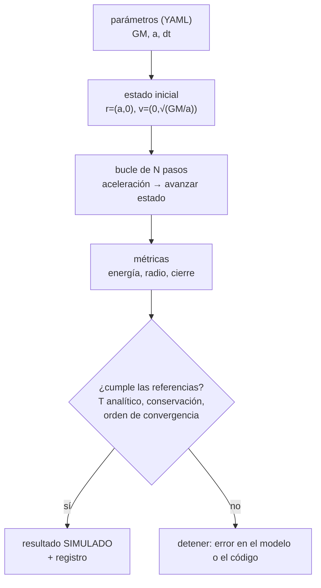
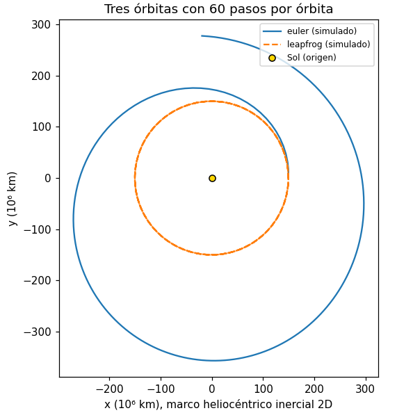

# B07-C20 — Primer simulador de un movimiento celeste

<!-- nav:top -->
[🏠 Programa](../../../../README.md) · [📚 Bloque B07](../../../tronco-comun/B07-informatica-cientifica-desde-cero.md) · [← Anterior: B07-C19 — Documentación y reproducibilidad](../B07-C19-documentacion-y-reproducibilidad/CLASE.md) · [Siguiente: B08-C01 — Orientación geográfica y puntos cardinales →](../../B08/B08-C01-orientacion-geografica-y-puntos-cardinales/CLASE.md)
<!-- /nav -->

## 1. Ubicación, nivel y alcance

Vigésima y última clase del bloque B07. Reúne todo lo anterior en un proyecto completo: lees parámetros desde un archivo ([C16](../B07-C16-formatos-json-y-yaml/CLASE.md)), simulas con un bucle ([C05](../B07-C05-bucles-y-simulaciones-sencillas/CLASE.md)) sobre funciones probadas ([C06](../B07-C06-funciones-y-modularidad/CLASE.md), [C17](../B07-C17-pruebas-de-funciones-matematicas/CLASE.md)), cuidas las unidades ([C11](../B07-C11-gestion-de-unidades-en-programas/CLASE.md)), representas gráficamente el resultado ([C10](../B07-C10-graficos-bidimensionales-iniciales/CLASE.md)) y dejas el resultado reproducible ([C19](../B07-C19-documentacion-y-reproducibilidad/CLASE.md)). El objeto: la **Tierra orbitando el Sol**. Nivel N2.

Verás la aceleración gravitatoria, dos métodos de integración (Euler y leapfrog), magnitudes conservadas (energía y momento angular), convergencia con el paso y comparación con un dato publicado. No verás órbitas con excentricidad, varios cuerpos, perturbaciones ni integradores de orden superior: eso es de los bloques B11 y B71 en adelante.

## 2. Por qué esta clase existe

Un simulador es la forma de explorar un fenómeno cuya solución no tienes a mano, y de comprobar que entiendes uno cuya solución sí conoces. Aquí conoces la respuesta (una órbita circular se repite con un período dado por una fórmula), así que puedes **verificar** el simulador antes de confiar en él para casos que no conoces. Y verás algo revelador: dos métodos con el mismo paso dan órbitas muy distintas, y uno de ellos está mal aunque el código «funcione».

La pregunta motivadora es: **¿cómo construyo un simulador del que pueda fiarme y cómo demuestro que lo es?** La decisión central es el método y el paso, y qué comprobaciones (conservación, convergencia, comparación con dato) lo respaldan.

## 3. Lo que podrás hacer al terminar

1. Escribir la aceleración gravitatoria de un cuerpo central en 2D y el estado inicial de una órbita circular.
2. Implementar los métodos de Euler y leapfrog para ese movimiento.
3. Verificar el simulador con cantidades conservadas (energía y momento angular) y con el período analítico.
4. Medir el orden de convergencia al reducir el paso.
5. Comparar el período calculado con un dato publicado y explicar la diferencia.
6. Declarar qué modela y qué no modela, y marcar el resultado como **simulado**.

La evidencia es el **simulador verificado** del ejercicio 12 (sección 20).

## 4. Con qué llegas y cómo comprobarlo

Necesitas C01–C19. Cinco preguntas:

1. ¿Qué error relativo tiene Euler en la caída libre con paso `dt` y tiempo `t`?
2. ¿Qué hace `yaml.safe_load`?
3. ¿Para qué sirve la semilla en un cálculo con azar? (Aquí no hay azar: ¿qué lo hace reproducible?)
4. ¿Qué es un caso analítico?
5. ¿Qué guarda un registro de ejecución?

<details>
<summary>Ver respuestas</summary>

1. `dt/t` (C05). 2. Lee un YAML construyendo solo tipos simples. 3. Fijar el generador; sin azar, basta fijar datos, parámetros, versión de código y entorno. 4. Uno cuyo resultado se deduce con matemáticas, sin el programa. 5. Entradas, entorno y resultado.
</details>

Con cuatro o cinco aciertos, sigue; con tres o menos, repasa C05, C16, C17 y C19.

## 5. Un caso real: ¿cuánto dura un año en el simulador?

Con tres datos publicados por el NASA NSSDC (S1) —el GM del Sol, el semieje mayor de la Tierra y su período sidéreo, que guardaste en `parametros_tierra.yaml` en C16— el simulador pone la Tierra en una órbita circular y la hace avanzar paso a paso. Dos preguntas orientan la clase: ¿completa la Tierra simulada una vuelta en el tiempo que da la fórmula `T = 2π√(a³/GM)`? ¿Y esa fórmula coincide con el período sidéreo de 365,256 d publicado? Es el **ejemplo conductor**; el resultado es **simulado**, no observado.

## 6. Vocabulario

El **GM** (parámetro gravitacional estándar) es el producto de la constante de gravitación por la masa del cuerpo; para el Sol, 1,32712 × 10¹¹ km³/s² (S1). La **aceleración gravitatoria** hacia un cuerpo central en el origen es `a = −GM · r / |r|³`, donde `r` es el vector de posición; apunta al centro y su módulo es `GM/r²`. Una **órbita circular** de radio `a` exige una rapidez `v = √(GM/a)`. El **período** es el tiempo de una vuelta: `T = 2π√(a³/GM)`. La **energía específica** (por unidad de masa) es `E = v²/2 − GM/r` y el **momento angular específico**, `L = x·vy − y·vx`; ambos se **conservan** en un campo central. Un **integrador** avanza el estado en pasos `dt`. **Euler explícito** usa velocidad y aceleración al inicio del paso; **leapfrog** (o velocity Verlet) avanza la velocidad medio paso, la posición un paso completo y de nuevo la velocidad medio paso. El **orden** de un método indica cómo disminuye su error al reducir `dt`: orden 1, error ∝ `dt`; orden 2, error ∝ `dt²`. El **error de cierre** es la distancia entre la posición tras un período y la inicial, relativa a `a`. Un **sistema de referencia inercial heliocéntrico** tiene el origen en el Sol y ejes fijos respecto de las estrellas.

## 7. Modelo mental: el bucle de la simulación



*Descripción textual:* los parámetros del YAML generan el estado inicial de una órbita circular; un bucle de N pasos calcula la aceleración y avanza el estado; al final se calculan las métricas de energía, radio y cierre y se comprueba si cumplen las referencias (período analítico, conservación, orden de convergencia). Si cumplen, el resultado se rotula como simulado y se registra; si no, el programa se detiene.

**Límite de la analogía:** una película reproduce lo que pasó; el simulador reproduce lo que **dice el modelo**, y si el modelo es incompleto (sin otros planetas, sin la Luna), la película puede ser coherente y falsa.

## 8. La explicación, paso a paso

### 8.1 Parámetros y unidades

El simulador lee `parametros_tierra.yaml` con `yaml.safe_load` y **valida** que GM, semieje, período y paso sean números positivos (C16). Trabaja en km y s: `GM` en km³/s², `a` en km, `v` en km/s. El paso de 3600 s es una **decisión nuestra**, no un dato publicado.

### 8.2 La aceleración

```python
def aceleracion(x, y, gm):
    r3 = (x * x + y * y) ** 1.5
    return -gm * x / r3, -gm * y / r3
```

`(x*x + y*y) ** 1.5` es `|r|³`. El signo menos hace que la aceleración apunte al origen. Es una función pura: no usa variables globales y se prueba por separado (C06, C17).

### 8.3 Estado inicial de la órbita circular

`r = (a, 0)` y `v = (0, √(GM/a))`: la Tierra empieza sobre el eje x, con la velocidad perpendicular al radio. Con los datos, `v = 29,7846 km/s`. La órbita real de la Tierra no es exactamente circular; aquí es un **modelo**, y por eso solo compararemos el período, que depende del semieje mayor.

### 8.4 Euler explícito

En cada paso: `x ← x + vx·dt`, `y ← y + vy·dt`, `vx ← vx + ax·dt`, `vy ← vy + ay·dt`, y luego se recalcula `a`. Es el método de C05 con dos dimensiones. En un solo paso, la partícula se mueve en la dirección de la velocidad, hacia afuera de la órbita: con `dt = 3600 s`, el radio crece `2,57 × 10⁻⁷` (relativo) en el primer paso, y esa pequeña ganancia **se acumula** sistemáticamente.

### 8.5 Leapfrog (velocity Verlet)

`vx += ½·dt·ax` (y igual en y); `x += vx·dt`; `y += vy·dt`; recalcula la aceleración; `vx += ½·dt·ax`. Es de orden 2 y, a diferencia de Euler, **no acumula** una ganancia sistemática de energía en órbitas: la energía oscila pero no se desvía de forma continua. El laboratorio lo confirma: con `dt = 3600 s` durante un año, leapfrog tiene una deriva de energía de `2,5 × 10⁻¹⁴` frente a `8,8 × 10⁻³` de Euler.

### 8.6 Las referencias del simulador

(1) **Período analítico**: `T = 2π√(a³/GM) = 365,2580 d`, que difiere del publicado (365,256 d) en `+0,00054 %`. (2) **Conservación**: la energía y el momento angular deben mantenerse. (3) **Orden de convergencia**: al reducir `dt` a la mitad, el error de cierre de leapfrog debe dividirse por 4 y el de Euler por 2. (4) **Cierre**: tras un período exacto, la partícula debe volver al punto de partida.

### 8.7 Un detalle del cierre

Con `dt = 3600 s`, el número de pasos del año es `round(T/dt) = 8766`, pero `T/dt = 8766,19`: los pasos no cubren exactamente un período (faltan 689 s). El error de cierre de leapfrog, `1,383 × 10⁻⁴`, es casi toda **diferencia de fase**: `2π · 689/31 558 289 = 1,37 × 10⁻⁴` rad. No es error del método. Para medir el error del método, se elige `dt = T/k` con `k` entero (`k = 500, 1000, 2000`): el error de leapfrog cae de `3,3 × 10⁻⁴` a `8,3 × 10⁻⁵` y `2,1 × 10⁻⁵` (factor 4 en cada caso) y el de Euler de `0,68` a `0,36` y `0,18` (factor ≈ 1,9).

### 8.8 Resultado de la figura

Con 60 pasos por órbita durante tres órbitas, Euler dibuja una **espiral** que se aleja del Sol (radio de ~150 a ~360 millones de km), mientras leapfrog cierra la circunferencia. Un simulador que gana energía en cada vuelta describe una Tierra que se aleja, algo que **no** ocurre en la realidad: el resultado no es físicamente correcto aunque el programa se ejecute sin errores.

### 8.9 Qué modela y qué no

Modela: una partícula de prueba en el campo del Sol (cuerpo central fijo), órbita circular, plano 2D. No modela: la masa de la Tierra, la Luna, los demás planetas, la excentricidad real, la relatividad ni el viento solar. El período coincide con el publicado porque depende del GM y del semieje, ambos tomados de la misma fuente; no es una prueba independiente de la gravitación.

## 9. Magnitudes, símbolos y unidades

| Símbolo | Qué es | Unidad | Valor o procedencia |
|---|---|---|---|
| `GM` | parámetro gravitacional del Sol | km³/s² | 1,32712 × 10¹¹ (publicado, S1) |
| `a` | semieje mayor de la Tierra | km | 1,49598 × 10⁸ (publicado, S1) |
| `T_pub` | período sidéreo publicado | d | 365,256 (S1) |
| `v` | rapidez circular | km/s | `√(GM/a)` = 29,7846 (calculado) |
| `T` | período analítico | s (d) | `2π√(a³/GM)` = 365,2580 d (calculado) |
| `dt` | paso de tiempo | s | 3600 (**elegido**) |
| `E` | energía específica | km²/s² | `v²/2 − GM/r` |
| `L` | momento angular específico | km²/s | `x vy − y vx` |

## 10. Convenciones y referencias

Marco: heliocéntrico inercial 2D, origen en el Sol. Unidades: km, s, km³/s². Rotular **publicado**, **elegido**, **calculado** y **simulado**. Parámetros desde un archivo validado; registro con la huella del archivo (sha256 `347cfef3e3ff…`). Versiones: Python 3.12.9, NumPy 2.4.4, Matplotlib 3.10.8, PyYAML 6.0.3.

## 11. De dónde sale lo que afirmamos

| ID | Fuente | Localizador | Respalda | Estado |
|---|---|---|---|---|
| S1 | NASA NSSDC, fichas *Sun Fact Sheet* (act. 9-may-2024) y *Earth Fact Sheet* (act. 15-nov-2024), *Mars*, *Uranus* y *Neptune Fact Sheet* | https://nssdc.gsfc.nasa.gov/planetary/factsheet/sunfact.html | GM del Sol (132 712 × 10⁶ km³/s²); semieje y período sidéreo de la Tierra, Marte, Urano y Neptuno; excentricidad de Urano (0,0469) y Neptuno (0,0097) | Leídas el 2026-11-05 (mutables) |
| S2 | Python Software Foundation, *The Python Tutorial* 3.12, §4 (control de flujo y funciones) | https://docs.python.org/3.12/tutorial/controlflow.html | `for`, funciones | Leída el 2026-11-05 |
| S3 | NumPy Developers, *NumPy: the absolute basics for beginners* (2.4) | https://numpy.org/doc/2.4/user/absolute_beginners.html | Arreglos | Leída el 2026-11-05 |
| S4 | Matplotlib Development Team, *Quick start guide* (3.10.8) | https://matplotlib.org/3.10.8/users/explain/quick_start.html | Figura y ejes | Leída el 2026-11-05 |
| S5 | PyYAML, *PyYAML Documentation* | https://pyyaml.org/wiki/PyYAMLDocumentation | `safe_load` | Leída el 2026-11-05 |

Límites: **no se consultó ninguna fuente de mecánica orbital**: la ley de la gravitación, las fórmulas de la aceleración, el período, la energía y el momento angular, y las propiedades de Euler y leapfrog son resultados estándar que aquí se **verifican numéricamente** (conservación, convergencia y comparación con el dato publicado), no se citan. La figura y las métricas son resultados simulados de este laboratorio.

## 12. Cómo ver la órbita



*Descripción textual.* Un gráfico cuadrado con el Sol (punto dorado) en el origen. Una circunferencia de unos 150 × 10⁶ km de radio, trazada con leapfrog en línea discontinua, se superpone sobre sí misma en las tres órbitas. La trayectoria de Euler, en línea continua, empieza en el mismo punto (150, 0) pero forma una espiral hacia afuera: tras tres órbitas llega a unos 360 × 10⁶ km del Sol. Ejes: x e y en 10⁶ km; marco heliocéntrico inercial 2D.

Como accesibilidad adicional, los números del laboratorio (sección 17) dan lo mismo en texto: la deriva de energía y el cierre de cada método.

## 13. Ejemplo trabajado: el período de Marte con el mismo simulador

**Datos (S1):** `a = 2,27956 × 10⁸ km`, período sidéreo publicado `686,980 d`, mismo `GM`.

**Paso 1.** `v = √(1,32712e11 / 2,27956e8) = 24,13 km/s`. **Paso 2.** `T = 2π√(a³/GM) = 687,0488 d`. **Paso 3.** Diferencia con el publicado: `+0,0100 %`. **Paso 4.** Con `dt = T/1000`, leapfrog cerraría con un error del orden de `10⁻⁴` relativo (el mismo orden que el de la Tierra con `k = 500`; no se ejecutó para Marte y el recuento es una predicción).

**Paso final · incertidumbre.** Marte da +0,0100 % y la Tierra +0,00054 %: ambas diferencias son pequeñas, pero las órbitas reales no son círculos exactos (el modelo supone uno) y el semieje publicado tiene seis cifras. Una diferencia de 0,01 % significa que, con **estos** datos, el período de Kepler explica el publicado a esa precisión; no dice nada sobre los efectos de otros planetas, que el modelo no incluye. Con Urano (−0,131 %) y Neptuno (+0,618 %) la diferencia es mayor y, con lo consultado, no sabemos la causa (los datos o el modelo): sería motivo de consultar otra fuente.

## 14. Distintos métodos y distintas estrategias

(1) **Euler**: el más simple; orden 1; en órbitas **gana energía** sistemáticamente. Útil para aprender, no para órbitas. (2) **Leapfrog/Verlet**: orden 2, simple y con buen comportamiento de la energía a largo plazo; usado en simulaciones gravitatorias. (3) **Runge-Kutta** de orden 4 y los métodos con paso adaptativo: más precisión por paso, pero tampoco conservan la energía exactamente; se estudian en B11 y no se consultaron. (4) **Solución analítica**: para el problema de dos cuerpos existe, y sirve de referencia; el simulador gana valor cuando no existe. Criterio: el método más simple que cumpla las referencias con el costo aceptable, y siempre contrastado.

## 15. Práctica guiada

**Ejercicio 1 · con los pasos indicados.** Calcula la rapidez circular de la Tierra con `GM = 1,32712e11 km³/s²` y `a = 1,49598e8 km`. *Pasos:* `v = √(GM/a)`.

<details><summary>Solución comentada</summary>

`GM/a = 887,1 km²/s²` y `v = 29,7846 km/s` (el laboratorio imprime `29.7846`). Concuerda con el orden de magnitud de unos 30 km/s.
</details>

**Ejercicio 2 · con una pista.** ¿Cuántos pasos de 3600 s hacen falta para un año de `T = 31 558 289 s`? *Pista:* redondea el cociente.

<details><summary>Solución comentada</summary>

`T/dt = 8766,19`; el programa usa `round` y hace **8766 pasos**. Quedan 689 s sin simular (sección 8.7).
</details>

**Ejercicio 3 · casi autónomo.** Tras el primer paso de Euler desde `(a, 0)` con velocidad `(0, v)`, ¿cuál es la posición y el radio? *Pista:* `x` no cambia porque `vx = 0`.

<details><summary>Solución comentada</summary>

`x = a`, `y = v·dt = 107 224,67 km`; el radio es `√(a² + (v dt)²)`: crece `2,57 × 10⁻⁷` relativo. Euler siempre empuja hacia afuera porque avanza en la dirección de la velocidad, tangente a la órbita.
</details>

## 16. Práctica autónoma, transferencia e integrador

**Ejercicio 4.** Con la tabla de convergencia, calcula el factor de reducción del error de leapfrog de `k = 500` a `k = 1000` y el de Euler.

<details><summary>Solución comentada</summary>

Leapfrog: `3,307e-4 / 8,268e-5 = 4,0` (orden 2). Euler: `0,6759 / 0,3585 = 1,89` (orden 1, con efectos de segundo orden a este paso).
</details>

**Ejercicio 5.** Explica por qué el cierre de leapfrog con `dt = 3600 s` es `1,383e-4` y no cercano a `10⁻¹⁴`.

<details><summary>Solución comentada</summary>

Porque `8766 · 3600 = 31 557 600 s` es 689 s menos que `T`: queda un desfase de `2π · 689/T = 1,37e-4` rad que se ve como distancia relativa al inicio. No es error del método: la energía se conserva a `10⁻¹⁴`.
</details>

**Ejercicio 6.** ¿Qué signo tiene la deriva de energía de Euler y qué hace con el radio de la órbita?

<details><summary>Solución comentada</summary>

Positivo: Euler gana energía en cada paso y el radio aumenta (`+8,97e-3` en un año con paso de 3600 s); en la figura, la espiral se abre.
</details>

**Ejercicio 7.** Con `k = 10` pasos por órbita (`dt = T/10`), la tabla del laboratorio da un cierre de `0,76` para leapfrog y de `6,1` para Euler. ¿Qué conclusión sacas?

<details><summary>Solución comentada</summary>

Con 10 pasos por órbita ambos métodos son inservibles (el cierre es del orden de la órbita misma): el paso es demasiado grande. Leapfrog conserva mejor la energía (deriva de `1,3e-3`, medida en una corrida de preparación) pero la fase se pierde. Hay que elegir `dt ≪ T` y comprobar la convergencia.
</details>

**Ejercicio 8.** ¿Qué dos cantidades se conservan en un campo central y cómo se comprueba con el simulador?

<details><summary>Solución comentada</summary>

Energía específica y momento angular específico. Se calculan en cada paso y se verifica que no se desvían de su valor inicial: leapfrog los conserva a `10⁻⁹` o mejor (la prueba lo exige); Euler no.
</details>

**Ejercicio 9 · transferencia.** Calcula el período analítico de Marte con `GM` del Sol y el semieje publicado. Compáralo con 686,980 d.

<details><summary>Solución comentada</summary>

`T = 687,0488 d`; la diferencia es `+0,0100 %`. El simulador reproduciría esa duración con `dt = T/k` y leapfrog.
</details>

**Ejercicio 10 · transferencia.** Calcula lo mismo para Urano (semieje `2,867043 × 10⁹ km`; período publicado 30 685,4 d) y para Neptuno (`4,514953 × 10⁹ km`; 60 189,018 d). ¿Qué observas?

<details><summary>Solución comentada</summary>

Urano `30 645,19 d` (−0,131 %) y Neptuno `60 560,70 d` (+0,618 %). La diferencia crece con la distancia y en Neptuno es unas mil veces mayor que en la Tierra. Con lo consultado no se puede atribuir a los datos o al modelo (la fórmula usa solo el GM del Sol y el semieje); es una discrepancia que habría que contrastar con otra fuente, como en C03.
</details>

**Ejercicio 11 · transferencia.** Lista tres efectos que el simulador no incluye y di cómo cambiarían el resultado **cualitativamente** (sin cifras).

<details><summary>Solución comentada</summary>

La atracción de los otros planetas (perturba la órbita lentamente), la excentricidad real (la órbita sería una elipse y la rapidez variaría) y la masa de la Tierra (el Sol también se mueve ligeramente). No se calcula su magnitud aquí: sin fuente, solo se afirma que existen y que el modelo es una simplificación.
</details>

**Ejercicio 12 · integrador.** Entrega un **simulador verificado** de otro planeta (Marte, Júpiter…): parámetros en un YAML validado, simulación con leapfrog, pruebas de período analítico, conservación y convergencia, comparación con el período publicado, una figura con texto alternativo, y un registro con la huella del YAML y las versiones. Declara qué modela y qué no.

<details><summary>Solución modelo</summary>

Adaptas `parametros_tierra.yaml` con el semieje y el período de S1 de tu planeta, ejecutas las mismas pruebas (la diferencia del período analítico con el publicado será la de su caso: por ejemplo `+0,0100 %` para Marte), una tabla de convergencia con `k = 500, 1000, 2000` y un registro con el sha256 del YAML. Se acepta cualquier planeta si cumple las comprobaciones y los límites quedan explícitos.
</details>

## 17. Laboratorio: el simulador de la órbita de la Tierra

El script [simulador_orbita.py](simulador_orbita.py) lee [parametros_tierra.yaml](../B07-C16-formatos-json-y-yaml/parametros_tierra.yaml), valida los parámetros, simula un año con Euler y leapfrog y guarda [orbita_tierra.png](orbita_tierra.png). Antes de imprimir comprueba: el período analítico frente al publicado (dentro de 0,01 %), el caso `GM = a = 1` (T = 2π), la conservación de energía, radio y momento angular de leapfrog, que Euler gane energía, el orden de convergencia (factor ≈ 4 para leapfrog y ≈ 2 para Euler), el rechazo de un método desconocido y la creación de la figura.

**Datos:** GM, semieje y período **publicados** (NASA NSSDC); paso **elegido**; resultados **simulados**. **Predice antes de ejecutar:** ¿qué método conservará la energía? (Leapfrog.) **Resultados (2026-11-05, Python 3.12.9, NumPy 2.4.4, Matplotlib 3.10.8, PyYAML 6.0.3):**

```text
python 3.12.9 | numpy 2.4.4 | matplotlib 3.10.8 | pruebas OK
Parámetros: parametros_tierra.yaml (sha256 347cfef3e3ff…)
Velocidad circular v = 29.7846 km/s | T analítico = 365.2580 d | T publicado = 365.256 d | diferencia = +0.00054 %
Un año con paso 3600 s: 8766 pasos
  euler     deriva de energía +8.848e-03 | deriva de radio +8.973e-03 | cierre/a 4.323e-02
  leapfrog  deriva de energía +2.486e-14 | deriva de radio +2.309e-14 | cierre/a 1.383e-04
Convergencia con dt = T/k (error de cierre / a):
      k       euler    leapfrog
     10   6.100e+00   7.588e-01
    500   6.759e-01   3.307e-04
   1000   3.585e-01   8.268e-05
   2000   1.847e-01   2.067e-05
Figura guardada: orbita_tierra.png
```

```bash
uv run --project ../B07-C13-entornos-y-dependencias-con-uv/proyecto_laboratorios python simulador_orbita.py
```

El tiempo de ejecución fue de unos 2,5 s en el equipo de prueba.

**Límites:** órbita circular, plano 2D, sin otros cuerpos; el período publicado se compara solo como orden de magnitud de la diferencia (ambos datos vienen de la misma fuente); las diferencias en la última cifra de las métricas pueden variar con la plataforma; la huella del YAML supone finales de línea LF (el repositorio los fija).

## 18. Errores frecuentes y cómo corregirlos

**Usar Euler para órbitas.** Se corrige con la sección 8.8 y el ejercicio 6.

**Atribuir el error de cierre al método cuando es de fase.** Se corrige con la sección 8.7 y el ejercicio 5.

**No comprobar la convergencia.** Se corrige con el ejercicio 4.

**Presentar un resultado simulado como observado.** Se corrige con el rótulo **simulado** y la sección 8.9.

**Atribuir una discrepancia a los datos sin pruebas.** Se corrige con el ejercicio 10.

## 19. Cómo sabrás que vas bien

Tras 8.2: ¿escribes la aceleración sin mirar? Si no, rehaz el ejercicio 1. Tras 8.5: ¿explicas por qué leapfrog conserva mejor la energía? Si no, relee 8.4–8.5 y el ejercicio 6. Tras 8.7: ¿distingues error de fase y error de método? Si no, ejercicio 5. Tras el laboratorio: ¿qué comprobaciones hizo el script antes de simular? Lee `pruebas()`. Al final: ¿qué parte de tu simulador depende de supuestos que no verificaste? Si no la identificas, repasa la sección 8.9.

## 20. Qué entregas y cómo se evalúa

El producto es tu **simulador verificado**: código con docstrings y cabecera, parámetros validados, pruebas, tabla de convergencia, figura con texto alternativo, registro de ejecución y la declaración de lo que modela y no modela.

| Criterio | Inicial | En desarrollo | Logrado | Destacado |
|---|---|---|---|---|
| Simulación | No avanza correctamente | Avanza con errores | Correcta con leapfrog | Compara dos métodos |
| Verificación | Sin referencias | Un período o una conservación | Período, conservación y convergencia | Distingue error de fase y de método |
| Honestidad | Presenta lo simulado como real | Lo rotula | Declara lo que no modela | Cuantifica o acota cada simplificación |
| Reproducibilidad | Sin registro | Con versiones | Con huella y registro | Con semilla (si aplica) y entorno fijado |

**Condiciones críticas:** rotular los resultados como simulados; declarar `dt` y supuestos; verificar contra una referencia independiente; citar solo fuentes consultadas.

## 21. Ética, seguridad y límites

Un simulador bien presentado puede persuadir más de lo que merece: declara qué modela y qué no, y no lo uses para decisiones de diseño o navegación reales. Los simuladores de trayectorias para misiones requieren verificación y validación independientes, modelos de perturbaciones y datos de efemérides (bloques B71–B76 y B88). Sin datos personales. Material educativo.

## 22. Para cerrar y seguir

Un simulador de la órbita de la Tierra reúne el bloque entero: parámetros validados, funciones probadas, un bucle, unidades cuidadas, un gráfico honesto y un registro reproducible. Euler y leapfrog con el mismo paso dan resultados distintos, y solo las comprobaciones (conservación, convergencia, comparación con un dato publicado) permiten saber cuál merece confianza. Queda abierta una pregunta para otros bloques: ¿cómo incluir la excentricidad, otros planetas y datos de efemérides sin perder esa verificabilidad?

**Glosario español–inglés.** simulador · *simulator*; parámetro gravitacional · *standard gravitational parameter*; integrador · *integrator*; paso de tiempo · *time step*; orden de convergencia · *order of convergence*; energía específica · *specific energy*; momento angular · *angular momentum*; error de cierre · *closure error*.

**Continuidad.** El bloque [B07](../../../tronco-comun/B07-informatica-cientifica-desde-cero.md) termina aquí. El bloque B08 (observación del cielo y astronomía práctica) usa tu capacidad de **programar y verificar** para procesar observaciones reales; y los bloques B11 y B71 retomarán la simulación con métodos y modelos más completos.

**Referencias:** ver sección 11.

<!-- nav:bottom -->
---

[← Anterior: B07-C19 — Documentación y reproducibilidad](../B07-C19-documentacion-y-reproducibilidad/CLASE.md) · [📚 Bloque B07](../../../tronco-comun/B07-informatica-cientifica-desde-cero.md) · [Siguiente: B08-C01 — Orientación geográfica y puntos cardinales →](../../B08/B08-C01-orientacion-geografica-y-puntos-cardinales/CLASE.md)
<!-- /nav -->
