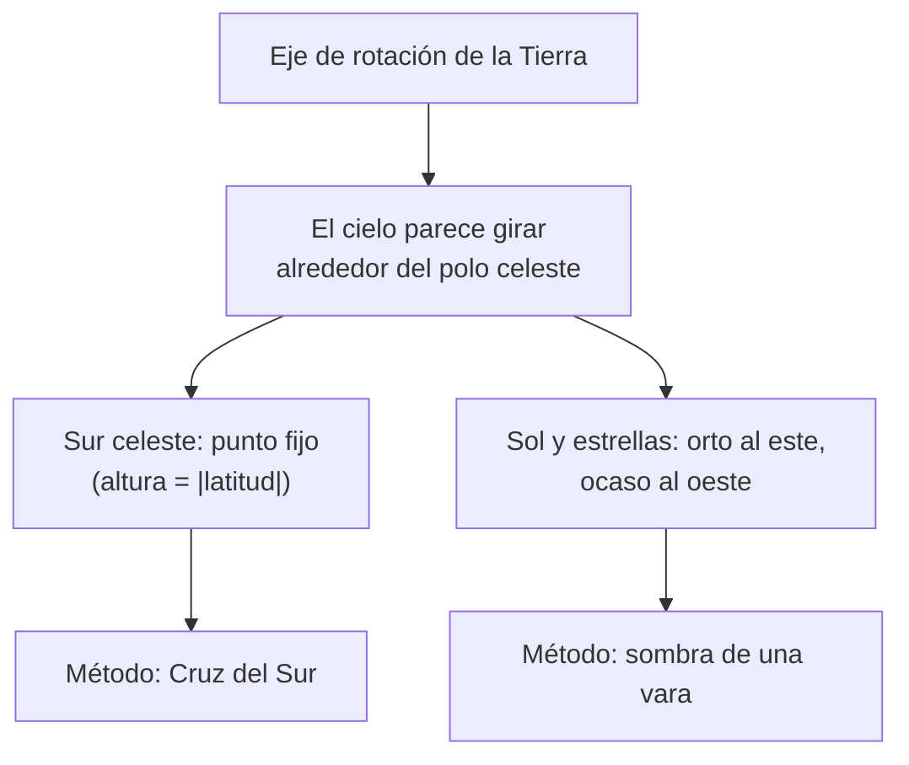

# B08-C01 — Orientación geográfica y puntos cardinales

<!-- nav:top -->
[🏠 Programa](../../../../README.md) · [📚 Bloque B08](../../../tronco-comun/B08-observacion-del-cielo-y-astronomia-practica.md) · [← Anterior: B07-C20 — Primer simulador de un movimiento celeste](../../B07/B07-C20-primer-simulador-de-un-movimiento-celeste/CLASE.md) · [Siguiente: B08-C02 — Esfera celeste y horizonte local →](../B08-C02-esfera-celeste-y-horizonte-local/CLASE.md)
<!-- /nav -->

## 1. Ubicación, nivel y alcance

Primera clase del bloque B08, que te lleva de mirar el cielo a observarlo con método. Aquí aprendes a saber **dónde está el norte, el sur, el este y el oeste** antes de levantar la vista, porque todo lo que sigue (coordenadas, alturas, planisferios, telescopios) parte de una orientación correcta. Nivel N1.

Verás tres formas de orientarte: con el Sol, con las estrellas del hemisferio sur y con una brújula, y cuándo falla cada una. No verás aún las coordenadas celestes (C02–C04) ni el tiempo sidéreo (C05).

## 2. Por qué esta clase existe

Una persona que llega de noche a un lugar oscuro sin saber dónde está el este no sabe dónde buscar una salida de Luna, ni hacia dónde apuntar un telescopio, ni qué rumbo debe tomar si pierde el sendero. La pregunta motivadora es: **¿cómo sé hacia dónde miro, sin depender de un aparato que se puede descargar o descalibrar?**

La decisión central: **elegir qué método de orientación usar según la hora, el lugar y los recursos, y declarar cuánto error esperas**. Los tres métodos que estudiarás tienen errores distintos, y eso es lo que importa anotar en tu bitácora (C17).

## 3. Lo que podrás hacer al terminar

1. Definir norte geográfico (verdadero), norte magnético y declinación magnética, y explicar por qué difieren.
2. Hallar el norte con una vara y su sombra, y estimar el error de ese método.
3. Calcular el acimut del orto (salida) del Sol a partir de la declinación del Sol y la latitud.
4. Encontrar el sur con la Cruz del Sur y las estrellas «Punteras», y decir por qué no hay una «estrella polar» austral brillante.
5. Combinar dos métodos y reportar el rumbo con su incertidumbre.
6. Adaptar la orientación a una persona que no ve, o a una noche nublada.

La evidencia es la **tarjeta de orientación** del ejercicio 12 (sección 20).

## 4. Con qué llegas y cómo comprobarlo

Necesitas ángulos en grados y la idea de que un cociente puede ser menor que uno. Cinco preguntas:

1. ¿Cuántos grados hay entre el este y el sur, medidos en el sentido horario desde el norte (norte = 0°)?
2. Si una vara de 1 m proyecta una sombra de 1 m, ¿cuál es la altura del Sol sobre el horizonte?
3. ¿Cuántos grados son 6 horas de giro de la Tierra? (La Tierra gira 360° en unas 24 h.)
4. ¿Qué dice un cociente `sen δ / cos φ` si `δ = 0`?
5. ¿Qué diferencia hay entre «error» e «incertidumbre»?

<details>
<summary>Ver respuestas</summary>

1. Este = 90°, sur = 180°: hay 90° entre ambos. 2. 45° (tangente igual a 1). 3. 90°. 4. Vale 0, es decir, el ángulo cuyo coseno es 0: 90°. 5. El error es la diferencia con el valor verdadero (que casi nunca conoces); la incertidumbre es el intervalo en que crees que está el valor, y sí la puedes estimar.
</details>

Con cuatro o cinco aciertos, sigue; con tres o menos, repasa ángulos y tangente (B03).

## 5. Un caso real: la salida de observación del 5 de noviembre de 2025

Usarás un mismo escenario en toda la clase. Imagina que llegas con luz de tarde a un campo del valle del Elqui, a una latitud de unos −30,0° y una longitud de −70,7° (valores redondeados para este ejemplo, no medidos con GPS). Tu plan es mirar la Luna llena y las constelaciones que salen. Tienes una vara de 1 m, una linterna, una brújula barata y la memoria de la Cruz del Sur. Dos amigos te preguntan «¿por dónde sale la Luna?». Para responder tienes que saber dónde está el este.

Es el 5 de noviembre de 2025. Los datos de la Luna de ese día se tomaron de las tablas de la NASA (S1); los del Sol se calculan en el laboratorio de la sección 17 y son **simulados** (calculados), no medidos.

## 6. Vocabulario

El **norte geográfico (verdadero)** es la dirección hacia el polo norte de rotación de la Tierra. El **norte magnético** es la dirección que indica una brújula, ligada al campo magnético terrestre; la **declinación magnética** es el ángulo entre ambos y varía con el lugar y con el tiempo (S2). El **acimut** de una dirección es su ángulo medido desde el norte hacia el este (0° norte, 90° este, 180° sur, 270° oeste). El **orto** es la salida de un astro por el horizonte y el **ocaso** su puesta. El **mediodía solar** es el instante en que el Sol cruza el **meridiano** local, la línea imaginaria norte–sur sobre tu cabeza; el USNO lo llama *tránsito* (S3). La **declinación solar** `δ` es el ángulo del Sol por encima o debajo del ecuador celeste (se define bien en C03). La **latitud** `φ` es tu ángulo respecto al ecuador terrestre, negativa en el sur.

## 7. Modelo mental: el cielo gira alrededor de un eje

La Tierra gira sobre un eje; por eso el cielo parece girar alrededor de dos puntos fijos, los polos celestes. Desde el hemisferio sur el punto que no se mueve está al sur, a una altura sobre el horizonte igual a tu latitud (sin el signo). El Sol y las estrellas salen, en general, por el este y se ponen por el oeste porque la Tierra gira hacia el este.



*Descripción textual:* de la rotación terrestre salen dos consecuencias: un punto fijo del cielo (el polo sur celeste), que sirve para orientarse con la Cruz del Sur, y un movimiento diario este-oeste, que sirve para orientarse con la sombra de una vara.

**Analogía y su límite.** Es como estar parado en un tiovivo: lo que está lejos parece girar. Pero la analogía falla en que el cielo no es una superficie a la misma distancia; las estrellas están a distancias muy distintas (B01-C02).

## 8. La explicación, paso a paso

### 8.1 Norte verdadero con una vara

Clava una vara vertical en suelo plano. Marca la punta de su sombra cada 15 minutos durante una hora o más. La sombra es **más corta** cuando el Sol cruza el meridiano, y en ese instante apunta justo hacia el polo opuesto al Sol: la línea del norte–sur. En el valle del Elqui, a −30°, el Sol cruza el meridiano **al norte** todo el año (su declinación nunca baja de −23,4°, valor que sale de la oblicuidad de la Tierra, S4), así que la sombra más corta apunta al **sur**. En una latitud como la de Arica, cerca del trópico, no vale esa regla todo el año; por eso conviene decidir con el modelo y no de memoria.

El error de este método depende de cuánto marcas y de la planitud del suelo. Con una vara de 1 m y marcas precisas a 1 cm, el error angular típico es del orden de `0,01 m / (sombra más corta)`; con una sombra de 0,25 m (como el 5 de noviembre al mediodía, laboratorio sección 17) es unos 2°. Con el Sol alto la sombra es corta y el método empeora.

### 8.2 Dónde sale el Sol (y por qué «el este» es una media verdad)

El Sol sale exactamente por el este solo cuando `δ = 0`, es decir, en los equinoccios. La fórmula, sin refracción, es

```text
cos(A) = sen(δ) / cos(φ)        A = acimut del orto, medido desde el norte hacia el este
```

Para `φ = −30°` y `δ = −15,8°` (5 de noviembre), `A ≈ 108,4°`: unos 18° al **sur** del este. En el solsticio de diciembre sale a 117°, y en el de junio a 63°. Si «el este» te sirve en marzo y septiembre, en noviembre te equivoca 18°. Es el error más común de la orientación solar.

### 8.3 La Cruz del Sur y el polo sur celeste

En el hemisferio sur no hay una estrella brillante señalando el polo, como ocurre con la Polar en el norte (afirmación general que no se verificó en una fuente de esta clase). La fuente S5 solo afirma que el pie de la Cruz apunta siempre hacia el polo sur celeste; el resto de este apartado es método práctico. Método: prolonga el eje largo de la Cruz, del brazo mayor hacia su pie, unas 4,5 veces su longitud; el punto al que llegas está cerca del polo sur celeste. Bajas desde ese punto una vertical hasta el horizonte y obtienes el **sur** con un error de pocos grados. La cifra «4,5 veces» es una regla práctica que no se verificó en una fuente de esta clase; la comprobarás tú en el laboratorio sin código. Las dos estrellas brillantes de Centauro, α y β Cen (las «Punteras»), apuntan aproximadamente hacia la Cruz (S5).

### 8.4 La brújula y la declinación

La brújula indica el norte magnético. Para pasarlo al verdadero se suma o resta la declinación del lugar. El modelo oficial que la calcula, el World Magnetic Model WMM2025, es válido hasta fines de 2029 (S2); el valor local se obtiene con el calculador de NOAA y **no se copia aquí** porque cambia con el tiempo. Cerca de imanes, cables, un auto o un teléfono, la brújula marca otra cosa: aléjate unos metros y repite.

## 9. Magnitudes, símbolos y unidades

| Símbolo | Qué es | Unidad | Nota |
|---|---|---|---|
| `φ` | latitud (sur negativa) | grados | −30,0° en el caso |
| `δ` | declinación del Sol | grados | −15,8° el 5-nov-2025 |
| `A` | acimut (N=0°, E=90°) | grados | crece hacia el este |
| `h` | altura sobre el horizonte | grados | 0° horizonte, 90° cenit |
| `D` | declinación magnética | grados | positiva si el norte magnético queda al este |

La altura del Sol al mediodía solar es `h = 90° − |φ − δ|`, y la sombra de una vara de altura `H` mide `H / tan h`.

## 10. Convenciones y referencias

Acimut desde el norte hacia el este. Latitud sur negativa. El orto se define con el centro del Sol a −0,8333° de altura (16′ de radio solar más 34′ de refracción, S3). Las horas del laboratorio están en UT; Chile cambia su hora oficial según la época y por decreto, y **no se consultó en esta clase** la regla vigente: confirma la hora oficial antes de salir.

## 11. De dónde sale lo que afirmamos

| ID | Fuente | Localizador | Respalda | Consulta | Estado |
|---|---|---|---|---|---|
| S1 | NASA SVS, *Moon Phase and Libration, 2025* (ID 5415; efeméride JPL DE421) | https://svs.gsfc.nasa.gov/5415/ ; archivo `mooninfo_2025.txt` | Posición y fase de la Luna el 5-nov-2025 | 2026-11-05 | Archivo de datos descargado y leído |
| S2 | NOAA NCEI, *World Magnetic Model* | https://www.ncei.noaa.gov/products/world-magnetic-model | WMM2025 liberado el 17-dic-2024, válido hasta fines de 2029; definición de declinación | 2026-11-05 | Página leída (mutable) |
| S3 | USNO, *Rise, Set, and Twilight Definitions* | https://aa.usno.navy.mil/faq/RST_defs | Orto/ocaso con −50′; tránsito; definiciones | 2026-11-05 | Página leída |
| S4 | NASA NSSDC, *Earth Fact Sheet* (act. 15-nov-2024) | https://nssdc.gsfc.nasa.gov/planetary/factsheet/earthfact.html | Oblicuidad 23,44°; rotación sidérea 23,9345 h | 2026-11-05 | Página leída |
| S5 | ESO, blog «Navigating the stars» (H. Huysegoms, 18-oct-2024) | https://www.eso.org/public/blog/navigating-the-stars/ | El pie de la Cruz apunta al polo sur celeste; las Punteras apuntan a la Cruz | 2026-11-05 | Página leída (divulgativa) |
| S6 | NASA, *Eclipse safety* | https://science.nasa.gov/eclipses/safety/ | Seguridad solar (sección 21) | 2026-11-05 | Página leída |
| S7 | AAS, *How to tell if your eclipse glasses or handheld solar viewers are safe* | https://eclipse.aas.org/eye-safety/how-to-tell-if-viewers-are-safe | ISO 12312-2; una etiqueta no basta; proveedores verificados | 2026-11-05 | Página leída (mutable) |

Límites: el método de las «4,5 longitudes», la ausencia de una estrella polar austral brillante y las cifras de error de la vara son prácticas didácticas, no resultados de fuente. La declinación magnética local no se obtuvo.

## 12. Cómo ver (o sentir) la orientación

Dibuja una rosa de los vientos con el acimut. Versión accesible: tabla de equivalencias.

| Punto | Acimut | Cómo reconocerlo sin ver |
|---|---|---|
| Norte | 0° | por la mañana el Sol calienta la cara a la derecha si miras al norte, en el hemisferio sur |
| Este | 90° | donde más calienta la mañana |
| Sur | 180° | opuesto al norte; sombra de la vara a mediodía |
| Oeste | 270° | donde más calienta la tarde |

Para una persona ciega, un compás parlante, la brújula de un teléfono con lector de pantalla o una marca táctil fija en el suelo (una línea norte–sur materializada con cuerda) cumplen la misma función. Declara en tu registro qué recurso usaste.

## 13. Ejemplo trabajado: ¿por dónde sale la Luna?

El 5 de noviembre de 2025 la Luna estaba casi llena (99,4 % iluminada a las 00:00 UT, S1). Una Luna llena sale, aproximadamente, cuando el Sol se pone, y a un acimut cercano al opuesto al del ocaso del Sol. El Sol en esa fecha tiene `δ ≈ −15,8°` y se pone a `360° − 108,4° = 251,6°`; la Luna llena sale entonces cerca de `251,6° − 180° = 71,6°`, unos 18° al **norte** del este (la Luna llena está opuesta al Sol, así que su declinación es aproximadamente la contraria a la del Sol). Los datos de la tabla S1 dan `δ_Luna ≈ +16,6°…+17,3°`; con la misma fórmula, `cos A = sen 16,9° / cos 30° = 0,336` y `A ≈ 70°`.

**Paso final · incertidumbre.** Dos fuentes de error: la fórmula omite la refracción (< 0,5° en el orto, verificado en el laboratorio) y la Luna no cae exactamente en oposición. Concluyes que saldrá por el **este-noreste, acimut 70° ± 3°**, y lo anotas con tu método.

## 14. Comparación de métodos

La **sombra** no necesita nada más que una vara, pero exige Sol y tiempo. La **Cruz del Sur** funciona de noche sin equipo, pero necesita cielo despejado y cruz bien identificada (el error de ojo es de varios grados). La **brújula** es inmediata, pero depende de la declinación y de interferencias. Un buen registro usa dos métodos y reporta la diferencia entre ellos como una estimación de la incertidumbre.

## 15. Práctica guiada

**Ejercicio 1 · con pasos.** Calcula el acimut del orto del Sol en el solsticio de junio (`δ = +23,4°`) a `φ = −30°`. *Pasos:* `cos A = sen δ / cos φ` (sección 8.2).

<details><summary>Solución comentada</summary>

`sen 23,4° = 0,397`; `cos 30° = 0,866`; cociente `0,458`; `A = arccos(0,458) = 62,7°`. Sale 27° al norte del este. El laboratorio da 63,1° con el criterio completo de orto (diferencia de 0,4° por la refracción).
</details>

**Ejercicio 2 · con pista.** La sombra de una vara de 1,20 m mide 0,50 m al mediodía solar. ¿Qué altura tiene el Sol y qué día podría ser, a −30°? *Pista:* `h = arctan(H / sombra)`, luego `h = 90° − |φ − δ|`.

<details><summary>Solución comentada</summary>

`h = arctan(2,4) = 67,4°`. Entonces `|φ − δ| = 22,6°` y `δ = −30° + 22,6° = −7,4°` (el Sol está al norte, `δ > φ`). Es una fecha de comienzos de octubre o de principios de marzo, cuando `δ` pasa por −7°. Una sola altura no distingue entre las dos: se necesitaría la fecha.
</details>

**Ejercicio 3 · casi autónomo.** El calculador dice que en tu lugar el norte magnético queda 8° al oeste del verdadero. ¿Qué lectura de brújula corresponde al sur verdadero? *Pista:* el acimut verdadero es el magnético más `D` con signo.

<details><summary>Solución comentada</summary>

Si el norte magnético queda 8° al oeste del verdadero, `D = −8°` y `A_verdadero = A_magnético + D`. Para ver el sur verdadero (180° verdaderos) la brújula debe marcar `180° − (−8°) = 188°`. Si mezclaste el signo, tu error es de 16°, el doble de la declinación.
</details>

## 16. Práctica autónoma, transferencia e integrador

**Ejercicio 4.** Calcula el acimut del orto en el equinoccio y en el solsticio de diciembre a `φ = −30°` (`δ = −23,4°`). ¿Cuántos grados se corre el orto entre uno y otro?

<details><summary>Solución comentada</summary>

Equinoccio: 90°. Diciembre: `cos A = −0,397/0,866 = −0,458`, `A = 117,3°`. Se corre 27,3° hacia el sur.
</details>

**Ejercicio 5.** ¿Qué altura tiene el Sol al mediodía solar del 21 de diciembre a −30°? ¿Y de la sombra de una vara de 2 m?

<details><summary>Solución comentada</summary>

`h = 90° − |−30° − (−23,4°)| = 83,4°`; sombra `= 2/tan 83,4° = 0,23 m`. Con sombra tan corta la dirección es difícil de leer: el método falla cerca del cenit.
</details>

**Ejercicio 6.** La Cruz del Sur está a 30° sobre el horizonte, con su pie hacia abajo y a la derecha. ¿Hacia dónde queda el polo sur celeste respecto del pie de la Cruz? ¿A qué altura estará el polo en el valle del Elqui?

<details><summary>Solución comentada</summary>

El pie apunta hacia el polo (S5). La altura del polo es igual al valor absoluto de la latitud: unos 30°. Si el pie está a 30° y el polo a 30°, la Cruz está «de pie» sobre el polo, un caso sencillo.
</details>

**Ejercicio 7.** Explica por qué «el Sol sale por el este» es una aproximación y da el error máximo a −30°.

<details><summary>Solución comentada</summary>

Solo a `δ = 0` el acimut es 90°. En los solsticios la desviación es de ±27° (ejercicio 4 y laboratorio). El error máximo es de unos 27°.
</details>

**Ejercicio 8.** Tienes una vara y solo cinco minutos. ¿Qué método usas y qué esperas de él?

<details><summary>Solución comentada</summary>

Con cinco minutos no esperas el mediodía solar. Marcas la punta de la sombra dos veces, lo más separadas posible: la recta que las une es una línea aproximadamente **este–oeste** (la punta se mueve de oeste a este). Pero el Sol avanza solo ~1,25° en cinco minutos, así que un error de 1 cm en marcas separadas por unos 5 cm cambia la dirección más de 10°. Lo honesto es declarar «±10° o peor» y contrastar con otro método.
</details>

**Ejercicio 9 · transferencia.** Un amigo dice que «el sur está donde brilla la estrella más brillante de la Cruz». ¿Qué le respondes?

<details><summary>Solución comentada</summary>

Acrux es la estrella brillante del pie, pero el sur celeste está más lejos, en la prolongación del eje (sección 8.3). Quedarse en la estrella es un error de dirección de varios grados.
</details>

**Ejercicio 10 · transferencia.** Diseña una orientación para una excursión de dos personas, una de ellas ciega, con cielo nublado.

<details><summary>Solución comentada</summary>

Se acepta una combinación: brújula parlante con corrección de declinación calculada antes de salir, un punto de referencia fijo (cerro, camino) anotado antes de que anochezca, y una cuerda guía. Se declaran la incertidumbre (varios grados) y la verificación al amanecer.
</details>

**Ejercicio 11 · transferencia.** Un teléfono dice «norte 0°» pero en el campo ves que la Cruz apunta unos 20° a la derecha del sur de tu brújula. ¿Qué haces?

<details><summary>Solución comentada</summary>

Desconfía de la brújula del teléfono (sensor sin calibrar o imanes cercanos), alejarla y recalibrarla; compara con el sur de la Cruz y registra ambas lecturas. Una diferencia de 20° excede la declinación local típica y obliga a descartar al menos un método.
</details>

**Ejercicio 12 · integrador.** Construye una **tarjeta de orientación** de una página: tu lugar (latitud, longitud), acimut del orto del Sol de hoy y su método, método nocturno con la Cruz del Sur, declinación magnética (con la fuente consultada) y el error esperado de cada método.

<details><summary>Solución modelo</summary>

La tarjeta lista el valor de cada acimut con su incertidumbre, usa dos métodos independientes para el mismo punto cardinal y señala cuándo cada método falla (nublado, Sol alto, imanes). Cumple si cita la fuente de la declinación y anota la fecha.
</details>

## 17. Laboratorio: [`orientacion.py`](orientacion.py)

**Objetivo.** Comprobar la fórmula del orto contra el cálculo con el Sol completo. **Datos:** simulados (calculados) para `φ = −30,0°`, `λ = −70,7°`. **Procedimiento:** ejecutar `python orientacion.py`. La prueba detiene el programa si el acimut numérico se aleja más de 0,5° de la fórmula. **Resultados reales (Python 3.12.9):**

```text
equinoccio de marzo:    dec +0.05  | orto 90.4 (analítico 89.9)   | altura mediodía 59.9 | sombra 0.58 m
solsticio de junio:     dec +23.44 | orto 63.1 (analítico 62.7)   | altura mediodía 36.6 | sombra 1.35 m
solsticio de diciembre: dec −23.44 | orto 117.8 (analítico 117.3) | altura mediodía 83.4 | sombra 0.12 m
5 de noviembre:         dec −15.84 | orto 108.8 (analítico 108.4) | altura mediodía 75.8 | sombra 0.25 m
```

**Límites:** Sol de baja precisión (0,02°), sin relieve del horizonte; si el horizonte es un cerro, el orto observado es más tarde. **Alternativa sin código:** haz la tabla con la fórmula y una calculadora, y compárala con la sombra real. **Alternativa sin equipo:** observa el orto desde la misma ventana varios días y anota el punto del horizonte.

## 18. Errores frecuentes y cómo corregirlos

**Creer que el Sol sale siempre por el este.** Se corrige con el ejercicio 4. **Confundir norte magnético con verdadero.** Se corrige con el ejercicio 3. **Usar la estrella más brillante de la Cruz como «el sur».** Ejercicio 9. **Usar la sombra con el Sol cerca del cenit.** Ejercicio 5. **No anotar el método ni la hora.** Se corrige con la tarjeta del ejercicio 12.

## 19. Cómo sabrás que vas bien

Tras 8.1: ¿marcarías la sombra más corta sin mirar? Si no, repite el ejercicio 2. Tras 8.2: ¿sabes por qué el orto cambia? Si no, ejercicio 4. Tras el ejemplo trabajado: ¿puedes hacer lo mismo con el Sol del 21 de diciembre? Final: ¿cuál método tuvo mayor error en tu tarjeta? Es el que debes mejorar.

## 20. Qué entregas y cómo se evalúa

La **tarjeta de orientación** (ejercicio 12).

| Criterio | Inicial | En desarrollo | Logrado | Destacado |
|---|---|---|---|---|
| Cálculo del acimut | Sin cálculo | Con error | Correcto y con unidades | Compara dos días |
| Método nocturno | No lo usa | Lo nombra | Lo aplica | Estima su error |
| Declinación magnética | No la usa | Valor sin fuente | Valor con fuente y fecha | Corrige el signo y verifica |
| Accesibilidad | Ninguna | Menciona | Ofrece una alternativa | Prueba la alternativa |

**Condiciones críticas:** no mirar el Sol sin filtro certificado (sección 21); declarar qué es simulado; citar solo lo consultado.

## 21. Ética, seguridad y límites

**Nunca mires el Sol directamente**, ni con binoculares, telescopio o cámara, sin un filtro solar adecuado montado al frente. NASA indica que los visores solares deben cumplir la norma ISO 12312-2 y que las gafas de sol normales no protegen (S6); la AAS advierte que una etiqueta no basta y recomienda comprar a proveedores verificados (S7). Esta clase solo usa la **sombra** de la vara, nunca el disco. Para marcar sombras, mira el suelo, no el Sol.

De noche: no camines hacia el horizonte por una pista desconocida; usa linterna roja o tenue, avisa a alguien tu ruta, lleva abrigo y agua, y desconfía de barrancos y animales; el desierto y la cordillera pueden helarse tras la puesta del Sol. Salir sola o solo es un riesgo: observa en grupo. Material educativo: no sustituye la navegación profesional.


## 22. Para cerrar y seguir

Orientarse es dar un acimut con su incertidumbre. Con una vara obtienes el norte–sur; con la Cruz del Sur, el sur de noche; con la brújula, un norte que hay que corregir. El Sol no sale siempre por el este, y esa media verdad se corrige con una fórmula. Queda una pregunta: ¿qué pasa con estos métodos en una latitud donde el Sol cruza al sur del cenit?

**Glosario español–inglés.** acimut · *azimuth*; declinación magnética · *magnetic declination*; orto · *sunrise / rising*; ocaso · *setting*; meridiano · *meridian*; norte verdadero · *true north*.

**Continuidad.** B08-C02 formaliza la idea de «cielo que gira» como esfera celeste y horizonte local, y usa el acimut de esta clase.

**Referencias:** ver sección 11 y la fila S7. Del S2 se usaron solo las afirmaciones listadas.

<!-- nav:bottom -->
---

[← Anterior: B07-C20 — Primer simulador de un movimiento celeste](../../B07/B07-C20-primer-simulador-de-un-movimiento-celeste/CLASE.md) · [📚 Bloque B08](../../../tronco-comun/B08-observacion-del-cielo-y-astronomia-practica.md) · [Siguiente: B08-C02 — Esfera celeste y horizonte local →](../B08-C02-esfera-celeste-y-horizonte-local/CLASE.md)
<!-- /nav -->
