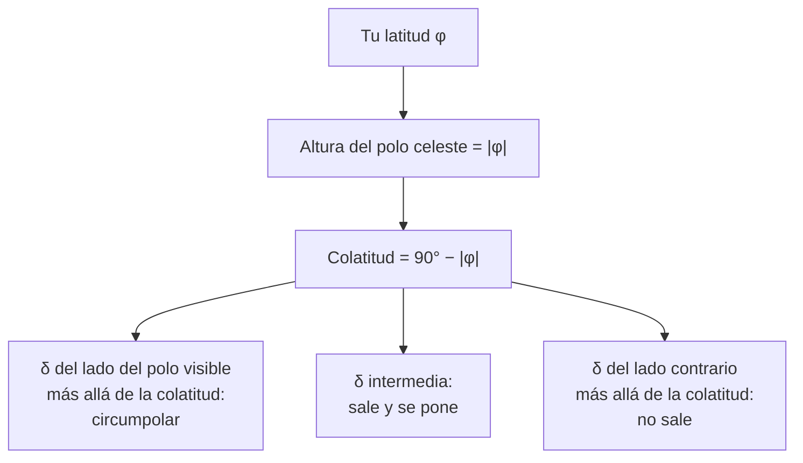

# B08-C02 — Esfera celeste y horizonte local

<!-- nav:top -->
[🏠 Programa](../../../../README.md) · [📚 Bloque B08](../../../tronco-comun/B08-observacion-del-cielo-y-astronomia-practica.md) · [← Anterior: B08-C01 — Orientación geográfica y puntos cardinales](../B08-C01-orientacion-geografica-y-puntos-cardinales/CLASE.md) · [Siguiente: B08-C03 — Ascensión recta y declinación →](../B08-C03-ascension-recta-y-declinacion/CLASE.md)
<!-- /nav -->

## 1. Ubicación, nivel y alcance

Segunda clase del bloque B08. En [B08-C01](../B08-C01-orientacion-geografica-y-puntos-cardinales/CLASE.md) aprendiste a hallar el sur y a dar un acimut; ahora construyes el **modelo** que explica por qué algunas estrellas salen y se ponen, otras nunca se ponen y otras nunca se ven desde tu lugar. Nivel N1.

Verás la esfera celeste, el horizonte local, el cenit, el meridiano y los polos celestes, y la relación entre tu latitud y lo que puedes ver. No verás todavía coordenadas numéricas (C03, C04).

## 2. Por qué esta clase existe

Alguien en Punta Arenas ve girar algunas estrellas sin ponerse jamás; alguien en el valle del Elqui las ve rozar el horizonte, y alguien en el hemisferio norte no las ve nunca. Entender por qué evita comprar un telescopio para un objeto que no sale en tu cielo. La pregunta motivadora: **¿qué parte del cielo puedo ver desde mi lugar, y cuánto tiempo?** La decisión central: **dado un objeto y mi latitud, ¿vale la pena planear una observación?**

## 3. Lo que podrás hacer al terminar

1. Describir la esfera celeste como un modelo geométrico, con sus límites.
2. Nombrar y ubicar cenit, nadir, horizonte, meridiano, polo y ecuador celestes.
3. Demostrar que la altura del polo visible es igual a tu latitud en valor absoluto.
4. Decidir si un objeto es circumpolar, sale y se pone, o no sale, a partir de su declinación y tu latitud.
5. Calcular cuántas horas permanece sobre el horizonte.
6. Dibujar tu horizonte local con obstáculos y corregir tu plan.

La evidencia es la **carta del horizonte local** del ejercicio 12.

## 4. Con qué llegas y cómo comprobarlo

1. ¿Cuántos grados hay entre el horizonte y el cenit?
2. Si algo gira 360° en 24 h, ¿cuántos grados gira en 1 h?
3. ¿Qué es un círculo máximo?
4. ¿Cuál es el valor de `tan 45°`?
5. ¿Qué dice B08-C01 sobre la altura del polo?

<details>
<summary>Ver respuestas</summary>

1. 90°. 2. 15°. 3. El círculo que se obtiene al cortar una esfera con un plano que pasa por su centro. 4. 1. 5. Que, en el sur, el polo está a una altura igual a la latitud sin signo (se demuestra aquí).
</details>

Con cuatro o cinco aciertos, sigue; con tres o menos, repasa B08-C01.

## 5. Un caso real: la Luna del 5 de noviembre de 2025 desde el Elqui

Retomas la salida de observación de C01 (lugar redondeado, `φ = −30,0°`). A las 20:00 UT del 4 de noviembre la Luna estaba bajo el horizonte; a las 00:00 UT del 5 estaba a unos 18° de altura; subió hasta unos 42° y volvió a bajar, hasta ponerse antes de las 10:00 UT. Las posiciones de la Luna vienen de la tabla de la NASA (S1); las alturas son **simuladas** con el programa de la sección 17. Ese recorrido, de salir, subir, cruzar el meridiano y bajar, es lo que la esfera celeste modela.

## 6. Vocabulario

La **esfera celeste** es una esfera imaginaria, de radio arbitrario y centrada en el observador, sobre la que se proyecta la dirección de cada astro. El **horizonte local** es el círculo máximo que separa la mitad visible de la oculta; el **cenit** es el punto sobre tu cabeza y el **nadir** su opuesto. El **meridiano local** es el círculo máximo que pasa por el cenit y los polos celestes. El **polo celeste sur** es la prolongación del eje de la Tierra hacia el sur y el **ecuador celeste** es la prolongación del plano ecuatorial. La **declinación** `δ` es el ángulo de un astro sobre (+) o bajo (−) el ecuador celeste (se mide con detalle en C03). Un astro es **circumpolar** si nunca se pone.

## 7. Modelo mental: una cúpula y un eje inclinado

Imagina el cielo como una cúpula con el horizonte como borde. El eje de giro del cielo está inclinado respecto del horizonte: el ángulo entre el eje y el horizonte es tu latitud. Todo gira alrededor de ese eje a 15° por hora. Los astros cercanos al polo describen círculos que no tocan el horizonte; los lejanos cortan el horizonte y salen y se ponen.



*Descripción textual:* de la latitud se deduce la altura del polo y la colatitud; la declinación del astro, comparada con la colatitud, lo clasifica como circumpolar, de salida y puesta o invisible.

**Analogía y su límite.** Es un paraguas abierto con un palo inclinado que gira. Falla porque la esfera celeste es un modelo: todos los astros se «pegan» a ella aunque estén a distancias muy distintas (B01-C02), y para objetos cercanos como la Luna (paralaje cercana a 1°) la dirección depende además del lugar.

## 8. La explicación, paso a paso

### 8.1 La altura del polo es tu latitud

Si estás en el polo sur, el polo celeste está sobre tu cabeza (altura 90°), y el horizonte coincide con el ecuador celeste. Si estás en el ecuador terrestre, el eje es horizontal y el polo está en el horizonte (0°). Entre ambos, la altura del polo sur celeste es `|φ|`. En el Elqui (`φ = −30°`) el polo sur celeste está a 30° sobre el horizonte, hacia el sur. Verifica con C01: el pie de la Cruz del Sur apunta hacia él (S2).

**Pausa.** Con la afirmación anterior, ¿a qué altura estaría el polo sur celeste en un lugar de latitud −18°? <details><summary>Respuesta</summary>18° sobre el horizonte sur.</details>

### 8.2 Colatitud y tres tipos de objeto

La **colatitud** es `90° − |φ|`: la distancia angular entre el polo visible y el cenit. Un astro del lado del polo visible con `|δ| ≥ colatitud` describe un círculo entero sobre el horizonte: es circumpolar. Si está del lado contrario con `|δ| > colatitud`, su círculo diurno queda siempre bajo el horizonte: nunca sale. Los demás cortan el horizonte. A `φ = −30°` la colatitud vale 60°: nunca se ponen los de `δ ≤ −60°`, y no salen jamás los de `δ > +60°`.

### 8.3 Cuántas horas sobre el horizonte

Un astro con declinación `δ` recorre un círculo de radio angular `90° − |δ|` alrededor del polo. La fracción de ese círculo sobre el horizonte da su arco diurno. Con `cos H₀ = −tan φ · tan δ`, el tiempo sobre el horizonte es `2H₀/15` en horas sidéreas (aproximadamente, 15° equivalen a 1 h). Para el ecuador celeste (`δ = 0`) siempre son 12 h; para objetos del lado del polo visible son más de 12 h; del lado contrario, menos.

### 8.4 El horizonte real no es el horizonte matemático

Un cerro, un edificio o la neblina elevan tu horizonte. El horizonte matemático (altura 0°) es un ideal; el real tiene una «curva de obstáculos» que mides con un clinómetro, o con la mano: el puño a brazo extendido abarca unos 10° (regla práctica no verificada en fuente; compárala en C04 con una medida real). Un cerro de 10° al este retrasa la salida de todo objeto y acorta su tiempo visible.

## 9. Magnitudes, símbolos y unidades

| Símbolo | Qué es | Unidad | Nota |
|---|---|---|---|
| `φ` | latitud (sur negativa) | grados | −30,0° en el caso |
| `δ` | declinación | grados | + hacia el norte celeste |
| `H₀` | semiarco diurno | grados | 15° = 1 h |
| `90° − \|φ\|` | colatitud | grados | límite de circumpolaridad |

## 10. Convenciones y referencias

Se ignoran refracción (que eleva los astros cerca del horizonte unos 34′, S3) y paralaje. Las «horas» de un arco son sidéreas; la diferencia con horas solares se verá en C05. El horizonte se toma al nivel del mar y plano.

## 11. De dónde sale lo que afirmamos

| ID | Fuente | Localizador | Respalda | Consulta | Estado |
|---|---|---|---|---|---|
| S1 | NASA SVS 5415, *Moon Phase and Libration, 2025* (JPL DE421) | https://svs.gsfc.nasa.gov/5415/ ; `mooninfo_2025.txt` | RA/Dec de la Luna el 4–5 nov 2025 | 2026-11-05 | Datos leídos |
| S2 | ESO, «Navigating the stars» (18-oct-2024) | https://www.eso.org/public/blog/navigating-the-stars/ | El pie de la Cruz apunta al polo sur celeste | 2026-11-05 | Página leída (divulgativa) |
| S3 | USNO, *Rise, Set, and Twilight Definitions* | https://aa.usno.navy.mil/faq/RST_defs | Refracción de 34′ en el horizonte; definición de tránsito | 2026-11-05 | Página leída |
| S4 | NASA NSSDC, *Earth Fact Sheet* | https://nssdc.gsfc.nasa.gov/planetary/factsheet/earthfact.html | Rotación sidérea 23,9345 h | 2026-11-05 | Página leída |

Límites: el modelo geométrico y las fórmulas son de uso estándar; se comprueban con un barrido numérico en el laboratorio, no con una fuente impresa. La regla del puño no se verificó.

## 12. Cómo ver (o imaginar) la esfera

Tabla accesible de la geometría para `φ = −30°`:

| Declinación | Tipo | Horas sobre el horizonte |
|---|---|---|
| −65° | circumpolar | 24 |
| −45° | sale y se pone | 16,7 |
| 0° | sale y se pone | 12,0 |
| +30° | sale y se pone | 9,4 |
| +65° | no sale | 0 |

Sin equipo: sujeta una pelota con un lápiz clavado como eje, inclina el eje 30° y gírala. Sin vista: una esfera con marcas táctiles y un eje de madera cumple la misma función.

## 13. Ejemplo trabajado: la Luna del Elqui

La Luna del 5 de noviembre tenía `δ ≈ +17°` (S1). Con `φ = −30°`: `cos H₀ = −tan(−30°)·tan(17°) = 0,577 × 0,306 = 0,176`; `H₀ = 79,8°`; tiempo sobre el horizonte `= 2 × 79,8 / 15 = 10,6 h`. El laboratorio y la tabla S1 dan una salida hacia las 22:30 UT y una puesta hacia las 09:00 UT, es decir, unas 10,5 h. **Paso final · incertidumbre.** La diferencia de 0,1 h viene del avance de la Luna durante la noche (la declinación de la Luna crece ≈ 1° cada 4 h, S1) y de la paralaje; es coherente con un modelo de esfera fija.

## 14. Comparación de métodos

La **geometría** da respuestas rápidas pero ignora el relieve. El **barrido numérico** (laboratorio) comprueba la fórmula y se adapta a horizontes con obstáculos. El **planisferio** (C07) da la misma información de forma gráfica pero con menos precisión.

## 15. Práctica guiada

**Ejercicio 1.** ¿A qué altura está el polo sur celeste en una latitud de −18°? ¿Cuál es la colatitud? *Pasos:* sección 8.1.

<details><summary>Solución comentada</summary>

Altura del polo `= 18°`; colatitud `= 90° − 18° = 72°`.
</details>

**Ejercicio 2.** Una estrella tiene `δ = −70°`. ¿Es circumpolar en `φ = −30°`? *Pista:* compara con la colatitud (8.2).

<details><summary>Solución comentada</summary>

Colatitud 60°; `|δ| = 70° > 60°` y está del lado del polo visible: circumpolar. Nunca se pone.
</details>

**Ejercicio 3.** ¿Cuántas horas está sobre el horizonte una estrella de `δ = −45°` a `φ = −30°`? *Pista:* 8.3.

<details><summary>Solución comentada</summary>

`cos H₀ = −tan(−30°)·tan(−45°) = −0,577`; `H₀ = 125,3°`; horas `= 2×125,3/15 = 16,7 h`. Más de 12 h, porque su declinación es del lado del polo visible.
</details>

## 16. Práctica autónoma, transferencia e integrador

**Ejercicio 4.** Una estrella de `δ = +65°`, ¿sale a `φ = −30°`? ¿Y a `φ = −10°`?

<details><summary>Solución comentada</summary>

A −30° la colatitud vale 60° y `+65° > 60°` del lado contrario: no sale. A −10° la colatitud vale 80°: sale y se pone, por poco tiempo.
</details>

**Ejercicio 5.** Muestra que un objeto con `δ = 0` está sobre el horizonte 12 h en cualquier latitud.

<details><summary>Solución comentada</summary>

`cos H₀ = −tan φ · 0 = 0`; `H₀ = 90°`; `2·90/15 = 12 h`. Es el círculo máximo que divide siempre al horizonte por la mitad.
</details>

**Ejercicio 6.** ¿Para qué declinación pasa un astro exactamente por el cenit del Elqui?

<details><summary>Solución comentada</summary>

Para `δ = φ = −30°`. En el meridiano su altura es `90° − |φ − δ| = 90°`.
</details>

**Ejercicio 7.** ¿Cuál es la máxima altura que alcanza un astro de `δ = +17°` en el Elqui? Compárala con la altura de la Luna en C04.

<details><summary>Solución comentada</summary>

`90° − |−30° − 17°| = 43°`. En el laboratorio de C04 la Luna alcanza ≈ 42,3° a las 04:00 UT, con declinación ≈ 17,6° (`90° − 47,6° = 42,4°`): coincide con la fórmula.
</details>

**Ejercicio 8.** Explica por qué en Arica (cerca de −18°) la Cruz del Sur se ve más alta o más baja que en el Elqui (−30°) cuando cruza el meridiano. *No necesitas su declinación exacta.*

<details><summary>Solución comentada</summary>

Un astro de declinación negativa alta (cerca del polo sur) tiene altura meridiana `90° − |φ − δ|`; para `δ` fija, aumenta cuando `|φ − δ|` disminuye, es decir, cuanto más al sur esté el observador. En el Elqui (más al sur) la Cruz culmina más alta que en Arica.
</details>

**Ejercicio 9 · transferencia.** Un aficionado compra una carta del cielo europea y no encuentra la Cruz del Sur. ¿Por qué?

<details><summary>Solución comentada</summary>

Una carta de latitud norte muestra el cielo visible desde allí: la Cruz tiene declinación muy sur y queda bajo el horizonte o rozándolo; el modelo se ajusta con la latitud (8.2). Se corrige usando una carta para hemisferio sur (C07).
</details>

**Ejercicio 10 · transferencia.** Un cerro de 10° tapa el este. ¿Qué cambia en tu plan para ver salir la Luna?

<details><summary>Solución comentada</summary>

La Luna aparecerá más tarde que el orto matemático (hasta que alcance 10° de altura) y por un acimut ligeramente distinto. Se anota el horizonte real y se desplaza la hora de inicio; si el plan era fotografiar la salida, hay que subir de altitud o moverse al este.
</details>

**Ejercicio 11 · transferencia.** Dos amigos comparan: uno en `φ = −30°` y otro en `φ = −45°`. ¿Quién ve circumpolar un astro de `δ = −50°`?

<details><summary>Solución comentada</summary>

A −30° la colatitud es 60° y `|δ| = 50° < 60°`: no es circumpolar. A −45° la colatitud es 45° y `50° > 45°`: sí lo es. Quien está más al sur ve más estrellas circumpolares.
</details>

**Ejercicio 12 · integrador.** Dibuja la **carta del horizonte local** de tu lugar: ocho acimuts (N, NE, E, SE, S, SO, O, NO) con la altura del obstáculo, la altura del polo sur celeste y la colatitud, y señala un objeto que ya no verías por el obstáculo.

<details><summary>Solución modelo</summary>

Se acepta una carta con alturas medidas (clinómetro, teléfono o estimación con el puño, declarando el método), la altura del polo igual a `|φ|`, la colatitud calculada y un ejemplo donde el obstáculo elimina el objeto o acorta su tiempo visible. Cumple si los números son coherentes con las fórmulas de 8.1 a 8.3.
</details>

## 17. Laboratorio: [`horizonte.py`](horizonte.py)

**Objetivo.** Contrastar la fórmula de las horas sobre el horizonte con un barrido numérico del ángulo horario. **Datos:** simulados (calculados) para `φ = −30°`. **Procedimiento:** `python horizonte.py`; la prueba detiene el programa si ambos métodos difieren más de 0,05 h. **Resultados reales (Python 3.12.9):**

```text
dec   clasificación              horas
-85   circumpolar                24.00
-60   circumpolar (nunca se pone) 24.00
-45   sale y se pone             16.70
-30   sale y se pone             14.60
  0   sale y se pone             12.00
+30   sale y se pone              9.40
+59   sale y se pone              2.14
+65   nunca sale                  0.00
```

**Límites:** sin refracción ni relieve. **Alternativa sin código:** tabla con la fórmula en una calculadora. **Sin equipo:** pelota y lápiz de la sección 12.

## 18. Errores frecuentes y cómo corregirlos

**Pensar que el cielo es igual en todo Chile.** Se corrige con el ejercicio 11. **Confundir latitud con altura del polo en el hemisferio equivocado.** Ejercicio 1. **Creer que «circumpolar» significa «cerca del polo» sin umbral.** Ejercicio 2. **Ignorar el horizonte real.** Ejercicio 10. **Contar horas solares en vez de sidéreas.** Se aclara en C05.

## 19. Cómo sabrás que vas bien

Tras 8.1: ¿sabes decir sin mirar la altura del polo en tu ciudad? Si no, repite el ejercicio 1. Tras 8.2: ¿clasificas un astro con la colatitud? Si no, ejercicios 2 y 4. Tras el ejemplo: ¿repites el cálculo para otra declinación? Final: ¿tu carta tiene medidas y no solo dibujo?

## 20. Qué entregas y cómo se evalúa

La **carta del horizonte local** (ejercicio 12).

| Criterio | Inicial | En desarrollo | Logrado | Destacado |
|---|---|---|---|---|
| Modelo geométrico | Solo dibujo | Datos sin relación | Altura del polo y colatitud correctas | Predice un caso y lo comprueba |
| Horizonte real | Ninguno | Estimado sin método | Medido con método declarado | Cuantifica el efecto sobre un objeto |
| Accesibilidad | No hay | Menciona | Alternativa táctil o textual | La prueba con otra persona |
| Fuentes | Sin fuente | Fuente sin dato | Fuente con dato | Distingue simulado de observado |

**Condiciones críticas:** no medir cerca del Sol con ayudas ópticas; declarar simulado vs observado.

## 21. Ética, seguridad y límites

Medir el horizonte implica caminar en la oscuridad o en cerros: reconoce el terreno de día, no subas a obstáculos para «ver más lejos», lleva linterna con luz roja y abrigo, y ve acompañado. Nunca midas la altura del Sol sin filtro certificado; si necesitas el Sol, usa la sombra (C01). El horizonte puede estar en propiedad privada o en una zona de acceso restringido: pide permiso.

## 22. Para cerrar y seguir

La esfera celeste es un modelo cuya inclinación es tu latitud. Con ella decides qué astros son circumpolares, cuáles salen y se ponen, y cuáles no verás, y calculas cuánto tiempo están arriba. El horizonte real recorta ese modelo. Queda abierta una pregunta: ¿cómo designar un punto de la esfera con dos números que no dependan de tu lugar? (C03).

**Glosario español–inglés.** esfera celeste · *celestial sphere*; cenit · *zenith*; nadir · *nadir*; meridiano local · *local meridian*; circumpolar · *circumpolar*; declinación · *declination*; horizonte · *horizon*.

**Continuidad.** B08-C03 define dos números (ascensión recta y declinación) que fijan una estrella en la esfera sin importar dónde estés, y B08-C04 los convierte en altura y acimut para tu lugar.

**Referencias:** ver sección 11.

<!-- nav:bottom -->
---

[← Anterior: B08-C01 — Orientación geográfica y puntos cardinales](../B08-C01-orientacion-geografica-y-puntos-cardinales/CLASE.md) · [📚 Bloque B08](../../../tronco-comun/B08-observacion-del-cielo-y-astronomia-practica.md) · [Siguiente: B08-C03 — Ascensión recta y declinación →](../B08-C03-ascension-recta-y-declinacion/CLASE.md)
<!-- /nav -->
