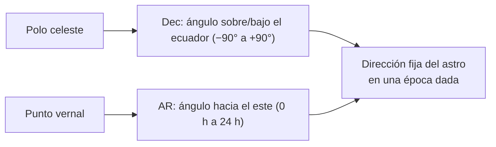

# B08-C03 — Ascensión recta y declinación

<!-- nav:top -->
[🏠 Programa](../../../../README.md) · [📚 Bloque B08](../../../tronco-comun/B08-observacion-del-cielo-y-astronomia-practica.md) · [← Anterior: B08-C02 — Esfera celeste y horizonte local](../B08-C02-esfera-celeste-y-horizonte-local/CLASE.md) · [Siguiente: B08-C04 — Altura y acimut →](../B08-C04-altura-y-acimut/CLASE.md)
<!-- /nav -->

## 1. Ubicación, nivel y alcance

Tercera clase del bloque B08. En [B08-C02](../B08-C02-esfera-celeste-y-horizonte-local/CLASE.md) usaste la declinación sin definirla del todo; ahora aprendes el sistema de **coordenadas ecuatoriales**, que da a cada estrella una «dirección» que no cambia si te mueves o si pasa la noche. Nivel N1.

Verás ascensión recta, declinación, el equinoccio de referencia, la época (J2000) y la precesión, la conversión entre horas y grados y la separación entre dos puntos. No verás aún cómo pasar a tu horizonte (C04) ni el tiempo sidéreo (C05).

## 2. Por qué esta clase existe

Un catálogo no puede decir «a la izquierda de la Luna», porque eso cambia a cada minuto. Necesita direcciones fijas. La pregunta motivadora es: **¿cómo describo la posición de un astro con dos números que cualquiera, en cualquier lugar, pueda usar?** La decisión central: **elegir el sistema y la época de referencia, y declararlos con el dato**; mezclar épocas produce errores reales (en esta clase, 0,36°, mayor que el diámetro de la Luna).

## 3. Lo que podrás hacer al terminar

1. Definir ascensión recta (AR) y declinación (Dec) y su unidad.
2. Convertir entre horas–minutos–segundos y grados, y entre grados y grados–minutos–segundos de arco.
3. Leer coordenadas de una tabla (Luna, NASA) y decir si están en J2000 o de la fecha.
4. Calcular la separación angular entre dos objetos.
5. Estimar el efecto de la precesión entre épocas.
6. Reconocer cuándo una posición no es suficiente (objetos cercanos, como la Luna).

La evidencia es la **ficha de coordenadas** del ejercicio 12.

## 4. Con qué llegas y cómo comprobarlo

1. ¿Cuántos grados son 3 h de giro?
2. ¿Cuántos segundos de arco tiene un grado?
3. ¿Cuánto es `0,5927°` en minutos de arco?
4. ¿Qué es la declinación (B08-C02)?
5. ¿Cuántas veces cabe el diámetro de la Luna (≈ 0,5°) en 15°?

<details><summary>Ver respuestas</summary>

1. 45°. 2. 3600″. 3. `0,5927 × 60 = 35,56′`. 4. El ángulo de un astro sobre o bajo el ecuador celeste. 5. 30 veces.
</details>

Con cuatro o cinco aciertos, sigue; con tres o menos, repasa B03 (unidades) y C02.

## 5. Un caso real: dónde estaba la Luna el 5 de noviembre de 2025

La tabla de la NASA «Moon Phase and Libration, 2025» (S1) entrega, hora por hora, la ascensión recta (en horas) y la declinación (en grados) de la Luna, calculadas con la efeméride JPL DE421. A las 00:00 UT del 5 de noviembre: AR = `2,0630 h` y Dec = `+16,5927°`. Cuatro horas después: `2,2260 h` y `+17,5864°`. Ese será el ejemplo conductor: leerás los números, los convertirás, medirás cuánto se movió la Luna y verás por qué hay que decir en qué época están.

## 6. Vocabulario

La **declinación** (Dec, `δ`) es el ángulo de un astro sobre (+) o bajo (−) el **ecuador celeste**. La **ascensión recta** (AR, `α`) es el ángulo, medido hacia el este sobre el ecuador celeste, entre el **punto vernal** (un punto del ecuador que sirve de origen) y el círculo que une los polos con el astro; se expresa en horas (24 h = 360°). El **equinoccio** de referencia es esa elección de origen. Una **época** es la fecha a la que se refieren las coordenadas; la **precesión** es el lento giro del eje de la Tierra, que desplaza el sistema entero unos 50″ al año. **J2000** es la época del 1 de enero de 2000, 12:00 (D. juliano 2451545,0); el IAU la usa en los datos de límites de las constelaciones (S2). La **separación angular** es el ángulo entre dos direcciones.

## 7. Modelo mental: longitud y latitud, pero del cielo

La declinación es como la latitud, pero sobre la esfera celeste: 0° en el ecuador celeste, +90° en el polo norte celeste, −90° en el polo sur celeste. La ascensión recta es como la longitud: da la vuelta completa, pero se mide hacia el este desde el punto vernal en lugar de desde Greenwich. Cuando la Tierra gira, el cielo se desliza bajo tu horizonte; las coordenadas ecuatoriales, no.



*Descripción textual:* dos ángulos, uno medido desde el ecuador celeste (declinación) y otro desde el punto vernal (ascensión recta), fijan la dirección de un astro en una época.

**Analogía y su límite.** Latitud y longitud terrestres. Se rompe en que el origen de la AR no está pegado al suelo: se desplaza por la precesión, y por eso importa la época.

## 8. La explicación, paso a paso

### 8.1 Leer una tabla: horas y grados

La AR de la tabla viene en horas decimales: `2,0630 h = 2 h 3 m 46,8 s`. Como 24 h equivalen a 360°, `1 h = 15°`, `1 m = 15′` y `1 s = 15″` (minutos y segundos *de tiempo* a minutos y segundos *de arco*). La declinación viene en grados decimales: `+16,5927° = +16° 35′ 33,7″`. El error clásico es leer «2,0630 h» como 2 h 6 m 30 s.

**Pausa.** ¿Cuántos grados es `2,0630 h`? <details><summary>Respuesta</summary>`2,0630 × 15 = 30,945°`.</details>

### 8.2 Separación entre dos puntos

La distancia angular `θ` entre `(α₁, δ₁)` y `(α₂, δ₂)` cumple `cos θ = sen δ₁ sen δ₂ + cos δ₁ cos δ₂ cos(α₂ − α₁)`. Para ángulos pequeños conviene una forma estable numéricamente (el laboratorio usa la de Vincenty). Un resultado útil: a declinación `δ`, una diferencia `Δα` de ascensión recta equivale a `Δα · cos δ` de arco; por eso una hora de AR cerca del polo es poco camino.

Con la tabla: la Luna se movió de `(2,0630 h; +16,5927°)` a `(2,2260 h; +17,5864°)` en 4 h. El laboratorio da `2,54°`, es decir, `0,63°` por hora, algo más de un diámetro lunar (≈ 0,5°) por hora.

### 8.3 La época importa: precesión

La AR y la Dec de la tabla están en J2000. Si tu planisferio o tu telescopio usan las coordenadas «de la fecha», hay que **precesar**. Para la Luna del 5 de noviembre de 2025 (25,8 años después de J2000), el laboratorio da un cambio de `1272″` en AR y `443″` en Dec: una separación de `0,360°`. Ese valor coincide con un cálculo independiente con astropy (cuyos valores se copiaron al programa, que los usa como prueba). Entre más años pasen, más grande: crece a unos `0,0139°` por año, de modo que en ~72 años llega a 1°.

### 8.4 Cuando dos números no bastan

Las coordenadas son direcciones desde el centro de la Tierra. Para un objeto cercano, como la Luna, la dirección vista desde tu lugar difiere de la dirección geocéntrica hasta cerca de 1° (**paralaje**). Para una estrella lejana, esa diferencia es despreciable. La tabla de la NASA entrega la dirección geocéntrica; para apuntar un telescopio a la Luna hay que corregirla.

## 9. Magnitudes, símbolos y unidades

| Símbolo | Qué es | Unidad | Nota |
|---|---|---|---|
| `α` | ascensión recta | h (o °) | 1 h = 15° |
| `δ` | declinación | ° | −90° a +90° |
| `θ` | separación angular | ° | 1° = 3600″ |
| `J2000` | época de referencia | — | JD 2451545,0 |

## 10. Convenciones y referencias

AR hacia el este, de 0 h a 24 h. Dec con signo. Salvo que se indique, las coordenadas de esta clase son J2000 medias (sin nutación ni aberración). Se declara siempre la época junto al dato. Las posiciones de la NASA son **calculadas** a partir de una efeméride, no observadas.

## 11. De dónde sale lo que afirmamos

| ID | Fuente | Localizador | Respalda | Consulta | Estado |
|---|---|---|---|---|---|
| S1 | NASA SVS 5415, *Moon Phase and Libration, 2025* (JPL DE421) | https://svs.gsfc.nasa.gov/5415/ ; `mooninfo_2025.txt` | RA/Dec J2000 de la Luna (filas del 4–5 nov 2025) | 2026-11-05 | Datos descargados y leídos; la página indica «J2000» |
| S2 | IAU, *The Constellations* (FAQ) | https://www.iau.org/IAU/IAU/Astronomy-FAQs/Constellations.aspx | Los límites de las constelaciones se definen con líneas de AR y Dec y se publican en J2000 | 2026-11-05 | Página leída |
| S3 | astropy, documentación v8.0.2: «Coordinates» y «Solar System Ephemerides» | https://docs.astropy.org/en/stable/coordinates/ ; https://docs.astropy.org/en/stable/coordinates/solarsystem.html | Según la documentación, AltAz usa información de rotación terrestre y la efeméride integrada usa elementos orbitales aproximados (errores de unos segundos a ~1,5 minutos de arco según el planeta); uso en esta clase: Precesión J2000→2025-11-05 usada como prueba (valores generados por nosotros con astropy 8.0.2 y pyerfa 2.0.1.5, no publicados) | 2026-11-05 | Documentación leída; valores ejecutados localmente |
| S4 | NASA NSSDC, *Moon Fact Sheet* (act. 11-ene-2024) | https://nssdc.gsfc.nasa.gov/planetary/factsheet/moonfact.html | Revolución sidérea 27,3217 d; distancia media 384 400 km; radio 1737,4 km | 2026-11-05 | Página leída |
| S5 | NASA NSSDC, *Earth Fact Sheet* (act. 15-nov-2024) | https://nssdc.gsfc.nasa.gov/planetary/factsheet/earthfact.html | Radio medio de la Tierra 6371 km | 2026-11-05 | Página leída |

Límites: la definición de punto vernal y el valor 50″/año son de uso general y no se verificaron en una fuente de esta clase; la precesión sí se comprueba con S3. La NASA no entrega aquí la época explícita de la efeméride sino «J2000» en la descripción de la tabla.

## 12. Cómo ver las coordenadas

Tabla de la Luna (datos de S1, J2000):

| UT (4 y 5 nov 2025) | AR (h) | Dec (°) |
|---|---|---|
| 04 nov 20:00 | 1,9020 | +15,5725 |
| 05 nov 00:00 | 2,0630 | +16,5927 |
| 05 nov 04:00 | 2,2260 | +17,5864 |
| 05 nov 08:00 | 2,3911 | +18,5510 |

Sin ver: dos reglas graduadas táctiles (una horizontal para AR, otra vertical para Dec) sobre una cartulina con puntos en relieve permiten «leer» el mapa.

## 13. Ejemplo trabajado: ¿cuánto se mueve la Luna?

Entre las 00:00 y las 04:00 UT del 5 de noviembre: `ΔAR = 0,1630 h = 2,445°`; `ΔDec = 0,9937°`. A `δ ≈ 17°`, `ΔAR·cos δ = 2,445 × 0,956 = 2,34°`. Separación: `√(2,34² + 0,99²) = 2,54°`, y a 4 h corresponde `0,635°/h`. Para compararla con un valor medio: la Luna completa 360° respecto de las estrellas en 27,3217 d (NASA, Moon Fact Sheet, S4), es decir `0,549°/h`. La velocidad de la tabla es mayor porque la Luna estaba más cerca (357 700 km frente a 384 400 km de distancia media): es lo esperable: un cuerpo en órbita se mueve más rápido cuanto más cerca está. **Paso final · incertidumbre.** Los datos de S1 tienen cuatro cifras decimales en AR y Dec (0,0001 h = 1,5″), así que el error de la separación es despreciable; la incertidumbre dominante es la época y la paralaje (hasta 1°) si apuntaras un telescopio.

## 14. Comparación de sistemas

Las coordenadas **ecuatoriales** no dependen del lugar ni de la hora y sirven para catálogos. Las **horizontales** (altura y acimut, C04) dependen de ambos y sirven para apuntar. Las **eclípticas** siguen el plano de la órbita de la Tierra y sirven para el sistema solar (no se desarrollan aquí). Cada una tiene su uso: un buen registro dice cuál usó.

## 15. Práctica guiada

**Ejercicio 1.** Convierte `AR = 2 h 03 m 46,8 s` a grados. *Pasos:* sección 8.1.

<details><summary>Solución comentada</summary>

`2 × 15 + 3 × 0,25 + 46,8 × (15/3600) = 30 + 0,75 + 0,195 = 30,945°`. Coincide con `2,0630 h × 15`.
</details>

**Ejercicio 2.** Expresa `Dec = +16,5927°` en grados, minutos y segundos. *Pista:* multiplica la parte decimal por 60.

<details><summary>Solución comentada</summary>

`0,5927 × 60 = 35,562′` → `35′`; `0,562 × 60 = 33,7″`. Resultado: `+16° 35′ 33,7″`.
</details>

**Ejercicio 3.** Dos puntos del ecuador celeste tienen AR `6 h` y `8 h`. ¿Qué separación hay? *Pista:* a `δ = 0`, 1 h = 15°.

<details><summary>Solución comentada</summary>

`2 h × 15 = 30°`.
</details>

## 16. Práctica autónoma, transferencia e integrador

**Ejercicio 4.** Con la tabla de la sección 12, calcula la velocidad de la Luna (°/h) entre las 04:00 y las 08:00 UT y compárala con la de 00:00 a 04:00.

<details><summary>Solución comentada</summary>

`ΔAR = 0,1651 h = 2,477°`; `ΔDec = 0,9646°`; con `cos 18° ≈ 0,951`: `2,355°` en longitud-arco; separación `2,54°` (el laboratorio da 2,544°). La velocidad es `0,636°/h`: casi igual a la anterior (0,635°/h).
</details>

**Ejercicio 5.** A `δ = −60°`, ¿qué separación hay entre dos puntos con 1 h de diferencia en AR? *Pista:* 8.2.

<details><summary>Solución comentada</summary>

`cos θ = sen²60° + cos²60°·cos 15° = 0,75 + 0,25 × 0,9659 = 0,99148`; `θ = 7,49°`. La aproximación `15° × cos 60° = 7,5°` da casi lo mismo.
</details>

**Ejercicio 6.** ¿Cuántos años de precesión producen un corrimiento de 1°?

<details><summary>Solución comentada</summary>

0,360° en 25,8 años dan `0,0139°/año`; `1° / 0,0139 ≈ 72 años` (equivalente a ~50″/año).
</details>

**Ejercicio 7.** Un catálogo antiguo da la posición en una época de 1950 y tu programa espera J2000. ¿Qué haces y qué error cometes si no lo haces (usa el ritmo de 0,0139°/año)?

<details><summary>Solución comentada</summary>

Precesas de 1950 a 2000 antes de comparar. Sin hacerlo, el error sería `50 × 0,0139° ≈ 0,7°`, del tamaño de unos 1,4 diámetros lunares.
</details>

**Ejercicio 8.** ¿En cuántas horas de AR cabe la vuelta completa y por qué se usa esa unidad?

<details><summary>Solución comentada</summary>

24 h. Porque la AR está ligada al giro diario de la Tierra: el cielo avanza 1 h de AR cada hora sidérea, y eso simplifica la relación con el tiempo (C05).
</details>

**Ejercicio 9 · transferencia.** La NASA entrega dirección geocéntrica. Si observas la Luna a baja altura, ¿en qué sentido puede diferir la posición real de la tabulada? Estima el tamaño máximo.

<details><summary>Solución comentada</summary>

La paralaje desplaza la Luna hacia abajo respecto de su dirección geocéntrica; el efecto máximo es del orden de 1° cuando está en el horizonte (radio terrestre / distancia lunar `≈ 6371/384400 = 0,0166 rad = 0,95°`). Es un cálculo propio con el radio terrestre (S5) y la distancia media (S4).
</details>

**Ejercicio 10 · transferencia.** Un compañero dice «las coordenadas del cielo cambian cada noche, así que no sirven». ¿Qué le respondes?

<details><summary>Solución comentada</summary>

Las estrellas cambian de AR/Dec solo por la precesión y por su movimiento propio (lento); lo que cambia cada noche es su altura y acimut. Por eso los catálogos usan AR/Dec. La Luna y los planetas sí cambian porque se mueven entre las estrellas.
</details>

**Ejercicio 11 · transferencia.** El Sol el 5 de noviembre estaba en AR ≈ `14 h 41 m` (cálculo propio con el modelo de B08, simulado). ¿Qué AR tiene el punto opuesto y qué dice eso sobre la Luna de las 00:00 UT (AR `2 h 04 m`)?

<details><summary>Solución comentada</summary>

El opuesto está en `14 h 41 m − 12 h = 2 h 41 m`. La Luna, en `2 h 04 m`, estaba aún 37 minutos (9,3°) antes del punto opuesto: faltaba del orden de media jornada para la oposición, coherente con que la Luna llena se alcanzara ese mismo día (la tabla S1 muestra la fase máxima, 99,86 %, hacia las 12–14 UT).
</details>

**Ejercicio 12 · integrador.** Arma una **ficha de coordenadas** para tres objetos (la Luna, el Sol en la fecha y un objeto que elijas con la fuente de sus coordenadas): AR y Dec en horas y grados, la época, el origen (observado, calculado) y las separaciones entre ellos.

<details><summary>Solución modelo</summary>

La ficha debe contener la conversión correcta de unidades, la época declarada, la separación por la fórmula de 8.2 con un valor plausible y la fuente del tercer objeto con su fecha de consulta. Se acepta cualquier objeto con fuente verificada.
</details>

## 17. Laboratorio: [`coordenadas.py`](coordenadas.py)

**Requisitos:** Python 3.9 o superior y solo la biblioteca estándar; no hace falta instalar nada. Los valores de referencia de astropy 8.0.2 / pyerfa 2.0.1.5 están copiados en el código (no se importa astropy); para regenerarlos: `pip install astropy==8.0.2` (o `uv pip install astropy==8.0.2`). Los scripts comparten `programa/clases/B08/astrolib_b08.py`; si falta, Python avisa con un ImportError que nombra el módulo.

**Objetivo.** Convertir y comparar coordenadas, y medir el efecto de la precesión. **Datos:** observados-calculados (posiciones de la NASA); precesión simulada. **Procedimiento:** `python coordenadas.py`. Detiene el programa si falla la prueba analítica (15° por hora de AR, polo a polo 180°) o la comparación con astropy. **Resultados reales (Python 3.12.9):**

```text
2025-11-04 20:00 UT  RA 01h54m07.2s  Dec +15.5725
2025-11-05 00:00 UT  RA 02h03m46.8s  Dec +16.5927  | desplazamiento en 4 h: 2.535 grados
2025-11-05 04:00 UT  RA 02h13m33.6s  Dec +17.5864  | desplazamiento en 4 h: 2.539 grados
2025-11-05 08:00 UT  RA 02h23m28.0s  Dec +18.5510  | desplazamiento en 4 h: 2.544 grados
Precesión J2000 -> fecha: dRA=1272" dDec=443" (separación 0.360 grados)
```

**Límites:** posiciones geocéntricas, sin paralaje; precesión media (sin nutación). **Sin código:** repite la conversión de la sección 12 con calculadora.

## 18. Errores frecuentes y cómo corregirlos

**Leer horas decimales como h:m:s.** Ejercicio 1. **Mezclar horas de AR con horas de reloj.** Ejercicio 8. **Olvidar `cos δ`.** Ejercicio 5. **Ignorar la época.** Ejercicios 6 y 7. **Tomar la dirección geocéntrica como la del observador.** Ejercicio 9.

## 19. Cómo sabrás que vas bien

Tras 8.1: convierte sin mirar `3 h 30 m` a grados (52,5°). Tras 8.2: ¿sabes cuándo usar `cos δ`? Si no, ejercicio 5. Tras 8.3: ¿puedes decir qué época usa tu planisferio? Si no, léelo. Final: ¿tu ficha dice época y origen?

## 20. Qué entregas y cómo se evalúa

La **ficha de coordenadas** (ejercicio 12).

| Criterio | Inicial | En desarrollo | Logrado | Destacado |
|---|---|---|---|---|
| Conversión | Con errores | Correcta sin unidades | Correcta con unidades | Verifica con otra vía |
| Época | No declarada | Declarada sin efecto | Declarada y aplicada | Cuantifica el error de omitirla |
| Separación | No la calcula | Fórmula mal usada | Correcta | Explica el límite (paralaje) |
| Fuentes | Sin fuente | Sin fecha | Con fecha y estado | Distingue calculado de observado |

**Condiciones críticas:** no presentar coordenadas calculadas como observadas; no omitir la época.

## 21. Ética, seguridad y límites

Esta clase no exige salir de casa. Si usas el Sol como objeto de la ficha, no lo mires: calcula su posición (el Sol sin filtro certificado daña los ojos; NASA exige visores ISO 12312-2, ver C16 y C01). Los datos de la NASA son públicos; cita su origen y no los uses como medidas propias.

## 22. Para cerrar y seguir

La AR y la Dec fijan la dirección de un astro en una época; se convierten con 15° por hora; se comparan con una separación angular y se corrigen por precesión y, para objetos cercanos, por paralaje. Queda abierta una pregunta: ¿cómo convierto esas coordenadas fijas en el lugar donde debo mirar ahora? (C04).

**Glosario español–inglés.** ascensión recta · *right ascension*; declinación · *declination*; época · *epoch*; precesión · *precession*; separación angular · *angular separation*; paralaje · *parallax*.

**Continuidad.** B08-C04 pasa de AR/Dec a altura y acimut; B08-C05 explica el tiempo sidéreo que falta para ello.

**Referencias:** ver sección 11.

<!-- nav:bottom -->
---

[← Anterior: B08-C02 — Esfera celeste y horizonte local](../B08-C02-esfera-celeste-y-horizonte-local/CLASE.md) · [📚 Bloque B08](../../../tronco-comun/B08-observacion-del-cielo-y-astronomia-practica.md) · [Siguiente: B08-C04 — Altura y acimut →](../B08-C04-altura-y-acimut/CLASE.md)
<!-- /nav -->
