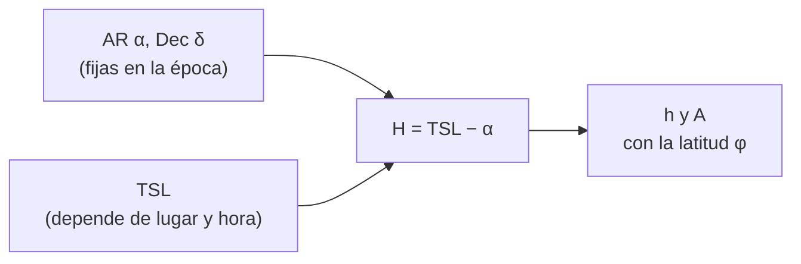

# B08-C04 — Altura y acimut

<!-- nav:top -->
[🏠 Programa](../../../../README.md) · [📚 Bloque B08](../../../tronco-comun/B08-observacion-del-cielo-y-astronomia-practica.md) · [← Anterior: B08-C03 — Ascensión recta y declinación](../B08-C03-ascension-recta-y-declinacion/CLASE.md) · [Siguiente: B08-C05 — Tiempo sidéreo y solar →](../../../tronco-comun/B08-observacion-del-cielo-y-astronomia-practica.md#b08-c05)
<!-- /nav -->

## 1. Ubicación, nivel y alcance

Cuarta clase del bloque B08 y cierre del primer tramo (orientarse y localizar). En [B08-C03](../B08-C03-ascension-recta-y-declinacion/CLASE.md) obtuviste una dirección fija (AR, Dec); ahora la conviertes en **dónde mirar tú, aquí y ahora**: altura sobre el horizonte y acimut. Nivel N1.

Verás las coordenadas horizontales, el ángulo horario, la fórmula que une los sistemas, cómo estimar ángulos sin instrumentos y qué ignora el cálculo (refracción, paralaje). El tiempo sidéreo se usa como dato; se explica en C05.

## 2. Por qué esta clase existe

Una tabla dice «Luna: AR 2,14 h, Dec +17,1°». Un telescopio, una cámara o tus ojos necesitan «a 35° de altura, hacia el nornoreste». La pregunta motivadora es: **¿cómo sé, para mi lugar y mi hora, hacia dónde apuntar y si el objeto estará sobre el horizonte?** La decisión central: **elegir la ventana de observación (hora y dirección) y comprobar que el objeto esté lo bastante alto para evitar la turbulencia y los obstáculos del horizonte**.

## 3. Lo que podrás hacer al terminar

1. Definir altura y acimut y distinguirlos de AR y Dec.
2. Calcular el ángulo horario a partir del tiempo sidéreo y la AR.
3. Obtener altura y acimut con las fórmulas esféricas y comprobar el resultado con una referencia.
4. Predecir cuándo un objeto sale, culmina y se pone.
5. Estimar ángulos en el cielo sin instrumentos y declarar el error.
6. Explicar qué efectos ignora el cálculo y cuánto pueden valer.

La evidencia es la **tabla de seguimiento** del ejercicio 12.

## 4. Con qué llegas y cómo comprobarlo

1. ¿Cuánto vale `sen 30°`? 2. ¿Cuántos grados avanza el cielo en 2 h? 3. ¿Qué es el meridiano local (C02)? 4. Si `cos x = 0,5`, ¿cuánto vale `x`? 5. ¿Qué signo tiene la declinación del Sol en noviembre en el hemisferio sur?

<details><summary>Ver respuestas</summary>

1. 0,5. 2. 30°. 3. El círculo máximo que pasa por el cenit y los polos. 4. 60°. 5. Negativo (−15,8° el 5 de noviembre, C01).
</details>

Con cuatro o cinco aciertos, sigue; con tres o menos, repasa C02 y C03.

## 5. Un caso real: la Luna del Elqui, hora por hora

Retomas el 5 de noviembre de 2025 en el lugar redondeado de C01 (`φ = −30,0°`, `λ = −70,7°`). Con las posiciones de la Luna de la NASA (S1) y el programa de la sección 17 obtienes, en horas UT, esta trayectoria **simulada** (calculada):

| UT | Tiempo sidéreo local (h) | Altura | Acimut |
|---|---|---|---|
| 4-nov 20:00 | 18,24 | −29,4° | 88,1° |
| 4-nov 22:00 | 20,25 | −5,0° | 74,2° |
| 5-nov 00:00 | 22,25 | 17,6° | 57,9° |
| 5-nov 02:00 | 0,26 | 35,3° | 34,1° |
| 5-nov 04:00 | 2,26 | 42,3° | 359,7° |
| 5-nov 06:00 | 4,27 | 34,3° | 326,1° |
| 5-nov 08:00 | 6,27 | 16,0° | 303,4° |
| 5-nov 10:00 | 8,28 | −6,7° | 288,2° |

La Luna sale por el este-noreste (cerca de 70°, como estimaste en C01), cruza el meridiano al norte a 42° (a las 03:57 UT) y se pone por el oeste-noroeste. Este es el ejemplo conductor: cada fórmula de la clase la reproduce.

## 6. Vocabulario

La **altura** `h` es el ángulo de un astro sobre el horizonte (0° horizonte, 90° cenit); la **distancia cenital** es `z = 90° − h`. El **acimut** `A` es el ángulo desde el norte hacia el este (C01). El **ángulo horario** `H` es el ángulo, medido hacia el oeste, entre el meridiano y el círculo que pasa por el astro y los polos; vale cero cuando el astro cruza el meridiano (**tránsito** o **culminación**, S2). El **tiempo sidéreo local** (TSL) es el ángulo horario del punto vernal en tu lugar; se verá en C05. La **refracción** es la desviación de la luz por la atmósfera, que eleva los astros cerca del horizonte. La **paralaje** es el cambio de dirección al ver un objeto cercano desde dos lugares.

## 7. Modelo mental: el cielo gira bajo un sistema fijo

AR y Dec están pegados a las estrellas; altura y acimut están pegados a tu lugar. Con el giro de la Tierra, el punto vernal sube por el este y el cielo completo se desplaza. El ángulo horario es el puente: `H = TSL − α`. Un astro con `H = 0` está en el meridiano, a su altura máxima.



*Descripción textual:* se combinan la ascensión recta del astro con el tiempo sidéreo local para obtener el ángulo horario, y con él, la latitud y la declinación se calculan altura y acimut.

**Analogía y su límite.** Es como pasar de las coordenadas de un mapa («lat–lon») a «a 200 m por mi izquierda». El mapa no cambia; tu posición sí. Falla en que el sistema horizontal tiene una singularidad en el cenit: el acimut no está definido.

## 8. La explicación, paso a paso

### 8.1 El ángulo horario

`H = TSL − α`, en horas o grados (1 h = 15°). Si `H < 0`, el astro aún no llega al meridiano (está en el lado este); si `H > 0`, ya pasó (lado oeste). Para la Luna a las 02:00 UT, `TSL = 0,2575 h = 3,86°` y, con la AR de la fecha `α ≈ 32,52°` (la J2000 de la tabla, 32,16°, más 0,35° de precesión, C03): `H = 3,86° − 32,52° = −28,66°`.

### 8.2 Altura y acimut

```text
sen h = sen φ · sen δ + cos φ · cos δ · cos H
tan A = (− cos δ · sen H) / (sen δ · cos φ − cos δ · sen φ · cos H)      [A con atan2, desde el norte hacia el este]
```

Con `φ = −30°`, `δ = 17,22°` (Dec J2000 17,09° más 0,12° de precesión) y `H = −28,66°`:
`sen h = (−0,5)(0,2960) + (0,8660)(0,9552)(0,8780) = −0,1480 + 0,7263 = 0,5783`, `h = 35,3°`. Para el acimut, el numerador vale `0,4573` y el denominador `0,6756`, y `A = 34,1°`. Ambos coinciden con la tabla de la sección 5.

**Pausa.** ¿Qué altura tiene un astro en el meridiano (`H = 0`)? <details><summary>Respuesta</summary>`sen h = cos(φ − δ)`, es decir, `h = 90° − |φ − δ|` (C02). Para la Luna a las 04:00 UT, `δ ≈ 17,7°`: `h = 90° − 47,7° = 42,3°`, igual que la tabla.</details>

### 8.3 Salida, culminación y puesta

La culminación ocurre cuando `H = 0`. La salida y la puesta ocurren cuando `h = 0` (C02, con `cos H₀ = −tan φ tan δ`), a `H = ∓H₀`. Para la Luna del 5 de noviembre, `H₀ ≈ 80°`, es decir, unas 5,3 h sidéreas. Un barrido minuto a minuto del programa (interpolando linealmente la tabla S1 entre filas de 2 h; ±5 min) da: salida a las 22:26 UT, tránsito a las 03:57 UT y puesta a las 09:26 UT. El intervalo salida–tránsito (5,5 h) supera las 5,3 h porque la Luna avanza hacia el este entre las estrellas (≈ 0,6° por hora) y su ángulo horario crece algo más despacio que el del cielo.

### 8.4 Estimar ángulos sin instrumentos y qué ignora el cálculo

Con el brazo estirado, un puño cerrado abarca unas 10° y un dedo meñique, 1° a 2°: son reglas prácticas, que varían de persona a persona; mide las tuyas contra una referencia conocida (por ejemplo, el diámetro de la Luna, ≈ 0,5°, S3). Un clinómetro, o la aplicación de un teléfono con el sensor calibrado, da la altura con 1° de error si lo calibras sobre una superficie plana. Lo que el cálculo ignora: la **refracción** (unos 34′ en el horizonte, S2; menos a mayor altura), la **paralaje** (hasta ~1° para la Luna) y el relieve. Para la Luna, la altura aparente puede diferir de la calculada hasta ~1°.

## 9. Magnitudes, símbolos y unidades

| Símbolo | Qué es | Unidad | Nota |
|---|---|---|---|
| `h` | altura | ° | 0° horizonte, 90° cenit |
| `z` | distancia cenital | ° | `90° − h` |
| `A` | acimut | ° | N = 0°, E = 90° |
| `H` | ángulo horario | h o ° | `H = TSL − α` |
| `TSL` | tiempo sidéreo local | h | se explica en C05 |
| `φ` | latitud | ° | sur negativa |

## 10. Convenciones y referencias

Acimut desde el norte hacia el este (algunas fuentes lo miden desde el sur: léelo siempre en la documentación). Ángulo horario positivo hacia el oeste. Las horas son UT. La refracción de 34′ y las definiciones de orto y tránsito vienen del USNO (S2). Chile adopta horas oficiales variables; para evitar errores, el cálculo y la bitácora se hacen en UT.

## 11. De dónde sale lo que afirmamos

| ID | Fuente | Localizador | Respalda | Consulta | Estado |
|---|---|---|---|---|---|
| S1 | NASA SVS 5415, *Moon Phase and Libration, 2025* (JPL DE421) | https://svs.gsfc.nasa.gov/5415/ ; `mooninfo_2025.txt` | RA/Dec J2000 de la Luna, 4–5 nov 2025 | 2026-11-05 | Datos leídos |
| S2 | USNO, *Rise, Set, and Twilight Definitions* | https://aa.usno.navy.mil/faq/RST_defs | Refracción de 34′; tránsito (cruce del meridiano, altura máxima) | 2026-11-05 | Página leída |
| S3 | NASA NSSDC, *Moon Fact Sheet* (act. 11-ene-2024) | https://nssdc.gsfc.nasa.gov/planetary/factsheet/moonfact.html | Diámetro angular de la Luna ≈ 1896″ en oposición | 2026-11-05 | Página leída |
| S4 | astropy 8.0.2 / pyerfa 2.0.1.5 | https://www.astropy.org | Altura 40,5929°, acimut 17,9926° para la fila de las 03:00 UT (prueba del laboratorio) | 2026-11-05 | Ejecutado localmente; valores copiados |

Límites: las fórmulas esféricas son estándar y se verifican con S4; la regla del puño y el dedo no tiene fuente; el tiempo sidéreo se toma de un modelo de baja precisión (C05).

## 12. Cómo ver (o sentir) altura y acimut

Tabla de la sección 5 como versión accesible. Para una persona ciega: un cuadrante de madera con escala táctil mide la altura; una brújula parlante o una escala en relieve da el acimut. Una cámara con sonido que indica «a 35°» sirve también para orientarse; declara el recurso usado.

## 13. Ejemplo trabajado: la ventana de observación

Quieres fotografiar la Luna con un cerro de 10° al este. De la tabla, la Luna supera 10° hacia las 23:18 UT (un barrido minuto a minuto del programa lo confirma; a mano, interpolando entre 22:00 UT, −5,0°, y 00:00 UT, 17,6°, la Luna sube ≈ 11,3° por hora y alcanza 10° en `22:00 + 15/11,3 h ≈ 23:20 UT`). **Paso final · incertidumbre.** Entre filas de 2 h la altura no es lineal, hay ±0,3° de interpolación, ±1° de paralaje y el error del cerro. Planea llegar con 20 min de margen y anótalo.

## 14. Comparación de métodos

La **fórmula** da precisión y es repetible, pero exige tiempo sidéreo y coordenadas. El **planisferio** (C07) y las **aplicaciones** (C07) lo hacen sin calcular, con 2° a 5° de error. La **medición directa** con clinómetro o mano comprueba el resultado: una buena práctica es calcular y medir, y anotar la diferencia.

## 15. Práctica guiada

**Ejercicio 1.** ¿A qué altura culmina un astro de `δ = −45°` desde `φ = −30°`? *Pasos:* 8.2, `H = 0`.

<details><summary>Solución comentada</summary>

`h = 90° − |−30° − (−45°)| = 75°`. Como `δ = −45° < φ = −30°`, el astro culmina más al sur que el cenit: su acimut en el tránsito es 180°.
</details>

**Ejercicio 2.** Un astro de `δ = 0` está a `H = +90°` (6 h después del tránsito). ¿Qué altura y qué acimut tiene en `φ = −30°`?

<details><summary>Solución comentada</summary>

`sen h = 0 + cos(−30°)·1·cos 90° = 0`; `h = 0°`. En la fórmula del acimut el numerador es `−cos δ · sen H = −1` y el denominador `0`, de modo que `atan2(−1, 0)` da `−90°`, es decir, `A = 270°`: se pone por el oeste, como esperabas.
</details>

**Ejercicio 3.** ¿A qué altura está el polo sur celeste desde `φ = −30°`? *Pista:* `δ = −90°`.

<details><summary>Solución comentada</summary>

`sen h = sen(−30°)·sen(−90°) = (−0,5)(−1) = 0,5`; `h = 30°`. Coincide con C02.
</details>

## 16. Práctica autónoma, transferencia e integrador

**Ejercicio 4.** Un astro con `δ = −30°` está 3 h antes del tránsito (`H = −45°`). ¿Qué altura tiene en `φ = −30°`?

<details><summary>Solución comentada</summary>

`sen h = (−0,5)(−0,5) + 0,866·0,866·cos 45° = 0,25 + 0,75 × 0,7071 = 0,7803`; `h = 51,3°`.
</details>

**Ejercicio 5.** ¿Cuántas horas antes del tránsito sale un astro de `δ = −45°` en `φ = −30°`?

<details><summary>Solución comentada</summary>

`cos H₀ = −tan(−30°) tan(−45°) = −0,577`; `H₀ = 125,3°` = 8,35 h sidéreas.
</details>

**Ejercicio 6.** El Sol está con su centro a −0,5° de altura geométrica. ¿Se ve parte del disco? Usa 16′ de radio solar y 34′ de refracción (S2).

<details><summary>Solución comentada</summary>

El borde superior geométrico está en `−0,5° + 0,267° = −0,233°`. La refracción lo eleva ≈ 0,57°, hasta `+0,33°`: sí se ve. El USNO define el orto con el centro a −0,8333° (50′), donde el borde superior justo toca el horizonte.
</details>

**Ejercicio 7.** Si ignoras la precesión entre J2000 y 2025 (0,36°), ¿qué fracción del diámetro de la Luna (≈ 0,53°, S3) es el error?

<details><summary>Solución comentada</summary>

El diámetro angular de ~1900″ ≈ 0,53°; `0,36 / 0,53 ≈ 0,68`: el error es cerca de dos tercios del diámetro lunar.
</details>

**Ejercicio 8.** Usando la tabla de la sección 5, ¿entre qué dos horas sale la Luna, y cómo la acotas con la altura?

<details><summary>Solución comentada</summary>

La altura pasa de −5,0° (22:00) a +17,6° (00:00): entre las 22:00 y las 00:00 UT; interpolando, `h = 0` a las `22:00 + 5,0/11,3 h ≈ 22:27 UT`, con ±15 min.
</details>

**Ejercicio 9 · transferencia.** Un puño a brazo extendido mide ~10°. ¿Cuántos puños de altura tiene la Luna a las 00:00 UT? ¿Y qué precisión esperas?

<details><summary>Solución comentada</summary>

`17,6° ≈ 1,8 puños`. Con un error de 10–20 % en el puño (regla práctica), la incertidumbre es de ~2° a 4°. Compáralo con el clinómetro.
</details>

**Ejercicio 10 · transferencia.** Quieres que la Luna esté por encima de 30° y sin cerros. ¿En qué rango de horas UT planeas, según la tabla?

<details><summary>Solución comentada</summary>

La altura supera 30° aproximadamente entre las 01:19 y las 06:33 UT (con el máximo de 42° hacia las 03:57 UT). A mano, interpolando la tabla, obtienes 01:24 y 06:28 UT: la diferencia de unos 5 min viene de la no linealidad. Se anota el rango con su incertidumbre (±10 min).
</details>

**Ejercicio 11 · transferencia.** ¿Por qué en un montaje altacimutal (C15) el seguimiento de un astro cerca del cenit es difícil?

<details><summary>Solución comentada</summary>

Porque el acimut cambia muy rápido (el cenit es una singularidad: allí el acimut no está definido) y el montaje debería girar muy deprisa en acimut. Es consecuencia de la fórmula del acimut cuando `cos δ sen H` y el denominador tienden a cero.
</details>

**Ejercicio 12 · integrador.** Elabora una **tabla de seguimiento** de un objeto (la Luna u otro con coordenadas con fuente) para tu lugar: hora UT, TSL, ángulo horario, altura y acimut cada 2 h, y compara con una referencia.

<details><summary>Solución modelo</summary>

La tabla debe usar la época correcta, mostrar al menos un cálculo manual completo, comprobar tránsito (`h = 90° − |φ − δ|`) y declarar diferencias con la referencia (laboratorio o aplicación) dentro de ~0,1° (sin refracción) o ~1° (con refracción y paralaje).
</details>

## 17. Laboratorio: [`altacimut.py`](altacimut.py)

**Objetivo.** Reproducir la tabla de la sección 5. **Datos:** posiciones de la NASA (observadas-calculadas, DE421) y alturas simuladas. **Procedimiento:** `python altacimut.py`. La prueba compara con astropy (S4) y con el tránsito meridiano; se detiene si difieren más de 0,03° en altura. **Resultados reales (Python 3.12.9):**

```text
2025-11-04 20:00 UT  TSL 18.24 h  alt  -29.4  az   88.1
2025-11-04 22:00 UT  TSL 20.25 h  alt   -5.0  az   74.2
2025-11-05 00:00 UT  TSL 22.25 h  alt   17.6  az   57.9
2025-11-05 02:00 UT  TSL  0.26 h  alt   35.3  az   34.1
2025-11-05 04:00 UT  TSL  2.26 h  alt   42.3  az  359.7
2025-11-05 06:00 UT  TSL  4.27 h  alt   34.3  az  326.1
2025-11-05 08:00 UT  TSL  6.27 h  alt   16.0  az  303.4
2025-11-05 10:00 UT  TSL  8.28 h  alt   -6.7  az  288.2
```

**Límites:** sin refracción, paralaje ni nutación. **Sin código:** calcula una fila con la calculadora (sección 8.2). **Sin equipo:** mide la altura de la Luna con la mano y compárala con la tabla de tu lugar.

## 18. Errores frecuentes y cómo corregirlos

**Confundir el ángulo horario con la AR.** Ejercicio 2. **Mezclar el acimut desde el norte con el medido desde el sur.** Se corrige leyendo la convención (sección 10). **Olvidar la precesión.** Ejercicio 7. **Usar horas locales con el TSL de UT.** Se corrige trabajando en UT. **Tratar la altura calculada como la visible.** Ejercicio 6.

## 19. Cómo sabrás que vas bien

Tras 8.2: ¿puedes calcular la altura en el meridiano sin la fórmula completa? Si no, repite el ejercicio 1. Tras 8.3: ¿sabes acotar la salida con una tabla? Ejercicio 8. Final: ¿tu tabla compara con una referencia y dice la diferencia?

## 20. Qué entregas y cómo se evalúa

La **tabla de seguimiento** (ejercicio 12).

| Criterio | Inicial | En desarrollo | Logrado | Destacado |
|---|---|---|---|---|
| Cálculo | Sin método | Con errores | Correcto con unidades | Verifica con referencia independiente |
| Época y tiempo | No los declara | Los declara | Los aplica | Cuantifica el efecto |
| Límites | No los menciona | Menciona refracción | Cuantifica refracción y paralaje | Aplica correcciones |
| Accesibilidad | Ninguna | Menciona | Ofrece alternativa | La prueba |

**Condiciones críticas:** declarar simulado vs observado; no mirar el Sol sin filtro certificado.

## 21. Ética, seguridad y límites

Medir alturas y acimuts es trabajo de campo: reconoce el terreno de día, no te acerques a bordes ni cerros a oscuras, lleva abrigo y avisa tu ruta. **No apuntes ningún instrumento al Sol** para «medir su altura»: para ello usa la sombra o un visor solar certificado (ISO 12312-2, NASA; ver C16). El cálculo de esta clase es educativo; no sustituye una efeméride oficial ni una carta de navegación.

## 22. Para cerrar y seguir

Altura y acimut dependen de tu lugar y de la hora; se obtienen de AR y Dec con el tiempo sidéreo y las fórmulas esféricas, y se comprueban con una referencia independiente. Queda abierta una pregunta: ¿qué es exactamente el tiempo sidéreo y por qué avanza distinto del reloj? (C05).

**Glosario español–inglés.** altura · *altitude/elevation*; acimut · *azimuth*; ángulo horario · *hour angle*; tránsito · *transit/culmination*; refracción · *refraction*; paralaje · *parallax*.

**Continuidad.** B08-C05 define el tiempo sidéreo y solar, que usaste aquí como dato.

**Referencias:** ver sección 11.

<!-- nav:bottom -->
---

[← Anterior: B08-C03 — Ascensión recta y declinación](../B08-C03-ascension-recta-y-declinacion/CLASE.md) · [📚 Bloque B08](../../../tronco-comun/B08-observacion-del-cielo-y-astronomia-practica.md) · [Siguiente: B08-C05 — Tiempo sidéreo y solar →](../../../tronco-comun/B08-observacion-del-cielo-y-astronomia-practica.md#b08-c05)
<!-- /nav -->
