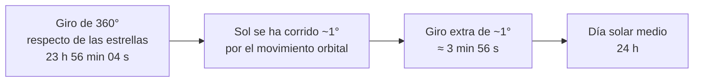

# B08-C05 — Tiempo sidéreo y solar

<!-- nav:top -->
[🏠 Programa](../../../../README.md) · [📚 Bloque B08](../../../tronco-comun/B08-observacion-del-cielo-y-astronomia-practica.md) · [← Anterior: B08-C04 — Altura y acimut](../B08-C04-altura-y-acimut/CLASE.md) · [Siguiente: B08-C06 — Constelaciones y catálogos estelares →](../B08-C06-constelaciones-y-catalogos-estelares/CLASE.md)
<!-- /nav -->

## 1. Ubicación, nivel y alcance

Quinta clase del bloque B08. Hasta ahora usaste el «tiempo sidéreo local» como un dato en [B08-C04](../B08-C04-altura-y-acimut/CLASE.md); ahora lo entiendes: por qué el cielo no vuelve a la misma posición a la misma hora del reloj, cuánto se adelanta cada noche y qué es el mediodía solar. Nivel N1.

Verás día solar y día sidéreo, tiempo sidéreo local, ecuación del tiempo y planificación de tránsitos. No verás escalas de tiempo precisas (UTC, TAI, TT), que son de B13.

## 2. Por qué esta clase existe

Si una estrella culmina a las 22:00 hoy, culminará a las 21:56 mañana. Quien no lo sabe «pierde» el objeto en pocas semanas. La pregunta motivadora es: **¿a qué hora de mi reloj estará mi objeto en el mejor lugar del cielo, dentro de tres semanas?** La decisión central: **planificar una observación con el tiempo sidéreo, no con la hora de la noche anterior**.

## 3. Lo que podrás hacer al terminar

1. Distinguir día solar de día sidéreo y dar la diferencia.
2. Explicar por qué un astro culmina unos 4 minutos antes cada día.
3. Calcular el tiempo sidéreo local a una hora UT y usarlo para ubicar el tránsito de un objeto.
4. Explicar qué es la ecuación del tiempo y por qué el mediodía solar no coincide con el mediodía del reloj.
5. Pasar de hora local a hora UT y registrar ambas.
6. Estimar el error de cada método.

La evidencia es el **reloj sidéreo** del ejercicio 12.

## 4. Con qué llegas y cómo comprobarlo

1. ¿Cuántos minutos son 0,0655 h? 2. ¿Cuántos grados gira la Tierra en 4 min, aproximadamente? 3. ¿Qué es el ángulo horario (C04)? 4. ¿Qué dice la ascensión recta de un astro sobre cuándo culmina (C03–C04)? 5. ¿Qué es UT?

<details><summary>Ver respuestas</summary>

1. 3,93 min. 2. 1° (15° por hora = 0,25° por minuto). 3. `H = TSL − α`: el ángulo desde el meridiano. 4. Culmina cuando el tiempo sidéreo local es igual a su AR. 5. El tiempo universal, la referencia horaria del Meridiano de Greenwich (se afina en B13).
</details>

## 5. Un caso real: el reloj del cielo la noche del 5 de noviembre de 2025

Retomas el valle del Elqui (`λ = −70,7°`, redondeada). A las 00:00 UT del 5 de noviembre, el tiempo sidéreo local fue `22,25 h` (laboratorio, simulado). La Luna tenía AR ≈ `2,06 h` (NASA, S1); por eso culminó unas horas después, hacia las 03:57 UT (C04). Dos amigos preguntan: «¿Y las Pléyades?». Sin necesitar sus datos exactos, sabes que su tránsito depende de su AR y del tiempo sidéreo. En esta clase fijas ese método.

## 6. Vocabulario

El **día solar** es el tiempo entre dos pasos consecutivos del Sol por el meridiano; el **día solar medio** dura 24 h. El **día sidéreo** es el tiempo entre dos pasos consecutivos de una misma estrella por el meridiano; el valor que da la NASA es de `23,9345 h` (S2). El **tiempo sidéreo local (TSL)** es el ángulo horario del punto vernal en tu lugar, expresado en horas; en el meridiano, el TSL es igual a la AR del astro que culmina. El **tiempo sidéreo de Greenwich (GMST)** es el TSL en longitud 0°; `TSL = GMST + λ` (λ hacia el este, en horas). La **ecuación del tiempo** es la diferencia entre el mediodía solar verdadero y el medio. La **hora UT** es el tiempo universal que se usa en el cálculo.

## 7. Modelo mental: dos relojes engranados

La Tierra gira 360° respecto de las estrellas en un día sidéreo. Pero también avanza por su órbita, y para que el Sol vuelva al meridiano debe girar un poco más: casi 1° más. Ese 1° de giro extra toma unos 4 min. En un año, la Tierra completa una vuelta alrededor del Sol, y el cielo estelar «gana» exactamente un día sidéreo respecto del reloj.



*Descripción textual:* un giro completo respecto de las estrellas dura casi 4 min menos que un día solar; el Sol, desplazado por la órbita de la Tierra, exige un giro extra de aproximadamente 1°.

**Analogía y su límite.** Es la aguja de las horas que se mueve mientras la de los minutos da una vuelta: la manecilla rápida necesita ir más lejos para alcanzarla. Falla en que el avance no es uniforme todo el año (ecuación del tiempo).

## 8. La explicación, paso a paso

### 8.1 Cuatro minutos por día

La NASA da el día sidéreo de la Tierra en `23,9345 h` y el día solar en `24,0000 h` (S2). La diferencia es `0,0655 h = 3,93 min`. El laboratorio calcula la duración del día sidéreo a partir de la tasa del tiempo sidéreo medio (1,0027379 vueltas por día solar): `23,93447 h = 23 h 56 min 04 s`, coincidente con la NASA dentro de su redondeo (0,0001 h). En 30 días, el cielo se adelanta `1,97 h`: un objeto que culminaba a medianoche culminará a las 22:00.

**Pausa.** Si una estrella culmina a las 23:00 hoy, ¿cuándo culmina dentro de 10 días? <details><summary>Respuesta</summary>`10 × 3,93 min = 39 min` antes: a las 22:21.</details>

### 8.2 Tiempo sidéreo local

Se calcula `GMST` a partir de la fecha y hora UT con una fórmula polinómica (coeficientes IAU 1982), y `TSL = GMST + λ`. A las 00:00 UT del 5 de noviembre de 2025: `GMST = 44,479° = 2,965 h` (valor de astropy copiado como prueba); con `λ = −70,7° = −4,713 h`: `TSL = 2,965 − 4,713 + 24 = 22,252 h`. El laboratorio confirma `22,252 h`.

### 8.3 Cuándo culmina un objeto

Un objeto de ascensión recta `α` culmina cuando `TSL = α`. Si `α = 2,0 h` y el TSL a 00:00 UT es `22,252 h`, faltan `2,0 − 22,252 + 24 = 3,748 h` sidéreas, que son `3,748 × 0,99727 = 3,738 h` solares: `03:44 UT`. Para la Luna (AR 2,06 h a 00:00 UT) el tránsito debería ser 04:00 UT; el barrido de C04 dio 03:57 UT porque la AR de la Luna sigue creciendo mientras tanto.

### 8.4 Mediodía solar y ecuación del tiempo

A `λ = −70,7°`, el **mediodía medio** es a `12 h + 70,7/15 h = 16:42:48 UT`. El Sol real cruza el meridiano cuando su AR iguala al TSL, y eso varía: el laboratorio (simulado, con prueba contra astropy) da 16:56:59 UT el 11 de febrero (−14,2 min respecto de la media), 16:39:09 el 14 de mayo (+3,6), 16:49:21 el 26 de julio (−6,6) y 16:26:24 el 5 de noviembre (+16,4, es decir, el Sol cruza 16 min *antes* del mediodía medio). Este desfase se llama **ecuación del tiempo** y ocurre porque la rapidez con que el Sol recorre el ecuador celeste no es constante (la causa, ligada a la elipticidad de la órbita y a la inclinación del eje, se estudia en B71 y B13; aquí es un resultado de cálculo). En C01 marcaste el mediodía con la sombra más corta: eso detecta el tránsito *real* del Sol, de modo que esta diferencia no te afecta; en cambio sí te afectaría si calcularas el mediodía como «las 12:00 más el desfase del lugar», con un error de hasta ±16 min.

## 9. Magnitudes, símbolos y unidades

| Símbolo | Qué es | Unidad | Nota |
|---|---|---|---|
| `GMST` | tiempo sidéreo de Greenwich | h (o °) | 1 h = 15° |
| `TSL` | tiempo sidéreo local | h | `GMST + λ/15` |
| `λ` | longitud (este +) | ° | −70,7° en el caso |
| `α` | ascensión recta | h | culmina si `TSL = α` |
| `EoT` | ecuación del tiempo | min | media − verdadera |

## 10. Convenciones y referencias

Longitud este positiva. Horas en UT. El día sidéreo de 23,9345 h es el valor de la NASA; el valor exacto del modelo es 23,93447 h. La relación entre hora local y UT depende de decretos de hora oficial que cambian; **no se consultó la vigente en Chile**, así que verifica el desfase actual y anota ambas horas en tu bitácora.

## 11. De dónde sale lo que afirmamos

| ID | Fuente | Localizador | Respalda | Consulta | Estado |
|---|---|---|---|---|---|
| S1 | NASA SVS 5415 (JPL DE421) | https://svs.gsfc.nasa.gov/5415/ ; `mooninfo_2025.txt` | AR de la Luna, 5-nov-2025 | 2026-11-05 | Datos leídos |
| S2 | NASA NSSDC, *Earth Fact Sheet* (act. 15-nov-2024) | https://nssdc.gsfc.nasa.gov/planetary/factsheet/earthfact.html | Rotación sidérea 23,9345 h; día 24,0000 h; órbita sidérea 365,256 d | 2026-11-05 | Página leída |
| S3 | USNO, *Rise, Set, and Twilight Definitions* | https://aa.usno.navy.mil/faq/RST_defs | Tránsito = paso por el meridiano; mediodía solar | 2026-11-05 | Página leída |
| S4 | astropy, documentación v8.0.2: «Coordinates» y «Solar System Ephemerides» | https://docs.astropy.org/en/stable/coordinates/ ; https://docs.astropy.org/en/stable/coordinates/solarsystem.html | Según la documentación, AltAz usa información de rotación terrestre y la efeméride integrada usa elementos orbitales aproximados (errores de unos segundos a ~1,5 minutos de arco según el planeta); uso en esta clase: GMST 44,47932° (2025-11-05 00 UT) y tránsitos solares en lon −70,7 (valores generados por nosotros con astropy 8.0.2 y pyerfa 2.0.1.5, no publicados) | 2026-11-05 | Documentación leída; valores ejecutados localmente |

Límites: la causa física de la ecuación del tiempo y la historia de la definición del segundo no se consultaron aquí. UT1 y UTC se tratan como iguales (error < 1 s).

## 12. Cómo ver el tiempo del cielo

Tabla de adelanto del cielo (modelo):

| Días | 1 | 10 | 30 | 91 | 365 |
|---|---|---|---|---|---|
| Adelanto | 3,93 min | 39 min | 1,97 h | 5,96 h | 23,9 h ≈ 1 día |

Sin ver: un reloj parlante a UT y una regla de cálculo táctil; o una app con lectura de pantalla que anuncie el TSL.

## 13. Ejemplo trabajado: ¿cuándo culmina un objeto de AR 5,5 h?

Dato: TSL a 00:00 UT del 5 de noviembre `= 22,252 h`. Faltan `5,5 − 22,252 + 24 = 7,248 h` sidéreas `= 7,248 × 0,99727 = 7,228 h` solares: culmina a las `07:14 UT`. Con `λ`: para obtener hora local suma el desfase oficial (verifícalo). **Paso final · incertidumbre.** Los datos de entrada (AR con 0,1 h de redondeo) dan ±6 min; el modelo de GMST aporta menos de 1 s; la hora de tu reloj, ±1 min. La incertidumbre dominante es tu dato de AR.

## 14. Comparación de métodos

La **fórmula de GMST** da el TSL en segundos de precisión; una **aplicación** o planisferio da el mismo dato con minutos de error; la **regla de 4 minutos por día** es la más simple y sirve en un rango de unas semanas desde una referencia. Un buen plan usa la fórmula una vez y la regla para extrapolar.

## 15. Práctica guiada

**Ejercicio 1.** Calcula la diferencia entre día solar y sidéreo con los valores de la NASA. *Pasos:* 8.1.

<details><summary>Solución comentada</summary>

`24,0000 − 23,9345 = 0,0655 h`; `0,0655 × 60 = 3,93 min`.
</details>

**Ejercicio 2.** Una estrella culmina a las 21:30 UT el 5 de noviembre. ¿A qué hora lo hará el 25 de noviembre? *Pista:* 20 días.

<details><summary>Solución comentada</summary>

`20 × 3,93 = 78,6 min`: culmina a las `21:30 − 1 h 19 min = 20:11 UT`.
</details>

**Ejercicio 3.** Con `TSL(00 UT) = 22,252 h`, ¿cuándo culmina un objeto de AR `2,0 h`? *Pasos:* 8.3.

<details><summary>Solución comentada</summary>

`3,748 h` sidéreas `= 3,738 h` solares: culmina a las `03:44 UT`.
</details>

## 16. Práctica autónoma, transferencia e integrador

**Ejercicio 4.** ¿Cuántos días sidéreos tiene un año sidéreo de 365,256 d (S2)?

<details><summary>Solución comentada</summary>

`365,256 × 24 / 23,9345 = 366,256`: un día sidéreo más que días solares, como dice el modelo mental.
</details>

**Ejercicio 5.** ¿Cuánto se adelanta el cielo en 91 días?

<details><summary>Solución comentada</summary>

`91 × 3,93 = 357,6 min ≈ 5,96 h`. Unas 6 horas por trimestre.
</details>

**Ejercicio 6.** Para `λ = −70,7°`, ¿cuánto vale el mediodía medio en UT? ¿Cuánto en tiempo solar medio local?

<details><summary>Solución comentada</summary>

`12 h + 70,7/15 h = 16,713 h = 16:42:48 UT`. El tiempo solar medio local es el que marcaría un reloj a 12:00 en ese instante; no coincide con la hora oficial, que depende de un decreto.
</details>

**Ejercicio 7.** El 5 de noviembre el Sol cruza el meridiano a las 16:26:24 UT. ¿Cuántos minutos antes del mediodía medio es?

<details><summary>Solución comentada</summary>

`16:42:48 − 16:26:24 = 16 min 24 s`. El Sol real va 16,4 min adelantado.
</details>

**Ejercicio 8.** Un objeto de AR `22,5 h`: ¿cuándo culmina el 5 de noviembre?

<details><summary>Solución comentada</summary>

`22,5 − 22,252 = 0,248 h` sidéreas `= 0,247 h = 14,8 min` después de las 00:00 UT: `00:15 UT`.
</details>

**Ejercicio 9 · transferencia.** Un aficionado dice «las Pléyades salen cada noche a la misma hora». Evalúalo.

<details><summary>Solución comentada</summary>

Falso: salen 3,93 min antes cada día. Tras un mes salen casi 2 h antes. La regla vale para el Sol (medio), no para las estrellas.
</details>

**Ejercicio 10 · transferencia.** Quieres observar un objeto de AR `5,5 h` cuando culmine pasadas las 22:00 UT. ¿Cuándo, aproximadamente, debes salir?

<details><summary>Solución comentada</summary>

Culmina a las 07:14 UT el 5 de noviembre y cada día lo hace 3,93 min antes. Para que culmine a las 22:00 UT (del día anterior en el ciclo) debe adelantarse `9 h 14 min = 554 min`, es decir, `554 / 3,93 ≈ 141 días`: hacia el 26 de marzo de 2026 (± 1 día).
</details>

**Ejercicio 11 · transferencia.** ¿Por qué usar UT y no la hora oficial local en los cálculos?

<details><summary>Solución comentada</summary>

La hora oficial cambia con decretos y estaciones; UT es continua y común, y evita errores de ±1 h. Registras la local solo como referencia, junto con el desfase usado.
</details>

**Ejercicio 12 · integrador.** Elabora un **reloj sidéreo** de una página: TSL a 00:00 UT para cada 5.º día de un mes, la hora UT en que culmina un objeto con AR conocida (con fuente) y la hora local que anotarías, con su incertidumbre.

<details><summary>Solución modelo</summary>

La tabla muestra el adelanto de 3,93 min por día, un cálculo manual del TSL (como en 8.2) comparado con el laboratorio o una aplicación, y la declaración de qué desfase horario se usó y de dónde salió. Se acepta cualquier objeto con fuente de coordenadas.
</details>

## 17. Laboratorio: [`tiempo.py`](tiempo.py)

**Requisitos:** Python 3.9 o superior y solo la biblioteca estándar; no hace falta instalar nada. Los valores de referencia de astropy 8.0.2 / pyerfa 2.0.1.5 están copiados en el código (no se importa astropy); para regenerarlos: `pip install astropy==8.0.2` (o `uv pip install astropy==8.0.2`). Los scripts comparten `programa/clases/B08/astrolib_b08.py`; si falta, Python avisa con un ImportError que nombra el módulo.

**Objetivo.** Comprobar el día sidéreo, el TSL y el tránsito solar. **Datos:** día sidéreo publicado (NASA) y tránsitos solares simulados. **Procedimiento:** `python tiempo.py`; se detiene si el día sidéreo difiere de 23,9345 h en más de 0,0001 h o si un tránsito solar difiere de astropy en más de 0,5 min. **Resultados reales (Python 3.12.9):**

```text
Día sidéreo (modelo): 23.93447 h = 23:56:04 | NASA: 23.9345 h
Día solar - día sidéreo: 3.9318 min = 235.9 s
Adelanto del cielo en 30 días solares: 1.966 h
2025-02-11: 16:56:59 UT | ecuación del tiempo -14.2 min
2025-05-14: 16:39:09 UT | ecuación del tiempo +3.6 min
2025-07-26: 16:49:21 UT | ecuación del tiempo -6.6 min
2025-11-05: 16:26:24 UT | ecuación del tiempo +16.4 min
TSL en lon -70,7 el 2025-11-05 00:00 UT: 22.252 h
```

**Límites:** UT1 ≈ UTC, GMST medio (sin nutación). **Sin código:** usa la regla de 4 minutos por día. **Sin equipo:** anota cuándo culmina una estrella detrás de un poste durante tres noches.

## 18. Errores frecuentes y cómo corregirlos

**Esperar que una estrella salga a la misma hora cada noche.** Ejercicio 9. **Mezclar horas sidéreas con solares.** Ejercicio 3. **Usar hora local en la fórmula.** Ejercicio 11. **Creer que el mediodía es siempre a las 12:00 locales.** Ejercicio 7. **Redondear el TSL a la hora y perder 15°.** Ejercicio 8.

## 19. Cómo sabrás que vas bien

Tras 8.1: ¿sabes la regla de los 4 minutos? Si no, ejercicio 2. Tras 8.3: ¿calculas un tránsito? Ejercicio 3. Tras 8.4: ¿sabes cuánto puede errar el mediodía medio? Ejercicio 7. Final: ¿tu reloj sidéreo declara qué desfase usó?

## 20. Qué entregas y cómo se evalúa

El **reloj sidéreo** (ejercicio 12).

| Criterio | Inicial | En desarrollo | Logrado | Destacado |
|---|---|---|---|---|
| Tiempo sidéreo | No lo calcula | Con errores | Correcto | Verifica con referencia |
| Tránsito | No lo predice | Aproximado | Correcto con incertidumbre | Lo comprueba con una observación |
| Horas | Mezcla UT y local | Declara una | Registra ambas | Documenta la fuente del desfase |
| Fuentes | Sin fuente | Sin fecha | Con fecha | Distingue publicado de simulado |

**Condiciones críticas:** declarar el desfase horario y su fuente; no atribuir a la NASA lo calculado aquí.

## 21. Ética, seguridad y límites

Planificar tránsitos implica salir de noche: avisa a alguien, lleva abrigo, linterna roja y agua, y ten un plan de regreso. No uses la hora de culminación del Sol para «mirarlo» sin protección: para ello usa la sombra o un visor solar certificado (ISO 12312-2; NASA, ver C16). Los cálculos son educativos y no reemplazan una efeméride oficial.

## 22. Para cerrar y seguir

El cielo avanza 3,93 min por día respecto del reloj porque el día sidéreo (23 h 56 min) es más corto que el solar. Con el tiempo sidéreo local calculas cuándo culmina cualquier objeto; con la ecuación del tiempo entiendes por qué el mediodía solar se mueve ±16 min. Queda abierta una pregunta: ¿cómo organizo los objetos del cielo para encontrarlos? (C06).

**Glosario español–inglés.** día sidéreo · *sidereal day*; día solar · *solar day*; tiempo sidéreo local · *local sidereal time*; ecuación del tiempo · *equation of time*; tránsito · *transit*; tiempo universal · *universal time*.

**Continuidad.** B08-C06 trata de constelaciones y catálogos; B08-C07 combina todo con planisferios y aplicaciones. B13 afinará las escalas de tiempo.

**Referencias:** ver sección 11.

<!-- nav:bottom -->
---

[← Anterior: B08-C04 — Altura y acimut](../B08-C04-altura-y-acimut/CLASE.md) · [📚 Bloque B08](../../../tronco-comun/B08-observacion-del-cielo-y-astronomia-practica.md) · [Siguiente: B08-C06 — Constelaciones y catálogos estelares →](../B08-C06-constelaciones-y-catalogos-estelares/CLASE.md)
<!-- /nav -->
