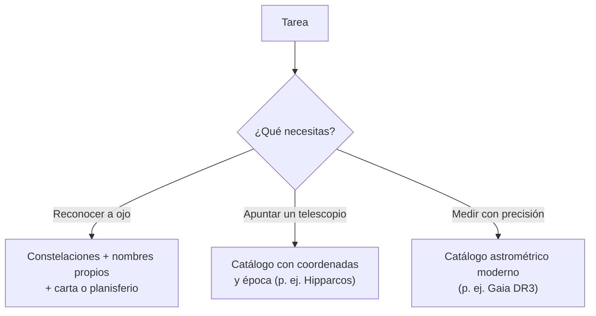

# B08-C06 — Constelaciones y catálogos estelares

<!-- nav:top -->
[🏠 Programa](../../../../README.md) · [📚 Bloque B08](../../../tronco-comun/B08-observacion-del-cielo-y-astronomia-practica.md) · [← Anterior: B08-C05 — Tiempo sidéreo y solar](../B08-C05-tiempo-sidereo-y-solar/CLASE.md) · [Siguiente: B08-C07 — Planisferios y aplicaciones celestes →](../B08-C07-planisferios-y-aplicaciones-celestes/CLASE.md)
<!-- /nav -->

## 1. Ubicación, nivel y alcance

Sexta clase del bloque B08. Ya sabes ubicar un punto del cielo con números (C03–C05); ahora aprendes a **nombrar** regiones y objetos de manera que otra persona, o un programa, entienda a cuál te refieres: constelaciones, nombres de estrellas, designaciones y catálogos. Nivel N1.

Verás qué es una constelación para la IAU, en qué se diferencia de un asterismo, cómo se identifica una estrella en un catálogo, qué contienen dos catálogos modernos (Hipparcos y Gaia) y cómo elegir el adecuado. No verás historia cultural del cielo (B02) ni fotometría (C11).

## 2. Por qué esta clase existe

Dos personas dicen «la estrella roja de la Cruz del Sur» y creen hablar de lo mismo; un programa de telescopio pide «HIP 12345». Sin un lenguaje común no puedes repetir una observación ni compartirla. La pregunta motivadora: **¿cómo identifico un objeto de forma inequívoca y sé en qué catálogo y época está su posición?** La decisión central: **elegir el catálogo adecuado a la tarea (reconocer a ojo, apuntar un telescopio, medir con precisión) y registrar su nombre, versión y época**.

## 3. Lo que podrás hacer al terminar

1. Explicar qué es una constelación en el sentido de la IAU y distinguirla de un asterismo.
2. Interpretar el formato de una designación (nombre propio, letra griega, número de catálogo).
3. Elegir entre un catálogo de ojo desnudo y uno de precisión según el objetivo.
4. Estimar cuántas fuentes de un catálogo caben en un campo de visión.
5. Registrar la identificación de un objeto con catálogo, versión, época y coordenadas.
6. Señalar lo que un catálogo no incluye (cobertura, brillo límite).

La evidencia es la **ficha de catálogo** del ejercicio 12.

## 4. Con qué llegas y cómo comprobarlo

1. ¿Qué dos números fijan una posición en la esfera celeste (C03)? 2. ¿Qué es una época (C03)? 3. ¿Cuántos grados cuadrados tiene una esfera? (`4π` estereorradianes ≈ 41 253 grados cuadrados.) 4. ¿Qué diferencia hay entre «observado» y «calculado»? 5. ¿Cuántas veces cabe un campo de 0,5° en 6,5° de ancho?

<details><summary>Ver respuestas</summary>

1. Ascensión recta y declinación. 2. La fecha a la que se refieren las coordenadas. 3. 41 253 (aprox.). 4. Observado: medido en el cielo; calculado: obtenido de un modelo. 5. 13 veces.
</details>

## 5. Un caso real: tres maneras de decir «la Cruz del Sur»

Sigues en el valle del Elqui, de noche. ESO la llama «la Cruz del Sur» y dice que su pie apunta siempre al polo sur celeste (S4); un colega te dice «mira esa estrella» y la nombra con un nombre propio tradicional, y un programa de telescopio acepta solo identificadores de catálogo. Los tres hablan de lo mismo con lenguajes distintos. En esta clase aprendes a traducir entre ellos y a anotar cuál usaste.

## 6. Vocabulario

Una **constelación** es, para la IAU, una de las 88 regiones en que se divide toda la esfera celeste, con límites definidos por líneas de ascensión recta y declinación (S1). Un **asterismo** es una figura reconocible de estrellas que no es una de las 88 (puede cruzar constelaciones o ser parte de una). Un **catálogo** es una lista de objetos con identificador, coordenadas y propiedades medidas. Un **identificador** es el código único de un objeto en un catálogo. La **magnitud límite** de un catálogo es el brillo mínimo que incluye (C11). Un **nombre propio** es un nombre de uso tradicional; una **designación** es un código sistemático.

## 7. Modelo mental: una guía de calles y un directorio

Las constelaciones son como los barrios de una ciudad: dividen todo el territorio sin dejar huecos. Los catálogos son directorios: cada entrada tiene un código, una posición y un contexto. Cuando una estrella tiene varios nombres, es como una persona con apodo, nombre legal y número de documento.



*Descripción textual:* la tarea decide el tipo de herramienta: para reconocer a ojo se usan constelaciones y cartas; para apuntar, un catálogo con coordenadas y época; para medir con precisión, un catálogo astrométrico moderno.

**Analogía y su límite.** Barrios y directorio de una ciudad. Falla porque los barrios están fijos en el mapa y las posiciones estelares se mueven lentamente (precesión, movimiento propio), de modo que hay que fijar una época.

## 8. La explicación, paso a paso

### 8.1 Las 88 constelaciones y sus límites

La IAU define 88 constelaciones. Eugène Delporte, del Observatorio Real de Bruselas, trazó sus límites con líneas de ascensión recta y declinación; la asamblea de 1928 en Leiden los aprobó y se publicaron en 1930; hoy se distribuyen en coordenadas J2000, y las estrellas variables conocidas se mantuvieron en la constelación en que ya estaban (S1). Dos consecuencias: toda posición del cielo cae en una, y solo una, constelación; y el nombre de una constelación sirve para *localizar* («está en…»), no para describir lo que es.

**Pausa.** Dos estrellas muy próximas, ¿pueden estar en constelaciones distintas? <details><summary>Respuesta</summary>Sí, si una línea de límite pasa entre ellas. Que estén cerca en el cielo no implica la misma constelación.</details>

### 8.2 Nombres y designaciones

Una misma estrella puede tener un nombre tradicional, una letra griega con la constelación (por ejemplo, «α Cru» para la más brillante de la Cruz) y un número de catálogo. Las **letras griegas** y los **números** se asignan por reglas de cada catálogo (no consultadas en detalle aquí). Lo importante para ti: al registrar un objeto, anota *todas* las que conozcas y el catálogo del que salieron, porque un programa solo entenderá algunas. Un nombre sin catálogo no es inequívoco.

### 8.3 Dos catálogos modernos

El catálogo **Hipparcos**, de la misión de la ESA, se publicó en su versión final en junio de 1997 (S2); sus identificadores van de «HIP 1» hasta «HIP 118322» (el rango de numeración que muestra la página, no el número de estrellas). **Gaia DR3** se liberó el 13 de junio de 2022 y contiene 1 811 709 771 fuentes; para unos 1 470 millones ofrece posiciones, paralajes y movimientos propios, la época de referencia es 2016,0 (S3). Para un observador a ojo, Gaia es un exceso; para medir la distancia a una estrella de forma moderna, es el estándar.

### 8.4 Cuántas fuentes caben en un campo

La esfera tiene `4π(180/π)² = 41 252,96` grados cuadrados. Con 1,81 × 10⁹ fuentes, Gaia DR3 promedia unas `43 900` por grado cuadrado (laboratorio, sección 17). Un campo de ocular de 0,5° (0,20 grados cuadrados) recibiría en promedio ~8600 fuentes; un campo de binoculares de 6,5° (33 grados cuadrados), ~1,5 millones. Son promedios: la densidad real es mucho mayor en el plano de la Vía Láctea y menor en los polos galácticos. El catálogo base de Stellarium (más de 600 000 estrellas, S5) da `~14,5` por grado cuadrado: ahí caben ~3 estrellas en el campo del ocular, un mapa legible para la vista.

## 9. Magnitudes, símbolos y unidades

| Símbolo | Qué es | Unidad | Nota |
|---|---|---|---|
| `N` | número de fuentes de un catálogo | adimensional | Gaia DR3: 1 811 709 771 |
| `Ω` | área de cielo | grados cuadrados | esfera completa: 41 252,96 |
| `ρ` | densidad media | fuentes/grado² | `N/Ω` |
| `época` | referencia temporal de las posiciones | año | Gaia DR3: 2016,0 |

## 10. Convenciones y referencias

Las constelaciones se escriben con su nombre en español en las clases; las abreviaturas de tres letras de la IAU no se desarrollan aquí. Las coordenadas se acompañan de su época. Los promedios sobre toda la esfera no representan la densidad de una región. Los catálogos pueden cambiar de versión: anota siempre la versión (Hipparcos 1997; Gaia DR3).

## 11. De dónde sale lo que afirmamos

| ID | Fuente | Localizador | Respalda | Consulta | Estado |
|---|---|---|---|---|---|
| S1 | IAU, *The Constellations* (FAQ) | https://www.iau.org/IAU/IAU/Astronomy-FAQs/Constellations.aspx | 88 constelaciones; Delporte; 1925/1928/1930; líneas de AR/Dec; J2000; variables | 2026-11-05 | Página leída |
| S2 | ESA, *Hipparcos and Tycho catalogues* | https://www.cosmos.esa.int/web/hipparcos/catalogues | Versión final de junio de 1997; numeración HIP hasta 118322 | 2026-11-05 | Página leída (no declara el número de estrellas) |
| S3 | ESA, *Gaia DR3* | https://www.cosmos.esa.int/web/gaia/dr3 | Liberación el 13-jun-2022; 1 811 709 771 fuentes; ~1,47 × 10⁹ con astrometría; época 2016,0 | 2026-11-05 | Página leída |
| S4 | ESO, «Navigating the stars» (18-oct-2024) | https://www.eso.org/public/blog/navigating-the-stars/ | Cruz del Sur; pie apunta al polo sur celeste | 2026-11-05 | Página leída (divulgativa) |
| S5 | Stellarium | https://stellarium.org/ | Catálogo por defecto de «más de 600 000 estrellas»; adicionales de más de 220 millones; constelaciones de más de 40 culturas | 2026-11-05 | Página leída |

Límites: no se consultaron las reglas de las designaciones de Bayer y Flamsteed, ni el número exacto de estrellas de Hipparcos, ni los límites numéricos de las 88 constelaciones.

## 12. Cómo ver el cielo organizado

Tabla de herramientas por tarea (versión accesible del diagrama):

| Tarea | Herramienta | Qué anotar |
|---|---|---|
| Reconocer a ojo | constelación + nombre propio | constelación, hora, lugar |
| Apuntar | catálogo con coordenadas | catálogo, ID, época |
| Medir | Gaia DR3 | ID Gaia, época 2016,0 |

Sin ver: el programa Stellarium y otros pueden leer en voz alta los nombres con un lector de pantalla y permiten enumerar los objetos de una constelación; una persona vidente puede describir la figura con una cuerda sobre una tabla.

## 13. Ejemplo trabajado: ¿cuántas fuentes tendré en un campo?

Quieres comparar dos catálogos para identificar una estrella en un campo de ocular de 0,5° de diámetro. Área: `π(0,25)² = 0,196` grados cuadrados. Gaia DR3: `0,196 × 43 917 = 8620` fuentes (promedio). Catálogo base de Stellarium: `0,196 × 14,5 = 2,9`. Con el segundo reconoces un patrón a ojo; con el primero mides con precisión pero necesitas filtrar por brillo (C11) o la lista es inmanejable. **Paso final · incertidumbre.** Los promedios no valen para una región concreta: cerca del plano galáctico pueden ser mucho mayores. Antes de planear, consulta el número real en el catálogo y anota la versión.

## 14. Comparación de métodos

La **constelación** localiza en una frase pero no da coordenadas. La **designación de catálogo** es inequívoca pero exige conocer el catálogo. Las **coordenadas** con época son lo más preciso, pero son frágiles si olvidas la época. Un buen registro usa las tres.

## 15. Práctica guiada

**Ejercicio 1.** ¿Cuántas constelaciones define la IAU y con qué líneas se trazan sus límites? *Pasos:* 8.1.

<details><summary>Solución comentada</summary>

88; con líneas de ascensión recta y declinación, publicadas en J2000 (S1).
</details>

**Ejercicio 2.** Calcula la densidad media de Gaia DR3 en fuentes por grado cuadrado. *Pasos:* 8.4.

<details><summary>Solución comentada</summary>

`1 811 709 771 / 41 252,96 = 43 917`. El laboratorio da el mismo valor.
</details>

**Ejercicio 3.** ¿Cuántas fuentes de Gaia, en promedio, hay en un campo de 6,5° de diámetro?

<details><summary>Solución comentada</summary>

Área `π(3,25)² = 33,18` grados cuadrados; `33,18 × 43 917 = 1,457 × 10⁶`. Es un promedio sobre todo el cielo.
</details>

## 16. Práctica autónoma, transferencia e integrador

**Ejercicio 4.** Calcula el cociente entre las fuentes de Gaia DR3 y las 600 000 estrellas del catálogo base de Stellarium (cota inferior).

<details><summary>Solución comentada</summary>

`1 811 709 771 / 600 000 ≈ 3020`. Como 600 000 es una cota inferior ("más de"), el cociente real es menor.
</details>

**Ejercicio 5.** La época de Gaia DR3 es 2016,0. ¿Cuánto vale aproximadamente el efecto de precesión entre J2000 y 2016,0 usando 0,0139° por año (C03)?

<details><summary>Solución comentada</summary>

`16 × 0,0139° = 0,22°`. Para un campo de 0,5° es casi la mitad: hay que declarar la época.
</details>

**Ejercicio 6.** Dos estrellas separadas por 0,2° pueden estar en constelaciones distintas. ¿Verdadero o falso? Justifica.

<details><summary>Solución comentada</summary>

Verdadero si una línea de límite pasa entre ellas (8.1). Los límites son líneas de AR/Dec sin relación con la cercanía física.
</details>

**Ejercicio 7.** ¿Qué debe contener la identificación de un objeto en tu bitácora? Enumera cuatro campos.

<details><summary>Solución comentada</summary>

Nombre o designación, catálogo y versión, época de las coordenadas y fecha de consulta (más las coordenadas mismas). Con eso otra persona puede repetirlo.
</details>

**Ejercicio 8.** Un catálogo dice «HIP 1 a HIP 118322» (S2). ¿Puedes concluir que contiene 118 322 estrellas?

<details><summary>Solución comentada</summary>

No: es un rango de numeración, y puede haber números sin objeto; la página no declara el total.
</details>

**Ejercicio 9 · transferencia.** Un compañero afirma «Gaia es mejor que Stellarium». ¿Cómo lo matizas?

<details><summary>Solución comentada</summary>

Depende de la tarea: Gaia tiene astrometría de precisión de ~1,5 × 10⁹ fuentes; Stellarium es un planetario que muestra el cielo de forma legible y puede incluir el catálogo ampliado (más de 220 millones adicionales, S5). Para reconocer a ojo basta el catálogo base; para medir distancias, Gaia.
</details>

**Ejercicio 10 · transferencia.** Stellarium muestra constelaciones de más de 40 culturas (S5). ¿Cómo lo reconcilias con las 88 de la IAU?

<details><summary>Solución comentada</summary>

Las 88 son la división convencional para el trabajo científico; las otras son sistemas propios de cada cultura y se estudian en B02 como saberes legítimos. Declara cuál usas.
</details>

**Ejercicio 11 · transferencia.** Quieres compartir la posición de un objeto débil. ¿Qué tres datos son indispensables además de las coordenadas?

<details><summary>Solución comentada</summary>

Época de las coordenadas, catálogo (con versión) y banda o tipo de magnitud. Sin esos datos, las coordenadas pueden diferir en décimas de grado (Ejercicio 5).
</details>

**Ejercicio 12 · integrador.** Elabora una **ficha de catálogo**: elige un catálogo y un objeto (con fuente verificada), anota identificadores, coordenadas, época, qué incluye y qué no, cuántas fuentes esperarías en tu campo de visión (con promedio y advertencia) y la licencia o condiciones de uso.

<details><summary>Solución modelo</summary>

La ficha cumple si el cálculo del número de fuentes usa el área del campo y la densidad con unidades correctas, declara la época y la versión, y señala al menos un límite del catálogo (cobertura, brillo límite). Se acepta cualquier catálogo con fuente consultada.
</details>

## 17. Laboratorio: [`densidad_de_catalogo.py`](densidad_de_catalogo.py)

**Objetivo.** Calcular cuántas fuentes de un catálogo caben, en promedio, en un campo. **Datos:** publicados (Gaia DR3, Stellarium); resultados calculados. **Procedimiento:** `python densidad_de_catalogo.py`; la prueba detiene el programa si el área de la esfera difiere de 41 252,96 grados cuadrados en más de 0,01. **Resultados reales (Python 3.12.9):**

```text
Área de la esfera celeste: 41252.96 grados cuadrados
Densidad media Gaia DR3: 43,917 fuentes por grado cuadrado
Densidad media catálogo base de Stellarium (cota inferior): 14.5 por grado cuadrado
Cociente Gaia / Stellarium base: 3,020
campo de ocular (0,5 grados): área 0.20 deg2 -> Gaia medio 8,623; Stellarium base 3
campo de 6,5 grados: área 33.18 deg2 -> Gaia medio 1,457,304; Stellarium base 483
```

**Límites:** promedios sobre toda la esfera; la aproximación plana del área del campo vale para campos pequeños. **Sin código:** repite los cálculos con calculadora. **Actividad de tarjetas:** escribe en tarjetas 10 objetos que conozcas con su nombre, constelación y catálogo; mezcla y pide a otra persona que los identifique solo con los datos de la tarjeta; anota los que no pudo.

## 18. Errores frecuentes y cómo corregirlos

**Creer que una constelación es una agrupación física.** Ejercicio 6. **Dar coordenadas sin época.** Ejercicios 5 y 11. **Confundir rango de numeración con tamaño del catálogo.** Ejercicio 8. **Usar el nombre de una estrella como identificador único.** Se corrige con el ejercicio 7. **Usar el promedio como valor local.** Se corrige con la sección 13.

## 19. Cómo sabrás que vas bien

Tras 8.1: ¿recuerdas cuántas son y cómo se trazan? Ejercicio 1. Tras 8.3: ¿distingues Hipparcos de Gaia en año y propósito? Si no, relee. Tras el ejemplo: ¿calculas la densidad en un campo distinto? Ejercicio 3. Final: ¿tu ficha dice versión y época?

## 20. Qué entregas y cómo se evalúa

La **ficha de catálogo** (ejercicio 12).

| Criterio | Inicial | En desarrollo | Logrado | Destacado |
|---|---|---|---|---|
| Identificación | Solo nombre | Con catálogo | Con catálogo, versión y época | La contrasta en dos catálogos |
| Cálculo de campo | No lo hace | Con errores | Correcto | Discute el caso real vs promedio |
| Límites | No los menciona | Menciona uno | Los explica | Propone cómo comprobarlos |
| Fuentes | Sin fuente | Sin fecha | Con fecha y estado | Indica licencia y uso |

**Condiciones críticas:** no inventar identificadores; citar solo lo consultado.

## 21. Ética, seguridad y límites

Las constelaciones y los nombres tienen dimensión cultural: la IAU fija una convención científica, no la única forma de leer el cielo (B02). Respeta licencias de catálogos y programas. Seguridad: esta clase se hace en casa o en campo; si sales de noche, aplica las reglas de C01 y C02 (terreno, abrigo, linterna roja, compañía). Nunca busques objetos cerca del Sol con instrumentos sin filtro certificado.

## 22. Para cerrar y seguir

Una constelación es un barrio del cielo con límites convenidos; un catálogo es un directorio con identificador, posición y época. Elige la herramienta según la tarea y registra siempre versión y época. Queda abierta una pregunta: ¿cómo se ve todo esto en un instrumento sencillo que combine fecha, hora y dirección? (C07).

**Glosario español–inglés.** constelación · *constellation*; asterismo · *asterism*; catálogo · *catalogue*; identificador · *identifier*; época · *epoch*; magnitud límite · *limiting magnitude*; movimiento propio · *proper motion*.

**Continuidad.** B08-C07 usa constelaciones y catálogos con planisferios y aplicaciones; B08-C11 define la magnitud y la magnitud límite.

**Referencias:** ver sección 11.

<!-- nav:bottom -->
---

[← Anterior: B08-C05 — Tiempo sidéreo y solar](../B08-C05-tiempo-sidereo-y-solar/CLASE.md) · [📚 Bloque B08](../../../tronco-comun/B08-observacion-del-cielo-y-astronomia-practica.md) · [Siguiente: B08-C07 — Planisferios y aplicaciones celestes →](../B08-C07-planisferios-y-aplicaciones-celestes/CLASE.md)
<!-- /nav -->
