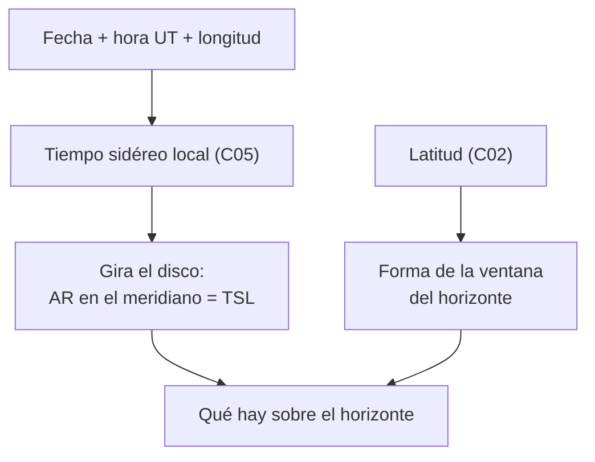

# B08-C07 — Planisferios y aplicaciones celestes

<!-- nav:top -->
[🏠 Programa](../../../../README.md) · [📚 Bloque B08](../../../tronco-comun/B08-observacion-del-cielo-y-astronomia-practica.md) · [← Anterior: B08-C06 — Constelaciones y catálogos estelares](../B08-C06-constelaciones-y-catalogos-estelares/CLASE.md) · [Siguiente: B08-C08 — Fases lunares y libración →](../B08-C08-fases-lunares-y-libracion/CLASE.md)
<!-- /nav -->

## 1. Ubicación, nivel y alcance

Séptima clase del bloque B08. Reúnes lo que aprendiste (horizonte, coordenadas, altura y acimut, tiempo sidéreo, catálogos) en dos herramientas que responden «¿qué hay en el cielo ahora?»: el **planisferio** de papel y las **aplicaciones** de planetario. Nivel N1.

Verás cómo funciona un planisferio, cómo se reproduce su lógica con tiempo sidéreo, qué hacen y qué no hacen las aplicaciones, y cómo comprobar sus resultados. No verás todavía planificación de campañas (C20).

## 2. Por qué esta clase existe

Una herramienta que no entiendes es una caja negra: si la aplicación se equivoca de ubicación o de hora, no lo notarás. La pregunta motivadora: **¿puedo confiar en lo que me muestra la herramienta, y qué hago si no hay batería?** La decisión central: **elegir entre papel y aplicación según la situación y verificar su resultado con un dato independiente**.

## 3. Lo que podrás hacer al terminar

1. Explicar cómo un planisferio alinea fecha y hora y por qué es específico de una latitud.
2. Calcular qué ascensión recta culmina a una fecha y hora dadas, y qué parte del ecuador celeste está sobre el horizonte.
3. Usar un planisferio o una aplicación para decidir qué observar.
4. Verificar la salida de una aplicación con un cálculo o una posición conocida.
5. Evaluar riesgos de las aplicaciones: ubicación, hora, brújula, batería, luz y privacidad.
6. Elegir la herramienta adecuada para una situación dada.

La evidencia es el **planisferio propio** del ejercicio 12.

## 4. Con qué llegas y cómo comprobarlo

1. ¿Qué ascensión recta culmina cuando el TSL vale 22,25 h (C05)? 2. ¿A cuántos grados por día se «mueve» el cielo respecto del reloj? 3. ¿Cuál es el ángulo horario de un astro que está en el horizonte este sobre el ecuador celeste? 4. ¿De qué depende que un astro sea circumpolar (C02)? 5. ¿Por qué se trabaja en UT (C05)?

<details><summary>Ver respuestas</summary>

1. 22,25 h. 2. ≈ 0,986°, unos 3,93 min por día. 3. −6 h (el astro se pone a +6 h). 4. De su declinación y de tu latitud. 5. Para evitar los cambios de hora oficial.
</details>

Con cuatro o cinco aciertos, sigue; con tres o menos, repasa C02 a C05.

## 5. Un caso real: ¿qué había sobre el horizonte esa noche?

Sigues en el valle del Elqui, el 5 de noviembre de 2025. A las 00:00 UT el tiempo sidéreo local era `22,25 h` (C05). Con eso, un planisferio te diría qué ascensiones rectas están sobre el horizonte; la Luna (AR 2,06 h, S1) estaba al este, subiendo hacia 17,6° de altura (C04). Compararás lo que da la herramienta con lo que ya sabes de esa noche.

## 6. Vocabulario

Un **planisferio** (carta celeste giratoria) tiene un disco con el mapa del cielo y una máscara con una ventana ovalada que representa el horizonte; al girar el disco hasta alinear fecha y hora, la ventana deja ver lo que está sobre el horizonte. Una **aplicación de planetario** es un programa que calcula posiciones y las dibuja para tu lugar y hora; **Stellarium**, por ejemplo, es un planetario libre que muestra el cielo como se vería a ojo, con binoculares o con telescopio, con varias bases de estrellas y constelaciones de más de 40 culturas (S2). Un **modo nocturno rojo** reduce el brillo y evita deslumbrar los ojos. La **hora oficial** es la del reloj civil y no la del cálculo.

## 7. Modelo mental: dos discos y un reloj sidéreo

El disco del mapa representa la esfera celeste en AR y Dec (C03); la máscara representa tu horizonte, que depende de tu latitud (C02). Girar el disco es lo mismo que cambiar el tiempo sidéreo: la ascensión recta que queda en el meridiano es el TSL. La escala de fecha y la de hora son una forma de pedir ese TSL sin calcularlo: cada día el disco debe adelantarse 0,986°.



*Descripción textual:* la fecha, la hora y la longitud dan el tiempo sidéreo local, que orienta el disco; la latitud determina la ventana del horizonte; juntos muestran lo que está sobre el horizonte.

**Analogía y su límite.** Es como un reloj de arena donde la ventana muestra lo que ha caído. Falla porque un planisferio muestra el cielo a una latitud; fuera de esa latitud la ventana ya no coincide con tu horizonte.

## 8. La explicación, paso a paso

### 8.1 Cómo funciona el planisferio

El disco rota 360° en un año; la escala de fecha da cuenta del adelanto de 0,986° por día (C05) y la escala horaria da cuenta de 15° por hora. La ventana tiene la forma del horizonte para una latitud determinada: el polo visible queda a una altura igual a la latitud (C02). Los objetos cerca del polo sur celeste, sobre el límite `δ ≤ −60°` en `φ = −30°`, permanecen siempre dentro de la ventana (circumpolares).

**Pausa.** Si usas un planisferio hecho para −45° en tu lugar a −30°, ¿cuánto se equivoca la altura del polo? <details><summary>Respuesta</summary>15°: el polo estaría dibujado a 45° y en tu cielo está a 30°.</details>

### 8.2 Reproducirlo con tiempo sidéreo

El programa del laboratorio calcula el TSL y la banda del ecuador celeste que está sobre el horizonte. Un punto del ecuador está en el horizonte este cuando su AR es `TSL + 6 h` y en el oeste cuando es `TSL − 6 h` (porque el ángulo horario es −6 h y +6 h). Resultados (simulados): el 5 de noviembre de 2025 a las 00:00 UT, `TSL = 22,252 h`, el este está en `AR 4,25 h` y el oeste en `16,25 h`; a las 04:00 UT, `TSL = 2,263 h`, este `8,26 h`, oeste `20,26 h`. El tramo visible del ecuador celeste es el que va de la AR del oeste a la del este pasando por la AR del meridiano (el TSL): 12 h en total.

### 8.3 Las aplicaciones: qué hacen y qué no

Una aplicación como Stellarium (S2) calcula con tu ubicación y hora y dibuja el cielo, con catálogo base de más de 600 000 estrellas y catálogos adicionales de más de 220 millones (S2). Hace bien lo que hacen las fórmulas de C03 a C05; hace mal lo que depende de datos externos: si la **ubicación** es incorrecta, si la **hora** del dispositivo se ha desajustado o si la **brújula** no está calibrada (C01), el cielo dibujado no coincide con el real. Además, no sabe de nubes ni de tu horizonte local.

### 8.4 Cómo verificar una herramienta

Elige un dato independiente: la Luna a las 00:00 UT del 5 de noviembre de 2025 debía estar a ~17,6° de altura y acimut ~58° (C04). Si tu aplicación, con la ubicación y hora ajustadas, da algo muy distinto, hay un error de configuración. La comprobación más simple es identificar a ojo dos objetos que ya conozcas y verificar que están donde la aplicación dice.

## 9. Magnitudes, símbolos y unidades

| Símbolo | Qué es | Unidad | Nota |
|---|---|---|---|
| `TSL` | tiempo sidéreo local | h | = AR en el meridiano |
| `α_E`, `α_O` | AR del ecuador en el horizonte este / oeste | h | `TSL ± 6 h` |
| `φ` | latitud | ° | la ventana depende de ella |
| `UT` | tiempo universal | h | sin cambios de horario |

## 10. Convenciones y referencias

Planisferio y aplicación usan hora local u oficial; el cálculo y la bitácora, UT. Un planisferio indica su latitud de diseño: léela. El modo rojo se usa para preservar la visión nocturna. La licencia y el uso de datos (ubicación) de cada aplicación deben revisarse antes de instalar; no se evaluaron aquí.

## 11. De dónde sale lo que afirmamos

| ID | Fuente | Localizador | Respalda | Consulta | Estado |
|---|---|---|---|---|---|
| S1 | NASA SVS 5415 (JPL DE421) | https://svs.gsfc.nasa.gov/5415/ ; `mooninfo_2025.txt` | Posición de la Luna el 5-nov-2025 | 2026-11-05 | Datos leídos |
| S2 | Stellarium | https://stellarium.org/ | Planetario libre y de código abierto; ojo desnudo, binoculares o telescopio; catálogo base de más de 600 000 estrellas; más de 220 millones adicionales; constelaciones de más de 40 culturas | 2026-11-05 | Página leída (no nombra la licencia) |
| S3 | astropy 8.0.2 / pyerfa 2.0.1.5 | https://www.astropy.org | GMST usado como prueba en `astrolib_b08.py` | 2026-11-05 | Ejecutado localmente |

Límites: no se probó ninguna aplicación; el funcionamiento del planisferio físico se describe desde la geometría de C02–C05 y no desde la documentación de un fabricante. El modo nocturno rojo es una práctica general sin fuente en esta clase.

## 12. Cómo usar el planisferio y la aplicación

Tabla de situaciones:

| Situación | Mejor herramienta | Por qué |
|---|---|---|
| Sin batería ni cobertura | Planisferio | No depende de energía |
| Planificar una noche con muchos objetos | Aplicación | Calcula posiciones y horas |
| Grupo en la oscuridad | Planisferio con luz roja | No deslumbra |
| Persona ciega | Aplicación con lector de pantalla, o lista de objetos con alturas y acimuts hablada | Información en forma auditiva |

## 13. Ejemplo trabajado: el cielo de las 04:00 UT

Para el 5 de noviembre a las 04:00 UT, `TSL = 2,263 h` (simulado). El meridiano pasa por AR 2,26 h: allí culmina un objeto de AR 2,26 h; la Luna (AR 2,23 h a esa hora, S1) está casi en el meridiano, a 42° (C04). El horizonte este corta el ecuador en AR 8,26 h y el oeste en 20,26 h: sobre el horizonte queda el ecuador entre 20,26 h y 8,26 h pasando por 0 h y 2,26 h (el meridiano). Los objetos cercanos a AR 8,26 h están saliendo y los cercanos a 20,26 h se están poniendo. **Paso final · incertidumbre.** El modelo tiene una precisión de segundos en TSL; tu hora de reloj y tu ubicación aportan más error. Un error de 1 min en la hora cambia el TSL en 4 s y la posición en 0,25°.

## 14. Comparación de métodos

El **planisferio** no necesita energía, enseña la lógica del cielo, pero es poco preciso (2° a 5°) y está atado a una latitud. La **aplicación** es precisa y flexible, pero depende de configuración, energía y pantalla. El **cálculo** (C04–C05) es el más trazable. Un observador competente conoce los tres.

## 15. Práctica guiada

**Ejercicio 1.** A las 04:00 UT del 5 de noviembre, `TSL = 2,263 h`. ¿Qué AR del ecuador está en el horizonte este y en el oeste? *Pasos:* 8.2.

<details><summary>Solución comentada</summary>

Este: `2,263 + 6 = 8,263 h`. Oeste: `2,263 − 6 = −3,737 → 20,263 h`.
</details>

**Ejercicio 2.** A las 00:00 UT (`TSL = 22,252 h`), ¿está sobre el horizonte un punto del ecuador con AR 5 h? *Pista:* ángulo horario `H = TSL − α`.

<details><summary>Solución comentada</summary>

`H = 22,252 − 5 = 17,252 h = −6,748 h`. El valor es menor que −6 h: aún no sale. Saldrá en `0,748 h` sidéreas.
</details>

**Ejercicio 3.** La Luna (AR 2,06 h) a las 00:00 UT, ¿está al este o al oeste del meridiano?

<details><summary>Solución comentada</summary>

`H = 22,252 − 2,063 = 20,19 h = −3,81 h`: al este, antes del tránsito, coherente con 17,6° de altura y acimut 58° (C04).
</details>

## 16. Práctica autónoma, transferencia e integrador

**Ejercicio 4.** Calcula el TSL a las 22:00 UT del 5 de diciembre de 2025, sabiendo que a las 00:00 UT de ese día vale `0,223 h`. *Pista:* en 22 h solares, el TSL avanza `22 × 1,0027379 h`.

<details><summary>Solución comentada</summary>

`0,223 + 22 × 1,0027379 = 0,223 + 22,0602 = 22,283 h`.
</details>

**Ejercicio 5.** ¿Cuántos grados debe girar el disco por día para seguir el cielo? ¿A cuántos minutos de hora equivale?

<details><summary>Solución comentada</summary>

`360° / 365,256 d = 0,9856°` por día; a 15° por hora, `0,9856/15 × 60 = 3,94 min`. Concuerda con C05.
</details>

**Ejercicio 6.** ¿Cuántas horas de AR del ecuador celeste hay sobre el horizonte en cualquier instante?

<details><summary>Solución comentada</summary>

12 h: de `TSL − 6 h` a `TSL + 6 h` por el meridiano (el ecuador celeste está siempre 12 h sidéreas sobre el horizonte, C02).
</details>

**Ejercicio 7.** Un objeto de `δ = −65°`, ¿estará en tu ventana del planisferio de −30° a cualquier hora?

<details><summary>Solución comentada</summary>

Sí: `δ = −65° ≤ −60°` es circumpolar a −30° (C02, laboratorio). Siempre está sobre el horizonte.
</details>

**Ejercicio 8.** Tu aplicación muestra la Luna a 40° de altura a las 00:00 UT del 5 de noviembre de 2025 desde el valle del Elqui. ¿Qué haces?

<details><summary>Solución comentada</summary>

Compara con 17,6° (C04). La diferencia (22°) es mayor que cualquier efecto (paralaje ≤ 1°, refracción pequeña): revisa ubicación, hora y fecha del dispositivo, y que la zona horaria sea correcta.
</details>

**Ejercicio 9 · transferencia.** Elige herramienta para: (a) una noche fría con la batería agotada; (b) una salida de grupo con niños; (c) preparar 10 objetos para la semana. Justifica.

<details><summary>Solución comentada</summary>

(a) Planisferio (no usa energía). (b) Planisferio con luz roja o aplicación en modo rojo con brillo mínimo. (c) Aplicación o cálculo con tabla. Se valora declarar la dependencia de cada elección.
</details>

**Ejercicio 10 · transferencia.** Una aplicación pide acceso permanente a tu ubicación. ¿Qué alternativa tienes y qué pierdes?

<details><summary>Solución comentada</summary>

Ingresar la ubicación manualmente con 0,1° de precisión (≈ 11 km, cambia la hora de culminación en menos de 30 s y las alturas en menos de 0,1°). Pierdes comodidad, no precisión útil.
</details>

**Ejercicio 11 · transferencia.** ¿Qué ocurre si usas un planisferio diseñado para el hemisferio norte en Chile?

<details><summary>Solución comentada</summary>

La ventana dibuja el polo norte elevado y el cielo sur no aparece completo: no coincide con tu horizonte (C02); los astros australes, como los circumpolares de Chile, no se ven en la carta. Debes usar uno diseñado para tu latitud.
</details>

**Ejercicio 12 · integrador.** Construye tu **planisferio propio**: un disco con una escala de AR de 0 h a 24 h, una escala de fechas y una máscara para tu latitud; verifica con tres puntos del laboratorio (TSL, este, oeste) y con la Luna del 5 de noviembre.

<details><summary>Solución modelo</summary>

Se acepta papel, cartón o una hoja de cálculo. Cumple si las tres comprobaciones coinciden (±0,3 h) con la tabla del laboratorio, si declara la latitud y si incluye una alternativa accesible (relieve táctil o tabla hablada).
</details>

## 17. Laboratorio: [`planisferio_digital.py`](planisferio_digital.py)

**Objetivo.** Reproducir la lógica del planisferio. **Datos:** simulados (calculados) para `φ = −30,0°`, `λ = −70,7°`. **Procedimiento:** `python planisferio_digital.py`; la prueba comprueba que la AR del meridiano es el TSL, que el ecuador toca el horizonte en el este y el oeste exactos y que el límite circumpolar es −60°. **Resultados reales (Python 3.12.9):**

```text
2025-11-05 00.0 UT | 22.252 h | AR este 4.25 h / oeste 16.25 h
2025-11-05 04.0 UT |  2.263 h | AR este 8.26 h / oeste 20.26 h
2025-11-05 08.0 UT |  6.274 h | AR este 12.27 h / oeste 0.27 h
2025-11-20 00.0 UT | 23.238 h | AR este 5.24 h / oeste 17.24 h
2025-12-05 00.0 UT |  0.223 h | AR este 6.22 h / oeste 18.22 h
Circumpolares en lat -30: dec <= -60; no salen: dec > 60
```

**Límites:** ecuador celeste solamente; sin refracción. **Sin código:** el disco de papel con la tabla. **Sin equipo:** una linterna roja y la lista de la tabla.

## 18. Errores frecuentes y cómo corregirlos

**Usar un planisferio de otra latitud.** Ejercicio 11. **Fiarse de la aplicación sin verificar la hora.** Ejercicio 8. **Confundir AR del meridiano con AR del horizonte.** Ejercicio 1. **Dejar la pantalla a todo brillo.** Se corrige con el modo rojo (sección 12). **Aceptar permisos sin pensar.** Ejercicio 10.

## 19. Cómo sabrás que vas bien

Tras 8.2: ¿calculas el este del ecuador sin mirar? Ejercicio 1. Tras 8.4: ¿tienes un dato independiente para verificar? Si no, usa la Luna de C04. Final: ¿tu planisferio se verificó con tres puntos?

## 20. Qué entregas y cómo se evalúa

El **planisferio propio** (ejercicio 12).

| Criterio | Inicial | En desarrollo | Logrado | Destacado |
|---|---|---|---|---|
| Construcción | Sin escalas | Escalas con error | Escalas correctas | Con latitud declarada |
| Verificación | Ninguna | Con un punto | Con tres puntos | Con un dato independiente |
| Herramientas | Solo una | Compara dos | Elige según la situación | Evalúa riesgos |
| Accesibilidad | Ninguna | Menciona | Alternativa | La prueba |

**Condiciones críticas:** declarar qué es simulado; no configurar permisos sin evaluar privacidad.

## 21. Ética, seguridad y límites

La luz de la pantalla deslumbra a quienes observan; usa modo rojo y brillo mínimo, y respeta la oscuridad de los demás. Cuida tus datos: concede la ubicación solo si hace falta y desactívala después. Seguridad en campo: terreno reconocido de día, abrigo, linterna roja, compañía y plan de regreso. Nunca dirijas un dispositivo con cámara al Sol para «buscarlo»; el Sol exige filtro certificado (ISO 12312-2; NASA) y una aplicación no sustituye ese filtro (C16). La herramienta es educativa, no un instrumento de navegación.

## 22. Para cerrar y seguir

Un planisferio es un reloj sidéreo de papel: gira el mapa con la fecha y la hora y recorta con tu horizonte. Una aplicación hace lo mismo con más datos y más dependencia. Lo importante es poder verificar el resultado con un dato independiente. Queda abierta una pregunta: ¿cómo cambia el aspecto de la Luna en esas noches? (C08).

**Glosario español–inglés.** planisferio · *planisphere / star wheel*; modo rojo · *red mode*; planetario · *planetarium software*; ventana del horizonte · *horizon window*; hora oficial · *civil time*.

**Continuidad.** B08-C08 estudia las fases de la Luna y su libración con los datos de la NASA que viste aquí.

**Referencias:** ver sección 11.

<!-- nav:bottom -->
---

[← Anterior: B08-C06 — Constelaciones y catálogos estelares](../B08-C06-constelaciones-y-catalogos-estelares/CLASE.md) · [📚 Bloque B08](../../../tronco-comun/B08-observacion-del-cielo-y-astronomia-practica.md) · [Siguiente: B08-C08 — Fases lunares y libración →](../B08-C08-fases-lunares-y-libracion/CLASE.md)
<!-- /nav -->
