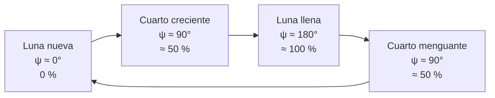

# B08-C08 — Fases lunares y libración

<!-- nav:top -->
[🏠 Programa](../../../../README.md) · [📚 Bloque B08](../../../tronco-comun/B08-observacion-del-cielo-y-astronomia-practica.md) · [← Anterior: B08-C07 — Planisferios y aplicaciones celestes](../B08-C07-planisferios-y-aplicaciones-celestes/CLASE.md) · [Siguiente: B08-C09 — Eclipses y geometría de sombras →](../B08-C09-eclipses-y-geometria-de-sombras/CLASE.md)
<!-- /nav -->

## 1. Ubicación, nivel y alcance

Octava clase del bloque B08 y cierre del tramo de «cielo y tiempo». Has seguido a la Luna del 5 de noviembre de 2025 en C03 a C07; ahora explicas **por qué cambia su forma, cuánto de ella ves y por qué te muestra casi siempre la misma cara**. Nivel N1.

Verás la geometría Sol–Tierra–Luna, el porcentaje de superficie iluminada, el período sinódico, el tamaño aparente y la libración. No verás eclipses (C09) ni mareas (B05 y siguientes).

## 2. Por qué esta clase existe

La Luna es el primer blanco de cualquier observación y el principal enemigo de las observaciones de objetos débiles (C12). Saber su fase y cuándo está en el cielo es parte de toda planificación. La pregunta motivadora: **¿qué fase tendrá la Luna esa noche y cuánto estorbará o ayudará?** La decisión central: **elegir fechas de observación según la fase (Luna nueva para cielo oscuro, cuartos para ver relieve, llena para luz y fotografía)**.

## 3. Lo que podrás hacer al terminar

1. Explicar las fases como el efecto de ver desde la Tierra una Luna siempre iluminada a medias.
2. Calcular el porcentaje iluminado desde la geometría y compararlo con una tabla de la NASA.
3. Distinguir período sinódico y sidéreo y derivar uno desde el otro.
4. Calcular el diámetro angular de la Luna a partir de su distancia.
5. Explicar la rotación sincrónica y la libración, con sus magnitudes de 2025.
6. Planificar una observación según la fase.

La evidencia es el **diario lunar** del ejercicio 12.

## 4. Con qué llegas y cómo comprobarlo

1. ¿Cuántos grados gira la Luna respecto de las estrellas en un día, si da la vuelta en 27,3 d? 2. ¿Qué es la elongación (separación angular Luna–Sol, C03)? 3. ¿Cuánto vale `(1 + cos 0°)/2`? 4. ¿Qué es la paralaje (C03)? 5. ¿Qué ángulo subtiende un objeto de 3475 km a 384 400 km (en radianes, aprox.)?

<details><summary>Ver respuestas</summary>

1. ≈ 13,2°. 2. El ángulo entre las direcciones a la Luna y al Sol. 3. 1. 4. El cambio de dirección por mirar desde lugares distintos. 5. `3475 / 384 400 ≈ 0,00904 rad ≈ 0,52°`.
</details>

Con cuatro o cinco aciertos, sigue; con tres o menos, repasa C03 y B01-C04.

## 5. Un caso real: de la Luna llena del 5 al cuarto menguante del 12 de noviembre

La tabla de la NASA (S1) indica que a las 12:00 UT del 5 de noviembre de 2025 la Luna estaba 99,86 % iluminada (elongación ≈ 176°, a 357 024 km: cerca del perigeo, con diámetro de 2007,5″). Siete días después, a las 00:00 UT del 12, estaba 52,54 % iluminada (≈ cuarto menguante, a 382 513 km). El 20 de noviembre a las 06:00 UT, solo 0,18 %: Luna nueva. Ese es el hilo conductor de la clase.

## 6. Vocabulario

La **fase** es la fracción del disco lunar que ves iluminada; se da como porcentaje de 0 % (nueva) a 100 % (llena). La **elongación** `ψ` es la separación angular entre la Luna y el Sol en el cielo. El **ángulo de fase** `i` es el ángulo Sol–Luna–Tierra visto desde la Luna. **Creciente** es el tramo de Luna nueva a llena; **menguante**, de llena a nueva. El **período sinódico** es el tiempo entre dos fases iguales (≈ 29,53 d, S2); el **período sidéreo** es el tiempo para dar una vuelta respecto de las estrellas (27,3217 d, S2). La **rotación sincrónica** es que la Luna gira sobre su eje una vez por cada vuelta alrededor de la Tierra, por lo que muestra siempre la misma cara; la **libración** son pequeños balanceos que dejan ver algo más de la mitad (S3). El **diámetro angular** es el ángulo que subtiende su disco.

## 7. Modelo mental: media Luna siempre iluminada

El Sol ilumina siempre media Luna (la que lo mira). Desde la Tierra ves una parte de esa mitad, que depende de dónde esté la Luna en su órbita. Luna nueva: el lado iluminado mira lejos de ti. Luna llena: lo ves entero. Entre ambos, cuartos. La fase no depende de la sombra de la Tierra (eso son los eclipses, C09).



*Descripción textual:* el ciclo va de Luna nueva (elongación cercana a 0°) a cuarto creciente (90°), Luna llena (180°), cuarto menguante (de nuevo 90°) y vuelta a la nueva.

**Analogía y su límite.** Es una pelota iluminada por una linterna mientras caminas a su alrededor. Falla porque la Luna también orbita con la Tierra alrededor del Sol, y el período entre fases (sinódico) no es el de una vuelta respecto de las estrellas.

## 8. La explicación, paso a paso

### 8.1 Del ángulo de fase al porcentaje iluminado

Si la fracción iluminada es `k = (1 + cos i)/2` y `i ≈ 180° − ψ`, entonces `k ≈ (1 − cos ψ)/2`. Con la elongación del 5 de abril de 2025 (`ψ = 88,8°`): `k ≈ (1 − 0,0209)/2 = 48,95 %`, cerca del 49,12 % de la NASA. La diferencia se debe a que el Sol está a una distancia finita: el ángulo de fase exacto es `tan i = R sen ψ / (d − R cos ψ)`, con `R` la distancia al Sol y `d` la de la Luna. El laboratorio usa esa forma y reproduce las ocho filas de la NASA con una diferencia máxima de 0,02 puntos porcentuales.

**Pausa.** ¿Qué fase tiene la Luna con `ψ = 90°` exacto? <details><summary>Respuesta</summary>≈ 50 % (con corrección por la distancia finita al Sol, 49,x %): es el cuarto creciente o menguante.</details>

### 8.2 Períodos sidéreo y sinódico

La Luna da una vuelta respecto de las estrellas en 27,3217 d (S2), pero para repetir su posición respecto del Sol debe girar un poco más, porque la Tierra avanza en su órbita (365,256 d, S4). Entonces `1/P_sin = 1/P_sid − 1/P_Tierra`: `1/27,3217 − 1/365,256 = 0,033864`; `P_sin = 29,5306 d`, que coincide con los 29,53 d de la NASA. En las tablas de 2025 las 11 lunaciones entre las lunas nuevas del 29 de enero y del 20 de diciembre promedian 29,51 d (con tiempos leídos al hora); cada lunación individual varía en horas porque la órbita no es circular.

### 8.3 Cuánto mide la Luna en el cielo

El diámetro angular es `θ = 2 arctan(R_L/d)`, con `R_L = 1737,4 km` (S2). A 380 413 km (5 de abril): `θ = 1884,1″`, igual que en la tabla de la NASA. Durante 2025 la distancia varió entre 356 830 y 406 690 km y el diámetro entre 1762,3″ y 2008,6″, una variación de 14 % (el 5 de noviembre estaba cerca del máximo). El Sol mide entre 1887″ y 1952″ (S5): según la Luna esté lejos o cerca, puede quedar menor o mayor que el Sol (eso decide eclipses totales o anulares, C09).

### 8.4 Libración

Como la rotación es sincrónica, ves siempre la misma cara, pero las tablas de la NASA muestran el punto de la Luna que mira a la Tierra (el «punto subterrestre») moviéndose: en 2025 su longitud selenográfica varió entre −7,7° y +8,0°, y su latitud entre −6,8° y +6,9°. Esos balanceos (libración) permiten ver unos grados más allá del borde y explican que se vea «un poco más de la mitad» de la superficie (S3). La causa del vaivén (una órbita no circular e inclinada, y la inclinación del eje) es una explicación estándar que no se consultó en una fuente de esta clase y se verá en B41.

## 9. Magnitudes, símbolos y unidades

| Símbolo | Qué es | Unidad | Nota |
|---|---|---|---|
| `ψ` | elongación Luna–Sol | ° | 0° nueva, 180° llena |
| `i` | ángulo de fase | ° | `i ≈ 180° − ψ` |
| `k` | fracción iluminada | % | `(1 + cos i)/2` |
| `d` | distancia Tierra–Luna | km | 356 830–406 690 en 2025 |
| `θ` | diámetro angular | ″ | 1762–2009″ en 2025 |

## 10. Convenciones y referencias

Fases en UT. La fase se expresa como porcentaje iluminado, no como nombre. En el hemisferio sur la Luna creciente se ve iluminada por el lado izquierdo y en el norte por el derecho (la orientación del disco cambia con el hemisferio; compruébalo con tus ojos, es una consecuencia de mirar con la cabeza al otro lado del eje terrestre). Las tablas de la NASA son calculadas (efeméride DE421), no observadas.

## 11. De dónde sale lo que afirmamos

| ID | Fuente | Localizador | Respalda | Consulta | Estado |
|---|---|---|---|---|---|
| S1 | NASA SVS 5415, *Moon Phase and Libration, 2025* (JPL DE421) | https://svs.gsfc.nasa.gov/5415/ ; `mooninfo_2025.txt` | Fase, distancia, diámetro, libración, posición (filas citadas) | 2026-11-05 | Datos descargados y leídos (hora a hora, 8760 filas) |
| S2 | NASA NSSDC, *Moon Fact Sheet* (act. 11-ene-2024) | https://nssdc.gsfc.nasa.gov/planetary/factsheet/moonfact.html | Radio 1737,4 km; revolución 27,3217 d; sinódico 29,53 d | 2026-11-05 | Página leída |
| S3 | NASA Science, *Moon phases* | https://science.nasa.gov/moon/moon-phases/ | Ocho fases; ciclo ≈ 29,5 d; rotación sincrónica; libración deja ver algo más de la mitad | 2026-11-05 | Página leída |
| S4 | NASA NSSDC, *Earth Fact Sheet* (act. 15-nov-2024) | https://nssdc.gsfc.nasa.gov/planetary/factsheet/earthfact.html | Período sidéreo de la Tierra 365,256 d | 2026-11-05 | Página leída |
| S5 | NASA NSSDC, *Sun Fact Sheet* (act. 9-may-2024) | https://nssdc.gsfc.nasa.gov/planetary/factsheet/sunfact.html | Diámetro angular solar 1887–1952″; distancia media 149,6 millones de km | 2026-11-05 | Página leída |

Límites: las cifras de 2025 son de una tabla de un solo año; la causa de la libración y la orientación del disco por hemisferio no se verificaron en fuente.

## 12. Cómo ver las fases

Tabla de filas de la NASA usadas (porcentaje y distancia):

| UT | Fase (%) | Distancia (km) | Diámetro (″) | Nombre |
|---|---|---|---|---|
| 2025-04-05 00:00 | 49,12 | 380 413 | 1884,1 | cuarto creciente |
| 2025-11-05 12:00 | 99,86 | 357 024 | 2007,5 | llena |
| 2025-11-12 00:00 | 52,54 | 382 513 | 1873,7 | cuarto menguante |
| 2025-11-20 06:00 | 0,18 | 406 685 | 1762,4 | nueva |

Sin ver: un modelo con una pelota y una linterna, o un globo lunar táctil; o una descripción hablada del porcentaje iluminado.

## 13. Ejemplo trabajado: ¿cuánto estorba la Luna del 12 de noviembre?

El 12 de noviembre a las 00:00 UT la Luna estaba 52,54 % iluminada, en menguante, con declinación +18°; por ello sale tarde: con AR 9,33 h y `δ = +18°`, el mismo cálculo de C04 (`H₀ ≈ 80°`, 5,3 h sidéreas antes del tránsito) la sitúa saliendo hacia las 05:20 UT, y la primera parte de la noche queda oscura. El modelo da 52,54 % a partir de `ψ = 92,8°`. **Paso final · incertidumbre.** El porcentaje es exacto en el modelo; lo que no sabes es cuánto estorba (nubes, polvo, tu horizonte). Anota tu estimación a ojo y compárala (ejercicio 12).

## 14. Comparación de métodos

Estimar la fase **a ojo** es rápido, con ±10 puntos porcentuales; **calcularla** con la geometría da 0,01 %; **leerla** de la tabla de la NASA es exacto pero depende de la fuente. Para un diario, haz la estimación a ojo primero y compárala después.

## 15. Práctica guiada

**Ejercicio 1.** Con `ψ = 88,8°`, calcula `k ≈ (1 − cos ψ)/2`. *Pasos:* 8.1.

<details><summary>Solución comentada</summary>

`cos 88,8° = 0,0209`; `k = 0,4895 = 48,95 %`. El valor de la NASA es 49,12 %; la diferencia (0,17) se debe a la distancia finita del Sol.
</details>

**Ejercicio 2.** Calcula el diámetro angular a 380 413 km con `R_L = 1737,4 km`. *Pasos:* 8.3.

<details><summary>Solución comentada</summary>

`θ = 2 × 1737,4 / 380 413 = 0,0091343 rad = 1884,1″`. Coincide con la tabla.
</details>

**Ejercicio 3.** ¿Es creciente o menguante la fase del 12 de noviembre (52,54 %, edad 21,5 d)? *Pista:* la edad de la Luna es el tiempo desde la última nueva; la llena ocurre a unos 14,8 d.

<details><summary>Solución comentada</summary>

La edad de 21,5 d supera 14,8 d, así que está en menguante, cerca del cuarto menguante (≈ 22,1 d).
</details>

## 16. Práctica autónoma, transferencia e integrador

**Ejercicio 4.** Deriva el período sinódico con 27,3217 d y 365,256 d.

<details><summary>Solución comentada</summary>

`1/27,3217 − 1/365,256 = 0,036600 − 0,002738 = 0,033862`; `1/0,033862 = 29,53 d`.
</details>

**Ejercicio 5.** Calcula el cociente entre el diámetro máximo y el mínimo de la Luna en 2025.

<details><summary>Solución comentada</summary>

`2008,6 / 1762,3 = 1,140`: la Luna se ve 14 % más grande en el perigeo.
</details>

**Ejercicio 6.** ¿Puede la Luna cubrir por completo al Sol cuando su diámetro es 1762″? Usa el diámetro solar de S5.

<details><summary>Solución comentada</summary>

El Sol mide entre 1887″ y 1952″, mayor que 1762″: no lo cubre (eclipse anular, C09).
</details>

**Ejercicio 7.** El 21 de septiembre de 2025 a las 19:00 UT la fase era 0,01 % con la Luna a 397 001 km. ¿Qué diámetro tenía y qué fase es?

<details><summary>Solución comentada</summary>

`θ = 3474,8 / 397 001 rad = 1805,3″`. Es Luna nueva (0,01 %).
</details>

**Ejercicio 8.** Los 11 intervalos entre las lunas nuevas de 2025 suman 324,6 d. Calcula el promedio y compáralo con 29,53 d.

<details><summary>Solución comentada</summary>

`324,6 / 11 = 29,51 d`, diferencia de 0,02 d (< 0,1 d de la tolerancia). La resolución de la tabla es 1 h (0,04 d).
</details>

**Ejercicio 9 · transferencia.** Una amiga en el hemisferio norte y tú en Chile ven la misma Luna creciente. ¿Ven la misma fase? ¿Y la misma orientación?

<details><summary>Solución comentada</summary>

Misma fase (porcentaje iluminado) porque ambos ven la misma mitad iluminada desde casi la misma dirección; orientación distinta: el disco se ve girado (lado iluminado a izquierda o derecha) por mirar desde lados opuestos del eje terrestre. Contrástalo observando.
</details>

**Ejercicio 10 · transferencia.** Quieres ver el relieve lunar con binoculares. ¿Eliges Luna llena o cuarto? Justifica.

<details><summary>Solución comentada</summary>

El cuarto: el relieve se aprecia cerca del terminador, donde los rayos del Sol son rasantes (geometría de sombras); la Luna llena aplana el relieve y deslumbra. Es consecuencia de la geometría (C09).
</details>

**Ejercicio 11 · transferencia.** Quieres fotografiar la nebulosidad débil del cielo. ¿Qué fase prefieres? Usa el 20 de noviembre.

<details><summary>Solución comentada</summary>

Luna nueva (0,18 % el 20 de noviembre a las 06:00 UT, S1): no aporta luz al cielo (C12 desarrolla el efecto). Declara que la Luna llena del 5 de noviembre (99,86 %) lo haría imposible en campos débiles.
</details>

**Ejercicio 12 · integrador.** Lleva un **diario lunar** de siete noches: fecha y hora UT, tu estimación del porcentaje iluminado a ojo, la lectura de una fuente (tabla o aplicación), la diferencia y una conclusión sobre el error de tu estimación.

<details><summary>Solución modelo</summary>

El diario debe incluir siete filas con UT, estimación, valor de referencia con su fuente y fecha de consulta, diferencia en puntos porcentuales y media de la diferencia. Se valora declarar si hubo nubes o horizonte obstruido y si se usó una alternativa no visual.
</details>

## 17. Laboratorio: [`fases.py`](fases.py)

**Requisitos:** Python 3.9 o superior y solo la biblioteca estándar; no hace falta instalar nada. Los valores de referencia de astropy 8.0.2 / pyerfa 2.0.1.5 están copiados en el código (no se importa astropy); para regenerarlos: `pip install astropy==8.0.2` (o `uv pip install astropy==8.0.2`). Los scripts comparten `programa/clases/B08/astrolib_b08.py`; si falta, Python avisa con un ImportError que nombra el módulo.

**Objetivo.** Reproducir con geometría las fases de la NASA. **Datos:** ocho filas de la NASA (calculadas con DE421) y la posición del Sol del modelo (simulada). **Procedimiento:** `python fases.py`; la prueba detiene el programa si la fase difiere más de 0,3 puntos o el diámetro más de 1″. **Resultados reales (Python 3.12.9):**

```text
Fecha UT          | NASA % | modelo % | elongación | diámetro NASA / modelo
2025-03-29 11:00  |   0.01 |    0.01  |    1.1     | 1998.2 / 1998.2
2025-04-05 00:00  |  49.12 |   49.11  |   88.8     | 1884.1 / 1884.1
2025-04-13 00:00  |  99.96 |   99.96  |  177.7     | 1765.3 / 1765.3
2025-04-21 00:00  |  50.82 |   50.83  |   90.8     | 1854.6 / 1854.6
2025-09-21 19:00  |   0.01 |    0.01  |    1.0     | 1805.3 / 1805.3
2025-11-05 12:00  |  99.86 |   99.86  |  175.7     | 2007.5 / 2007.5
2025-11-12 00:00  |  52.54 |   52.54  |   92.8     | 1873.7 / 1873.7
2025-11-20 06:00  |   0.18 |    0.18  |    4.8     | 1762.4 / 1762.4
Período sinódico promedio (11 lunaciones de 2025): 29.51 d | NASA: 29.53 d
Libración 2025: longitud -7.7..+8.0, latitud -6.8..+6.9 grados
```

**Límites:** el Sol es de baja precisión y la fase es la geométrica (sin la oblicuidad de la iluminación). **Sin código:** usa la fórmula del 8.1 con la tabla de la sección 12. **Sin equipo:** pelota y linterna.

## 18. Errores frecuentes y cómo corregirlos

**Creer que las fases son la sombra de la Tierra.** Se corrige con la sección 7. **Confundir período sinódico y sidéreo.** Ejercicio 4. **Creer que la Luna no rota.** Gira una vez por vuelta (sección 6). **Suponer un tamaño constante.** Ejercicio 5. **Dar la fase por el nombre y no por el porcentaje.** Ejercicio 1.

## 19. Cómo sabrás que vas bien

Tras 8.1: ¿explicas por qué 50 % no es siempre 90° exacto? Si no, repite el ejercicio 1. Tras 8.2: ¿derivas el sinódico? Ejercicio 4. Final: ¿tu diario separa estimación y referencia?

## 20. Qué entregas y cómo se evalúa

El **diario lunar** (ejercicio 12).

| Criterio | Inicial | En desarrollo | Logrado | Destacado |
|---|---|---|---|---|
| Registro | Sin hora | Con hora local | Con UT y fuente | Con incertidumbre |
| Comparación | Ninguna | Cualitativa | Cuantitativa | Explica las diferencias |
| Modelo | No lo usa | Usa nombres | Usa porcentaje y geometría | Predice y comprueba |
| Accesibilidad | Ninguna | Menciona | Alternativa | La prueba |

**Condiciones críticas:** declarar fuente y fecha; no presentar tablas calculadas como observaciones.

## 21. Ética, seguridad y límites

Observar la Luna es seguro a simple vista, pero con binoculares o telescopio el brillo de la Luna llena es incómodo: usa pausas. La noche trae riesgos: frío, terreno irregular, oscuridad. No confundas la observación lunar con la solar: **para el Sol se exige filtro certificado** (ISO 12312-2; NASA y AAS) y, de día, la Luna cerca del Sol exige el mismo cuidado (C16). Los datos de 2025 son un ejemplo; las predicciones de otras fechas requieren efemérides oficiales.

## 22. Para cerrar y seguir

Las fases son geometría de iluminación: la Luna siempre está iluminada a medias y tú ves una parte. Su período sinódico (29,53 d) se deriva del sidéreo y del año; su tamaño aparente varía 14 %; la libración deja ver algo más de la mitad. Queda abierta una pregunta: ¿qué pasa cuando la Luna se alinea con el Sol y la Tierra? (C09).

**Glosario español–inglés.** fase · *phase*; elongación · *elongation*; período sinódico · *synodic period*; rotación sincrónica · *synchronous rotation*; libración · *libration*; terminador · *terminator*; perigeo · *perigee*; apogeo · *apogee*.

**Continuidad.** B08-C09 trata de eclipses, que ocurren en las lunas nuevas y llenas cuando la geometría es especial.

**Referencias:** ver sección 11.

<!-- nav:bottom -->
---

[← Anterior: B08-C07 — Planisferios y aplicaciones celestes](../B08-C07-planisferios-y-aplicaciones-celestes/CLASE.md) · [📚 Bloque B08](../../../tronco-comun/B08-observacion-del-cielo-y-astronomia-practica.md) · [Siguiente: B08-C09 — Eclipses y geometría de sombras →](../B08-C09-eclipses-y-geometria-de-sombras/CLASE.md)
<!-- /nav -->
