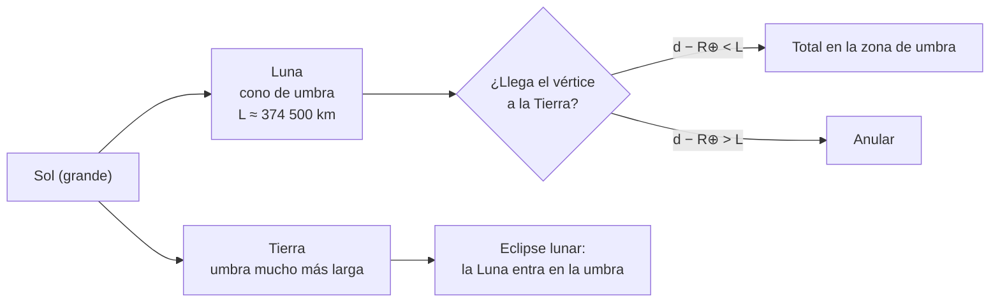

# B08-C09 — Eclipses y geometría de sombras

<!-- nav:top -->
[🏠 Programa](../../../../README.md) · [📚 Bloque B08](../../../tronco-comun/B08-observacion-del-cielo-y-astronomia-practica.md) · [← Anterior: B08-C08 — Fases lunares y libración](../B08-C08-fases-lunares-y-libracion/CLASE.md) · [Siguiente: B08-C10 — Planetas observables y elongación →](../B08-C10-planetas-observables-y-elongacion/CLASE.md)
<!-- /nav -->

## 1. Ubicación, nivel y alcance

Novena clase del bloque B08. En [B08-C08](../B08-C08-fases-lunares-y-libracion/CLASE.md) viste que la Luna recorre sus fases cada mes; aquí explicas por qué **no hay un eclipse cada mes** y qué decide si es total, anular o parcial. Esta es la primera clase del bloque en que el Sol entra como protagonista: la seguridad se trata desde el principio. Nivel N1.

Verás conos de sombra, tamaños angulares, ventanas de eclipse, el calendario de eclipses visibles desde Chile en la tabla de la NASA y cómo observar con seguridad. No verás cálculo de trayectorias de eclipse (B41 y siguientes) ni fotografía (C19).

## 2. Por qué esta clase existe

Un eclipse solar es un fenómeno que reúne a miles de personas y que puede dejar ciegas a quienes lo miran mal. La pregunta motivadora: **¿qué tipo de eclipse ocurrirá, dónde y cómo lo veo sin dañarme?** La decisión central: **decidir si salir a verlo, dónde ubicarte y con qué protección, usando datos oficiales y un modelo geométrico simple**.

## 3. Lo que podrás hacer al terminar

1. Explicar con un diagrama de conos de sombra cómo se producen eclipses solares y lunares.
2. Decidir, a partir de distancias y radios, si una alineación daría eclipse total o anular.
3. Explicar por qué solo algunas lunas nuevas y llenas dan eclipse.
4. Calcular la longitud de la umbra de la Luna y el radio de la umbra de la Tierra.
5. Leer la lista de eclipses de la NASA y ubicar los visibles desde Chile.
6. Elaborar un plan de observación segura.

La evidencia es el **plan de eclipse** del ejercicio 12.

## 4. Con qué llegas y cómo comprobarlo

1. ¿Qué fase tiene la Luna en un eclipse solar? 2. ¿Y en uno lunar? 3. ¿Cuánto mide un objeto de radio 1737,4 km visto desde 370 000 km, en grados? 4. ¿Qué es la semejanza de triángulos? 5. ¿Qué diámetro angular tienen el Sol (1887–1952″) y la Luna (1762–2009″ en 2025)?

<details><summary>Ver respuestas</summary>

1. Luna nueva. 2. Luna llena. 3. `2 × 1737,4 / 370 000 = 0,00939 rad ≈ 0,54°`. 4. Dos triángulos con los mismos ángulos tienen lados proporcionales. 5. Son casi iguales: la Luna puede ser algo mayor o menor que el Sol (C08).
</details>

Con cuatro o cinco aciertos, sigue; con tres o menos, repasa C08.

## 5. Un caso real: las dos lunas nuevas de 2025 en que la sombra rozó la Tierra

La tabla de eclipses de la NASA para 2021–2030 (S1) lista dos eclipses solares en 2025, ambos parciales: el 29 de marzo (visible desde el noroeste de África, Europa y el norte de Rusia) y el 21 de septiembre (Pacífico Sur, Nueva Zelanda, Antártida). Ninguno se vio desde Chile. Pero hubo 12 lunas nuevas ese año. Esta clase explica por qué solo dos tuvieron eclipse y comprueba, con la tabla de la Luna de la NASA (S2), que un modelo simple lo reproduce.

## 6. Vocabulario

La **umbra** es la zona de sombra total, de donde el Sol queda completamente cubierto; la **penumbra** es la zona de sombra parcial que la rodea. Un eclipse **solar** ocurre cuando la Luna se interpone entre el Sol y la Tierra (Luna nueva); uno **lunar**, cuando la Tierra se interpone entre el Sol y la Luna (Luna llena). Un eclipse solar es **total** si la Luna cubre por completo el Sol; **anular** si la Luna parece más pequeña que el Sol y deja un anillo brillante; **parcial** si el Sol, la Luna y la Tierra no están perfectamente alineados; **híbrido** si cambia de total a anular a lo largo de su trayectoria (S3). Una **estación de eclipses** es el período en que la órbita de la Luna cruza el plano de la órbita de la Tierra; ocurre dos veces al año (S3). **Nodo** es cada uno de los dos puntos en que la órbita lunar cruza ese plano.

## 7. Modelo mental: dos conos de sombra

El Sol es grande, de modo que la sombra de cada cuerpo es un cono que se estrecha hasta un vértice. Si el vértice de la umbra de la Luna alcanza la superficie de la Tierra, hay totalidad en ese lugar; si el vértice se queda corto, ves un anillo (anular). El cono de umbra de la Tierra es mucho más largo y ancho, y a la distancia de la Luna cubre unas 2,65 veces su radio.



*Descripción textual:* el Sol ilumina a la Luna y a la Tierra, cada una con su cono de sombra; si el vértice de la sombra de la Luna llega a la Tierra el eclipse solar es total en esa zona, si no, anular; la sombra de la Tierra, más larga, produce los eclipses lunares cuando la Luna entra en ella.

**Analogía y su límite.** Una linterna grande y una pelota: la sombra detrás de la pelota se estrecha hasta un punto. Falla porque el Sol no es una fuente puntual ni uniforme, y porque la atmósfera de la Tierra desvía luz hacia la sombra (el color rojizo de la Luna en los eclipses lunares).

## 8. La explicación, paso a paso

### 8.1 La longitud de la umbra de la Luna

Con triángulos semejantes, la umbra tiene longitud `L = R_L · D / (R_S − R_L)`, donde `R_L = 1737,4 km` (S4), `R_S = 695 700 km` (S5) y `D ≈ 149,6 × 10⁶ km` (S5, distancia media). Resulta `L = 374 538 km`. El vértice llega a la superficie de la Tierra si `d − R⊕ < L`, con `R⊕ = 6371 km` (S6): es decir, si la distancia a la Luna es menor que `380 909 km`. En 2025 la distancia varió entre 356 830 y 406 690 km (S2): cerca del perigeo un eclipse central sería total, cerca del apogeo, anular.

**Pausa.** El 21 de septiembre de 2025 la Luna estaba a 396 872 km; si el eclipse hubiese sido central, ¿habría sido total o anular? <details><summary>Respuesta</summary>`396 872 > 380 909 km`: el vértice no llega: anular.</details>

### 8.2 La umbra de la Tierra

El radio de la umbra de la Tierra a una distancia `x` es `R⊕ − x (R_S − R⊕)/D`. A 384 400 km (S4) vale 4600 km, es decir, 2,65 veces el radio de la Luna, y su radio angular visto desde la Tierra es 0,686°. La Luna (radio angular ≈ 0,26°) cabe en ella con holgura: por eso la Luna puede quedar completamente dentro de la umbra (la duración de la totalidad lunar no se consultó en esta clase). La atmósfera terrestre desvía luz hacia la umbra y enrojece la Luna (S3).

### 8.3 Por qué no hay eclipse cada mes

La órbita de la Luna está inclinada 5,145° respecto del plano de la órbita de la Tierra (S4). Casi siempre, en Luna nueva, la Luna pasa por encima o por debajo del Sol: no proyecta sombra en la Tierra. Solo cuando la Luna está cerca de un nodo en luna nueva (o llena) hay eclipse (S3). El modelo del laboratorio usa un criterio geométrico: habrá algún eclipse solar, al menos parcial en algún lugar, si la separación Luna–Sol en la luna nueva es menor que la suma de sus radios angulares más la paralaje de la Luna (≈ 0,95°), es decir, unos 1,4°–1,6° según la distancia. Aplicado a las 12 lunas nuevas de 2025 (filas horarias de S2): solo el 29 de marzo (separación 1,16°) y el 21 de septiembre (1,27°) caen bajo el límite, lo que coincide con los dos eclipses de la lista de la NASA (S1). El 28 de febrero y el 23 de agosto quedan cerca (1,70° y 1,76°), pero sobre el límite (1,54° y 1,47°), y no tuvieron eclipse. Para las lunas llenas, el criterio de umbra (separación con el punto antisolar menor que ≈ 0,9°–1,0°) da dos candidatas en 2025: 14 de marzo (0,56°) y 7 de septiembre (0,72°); la confirmación con la lista de eclipses lunares de la NASA no se consultó en esta clase.

### 8.4 Los eclipses visibles desde Chile

La tabla de la NASA para 2021–2030 (S1) marca como visibles desde el sur de Sudamérica los siguientes eclipses solares: parcial del 30 de abril de 2022 (sudeste del Pacífico y sur de Sudamérica); anular del 14 de octubre de 2023 (Norteamérica, Centroamérica y Sudamérica, con la trayectoria central por Colombia y Brasil); **anular del 2 de octubre de 2024**, con trayectoria central por el sur de Chile y Argentina; anular del 17 de febrero de 2026, visible desde el sur de Argentina y Chile pero con trayectoria central en la Antártida; **anular del 6 de febrero de 2027**, con trayectoria central por Chile y Argentina; anular del 26 de enero de 2028 (trayectoria por Ecuador, Perú, Brasil, Surinam); parciales del 11 de julio y del 5 de diciembre de 2029 (sur de Chile y Argentina). Desde la fecha de esta redacción (5 de noviembre de 2026) quedan por delante el anular del 6 de febrero de 2027 (tema del ejercicio 10), el del 26 de enero de 2028 y los parciales de 2029.

## 9. Magnitudes, símbolos y unidades

| Símbolo | Qué es | Unidad | Valor |
|---|---|---|---|
| `R_S` | radio del Sol | km | 695 700 (S5) |
| `R⊕` | radio medio de la Tierra | km | 6371 (S6) |
| `R_L` | radio medio de la Luna | km | 1737,4 (S4) |
| `D` | distancia media Tierra–Sol | km | 149,6 × 10⁶ (S5) |
| `d` | distancia Tierra–Luna | km | 356 830–406 690 en 2025 (S2) |
| `L` | longitud de la umbra de la Luna | km | 374 538 (calculado) |

## 10. Convenciones y referencias

Las horas de la tabla de la NASA son tiempo dinámico terrestre (TD), no UT. Las fechas son locales del evento en UT salvo que se indique. «Visible» significa que alguna fase del eclipse es observable desde esa región, no que sea total allí. Los límites de 1,4°–1,6° y 0,9°–1,0° son derivados aquí, no valores publicados, y el muestreo horario de las filas de la Luna agrega ±0,3°.

## 11. De dónde sale lo que afirmamos

| ID | Fuente | Localizador | Respalda | Consulta | Estado |
|---|---|---|---|---|---|
| S1 | NASA Eclipse Web Site (F. Espenak), *Solar Eclipses 2021–2030* | https://eclipse.gsfc.nasa.gov/SEdecade/SEdecade2021.html | Fechas, tipos y regiones de visibilidad de los eclipses solares 2021–2030 | 2026-11-05 | Página leída |
| S2 | NASA SVS 5415 (JPL DE421) | https://svs.gsfc.nasa.gov/5415/ ; `mooninfo_2025.txt` | Posición y distancia de la Luna 2025 | 2026-11-05 | Datos leídos |
| S3 | NASA Science, *Eclipse types* | https://science.nasa.gov/eclipses/types/ | Tipos de eclipse; órbita inclinada; dos estaciones al año; enrojecimiento lunar; solo en totalidad se quitan los lentes | 2026-11-05 | Página leída |
| S4 | NASA NSSDC, *Moon Fact Sheet* (act. 11-ene-2024) | https://nssdc.gsfc.nasa.gov/planetary/factsheet/moonfact.html | Radio 1737,4 km; inclinación 5,145°; distancia media 384 400 km | 2026-11-05 | Página leída |
| S5 | NASA NSSDC, *Sun Fact Sheet* (act. 9-may-2024) | https://nssdc.gsfc.nasa.gov/planetary/factsheet/sunfact.html | Radio 695 700 km; distancia media 149,6 millones de km; diámetro angular 1887–1952″ | 2026-11-05 | Página leída |
| S6 | NASA NSSDC, *Earth Fact Sheet* (act. 15-nov-2024) | https://nssdc.gsfc.nasa.gov/planetary/factsheet/earthfact.html | Radio medio 6371 km | 2026-11-05 | Página leída |
| S7 | NASA Science, *Eclipse safety* | https://science.nasa.gov/eclipses/safety/ | ISO 12312-2; filtros; binoculares y telescopios; proyección con orificio | 2026-11-05 | Página leída |
| S8 | AAS, *How to tell if your eclipse glasses or handheld solar viewers are safe* | https://eclipse.aas.org/eye-safety/how-to-tell-if-viewers-are-safe | Una etiqueta no basta; pruebas básicas; proveedores | 2026-11-05 | Página leída (mutable) |

Límites: no se consultó el catálogo de eclipses lunares de la NASA ni la duración de la totalidad lunar; las candidatas lunares son resultados del modelo. La lista de eclipses es de la tabla 2021–2030 consultada, que puede actualizarse.

## 12. Cómo ver (o representar) un eclipse

Tabla de eclipses solares 2021–2030 con visibilidad desde Chile (S1):

| Fecha | Tipo | Visibilidad según la tabla |
|---|---|---|
| 2022-04-30 | parcial | sudeste del Pacífico y sur de Sudamérica |
| 2023-10-14 | anular | Norte, Centro y Sudamérica (central por Colombia y Brasil) |
| 2024-10-02 | anular | sur de Chile y Argentina (central) |
| 2026-02-17 | anular | sur de Argentina y Chile (central en la Antártida) |
| 2027-02-06 | anular | Chile y Argentina (central) |
| 2029-07-11 y 2029-12-05 | parcial | sur de Chile y Argentina |

Sin ver: una pelota, una linterna y una persona que describa la sombra, o un modelo táctil con un cono de cartulina. Durante un eclipse, la bajada de temperatura, el cambio de luz y el silencio de las aves se pueden sentir y describir en voz alta.

## 13. Ejemplo trabajado: ¿por qué falló el eclipse del 28 de febrero de 2025?

El 28 de febrero de 2025 a las 00:00 UT, la Luna nueva estaba a 364 784 km, con AR 22,74 h y Dec −9,77° (S2). El Sol, en el modelo, estaba a 1,70° de ella. El límite geométrico es `(R_S/D + R_L/d)` en grados más la paralaje: `0,266° + 0,273° + 1,001° = 1,54°`, igual que el laboratorio. Como `1,70° > 1,54°`, no hay eclipse solar en ningún lugar de la Tierra. **Paso final · incertidumbre.** La separación se lee de una fila horaria; la Luna se mueve ≈ 0,5° por hora, y el mínimo de la separación (su latitud eclíptica) es menor que el valor muestreado en como mucho `√(1,70² − (0,27)²)`, es decir 1,68°, aún por encima del límite. Concluyes «sin eclipse» con margen de 0,14°, que es pequeño: lo declaras. Para decidir de verdad se usa la lista oficial.

## 14. Comparación de métodos

El **modelo geométrico** explica por qué ocurre o no, pero tiene un margen de 0,1° a 0,3°. La **lista de la NASA** (S1) da fechas y regiones con precisión de efeméride. La **observación** con protección confirma el evento. Un buen plan usa la lista para decidir y el modelo para entender.

## 15. Práctica guiada

**Ejercicio 1.** Calcula la longitud de la umbra de la Luna con los datos de la sección 9. *Pasos:* 8.1.

<details><summary>Solución comentada</summary>

`L = 1737,4 × 149,6 × 10⁶ / (695 700 − 1737,4) = 2,599 × 10¹¹ / 693 962,6 = 374 538 km`.
</details>

**Ejercicio 2.** El 29 de marzo de 2025 la Luna estaba a 358 751 km. Si el eclipse hubiese sido central, ¿habría sido total o anular? ¿Fue central?

<details><summary>Solución comentada</summary>

`d − R⊕ = 352 380 km < 374 538 km`: habría sido total si el eje de la sombra hubiese tocado la Tierra. Pero la tabla (S1) lo clasifica como parcial: la separación de 1,16° muestra que la sombra pasó por encima o por debajo del centro de la Tierra.
</details>

**Ejercicio 3.** ¿Qué radio tiene la umbra de la Tierra a 384 400 km y cuántos radios lunares son? *Pasos:* 8.2.

<details><summary>Solución comentada</summary>

`6371 − 384 400 × (695 700 − 6371)/149,6 × 10⁶ = 6371 − 1771 = 4600 km`; `4600 / 1737,4 = 2,65`.
</details>

## 16. Práctica autónoma, transferencia e integrador

**Ejercicio 4.** Con la inclinación de 5,145° (S4) y el límite de ≈ 1,5° para el eclipse solar, explica por qué hay eclipses solo en estaciones.

<details><summary>Solución comentada</summary>

En una luna nueva cualquiera, la Luna puede estar hasta 5,145° al norte o al sur de la eclíptica, mucho más que 1,5°. Solo cuando está cerca de un nodo su separación del Sol cae bajo el límite. Eso ocurre en dos períodos al año (S3).
</details>

**Ejercicio 5.** ¿Cuántas lunas nuevas de 2025 quedaron bajo el límite? ¿Qué fracción?

<details><summary>Solución comentada</summary>

Dos de 12 (29 de marzo y 21 de septiembre): 17 %. El resto quedó entre 1,70° y 4,91°.
</details>

**Ejercicio 6.** El 23 de agosto de 2025 la Luna estaba a 386 876 km y a 1,76° del Sol. El límite del modelo es 1,47°. ¿Hubo eclipse?

<details><summary>Solución comentada</summary>

No: `1,76° > 1,47°`. Tampoco aparece en la lista de la NASA (S1). Observa que el margen es de 0,29°, mayor que el error del muestreo.
</details>

**Ejercicio 7.** Compara el diámetro angular máximo de la Luna en 2025 (2008,6″) y el mínimo del Sol (1887″, S5). ¿Cuándo es posible la totalidad?

<details><summary>Solución comentada</summary>

2008,6″ > 1887″: es posible. Con el diámetro mínimo de la Luna (1762,3″) frente al máximo del Sol (1952″) el eclipse central sería anular. La totalidad exige que la Luna sea mayor que el Sol en ese momento.
</details>

**Ejercicio 8.** ¿Qué dice la tabla de la NASA sobre el eclipse del 2 de octubre de 2024? ¿Por qué se llama «anular»?

<details><summary>Solución comentada</summary>

Anular, trayectoria central por el sur de Chile y Argentina (S1). Anular porque la Luna estaba lejos y se veía más pequeña que el Sol, dejando un anillo (S3).
</details>

**Ejercicio 9 · transferencia.** Un compañero propone mirar el eclipse parcial con unas gafas de sol «muy oscuras» o con las gafas del eclipse a través de binoculares. Evalúa.

<details><summary>Solución comentada</summary>

Ambas son peligrosas: las gafas de sol no protegen aunque sean oscuras, y los visores de eclipse no deben combinarse con binoculares ni telescopios porque la luz concentrada puede quemarlos (S7). Se usa un visor ISO 12312-2 sin óptica, o un filtro solar adecuado montado al frente del instrumento, o proyección con orificio sin mirar el Sol por el orificio.
</details>

**Ejercicio 10 · transferencia.** Planifica el eclipse anular del 6 de febrero de 2027. ¿Qué protección necesitas durante qué fases y por qué?

<details><summary>Solución comentada</summary>

En un eclipse anular nunca hay totalidad: se necesita protección durante todo el evento, anillo incluido (S7: usar los visores en las fases parciales o anulares). Se compra a proveedores verificados (S8), se inspeccionan los visores, y se tiene alternativa de proyección con orificio. Se anota lugar, hora oficial de la NASA y cielo despejado esperado.
</details>

**Ejercicio 11 · transferencia.** Un eclipse lunar es seguro a simple vista, ¿por qué? ¿Y por qué sigue siendo peligroso mirar el Sol aunque esté eclipsado parcialmente?

<details><summary>Solución comentada</summary>

En un eclipse lunar solo se mira la Luna, que refleja una fracción pequeña de luz. En un eclipse solar parcial el Sol sigue emitiendo casi toda su radiación (la parte descubierta es muy brillante), por lo que el riesgo persiste (S7).
</details>

**Ejercicio 12 · integrador.** Elabora un **plan de eclipse**: elige un eclipse de la tabla S1 visible desde Chile, indica su tipo, fecha, qué verías desde tu lugar, la protección ocular exacta, una alternativa de proyección, una alternativa no visual y los tres riesgos de ese día y cómo los mitigas.

<details><summary>Solución modelo</summary>

El plan debe indicar la fuente del eclipse (S1), el tipo y la región; mencionar visores ISO 12312-2 de proveedor verificado (S7, S8); la proyección con orificio sin mirar el Sol; una alternativa accesible (descripción hablada, modelo táctil, sensor de luz con salida sonora) y riesgos como calor, multitudes, tráfico y la tentación de mirar sin protección.
</details>

## 17. Laboratorio: [`eclipses.py`](eclipses.py)

**Objetivo.** Calcular la geometría de sombras y comprobar las candidatas de 2025. **Datos:** constantes publicadas de la NASA y filas de la tabla SVS 5415; salidas simuladas. **Procedimiento:** `python eclipses.py`; la prueba detiene el programa si el modelo no marca exactamente como candidatas las lunas nuevas del 29 de marzo y del 21 de septiembre. **Resultados reales (Python 3.12.9):**

```text
Longitud de la umbra de la Luna: 374,538 km. Totalidad posible si distancia < 380,909 km
Umbra de la Tierra a 384 400 km: radio 4,600 km = 2.65 radios lunares; radio angular 0.686 grados
2025-02-28 00:00 | 364784 | sep 1.70 | límite 1.54 | no
2025-03-29 10:00 | 358751 | sep 1.16 | límite 1.56 | SI
2025-08-23 05:00 | 386876 | sep 1.76 | límite 1.47 | no
2025-09-21 18:00 | 396872 | sep 1.27 | límite 1.44 | SI
(las otras 8 lunas nuevas: separaciones de 3,45° a 4,91°, "no")
Lunas llenas candidatas (umbra): 2025-03-14 (0.56° < 0.89°), 2025-09-07 (0.72° < 0.99°); las otras 10: 2,33° a 5,05°
```

**Límites:** Sol puntual a distancia media, sin atmósfera ni penumbra, muestreo horario. **Sin código:** repite el cálculo de L y de la umbra con calculadora. **Sin equipo:** pelota y linterna.

## 18. Errores frecuentes y cómo corregirlos

**Creer que la Luna nueva siempre produce un eclipse.** Ejercicio 4. **Mirar un eclipse parcial sin protección.** Ejercicio 9. **Combinar visores de eclipse con binoculares.** Ejercicio 9. **Creer que un eclipse anular es seguro a simple vista.** Ejercicio 10. **Creer que la lista de la NASA y el modelo son equivalentes.** Sección 14.

## 19. Cómo sabrás que vas bien

Tras 8.1: ¿calculas `L` y sabes qué compararla? Ejercicio 1. Tras 8.3: ¿puedes decir por qué febrero de 2025 no tuvo eclipse? Ejercicio 6. Final: ¿tu plan nombra la protección exacta y su fuente?

## 20. Qué entregas y cómo se evalúa

El **plan de eclipse** (ejercicio 12).

| Criterio | Inicial | En desarrollo | Logrado | Destacado |
|---|---|---|---|---|
| Geometría | Sin explicación | Describe | Calcula `L` y compara | Valida con datos reales |
| Seguridad | Omite | Menciona gafas | ISO 12312-2 y proveedor | Incluye verificación y alternativas |
| Fuentes | Sin fuente | Sin fecha | Con fecha | Distingue publicado de modelo |
| Accesibilidad | Ninguna | Menciona | Alternativa | La prueba |

**Condición crítica (no se compensa por promedio):** cualquier plan que implique mirar el Sol sin protección certificada, o con óptica sin filtro frontal, se evalúa como no aprobado.

## 21. Ética, seguridad y límites

**Nunca mires el Sol sin protección.** Según NASA, los visores deben cumplir ISO 12312-2; las gafas de sol no sirven; con binoculares o telescopio se necesita un filtro especial montado al frente, y los visores de eclipse no deben combinarse con ellos. Solo en la totalidad de un eclipse total se puede mirar sin protección (S3, S7). La AAS añade que una etiqueta ISO no es prueba suficiente y recomienda proveedores verificados; inspecciona los visores y deséchalos si están dañados (S8). Los niños necesitan supervisión. No hay eclipse total desde Chile en la lista consultada hasta 2030, así que la regla de la totalidad no es operativa aquí: usa protección siempre.

Otros riesgos: calor, multitudes y tráfico en los lugares de la trayectoria central, y el frío y la oscuridad si se viaja al amanecer o al atardecer. Material educativo: no sustituye el consejo de un oftalmólogo ni de la autoridad.

## 22. Para cerrar y seguir

Los eclipses son geometría de sombras: el Sol, la Luna y la Tierra se alinean, y el tamaño aparente decide el tipo. Un modelo simple reproduce cuáles lunas nuevas de 2025 dieron eclipse; la lista oficial lo confirma y dice cuáles ver desde Chile. La seguridad ocular es innegociable. Queda abierta una pregunta: ¿cómo cambian de posición los planetas entre las estrellas, y cuándo se ven mejor? (C10).

**Glosario español–inglés.** eclipse · *eclipse*; umbra · *umbra*; penumbra · *penumbra*; total · *total*; anular · *annular*; parcial · *partial*; nodo · *node*; estación de eclipses · *eclipse season*; visor solar · *solar viewer*.

**Continuidad.** B08-C10 estudia planetas y su elongación; B08-C16 retoma la observación solar con filtros certificados.

**Referencias:** ver sección 11.

<!-- nav:bottom -->
---

[← Anterior: B08-C08 — Fases lunares y libración](../B08-C08-fases-lunares-y-libracion/CLASE.md) · [📚 Bloque B08](../../../tronco-comun/B08-observacion-del-cielo-y-astronomia-practica.md) · [Siguiente: B08-C10 — Planetas observables y elongación →](../B08-C10-planetas-observables-y-elongacion/CLASE.md)
<!-- /nav -->
