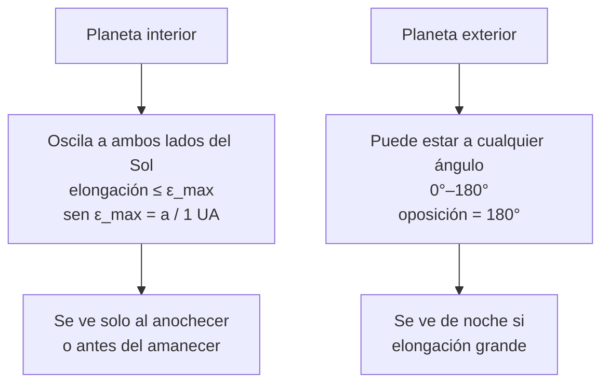

# B08-C10 — Planetas observables y elongación

<!-- nav:top -->
[🏠 Programa](../../../../README.md) · [📚 Bloque B08](../../../tronco-comun/B08-observacion-del-cielo-y-astronomia-practica.md) · [← Anterior: B08-C09 — Eclipses y geometría de sombras](../B08-C09-eclipses-y-geometria-de-sombras/CLASE.md) · [Siguiente: B08-C11 — Magnitudes aparentes y brillo →](../B08-C11-magnitudes-aparentes-y-brillo/CLASE.md)
<!-- /nav -->

## 1. Ubicación, nivel y alcance

Décima clase del bloque B08. Has seguido al Sol y a la Luna; ahora sigues a los **planetas visibles a simple vista**, que no están fijos entre las estrellas y cuya visibilidad depende de un ángulo: la **elongación**, su separación angular del Sol. Nivel N1.

Verás por qué Mercurio y Venus se alejan poco del Sol, por qué Marte, Júpiter y Saturno pueden verse toda la noche, cómo se calcula el período sinódico y cómo decidir qué ver una noche dada. No verás las leyes de Kepler (B41) ni la fotografía planetaria (C19).

## 2. Por qué esta clase existe

Los planetas parecen «estrellas errantes» y un titular promete «alineación de planetas». La pregunta motivadora: **¿qué planetas puedo ver esta noche, dónde y a qué hora?** La decisión central: **decidir si vale la pena salir, a partir de la elongación y de la altura del planeta a la hora de oscuridad**; una elongación grande no basta si el planeta está bajo, y una pequeña se pierde en el crepúsculo.

## 3. Lo que podrás hacer al terminar

1. Definir elongación y distinguir planetas interiores y exteriores.
2. Calcular la elongación máxima de Mercurio y Venus en un modelo circular.
3. Calcular un período sinódico a partir de períodos orbitales.
4. Leer una tabla de elongaciones y alturas y decidir qué planetas se ven y cuándo.
5. Distinguir un planeta de una estrella por su aspecto y su movimiento.
6. Planificar una observación planetaria con sus límites.

La evidencia es el **pronóstico planetario** del ejercicio 12.

## 4. Con qué llegas y cómo comprobarlo

1. ¿Qué es la separación angular entre dos objetos (C03)? 2. Si `sen ε = 0,723`, ¿cuánto vale `ε`? 3. ¿Cuántas veces cabe una órbita de 0,615 años en un año? 4. ¿Qué es el crepúsculo astronómico (USNO: Sol a 18° bajo el horizonte)? 5. ¿Qué altura tiene el polo sur celeste en tu lugar?

<details><summary>Ver respuestas</summary>

1. El ángulo entre las direcciones a ambos. 2. 46,3°. 3. `1/0,615 = 1,626` veces. 4. El momento en que la luz solar dispersada queda más débil que la de las estrellas (S3). 5. Tu latitud en valor absoluto.
</details>

Con cuatro o cinco aciertos, sigue; con tres o menos, repasa C02 y C04.

## 5. Un caso real: ¿qué planetas se veían la noche del 5 de noviembre de 2025?

Sigues en el valle del Elqui (`φ = −30,0°`). Con la efeméride integrada en astropy (S5) obtienes, para esa noche, la elongación de cada planeta y su altura en los crepúsculos astronómicos: Saturno estaba a 132,75° al este del Sol y a 61,6° de altura al anochecer; Júpiter, a 107,75° al oeste, subió y alcanzó 35,9° al amanecer; Mercurio (22,7° este) y Marte (17,5° este) quedaron en el crepúsculo; Venus (15,3° oeste) no se vio. Tu tarea es entender por qué.

## 6. Vocabulario

La **elongación** es el ángulo en el cielo entre un planeta y el Sol; es **este** si el planeta sale después que el Sol y se ve en el cielo vespertino, y **oeste** si sale antes y se ve en el cielo matutino. Un **planeta interior** (Mercurio, Venus) tiene su órbita dentro de la de la Tierra; uno **exterior** (Marte, Júpiter, Saturno), fuera. La **conjunción** es el alineamiento aparente con el Sol; la **oposición** (planeta exterior opuesto al Sol, elongación 180°) es su mejor momento para ver. La **elongación máxima** es la mayor separación angular que un planeta interior alcanza. El **período sinódico** es el intervalo entre dos configuraciones iguales respecto del Sol. NASA indica que Mercurio, Venus, Marte, Júpiter y Saturno se ven a simple vista, con luz estable, y que se desplazan entre las estrellas (S1).

## 7. Modelo mental: carreras en pistas circulares

Imagina la Tierra y un planeta corriendo por pistas concéntricas alrededor del Sol. Un planeta interior corre más rápido y da vueltas a la Tierra; visto desde esta, parece oscilar a un lado y otro del Sol sin alejarse más que un cierto ángulo. Un planeta exterior corre más lento y la Tierra lo alcanza una vez por período sinódico: en ese momento está en oposición.



*Descripción textual:* un planeta interior no se aleja del Sol más que una elongación máxima fijada por el tamaño de su órbita, por lo que se ve solo cerca del crepúsculo; un exterior puede estar a cualquier elongación y, en oposición, se ve toda la noche.

**Analogía y su límite.** Corredores en pistas concéntricas. Falla porque las órbitas son elipses ligeramente excéntricas y no exactamente coplanares: los valores reales varían respecto del modelo circular.

## 8. La explicación, paso a paso

### 8.1 Elongación máxima de un planeta interior

Cuando la Tierra, el planeta y el Sol forman un ángulo recto en el planeta, la línea Tierra–planeta es tangente a la órbita, y `sen ε_max = a / (1 UA)`. Con `a = 0,387 UA` (Mercurio) y `0,723 UA` (Venus) de la tabla de la NASA (S2): `ε_max = 22,8°` y `46,3°`. El laboratorio lo confirma barriendo la órbita con un ángulo de paso de 0,01°. Son valores de un modelo circular: la órbita real de Mercurio es notablemente excéntrica y su elongación máxima real varía respecto de 22,8° (cifra real no consultada).

**Pausa.** Venus estuvo a 15,3° del Sol el 5 de noviembre de 2025 (S5). ¿Está cerca de su elongación máxima? <details><summary>Respuesta</summary>No: 15,3° es un tercio de 46,3°. Está cerca del Sol en el cielo y es difícil de ver.</details>

### 8.2 Período sinódico

Para planetas con período orbital `P` (en años terrestres), `1/S = |1/P − 1|` en años. Con los períodos de la tabla (S2: 0,241, 0,615, 1,88, 11,9, 29,4) y el año sidéreo de 365,256 d (S3): Mercurio 116,0 d, Venus 583,5 d, Marte 780,3 d, Júpiter 398,8 d, Saturno 378,1 d. Contra las fechas calculadas con astropy (S5): para Venus, el intervalo entre conjunciones inferiores de 2024 a 2027 promedia 581,5 d; para Júpiter, entre oposiciones de 2024 a 2028, 396,9 d; para Marte, entre las oposiciones de enero de 2025 y febrero de 2027, 764,75 d (el modelo da 780,3 d, un 2 % más). Marte se desvía más porque su órbita es la más excéntrica de las tres y el intervalo entre oposiciones varía con la posición.

### 8.3 Qué se ve esa noche

La elongación dice si el planeta está cerca del Sol en el cielo; la altura al anochecer o antes del amanecer dice si puedes verlo. El crepúsculo astronómico (Sol a 18° bajo el horizonte, S3) marca cuándo el cielo está lo bastante oscuro. La tabla de S5 para la noche del 5 al 6 de noviembre: el crepúsculo astronómico vespertino fue a las 00:35 UT y el matutino a las 08:15 UT.

| Planeta | Elongación | Lado | Altura al anochecer | Altura al amanecer |
|---|---|---|---|---|
| Mercurio | 22,7° | este | 2,8° | −26,3° |
| Venus | 15,3° | oeste | −33,0° | −10,9° |
| Marte | 17,5° | este | −2,6° | −26,4° |
| Júpiter | 107,8° | oeste | −46,4° | 35,9° |
| Saturno | 132,8° | este | 61,6° | −8,3° |

Resultado: Saturno es el blanco de la primera parte de la noche (altura sobre 60° al anochecer); Júpiter, de la segunda mitad; Mercurio y Marte se pierden en el horizonte occidental; Venus no sale antes de que amanezca lo suficiente.

### 8.4 Reconocer un planeta

Según la NASA (S1), los planetas brillan con luz estable (las estrellas parpadean más), son tan brillantes o más que las estrellas y se desplazan entre ellas. Una prueba práctica: anota su posición respecto de dos estrellas durante varias noches; si cambia, es un planeta. Los binoculares son un buen primer instrumento (S1).

## 9. Magnitudes, símbolos y unidades

| Símbolo | Qué es | Unidad | Nota |
|---|---|---|---|
| `ε` | elongación | ° | 0–180° |
| `a` | distancia media al Sol | UA | S2 |
| `P` | período orbital | años | S2 |
| `S` | período sinódico | d | `1/S = \|1/P − 1\|` |
| `h` | altura | ° | C04 |

## 10. Convenciones y referencias

La elongación se da como separación angular de 0° a 180° con el lado (este/oeste). Los valores de S2 tienen tres cifras significativas, por lo que los resultados del modelo se redondean a ~0,3 %. Las horas son UT. Los datos de planetas del 5 de noviembre de 2025 son calculados con astropy y no observados.

## 11. De dónde sale lo que afirmamos

| ID | Fuente | Localizador | Respalda | Consulta | Estado |
|---|---|---|---|---|---|
| S1 | NASA Science, *Skywatching* (act. 2-nov-2026) | https://science.nasa.gov/skywatching/ | Mercurio, Venus, Marte, Júpiter y Saturno se ven a simple vista; luz estable; se desplazan; binoculares como primer instrumento | 2026-11-05 | Página leída |
| S2 | NASA NSSDC, *Planetary Fact Sheet – Ratio to Earth Values* (act. 18-mar-2025) | https://nssdc.gsfc.nasa.gov/planetary/factsheet/planet_table_ratio.html | Distancia al Sol (UA) y período orbital (años), 3 cifras | 2026-11-05 | Página leída |
| S3 | USNO, *Rise, Set, and Twilight Definitions* | https://aa.usno.navy.mil/faq/RST_defs | Crepúsculo astronómico: Sol a 18° bajo el horizonte | 2026-11-05 | Página leída |
| S4 | NASA NSSDC, *Earth Fact Sheet* (act. 15-nov-2024) | https://nssdc.gsfc.nasa.gov/planetary/factsheet/earthfact.html | Período sidéreo de la Tierra 365,256 d | 2026-11-05 | Página leída |
| S5 | astropy 8.0.2 / pyerfa 2.0.1.5 | https://www.astropy.org | Elongaciones, alturas y fechas de conjunciones/oposiciones usadas como referencia independiente | 2026-11-05 | Ejecutado localmente; valores copiados |

Límites: los valores de S5 son una efeméride de baja a media precisión (no una publicación oficial) y no se compararon con almanaques impresos ni con el USNO. No se consultó la elongación máxima real de Mercurio y Venus.

## 12. Cómo ver los planetas

Tabla accesible: la tabla de la sección 8.3. Para una persona que no ve, una aplicación que lea «Saturno, 62° sobre el horizonte, al noreste» o una lista de objetos con alturas y acimuts habladas cumple lo mismo; los planetas no se perciben táctilmente, pero un modelo a escala del sistema solar con distancias y tiempos de recorrido sí permite entender elongaciones.

## 13. Ejemplo trabajado: ¿ver Mercurio el 5 de noviembre?

Mercurio estaba a 22,7° al este del Sol (S5), casi su máximo del modelo circular (22,8°). Parece una buena oportunidad, pero su altura al anochecer astronómico fue de apenas 2,8° a las 00:35 UT. Mercurio se ponía poco después del Sol, cuando el cielo aún no está oscuro; en un crepúsculo menos profundo (civil o náutico: Sol a 6° o 12° bajo el horizonte, S3) estaría algo más alto, pero con el cielo aún claro (no se calculó aquí). **Paso final · incertidumbre.** Una elongación grande es condición necesaria, no suficiente: la altura depende del lugar, la fecha y el ángulo con que la eclíptica corta el horizonte. Decide con la altura al crepúsculo; anota `2,8°` como una oportunidad «marginal» y verifica con una aplicación.

## 14. Comparación de métodos

El **modelo circular** da elongaciones máximas y períodos aproximados; la **efeméride** da posiciones reales con precisión útil para observar; la **observación directa** (posición respecto de estrellas varias noches) comprueba el movimiento. Un plan sólido usa la efeméride para decidir y el modelo para entender.

## 15. Práctica guiada

**Ejercicio 1.** Calcula la elongación máxima de Venus (modelo circular). *Pasos:* 8.1.

<details><summary>Solución comentada</summary>

`ε_max = arcsen(0,723) = 46,3°`. Mercurio: `arcsen(0,387) = 22,8°`.
</details>

**Ejercicio 2.** Calcula el período sinódico de Venus con `P = 0,615 años` y 365,256 d. *Pasos:* 8.2.

<details><summary>Solución comentada</summary>

`1/S = |1/0,615 − 1| = 0,626 años⁻¹`; `S = 1,597 años = 583,5 d`. La referencia de astropy da 581,5 d (0,3 % menos).
</details>

**Ejercicio 3.** Con la tabla de 8.3, ¿qué planeta está más alto al anochecer y por qué conviene observarlo en la primera parte de la noche?

<details><summary>Solución comentada</summary>

Saturno, 61,6°. Está al este del Sol (cielo vespertino), alto al anochecer; a las 08:15 UT está a −8,3° (ya se puso).
</details>

## 16. Práctica autónoma, transferencia e integrador

**Ejercicio 4.** ¿Cuántas horas estuvo Júpiter por encima de 5° con el Sol bajo −12°, según la referencia de S5?

<details><summary>Solución comentada</summary>

4,0 h (referencia calculada con pasos de 5 min): es la segunda mitad de la noche.
</details>

**Ejercicio 5.** Mercurio tiene un período sinódico de 116,0 d. Si alcanzó su elongación máxima este el 5 de noviembre, ¿cuándo se repite aproximadamente?

<details><summary>Solución comentada</summary>

Una elongación máxima este se repite cada período sinódico: ~116 d después, hacia el 1 de marzo de 2026 (modelo; la órbita excéntrica desplaza la fecha).
</details>

**Ejercicio 6.** El período sinódico de Marte con el modelo es 780,3 d y el intervalo calculado por astropy entre las oposiciones de 2025 y 2027 es 764,75 d. ¿Cuál es la diferencia y qué la causa?

<details><summary>Solución comentada</summary>

`15,6 d`, un 2 %. El modelo supone órbitas circulares; la órbita de Marte es excéntrica y el intervalo real varía con dónde ocurre cada oposición.
</details>

**Ejercicio 7.** Explica por qué un planeta exterior en oposición se ve toda la noche.

<details><summary>Solución comentada</summary>

En oposición está a 180° del Sol: sale cuando el Sol se pone, culmina a medianoche y se pone cuando amanece (C05, C02).
</details>

**Ejercicio 8.** Venus estuvo a 15,3° al oeste del Sol el 5 de noviembre. ¿Se ve en el cielo vespertino o en el matutino y por qué no era observable con oscuridad total?

<details><summary>Solución comentada</summary>

Matutino (oeste). Su altura al crepúsculo astronómico matutino fue −10,9°: aún no sale; al clarear el cielo, ya está inmersa en la luz.
</details>

**Ejercicio 9 · transferencia.** Un titular anuncia «seis planetas alineados». Evalúalo con 8.3.

<details><summary>Solución comentada</summary>

«Alineados» solo en sentido amplio: los planetas están siempre cerca de la eclíptica. NASA dice que dos o tres suelen verse al atardecer y ocasionalmente cuatro o cinco (S1). Hay que mirar la elongación y la altura de cada uno; algunos se perderán en el crepúsculo, como Mercurio y Marte en la tabla.
</details>

**Ejercicio 10 · transferencia.** Quieres ver Júpiter con binoculares. ¿A qué hora UT y con qué altura, según la tabla?

<details><summary>Solución comentada</summary>

Hacia el crepúsculo astronómico matutino, 08:15 UT, a 35,9°. Mejor altura al final de la noche; verifícalo con una aplicación (C07) y evita observar con la altura muy baja.
</details>

**Ejercicio 11 · transferencia.** Diseña una actividad para que una persona ciega "perciba" una elongación.

<details><summary>Solución comentada</summary>

Un modelo táctil con un círculo (órbita) y un brazo giratorio: el planeta interior se mueve a un lado y otro; el ángulo máximo se marca con una muesca en el borde. Se acompaña de una descripción hablada de la oscilación y del cálculo `sen ε = a`.
</details>

**Ejercicio 12 · integrador.** Elabora un **pronóstico planetario** para tu lugar y una noche: elongación y lado, altura en los crepúsculos, planetas visibles y el mejor horario para cada uno, con fuente y fecha de consulta. Compáralo con el resultado de una aplicación.

<details><summary>Solución modelo</summary>

El pronóstico debe usar una efeméride con fuente citada, la regla del crepúsculo astronómico, una tabla como la de 8.3, un caso marginal declarado y una alternativa no visual. Se evalúa si las diferencias con la aplicación se explican.
</details>

## 17. Laboratorio: [`elongacion.py`](elongacion.py)

**Objetivo.** Calcular elongaciones máximas y períodos sinódicos y contrastarlos con una referencia independiente. **Datos:** publicados (NASA, 3 cifras) y calculados (astropy, copiados). **Procedimiento:** `python elongacion.py`; se detiene si la elongación analítica y la numérica difieren más de 0,01° o si un período sinódico difiere más de 1 % (Venus, Júpiter) o 3 % (Marte) de la referencia. **Resultados reales (Python 3.12.9):**

```text
Mercurio: elongación máxima (órbita circular) 22.8 grados
Venus: elongación máxima (órbita circular) 46.3 grados
Mercurio 116.0 d | Venus 583.5 d (astropy 581.5) | Marte 780.3 d (astropy 764.75) | Júpiter 398.8 d (astropy 396.92) | Saturno 378.1 d
2025-11-05: Mercurio 22.72 E | Venus 15.32 O | Marte 17.51 E | Júpiter 107.75 O | Saturno 132.75 E
```

**Límites:** órbitas circulares y coplanares; referencia de precisión media. **Sin código:** usa la calculadora para `arcsen` y el período sinódico. **Sin equipo:** observa cómo cambia la posición de un planeta respecto de dos estrellas en una semana.

## 18. Errores frecuentes y cómo corregirlos

**Creer que Venus puede estar a medianoche en el cenit.** Ejercicio 8. **Pensar que elongación grande significa buena visibilidad.** Ejemplo 13. **Confundir planetas y estrellas.** Sección 8.4. **Ignorar el crepúsculo.** Ejercicio 3. **Usar un modelo circular como si fuera exacto.** Ejercicio 6.

## 19. Cómo sabrás que vas bien

Tras 8.1: ¿calculas `ε_max` de memoria? Ejercicio 1. Tras 8.3: ¿lees la tabla y decides? Ejercicio 3. Final: ¿tu pronóstico declara su fuente?

## 20. Qué entregas y cómo se evalúa

El **pronóstico planetario** (ejercicio 12).

| Criterio | Inicial | En desarrollo | Logrado | Destacado |
|---|---|---|---|---|
| Elongación | No la usa | La menciona | La calcula y usa | La contrasta con altura |
| Fuentes | Sin fuente | Sin fecha | Con efeméride y fecha | Compara dos fuentes |
| Decisión | Sin criterio | Basada en elongación | Basada en altura y oscuridad | Declara el caso marginal |
| Accesibilidad | Ninguna | Menciona | Alternativa | La prueba |

**Condiciones críticas:** declarar que los datos son calculados; no usar el Sol con óptica para localizar planetas cercanos a él.

## 21. Ética, seguridad y límites

Buscar Mercurio o Venus cerca del Sol con binoculares o telescopio puede acabar con la vista si el Sol aparece en el campo. **Nunca barras el cielo con óptica cerca del Sol; espera a que se haya puesto por completo o usa solo la vista.** El Sol sin filtro certificado ISO 12312-2 es peligroso (C16, C09). En el campo, frío, oscuridad y terreno son los riesgos habituales: ve acompañado, con linterna roja y abrigo. Los datos son educativos y no reemplazan un almanaque oficial.

## 22. Para cerrar y seguir

La elongación mide cuánto se aleja un planeta del Sol en el cielo y, junto con su altura y el crepúsculo, decide si lo verás. Los períodos sinódicos organizan el calendario de oposiciones y elongaciones. Queda abierta una pregunta: ¿cómo cuantifico el brillo de un planeta frente a una estrella? (C11).

**Glosario español–inglés.** elongación · *elongation*; oposición · *opposition*; conjunción · *conjunction*; planeta interior · *inferior planet*; planeta exterior · *superior planet*; período sinódico · *synodic period*; crepúsculo astronómico · *astronomical twilight*.

**Continuidad.** B08-C11 define la escala de magnitudes para comparar brillos de planetas y estrellas.

**Referencias:** ver sección 11.

<!-- nav:bottom -->
---

[← Anterior: B08-C09 — Eclipses y geometría de sombras](../B08-C09-eclipses-y-geometria-de-sombras/CLASE.md) · [📚 Bloque B08](../../../tronco-comun/B08-observacion-del-cielo-y-astronomia-practica.md) · [Siguiente: B08-C11 — Magnitudes aparentes y brillo →](../B08-C11-magnitudes-aparentes-y-brillo/CLASE.md)
<!-- /nav -->
