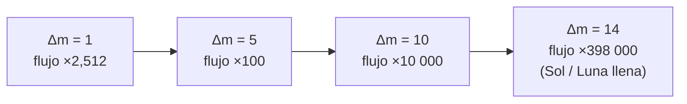

# B08-C11 — Magnitudes aparentes y brillo

<!-- nav:top -->
[🏠 Programa](../../../../README.md) · [📚 Bloque B08](../../../tronco-comun/B08-observacion-del-cielo-y-astronomia-practica.md) · [← Anterior: B08-C10 — Planetas observables y elongación](../B08-C10-planetas-observables-y-elongacion/CLASE.md) · [Siguiente: B08-C12 — Limitación por contaminación lumínica →](../B08-C12-limitacion-por-contaminacion-luminica/CLASE.md)
<!-- /nav -->

## 1. Ubicación, nivel y alcance

Undécima clase del bloque B08. Has localizado la Luna, el Sol y los planetas; ahora los **comparas por brillo**. La escala de magnitudes es la forma en que la astronomía dice cuánto brilla un objeto, y tiene una peculiaridad: los números más pequeños (incluso negativos) son los más brillantes. Nivel N1.

Verás la definición de magnitud aparente, su relación logarítmica con el flujo, cómo combinar magnitudes, qué mejora un instrumento y por qué la ganancia teórica no se alcanza en el campo. No verás fotometría con detectores (B29) ni extinción atmosférica.

## 2. Por qué esta clase existe

Un informe dice «cometa de magnitud 6» y otro «galaxia de magnitud 9». Sin entender la escala, no sabrás si los verás a simple vista, con binoculares o solo con telescopio. La pregunta motivadora: **¿puedo ver este objeto con mi instrumento y bajo mi cielo?** La decisión central: **comparar la magnitud del objeto con la magnitud límite que alcanzas y declarar los supuestos**.

## 3. Lo que podrás hacer al terminar

1. Definir magnitud aparente y la relación de 5 magnitudes con un factor 100 en flujo.
2. Convertir diferencias de magnitud en cocientes de flujo y al revés.
3. Combinar las magnitudes de dos fuentes no resueltas.
4. Estimar la ganancia teórica en magnitud límite de un instrumento.
5. Explicar por qué la ganancia real es menor y qué la limita.
6. Comparar objetos de la serie (Sol, Luna, estrellas) por brillo.

La evidencia es la **escalera de brillos** del ejercicio 12.

## 4. Con qué llegas y cómo comprobarlo

1. ¿Cuánto vale `10^0,4`? 2. ¿Qué es un logaritmo decimal? 3. ¿Cuánto vale `log₁₀ 100`? 4. ¿Cuál es el cociente `(50/7)²`? 5. ¿Qué dice B01 sobre medir con incertidumbre?

<details><summary>Ver respuestas</summary>

1. `≈ 2,512`. 2. El exponente al que hay que elevar 10 para obtener el número. 3. 2. 4. ≈ 51. 5. Que toda cifra viene de un método y se acompaña de su incertidumbre.
</details>

Con cuatro o cinco aciertos, sigue; con tres o menos, repasa logaritmos (B03).

## 5. Un caso real: el Sol, la Luna llena y la estrella más débil que verás

Esa noche del 5 de noviembre de 2025, la Luna estaba casi llena. Para la NASA, la Luna llena media tiene magnitud visual aparente −12,74 y el Sol, −26,74 (S1, S2). En tu cielo, la Luna llena es tanto más brillante que las estrellas que apaga las débiles; en C12 verás cuánto. En esta clase la usarás como patrón: ¿cuántas veces más brillante es el Sol que la Luna llena? ¿Y cuánto más débil podrías ver con binoculares?

## 6. Vocabulario

La **magnitud aparente** `m` es una medida logarítmica del flujo de luz que llega de un objeto, como se ve desde la Tierra; la escala crece al disminuir el brillo y los valores negativos son más brillantes que el cero (S3). Una diferencia de 5 magnitudes equivale a un factor 100 en flujo; unos apuntes de curso (S6) la atribuyen a una definición de 1856 (el artículo de Pogson, S5, no se pudo leer) y la escala logarítmica es coherente con los puntos cero fijados por la IAU en 2015 (S3), que el laboratorio comprueba. El **flujo** `F` es la energía luminosa que llega por unidad de área y tiempo. La **magnitud límite** es la del objeto más débil que se puede ver en un cielo y con un instrumento dados; la IMO usa 6,5 como referencia en su definición de ZHR (S4). La **ganancia** es cuántas magnitudes más débil se llega con un instrumento. Una **fuente puntual** es la que el instrumento no resuelve (una estrella); un **objeto extenso** (la Luna, una nebulosa) no cumple las reglas de esta clase.

## 7. Modelo mental: una escala que se comprime

Si el flujo se multiplica por 100, la magnitud baja 5. Es como contar ceros: cada paso de 5 magnitudes añade dos ceros al cociente. La escala se mantiene por tradición histórica y porque comprime un rango enorme de brillos en números manejables; que el ojo responda de forma aproximadamente logarítmica es una explicación habitual que no se verificó en una fuente de esta clase.



*Descripción textual:* una magnitud de diferencia equivale a un factor 2,512 en flujo; cinco, a 100; diez, a 10 000; catorce, a unas 398 000 veces, que es el cociente entre el Sol y la Luna llena.

**Analogía y su límite.** La escala de decibelios del sonido: también logarítmica. Falla en que las magnitudes están «al revés» (más brillante, número menor) por razones históricas.

## 8. La explicación, paso a paso

### 8.1 De magnitudes a flujos

Si dos objetos tienen magnitudes `m₁` y `m₂`, sus flujos cumplen `F₁/F₂ = 100^((m₂ − m₁)/5)` (S6; comprobación con la IAU en la sección 17). Para `Δm = 1`, el cociente es `100^(1/5) = 2,512`; para `Δm = 2,5`, es 10. El Sol (−26,74) y la Luna llena (−12,74): `Δm = 14`, `F_Sol/F_Luna = 100^(14/5) = 10^5,6 = 3,98 × 10⁵`. El laboratorio da 398 107.

**Pausa.** Una estrella de magnitud 1 frente a una de magnitud 6: ¿cuánto flujo más? <details><summary>Respuesta</summary>`Δm = 5`, factor 100.</details>

### 8.2 Combinar magnitudes

Los flujos se suman; las magnitudes no. Dos estrellas idénticas de magnitud 5, no resueltas, tienen flujo doble: `m = 5 + 2,5 log₁₀(0,5) = 4,25`, no 10 (ejemplo de S6). La fórmula general es `m = −2,5 log₁₀(Σ 10^(−0,4 mᵢ))`. Estrellas de magnitud 3,0 y 4,0 juntas dan 2,636. El resultado está siempre más cerca de la más brillante.

### 8.3 Ganancia de un instrumento (teórica)

Un instrumento de apertura `D` recoge más luz que la pupila del ojo (`d ≈ 7 mm` totalmente dilatada, supuesto de esta clase, no una cifra de fuente): el cociente de flujos es `(D/d)²`, y la ganancia en magnitudes es `Δm = 2,5 log₁₀((D/d)²) = 5 log₁₀(D/d)`. Para binoculares de 50 mm: `Δm = 5 log₁₀(50/7) = 4,27`. Partiendo del límite de referencia 6,5 (S4), el límite ideal sería ≈ 10,8. Con 200 mm: 7,28 magnitudes y límite ideal ≈ 13,8.

### 8.4 Por qué la ganancia real es menor

La ganancia teórica supone cielo perfectamente oscuro, instrumento sin pérdidas de luz, pupila de salida menor que la del ojo, ojo adaptado y fuente puntual. En la práctica, el brillo del cielo (luna, luz artificial: C12), las pérdidas en lentes y espejos, la edad del observador y la turbulencia reducen el resultado. Por eso el límite real se mide, no se calcula: se cuenta cuántas estrellas de un campo conocido ves y se anota (C12, C17). La ganancia teórica es una cota superior, no una promesa.

## 9. Magnitudes, símbolos y unidades

| Símbolo | Qué es | Unidad | Nota |
|---|---|---|---|
| `m` | magnitud aparente | mag (adimensional) | menor = más brillante |
| `F` | flujo | W m⁻² | solo el cociente importa |
| `Δm` | diferencia de magnitudes | mag | `F₁/F₂ = 100^(Δm/5)` |
| `D` | apertura | mm | del instrumento |
| `d` | pupila | mm | 7 mm supuesto |
| `LM` | magnitud límite | mag | 6,5 referencia IMO |

## 10. Convenciones y referencias

La magnitud visual V se refiere a la banda del ojo; en esta clase se omite la banda. Las magnitudes del Sol y de la Luna son valores medios de la NASA. El cero de la escala se fija con una estrella de referencia y no se trata aquí (B29). Los logaritmos son decimales.

## 11. De dónde sale lo que afirmamos

| ID | Fuente | Localizador | Respalda | Consulta | Estado |
|---|---|---|---|---|---|
| S1 | NASA NSSDC, *Sun Fact Sheet* (act. 9-may-2024) | https://nssdc.gsfc.nasa.gov/planetary/factsheet/sunfact.html | Magnitud visual aparente del Sol −26,74 | 2026-11-05 | Página leída |
| S2 | NASA NSSDC, *Moon Fact Sheet* (act. 11-ene-2024) | https://nssdc.gsfc.nasa.gov/planetary/factsheet/moonfact.html | Magnitud visual aparente media en oposición −12,74 | 2026-11-05 | Página leída |
| S3 | IAU, Resolución B2 de 2015 sobre los puntos cero de las magnitudes bolométricas (Mamajek et al., arXiv:1510.06262) | https://arxiv.org/abs/1510.06262 | M_bol = 0 corresponde a 3,0128 × 10²⁸ W; m_bol = 0 a una irradiancia de ≈ 2,518 × 10⁻⁸ W m⁻²; con la irradiancia solar nominal de 1361 W m⁻² resulta m_bol(Sol) ≈ −26,832 | 2026-11-05 | Resumen consultado (no el texto completo) |
| S5 | N. Pogson, «Magnitudes of Thirty-six of the Minor Planets…», MNRAS 17, 12–15 (14-nov-1856), doi:10.1093/mnras/17.1.12 | https://academic.oup.com/mnras/article-lookup/doi/10.1093/mnras/17.1.12 | Solo metadatos bibliográficos: el artículo no se pudo leer (acceso restringido) | 2026-11-05 | Solo metadatos; no respalda ninguna afirmación numérica |
| S6 | J. Battat, «Working with Magnitudes and Color Indices» (12-may-2005), apuntes (lectura complementaria) | https://lweb.cfa.harvard.edu/~dfabricant/huchra/ay145/magnitudes.pdf | Definición de 5 mag = factor 100 (1 mag = 2,512); ejemplo de dos estrellas idénticas (5 → 4,25) | 2026-11-05 | PDF leído (apuntes de curso, fuente secundaria) |
| S4 | IMO, *Glossary* | https://imo.net/resources/glossary/ | ZHR: magnitud límite de 6,5 y radiante en el cenit; magnitud límite = estrella más débil visible | 2026-11-05 | Página leída |

Límites: la pupila de 7 mm, la pérdida de luz de los instrumentos y la ganancia ideal son supuestos o resultados del modelo, no datos de fuente. Los apuntes de Battat (S6) son material de curso, fuente secundaria: sirven para el ejemplo, no para fijar el cero de la escala. Del texto de la IAU (S3) solo se leyó el resumen: los puntos cero bolométricos no son el cero de la magnitud visual V de las tablas de la NASA.

## 12. Cómo ver la escala

Tabla de referencia con las cifras de la clase:

| Δm | Cociente de flujo |
|---|---|
| 1 | 2,512 |
| 2,5 | 10 |
| 5 | 100 |
| 10 | 10 000 |
| 14 | 398 107 |

Sin ver: una escala sonora (tono según el brillo) o una tabla de alturas de relieve proporcionales a `Δm`.

## 13. Ejemplo trabajado: ¿qué verán unos binoculares?

Con binoculares 7×50 (apertura 50 mm; su pupila de salida es `50/7 = 7,1 mm`, igual a la pupila supuesta del ojo), la ganancia ideal es `5 log₁₀(50/7) = 4,27` mag: de 6,5 se pasa a 10,8. Pero esa noche la Luna llena aclara el cielo, y la magnitud límite del ojo no sería 6,5 sino menor (C12 lo mide). **Paso final · incertidumbre.** El cálculo da una cota superior ideal; la incertidumbre real es de 1–2 magnitudes o más por cielo y observador. Se anota «cota ideal 10,8; medir en el campo».

## 14. Comparación de métodos

La **fórmula ideal** es rápida y da la cota. El **conteo de estrellas** (C12, C17) da el límite real de esa noche. La **observación del objeto** conocido más débil que ves lo confirma. Un registro sólido da los tres y las diferencias.

## 15. Práctica guiada

**Ejercicio 1.** ¿Cuánto más flujo llega de una estrella de magnitud 2 que de una de magnitud 7? *Pasos:* 8.1.

<details><summary>Solución comentada</summary>

`Δm = 5`, factor `100`.
</details>

**Ejercicio 2.** ¿Cuántas veces más brillante es el Sol que la Luna llena? *Pasos:* 8.1.

<details><summary>Solución comentada</summary>

`Δm = −12,74 − (−26,74) = 14`; `100^(14/5) = 10^5,6 = 3,98 × 10⁵`.
</details>

**Ejercicio 3.** Combina dos estrellas de magnitudes 3,0 y 4,0. *Pasos:* 8.2.

<details><summary>Solución comentada</summary>

`10^(−1,2) + 10^(−1,6) = 0,06310 + 0,02512 = 0,08822`; `m = −2,5 log₁₀(0,08822) = 2,636`.
</details>

## 16. Práctica autónoma, transferencia e integrador

**Ejercicio 4.** Calcula la ganancia ideal de una apertura de 35 mm frente a una pupila de 7 mm y el límite ideal partiendo de 6,5.

<details><summary>Solución comentada</summary>

`5 log₁₀(35/7) = 5 log₁₀ 5 = 3,49`; límite ideal `6,5 + 3,49 = 10,0`.
</details>

**Ejercicio 5.** ¿Cuántas veces más área tiene un espejo de 200 mm que una pupila de 7 mm?

<details><summary>Solución comentada</summary>

`(200/7)² = 816`. Corresponde a 7,28 mag.
</details>

**Ejercicio 6.** Diez estrellas idénticas de magnitud 8 no resueltas, ¿qué magnitud combinada tienen?

<details><summary>Solución comentada</summary>

`m = 8 − 2,5 log₁₀ 10 = 8 − 2,5 = 5,5`.
</details>

**Ejercicio 7.** Un compañero suma 5 + 5 = 10 para dos estrellas idénticas. Corrige.

<details><summary>Solución comentada</summary>

Las magnitudes no se suman; se suman los flujos. El resultado es 4,25: más brillante que cada una, no más débil (S6).
</details>

**Ejercicio 8.** Si bajo cielo con la Luna tu límite a simple vista es 5,5 en vez de 6,5, ¿qué fracción de flujo has perdido?

<details><summary>Solución comentada</summary>

`Δm = 1`; las fuentes más débiles que ves son 2,512 veces más brillantes que antes: pierdes las que están en ese factor.
</details>

**Ejercicio 9 · transferencia.** Un artículo dice que unos binoculares 10×50 «llegan a magnitud 12». Evalúa con la fórmula.

<details><summary>Solución comentada</summary>

La ganancia ideal de 50 mm es 4,27 mag, y el límite ideal 10,8; llegar a 12 exigiría 5,5 mag, más que lo posible con 50 mm bajo los supuestos. Habría que ver bajo qué condiciones se midió.
</details>

**Ejercicio 10 · transferencia.** Quieres ver un objeto de magnitud 9 con binoculares 7×50 desde un cielo en el que el ojo ve magnitud 5,5. ¿Es posible en teoría?

<details><summary>Solución comentada</summary>

Límite ideal: `5,5 + 4,27 = 9,77 > 9`: posible en teoría, pero con margen de solo 0,77 mag; objeto extenso (galaxia) sería más difícil que una estrella.
</details>

**Ejercicio 11 · transferencia.** ¿Por qué la regla de la ganancia no vale para la Luna ni para una nebulosa?

<details><summary>Solución comentada</summary>

Porque son objetos extensos: más apertura no los hace más brillantes por unidad de área de la imagen; la ganancia de 5 log₁₀(D/d) solo vale para fuentes puntuales.
</details>

**Ejercicio 12 · integrador.** Construye tu **escalera de brillos**: ocho objetos con su magnitud y fuente (incluye el Sol y la Luna llena con las cifras de la NASA), el cociente de flujo respecto de la estrella más débil visible a simple vista y cuál de ellos se vería con tus recursos.

<details><summary>Solución modelo</summary>

La escalera debe estar ordenada, con cocientes calculados con `100^(Δm/5)`, fuentes con fecha y una columna «visible con» (sin equipo, binoculares, telescopio). Se valora declarar los supuestos de la ganancia ideal y una alternativa no visual.
</details>

## 17. Laboratorio: [`magnitudes.py`](magnitudes.py)

**Requisitos:** Python 3.9 o superior y solo la biblioteca estándar; no hace falta instalar nada. Los valores de referencia de astropy 8.0.2 / pyerfa 2.0.1.5 están copiados en el código (no se importa astropy); para regenerarlos: `pip install astropy==8.0.2` (o `uv pip install astropy==8.0.2`). Los scripts comparten `programa/clases/B08/astrolib_b08.py`; si falta, Python avisa con un ImportError que nombra el módulo.

**Objetivo.** Calcular razones de flujo, sumas de magnitudes y ganancias ideales. **Datos:** publicados (NASA, IMO, IAU B2, Battat); resultados calculados. **Procedimiento:** `python magnitudes.py`; se detiene si no se reproduce el ejemplo de Battat (5 + 5 → 4,25) o si la irradiancia solar nominal de la IAU no da m_bol ≈ −26,832 con el punto cero de 2,518 × 10⁻⁸ W m⁻². **Resultados reales (Python 3.12.9):**

```text
Una magnitud = factor 2.5119; 5 magnitudes = 100.0; 10 magnitudes = 10000
m_bol(Sol) con los puntos cero de la IAU 2015 (1361 W/m² y 2,518e-8 W/m²): -26.832 (IAU: -26,832)
Dos estrellas de magnitud 5 juntas: 4.2474
Estrellas de magnitud 3,0 y 4,0 juntas: 2.636
Sol / Luna llena: 398,107 veces
D = 35 mm: +3.49 mag, límite ideal 10.0; área x25
D = 50 mm: +4.27 mag, límite ideal 10.8; área x51
D = 100 mm: +5.77 mag, límite ideal 12.3; área x204
D = 200 mm: +7.28 mag, límite ideal 13.8; área x816
```

**Límites:** fuentes puntuales, cielo ideal, pupila supuesta de 7 mm. **Sin código:** calculadora con `log`. **Sin equipo:** compara estrellas de brillo conocido (con carta) y estima el límite.

## 18. Errores frecuentes y cómo corregirlos

**Sumar magnitudes.** Ejercicio 7. **Invertir la escala.** Se corrige con la sección 6. **Creer que la ganancia teórica es la real.** Ejercicio 9. **Aplicar la fórmula a objetos extensos.** Ejercicio 11. **Olvidar el cielo.** Ejercicio 8.

## 19. Cómo sabrás que vas bien

Tras 8.1: ¿conviertes 3 magnitudes en cocientes sin calculadora? Si no, ejercicio 1. Tras 8.2: ¿combinas dos magnitudes? Ejercicio 3. Tras 8.3: ¿calculas la ganancia de tu instrumento? Ejercicio 4. Final: ¿tu escalera dice con qué se vería cada objeto?

## 20. Qué entregas y cómo se evalúa

La **escalera de brillos** (ejercicio 12).

| Criterio | Inicial | En desarrollo | Logrado | Destacado |
|---|---|---|---|---|
| Escala | Confunde sentido | Correcta sin cocientes | Con cocientes correctos | Combina y compara |
| Instrumento | Sin cálculo | Con error | Cota ideal con supuestos | Contrasta con medición |
| Fuentes | Sin fuente | Sin fecha | Con fecha y estado | Distingue ideal de medido |
| Accesibilidad | Ninguna | Menciona | Alternativa | La prueba |

**Condiciones críticas:** declarar supuestos; no presentar la cota ideal como resultado observado.

## 21. Ética, seguridad y límites

Comparar brillos no exige riesgos, pero observar con instrumentos sí: **nunca apuntes binoculares o telescopios al Sol sin filtro certificado** (ISO 12312-2; NASA y AAS; C16). La Luna llena en binoculares deslumbra y cansa; haz pausas. En campo: frío, terreno y oscuridad (C01–C02). La ganancia teórica no sustituye la medición real y no debe usarse para afirmar descubrimientos.

## 22. Para cerrar y seguir

La magnitud es una escala logarítmica en que 5 magnitudes valen un factor 100; las magnitudes no se suman, los flujos sí; la ganancia de un instrumento es una cota teórica. Queda abierta una pregunta: ¿qué limita realmente lo que ves en tu cielo? (C12).

**Glosario español–inglés.** magnitud aparente · *apparent magnitude*; flujo · *flux*; magnitud límite · *limiting magnitude*; fuente puntual · *point source*; objeto extenso · *extended object*; ganancia · *gain*.

**Continuidad.** B08-C12 mide la magnitud límite y estudia cómo la contaminación lumínica y la Luna la reducen.

**Referencias:** ver sección 11.

<!-- nav:bottom -->
---

[← Anterior: B08-C10 — Planetas observables y elongación](../B08-C10-planetas-observables-y-elongacion/CLASE.md) · [📚 Bloque B08](../../../tronco-comun/B08-observacion-del-cielo-y-astronomia-practica.md) · [Siguiente: B08-C12 — Limitación por contaminación lumínica →](../B08-C12-limitacion-por-contaminacion-luminica/CLASE.md)
<!-- /nav -->
