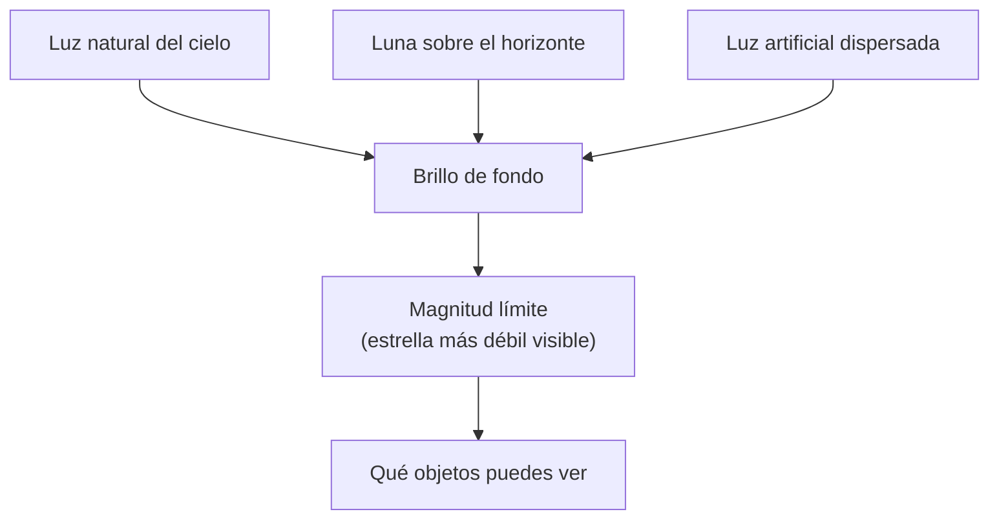

# B08-C12 — Limitación por contaminación lumínica

<!-- nav:top -->
[🏠 Programa](../../../../README.md) · [📚 Bloque B08](../../../tronco-comun/B08-observacion-del-cielo-y-astronomia-practica.md) · [← Anterior: B08-C11 — Magnitudes aparentes y brillo](../B08-C11-magnitudes-aparentes-y-brillo/CLASE.md) · [Siguiente: B08-C13 — Uso seguro de binoculares →](../../../tronco-comun/B08-observacion-del-cielo-y-astronomia-practica.md#b08-c13)
<!-- /nav -->

## 1. Ubicación, nivel y alcance

Duodécima clase del bloque B08 y cierre de la parte de observación a simple vista. En [B08-C11](../B08-C11-magnitudes-aparentes-y-brillo/CLASE.md) calculaste cuánto podría ver un instrumento en un cielo ideal; aquí estudias **qué empeora ese cielo**: la Luna, la luz artificial y la propia atmósfera, y cómo medirlo. Nivel N1.

Verás la magnitud límite como medida del cielo, la luz de la Luna como contaminación natural cuantificable, el atlas mundial de brillo artificial, los observatorios de Chile como contexto y buenas prácticas para reducir tu impacto. No verás fotometría del cielo con instrumentos (B28–B29).

## 2. Por qué esta clase existe

La mayoría de las personas ya no ve la Vía Láctea desde su casa. La pregunta motivadora: **¿qué tan oscuro es mi cielo, cuánto de eso es culpa de la Luna y cuánto de las luces, y qué puedo hacer?** La decisión central: **elegir lugar y fecha de observación midiendo la oscuridad en vez de suponerla**.

## 3. Lo que podrás hacer al terminar

1. Definir contaminación lumínica y distinguirla de la luz natural del cielo.
2. Medir la magnitud límite con un método de conteo de estrellas y estimar su incertidumbre.
3. Calcular las horas de noche astronómica sin Luna para una fecha dada.
4. Leer con espíritu crítico las cifras del atlas mundial de brillo artificial del cielo.
5. Proponer medidas para reducir tu impacto lumínico y evaluar sus límites.
6. Contextualizar el cielo de Chile con fuentes verificadas y declarar lo que no pudiste verificar.

La evidencia es el **informe de cielo** del ejercicio 12.

## 4. Con qué llegas y cómo comprobarlo

1. ¿Qué es la magnitud límite (C11)? 2. ¿Cuántas veces más flujo hay entre magnitud 5,0 y 6,5? 3. ¿Cuándo comienza la noche astronómica (USNO)? 4. ¿Qué altura tiene la Luna cuando sale? 5. ¿Qué es un promedio y una desviación estándar?

<details><summary>Ver respuestas</summary>

1. La magnitud de la estrella más débil visible con un instrumento y un cielo dados. 2. `10^(0,4 × 1,5) = 3,98` veces. 3. Cuando el Sol está a más de 18° bajo el horizonte. 4. 0°. 5. El valor central de un conjunto y una medida de su dispersión.
</details>

Con cuatro o cinco aciertos, sigue; con tres o menos, repasa C11 y C05.

## 5. Un caso real: dos noches de noviembre de 2025 en el Elqui

Comparas la noche de Luna llena (5 al 6 de noviembre de 2025) con la de Luna nueva (20 al 21), en el lugar redondeado de C01. Con las posiciones de la NASA (S1) y el programa de la sección 17 obtienes: la noche astronómica del 5 al 6 dura 7,67 h (de las 00:37 a las 08:17 UT), pero la Luna, ~99 % iluminada, está sobre el horizonte las 7,67 h completas: **0 horas** de cielo oscuro sin Luna. La noche del 20 al 21 dura 7,20 h y la Luna (≈ 0,9 % iluminada) está bajo el horizonte las 7,20 h: **todas**. La misma latitud, el mismo cielo; la diferencia es la fase.

## 6. Vocabulario

La **contaminación lumínica** es el brillo del cielo nocturno por luz artificial emitida o reflejada hacia arriba, y su efecto sobre la observación y los ecosistemas. El **brillo del cielo** (*skyglow*) es la luz difusa en la atmósfera. La **magnitud límite** (MLE) es la de la estrella más débil visible; depende del cielo, del ojo y del instrumento; la IMO la define como la estrella más débil que se ve durante una sesión (S3). La **noche astronómica** es el período con el Sol a más de 18° bajo el horizonte (S4). La **adaptación a la oscuridad** es el proceso por el que el ojo gana sensibilidad tras minutos en la oscuridad. Un **atlas** de brillo artificial es un mapa calculado con modelos de propagación a partir de datos de satélite y de mediciones en tierra (S2).

## 7. Modelo mental: tres capas de luz que se suman

Tu cielo recibe luz de tres capas: la natural del cielo, la de la Luna (si está sobre el horizonte) y la artificial. Todas se suman al fondo; una estrella débil se pierde cuando su brillo es inferior a las variaciones de ese fondo. Reducir una capa sube la magnitud límite.



*Descripción textual:* tres fuentes de luz (natural, lunar, artificial) se suman en el brillo de fondo del cielo; ese fondo fija la magnitud límite y, con ella, qué objetos se ven.

**Analogía y su límite.** Intentar escuchar un susurro en una sala con música. Falla en que la luz no se enmascara igual que el sonido: los ojos se adaptan lentamente y un destello cercano (un faro) borra esa adaptación en segundos.

## 8. La explicación, paso a paso

### 8.1 Qué cuantifica el atlas mundial

Falchi y colaboradores (S2) calcularon un atlas mundial del brillo artificial del cielo con datos de satélite de alta resolución y nuevas mediciones. Entre sus resultados: más del 80 % de la población mundial vive bajo «cielos contaminados»; más del 99 % de la población de Estados Unidos y Europa; la Vía Láctea está oculta para más de un tercio de la humanidad (60 % de los europeos y casi 80 % de los norteamericanos); y el 23 % de la superficie terrestre entre 75° N y 60° S tiene noches contaminadas. Son resultados de un modelo y no mediciones directas en cada sitio: el atlas es una guía, no una medida de tu patio.

**Pausa.** ¿Qué región de la Tierra concentra, según S2, la mayor proporción de población bajo cielos contaminados entre las citadas? <details><summary>Respuesta</summary>Estados Unidos y Europa (más del 99 %). El resumen consultado no da cifras por país para Chile.</details>

### 8.2 La Luna como contaminación natural

La NASA da la fase de la Luna hora por hora (S1). Con la posición de la Luna y la del Sol se calcula cuántas horas de noche astronómica transcurren con la Luna bajo el horizonte. Para el Elqui, noche del 5 al 6: 0,00 h; noche del 20 al 21: 7,20 h (sección 17). Para un objeto débil, la segunda noche es incomparablemente mejor. La fase sola no basta: una Luna en cuarto creciente que se pone temprano deja la segunda mitad de la noche oscura; la altura y la hora de puesta importan tanto como el porcentaje (C08, C04).

### 8.3 Cómo medir la magnitud límite

El procedimiento visual de la IMO (S3, sobre meteoros pero válido para cualquier sesión) es: estimar la estrella más débil visible cerca del centro del campo, contando las estrellas visibles en áreas definidas y comparando el recuento con una carta; usar dos o tres áreas porque el valor cambia con la altura y el tiempo; repetirlo al menos cada hora y más a menudo si cambian las condiciones. Como el valor depende del observador, se reporta la media de varios y se calcula la **desviación estándar** y el **error estándar de la media** (desviación / √n). La cifra se acompaña de fecha, hora UT, lugar, Luna y nubosidad.

### 8.4 Chile: cielos oscuros como recurso, con límites de lo verificado

Los observatorios de ESO en el desierto de Atacama muestran el valor del cielo oscuro: Paranal, a 2635 m de altitud, que ESO describe como «uno de los mejores sitios de observación astronómica del mundo» (S5), y La Silla, a 2400 m y unos 600 km al norte de Santiago, el primer observatorio de ESO, conocido por sus cielos oscuros (S6). Las páginas consultadas no describen el brillo del cielo en números. No se pudo consultar en esta redacción el texto de la normativa chilena de iluminación ni las áreas de protección astronómica, de modo que no se resume aquí su contenido: consulta la norma vigente y la fuente oficial antes de afirmar nada sobre ella.

## 9. Magnitudes, símbolos y unidades

| Símbolo | Qué es | Unidad | Nota |
|---|---|---|---|
| `MLE` | magnitud límite a simple vista | mag | 6,5 referencia IMO |
| `σ` | desviación estándar | mag | de varias estimaciones |
| `SEM` | error estándar de la media | mag | `σ/√n` |
| `T_osc` | horas de noche astronómica sin Luna | h | sección 17 |
| `Δm` | pérdida de magnitud límite | mag | flujo `100^(Δm/5)` |

## 10. Convenciones y referencias

Las horas son UT. La noche astronómica se define con el Sol a −18° (S4). Las posiciones de la Luna son calculadas (NASA) y de baja precisión en altura (≈ 1° por paralaje). La magnitud límite se reporta con un decimal. Los porcentajes del atlas son del resumen del artículo, no de los datos.

## 11. De dónde sale lo que afirmamos

| ID | Fuente | Localizador | Respalda | Consulta | Estado |
|---|---|---|---|---|---|
| S1 | NASA SVS 5415 (JPL DE421) | https://svs.gsfc.nasa.gov/5415/ ; `mooninfo_2025.txt` | Fase, AR y Dec de la Luna (filas citadas) | 2026-11-05 | Datos leídos |
| S2 | Falchi et al., *The new world atlas of artificial night sky brightness*, Sci. Adv. 2, e1600377 (2016); arXiv:1609.01041 | https://arxiv.org/abs/1609.01041 | Porcentajes de población y territorio bajo cielos contaminados | 2026-11-05 | Resumen consultado (no el artículo completo) |
| S3 | IMO, *Glossary* y *Visual observation* | https://imo.net/resources/glossary/ ; https://imo.net/observations/methods/visual-observation/ | Magnitud límite; método de conteo en áreas, 2–3 áreas, revisar cada hora | 2026-11-05 | Páginas leídas |
| S4 | USNO, *Rise, Set, and Twilight Definitions* | https://aa.usno.navy.mil/faq/RST_defs | Crepúsculo astronómico: Sol a 18° bajo el horizonte | 2026-11-05 | Página leída |
| S5 | ESO, *Paranal Observatory* | https://www.eso.org/public/teles-instr/paranal-observatory/ | Atacama, 2635 m, VLT, «uno de los mejores sitios» | 2026-11-05 | Página leída |
| S6 | ESO, *La Silla Observatory* | https://www.eso.org/public/teles-instr/lasilla/ | Borde del desierto de Atacama, a unos 600 km al norte de Santiago, 2400 m; cielos oscuros | 2026-11-05 | Página leída |
| S7 | astropy 8.0.2 / pyerfa 2.0.1.5 | https://www.astropy.org | Instantes de crepúsculo astronómico (prueba del laboratorio) | 2026-11-05 | Ejecutado localmente |

Límites: no se leyó el cuerpo del artículo de Falchi ni se obtuvo el atlas para Chile; la normativa chilena y las áreas de protección astronómica **no se consultaron** (las fuentes oficiales no se abrieron en esta redacción); no se midió el brillo del cielo en unidades físicas; buenas prácticas de iluminación (apantallado, tono cálido, regulación) son recomendaciones generales no verificadas aquí.

## 12. Cómo ver (o medir) la oscuridad

Tabla de las dos noches (laboratorio):

| Noche | Noche astronómica | Horas sin Luna | Fase media |
|---|---|---|---|
| 5–6 nov 2025 (llena) | 00:37–08:17 UT (7,67 h) | 0,00 | 99,2 % |
| 20–21 nov 2025 (nueva) | 00:53–08:05 UT (7,20 h) | 7,20 | 0,9 % |

Sin ver: un medidor de luz con salida sonora o un asistente que cuente estrellas a tu dictado; el atlas de S2 está en línea y se puede consultar con lector de pantalla.

## 13. Ejemplo trabajado: tres lecturas de magnitud límite

Tres compañeros reportan `5,8`, `6,0` y `5,5` (datos sintéticos, ilustrativos). Media `= 5,77`; desviaciones `+0,03, +0,23, −0,27`; `σ = √(0,0009+0,0529+0,0729)/2 = √0,0634 = 0,252`; `SEM = 0,252/√3 = 0,15`. Reporte: «MLE = 5,8 ± 0,3 (2 SEM), 3 observadores». **Paso final · incertidumbre.** Con tres personas el error es grande; con una noche más y más áreas se reduce. Si el valor fuera 5,8 frente a 6,5 de referencia: `Δm = 0,7`, flujo `100^(0,7/5) = 1,9` veces: pierdes las estrellas que son menos de dos veces más débiles que el límite de referencia.

## 14. Comparación de métodos

El **conteo visual** es gratuito pero depende del ojo; un **medidor de brillo del cielo** da una cifra física, pero cuesta y exige calibración (B28); el **atlas** (S2) da un contexto regional pero no tu patio. La **posición de la Luna** es el factor natural más fácil de controlar eligiendo la fecha. Un informe sólido combina al menos dos.

## 15. Práctica guiada

**Ejercicio 1.** Calcula el flujo relativo por perder 1,5 magnitudes de límite. *Pasos:* C11.

<details><summary>Solución comentada</summary>

`100^(1,5/5) = 10^0,6 = 3,98`: las estrellas que ves son casi cuatro veces más brillantes que las que perdiste.
</details>

**Ejercicio 2.** Con las dos noches de la sección 12, ¿cuál elegirías para un objeto débil y por qué?

<details><summary>Solución comentada</summary>

La del 20–21 de noviembre: 7,20 h de noche sin Luna frente a 0 h. La longitud de la noche es parecida (7,67 y 7,20 h), así que la diferencia es la Luna.
</details>

**Ejercicio 3.** Calcula la media, la desviación estándar y el error estándar de `5,8; 6,0; 5,5; 6,2; 5,9`. *Pasos:* 8.3.

<details><summary>Solución comentada</summary>

Media `5,88`; desviaciones `−0,08, +0,12, −0,38, +0,32, +0,02`; suma de cuadrados `0,268`; `σ = √(0,268/4) = 0,259`; `SEM = 0,259/√5 = 0,116`. Reporte `5,9 ± 0,2`.
</details>

## 16. Práctica autónoma, transferencia e integrador

**Ejercicio 4.** ¿Qué porcentaje de la población mundial vive, según S2, bajo cielos no contaminados como mucho?

<details><summary>Solución comentada</summary>

Más del 80 % vive bajo cielos contaminados, de modo que a lo sumo ~20 % no. Cuidado: es un resultado del resumen del artículo con su definición de «contaminado»; no es una medida local.
</details>

**Ejercicio 5.** Una noche astronómica de 7,67 h con la Luna sobre el horizonte las 7,67 h, ¿cuántas horas de cielo sin Luna hay? ¿Y si la Luna se pone a las 03:00 UT, con la noche entre 00:37 y 08:17 UT?

<details><summary>Solución comentada</summary>

Cero horas en el primer caso. En el segundo, `08:17 − 03:00 = 5,28 h` de cielo sin Luna (suponiendo que no vuelva a salir).
</details>

**Ejercicio 6.** Si la estrella más débil que ves cambia de 6,0 a 5,0 al salir la Luna, ¿cuántas magnitudes y qué factor de flujo?

<details><summary>Solución comentada</summary>

Pierdes 1,0 mag: factor 2,512 en flujo.
</details>

**Ejercicio 7.** ¿Por qué se cuentan estrellas en 2 o 3 áreas y se repite cada hora? *Pista:* S3.

<details><summary>Solución comentada</summary>

El valor cambia con la altura del campo sobre el horizonte y con el tiempo (Luna, crepúsculo, nubes). Varias áreas y repeticiones dan una estimación robusta con una incertidumbre calculable.
</details>

**Ejercicio 8.** ¿Qué dice y qué no dice S2 sobre Chile?

<details><summary>Solución comentada</summary>

El resumen consultado no menciona Chile ni da cifras por país (salvo Estados Unidos y Europa). No se puede afirmar nada de Chile a partir de él.
</details>

**Ejercicio 9 · transferencia.** Un vecino afirma que «en Chile no hay contaminación lumínica». Evalúa con lo que consultaste.

<details><summary>Solución comentada</summary>

No se puede apoyar ni refutar con S5 y S6, que describen observatorios en lugares aislados del desierto de Atacama. La contaminación lumínica depende del lugar: una ciudad, aun en Chile, tiene cielos brillantes. Una afirmación así necesita medición local o datos del atlas por región.
</details>

**Ejercicio 10 · transferencia.** Propone tres acciones para reducir tu luz hacia el cielo y para cada una anota qué dato verificarías.

<details><summary>Solución comentada</summary>

Ejemplo: apantallar las luminarias para que no emitan hacia arriba (verificar con una foto nocturna o con un medidor), apagar o bajar el brillo de luces innecesarias a ciertas horas (medir la magnitud límite antes y después), y elegir un tono más cálido (comprobar que la norma local lo permite y cuánto cambia el cielo). Se valora declarar que estas medidas son recomendaciones generales no verificadas aquí.
</details>

**Ejercicio 11 · transferencia.** ¿Cómo participa una persona ciega en una campaña de medición de magnitud límite?

<details><summary>Solución comentada</summary>

Como organizador y analista de datos (tabulación, estadística, mapas del atlas leídos con lector de pantalla), con una persona vidente que cuente estrellas; o con un instrumento que emita su lectura en sonido. La campaña no depende de una sola vía.
</details>

**Ejercicio 12 · integrador.** Elabora un **informe de cielo** de una página: lugar (con permiso), magnitud límite medida con su incertidumbre y método, estado de la Luna (fase, altura, horas sin Luna para la fecha), luces cercanas, lo que dice una fuente verificada sobre tu región y una recomendación.

<details><summary>Solución modelo</summary>

Debe incluir datos de al menos dos observadores o dos áreas, media y SEM, fecha y hora UT, horas sin Luna calculadas con una fuente citada, una referencia al atlas o a otra fuente verificada con su límite, y una acción concreta y verificable.
</details>

## 17. Laboratorio: [`ventana_oscura.py`](ventana_oscura.py)

**Objetivo.** Calcular las horas de noche astronómica sin Luna. **Datos:** posiciones lunares de la NASA (calculadas, copiadas) y Sol de baja precisión (simulado). **Procedimiento:** `python ventana_oscura.py`; la prueba compara el crepúsculo con astropy (6 min de tolerancia) y exige que la noche de Luna nueva tenga más horas sin Luna. **Resultados reales (Python 3.12.9):**

```text
llena (5-6 nov 2025): noche astronómica 00.62-08.28 UT (7.67 h) | horas sin Luna sobre el horizonte 0.00 h | fase media 99.22 %
nueva (20-21 nov 2025): noche astronómica 00.88-08.08 UT (7.20 h) | horas sin Luna sobre el horizonte 7.20 h | fase media 0.91 %
```

**Límites:** altura de la Luna sin paralaje ni refracción (≈ 1° de error), interpolación lineal entre filas de 2 h. **Sin código:** compara la hora de puesta de la Luna de una aplicación con el fin del crepúsculo. **Sin equipo:** anota cuándo desaparece la Luna tras un horizonte conocido.

## 18. Errores frecuentes y cómo corregirlos

**Atribuir toda la luz a las ciudades e ignorar la Luna.** Ejercicio 2. **Confundir magnitud límite con la de un instrumento.** Sección 6. **Reportar un solo valor sin incertidumbre.** Ejercicio 3. **Extrapolar el atlas a tu patio.** Ejercicio 8. **Afirmar leyes sin leerlas.** Se corrige con la sección 8.4.

## 19. Cómo sabrás que vas bien

Tras 8.2: ¿calculas las horas sin Luna para una noche? Ejercicio 5. Tras 8.3: ¿tu reporte lleva incertidumbre? Ejercicio 3. Final: ¿tu informe separa lo medido de lo supuesto?

## 20. Qué entregas y cómo se evalúa

El **informe de cielo** (ejercicio 12).

| Criterio | Inicial | En desarrollo | Logrado | Destacado |
|---|---|---|---|---|
| Medición | Una cifra | Varias sin estadística | Media y SEM con método | Repite en otra noche |
| Luna | No la considera | Fase | Horas sin Luna calculadas | Contrasta dos fechas |
| Fuentes | Sin fuente | Sin fecha | Con fecha y alcance | Declara lo no verificado |
| Accesibilidad y ética | Ninguna | Menciona | Alternativa y permiso | Plan de mitigación |

**Condiciones críticas:** no entrar en propiedad privada sin permiso; declarar la normativa no consultada como tal.

## 21. Ética, seguridad y límites

Observar de noche es seguro solo con preparación: reconoce el sitio de día, avisa tu ruta, lleva abrigo, agua y linterna roja, y no te alejes solo del vehículo; los desiertos y la cordillera se enfrían de golpe. Muchos buenos sitios son propiedad privada o zonas restringidas: pide permiso. La luz de tu linterna, tus faros y tu pantalla arruinan la adaptación de los demás: apágalos o cúbrelos con rojo. La contaminación lumínica afecta a la comunidad científica, a la fauna y a las personas: trátala como un problema compartido, sin acusar a nadie sin medición. Nunca apuntes instrumentos al Sol sin filtro certificado (C16). El material es educativo; para exigir el cumplimiento de una norma, consulta la autoridad competente.

## 22. Para cerrar y seguir

La magnitud límite mide tu cielo; la Luna es la contaminación natural más fácil de controlar; la luz artificial la suma el atlas mundial en cifras que hay que leer con cuidado. Las horas de noche sin Luna se calculan; la oscuridad real se mide con su incertidumbre. Queda abierta una pregunta: ¿cómo ver más con binoculares, sin dañarte ni dañar el instrumento? (C13).

**Glosario español–inglés.** contaminación lumínica · *light pollution*; brillo del cielo · *skyglow*; magnitud límite · *limiting magnitude*; noche astronómica · *astronomical night*; adaptación a la oscuridad · *dark adaptation*; error estándar · *standard error*.

**Continuidad.** B08-C13 pasa a los binoculares, que aprovechan la oscuridad que acabas de aprender a medir.

**Referencias:** ver sección 11.

<!-- nav:bottom -->
---

[← Anterior: B08-C11 — Magnitudes aparentes y brillo](../B08-C11-magnitudes-aparentes-y-brillo/CLASE.md) · [📚 Bloque B08](../../../tronco-comun/B08-observacion-del-cielo-y-astronomia-practica.md) · [Siguiente: B08-C13 — Uso seguro de binoculares →](../../../tronco-comun/B08-observacion-del-cielo-y-astronomia-practica.md#b08-c13)
<!-- /nav -->
