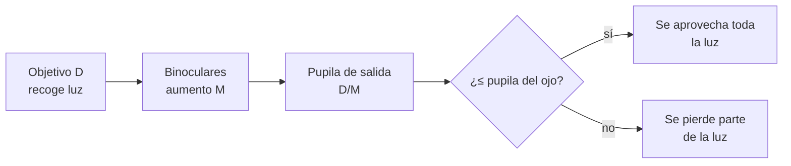

# B08-C13 — Uso seguro de binoculares

<!-- nav:top -->
[🏠 Programa](../../../../README.md) · [📚 Bloque B08](../../../tronco-comun/B08-observacion-del-cielo-y-astronomia-practica.md) · [← Anterior: B08-C12 — Limitación por contaminación lumínica](../B08-C12-limitacion-por-contaminacion-luminica/CLASE.md) · [Siguiente: B08-C14 — Telescopios de iniciación →](../B08-C14-telescopios-de-iniciacion/CLASE.md)
<!-- /nav -->

## 1. Ubicación, nivel y alcance

Decimotercera clase del bloque B08. Pasas de observar a simple vista a usar un instrumento: los **binoculares**, que NASA recomienda como primer instrumento. «Seguro» significa dos cosas: no dañar tus ojos (jamás apuntarlos al Sol sin filtro certificado) y no dañar ni perder el equipo ni a ti en el campo. Nivel N1.

Verás qué significan los números de unos binoculares, cómo sostenerlos y ajustarlos, qué ver con ellos (Luna, cúmulos, planetas) y cómo cuidarlos. No verás telescopios (C14), monturas (C15) ni filtros solares (C16).

## 2. Por qué esta clase existe

Unos binoculares multiplican lo que ves, pero también multiplican el riesgo si miras al Sol. La pregunta motivadora: **¿qué binoculares sirven para mi caso y cómo los uso sin hacerme daño?** La decisión central: **elegir aumento y apertura según qué quieres ver y cómo los sostendrás, y fijar reglas de seguridad antes de la primera salida**.

## 3. Lo que podrás hacer al terminar

1. Leer una especificación «M×D» y calcular la pupila de salida y el campo real aproximado.
2. Elegir entre binoculares de mano o con trípode según el aumento.
3. Ajustar distancia interpupilar, enfoque y dioptrías.
4. Planificar qué observar con ellos (Luna cerca del terminador, planetas, cúmulos).
5. Aplicar reglas de seguridad ocular y de terreno.
6. Estimar la ganancia teórica y declarar por qué la real es menor.

La evidencia es la **ficha de uso seguro** del ejercicio 12.

## 4. Con qué llegas y cómo comprobarlo

1. ¿Qué es la ganancia en magnitud límite (C11)? 2. Calcula `50/7`. 3. ¿Qué significa «campo» de visión? 4. ¿Qué altura tiene el polo sur celeste en tu lugar? 5. ¿Por qué no se mira el Sol sin protección?

<details><summary>Ver respuestas</summary>

1. Cuántas magnitudes más débil se llega. 2. 7,14. 3. El ángulo de cielo que abarca la imagen. 4. Tu latitud, sin signo. 5. Porque puede dañar la retina de forma permanente (NASA, C09).
</details>

Con cuatro o cinco aciertos, sigue; con tres o menos, repasa C11 y C09.

## 5. Un caso real: la Luna llena de noviembre con binoculares 10×50

Retomas la noche del 5 de noviembre de 2025 en el Elqui (lugar redondeado). La Luna está cerca del perigeo, 99,86 % iluminada (NASA, S1). NASA aconseja, para ver la Luna con binoculares, al menos 7 aumentos, y mirar cerca del límite entre luz y sombra para que los accidentes del relieve se aprecien (S2). En luna llena eso no existe; sin embargo, es una buena ocasión para practicar el ajuste y el pulso. Imagina que tienes unos 10×50 prestados.

## 6. Vocabulario

En «M×D» (por ejemplo 7×35), `M` es el **aumento** y `D` el diámetro del **objetivo** en milímetros (S2). La **pupila de salida** es el círculo de luz que sale del ocular, de diámetro `D/M`. El **campo de visión** (real) es el ángulo de cielo que ves; el **campo aparente** es el ángulo que ocupa la imagen en tu vista; el real es aproximadamente `aparente/M`. Los prismas pueden ser **porro** (más anchos, a menudo con mejor campo) o de **techo** (más compactos) (S2). La **distancia interpupilar** es la separación de tus ojos que debes igualar con las bisagras; el **ajuste dióptrico** corrige la diferencia entre tus dos ojos. La **estabilización** de imagen o un **trípode** reducen el temblor.

## 7. Modelo mental: la luz entra por el objetivo y sale por la pupila de salida

El objetivo recoge luz; el ocular la concentra en un haz que debe entrar en tu pupila. Si el haz (la pupila de salida) es mayor que tu pupila, parte de la luz se pierde. Si es menor, aprovechas toda. El aumento reduce el campo y agranda el temblor.



*Descripción textual:* la luz entra por el objetivo, los binoculares la concentran y sale por la pupila de salida de diámetro D/M; si ese haz cabe en la pupila del ojo se aprovecha toda la luz, si no, parte se pierde.

**Analogía y su límite.** Un embudo que llena un vaso: si el chorro es más ancho que la boca del vaso, se derrama. Falla porque la pupila del ojo cambia con la luz y la edad.

## 8. La explicación, paso a paso

### 8.1 Leer los números

NASA recomienda, para empezar, entre 7×35 y 10×50: con más aumento el campo es más estrecho, pesan más y se sacuden, salvo con estabilización o trípode (S2, S3). Con estos números se calcula: 7×50 → pupila de salida `50/7 = 7,14 mm`; 10×50 → `5,0 mm`; 7×35 → `5,0 mm`. Si tu pupila dilatada es de 7 mm (supuesto de ejemplo), los 7×50 la llenan; si fuera de 5 mm, solo se aprovechan `5 × 7 = 35 mm` de los 50. El campo real aproximado con un campo aparente de 60° (supuesto) es `60/7 = 8,6°` para 7× y `6,0°` para 10×. NASA señala que los binoculares muestran un cielo mucho más ancho que casi cualquier telescopio: caben objetos grandes enteros (S2).

**Pausa.** ¿Qué binoculares tienen mayor pupila de salida: 8×42 o 10×50? <details><summary>Respuesta</summary>8×42: `42/8 = 5,25 mm`; 10×50: `5,0 mm`.</details>

### 8.2 Ajustar y sostener

Abre las bisagras hasta que veas un solo círculo (distancia interpupilar). Enfoca con el ojo izquierdo cerrado sobre un objeto lejano, usando la rueda central; luego con el derecho cerrado, corrige con el ajuste dióptrico. Apoya los codos, o el cuerpo en un muro; a mayor aumento, el temblor se nota más, y NASA sugiere trípode para 10× o 15× en la Luna (S4). Para objetos altos, usa una silla reclinable.

### 8.3 Qué observar

Luna: según NASA, con al menos 7 aumentos se ven cráteres y cordilleras, sobre todo cerca del límite entre luz y sombra, y las fases distintas de la llena muestran más relieve (S4). Planetas: aparecen como puntos, aunque los binoculares son una buena primera herramienta (C10). Cúmulos y objetos extensos grandes: caben en el campo (S2). Para encontrar objetos débiles: usa un planisferio o aplicación (C07), parte desde una estrella brillante y avanza por «saltos» conocidos.

### 8.4 Seguridad ocular y de equipo

**Nunca mires el Sol con binoculares, ni de pasada.** NASA indica que, para mirar el Sol con binoculares o telescopios, se necesitan filtros solares especiales montados al frente; los visores de eclipse no se combinan con ellos (S5). La AAS añade que los filtros del frente deben ser de proveedores verificados y usarlos solo observadores con experiencia (S6). La regla de esta clase: **no uses tus binoculares de día cerca del Sol**. Además, no dejes los binoculares al sol: pueden concentrar luz y dañar el equipo o provocar incendios (consecuencia óptica general, no verificada en una fuente de esta clase). Cuida la lente: no la toques con los dedos.

## 9. Magnitudes, símbolos y unidades

| Símbolo | Qué es | Unidad | Nota |
|---|---|---|---|
| `M` | aumento | × | adimensional |
| `D` | diámetro del objetivo | mm | S2 |
| `d_s = D/M` | pupila de salida | mm | `50/7 = 7,14` |
| `d_ojo` | pupila del ojo | mm | supuesto de 7 o 5 mm |
| `θ_real` | campo real | ° | `aparente/M` |
| `Δm` | ganancia ideal | mag | `5 log₁₀(D_ef/d_ojo)` |

## 10. Convenciones y referencias

Las tallas de binoculares recomendadas (7×35 a 10×50) son las de NASA Night Sky Network; el campo aparente de 60° y las pupilas de 5 y 7 mm son supuestos de ejemplo, no cifras de fuente. Los resultados del laboratorio son ideales. La edad reduce el tamaño máximo de la pupila (afirmación general, no verificada aquí).

## 11. De dónde sale lo que afirmamos

| ID | Fuente | Localizador | Respalda | Consulta | Estado |
|---|---|---|---|---|---|
| S1 | NASA SVS 5415 (JPL DE421) | https://svs.gsfc.nasa.gov/5415/ ; `mooninfo_2025.txt` | Fase y distancia de la Luna el 5-nov-2025 | 2026-11-05 | Datos leídos |
| S2 | NASA Science / Night Sky Network, «Binoculars: A Great First Telescope» (post. 2022, act. abr-2024) | https://science.nasa.gov/solar-system/skywatching/night-sky-network/binoculars-a-great-first-telescope/ | Significado de M×D; 7×35 a 10×50; campo más estrecho y más peso con más aumento; porro vs techo; clubes | 2026-11-05 | Página leída |
| S3 | Night Sky Network, «How to Choose a First Telescope» (dic-2020) | https://nightsky.jpl.nasa.gov/news/321/ | Binoculares 7×35–10×50; sacudida a mayor aumento; aprender el cielo primero | 2026-11-05 | Página leída |
| S4 | NASA Science, «Viewing the Moon» (act. 18-feb-2026) | https://science.nasa.gov/moon/viewing-tips/ | Binoculares: al menos 7×; 10×–15× pueden requerir trípode; mirar cerca del terminador; fases distintas de la llena | 2026-11-05 | Página leída |
| S5 | NASA Science, *Eclipse safety* | https://science.nasa.gov/eclipses/safety/ | Filtros solares especiales en el frente de binoculares; no combinar con visores | 2026-11-05 | Página leída |
| S6 | AAS, *Solar filters for telescopes, binoculars and cameras* | https://eclipse.aas.org/eye-safety/viewers-filters | Filtros en el frente; proveedores; solo observadores con experiencia | 2026-11-05 | Página leída (sin fecha) |

Límites: ningún modelo de binoculares se probó; los campos aparentes y la pupila son supuestos; el riesgo de incendio por concentración de luz es un consejo general sin fuente.

## 12. Cómo ver con binoculares (alternativas)

| Recurso | Qué haces | Alternativa |
|---|---|---|
| Sin equipo | Describes la Luna a simple vista (S4) | Modelo táctil de la Luna |
| Binoculares | Terminador, cúmulos, planetas | Trípode o apoyo en un muro |
| Telescopio | Ver C14 | — |
| Datos abiertos | Fotos y datos de la Luna (NASA SVS) | Descripción hablada o impresión táctil |

Para una persona ciega, la actividad se adapta a la descripción: alguien que ve describe y la persona dirige la búsqueda con la tabla de alturas y acimuts (C04). Para baja visión, los binoculares con enfoque fácil y trípode estable ayudan.

## 13. Ejemplo trabajado: 7×50 frente a 10×50 en el Elqui

Con una pupila de ojo de 7 mm, los 7×50 aprovechan `D_ef = min(50, 7×7) = 49 mm` (ganancia `+4,23` mag) y los 10×50, 50 mm (`+4,27`): casi lo mismo. Con una pupila de 5 mm, los 7×50 aprovechan solo `35 mm` (`+4,23`) y los 10×50 los 50 mm (`+5,00`). El 10×50 tiene un campo de `6,0°` frente a `8,6°`, pero se sacude más. **Paso final · incertidumbre.** La ganancia es ideal; la pupila, el campo aparente y el temblor cambian los números. Elige según qué falla primero en tu caso: si el pulso, 7×; si la luz, 10×. Anota el supuesto.

## 14. Comparación de métodos

**Mano libre** es rápido pero limita el aumento útil. **Trípode con adaptador** estabiliza y permite 10× o más, a costa de comodidad. **Apoyo en un muro o árbol** es el compromiso del campo. El **telescopio** (C14) aumenta más con menos campo. Un buen observador usa binoculares para localizar y el telescopio para detallar.

## 15. Práctica guiada

**Ejercicio 1.** Calcula la pupila de salida de unos 8×42 y de unos 7×35. *Pasos:* 8.1.

<details><summary>Solución comentada</summary>

8×42: `42/8 = 5,25 mm`. 7×35: `35/7 = 5,0 mm`.
</details>

**Ejercicio 2.** Calcula el campo real aproximado de unos 10×50 con campo aparente supuesto de 60°.

<details><summary>Solución comentada</summary>

`60/10 = 6°`. Con 7× serían `8,6°`.
</details>

**Ejercicio 3.** ¿Qué parte de un campo de 60° ocupa la Luna (0,5°) con 10 aumentos?

<details><summary>Solución comentada</summary>

Aparente: `0,5° × 10 = 5°`, que es `5/60 = 8 %` del campo aparente.
</details>

## 16. Práctica autónoma, transferencia e integrador

**Ejercicio 4.** Si tu pupila es de 5 mm, ¿qué apertura efectiva aprovechas con 7×50 y qué ganancia ideal tienes frente al ojo?

<details><summary>Solución comentada</summary>

`D_ef = 7 × 5 = 35 mm`; ganancia `5 log₁₀(35/5) = 5 log₁₀ 7 = 4,23` mag.
</details>

**Ejercicio 5.** ¿Qué es mejor para cielo oscuro y objetos débiles: 7×35 o 10×50? Justifica con la ganancia.

<details><summary>Solución comentada</summary>

10×50: con pupila de 7 mm gana `4,27` frente a `3,49` mag de los 7×35. Pero el 7×35 es más liviano y estable.
</details>

**Ejercicio 6.** Un vendedor dice que unos binoculares «30×60» son mejores. ¿Qué preguntas haces?

<details><summary>Solución comentada</summary>

Campo real (será ~2°), peso y estabilidad (probablemente requieren trípode, S2, S3), pupila de salida `60/30 = 2 mm` (poca luz), y si se probó en campo. NASA recomienda no ir mucho más allá de 10×50 al comienzo (S2).
</details>

**Ejercicio 7.** Ordena de menor a mayor campo real: 7×35, 10×50, 15×70 (con campo aparente de 60°).

<details><summary>Solución comentada</summary>

15×70: 4,0°; 10×50: 6,0°; 7×35: 8,6°.
</details>

**Ejercicio 8.** ¿Qué dos acciones reducen el temblor sin cambiar de binoculares?

<details><summary>Solución comentada</summary>

Apoyar los codos o el cuerpo (muro, árbol) y montarlos en un trípode (S3, S4). También respirar y observar sentado.
</details>

**Ejercicio 9 · transferencia.** Un compañero quiere "mirar el eclipse parcial solo un segundo con mis binoculares". ¿Qué le respondes?

<details><summary>Solución comentada</summary>

No: sin filtro solar certificado al frente de la óptica, incluso un instante puede causar daño (S5). Alternativas: visor ISO 12312-2 sin óptica, o proyección con orificio sin mirar el Sol (C09, C16).
</details>

**Ejercicio 10 · transferencia.** ¿Cómo adaptarías la actividad de la Luna para una persona con baja visión?

<details><summary>Solución comentada</summary>

Trípode con apuntado asistido por otra persona, binoculares con enfoque sencillo, alto contraste en cuaderno de registro, descripción hablada del terminador, y una imagen tomada de la tabla de la NASA impresa en relieve.
</details>

**Ejercicio 11 · transferencia.** Ordena de más a menos prioritaria la lista de seguridad para una salida nocturna con niños.

<details><summary>Solución comentada</summary>

Una buena respuesta incluye: prohibir mirar el Sol con cualquier óptica, supervisión adulta, reconocimiento del terreno de día, abrigo y agua, linterna roja, plan de regreso, y cuidado del equipo. Se valora justificar el orden.
</details>

**Ejercicio 12 · integrador.** Elabora una **ficha de uso seguro**: tus binoculares (o unos hipotéticos) con M×D, pupila de salida, campo real, ganancia ideal con el supuesto de pupila; un plan de observación de la Luna; las cinco reglas de seguridad ocular y de terreno; y una alternativa sin instrumento.

<details><summary>Solución modelo</summary>

La ficha debe tener los cálculos de 8.1 y 13, declarar sus supuestos, citar la fuente de seguridad (S5, S6), incluir la regla de no apuntar al Sol y una alternativa no visual o sin equipo.
</details>

## 17. Laboratorio: [`binoculares.py`](binoculares.py)

**Requisitos:** Python 3.9 o superior y solo la biblioteca estándar; no hace falta instalar nada. Los valores de referencia de astropy 8.0.2 / pyerfa 2.0.1.5 están copiados en el código (no se importa astropy); para regenerarlos: `pip install astropy==8.0.2` (o `uv pip install astropy==8.0.2`). Los scripts comparten `programa/clases/B08/astrolib_b08.py`; si falta, Python avisa con un ImportError que nombra el módulo.

**Objetivo.** Calcular los números derivados de la especificación. **Datos:** especificaciones tipo (NASA recomienda el rango 7×35–10×50); resultados simulados bajo supuestos declarados. **Procedimiento:** `python binoculares.py`; las pruebas analíticas detienen el programa si fallan. **Resultados reales (Python 3.12.9):**

```text
MxD    | pupila salida | campo real | D efectiva (7|5 mm) | ganancia ideal (7|5 mm)
 7x35  |   5.00 mm |   8.6 gr |   35 |   35 mm | +3.49 | +4.23 mag
 7x50  |   7.14 mm |   8.6 gr |   49 |   35 mm | +4.23 | +4.23 mag
 8x42  |   5.25 mm |   7.5 gr |   42 |   40 mm | +3.89 | +4.52 mag
10x50  |   5.00 mm |   6.0 gr |   50 |   50 mm | +4.27 | +5.00 mag
15x70  |   4.67 mm |   4.0 gr |   70 |   70 mm | +5.00 | +5.73 mag
La Luna (0,5 grados) con aumento 10 ocupa 5.0 grados de campo aparente: 8 % de un campo de 60 grados
```

**Límites:** sin pérdidas ópticas; campo aparente y pupila supuestos; la ganancia es respecto del ojo con esa pupila. **Sin código:** calculadora. **Sin equipo:** usa un tubo de cartón para simular un campo estrecho.

## 18. Errores frecuentes y cómo corregirlos

**Pensar que más aumento es mejor.** Ejercicio 6. **Mirar el Sol «solo un instante».** Ejercicio 9. **Ignorar la pupila de salida.** Ejercicio 4. **Mirar la Luna llena para ver relieve.** Sección 8.3. **No ajustar dioptrías.** Sección 8.2.

## 19. Cómo sabrás que vas bien

Tras 8.1: ¿calculas pupila de salida y campo de memoria? Ejercicios 1 y 2. Tras 8.2: ¿ajustas con los ojos alternados? Prueba en casa. Final: ¿tu ficha incluye las reglas de seguridad?

## 20. Qué entregas y cómo se evalúa

La **ficha de uso seguro** (ejercicio 12).

| Criterio | Inicial | En desarrollo | Logrado | Destacado |
|---|---|---|---|---|
| Cálculo | Sin cálculo | Con errores | Correcto con supuestos | Compara dos binoculares |
| Seguridad ocular | Omite | Menciona | Regla explícita con fuente | Plan para el caso de eclipse |
| Terreno y equipo | Omite | Genérico | Específico del sitio | Con plan de regreso |
| Accesibilidad | Ninguna | Menciona | Alternativa | La prueba |

**Condición crítica (no se compensa por promedio):** una ficha que permita apuntar binoculares al Sol sin filtro certificado al frente, o que combine visores de eclipse con binoculares, se evalúa como no aprobada.

## 21. Ética, seguridad y límites

**Nunca apuntes binoculares al Sol.** Un filtro solar para binoculares debe ir montado al frente, ser de un proveedor verificado y usarse solo con experiencia (S5, S6); los visores de eclipse no se combinan con óptica. Si no tienes ese filtro, no los uses de día cerca del Sol y tapa los objetivos al guardarlos. De noche: terreno desconocido, frío, caídas y animales; observa acompañado, con linterna roja, abrigo y agua, y no uses los binoculares mientras caminas. Cuida a los demás: no deslumbres con luces. Respeta propiedad privada y áreas protegidas. Material educativo; no sustituye el consejo de un oftalmólogo ni de un club astronómico (que NASA recomienda para probar equipos, S2, S3).

## 22. Para cerrar y seguir

Los binoculares se eligen por tres números (aumento, objetivo y pupila de salida), se ajustan en un minuto y se usan con seguridad si el Sol queda fuera de su alcance. Son el mejor primer instrumento, según NASA. Queda abierta una pregunta: ¿qué cambia con un telescopio? (C14).

**Glosario español–inglés.** binoculares · *binoculars*; aumento · *magnification*; objetivo · *objective lens*; pupila de salida · *exit pupil*; campo de visión · *field of view*; prisma de techo · *roof prism*; prisma porro · *porro prism*; distancia interpupilar · *interpupillary distance*.

**Continuidad.** B08-C14 estudia los telescopios de iniciación, con las mismas ideas de apertura, aumento y pupila de salida.

**Referencias:** ver sección 11.

<!-- nav:bottom -->
---

[← Anterior: B08-C12 — Limitación por contaminación lumínica](../B08-C12-limitacion-por-contaminacion-luminica/CLASE.md) · [📚 Bloque B08](../../../tronco-comun/B08-observacion-del-cielo-y-astronomia-practica.md) · [Siguiente: B08-C14 — Telescopios de iniciación →](../B08-C14-telescopios-de-iniciacion/CLASE.md)
<!-- /nav -->
