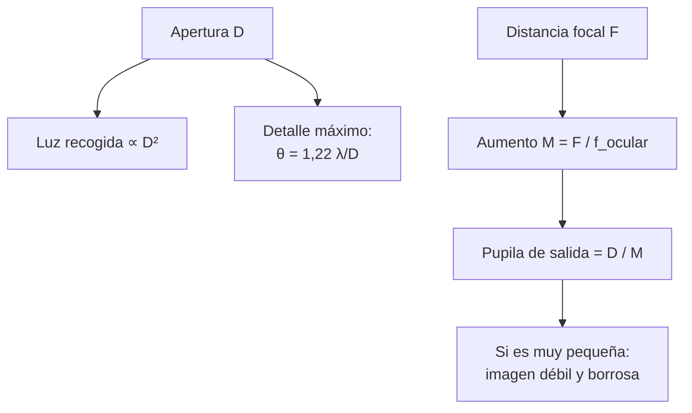

# B08-C14 — Telescopios de iniciación

<!-- nav:top -->
[🏠 Programa](../../../../README.md) · [📚 Bloque B08](../../../tronco-comun/B08-observacion-del-cielo-y-astronomia-practica.md) · [← Anterior: B08-C13 — Uso seguro de binoculares](../B08-C13-uso-seguro-de-binoculares/CLASE.md) · [Siguiente: B08-C15 — Monturas y seguimiento inicial →](../B08-C15-monturas-y-seguimiento-inicial/CLASE.md)
<!-- /nav -->

## 1. Ubicación, nivel y alcance

Decimocuarta clase del bloque B08. Con los binoculares aprendiste apertura, aumento y pupila de salida; el telescopio usa las mismas ideas pero aumenta más y abarca menos. Aquí entiendes sus partes y cuentas básicas, y aprendes a no caer en la publicidad de aumentos. Nivel N1.

Verás tipos de telescopio (refractor, reflector, Dobson), razón focal, aumento, pupila de salida, campo, poder separador y qué se puede ver con uno de iniciación. No verás monturas (C15), óptica geométrica detallada (B25) ni fabricación (B27).

## 2. Por qué esta clase existe

Un telescopio de juguete anuncia «600×» y decepciona. La pregunta motivadora: **¿qué telescopio me conviene y qué podré ver con él?** La decisión central: **elegir la apertura y el tipo de instrumento según presupuesto, transporte y objetivos, y rechazar afirmaciones sin sentido físico**.

## 3. Lo que podrás hacer al terminar

1. Distinguir refractor, reflector y Dobson, con una ventaja y un límite de cada uno.
2. Calcular razón focal, aumento, pupila de salida y campo de un sistema telescopio–ocular.
3. Explicar por qué la apertura es el parámetro más importante.
4. Detectar una publicidad de aumento sin sentido.
5. Estimar el tamaño del rasgo lunar más pequeño que resuelve un telescopio, con su límite teórico.
6. Planificar una primera noche con el instrumento y con alternativas.

La evidencia es la **ficha de telescopio** del ejercicio 12.

## 4. Con qué llegas y cómo comprobarlo

1. ¿Qué es la pupila de salida (C13)? 2. ¿Cuánto es `1,22 × 550 nm / 0,1 m` en radianes? 3. ¿Cuántos segundos de arco hay en un radián? 4. ¿Qué ganancia ideal da una apertura 10 veces mayor que la pupila (C11)? 5. ¿Por qué no se apunta un telescopio al Sol sin filtro?

<details><summary>Ver respuestas</summary>

1. El diámetro del haz que sale del ocular, `D/M`. 2. `6,71 × 10⁻⁶ rad`. 3. 206 265. 4. 5 magnitudes. 5. Porque concentra la luz solar y daña la vista y el equipo (C09).
</details>

Con cuatro o cinco aciertos, sigue; con tres o menos, repasa C11 y C13.

## 5. Un caso real: ¿qué telescopio para la Luna del Elqui?

Retomas el 5 de noviembre de 2025 en el Elqui (lugar redondeado). La Luna estaba a 357 024 km, 99,86 % iluminada (S1). NASA indica que con un telescopio se ven montañas individuales, cadenas de cráteres, valles y grietas en antiguos flujos de lava, que conviene observar en distintas fases y noches porque la libración muestra regiones distintas del borde, y que observadores experimentados llegan a ver cerca del 59 % de la superficie (S2). Tres opciones de ejemplo (D, F): refractor de 70 mm y 700 mm; reflector de 114 mm y 900 mm; Dobson de 200 mm y 1200 mm.

## 6. Vocabulario

Un **refractor** reúne la luz con lentes; un **reflector** usa espejos y puede necesitar ajustar sus espejos (*colimación*); un **Dobson** es un reflector sobre una montura simple (S3). La **apertura** `D` es el diámetro del objetivo o espejo; la **distancia focal** `F`, la longitud del camino óptico; la **razón focal** `N = F/D`. El **ocular** (distancia focal `f_o`) amplía la imagen; el **aumento** es `M = F/f_o`. La **pupila de salida** es `D/M`. El **poder separador** (de Rayleigh) es el ángulo mínimo entre dos puntos que el telescopio, perfecto, puede distinguir: `θ = 1,22 λ/D`. El **buscador** es un visor pequeño de campo ancho para apuntar.

## 7. Modelo mental: apertura es luz y detalle; aumento es solo tamaño

La apertura decide cuánta luz recoges y cuánto detalle es posible; el aumento solo agranda la imagen que ya existe. Más aumento sin más apertura da una imagen mayor, más oscura y borrosa. El ocular elige el aumento: a menor distancia focal del ocular, mayor aumento.



*Descripción textual:* la apertura fija la luz recogida y el detalle máximo; la distancia focal con el ocular fija el aumento, y la pupila de salida D/M resume cuánta luz llega al ojo; si es muy pequeña, la imagen se vuelve débil y borrosa.

**Analogía y su límite.** Un cubo para recoger lluvia: la apertura es el diámetro del cubo. Falla porque la imagen también tiene calidad óptica y turbulencia atmosférica, que el cubo no tiene.

## 8. La explicación, paso a paso

### 8.1 Tipos y consejo de NASA

Según Night Sky Network (S3): los refractores usan lentes, necesitan poco mantenimiento y suelen ser más grandes y caros que un reflector de potencia similar; los reflectores usan espejos y pueden requerir colimación; los Dobson son reflectores sobre una montura sencilla, fáciles de sacar y usar, una elección común de principiantes. Para reflectores recomienda aperturas de 4,5 a 8 pulgadas (114 a 203 mm), un buen compromiso de calidad de imagen, costo, peso y tamaño. Advierte contra los telescopios baratos que prometen aumentos de «600×» (calidad pobre), contra compras impulsivas y contra los modelos computarizados caros sin investigar; sugiere aprender el cielo a simple vista primero, usar binoculares, probar instrumentos en un club o biblioteca y recordar que la Luna es un buen primer blanco (S3, S4).

### 8.2 Las cuentas

Con el Dobson de 200 mm y F = 1200 mm: `N = 1200/200 = 6`. Con un ocular de 25 mm: `M = 1200/25 = 48×`, pupila de salida `200/48 = 4,17 mm`, campo real `50°/48 = 1,04°` (con campo aparente supuesto de 50°). Con uno de 10 mm: `120×`, pupila `1,67 mm`, campo `0,42°`. A menor pupila de salida, la imagen es más oscura por unidad de área (objetos extensos) y más sensible a la turbulencia; para fuentes puntuales la apertura sigue dando más luz.

**Pausa.** ¿Qué aumento da el refractor de 700 mm de F con un ocular de 10 mm? <details><summary>Respuesta</summary>`700/10 = 70×`; pupila de salida `70/70 = 1,0 mm`.</details>

### 8.3 Qué límite impone la apertura

El poder separador teórico es `θ = 1,22 λ/D` (ecuación de la teoría de la difracción; la desarrolla B26). Con λ = 550 nm: 70 mm → 1,98″; 114 mm → 1,21″; 200 mm → 0,69″. A la distancia de la Luna del caso (357 024 km), `θ` equivale a rasgos de 3,4 km, 2,1 km y 1,2 km respectivamente (calculados). Son límites teóricos para un instrumento perfecto: la turbulencia de la atmósfera (el *seeing*) y la calidad de la óptica los empeoran, de manera que en la práctica los rasgos visibles son mayores. Un aumento mayor que el necesario para aprovechar ese detalle solo hace la imagen más grande y borrosa: de ahí que 600× en 60 mm (pupila de salida de 0,1 mm) sea absurdo.

### 8.4 La primera noche

Usa un ocular de aumento bajo (25 mm) para encontrar el objeto y luego aumenta. Parte por la Luna cerca del terminador (S2). Enfoca con paciencia. Deja que el telescopio se aclimate a la temperatura exterior unos minutos antes de observar (práctica general; no verificada aquí). Mantén tapa en el buscador y objetivo cuando no lo uses. Lleva un cuaderno (C17) y una linterna roja. Si es posible, acude a un club de astronomía o a una noche pública para probar varios instrumentos (S3).

## 9. Magnitudes, símbolos y unidades

| Símbolo | Qué es | Unidad | Nota |
|---|---|---|---|
| `D` | apertura | mm | 70, 114, 200 en el caso |
| `F` | distancia focal | mm | 700, 900, 1200 |
| `N = F/D` | razón focal | adimensional | f/10, f/7,9, f/6 |
| `M = F/f_o` | aumento | × | |
| `d_s = D/M` | pupila de salida | mm | |
| `θ` | poder separador | ″ | `1,22 λ/D` |

## 10. Convenciones y referencias

Aperturas en milímetros (equivalencia: 1 pulgada = 25,4 mm). La razón focal se escribe «f/6». Los valores de este capítulo son de configuraciones de ejemplo, no recomendaciones de marcas. λ = 550 nm es un valor típico del visible, supuesto. El campo aparente de 50° es un supuesto.

## 11. De dónde sale lo que afirmamos

| ID | Fuente | Localizador | Respalda | Consulta | Estado |
|---|---|---|---|---|---|
| S1 | NASA SVS 5415 (JPL DE421) | https://svs.gsfc.nasa.gov/5415/ ; `mooninfo_2025.txt` | Distancia y fase de la Luna el 5-nov-2025 | 2026-11-05 | Datos leídos |
| S2 | NASA Science, «Viewing the Moon» (act. 18-feb-2026) | https://science.nasa.gov/moon/viewing-tips/ | Qué se ve con telescopio; libración; 59 %; mejores fases | 2026-11-05 | Página leída |
| S3 | Night Sky Network, «How to Choose a First Telescope» (dic-2020) | https://nightsky.jpl.nasa.gov/news/321/ | Tipos; 4,5–8 pulgadas; 600× de baja calidad; clubes; binoculares primero; manual vs computarizado | 2026-11-05 | Página leída |
| S4 | Night Sky Network, «What Kind of Telescope Should I Buy?» (30-may-2023, act. dic-2023) | https://science.nasa.gov/solar-system/skywatching/night-sky-network/what-kind-of-telescope-should-i-buy/ | Empezar con binoculares y unirse a un club | 2026-11-05 | Página leída |
| S5 | NASA Science, *Eclipse safety* | https://science.nasa.gov/eclipses/safety/ | Filtro solar especial en el frente de telescopios | 2026-11-05 | Página leída |

Límites: la ecuación de Rayleigh, el valor de λ y los efectos del seeing no se verificaron en una fuente de esta clase; no se evaluó ningún modelo comercial. No se consultó información sobre telescopios catadióptricos.

## 12. Cómo ver (con distintos recursos)

| Recurso | Qué haces | Alternativa |
|---|---|---|
| Sin equipo | Sigues la Luna con el planisferio (C07) | Modelo táctil |
| Binoculares | Terminador, cúmulos | Trípode |
| Telescopio | Cráteres, planetas | Club o noche pública |
| Datos abiertos | Imágenes y datos de la Luna (NASA SVS) | Impresión táctil, descripción |

Para una persona con baja visión, un Dobson de altura regulable y oculares con ojera de goma facilitan la postura; una persona ciega puede dirigir el apuntado mediante la tabla de alturas y acimuts, con otra persona que describe la imagen.

## 13. Ejemplo trabajado: ¿qué mejora el paso de 114 a 200 mm?

Del reflector de 114 mm al Dobson de 200 mm: la luz recogida crece `(200/114)² = 3,08` veces (1,22 mag de ganancia: `5 log₁₀(200/114) = 1,22`), y el poder separador mejora de 1,21″ a 0,69″ (el límite teórico lunar pasa de 2,1 a 1,2 km). **Paso final · incertidumbre.** Un seeing de 2″ a 3″ (valor ilustrativo, no consultado) haría que, en la práctica, la imagen no supere esos 2–3″ sea cual sea la apertura; el beneficio más seguro de los 200 mm es la luz, no el detalle. Se anota el supuesto.

## 14. Comparación de métodos

El **refractor** es robusto y requiere poco ajuste; el **reflector** da más apertura por dinero; el **Dobson** es la combinación habitual para principiantes por simplicidad (S3). Frente a los **binoculares**, ofrece más aumento y apertura pero menos campo y más tiempo de montaje. Un buen plan combina binoculares para ubicar y telescopio para detallar.

## 15. Práctica guiada

**Ejercicio 1.** Calcula razón focal, aumento y pupila de salida de un reflector de 114 mm y 900 mm de F con un ocular de 25 mm. *Pasos:* 8.2.

<details><summary>Solución comentada</summary>

`N = 900/114 = 7,9`; `M = 900/25 = 36×`; `d_s = 114/36 = 3,17 mm`.
</details>

**Ejercicio 2.** Calcula el poder separador de un telescopio de 100 mm con λ = 550 nm. *Pasos:* 8.3.

<details><summary>Solución comentada</summary>

`θ = 1,22 × 550×10⁻⁹ / 0,1 = 6,71×10⁻⁶ rad = 1,38″`.
</details>

**Ejercicio 3.** ¿A cuántos kilómetros de la Luna (357 024 km) equivale ese ángulo?

<details><summary>Solución comentada</summary>

`357 024 × 6,71×10⁻⁶ = 2,40 km`: el rasgo lunar mínimo resuelto en teoría por un telescopio de 100 mm.
</details>

## 16. Práctica autónoma, transferencia e integrador

**Ejercicio 4.** Un telescopio de 60 mm anuncia «600×». Calcula la pupila de salida y comenta.

<details><summary>Solución comentada</summary>

`60/600 = 0,1 mm`: la imagen sería muy tenue y borrosa. NASA advierte sobre estas ofertas (S3).
</details>

**Ejercicio 5.** ¿Qué aumento requiere una pupila de salida de 2 mm en un telescopio de 200 mm?

<details><summary>Solución comentada</summary>

`M = D/d_s = 200/2 = 100×`.
</details>

**Ejercicio 6.** Con el Dobson de 200 mm y F = 1200 mm, ¿qué ocular da 60×?

<details><summary>Solución comentada</summary>

`f_o = F/M = 1200/60 = 20 mm`.
</details>

**Ejercicio 7.** Calcula la ganancia ideal de 200 mm frente a una pupila de 7 mm.

<details><summary>Solución comentada</summary>

`5 log₁₀(200/7) = 7,28` mag (C11): límite ideal 13,8 desde 6,5.
</details>

**Ejercicio 8.** Compara el área colectora de 70 mm y 200 mm.

<details><summary>Solución comentada</summary>

`(200/70)² = 8,16`: 8 veces más luz.
</details>

**Ejercicio 9 · transferencia.** Un amigo dice «el mejor telescopio es el de mayor aumento». Responde con datos.

<details><summary>Solución comentada</summary>

El aumento se cambia con el ocular; lo que no se cambia es la apertura. NASA aconseja centrarse en la calidad y en la apertura (de 114 a 203 mm en reflectores) y desconfía de «600×» (S3). Con aumento excesivo la pupila de salida es minúscula y la imagen empeora.
</details>

**Ejercicio 10 · transferencia.** Tu presupuesto es limitado. ¿Qué compras primero según NASA y por qué?

<details><summary>Solución comentada</summary>

Binoculares (7×35 a 10×50) y una carta o aplicación, y visitas a un club antes de un telescopio (S3, S4). Se aprende el cielo y se evita una compra impulsiva.
</details>

**Ejercicio 11 · transferencia.** ¿Cómo comprobarías si la imagen está limitada por la atmósfera y no por el telescopio?

<details><summary>Solución comentada</summary>

Observarías la misma estrella o la Luna a distintas alturas y noches: si la imagen mejora o empeora con la turbulencia sin cambiar el equipo, la causa es el seeing. Además, compararías con la resolución teórica calculada.
</details>

**Ejercicio 12 · integrador.** Elabora una **ficha de telescopio**: tu instrumento (o uno hipotético con D y F), dos oculares con aumento, pupila de salida y campo; poder separador teórico y lo que implica en la Luna; un plan de la primera noche; las reglas de seguridad solar; y una alternativa sin telescopio.

<details><summary>Solución modelo</summary>

Debe incluir los cálculos de 8.2 y 8.3, declarar sus supuestos (campo aparente, λ), citar S3 y S5, reservar la regla de no apuntar al Sol sin filtro frontal y ofrecer una alternativa de club, binoculares o datos abiertos.
</details>

## 17. Laboratorio: [`telescopio.py`](telescopio.py)

**Objetivo.** Calcular las cuentas básicas de tres configuraciones de ejemplo. **Datos:** configuraciones simuladas y distancia lunar de la NASA. **Procedimiento:** `python telescopio.py`; la prueba verifica 1,384″ para 100 mm y las pupilas de 0,5 y 0,1 mm. **Resultados reales (Python 3.12.9):**

```text
refractor 70 mm f/10: Rayleigh 1.98″ | rasgo lunar mínimo 3.4 km | ganancia ideal +5.00 mag
   ocular 25 mm: 28.0x | pupila 2.50 mm | campo 1.79°;  ocular 10 mm: 70.0x | pupila 1.00 mm | campo 0.71°
reflector 114 mm f/7,9: Rayleigh 1.21″ | 2.1 km | +6.06 mag
   ocular 25 mm: 36.0x | 3.17 mm | 1.39°;  ocular 10 mm: 90.0x | 1.27 mm | 0.56°
Dobson 200 mm f/6: Rayleigh 0.69″ | 1.2 km | +7.28 mag
   ocular 25 mm: 48.0x | 4.17 mm | 1.04°;  ocular 10 mm: 120.0x | 1.67 mm | 0.42°
Aumento 600x en 60 mm: pupila de salida 0.10 mm
```

**Límites:** óptica perfecta, sin turbulencia; campo aparente y λ supuestos. **Sin código:** calculadora. **Sin equipo:** tubo de cartón con una lupa.

## 18. Errores frecuentes y cómo corregirlos

**Comprar por aumento.** Ejercicios 4 y 9. **Confundir apertura con distancia focal.** Sección 6. **Esperar el límite teórico de resolución.** Ejemplo 13. **Empezar por un telescopio computarizado.** Ejercicio 10. **Dejar el telescopio apuntando al Sol.** Sección 21.

## 19. Cómo sabrás que vas bien

Tras 8.2: ¿calculas aumento y pupila? Ejercicio 1. Tras 8.3: ¿distingues límite teórico y real? Ejemplo 13. Final: ¿tu ficha incluye una alternativa sin telescopio?

## 20. Qué entregas y cómo se evalúa

La **ficha de telescopio** (ejercicio 12).

| Criterio | Inicial | En desarrollo | Logrado | Destacado |
|---|---|---|---|---|
| Cálculos | Sin cálculo | Con errores | Correctos con supuestos | Compara dos configuraciones |
| Criterio de compra | Por aumento | Por precio | Por apertura y uso | Con club o prueba |
| Seguridad | Omite | Menciona | Regla solar explícita | Plan con tapas y supervisión |
| Fuentes | Sin fuente | Sin fecha | Con fecha | Distingue consejo de cálculo |

**Condición crítica (no se compensa por promedio):** cualquier plan que apunte un telescopio al Sol sin filtro solar certificado montado al frente, o que use un filtro de ocular, se evalúa como no aprobado.

## 21. Ética, seguridad y límites

**Un telescopio apuntado al Sol sin filtro certificado al frente puede cegar en un instante y quemar el equipo.** NASA exige filtros solares especiales sobre el frente del telescopio (S5) y la AAS descarta los filtros que se enroscan en el ocular (C16). No dejes el telescopio apuntado al cielo diurno ni sin tapas; no permitas que los niños lo usen sin supervisión. De noche: terreno desconocido, caídas, frío y pesos: transporta con ayuda; no tropieces con el trípode. Cuida a los demás: luces rojas y sin faros. Un telescopio costoso no es garantía de un buen resultado: prueba antes en un club (S3, S4).

## 22. Para cerrar y seguir

Un telescopio de iniciación se elige por su apertura y se usa con oculares que den pupilas de salida razonables; el aumento es solo tamaño, y el límite de detalle lo fija la apertura (y la atmósfera). Queda abierta una pregunta: ¿cómo se apunta y se sigue un objeto que se mueve con el cielo? (C15).

**Glosario español–inglés.** telescopio · *telescope*; refractor · *refractor*; reflector · *reflector*; apertura · *aperture*; distancia focal · *focal length*; razón focal · *focal ratio*; ocular · *eyepiece*; poder separador · *resolving power*; colimación · *collimation*; buscador · *finder scope*.

**Continuidad.** B08-C15 trata de monturas y seguimiento; B08-C16 retoma el Sol con filtros certificados.

**Referencias:** ver sección 11.

<!-- nav:bottom -->
---

[← Anterior: B08-C13 — Uso seguro de binoculares](../B08-C13-uso-seguro-de-binoculares/CLASE.md) · [📚 Bloque B08](../../../tronco-comun/B08-observacion-del-cielo-y-astronomia-practica.md) · [Siguiente: B08-C15 — Monturas y seguimiento inicial →](../B08-C15-monturas-y-seguimiento-inicial/CLASE.md)
<!-- /nav -->
